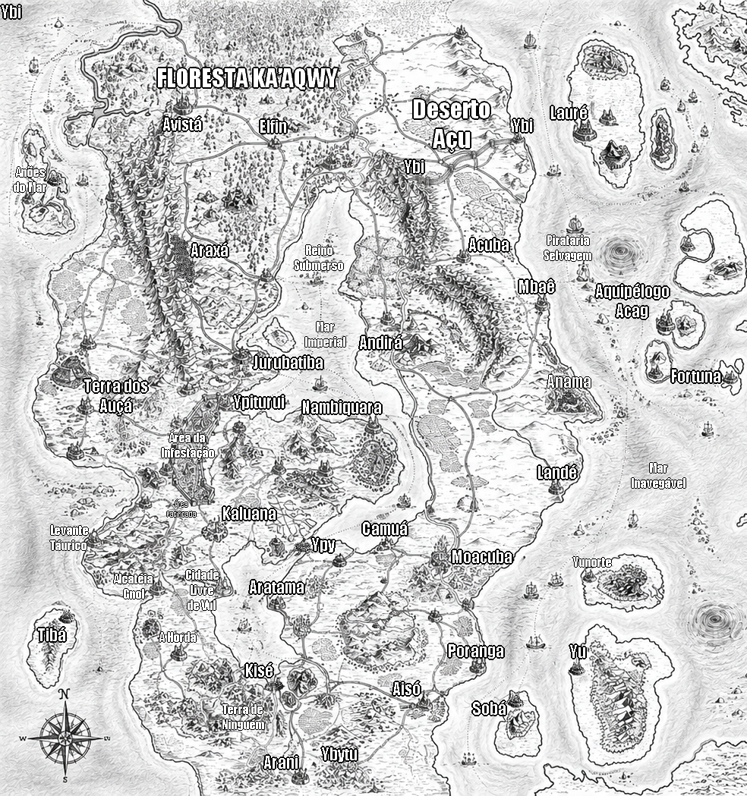

# Wiki Arcano & Airy

Nas fronteiras deste mundo há muitos perigos, espécies e monstros que ameaçam a humanidade. A missão principal das brigadas de fronteira é derrotá-los e reprimilos. Pode-se trocar itens de monstros, como garras e chifres a um preço alto. Esses itens geralmente são usados por magos para canalizar suas magias.

*Clique no nome de um reino ou região para abrir a página.*

---

[Introdução](introducao.md)

- [Lore e Cosmologia](lore/index.md)
- [O Mundo](mundo/index.md)
- [História](historia/index.md)
- [Povos](povos/index.md)
- [O Império](imperio/index.md)
- [Reinos e Cidades fora do Império](reinos/index.md)
- [Facções](faccoes/index.md)
- [Personagens](personagens/index.md)
- [Ameaças](ameacas/index.md)
- [Artefatos](artefatos/index.md)
- [Magia](magia/index.md)
