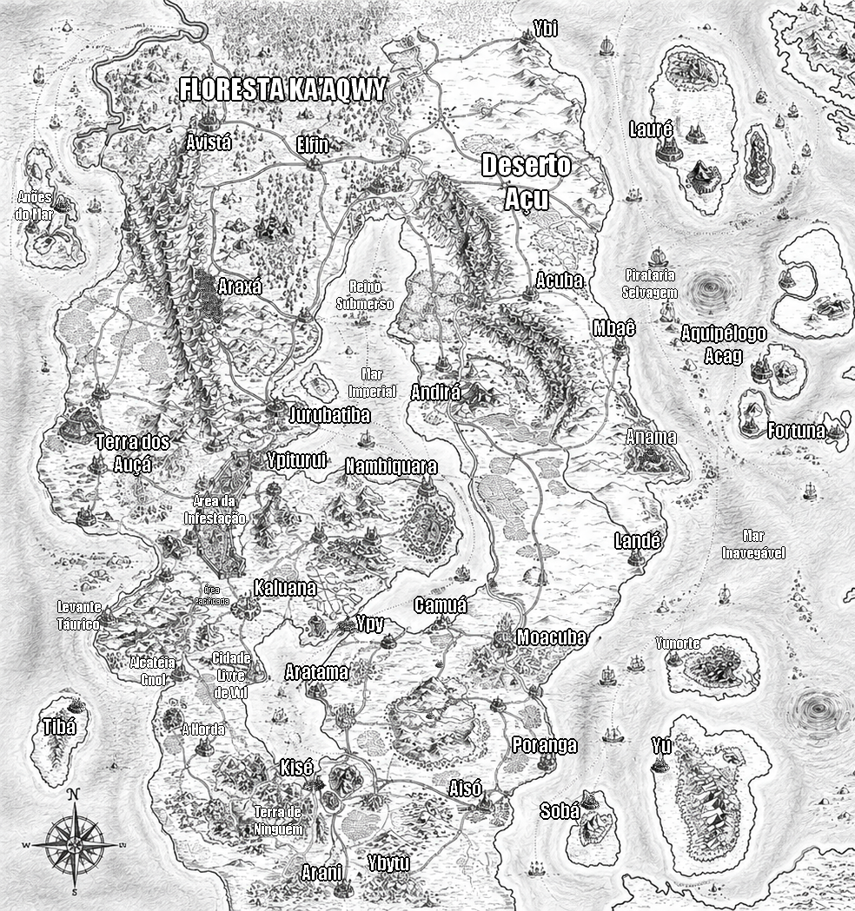

# O Mundo

Uma Volta pelo mundo. No coração do continente fica o Império Aba, onde o Espécie dos Aba (os humanos deste mundo) vivem em toda a sua plenitude e de cadência. Ao Norte ficam as Montanhas Beniti, lar do último refúgio dos orgulhosos Akitã (Anões), mais além fica a Floresta Proibida lar dos Abaré (Elfos), que vivem na sua cidade nas copas das árvores [Elfin](../reinos/elfin.md). A Leste fica o deserto, onde homens e monstros disputam os poucos recursos, seus principais Reinos são Landé, o Reino Portuário, Yby, reino do magos especialistas em controle do Fogo e Terra e [Mbaê](../reinos/mbae.md), Reino de uma semi-deusa imortal, mais além entre o deserto e o mar vivem os Kaapora (Halflings) nas suas casas construídas dentro das colinas, sua principal cidade é [Anama](../reinos/anama.md). Ao Sul ficam as terras geladas, e os perigosos [Montes Brancos](montes-brancos.md), picos habitados por monstros poderosos e pequenos reinos humanos, seus principais reinos são [Arani](../reinos/arani.md) e [Ybytu](../reinos/ybytu.md) pequenos mas resistentes como como uma rocha no inverno. Ao Sudoeste, ficam [Terra Selvagem](terra-selvagem.md), onde antigamente viviam orgulhosamente os Abaré  e os Akitã, mas agora é habitado por Abaité e os Anaiti (Meio-Gigantes). A Oeste fica a area da Infestação, uma área com extensão de mais de 1000 km² que surgiu após um mago Extremamente poderoso abusar do uso das Trevas no local. Para lá da Infestação ficam as Terras dos Auçá, um Espécie de homens extremamente militaristas que tem um fortíssimo exoesqueleto que os deixa parecidos com homens de armaduras completas. A Noroeste ficam as Cordilheiras Atã, uma cadeia de montanhas que corta o continente ao meio e serve de limite natural entre as Terras dos Auçá e a Floresta Proibida.

Um aspecto importante dessas cordilheiras é que elas são na verdades uma cadeia de milhares de ilhas voadoras onde vivem os Abaquar, que são um Espécie descendente de Anjos, que não envelhecem nem adoecem, sua principal cidade e mais acessível aos homens é Araxá, a mítica cidade situada em ilhas voadoras ligadas apenas por escadas de corda. Mais a nordeste ainda fica Avista, a cidade proibida dos Piquira (Gnomos), uma cidade flutuante em que abriga a mais avançada tecnologia de Airy.

Airy é um continente muito grande e como tal existem muitas ilhas aos seu redor, algumas são habitadas por humanos, outros por espécies muito diferentes da humanidade, a Sudoeste, fica o continente de Yu, lar de um Espécie de homens de traços orientais (o equivalente ao japão em Airy). Ao Leste do continente fica a cidade Pirata Fortuna, refúgio dos piratas, uma nação sem lei que é procurada por muitos que desejam conseguir dinheiro fácil. A Noroeste do Continente fica o Arquipélago Acag, lar dos misteriosos Yawara, um Espécie de homens com traços de animais, que tem como seu líder um Homem Leão.

No outro lado do continente a Sudoeste, perto da Terra Selvagem fica a ilha de [Tibá](../reinos/tiba.md) também com sua capital Megalópia, a ilha de onde os gigantes foram originados, nesta ilha todas as criaturas têm tamanhos muito maiores do que o normal, desde insetos gigantes até mamíferos colossais, o que se destaca nessa ilha, o Espécie dos FormianosFormians (Homens Formiga), que criaram um império que domina metade do continente e tem planos para expandir seus domínios até o continente, eles pretendem fazer isso nem que seja a força guiados pelas sua ambiciosa Rainha.
