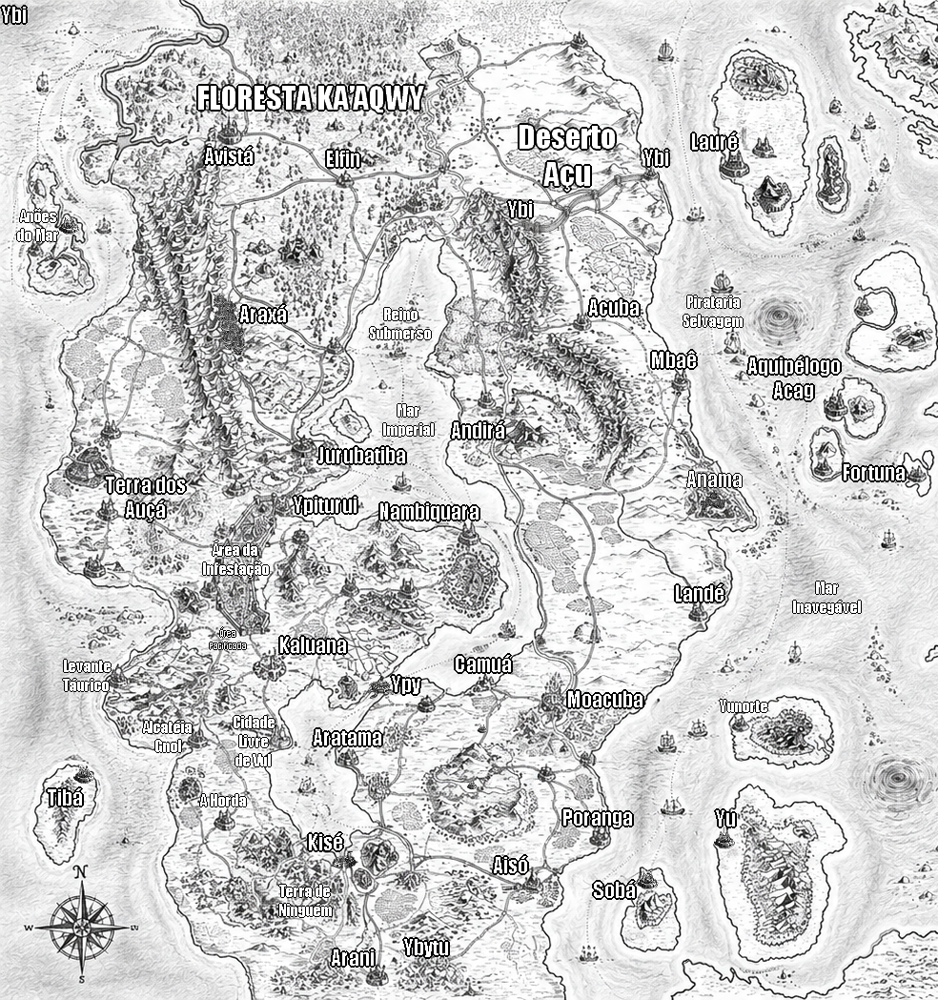

# Índice

<!-- INDICE:INICIO -->

- [Arcano & Airy — Início](#arcano)
- [Introdução](#introdução)
- **Lore e Cosmologia**
  - [O Mito da Criação](#o-mito-da-criação)
  - [Os Planos de Existência](#os-planos-de-existência)
- **O Mundo**
  - [Geografia](#geografia)
  - [O Mundo](#o-mundo)
  - [Locais de Interesse](#locais-de-interesse-no-mundo)
  - [O Templo do Conhecimento](#o-templo-do-conhecimento)
  - [Floresta Ka’aqwy](#floresta-kaaqwy)
  - [Mundo Interior](#mundo-interior)
  - [Deserto Açu](#deserto-açu)
  - [Montes Brancos](#montes-brancos)
  - [Terra dos Kaapora](#terra-dos-kaapora)
  - [Terra Selvagem](#terra-selvagem)
  - [As Ilhas](#as-ilhas)
  - [O Reino Submerso](#o-reino-submerso)
  - [Cidades Perdidas](#cidades-perdidas)
  - [As Ruínas de Ratanaba](#as-ruínas-de-ratanaba)
- **História**
  - [A Era do Esquecimento](#a-era-do-esquecimento)
  - [A Invenção de Arthur Áureo](#a-invenção-de-arthur-áureo-como-a-política-encontrou-um-deus-no-espelho)
  - [Linha do Tempo de Airy](#a-linha-do-tempo-de-airy)
    - [A Era dos Deuses](#a-era-dos-deuses)
    - [A Era dos Demônios](#a-era-dos-demônios)
    - [A Era dos Gigantes](#a-era-dos-gigantes)
    - [Era dos Akitã e Abaré - A Aurora dos Abaré e Akytã](#era-dos-akitã-e-abaré---a-aurora-dos-abaré-e-akytã)
    - [A Era dos Aba](#a-era-dos-aba)
  - [A Era do Império](#a-era-do-império--o-legado-de-áureo)
  - [Linha do Tempo de Aslareth](#linha-do-tempo-de-aslareth)
- **[Povos](#os-povos)**
  - [Humanos Aba](#os-humanos-aba)
  - [Elfos Abaré](#os-elfos-abaré)
  - [Meio-Elfos](#meio-elfos)
  - [Anões Akitã](#os-anões-akitã)
  - [Halflings Kaapora](#os-halflings-kaapora)
  - [Gnomos Piquira](#os-gnomos-piquira)
  - [Kemonos Yawara](#os-kemonos-yawara-1-ponto)
  - [Orcs Abaité](#os-orcs-abaité)
  - [Meio-Orc](#meio-orc)
  - [Licantropos](#licantropos)
  - [Meio-Gigantes Anaiti](#os-meio-gigantes-anaiti)
  - [Auçá](#os-auçá-1-ponto)
  - [Abaquar](#os-abaquar)
  - [Icamiabas](#as-icamiabas)
  - [Reptantes](#reptantes)
  - [Minotauros](#minotauros)
  - [Gnól](#gnól)
  - [Goblinoides](#goblinoides)
- **[O Império](#império)**
  - [Os Símbolos Imperiais](#os-símbolos-imperiais)
  - [A História do Império](#a-história-do-império)
  - [Organização Política](#organização-política)
  - [O Imperador](#o-imperador)
  - [A Corte](#a-corte)
  - [Relação dos Nobres com a Política](#relação-dos-nobres-com-a-política)
  - [Democracia](#democracia)
  - [Ministérios](#ministérios)
  - [Política do Império](#política-do-império)
  - [O Senado](#o-senado)
  - [O Plenário do Senado Imperial](#o-plenário-do-senado-imperial)
  - [O Paralelo Histórico](#o-paralelo-histórico)
  - [A Máquina de Propaganda Estatal](#a-máquina-de-propaganda-estatal)
  - [Cargos Públicos mais Importantes](#cargos-públicos-mais-importantes)
  - [O Trabalho no Império](#o-trabalho-no-império)
  - [A Educação no Império](#a-educação-no-império)
  - **[Reinos Vassalos](#reinos-vassalos)**
    - [Ypy](#ypy)
    - [Kisé](#kisé)
    - [Moacuba](#moacuba)
    - [Aratama](#aratama)
    - [Aisó](#aisó)
    - [Camuá](#camuá)
    - [Jurubatiba](#jurubatiba)
    - [Kaluana](#kaluana)
    - [Nambiquara](#nambiquara)
    - [Poranga](#poranga)
    - [Ypiturui](#ypiturui)
  - **[Estados Tampões](#estados-tampões-do-império)**
    - [A Área da Infestação](#a-área-da-infestação)
    - [A Terra dos Pistoleiros](#a-terra-dos-pistoleiros)
    - [A Terra de Ninguém](#a-terra-de-ninguém)
    - [Território Pacificado](#território-pacificado)
    - [Vale dos Condenados](#vale-dos-condenados)
- **[Reinos e Cidades fora do Império](#império-qual-império)**
  - [Reino dos Abaré](#reino-dos-abaré)
  - [Elfin](#elfin)
  - [Reino dos Abaquar](#reino-dos-abaquar)
  - [Reino dos Piquira](#reino-dos-piquira)
  - [Andirá](#andirá)
  - [Aslareth](#aslareth)
  - [As Cidades Livres](#as-cidades-livres)
  - [Vul](#vul)
  - [Os Magos das Trevas de Vul](#os-magos-das-trevas-de-vul)
  - [Fortuna](#fortuna)
  - [Ybytu](#ybytu)
  - [Arani](#arani)
  - [Tamaya](#tamaya)
  - [Mbaê](#mbaê)
  - [Ybi](#ybi)
  - [Acuba](#acuba)
  - [Anama](#anama)
  - [As Terras dos Auçás](#as-terras-dos-auçás)
  - [Lauré](#lauré)
  - [Tupãsununga](#tupãsununga)
  - [Yu](#yu)
  - [Tibá](#tibá)
  - [Sobá](#sobá)
- **Facções**
  - [Outras Guildas e Facções](#facções)
  - **[Ordem dos Arcanos Imperiais](#a-ordem-dos-arcanos-imperiais)**
    - [Cargos da Organização](#cargos-da-organização)
    - [Títulos Honorários](#títulos-honorários)
    - [Sam-Mael, o Quartel General](#sam-mael---o-quartel-general-dos-arcanos-imperiais)
    - [Locais Notáveis](#locais-notáveis)
    - [Personalidades Notáveis](#personalidades-notáveis)
  - **[Os Cavaleiros](#os-cavaleiros)**
    - [Origens e Propósito](#origens-e-propósito)
    - [Rito do Selo da Alma](#2-rito-do-selo-da-alma)
    - [Regimento da Vigília Escarlate](#regimento-da-vigília-escarlate)
    - [Regimento da Ossaria Silenciosa](#regimento-da-ossaria)
    - [Regimento do Fôlego Infernal](#regimento-cavaleiros-do-fôlego-infernal)
    - [Regimento do Limiar Abissal](#regimento-cavaleiros-do-limiar-abissal)
    - [Regimento da Aurora Fendida](#regimento-cavaleiros-da-aurora)
    - [Regimento dos Intendentes de Ossavermelha](#regimento-dos-intendentes)
    - [Treinamento dos Cavaleiros](#treinamento-dos-cavaleiros)
- **[Ameaças](#ameaças-de-arcano)**
  - [Misty As-La](#misty-as-la)
  - [Eligos, o Primeiro Duque do Inferno](#eligos-o-primeiro-duque-do-inferno)
  - [Vlad Dracul, o Mago das Trevas Vampiro](#vlad-dracul-o-mago-das-trevas-vampiro)
  - [Perigos Regionais](#perigos-regionais)
  - [A Legião Goblinóide](#a-legião-goblinóide)
  - [A Horda de Orcs](#a-horda-de-orcs)
  - [O Levante Táurico](#o-levante-táurico)
  - [A Alcatéia Gnól](#a-alcatéia-gnól)
  - [Fauna de Airy](#fauna-de-airy)
- **[Artefatos](#artefatos-de-arcano)**
  - [Aliados Conjurados](#aliados-conjurados)
  - [As Armaduras Lendárias](#as-armaduras-lendárias)
  - [Veículos](#veículos)
- **[Magia](#lista-de-magias)**
  - [Magias](#magias)
  - [Escola Física](#escola-física)
    - [K / X — Impacto, ação direta e manipulação física](#k--x--impacto-ação-direta-e-manipulação-física)
    - [EN / ON — Movimento e fluxo](#en--on--movimento-e-fluxo)
    - [KUN — Explosões](#kun--explosões)
    - [IR — Persistentes/Sustentados](#ir--persistentessustentados)
  - [Escola Alquímica](#escola-alquímica)
    - [ETH — Transformação](#eth--transformação)
    - [ESH — Conjuração e manifestação](#esh--conjuração-e-manifestação)
  - [Escola Natural](#escola-natural)
    - [AYA — Vida, biologia e regeneração](#aya--vida-biologia-e-regeneração)
    - [VOK — Invocações](#vok--invocações)
  - [Escola Abstrata](#escola-abstrata)
    - [ECH — Ondas, informação e mente](#ech--ondas-informação-e-mente)
    - [Vhaurechaya](#vhaurechaya)
    - [OR — Espaço e deslocamento](#or--espaço-e-deslocamento)
    - [EL — Ilusão e percepção](#el--ilusão-e-percepção)
    - [THAR — Tempo](#thar--tempo)
  - [Anti-Fonemas](#anti-fonemas)
  - [Novas Magias](#novas-magias)
- **Fora da wiki** (material de apoio, não publicado no site)
  - [IDEIAS](#ideias)

<!-- INDICE:FIM -->

# **ARCANO**

Nas fronteiras deste mundo há muitos perigos, espécies e monstros que ameaçam a humanidade. A missão principal das brigadas de fronteira é derrotá-los e reprimilos. Pode-se trocar itens de monstros, como garras e chifres a um preço alto. Esses itens geralmente são usados por magos para canalizar suas magias.

# **Introdução**

O Império é uma vasta e decadente nação, governada por uma elite política imperial que se agarra ao poder com unhas e dentes. Esse regime opressor mantém sua soberania por meio de uma combinação sufocante de estagnação científica e tecnológica, regressão intelectual e uma profunda xenofobia, mergulhando sua população na ignorância. A sociedade é mantida sob controle através da manipulação da informação, onde todas as notícias do império é rigidamente controlada, que reforça o poder e alimenta o culto às autoridades estatais.

A humanidade, sob esse regime totalitário e corrompido, vive em um estado constante de medo e submissão. O Império, embora desmoronando por dentro devido à corrupção e à ineficácia de seus líderes, ainda mantém a ilusão de poder por meio da opressão brutal. A repressão é acompanhada de uma guerra de propaganda, onde o governo se posiciona como a única barreira entre a civilização e o caos representado por inimigos externos e internos. Nesse cenário, não há vilões "menores" ou "menos piores" — o Império e suas ameaças são duas faces de uma mesma moeda cruel e implacável.

A força militar principal do Império é o Exército Imperial, uma organização massiva de soldados que defendem territórios estratégicos e respondem a crises nas fronteiras e além. Esses homens e mulheres são usados como bucha de canhão em guerras constantes pela sobrevivência humana, lutando contra espécies monstruosos, rebeldes e outras ameaças externas. Cada perda no campo de batalha tem um impacto profundo, pois a população já é duramente oprimida e enfraquecida por uma vida de servidão ao estado.

Paralelamente ao Exército Imperial, existem os temidos Arcanos Imperiais, organização que funciona como uma polícia secreta do império. Sua missão é eliminar qualquer ameaça que possa desafiar a estabilidade do regime — sejam traidores, monstruosidades, demônios ou espécies monstruosos. Os Arcanos são especialistas em infiltração e controle social, operando nas sombras e instilando terror na população com sua autoridade ilimitada. Nenhuma autoridade, nem mesmo os reis subordinados ao Império, ousa questionar suas ações, pois eles respondem apenas ao próprio imperador.

Apesar de seu aparato de controle militar e político, o Império enfrenta uma era de decadência e recessão. A inovação foi sufocada, a tecnologia estagnou e a cultura intelectual regrediu, tudo devido ao esmagador peso do estado sobre os indivíduos. Burocracia, corrupção e um senso paralisante de impotência permeiam todas as instituições, sufocando qualquer esperança de progresso ou renovação.

Ao mesmo tempo, o Império luta desesperadamente contra forças externas e internas que ameaçam constantemente sua sobrevivência. As Terras Selvagens, um território habitado por espécies monstruosos xenofóbicos, lançam ataques incessantes na tentativa de destruir o que resta da humanidade. Além dessas ameaças, há criaturas infernais e demônios vindos dos Planos Inferiores, corrompendo tudo o que tocam, trazendo as Trevas para infectar o mundo dos homens em troca de poder.

Por mais que o Império seja brutal e decadente, ele é a última linha de defesa da humanidade. Apesar de todas as suas falhas, sua burocracia sufocante e sua corrupção desenfreada, ele ainda se apresenta como o único bastião contra a extinção iminente. Enquanto o Império resiste, ele mantém a humanidade à beira do abismo, enfrentando o caos com um sistema de controle tão tirânico quanto às ameaças que o cercam.

**Airy: Um Mundo de Perigos Inimagináveis**

Em Airy, um mundo dominado pela selvageria, a existência de cidades e vilas é uma façanha, protegidas apenas por suas imponentes e fortificadas muralhas. Aventurar-se além destas barreiras representa um desafio mortal; somente os excepcionalmente valentes ou incrivelmente insensatos ousam tal empreitada. Aberrantes monstros e implacáveis saqueadores percorrem as vastas planícies, caçando viajantes incautos, enquanto perigos indizíveis espreitam aqueles que possuem a audácia de explorar.

Vocês podem se questionar sobre a razão de tamanha periculosidade além das muralhas. A resposta jaz na Área da Infestação, epicentro de onde emanam horrores sem fim – monstros, aberrações e entidades sobrenaturais que assolam Airy. Dessa zona nefasta surgem criaturas grotescas, fruto da corrupção pelas Trevas, que antes eram seres comuns deste mundo.

Contudo, o perigo em Airy não se limita apenas às ameaças externas. Dentro das muralhas, monstros de outra natureza: oportunistas gananciosos, soberanos déspotas obcecados por poder, comerciantes inescrupulosos e funcionários públicos corruptos. Neste lugar, todos buscam tirar vantagem — desde o mendigo na esquina até o próprio governante. Virtudes como caridade, bondade e compaixão, embora ainda presentes, tornaram-se raridades, tesouros escondidos que não são encontrados sem uma busca diligente.

Airy é um mundo onde o perigo une-se à corrupção, desafiando seus habitantes a encontrar esperança em meio ao caos.

# **O MITO DA CRIAÇÃO**

No Princípio: Ordem e Caos, Arquitetos do Universo

No alvorecer da existência, apenas Ordem e Caos permeavam o vazio \- duas entidades supremas, sem gênero definido e de poder incomensurável. Embora fossem opostos, se consideravam as duas faces de uma mesma existência. A Ordem, com sua natureza metódica, deu forma ao universo, esculpindo estrelas, planetas e galáxias, enquanto Caos, com sua essência disruptiva, introduziu a separação espacial, criando abismos imensuráveis entre as criações.

Escolhendo os Planos Superiores, a Ordem batizou essa dimensão de Monte Celestial e a povoou com os Anjos, seres de pura perfeição. No plano intermediário, conhecido como Airy, Ordem gerou os Abaré, Espécie de seres cultos e sábios. Em contrapartida, Caos dominou os Planos Inferiores, dando origem ao Inferno, um reino de tormento habitado por Demônios, nascidos de Anjos que sucumbiram à corrupção. Em Airy, Caos criou os Abaité, descendentes degenerados dos Abaré, marcados pela violência e perversidade.

A dinâmica entre criação e corrupção persistiu por eras indefinidas, com Ordem e Caos gerando existências que pendiam ligeiramente para suas próprias essências, até finalmente chegarem a um consenso. Desse entendimento, nasceram os Aba, um Espécie concebido pela fusão harmoniosa de Ordem e Caos com o intuito de alcançar um equilíbrio perfeito entre bem e mal, ordem e desordem. Constatado o sucesso desta criação equilibrada, decidiram cessar o surgimento de novos Espécie.

Os deuses, então, perceberam o impacto de suas interferências diretas em Airy. Ordem enviava frequentemente seus anjos poderosos em resposta aos apelos das criaturas mortais, o que, por sua vez, dava a Caos a justificativa para inundar o plano material com seus demônios, levando-o a atos abomináveis. Reconhecendo o ciclo destrutivo de suas ações, estabeleceram um novo pacto, limitando sua influência ao plano espiritual e conferindo dons divinos apenas aos seus devotos mais fervorosos.

Ainda assim, em momentos críticos da história, Ordem e Caos continuaram a enviar seus emissários a Airy, mantendo uma presença velada e influenciando por baixo dos panos os acontecimentos mundanos. Com o passar das eras, ambos os deuses se surpreenderam com o potencial inerente ao bem e ao mal em suas criações e, desapontados com a evolução inesperada das mesmas, começaram a se distanciar do mundo material. Este afastamento gradual culminou em sua retirada completa, permanecendo apenas em sua contenda etérea. A partir dessa decisão, suas interações com o mundo passaram a ser exclusivamente através de sutis conselhos concedidos aos mais leais servos, enquanto Ordem e Caos se enclausuravam em sua disputa pessoal imortal.

**A MAGIA NO MUNDO E A CORRUPÇÃO**

Ordem e Caos foram nomeados por seus filhos, Ordem foi chamada pelos Abaré de Anhum, pois seus Anjos chegavam cantando e emanando felicidade e esperança para todos no Plano Material. Já Caous foi chamado de Tenemur pois seus emissários os Demônios eram temidos por todos.

A Ordem orgulhosa da sua criação os Abaré, os ensinou a sua mais nobre arte, a Magia, Caos com muita raiva, pois sua primeira criação não seria capaz de dominar tal arte, criou as Trevas, um poder que potencializava a criação de seu irmão e conseguia deixar criaturas com menor capacidade mágica com poderes equivalentes, mas a um preço, a cada utilização as Trevas consumiam a vida das proximidades para alimentar esses poderes.

Depois de algumas eras quando a humanidade já havia se multiplicado muito e seu número era na casa de milhões. Um homem notou o verdadeiro potencial que tinha nas suas mãos, ele poderia ser superior aos deuses, munido de seu poder mágico e persuasão ele tentou se apoderar de todo o mundo para si.

Sua empreitada durou toda a sua vida, mas ele não era imortal como os deuses, sua vida estava no fim e ele não tinha esperança de alcançar os seus objetivos, e num ataque desesperado, confrontou pessoalmente os deuses, essa batalha durou muito tempo, até que o homem pereceu sendo morto pelo próprio caos um dos seus pais. Como recompensa este homem se tornou um dos Duques do Inferno dos Aba nos Planos Inferiores a serviço do Caos.

Gostando do resultado após promover um poderoso Aba para Duque do Inferno numa das camadas dos Planos Inferiores, Tenemur fez isso para todas os espécies de Airy, tendo cada Espécie um Duque do Inferno para o representar e comandar um dos Planos Inferiores.

Até então, nos Planos Inferiores, não existiam outros habitantes que não fossem demônios, mas estas promoções que Tenemur fez a habitantes do Plano Material, mexeu com o equilíbrio de poder de todas as camadas do inferno e estes Duques do Inferno oriundos da terra se tornaram muito poderosos e com sede de poder e começaram a invadir o Plano Terreno com mais frequência. Então Anhum e Tenemur tentando remediar a situação fizeram um acordo com os novos Duques do Inferno, eles e os outros Duques do Inferno ficariam nos Planos Inferiores e eles teriam cada um o seu reino que seria uma camada do Inferno, onde eles poderiam punir almas de pessoas do Plano Material, mas apenas as pessoas malvadas e malignas que faziam maldades no seu mundo e após sua morte teriam suas almas tragadas para o inferno e seriam punidas no pós vida pela eternidade. Mas novamente os Duques do Inferno se mostraram ardilosos, e a medida que estas almas eram punidas no inferno, elas também começavam a ser tão corrompidas que se tornavam demônios também, e algumas almas, agora transformadas em demônios se tornaram tão poderosas que ascenderam na hierarquia infernal e algumas até conseguiram derrotar alguns Duques do Inferno e se tornar eles mesmos Duques do Inferno dominando uma camada do inferno.

Com estas criações corrompidas inesperadas o exército do inferno tornou-se cada vez maior e mais poderoso. E os Duques do Inferno se tornaram cada vez mais ardilosos e começaram a não só capturar almas malignas para o seu exército, mas também tentar as pessoas do plano material através de pactos, comprando a alma de quem estivesse  estivesse querendo mais poder ou em necessidades, usando assim os sete pecados capitais avareza, gula, inveja, ira, luxúria, preguiça e soberba, para atrair almas para o inferno.

**A DISPUTA ENTRE ORDEM E CAOS**

A Era dos Demônios e o Nascimento dos Dragões

Ordem e Caos sempre mediram forças em um embate de poder e criatividade, cada um buscando superar o outro. Esta rivalidade deu origem a uma era de equilíbrio precário, mas, infelizmente, suas criações ficaram à deriva, vulneráveis às investidas do mal. Esta fase turbulenta da história ficou conhecida como a Era dos Demônios, caracterizada por invasões constantes das hordas infernais ao Plano Material.

Os Anjos, servos leais da divindade da Ordem, recordaram-se de uma época em que descendiam ao mundo para socorrer aqueles em profundo sofrimento, por ordem de Anhum. Diante da devastação causada pelos Demônios, alguns destes seres celestiais, movidos por um ímpeto heroico, decidiram intervir em Airy sem esperar ordens expressas, mergulhando no Plano Terreno para estender sua proteção aos mortais.

Consciente da audácia dos anjos, os deuses Anhum e Tenemur uniram-se uma última vez para criar os Dragões, seres de força incomparável, encarregados de expurgar as hordas demoníacas de volta ao abismo. Graças à intervenção dessas majestosas criaturas, a ordem foi parcialmente restaurada. Muitos Anjos foram acolhidos de volta ao Monte Celestial por Anhum, mas alguns escolheram permanecer em Airy, vigiando o plano material e, consequentemente, perdendo sua divindade para tornarem-se Anjos caídos.

Contudo, os Dragões mostraram-se uma força quase incontrolável, até mesmo para seus criadores, desencadeando uma guerra celestial de proporções épicas entre o Monte Celestial e os Planos Inferiores. Este conflito, alimentado por eras, demandava constantemente novos soldados. Os Planos Inferiores recorriam às almas corrompidas, transformadas em guerreiros da legião infernal, enquanto o Monte Celestial empregava seus Anjos e almas voluntárias de virtuosos que haviam partido deste mundo.

O campo de batalha deste eterno embate situa-se no Plano Transitório, mais especificamente na Antessala do Inferno — o limiar entre o inferno e os demais planos existenciais. Aqui, as forças celestiais e demoníacas travam uma luta incessante pela supremacia. Sem a bravura angelical, o multiverso já teria sido consumido pelo caos das legiões infernais.

Com o foco dos Anjos e Demônios voltado para esta batalha apocalíptica, a interferência nos assuntos do Plano Material diminuiu consideravelmente, uma evolução que agradou aos deuses. Anhum e Tenemur, observando a guerra à distância, incentivam essa luta contínua, permitindo que suas outras criações menos belicosas possam experimentar uma existência mais pacífica. Neste cosmos agitado pela guerra, a paz para as criações mais gentis em Airy torna-se um objetivo distante, porém essencial, aos olhos divinos.

**Em Airy os Semideuses Estão Entre Nós**

No mundo de Airy, existem indivíduos dotados de poderes extraordinários, conhecidos como os Ressureitos. Entre eles, há os que parecem meramente humanos, indivíduos que desafiam o conceito da mortalidade — incapazes de perecer, desafiando toda e qualquer tentativa de serem levados à morte definitiva. Outros entre esses seres possuem domínios mágicos colossais, fruto de séculos de dedicação e estudo, permitindo-lhes viver vidas que se estendem por eras. Alguns desses semideuses são venerados como deidades, recebendo adoração e reverência, enquanto outros são tidos como descendentes divinos. No entanto, o véu de mistério que encobre suas verdadeiras origens permanece intocado, até mesmo para os próprios Ressureitos, cuja essência e propósito real são enigmas.

Por padrão, todos os personagens que possuem a vantagem de serem Imortais são categorizados como Ressureitos e, por esta razão, tornam-se alvos dos Arcanos Imperiais. Essa caçada perpetua um ciclo de tensão e intriga, pois os Ressureitos navegam pelo delicado equilíbrio entre sua existência eterna e o perigo constante imposto pelos seus perseguidores.

Em Airy, a linha que separa mitos de realidade se torna turva, e os Ressureitos caminham entre os mortais, encapsulando tanto o divino quanto o desconhecido.

Os Intocáveis representam o extremo oposto da sociedade mágica de Airy, pois são desprovidos de qualquer resquício de magia em seus corpos e até mesmo cancelam os efeitos mágicos ao seu redor. Esses indivíduos são destinados a vidas de privação e sofrimento, incapazes de desfrutar dos poderes mágicos que permeiam uma sociedade focada na magia. Em vez disso, muitos deles vivem à margem da sociedade, sendo expulsos de lugares públicos e relegados à condição de mendigos.

Para os Intocáveis, cada dia é uma batalha contra o estigma e a exclusão. Muitos são vistos como uma ameaça pelos praticantes de magia, temidos pelo simples fato de anularem os poderes mágicos ao seu redor. Como resultado, são frequentemente marginalizados e ostracizados, incapazes de encontrar emprego ou abrigo entre os membros da sociedade mágica.

Aqueles que conseguem se estabelecer muitas vezes vivem em comunidades isoladas, onde formam laços com outros Intocáveis e tentam encontrar maneiras de sobreviver sem depender da magia. No entanto, mesmo nesses grupos, a vida é difícil e muitas vezes desesperadora, com recursos limitados e poucas oportunidades de melhoria.

Alguns Intocáveis tentam encontrar sentido em suas vidas buscando propósito em causas sociais ou religiosas, enquanto outros sucumbem à desesperança e à amargura, perdendo a fé na sociedade que os rejeitou. No entanto, apesar de sua condição adversa, os Intocáveis são resilientes e demonstram uma força impressionante diante das adversidades que enfrentam.

**Deuses e Religião em Arcano**

“Luz demais cega os olhos.

Som demais ensurdece.

A gula corrompe.

A paixão desmedida perturba.

A cobiça devora a mente e a ética.

O sábio mantém a alma

entre o excesso que destrói,

a medida que a eleva.”

“A virtude deve ser praticada o vício se propaga por inércia.”

Em Arcano, a essência da existência gira em torno da moderação e do excesso: tudo que excede a medida corrompe a alma, enquanto a moderação conduz à ascensão. Essa dualidade permeia toda a cosmologia, desde os Primordiais até as criaturas do Plano Material.

Estudiosos teológicos chegaram a um consenso sobre os semi-deuses de Airy. Essas entidades são geralmente classificadas como criaturas extremamente poderosas, dotadas de inteligência superior, sabedoria plena, imortalidade temporal, grande resiliência e resistência física. Uma criatura que reúna todos esses atributos torna-se um semi-deus, estando apenas um passo da divindade plena.

A classificação das divindades segue hierarquias precisas:

**Deuses Menores:** imperfeitos, falíveis, cujas escolhas revelam suas limitações e fraquezas humanas.

**Deuses:** mais poderosos já se mudaram e tem um reino no Plano Superior ou Inferior, mas ainda sujeitos a falhas; refletem a imperfeição mesmo em níveis elevados de divindade.

**Primordiais:** criadores supremos, entidades de infalibilidade absoluta, cujas decisões nunca estão erradas e cujas ações moldam toda a realidade.

Os Primordiais são dois, e juntos deram origem a tudo o que se conhece: os planos, a matéria, a vida em Airy. No entanto, os teólogos não concordam sobre qual surgiu primeiro: os Primordiais ou os planos que eles habitam. Uma verdade inegável é que da união desses dois deuses surgiram o Plano Material, o mundo físico onde vivem as criaturas mortais.

Ainda assim, há quem diga que os Primordiais esqueceram o Plano Material, morreram, despareceram ou talvez simplesmente não se importem com ele. Alguns teólogos vão mais longe e questionam até mesmo se eles já existiram.

As almas das criaturas do Plano Material são preenchidas com a energia divina dos Primordiais, uma força emprestada que retorna aos Planos Primordiais assim que a vida termina. Este ciclo conecta o Plano Material à eterna guerra entre os Primordiais, cujo campo de batalha é a própria união dos planos alma das criaturas do Plano Material, servem de munição nesse conflito cósmico.

O Plano do Caos e suas entidades confrontam incessantemente o Plano da Ordem. Cada Primordial tenta conquistar mais almas para seu lado:

Caos corrompe as almas pelo excesso, buscando expandir seu domínio.

Ordem mantém o equilíbrio, defendendo o Plano Material das influências corruptoras.

O resultado é um jogo sombrio e incessante, no qual entidades do Caos tentam incessantemente invadir o Plano Material, enquanto as forças da Ordem protegem os habitantes, garantindo que a moderação prevaleça.

O Primordial da Ordem reina no Plano Superior, o reino da moderação, onde se origina a magia ordeira e o equilíbrio entre fé e razão mantém a alma ligada à sua fonte superior.

O Primordial do Caos governa o Plano Inferior, o reino dos excessos e da corrupção, onde toda coisa é distorcida pelo descontrole e pelo excesso, em oposição direta à ordem do plano superior.

No início, apenas os Primordiais existiam. Mas entre as criaturas do Plano Material, algumas receberam a centelha divina, transformando-se nos primeiros Ressureitos. Esse foi considerado pelos estudiosos como o primeiro passo rumo à divindade.

Com o tempo, esses seres evoluíram, adquirindo poder, inteligência, resiliência e resistência física. Ao final de sua ascensão, tornaram-se semi-deuses depois, deuses, escolhendo migrar para o plano da Ordem ou para o plano do Caos, normalmente aquele que lhes concedeu a centelha divina.

Assim, o ciclo da existência e da divindade se mantém: almas mortais alimentam o conflito eterno dos Primordiais, enquanto o equilíbrio entre moderação e excesso guia os destinos de todos os seres em Arcano

**O Culto Imperial**

No coração do Império, a religião oficial é o Culto Imperial, uma instituição tão vasta e inflada quanto o próprio estado. Serve tanto para inspirar fé quanto para exercer controle absoluto sobre a população, legitimando a autoridade imperial e mantendo a burocracia inchada, corrupta e opressora. É a religião oficial do Império onde mais nenhuma é tolerada.

Os Arcanos Imperiais agentes da Ordem e os Cavaleiros Imperiais — descendentes dos antigos Cavaleiros de Aslareth — são os grandes paladinos desse culto, proclamando-se Defensores do Plano Material. Em sua retórica, a proteção do mundo mortal se dá pela união de dois conceitos da Verdade Imutável: a superioridade do modo de vida imperial e o perigo representado pelos hereges e dissidentes e usuários da Trevas.

A fé no Culto Imperial é apresentada como escudo contra os poderes do Caos, mas, na prática, serve para manter o império inchado, burocrático e corrupto, intacto por gerações. Entre os preceitos inabaláveis do culto, destacam-se:

**Anhun, deus da Ordem, é o único deus verdadeiro, e o Imperador é sua manifestação no Plano Material, independente das crenças antigas ou da fé pessoal dos cidadãos todos são perdoados ao seguir o Culto ao Imperial.**

**Purgar os hereges:** todos que se opõem ao Império, que manipulam as Trevas ou que desafiam a ordem imperial devem ser destruídos; atenção especial é dada a outros Espécies e às Criaturas das Trevas.

**A humanidade como servo da ordem divina:** todo cidadão tem um lugar designado na hierarquia do culto, obedecendo à vontade de Anhun e do Império.

**Obediência absoluta:** a autoridade imperial e seus superiores não podem ser questionados, e o cumprimento das ordens é considerado ato de fé.

**A partir desses princípios, surgiu a Inquisição Imperial:** a cruzada oficial do Império, utilizando os preceitos do culto para manter a unidade do estado e eliminar toda resistência. Ela atua como a mão armada da fé, transformando crença em medo e fé em controle. Seus executores são principalmente os Arcanos Imperiais, que perseguem inimigos de natureza mágica e os Cavaleiros Imperiais que perseguem inimigos mundanos. As duas Ordens são na pratica inquisidores, embora não sejam chamados assim.

Por trás da fachada do culto, o Imperador é apenas um fantoche, uma criatura sem vontade própria, símbolo vazio que legitima a dominação do Estado. Assim, enquanto o povo se curva à fé, o império continua a expandir territórios, acumular poder e enriquecer suas elites, mantendo o ciclo de opressão, corrupção e fanatismo religioso intacto.

**MAGIA DESTRÓI O MUNDO**

A prática imprudente de magia por Misty As-La deixou os governantes de Airy alarmados. Após anos de conflito intensificado pelo uso indiscriminado de feitiços, M.A.L. rompeu o véu entre as realidades e abriu uma fenda para os planos Inferiores de onde surgiu a corrupção da Área Infestada: uma vastidão de terra devastada que se estende por mais de mil quilômetros de comprimento e cerca de dez quilômetros de largura. Esse local maldito, onde as sombrias energias invadiram o mundo de Airy, corrompe tudo que encosta, transformando a região numa extensão dos Planos Inferiores e tornando-se um ponto de irrupção para criaturas de dimensões obscuras.

Normalmente, a conjuração mágica em Airy requer que um mago canalize sua própria energia vital para realizar feitos extraordinários. Entretanto, há aqueles que, seduzidos pelo poder proibido, recorrem às Trevas – quer seja através de antigos Grimórios das Trevas ou pela instrução de um conjurador das sombras. Esse sombrio conhecimento permite aos magos acessar energia de um plano existencial completamente diferente. Tragicamente, essa energia alienígena tem um efeito devastador sobre o ambiente: mesmo a mais simples das magias pode comprometer a vida de um local por semanas ou meses, tornando-o inabitável para a flora ea fauna, levando-os a adoecer, perecer ou sofrer mutações mágicas severas. Em muitos casos, a ativação de um feitiço das trevas custa a vida de um ser do Plano Material, sacrificado para permitir a transferência dessa maligna energia mágica para Airy.

Descortinando o perigoso impacto destas práticas, instituiu-se uma rigorosa restrição ao uso da magia das Trevas. Compreende-se agora que as Trevas são uma forma de energia alienígena predatória de outros planos que ameaça Airy, funcionando quase como um câncer expansivo, ameaçando consumir a essência positiva que anima o mundo de Airy.

**A Mana**

Mas existe ainda o Poder um resquício da antiga magia que existia no mundo e é parte integrante da alma de cada indivíduo, alguns têm tanta intimidade com a seu Poder interior, ele se chama Mana, com a sua alma que podem retirar essa energia e usá-la para fazer coisas sobrenaturais e sobre-humanas. E claro para conjurar mágicas, de forma segura que não destrua o mundo. As regras que alimentam as vantagens do 3DeT Victory são a Mana de Arcano.

**UMA BREVE HISTÓRIA DO MUNDO ATÉ OS DIAS ATUAIS**

**Da Ascensão dos Dragões às Lutas Pelo Domínio em Airy**

Nos albores da história, após a expulsão dos demônios do plano material, uma era de florescimento se inaugurou, protagonizada pelos Dragões, seres de poder incomparável, forjados para combater as hordas infernais. Dominantes, governaram o plano material e recrutaram os Abaquar, descendentes angélicos, como guerreiros na eterna batalha contra as Trevas. Com o tempo e após demonstrarem extraordinária maestria em magia, os Abaquar conquistaram a igualdade aos olhos dos Dragões e foram libertados, marcando o início de uma nova ordem.

Entretanto, a tranquilidade foi passageira; dos escombros da guerra emergiram os Gigantes, seres formidáveis que escravizaram Abarés e Akitãs para edificar suas imponentes cidades. Os Dragões remanescentes em Airy, não suficientemente poderosos para seguir seus congêneres rumo às terras mitológicas além mar, encontraram nos Gigantes parceiros improváveis, originando os Anaiti, um Espécie híbrido de força e esplendor sem par. Por milênios, floresceram, construindo civilizações de grande magnificência. Todavia, sua glória foi efêmera, pois uma enfermidade mágica — um legado da malevolência de um Gigante, Baltir — precipitou sua queda rumo à barbárie.

Nesse período de declínio, a figura sombria do primeiro Lich de Airy, uma criatura draconiana detentora de mágicas ancestrais, emergiu, solidificando seu lugar na eternidade. Entretanto, a reaparição dos demônios, na ausência dos magnânimos Dragões, mergulhou o mundo em uma nova era de desespero. Os Gigantes, em um gesto derradeiro de defesa, tentaram conjurar um ritual para salvaguardar suas metrópoles — um esforço condenado ao fracasso que resultou no primeiro cataclismo conhecido por Airy, transformando grandes extensões de terra em mar e isolando os Gigantes sobreviventes na ilha de Tibá.

Os Gigantes, agora numericamente reduzidos, viram os Abaré e Akitã escaparem de seus grilhões, erguendo civilizações avançadas que eventualmente colidiram na Guerra da Bigorna e do Martelo, um conflito de proporções apocalípticas. Os Akitã, graças à superioridade militar e tecnológica, prevaleceram, mas o custo foi a ruína de ambas as sociedades. Os Abaré retraíram-se em exílio, enquanto os Akitã recolhiam suas forças em Andirá sua última cidade fortaleza.

Porém, no cerne das antigas batalhas, os Aba, seres humanóides de menor estatura em magia, cultura e tecnologia, aproveitaram para aprender e evoluir a partir das ruínas das grandes civilizações. A posição subjugada anteriormente ocupada pelos Aba inverteu-se; a rápida sucessão de gerações permitiu-lhes superar os números e integrar os avanços e culturas perdidas pelas civilizações Abaré e Akitã. Agora livres da opressão, os Aba ascenderam, estabelecendo-se como a Espécie dominante no renovado mundo de Airy, moldando o futuro do mundo com sua inesperada ascensão à preeminência.

A ascensão dos Abá como a Espécie dominante de Airy é um exemplo notável de como mudanças demográficas e vantagens naturais podem moldar o curso da história. Sua rápida taxa de reprodução, combinada com a diminuição das populações do Espécie mais antigas, permitiu que os Abá se desenvolvessem e prosperassem sem a opressão dos Abaré e Akitã.

Enquanto os Akitã, apesar de sua longevidade e conhecimento, enfrentavam uma taxa de reprodução lenta, os Abá se multiplicavam em uma escala geométrica, aumentando seus números de forma exponencial ao longo do tempo. Essa disparidade na taxa de crescimento populacional inevitavelmente resultou na ascensão dos Abá como a Espécie dominante, uma vez que sua população rapidamente superou a dos outras ancestralidades.

Com sua crescente população e falta de competição de outros Espécie dominantes, os Abá puderam estabelecer seu domínio sobre Airy, criando cidades, desenvolvendo conhecimento e cultura, e assumindo o protagonismo do mundo. Essa ascensão meteórica dos Abá mostra como fatores demográficos podem ser cruciais na determinação do curso dos eventos históricos e na evolução das sociedades.

**A GUERRA DE MIL ANOS CONTRA AS CRIATURAS MONSTRUOSAS DA TERRA SELVAGEM**

Ascensão e Desafios do Império Aba

A transformação dos Aba de um povo nômade para o estabelecimento do império que agora predomina grande parte do mundo constitui uma mudança histórica que, aos olhos de um Akitã ou de um Abaré, equivaleria a uma única geração. Porém, para os Aba, este período representa vidas inteiras e gerações inumeráveis que trabalharam incansavelmente para edificar a rica diversidade cultural que define seu povo atualmente. Há cerca de 3000 anos, os Aba iniciaram a fundação de suas primeiras cidades, deixando para trás a vida nômade. Inspirados pelos vestígios da Guerra da Bigorna e do Martelo, aprimoraram suas técnicas em tecnologia, agricultura e engenharia, e embora de vida curtas em comparação aos seus antecessores mágicos, os Aba alcançaram uma proeza notável em magia.

A busca incessante por igualar-se em poder aos magos Abaré e Abaquar levou os Aba a explorar os planos inferiores, fazendo pactos com suas entidades obscuras. Este ato ousado trouxe à Airy a magia das Trevas, uma força há muito confinada ao reino demoníaco. No entanto, o uso dessas magias sobrenaturais veio com um custo severo. As fronteiras entre os mundos começaram a esmorecer, não por invasões demoníacas, mas por um convite voluntário das forças das trevas pelos habitantes de Airy. 

Essa era viu o surgimento de toda sorte de aberrações; magos transformando-se em vampiros, a criação de mortos-vivos e o aumento de magos Lichs, causando estragos incalculáveis. Os próprios Abaquar, que viveram milênios em pacífica reclusão, se alarmaram com as consequências dessa nova corrida pelo poder.

Da análise dessa sombria arte nasceu o primeiro Ressureito de Airy, Misty As-La. Sob sua liderança, os povos Aba foram unificados, porém sua subsequente desaparição abriu caminho para novas figuras tirânicas. Áureo I emergiu como um unificador, liderando o povo numa batalha contra as ameaças monstruosas que tentavam erradicar sua existência.

No vácuo de poder deixado pelo declínio dos Akitã e Abaré, vários espécies de ciclo de vida breve e prolífico se esforçavam por dominar novos territórios. Entre estas, emergiram ditadores sanguinários, preludiando uma era sombria de conflitos violentos e breves. Os Abaité, vindos do sul, e os Goblinóides e Minotauros, atacando de outras direções, pressionaram os Aba a uma união sob a liderança de Áureo I. Este liderou seu povo em campanhas militares que repeliram os invasores além do rio de Tupã, transformando aquela região nas Terras Selvagens. Com essas vitórias sucessivas, Áureo I lançou os alicerces do império Aba, uma entidade política e cultural que perdura até os dias atuais, representando tanto o triunfo quanto os desafios inerentes ao seu povo.

A faixa de terra que preludia a união das duas terras (Império Abá e a Terra Selvagem), hoje é conhecida como Terra de Ninguém, um campo de batalha perpétuo entre vários Espécie hostis contra o Império dos Homens. Outro ponto de acesso ao Império da Terra Selvagem foi chamado de Território Pacificado, terras onde tribos e clãs pacíficos do Espécie oriundas da terra selvagem vivem pacificamente em convívio com os humanos. 

Na verdade, parece que este novo país foi estabelecido principalmente por motivos estratégicos, servindo como um “estado tampão”, uma mera barreira criada artificialmente contra os avanços dos exércitos inimigos que vêm do Oeste. A presença de uma guarnição do exército imperial dentro desse território demonstra o compromisso do Império em apoiar a milícia local na defesa de suas terras.

Essa configuração reflete uma dinâmica complexa de poder e geopolítica, onde o novo país atua como um amortecedor entre o Império e seus inimigos, permitindo que o Império mantenha uma presença militar eficaz na região sem a necessidade de estender suas fronteiras diretamente até a área de conflito. Essa estratégia pode ser crucial para manter a estabilidade e a segurança na região, ao mesmo tempo em que protege os interesses do Império e de seus aliados.

| ORIGENS REGIONAIS E OS REINOS Cada reino possui características próprias, entre elas estão clima, terreno, cultura e mais alguns aspectos que não apresentaremos aqui, essas características geram seres únicos totalmente adaptados aquela região. Para representar isso, cada Reino possui um conjunto de Vantagens Regionais que representam as diferenças que personagens criados nesses locais possuem. As Vantagens Regionais apresentadas para cada Localidade, cidade, reino nada mais são do que pequenos bônus que podem ser incorporados a personagens criados naquele ambiente. Você vai notar que há Vantagens Regionais que tem uma descrição entre Parêntese, essa descrição define para qual reino além do reino apresentado essa vantagem regional pode ser aplicada. Alguns reinos tem uma Vantagem Regional Exclusiva para o reino. |
| :---- |

# **GEOGRAFIA**

# **O MUNDO**

Uma Volta pelo mundo. No coração do continente fica o Império Aba, onde o Espécie dos Aba (os humanos deste mundo) vivem em toda a sua plenitude e de cadência. Ao Norte ficam as Montanhas Beniti, lar do último refúgio dos orgulhosos Akitã (Anões), mais além fica a Floresta Proibida lar dos Abaré (Elfos), que vivem na sua cidade nas copas das árvores Elfin. A Leste fica o deserto, onde homens e monstros disputam os poucos recursos, seus principais Reinos são Landé, o Reino Portuário, Yby, reino do magos especialistas em controle do Fogo e Terra e Mbaê, Reino de uma semi-deusa imortal, mais além entre o deserto e o mar vivem os Kaapora (Halflings) nas suas casas construídas dentro das colinas, sua principal cidade é Anama. Ao Sul ficam as terras geladas, e os perigosos Montes Brancos, picos habitados por monstros poderosos e pequenos reinos humanos, seus principais reinos são Arani e Ybytu pequenos mas resistentes como como uma rocha no inverno. Ao Sudoeste, ficam Terra Selvagem, onde antigamente viviam orgulhosamente os Abaré  e os Akitã, mas agora é habitado por Abaité e os Anaiti (Meio-Gigantes). A Oeste fica a area da Infestação, uma área com extensão de mais de 1000 km² que surgiu após um mago Extremamente poderoso abusar do uso das Trevas no local. Para lá da Infestação ficam as Terras dos Auçá, um Espécie de homens extremamente militaristas que tem um fortíssimo exoesqueleto que os deixa parecidos com homens de armaduras completas. A Noroeste ficam as Cordilheiras Atã, uma cadeia de montanhas que corta o continente ao meio e serve de limite natural entre as Terras dos Auçá e a Floresta Proibida.

Um aspecto importante dessas cordilheiras é que elas são na verdades uma cadeia de milhares de ilhas voadoras onde vivem os Abaquar, que são um Espécie descendente de Anjos, que não envelhecem nem adoecem, sua principal cidade e mais acessível aos homens é Araxá, a mítica cidade situada em ilhas voadoras ligadas apenas por escadas de corda. Mais a nordeste ainda fica Avista, a cidade proibida dos Piquira (Gnomos), uma cidade flutuante em que abriga a mais avançada tecnologia de Airy.

Airy é um continente muito grande e como tal existem muitas ilhas aos seu redor, algumas são habitadas por humanos, outros por espécies muito diferentes da humanidade, a Sudoeste, fica o continente de Yu, lar de um Espécie de homens de traços orientais (o equivalente ao japão em Airy). Ao Leste do continente fica a cidade Pirata Fortuna, refúgio dos piratas, uma nação sem lei que é procurada por muitos que desejam conseguir dinheiro fácil. A Noroeste do Continente fica o Arquipélago Acag, lar dos misteriosos Yawara, um Espécie de homens com traços de animais, que tem como seu líder um Homem Leão.

No outro lado do continente a Sudoeste, perto da Terra Selvagem fica a ilha de Tibá também com sua capital Megalópia, a ilha de onde os gigantes foram originados, nesta ilha todas as criaturas têm tamanhos muito maiores do que o normal, desde insetos gigantes até mamíferos colossais, o que se destaca nessa ilha, o Espécie dos FormianosFormians (Homens Formiga), que criaram um império que domina metade do continente e tem planos para expandir seus domínios até o continente, eles pretendem fazer isso nem que seja a força guiados pelas sua ambiciosa Rainha.

# **LOCAIS DE INTERESSE NO MUNDO**

**FLORESTA PROÍBIDA**

Situado a noroeste do continente de Airy, é o lar dos Abaré de Airy, eles foram para lá após a sua sangrenta guerra contra o povo dos Akitã do cenário. Na floresta existe pelo menos 2 cidades gigantescas conhecidas dos Abaré, mas sua localização permanece um mistério, acredita-se que somente é possível encontrar alguma delas se houver algum Abaré o guiando, alguns especulam que as cidades dos Abaré tem poderosas magias de proteção que as mantêm seguras e invisíveis para os estrangeiros.

Fora os Abaré a floresta é habitada por todo o tipo possível e imaginável de animais de uma floresta tropical e é claro monstros, desde os mais comuns até os mais incomuns e desconhecidos, muitas criaturas que escaparam dos portais da Área da Infestação.

Nessa Floresta também se situa o Templo do Conhecimento, lar do Mago, Meio-Morto-vivo Escuridão um dos mais poderosos guerreiros magos de Airy.

**AS CORDILHEIRA ATÃ**

Atã é o nome que os magos dão a energia que alimenta as suas magias, e para eles essa montanhas e ilhas voadoras são abastecidas pelo mesmo poder e lhes permite flutuar a grandes alturas nos céus.

Nas Ilhas Voadoras se situa o reino dos Abaquar, o povo descendente dos Anjos de Airy, um povo de magos reclusos e estupidamente poderosos, arqueiros habilidosos e principalmente de sábios.

**A ÁREA DA INFESTAÇÃO**

A Área da Infestação é um território corrompido e perigoso em Airy, criado pelo mago Misty As-La, também chamado Mal, que abriu uma fenda para o Plano do Caos. A terra ficou tomada por energia maligna, tornando-se um espaço hostil e instável, onde a realidade se contorce e o ar tem cheiro de éter. Plantas retorcidas, água envenenada e paisagens deformadas refletem o poder destrutivo que permeia o local, e a magia age de maneira imprevisível, ora falhando, ora se tornando mais potente.

A região é o berço de criaturas conhecidas como Infestados, seres deformados pelas Trevas que agem como uma mente coletiva, buscando expandir a Infestação. Mortos-vivos se levantam rapidamente dentro da área, enquanto Algozes e Feiticeiros Infestados mantêm seu domínio com magia negra e imortalidade. Apenas os Auçá são imunes aos efeitos da Infestação, tornando-se os únicos capazes de atravessá-la sem sucumbir.

Para conter a ameaça, séculos atrás os Arcanos criaram “A Cortina”, uma barreira mágica colossal que requer sacrifícios contínuos para permanecer ativa. Além disso, a Grande Muralha de Ypiturui foi erguida ao redor da área, com 100 metros de altura e 1500 quilômetros de extensão, vigiada pela Guarda Açã, formada por condenados e exilados. Assim, a Área da Infestação permanece como um ponto de perigo absoluto, onde cada passo é uma ameaça e a própria realidade parece lutar contra quem ousa entrar.

# **O Templo do Conhecimento**

Nas profundezas da Floresta Ka’agwy, também conhecida como Floresta Proibida, ao noroeste do continente de Airy, ergue-se uma construção envolta em lendas, temor e mistério: o Templo do Conhecimento, um templo que foi fundado a milhares de anos atrás. Poucos ousam atravessar as trilhas tomadas pela vegetação densa e pela fauna hostil que cerca suas muralhas. Entre aventureiros, estudiosos e camponeses, o lugar é lembrado tanto como um santuário do saber quanto como a prisão de uma das criaturas mais perigosas que já caminharam pelo mundo.

O templo é o lar do mago conhecido apenas como Escuridão.

Descrito por aqueles que sobreviveram ao encontro como uma criatura situada entre um espectro e um morto-vivo, Escuridão possui uma aparência cadavérica, marcada pela putrefação, mas conserva inteligência, consciência e um domínio mágico capaz de rivalizar com o dos maiores feiticeiros de Airy. No Ano 409, após realizar um ritual obscuro que lhe concedeu habilidades sobrenaturais, tomou o controle do templo e espalhou terror por toda a região.

Sua ascensão, entretanto, foi interrompida quando um grupo de aventureiros conseguiu derrotá-lo e aprisioná-lo dentro do próprio templo. Desde então, Escuridão permanece incapaz de abandonar aquelas antigas construções. Ainda assim, jamais deixou de exercer influência sobre o mundo exterior.

Ao longo dos séculos, seus seguidores infiltraram-se silenciosamente nas estruturas de poder do Império. Rumores persistentes afirmam que figuras importantes da Corte Imperial visitam secretamente o templo durante a noite para negociar favores, adquirir conhecimento proibido ou firmar pactos sombrios com o antigo mestre.

Mesmo preso, Escuridão continua sendo considerado um dos mais poderosos guerreiros/magos de Airy.

Paradoxalmente, o Templo do Conhecimento também serve de sede para uma das mais respeitadas ordens do continente: os Monges do Conhecimento.

Dedicados à preservação do saber, esses monges possuem como missão reunir todo o conhecimento produzido pela humanidade. Livros raros, pergaminhos antigos, mapas esquecidos e tratados de magia são cuidadosamente catalogados e protegidos dentro das imensas bibliotecas do complexo.

Além de seu trabalho acadêmico, os monges mantêm uma tradição incomum para a época. Eles percorrem povoados ensinando leitura, escrita e matemática básica às crianças plebeias, acreditando que o conhecimento deve pertencer a todos. Essa prática, porém, é vista com desconfiança pelo governo Imperial, que prefere uma população menos instruída e recebendo apenas a educação aprovada pelo governo Imperial e, consequentemente, mais fácil de manipular.

Uma vez por ano, membros da ordem realizam uma grande peregrinação até a lendária Cidade do Conhecimento. Nessa jornada transportam cópias de tudo o que foi descoberto ou registrado ao longo do período, contribuindo para a preservação do que muitos acreditam ser o maior acervo histórico já reunido em Airy.

Apesar de sua vocação intelectual, os monges também buscam a perfeição do corpo. Seu treinamento marcial é rigoroso e constante, fazendo com que sejam reconhecidos em todo o continente como alguns dos mais habilidosos combatentes desarmados existentes.

Para aventureiros, porém, o Templo do Conhecimento representa muito mais do que um centro de estudos.

Suas galerias escondem passagens esquecidas, laboratórios abandonados, criptas seladas e incontáveis segredos arcanos. A enorme biblioteca pública desperta especial interesse entre estudiosos e magos, pois muitos acreditam que, escondidos entre milhares de estantes, ainda repousam grimórios perdidos, pergaminhos de magias desaparecidas e registros capazes de alterar a compreensão da própria história do Mundo.

O caminho até o templo também é um desafio por si só. A Floresta Proibida abriga animais extremamente agressivos e criaturas monstruosas que escaparam da Área da Infestação, transformando qualquer expedição em uma missão de alto risco.

Assim, o Templo do Conhecimento tornou-se um símbolo de extrema dualidade.

Enquanto os monges dedicam suas vidas à preservação da história, da educação e do saber universal, a sombra de Escuridão continua pairando sobre suas muralhas. Preso em seu próprio domínio, o antigo mago jamais abandonou seus planos e segue manipulando acontecimentos muito além das fronteiras da floresta, aguardando pacientemente o dia em que voltará a caminhar livremente pelo mundo.

Nas Ilhas

Vessa Fantasma 

**O Conto da Escuridão**

Seu nome nunca foi Escuridão, esse foi o nome que ele mesmo se deu com o passar do anos quando seu nome de batismo foi esquecido junto com o seu passado, só sobrou esta história para lembrar. Sua aparência agora era aterradora. O corpo lembrava um cadáver em estado de putrefação. Mas por trás daquela carne apodrecida existia um poder incompreensível. Um poder conquistado ao fazer aquilo que ninguém jamais ousou tentar: morrer.

Desde sua primeira lembrança, ele recordava-se apenas do mestre. Um velho sábio que lhe ensinara magia e a arte do combate. Os anos passaram. O mestre envelheceu. Tornou-se evidente que precisava escolher, entre seus discípulos, alguém digno de sucedê-lo como Grande Mestre.

Para isso, organizou um torneio.

O vencedor herdaria não apenas o título, mas todos os segredos preservados por incontáveis gerações, conhecimentos transmitidos de mestre para discípulo desde tempos imemoriais.

As disputas duraram semanas.

Ao final, restaram dois.

Escuridão.

E seu melhor amigo, Andus.

\*\*\*

O duelo final começou ao amanhecer. Quando terminou, as estrelas já estavam de volta no céu, e ninguém soube dizer quantas vezes.

Golpes que deveriam decidir tudo eram aparados no último instante. Magias que deveriam queimar a carne se dissipavam no ar, anuladas por contramedidas igualmente perfeitas. Era como ver um homem lutar contra o próprio reflexo.

Por fim, o Grande Mestre ergueu o cajado entre os dois.

— Parem.

Escuridão baixou a espada, o peito subindo e descendo, os olhos ainda fixos no amigo.

— Ele não tinha vantagem nenhuma sobre mim. — A voz saiu rouca, mas firme. — O senhor viu. Estávamos iguais.

— Estavam.

— Então o torneio não decidiu nada.

— O torneio nunca foi a decisão. — O velho olhou para os dois jovens, exaustos, suados, ainda em posição de combate mesmo depois de ouvirem a ordem. — A decisão é de uma vida inteira.

Escuridão não entendeu. Ou entendeu, e não quis aceitar.

— Andus será o próximo Grande Mestre.

Silêncio.

Foi Andus quem falou primeiro, e havia mais surpresa em sua voz do que vitória.

— Mestre...

— Não diga nada. Vá se preparar.

Andus obedeceu. Quando passou ao lado de Escuridão, tentou tocar seu ombro. Escuridão se afastou um passo, pequeno, quase imperceptível, mas o suficiente.

\*\*\*

Mais tarde, na cela onde dormia, Escuridão esperou o velho.

Ele veio.  como sempre, calmo e prestativo.

— Por quê?

O Grande Mestre sentou-se na pedra ao lado da porta, as mãos sobre os joelhos, o peso dos anos visível em cada movimento.

— Você quer mesmo saber?

— Eu mereço saber.

— Você tem talento que talvez supere o meu. Já superou, em alguns aspectos. — O velho olhou para as próprias mãos. — Mas talento não é a pergunta que eu precisava responder.

— Então qual era a pergunta?

— O que você faria com aquilo que eu te entregasse.

Escuridão riu, um som sem alegria nenhuma.

— E o senhor decidiu que sabe a resposta.

— Eu vi você crescer. Vi cada decisão que você tomou quando pensava que ninguém estava olhando. — O velho se levantou, devagar. — Eu estava olhando.

Ele saiu sem dizer mais nada.

Escuridão ficou ali, sentado no escuro, repetindo a frase na cabeça. “Cada decisão que você tomou quando pensava que ninguém estava olhando.”

Não havia resposta para isso. Só havia a certeza fria de que o veredito já estava dado há anos, e o torneio fora apenas a cerimônia.

\*\*\*

Pouco depois, o ancião anunciou oficialmente seu sucessor. Em seguida, retirou-se com Andus para um templo isolado, onde começaria o ensino dos conhecimentos secretos preservados por incontáveis gerações.

Escuridão não foi embora.

Passou a segui-los em segredo.

Durante meses permaneceu oculto nas montanhas, observando cada movimento, tentando aprender por conta própria. Ouvia fragmentos das lições, vozes carregadas pelo vento, cortadas pela distância. Via gestos. Via símbolos. Anotava rituais com a letra cada vez mais apertada, como se o papel também precisasse guardar segredo.

As explicações mais importantes, porém, eram sussurradas, ou realizadas longe demais para que pudesse compreendê-las.

Mesmo assim, persistiu.

Então chegou o inverno.

\*\*\*

Era a noite em que Andus passaria pelo ritual de iluminação.

Enquanto mestre e discípulo permaneciam isolados na cerimônia, Escuridão entrou no templo vazio.

Os corredores estavam silenciosos, o silêncio de um lugar que esperava alguma coisa. Encontrou os registros num cofre que não estava nem mesmo trancado. Talvez o velho confiasse demais. Talvez soubesse e não tivesse se importado.

Os pergaminhos descreviam cada passo, cada preparação, cada benefício concedido ao iniciado.

Escuridão leu tudo duas vezes. Depois enrolou os pergaminhos de volta no lugar exato onde estavam, como se isso pudesse apagar o fato de tê-los lido.

Convencido de que bastava repetir o procedimento, subiu ao topo de uma montanha coberta de neve.

A noite estava clara demais. Sem nuvens, sem vento. Como se o próprio céu estivesse assistindo.

Seguiu cada instrução com precisão absoluta. Os símbolos no chão de neve, traçados com o próprio sangue. Os fonemas na ordem certa, na entonação correta.

Restava apenas a última etapa.

Entrar em transe profundo, um transe que simulava a própria morte.

Escuridão se sentou no centro do círculo. Fechou os olhos.

E morreu.

Ou pelo menos foi isso que pareceu.

\*\*\*

Durante o transe, viveu incontáveis sonhos.

Recorda-se apenas de fragmentos.

Tem, porém, absoluta convicção de ter vivido milhares de vidas humanas, num mundo onde o mal prevalecia sobre o bem. Testemunhou guerras intermináveis. Civilizações nascerem e desaparecerem. Impérios erguerem-se apenas para serem consumidos pela própria crueldade.

Estudou sobre tudo que sempre teve curiosidade de saber mas não haveria tempo para durante uma curta existência humana aprender. Com isso internalizou conhecimentos que nenhum ser vivo jamais deveria possuir.

Quando despertou, o inverno havia terminado.

Meses tinham se passado.

Seu corpo tinha a aparência de um cadáver em moderado estado de decomposição. Ainda assim, respirava. Sentia fome. Sentia sono. Pensava com mais clareza do que jamais pensara.

Jamais se sentira tão forte.

Tentou compreender o que havia acontecido.

Concluiu apenas que não era um morto-vivo. Também não estava verdadeiramente vivo. Era alguma coisa situada entre os dois.

A culpa, em sua mente, recaiu imediatamente sobre o mestre.

“Se eu tivesse sido escolhido, nunca precisaria disso.”

As memórias dos sonhos haviam desaparecido quase por completo. O conhecimento, porém, permanecera, entranhado, como se sempre tivesse estado lá, esperando.

Passou a conjurar magias mais poderosas do que qualquer uma conhecida no mundo. Técnicas impossíveis surgiam naturalmente em sua mente, como lembranças de uma vida que não era a sua.

Decidiu testar esse novo poder.

\*\*\*

Partiu para o templo. Atacou sem aviso.

A primeira coisa que os guardas viram foi um cadáver andando, e tiveram tempo apenas para um grito antes de caírem.

Andus saiu correndo, as armas ainda na bainha, e parou no pátio diante da criatura.

— Quem é você?

— Você não reconhece?

A voz era diferente, mais grave, com algo de eco nela, como se viesse de um lugar maior do que a garganta que a produzia. Mas os movimentos, quando a criatura ergueu a espada, eram movimentos que Andus conhecia. Conhecia há anos.

— Não pode ser.

— Pode.

O combate começou.

Andus lutou como havia sido treinado, com a disciplina dos meses isolado no templo, com técnicas que o tornavam, até aquele dia, o segundo melhor guerreiro que o mundo já vira.

Não foi suficiente.

Cada golpe que ele desferia era antecipado. Cada estratégia, conhecida antes mesmo de ser executada, como se a criatura já tivesse vivido aquele combate centenas de vezes, em centenas de vidas diferentes.

— O que você fez? — Andus perguntou, já ferido, já recuando. — O que você “fez”?

— Eu fiz o que vocês não tiveram coragem de fazer.

O Grande Mestre chegou ao pátio a tempo de ver o golpe final acertar o peito do discípulo. Andus caiu.

O velho compreendeu tudo num único instante. O transe, que deveria durar poucas horas, havia se estendido por um inverno inteiro. Andus completara o ritual no tempo certo, aprimorara suas técnicas no mundo dos sonhos até a perfeição. Seu antigo discípulo, porém, ficara preso entre a vida e a morte durante meses, e havia apenas uma explicação para alguém sobreviver tanto tempo naquele estado.

Loucura.

— Eu sei quem você é — disse o velho, sem recuar. — E sinto muito pelo que você viu lá dentro.

— Você não sabe nada.

— Sei o suficiente para entender que você não vai parar.

— Não vou.

\*\*\*

Antes de atacar, Escuridão declarou que sua antiga identidade seria apagada da história. Para isso, mataria todos que o conheceram durante a juventude no templo.

— Esse nome morreu na montanha — disse, e havia algo na frase que soava como um juramento, ou como uma sentença que ele próprio cumpria. — Eu não vou usá-lo de novo.

— Então quem é você agora?

— Ainda não decidi.

O combate entre mestre e ex-discípulo durou menos tempo do que qualquer um esperava.

O velho lutou com tudo que sabia, décadas de experiência, técnicas que nem mesmo Andus conhecia. Não foi suficiente. Nada seria suficiente contra alguém que havia atravessado mil vidas de guerra.

Ao final, o Grande Mestre estava nos braços do próprio discípulo. Ferido demais para se levantar. Vivo o suficiente para falar.

— Eu deveria ter te escolhido?

— Não importa mais.

— Importa. — O velho tossiu, e havia sangue na tosse. — Você teve talento. Sempre teve. O que faltou... não era poder.

— Eu sei o que faltou.

— Então você sabe o que precisa fazer agora.

Escuridão olhou para ele por um longo momento.

— Não.

O velho sorriu, um sorriso pequeno, cansado, quase em paz.

— Redenção.

E morreu.

\*\*\*

Andus sobreviveu. Gravemente ferido, foi privado até de uma morte rápida. Escuridão o abandonou na floresta, para agonizar sozinho.

Antes de ir, parou diante do amigo caído e disse:

— Eu não te odeio.

Andus tentou responder. Não conseguiu.

— É isso que torna tudo pior, não é? — Escuridão olhou para o templo em chamas atrás de si. — Eu não te odeio. E ainda assim faria tudo de novo.

Virou-se e foi embora.

Desde então, ninguém conhece o paradeiro de Andus. Alguns dizem que morreu naquela noite, na neve, sozinho. Outros afirmam que ainda vaga pelas matas, chamam este espírito de Vessa Fantasma  — uma sombra entre as árvores, observando o antigo templo à distância, esperando algo que nunca chega.

Quanto à Escuridão...

Hoje reina absoluto no mesmo lugar onde nasceu, cresceu e foi treinado.

A única casa que seu mestre conheceu.

Que o mestre de seu mestre também conheceu.

E que incontáveis gerações chamaram de lar.

Depois disso, nunca mais houve um ritual de passagem, o único mestre do Templo da Sabedoria  conhece desde de ontem, hoje e até o fim dos tempos  será Escuridão

Fim?

\*\*\*

# **A ERA DO ESQUECIMENTO**

Nenhum historiador do Império discorda sobre um ponto: os cem anos que separam a queda de Aslareth da ascensão de Áureo I são os mais bem guardados segredos da história de Airy. O que diverge, e diverge com violência entre os poucos estudiosos que ainda ousam tocar no assunto, é o motivo.

A versão oficial, ensinada em cada escola do Culto Imperial, é simples e conveniente: foi uma época de barbárie, de fragmentação tribal, de guerra sem propósito entre senhores menores disputando os escombros de um reino que já não existia. Nada digno de registro, dizem os manuais. Nada que merecesse sobreviver à transição para uma era mais civilizada.

Os poucos fragmentos que escaparam à censura contam outra história.

Quando Aslareth caiu de forma definitiva, não num único cataclismo, mas numa lenta sucessão de regicídios, traições e colapsos administrativos que se estendeu por gerações, o que restou não foi vazio. Foi disputa. Generais sem reino, magos sem mestre, arquivistas sem instituição para servir: todos se voltaram, num momento ou outro daquele século, para os mesmos arquivos esquecidos sob o que sobrava do Salão da Memória de Aslareth, em busca de qualquer coisa que pudesse lhes dar vantagem sobre os rivais.

Foi ali que encontraram o Espelho.

Os Arquimagos que haviam selado a alma de **Vaelyn** As-La, o Desaparecido, estavam mortos há gerações. O propósito original do artefato, proteção, luto, continuidade dinástica desesperada, havia se perdido junto com eles. O que sobreviviam eram apenas os pergaminhos, incompletos, mal compreendidos, e uma alma presa que ninguém mais sabia identificar.

Não há registro de quem foi o primeiro a tentar reproduzir o ritual. Os fragmentos preservados sugerem múltiplos grupos rivais, trabalhando em segredo uns dos outros, cada um convencido de que dominar aquele conhecimento garantiria a única coisa que faltava a qualquer general vitorioso daquela época: legitimidade que a espada, por si só, jamais poderia comprar.

As tentativas, ao que se sabe, foram numerosas. E catastróficas.

Um fragmento queimado, recuperado séculos depois nas ruínas de um posto militar abandonado, menciona "a falha de Karsten", sem qualquer outro contexto além de uma única frase manchada de sangue seco: que os deuses nos perdoem pelo que saiu daquele espelho. Outro registro, este preservado por acidente entre os arquivos pessoais de um escriba de Moacuba, fala de uma "praga de rostos repetidos" que teria assolado uma vila inteira por meses, até que tudo, vila e tentativa, fosse simplesmente apagado dos registros seguintes.

O que se sabe com mais certeza é o resultado final: em algum momento daquele século sem nome, alguém conseguiu. O ritual foi refinado, a falha original corrigida, e o método transformado de experimento desesperado em ferramenta replicável.

Quando Áureo I finalmente emergiu das cinzas daquele caos para unificar os povos Aba contra as ameaças que pressionavam suas fronteiras, ele não trazia consigo sangue real, linhagem antiga ou direito ancestral ao trono. Trazia apenas vitórias militares e a lealdade dos generais que o haviam acompanhado. Era, em todos os sentidos que importavam à nobreza emergente daquela época, um homem comum que havia subido pela força.

E foi exatamente essa ausência, a falta de mito fundador, de sangue divino, de qualquer coisa que separasse Áureo I do último soldado em suas fileiras, que levou aqueles que o cercavam a recorrer, pela primeira vez com sucesso documentado, ao conhecimento que vinham reunindo às escondidas durante todo aquele século de caos.

Não há prova definitiva de que o próprio Áureo I soubesse o que seus conselheiros mais próximos haviam construído nos bastidores. Os poucos historiadores que se atreveram a investigar a questão, e que em sua maioria desapareceram ou sofreram acidentes convenientes pouco depois de publicar suas suspeitas, sugerem que a verdade pode ser ainda mais perturbadora do que a simples substituição de um imperador por uma cópia: que talvez o próprio Áureo I, em algum momento entre sua morte "natural" e o surgimento conveniente de Arthur Áureo, tenha sido o primeiro teste bem-sucedido daquilo que mais tarde se tornaria rotina dinástica.

É por isso, dizem os poucos que ainda sussurram sobre o assunto nos cantos mais discretos das tabernas de Moacuba, que o Império jamais permitiu que a Era do Esquecimento fosse verdadeiramente esquecida, apenas silenciada. Porque desenterrar aquele século não significaria apenas revelar um segredo incômodo sobre a linhagem imperial. Significaria revelar que não existe, e talvez nunca tenha existido, linhagem alguma. Apenas um espelho, um ritual aperfeiçoado a sangue e erro, e a vontade fria de homens sem reino de criar, do nada, um deus para governar em seu nome.

**O ESPELHO SANGRAL: DE PROTEÇÃO A INSTRUMENTO DE DOUTRINAÇÃO**

Nenhum documento da Era da Intriga revela com exatidão o momento em que o conhecimento usado para criar o Espelho Sangral chegou às mãos da Coroa de Aslareth. O que se sabe, através de fragmentos preservados nos arquivos secretos descobertos séculos depois sob o Salão da Memória, é que o princípio fundamental do ritual remonta a técnicas desenvolvidas durante o próprio reinado de Misty As-La, não como instrumento de poder, mas como subproduto incidental de suas pesquisas sobre a fusão entre carne mortal e essência mágica, o mesmo conhecimento que mais tarde daria origem aos Cavaleiros de Aslareth. Misty nunca soube, e jamais saberia, o uso que seria feito daquilo que deixara incompleto em seus tomos pessoais quando abandonou o trono.

A oportunidade, ou a tragédia, dependendo de quem narra, surgiu com o assassinato de **Vaelyn** As-La.

O regicídio não foi obra de ambição comum. O Chanceler responsável pelo ato foi encontrado morto ao lado do próprio rei, o corpo marcado por corrupção arcana que nenhum Arquimago da Academia de Aslareth conseguiu identificar dentro dos catálogos conhecidos da época. As investigações que se seguiram, hoje preservadas apenas em fragmentos, concluíram aquilo que a corte temia mais do que qualquer guerra externa: que uma força das Trevas, antiga e sem nome, havia usado o conselheiro como instrumento, e que o alvo verdadeiro não fora o reino, mas o sangue.

**Vaelyn** era filho de um Ressureito. Sua alma, segundo os Arquimagos da época, carregava algo que nenhuma outra alma em Airy possuía, uma ressonância que a tornava, simultaneamente, vulnerável e valiosa para qualquer entidade capaz de reivindicá-la no plano dos mortos. O medo não era infundado: relatos da época descrevem uma agitação inexplicável nos templos funerários de Aslareth nas semanas seguintes à morte do rei, como se algo do outro lado aguardasse a passagem.

Foi nesse clima de pânico que um conselho restrito de Arquimagos da corte, cujos nomes a história optou por não preservar, tomou a decisão que selaria, séculos mais tarde, o destino de um Império que ainda não existia. Usando o conhecimento incompleto deixado por Misty As-La, adaptaram um ritual de contenção de almas para um propósito duplo: impedir que o espírito de **Vaelyn** fosse reivindicado pela escuridão que o havia tirado tarde demais, e preservar, ao mesmo tempo, a continuidade da linhagem As-La, caso os herdeiros vivos não sobrevivessem à instabilidade que se seguia à morte do rei.

A intenção, registrada nos poucos fragmentos que sobreviveram à censura dos cem anos, era de proteção. Nada nos textos remanescentes sugere ambição de controle, manipulação dinástica ou doutrinação. O que os Arquimagos daquele conselho construíram foi, em sua concepção original, um santuário, um lugar onde a alma de um rei assassinado pudesse repousar fora do alcance daquilo que o havia destruído, e de onde, em tese, a linhagem poderia ser restaurada caso o pior acontecesse.

O pior aconteceu. Mas não da forma que temiam.

A alma de **Vaelyn** foi colocada em um novo corpo, o Rei finalmente poderia voltar a reinar, mas algo havia dado errado. Ele voltou sim, tinha sua aparencia, falava e se comportava como ele, mas não tinha vontade própria, tudo que alguém lhe sugerisse que fizesse ele fazia sem questionar, não era verdadeiramente **Vaelyn** As La, era outra coisa. Ficou provado que o ritual ficou incompleto e sem Misty As'La não poderia ser finalizado. **Vaelyn** foi considerado oficialmente morto e outro na linha de sucessão assumiu o trono, o Espelho Sangral foi arquivado nos salões da memória e esquecido com o tempo.

Mas Aslareth não caiu para as Trevas que mataram **Vaelyn**. Caiu, lentamente, para a própria Era da Intriga que se seguiu, décadas de traições, regicídios e decadência interna que consumiram dezenas de regentes da linhagem As-La, cada um mais distante do propósito original do reino do que o anterior. O Espelho, intacto sob o Salão da Memória, permaneceu esquecido por gerações, um artefato sem função, guardado por arquivistas que já não compreendiam por completo o que protegiam.

Foi somente após o Grande Silêncio, o século de censura que se seguiu à queda definitiva de Aslareth, que o Espelho Sangral encontrou um novo propósito nas mãos daqueles que ergueram o Império sobre as ruínas do reino caído.

Áureo I, fundador do Império, não possuía sangue real. Sua ascensão fora conquistada pela espada e pela lealdade de generais, não pela linhagem. E foi exatamente essa ausência de legitimidade ancestral que levou seus sucessores políticos,  o embrião do que viria a se tornar o Senado Imperial, a redescobrir, nos arquivos esquecidos de Aslareth, um artefato capaz de oferecer ao novo regime algo que nenhuma conquista militar poderia comprar: a aparência de continuidade.

O que havia sido criado para proteger uma alma da escuridão tornou-se, nas mãos de uma elite sem escrúpulos, o instrumento perfeito para fabricar uma dinastia. A alma fragmentada que repousava no Espelho, não mais a de **Vaelyn**, mas a de seu próprio filho, capturada por processos que os arquivos não detalham com clareza, possivelmente durante os mesmos rituais experimentais do conselho original, foi moldada, geração após geração, em cópias de carne destinadas a ocupar o trono. Cada clone trazia consigo o suficiente da ressonância original para satisfazer os ritos de legitimação exigidos pelo Culto Imperial, e pouco o bastante para jamais ameaçar o controle absoluto exercido pelos verdadeiros detentores do poder.

A doutrinação que se seguiria, a manutenção de um Imperador perpetuamente jovem, perpetuamente vazio, perpetuamente obediente, não nasceu de um plano arquitetado desde o início. Nasceu da reutilização cínica de um luto antigo, da apropriação de um gesto de amor e medo transformado, com o tempo e a ausência de memória, na espinha dorsal de um regime que governa, até hoje, através da ilusão de uma linhagem que nunca mais existiu de verdade.

Da proteção de uma alma à fabricação de um símbolo vazio: assim nasceu, sem que ninguém o planejasse por completo, o instrumento mais eficaz de doutrinação que o Império Aba já conheceu.

# **A INVENÇÃO DE ARTHUR ÁUREO: COMO A POLÍTICA ENCONTROU UM DEUS NO ESPELHO**

A morte de Áureo I em seu leito, sem testemunhas confiáveis e sem herdeiro legítimo, deveria ter sido o fim de uma dinastia que nunca chegara a se consolidar como tal. Áureo I não nascera para governar, nascera para vencer guerras, e venceu-as com uma competência que jamais se traduziu em projeto de sucessão. Quando morreu, deixou atrás de si não um reino, mas um vácuo, e foi nesse vácuo que a verdadeira fundação do Império Aba começou a tomar forma, não no campo de batalha, mas nas salas fechadas onde os generais sobreviventes tentavam decidir quem ficaria com o que Áureo havia conquistado.

A escolha de Caíco, o Breve, como regente interino, parecia a solução óbvia. Justo, gentil, condecorado, considerado por unanimidade, Caíco representava a continuidade que a nobreza emergente desejava sem o desconforto de uma disputa aberta. Sua morte meses depois, numa fatalidade em campo de batalha que poucos acreditaram ser inteiramente acidental, devolveu o problema à mesa com uma urgência que não existia antes: o império recém-nascido não sobreviveria a uma segunda rodada de disputas sangrentas entre generais ambiciosos.

Foi nesse momento, não antes, não como parte de um plano arquitetado desde os tempos de Aslareth, mas como resposta improvisada a uma crise concreta, que a classe política reunida em Ypy se voltou para os arquivos que vinham sendo escavados, com variável sucesso e considerável desastre, durante o século sem nome que se seguira à queda do antigo reino.

Não está claro quem, exatamente, lembrou-se do Espelho Sangral naquele momento, ou quem entre os conselheiros reunidos já possuía conhecimento suficiente do artefato para sugerir seu uso. O que os fragmentos sobreviventes sugerem é que ninguém naquela sala compreendia por completo a natureza do que estavam manipulando. Sabiam que funcionava, que era possível produzir, a partir daquela alma presa há gerações nos arquivos esquecidos de Aslareth, uma cópia de carne capaz de governar, de envelhecer de forma convincente, de morrer e ser substituída sem que o povo jamais suspeitasse da costura. Não sabiam, ou não se importavam em saber, de onde aquela alma vinha, nem por que fora preservada, nem que mãos haviam erguido o Espelho originalmente com intenções que nada tinham a ver com o uso que agora lhe davam.

A solução era perfeita demais para ser ignorada. Um imperador que nunca desafiaria os interesses de quem o criou, porque não possuía vontade própria além daquela emprestada pela alma fragmentada que o sustentava. Um símbolo de continuidade dinástica que custava, à classe política, apenas a manutenção de um segredo, e o ocasional desaparecimento de quem ousasse questioná-lo em voz alta.

Arthur Áureo surgiu em Ypy meses depois, reivindicando ser filho bastardo de Áureo I com Luna Lin, a amazona que a história lembra, com conveniente ambiguidade, como possível amante do antigo general. A nobreza da capital o reconheceu sem hesitação. Parte do povo o recebeu como salvador. Outros, mais cautelosos, sussurraram desde o início que aquele garoto era marionete de facções ocultas, sem imaginar o quão literal aquela suspeita seria.

Ninguém, à época, fez a pergunta que importava: de onde vinha a alma que dava a Arthur Áureo seu rosto, sua voz, sua suficiente humanidade para enganar um reino inteiro?

A resposta, perdida nos arquivos que o próprio Império se encarregaria de sepultar nas décadas seguintes, remontava a uma alma presa havia mais de setecentos anos por um conselho de Arquimagos que apenas desejava proteger um rei assassinado da escuridão que o havia tirado tarde demais. O que aqueles Arquimagos jamais poderiam prever é que sua tentativa de salvaguarda, esquecida e redescoberta por mãos que não compartilhavam de sua intenção original, se tornaria a fundação literal de um trono, e que cada imperador subsequente, da linhagem fictícia dos Áureo, seria menos herdeiro de um general vitorioso do que eco distante de um rei morto que ninguém mais, no Império inteiro, sequer recordava o nome.

# **A Linha do Tempo de Airy**

# A Era dos Deuses:

**\-100.000.000 Anos:** Os Deuses Criam o mundo, o Deus da Ordem cria o plano Superior e o Deus do Caos para contrariar totalmente o seu irmão Cria o Plano inferior, Da união das ideias dos dois Deuses Supremos, surgem o Plano Material, a Magia circula livremente todos os planos. No Plano Superior Ordem cria o Espécie dos Anjos, em resposta o Caos cria o Espécie dos Demônios. No Plano Material espécies começam a ser criadas pelos deuses, Algumas devido a criação conjunta dos dois deuses outras exclusividade de cada Deus. Nessa época, a humanidade se rebela no plano Terreno contra os Deuses e a magia é retirada de Airy.

# A Era dos Demônios

**\-10.000.000 Anos:** Os Demônios descobrem como vir para o Plano Material e o Dominam, com isso o conhecimento sobre as Trevas se impregna ainda mais em Airy. Os Deues devido a seu pacto de neutralidade, nem sabem do que está acontecendo (ou não se importavam porque na verdade estavam em um partida de outro jogo diferente).

**\-5.000.000 Anos:** Os Dragões já Dominando o conhecimento sobre a Magia e se rebelam contra os demônios. Os espécies menores, ainda primitivos, se escondem dessa batalha em busca de sobrevivência.

**\-4.000.000 Anos:** Vários Anjos resolvem abandonar o Plano Superior e se tornam Anjos caídos para combater o domínio dos Demônios.

**\-1.000.000 Anos:** A maioria dos Anjos Caídos se miscigenaram com as vários espécies de Airy e esquecem da sua origem Celestial, e agora se consideram os Abaquar, Os Senhores do Vôo e futuramente extremamente poderosos usuários de magia.

**\-500.000 Anos:** Os Dragões tomam os Abaquar como escravos, os considerando o Espécie mais apto para os ajudar na luta contra os Demônios. Os Abaquar aprendem com seus mestres novamente uso da Magia ( conhecimento sobre a magia lhes foi retirado pelos deuses quando eles se tornaram Anjos Caídos).

**\-130.000 Anos:** Alguns Dragões consideram os seus servos Abaquar como iguais os libertam da escravidão, os poucos Abaquar libertos criam as suas primeiras cidades surge a civilização dos Abaquar. Mas até hoje os dragões consideram os Abaquar seus servos.

**\-110.000 Anos:** Os Abaquar superam os seus mestres no uso da magia e se tornam os mais poderosos utilizadores de magia de Airy. E através de grande esforço e sacrifício de muitos de seu Espécie conseguem aprisionar os Demônios mais poderosos de volta nos Planos Inferiores, e migram para as Montanhas Atã. Os Dragões após expulsarem ou forçar os Demônios mais fracos a se esconderem nas profundezas de Airy, migram para o Continente Além Mar (A terra dos Dragões) e ignoram os espécies menores.

# A Era dos Gigantes:

**\-100.000 Anos:** Os Gigantes se levantam de onde hoje é a Terra Selvagem em meio às ruínas da guerra entre Demônios e Dragões, e estabelecem uma vasta e poderosa civilização que ocupa toda Airy. Eles escravizam os Abaré (Elfos), (que são usados como servos pessoais) e os Akitã (Anões) (que são usados como mão de Obra para a criação das suas cidades), e inadvertidamente forçam a evolução das primeiros espécies menores. Os Abaquar nas Cordilheiras Voadoras não são afetados pelo domínio dos Gigantes.

**\-90.000 Anos:** Os Dragões ensinam para os Gigantes o uso da magia, e começam a se relacionar com eles em condição de igualdade, começam a surgir relações amorosas entre as dois espécies e fruto dessa união surgem os Meio-Dragões/Meio-Gigantes, que futuramente irão se tornar os Anaiti.

**\-87.000 Anos:** O Dragão Negro ancestral Caci, descobre como se tornar imortal, através do uso de Magia, surge o primeiro Lich de Airy.

**\-80.000 Anos:** Alguns membros do Espécie dos Piquira (Gnomos) conseguem fugir para as Cordilheiras Atã e são acolhidos pelo povo dos Abaquar, surgem as primeiras cidades dos Piquira. Os Gigantes usando a mão de obra Akitã criam obras extraordinárias no continente de Airy, que até hoje não são igualadas.

**\-77.000 Anos:** O Dragão Lich Caci migra para a ilha de Sobá e torna toda a ilha em seu covil.

**\-75.000 Anos:** O grande número de Meio-Dragões/Meio-Gigantes entre os Gigantes forma um tipo de divisão entre os dois espécies que se desentendem, os Anaití se julgam superiores aos Gigantes normais e assim surge o Espécie dos Anaití. A maioria deste novo Espécie migra para o local onde hoje é conhecido como Terra Selvagem, e começam a criar as suas cidades, igualmente extraordinárias as dos Gigantes.

**\-70.000 Anos:** Após algumas gerações dos Anaití começa a degenerar perdendo a grande inteligência herdada dos Dragões e o grande tamanho herdado dos Gigantes e gradualmente vão regredindo a um estado mais primitivo, se esquecendo da sua antiga e majestosa condição anterior.

**\-20.000 Anos:** Os Demônios abrem um novo portal para Airy, os Gigantes usando a magia ensinada pelos Dragões conseguem fechar o portal, e expulsar os Demônios de volta para os planos Inferiores, ao preço de quase todo o seu Espécie ser destruído. Ocorre o Primeiro Cataclisma em Airy, resultado de um ritual mágico que pretendia proteger as principais cidades dos Gigantes mas que dá errado e arrancam as cidades do continente e criam a ilha que hoje é conhecida como Tiba, o ritual mágico também destrói grande parte do lado Oeste do continente de Airy.

**\-19.050 Anos:** Os Abaré que não foram enviados para Tiba. Se valendo que os gigantes estão enfraquecidos e se rebelam. Os gigantes em desespero resolvem usar a Magia criada pelos Dragões, mas os Abaré que haviam aprendido a magia observando os seus mestre massacram os poucos gigantes remanescentes juntamente com a ajuda dos Akitã. Os Aba começam a criar as primeiras tribos organizadas onde hoje é o império Aba.

# Era dos Akitã e Abaré \- A Aurora dos Abaré e Akytã:

**\-19.000 Anos:** Os gigantes sobreviventes migraram para Tiba, e os poucos que ficam no grande continente voltam a um estado primitivo e a viver como monstros em meio às ruínas de sua antiga civilização. Os Abaré e Akitã agora livres povoam o local que hoje é conhecido como Terra Selvagem. Andando juntas e trocando conhecimentos os dois Espécie criam duas grandes civilizações, criando cidades extraordinárias. A maioria dos Abaré e dos Akitã em Tibá são exilados da ilha para o continente.

**\-17.000 Anos:** Os Akitã e Abaré dominam todo o mundo conhecido, todas os Espécie inteligentes de Airy são obrigados a servir os estes dois espécies.

**\-7.000 Anos:** Os Gigantes fazem um levante e tentam dominar novamente Airy, os Akitã e Abaré usando as suas forças compostas pelos outros Espécie menores massacram novamente os Gigantes. Depois dessa guerra os Gigantes não primitivos estão praticamente extintos, sobrando poucos membros da espécie escondidos em Tiba. Após esse levante dos Gigantes as sociedades dos Akitã e Abaré têm um período de milênios de paz e prosperidade no local onde hoje é conhecido como Terra Selvagem. Mas um período de paz nunca dura para sempre.

**\-3.000 Anos:** A Guerra do Bigorna e do Martelo: Ocorre uma guerra sangrenta entre os Abaré e Akitã, no local que hoje é conhecido como Terra selvagem, ambas os Espécie procuravam expandir seus territórios, os Akitã estavam presos entre as terras Abarés e o mar e os orgulhosos Abaré não estavam dispostos a ceder as suas terras para os Akitã.

**\-1.500 Anos:** Após mais de mil anos de guerras os Akitã finalmente expulsam os Abaré das suas terras. Os Abaré humilhados partem para a Floresta Proibida onde constroem cidades grandiosas nas copas das árvores, local onde julgavam que os Akitã não se interessaram em ocupar, o povo Akitã enfraquecido pela guerra contra os Abaré é atacado e expulso das suas terras pelas tribos Abaité que haviam se unificado por uma única bandeira. Os Akitã sem lugar para onde ir se refugiam nas cavernas do Mundo Interior, uma série de cavernas que passa por baixo de todo o continente.

# A Era dos Aba

**\-1.400 anos — Fundação das Primeiras Vilas**

As tribos Aba, outrora nômades, iniciam a fundação de vilarejos estáveis. Algumas tribos migram para o Deserto Açu, onde constroem assentamentos ao redor de oásis, dando início a uma nova cultura.

**\-1.300 anos — O Último Refúgio dos Akitã**

Após sua expulsão da superfície, os Akitã se refugiam no Mundo Interior e fundam a cidade de Andirá — a última cidadela do orgulho anão. Enquanto isso, os Aba vivem constantes guerras tribais. Novos líderes guerreiros emergem, tentando unificar os clãs sob uma única bandeira.

**\-1.230 anos — A Redescoberta da Magia**

O contato com os Abaré e Abaquar permite aos Aba aprender magia. Magos poderosos surgem entre as tribos, mas os considerados malignos são exilados. Muitos destes se refugiam no Deserto Açu, onde rapidamente ascendem ao poder, fundando as linhagens dos Faraós, conhecidos no Império como Lordes Caídos.

**\-1.167 anos — O Primeiro Múmia-Viva: Karnos Minor**

O arquimago Karnos Minor conquista a imortalidade por meio da mumificação ritual e se torna Faraó eterno da cidade de Ybi. Nas décadas seguintes, os demais Faraós aprendem seu segredo e tornam-se mortos-vivos, estabelecendo dinastias eternas no deserto.

**\-1.150 anos — A Criação do Primeiro Vampiro**

Vlad Dracul, M\]ago das Trevas Aba, realiza pactos com demônios dos Planos Inferiores em busca da imortalidade. O preço é alto: ele torna-se o primeiro vampiro de Airy, amaldiçoado a viver nas sombras e nutrir-se de sangue. Seu paradeiro torna-se um mistério, e seu nome um sussurro temido nas noites sem lua.

**\-1.001 anos — O Ressurreito**

Nasce Misty As-La, membro de uma tribo nômade do centro de Airy. Sua vida e feitos seriam transmitidos por gerações na tradição oral.

**\-985 anos — A Primeira Ressurreição**

Misty As-La é morto em batalha tribal. Seu corpo mutilado regenera-se, e ele retorna à vida poucos dias depois. Surge o primeiro Ressureito de Airy, um ser cuja morte não é o fim.

**\-834 anos — A Ascensão do Ressureito**

Misty As-La, já renomado líder tribal, descobre a magia e começa a usá-la para unificar sua região. Sua lenda cresce.

**\-768 anos — Criação de Aslareth**

Misty As-La lidera um levante sem precedentes. Seu conhecimento mágico e tático lhe garante a dominação de vastas regiões. As tribos rivais curvam-se ou são destruídas. Um novo Reino começa a se formar, ainda embrionário, mas promissor, Aslareth.

**\-752 anos — Criação dos Primeiros Cavaleiros**

Misty As-La enquanto governava Aslareth, notou que a magia estava se tornando muito difundida, juntamente com o aparecimento de criaturas e catástrofes cada vez mais poderosas para o mundo, magos eram sua maior força sim, mas precisava de décadas de muito estudo e treinamento para alguém se tornar um mago realmente poderoso o suficiente para enfrentar tais ameaças então ele resolveu transformar seus próprios soldados em criaturas tão poderosas como as ameaças que surgiam, com auxilio de magia, rituais mágicos e transplante de partes de monstros em soldados leais, surgiram os primeiro Cavaleiros de Aslareth, os supersoldados de Misty As'La, que com poucos anos de treinamento conseguiam rivalizar os poderosos Arquimagos de Aslareth.

**\-723 anos — O Exílio Voluntário**

Após perder sua sexta esposa, Misty abandona o trono. Deixa o poder nas mãos de seu filho mais novo, **Vaelyn As-La** e desaparece. Historiadores registram que ele viajou por terras distantes — talvez até por outros mundos. Seu legado permanece vivo, e muitos esperam sua volta como a de um salvador ou de um flagelo.

**\-507:** Aelthar As-La, o Conquistador de Fogo após quatro anos de guerras contra Karundar os força a jurar vassalagem a Aslareth, criando o maior reino humano do mundo, ocupando quase metade do continente de Airy. ***Aslareth se torna o primeiro Império humano do Mundo.***

**Era da Intriga**

**\-490: Era da Intriga.** Inicia-se a longa decadência do Império de Aslareth. Acordos são rompidos, reis morrem em caçadas suspeitas, e as casas nobres iniciam uma guerra de influência nos bastidores.  
 A Confederação de Koramr dissolve-se após membros descobrirem que um de seus líderes vendia segredos ao inimigo.

**\-100 anos — Era do Esquecimento**

A partir daqui o Império censura a história e nada se sabe o que aconteceu até Áureo I derrubar o que sobrou de Aslareth e fundar o Império como conhecemos hoje. Durante esses 100 anos somente informações aprovadas são divulgadas.

# A ERA DO IMPÉRIO — O Legado de Áureo

**\- 70 anos — O Nascimento de Áureo I**

> Nasce Áureo, filho de um dos mais influentes líderes tribais do centro de Airy, um guerreiro visionário que sonhava com a unificação do povo Aba sob uma única bandeira. Com o sangue da guerra e do comando correndo em suas veias, Áureo foi criado entre lanças e conselhos de guerra.

**\- 50 anos — A Queda do Pai, A Ascensão do Filho**

> Após a morte trágica de seu pai em uma emboscada vinda da Terra Selvagem, Áureo, com apenas vinte anos, assume o controle do exército. Em poucos invernos, o jovem comandante demonstra ser um estrategista brilhante. Com vitórias rápidas e carisma feroz, ele subjuga dezenas de tribos e transforma inimigos em aliados.

**Há 37 anos — A Fundação de Ypy**

> Áureo declara a criação da cidade de **Ypy**, planejada para ser a joia do novo império. Construída às margens do grande Rio Pindaré, ela torna-se símbolo da unificação. É ali que será forjado o destino de Airy.

**Entre 29 e 1 ano antes do Ano Zero Imperial — A Marcha dos Fundadores**

> Os aliados mais próximos de Áureo, recompensados por sua lealdade e feitos em batalha, fundam cidades por todo o continente. Surgem cidades-estado semi-independentes governadas por generais, magos, espiões e antigos amantes do imperador. Nasce um equilíbrio instável de poder:

* **Camuá**, fundada por *Stigin Nato*, o taverneiro que salvou Áureo de um atentado e ganhou terras pela amizade.

* **Ypiturui**, erguida por *Nergal Guerra*, general brutal que preferia vencer pelo medo do que pela lealdade.

* **Kisé** (antigo Norvaen) e **Irundyna** (Antiga capital Aslareth) , cidades gêmeas da época de Aslareth são repovoadas e dispostas como postos militares estratégicos.

* **Moacuba**, domínio de *Belero Leroy*, mago transformado em vampiro, agora conhecido como *Oráculo de Moá*, que sussurra segredos que nem os mortos deveriam ouvir.

* **Nambiquara**, controlada por *Purpleskull Arc*, mestre das sombras, que teria vencido o domínio da cidade em uma aposta de cartas contra o próprio Áureo.

* **Poranga**, fundada por *Luna Lin*, amazona lendária e amante oculta de Áureo. Muitos suspeitam que ela carregava um filho do Imperador.

* **Jurubatiba**, capital arcana fundada por *Dragnovith Uller*, arquimago imperial.

* **Kaluana**, cidade militar e produtiva, entregue a *Huck Hor*, comandante da cavalaria.

* **Aisó**, última cidade fundada por *Baley Ell*, curandeiro pessoal do Imperador, cuja bondade escondia ambições místicas profundas.

  **\-37 anos:** A cidade de Ypy é fundada a futura capital do Império.

  **\-29 anos:** Camuá é fundada, por Stigin Nato, taverneiro Amigo pessoal de Áureo I.

  **\-11 anos:** Ypiturui é fundada por Nergal Guerra, principal general do Exército Imperial.

  **\-10 anos:** Kisé é fundada, juntamente com Aslareth .

  **\-8 anos:** Moacuba é fundada por Belero Leroy (atualmente Mago Vampiro é conhecido como o Oráculo de Moá).

  **\- 7 anos:** Nambiquara é fundada pelo especialista em infiltração de Áureo I, Purpleskull Arc, dizem que ele “ganhou” o reino em uma aposta contra o Imperador.

  **\- 6 anos:** Poranga é fundada por Luna Lin, amazona do exército imperial de Áureo I, (dizem que ela foi amante do Imperador).

  **\- 5 anos:** Jurubatiba é fundada pelo Arquimago do exército de Áureo I, Dragnovith Uller, no mesmo ano Kaluana é fundada pelo comandante da Cavalaria de Áureo I, Huck Hor.

**Ano Zero Imperial — A Morte de Áureo I e o Vácuo de Poder**

> Áureo I morre em seu leito, supostamente sem herdeiros, em sua fortaleza em Ypy. Não há testemunhas confiáveis da morte. Alguns dizem que foi natural. Outros falam em envenenamento ou feitiçaria.  
>  O trono vago mergulha o império no caos. *Caíco o Breve*, escolhido como regente interino, morre meses depois em circunstâncias suspeitas durante uma campanha militar. Suspeita-se de traição entre os regentes.

**Ano 1 — A Assembleia das Lâminas**

> Os regentes das cidades fundadas por Áureo se reúnem em Ypy para decidir o destino do império. Durante **23 meses** de negociações intensas, conspirações e assassinatos velados, eles estabelecem o **Concílio dos Reinos**, jurando lealdade mútua... até onde suas ambições permitirem.  
>  No fim da assembleia, um jovem chamado **Arthur Áureo** surge em Ypy, reivindicando ser filho bastardo de Áureo I com Luna Lin. A nobreza da capital o reconhece como herdeiro legítimo. Parte do povo o vê como um salvador; outros o consideram uma marionete de facções ocultas.

Tensões Emergentes:

* **Os Lordes Fundadores** desconfiam uns dos outros. Alguns já se intitulam reis.

* **O Oráculo de Moá (Belero)** profetiza a volta de Misty As-La para reivindicar o império, gerando temor entre os regentes.

* **Purpleskull Arc** estaria reunindo espiões e assassinos para eliminar Arthur Áureo.

* **Ypy**, embora ainda a capital, está cercada por lealdades frágeis.

* **Luna Lin**, desaparecida desde a morte de Áureo, talvez esteja viva…

* **Vlad Dracul** pode ter retornado — e há rumores de uma seita que o cultua nas sombras de Moacuba.

* **Os Abaquar**, isolados nas Cordilheiras Voadoras, observam o mundo e cogitam intervir.

  **Ano 14:** Depois de muitos anos de calmaria os Abaité da Terra Selvagem começam a atacar o império. Arthur Áureo agora com 14 anos quer seu lugar de direito como imperador e se aproveitando de sua condição nobre assume um posto de comando no exército de Ypy.

  **Ano 25:** A guerra contra os Abaité é iminente e a cidade estado de Aslareth  cai no início da guerra sobre o poderio do Exército Abaité, Arthur Áureo já com muita notoriedade como general do Exército de Ypy assume o posto de Comandante Geral do exército Imperial.

  **Ano 31:** Após 6 anos de guerra Arthur Áureo consegue rechaçar as forças Abaité e os expulsa para o oeste os mantendo prensados contra o mar. Através é chamado desde então como Áureo II.

  **Ano 73:** Áureo III, assume como novo imperador, como seu pai é muito bom líder militar, mas um fantoche dos fidalgos de ypy na área política.

**Ano 96:** A Luz nas Sombras: Os Paladinos de Aisó

> Em meio à crescente corrupção, surge em **Aisó** a **Ordem dos Paladinos Templários**, uma irmandade sagrada juramentada à bondade e justiça. Liderados por **Sir Damasco**, um curandeiro militar da guerra dos Abaité, eles se tornam lendas vivas. São os únicos paladinos verdadeiros reconhecidos pelos próprios deuses.

> Contudo, sua influência provoca inquietação entre os nobres. Logo surgem dezenas de ordens "templárias" falsas, formadas por oportunistas e mercenários.  
>  **A Ordem Verdadeira**, em minoria, é perseguida politicamente. Muitos de seus cavaleiros são acusados de heresia e banidos de suas cidades natais.

> Boatos apontam que a **Casa Nambiquara**, aliada a cultistas vampíricos de Moacuba, está infiltrando impostores nas fileiras paladinas para desacreditar a fé e fomentar guerras religiosas.

Tensões Atuais:

* O Império está fraturado em **alianças instáveis**, regido por uma figura imperial fraca e dominado por nobres gananciosos.

* **Os Abaité** se reorganizam sob uma nova liderança espiritual, pregando o retorno de Misty As-La.

* **Moacuba** sussurra sobre a volta de **Dracul** e cultos secretos ligados à imortalidade.

* **A Ordem dos Paladinos Templários** ameaça tornar-se uma força independente, com poder político e militar.

* Profecias apontam para **“um novo filho de Áureo”** que surgirá das sombras para reivindicar o trono de forma brutal.

**Ano 241:** A Luz nas Sombras: Os Paladinos de Aisó

**Ano 253 – O Surgimento do Mal:**  Surge um mago de poder inigualável, conhecido apenas como *Mal*. Seu verdadeiro nome foi esquecido — embora alguns estudiosos afirmem tratar-se de *Misty As-La*, retornado de um exílio autoimposto. Nada é comprovado. Mal ergue uma torre de obsidiana viva em **Irundyna** cidade criada a partir das ruínas da antiga Aslareth, outrora capital cultural da região norte, agora um local amaldiçoado que marca o centro da futura *Área Infestada*.  
 No Senado Imperial, começa a circular a suspeita de que Mal foi, de alguma forma, instigado ou financiado por uma facção dissidente dentro do próprio Império — um grupo que via com bons olhos a destruição dos Aba e a fragmentação do poder mágico tradicional.  
 Intrigas começam a se espalhar dentro da **Corte dos Magos**: alguns conselheiros acusam os Imperiais de terem provocado o retorno de Mal ao exilá-lo injustamente no passado. Facções rivais se formam em silêncio.

**Ano 253 (Final do Inverno) – A Traição Rubra:**  Durante uma tentativa de aliança diplomática entre os clãs do norte e os magos Aba, uma caravana é emboscada e destruída. A autoria é creditada falsamente aos Abaité, reacendendo o conflito entre as facções. Na verdade, os mandantes são senadores de Gallas, capital imperial, temerosos de uma unificação mágica sob uma mesma bandeira.

**Ano 254 – A Guerra dos Três Exércitos:** Cansado da guerra fútil entre os Aba e os monstros da Terra Selvagem, Mal revela sua verdadeira ambição: apagar os dois do mundo. Ele convoca um exército jamais visto — feito de mortos-vivos controlados por pragas arcanas, horrores infernais dos planos inferiores e aberrações de planos desconhecidos.  
 Os Aba e os Abaité são dizimados nas primeiras semanas. Templos são saqueados, bibliotecas mágicas queimadas.  
 O Imperador Lucien Áureo Oitavo se recusa a intervir diretamente, alegando “questões de soberania mágica”. Boatos dizem que Mal lhe ofereceu um pacto secreto: poder sobre os Senhores do Sul em troca de não-intervenção. (Ha uma dúvida entre os historiadores, alguns dizem que MAL atacou o império por causa da guerra contra as criaturas da Terra Selvagem, outros dizem que era porque MAL não provava o tratamento que o Senado Imperial tratava o povo do Império).

**Ano 254 (Primavera) – Exército do Fim:** Farto da guerra e da fraqueza dos homens, Mal conjura horrores dos planos inferiores, mortos-vivos contaminados por uma magia corruptora e criaturas sem nome. Os exércitos dos Aba e dos Abaité são massacrados.  
 Mas, diante da aniquilação, os dois povos se unem — uma aliança improvável firmada sob o comando do general **Tharian Bel-Vir**, um meio-elfo odiado por ambas as castas, mas respeitado por sua astúcia.  
 Enquanto a guerra consome as planícies, um grupo de nobres conspiradores no Senado Imperial propõe se aliar secretamente a Mal, acreditando que ele pode destruir os magos e devolver o poder à aristocracia. Esses conspiradores formam a **Irmandade da Lâmina Negra**.

**Ano 254 (Outono) O Pacto Sombrio:** Nos bastidores do Palácio de Mármore, uma reunião secreta entre senadores e três grandes casas nobres resulta na criação da *Liga de Soraën*, uma organização oculta cujo objetivo é manter o caos mágico sob controle político. Um de seus agentes é enviado para sabotar as linhas de suprimento Aba, o que acelera ainda mais seu colapso.

**Ano 255 (outono):** A guerra chega ao seu auge. As perdas são insustentáveis. Em um gesto inédito, os Aba e os Abaité selam um acordo temporário de cooperação. Esse pacto foi intermediado por *Alarion Uller*, Grão-Mestre da Torre Branca e conselheiro-mor do Conselho de Magos.  
 Combinando seus poderes, os magos mais poderosos do mundo lançam um contra-ataque. A batalha final ocorre no Vale de Eiron. Mal é derrotado — ou ao menos, dissipado — ao custo da vida de quase todos os arcanistas de elite.  
 Poucas horas após sua derrota, a magia que sustentava seu exército começa a corromper o tecido da realidade ao redor. A *Infestação* se alastra com vontade própria. Os magos sobreviventes, liderados por Alarion e os três últimos Generais do Império, conjuram uma barreira mágica colossal, selando a região. Nasce a *Área Infestada*.

**Ano 255 (Inverno) – A Morte do Imperador:**  O Imperador é assassinado por envenenamento durante um banquete de celebração da vitória. Seu filho, o jovem e inexperiente, assume o trono. Muitos acreditam que o assassinato foi obra da Liga de Soraën, temerosa de que o imperador revelasse o pacto que fez com Mal.

**Ano 255 (Virada do ano) – A Queda do Mal:** A união entre Aba e Abaité, com o apoio da elite mágica liderada por **Alarion ULLER**, resulta numa vitória amarga. Mal é destruído... ou assim se acredita. Sua torre permanece intacta.  
 Nas horas seguintes, uma corrupção desconhecida vaza da terra ferida — a **Infestação**. O solo pulsa, o ar fede a éter, e a realidade se contorce. Magos do círculo interno sacrificam centenas para erguer uma **barreira arcana** ao redor da região.  
 Nos bastidores, **Alarion ULLER** desaparece. Há quem diga que ele tentou conter algo maior do que o próprio Mal e pagou o preço. Outros juram que ele sobreviveu... e que **carrega em si a essência do inimigo**.

**Ano 256 (Primavera) – A Infestação Desperta:** A barreira começa a falhar. Monstros cruzam os limites do selo, e **cidades periféricas desaparecem** em silêncio. Clima, tempo e até a lógica se distorcem perto da Infestação.  
 No sul, **o Trono de Poranga** é reivindicado por **Aglareth**, um bastardo imperial que afirma ser herdeiro legítimo da linhagem dos reis esquecidos de Aslareth . Sua ascensão desafia a autoridade do imperador.  
 Ao norte, o Reino de **Thern** ameaça romper seu juramento de lealdade, alegando que o Império não pode mais proteger suas fronteiras.

**Ano 256 – Fragmentação e Conspirações:**  Enquanto a barreira mágica mantém a Infestação contida, o Império começa a ruir por dentro.  
 *Os Abaité retornam às suas montanhas, mas não esquecem que foram traídos nos primeiros anos da guerra. Alguns exigem compensações territoriais — outros começam a treinar seus filhos na antiga arte de sangrar magos com lâminas encantadas.*  
 *Os Aba, fragilizados, veem sua influência política desmoronar. O Senado Imperial revoga seus direitos sobre as Academias Mágicas do Norte, colocando-as sob administração civil. Um grupo radical, liderado por Mestre Calven, jura reconstruir a Torre Azul e restaurar a supremacia mágica, custe o que custar.*

**Ano 257 (Verão) – Os Crustáceos Desviantes:** Um Espécie de crustáceos gigantes, antes animais irracionais, resiste ao domínio da mente-colmeia da Infestação. Intrigados, magos imperiais **da Escola de Manipulação Biológica** passam a estudá-los.  
 Esses seres mostram inteligência crescente. Teóricos começam a defender que eles seriam resultado de uma mutação artificial deixada por Mal — uma falha em seu controle mental.  
 A **Ordem dos Exilados**, grupo dissidente dos magos, alerta que esses experimentos podem levar à criação de um novo tipo de ameaça. São ignorados.

**Ano 257 – O Cisma de Uller:**  Alarion Uller desaparece misteriosamente. Seu aprendiz, Ysmael Vereth, acusa os altos senadores de Gallas de traição e quebra do Tratado de Eiron. Uma cisão ocorre entre os magos restantes — os que juram fidelidade ao novo Imperador e os que seguem Ysmael, criando uma nova facção: *A Ordem do Véu Rachado*.

**Ano 258 (Verão) – As Sombras de Além-Mar:**  Exploradores relatam movimentos navais vindos de terras desconhecidas no oeste. As velas negras e douradas de uma frota estrangeira são vistas ao largo das Ilhas Petrificadas.  
 Dizem que eles vieram atraídos pela magia residual da Infestação... ou talvez por algo que Mal tenha deixado inacabado.

**Ano 258 (inverno) – Sangue Azul, Magia Preta:** Um nobre da Casa Varn, descendente direto de Alarion, é descoberto realizando rituais obscuros com pedaços de criaturas infestadas. Ele alega estar tentando compreender o "coração da Infestação".  
 O escândalo divide a nobreza. Alguns o veem como visionário, outros como traidor. Seu julgamento termina em assassinato público durante o veredito — mas o autor do crime nunca é encontrado.

**Ano 260 – Evolução Acelerada:** A inteligência dos crustáceos gigantes evolui a olhos vistos. Alguns já falam línguas humanas, usam ferramentas e aprendem estratégias de guerra.  
 Rumores apontam que um deles, chamado **Ror**, fala com voz humana e sonha. A elite mágica começa a dividi-los em castas e a treiná-los como soldados.  
 Conselheiros mais conservadores temem uma revolta futura. A **Primeira Rebelião dos Arcanistas** acontece em segredo, liderada por magos que desejam exterminar os crustáceos antes que se tornem autoconscientes demais. O movimento é descoberto e esmagado, mas deixa feridas internas.

**Ano 263 – Ror, o General:** Ror, agora imponente e articulado, é nomeado general por ordem dos magos. Sua liderança no cerco de Kisé salva a cidade de uma invasão dos Abaité.  
 O povo começa a cultuar Ror como herói. Em algumas vilas, erguem-se estátuas dele.  
 Dentro da **Corte Imperial**, nobres temem que Ror se torne símbolo de uma nova ordem. Alguns propõem matá-lo em segredo. Outros sugerem casá-lo com uma nobre humana, selando alianças. Nenhuma decisão é tomada — apenas ódio semeado.

**Ano 265 – O Selo Quebra:** A barreira que isola a Infestação sofre uma fenda após um terremoto. Um novo tipo de criatura escapa: **os Enxertados**, híbridos entre homem e algo além.  
 Eles não atacam de imediato, mas **sussurram segredos**, oferecendo poder em troca de pactos. Facções menores, casas decadentes e magos frustrados começam a ouvi-los.

**Ano 266 – Fundação da Ordem dos Arcanos Imperiais:** Temendo que o caos se espalhe, o Império estabelece a **Ordem dos Arcanos Imperiais**. Seu objetivo oficial é proteger a barreira, estudar os fenômenos e combater a Infestação.  
 Na prática, a Ordem se torna uma força autônoma, rica e temida. Seus líderes juram lealdade ao imperador, mas **respondem apenas ao Círculo Interno**, um grupo secreto dentro da própria Ordem.  
 Ror é nomeado Patrono Honorário da Ordem, mas começa a desconfiar que está sendo usado como peça simbólica.  
 Boatos indicam que **uma nova linhagem de monstros está sendo criada dentro da própria Ordem**. Alguns dizem que são crianças humanas... outras que são clones de Mal.

**Ano 271 – O Nascimento dos Auçá:** Utilizando rituais arcanos proibidos em outras eras, os Arcanos Imperiais refinam ainda mais a seleção do Espécie de crustáceos mutantes da Infestação. Agora, a nova geração dos antigos monstros exibe traços humanos tão convincentes que são indistinguíveis dos Abas comuns — exceto por sua brutal eficiência marcial. Chamam-se a si mesmos de **Exército Auçá**, e são organizados em legiões disciplinadas, lideradas por oficiais formados diretamente nas torres dos Arcanos.

Internamente, no entanto, os Arcanos começam a divergir: um grupo ortodoxo — os **Puristas da Tradição** — denuncia a criação dos Auçá como uma blasfêmia contra os deuses antigos e acusa os líderes da Ordem de estarem sendo corrompidos por ideais pragmáticos demais. A cisão dá origem a uma guerra fria dentro da própria Ordem dos Arcanos Imperiais

**Ano 272 – O Caso dos Três Códices:** Durante uma missão de contenção nos limites da Infestação, três grimórios antigos são encontrados em ruínas submersas. Cada um deles possui encantos relacionados à origem da praga e são levados para a Torre Alta de Vanthelor. O sumiço subsequente de dois dos códices, somado ao assassinato ritualístico de um dos Altos Arcanos responsáveis por sua guarda, abala a confiança do povo na Ordem. Os rumores dizem que um dos códices foi entregue aos Algozes Infestados.

**Ano 273 – Os Algozes Infestados:** Pela primeira vez, os Algozes e Feiticeiros Infestados revelam sua existência ao mundo. Vestidos em farrapos e pele necrosada, suas magias profanam a terra, apodrecem muralhas e corrompem animais. Alguns são ex-arcanos que desapareceram nas expedições às fronteiras. Suspeita-se que esses infames conjuradores estejam sendo guiados por uma entidade chamada apenas de **O Sussurro**, cujas palavras ecoam na mente dos condenados e dos ambiciosos.

Nas cortes do Império, uma voz cresce em influência: **Senador Khalor Merenth**, um político astuto do sul, defende abertamente que se abandone a Infestação e a Grande Muralha, selando-a com fogo purificador. Sua proposta divide o Senado e enfraquece o apoio à Ordem dos Arcanos.

**Ano 275 – A Noite dos Espelhos Quebrados:** Em um evento orquestrado, sete membros da nobreza imperial são mortos na mesma noite, em sete províncias diferentes, por assassinos que invadem suas mansões sem deixar rastros. Investigações sigilosas apontam para o envolvimento de um culto chamado **As Lágrimas de Vidro**, que idolatra a Entropia como forma suprema de purificação. Descobre-se que parte do financiamento da Grande Muralha foi desviado por nobres ligados a esse culto. A confiança nas instituições se esfacela.

**Ano 278 – O Pântano dos Auçá:** Os primeiros assentamentos Auçá surgem nos pântanos próximos à Infestação. Contudo, ao invés de simples quartéis, os Auçá erguem torres de pedra viva encantada e templos que seguem uma religião própria: **o Culto da Essência**, que idolatra a mutação como forma de transcendência. A Ordem dos Arcanos tenta intervir, mas Ror, o general-crustáceo que fundou o primeiro assentamento, declara independência religiosa dentro dos limites da Muralha.

**Ano 281 – A Batalha Silenciosa:** Grupos de inquisidores enviados para exterminar líderes religiosos dos Auçá desaparecem misteriosamente. Em resposta, a Ordem dos Arcanos envia tropas, mas os Auçá se recusam a lutar. Em vez disso, isolam suas torres e deixam inscrições arcanas gravadas com sangue: “Não é o mundo que muda, são os que se negam a se adaptar que perecem.” A ausência de confronto gera tensão, mas não guerra — um impasse estratégico.

**Ano 285 – A Grande Muralha de Ypiturui:** A constante ameaça dos monstros da Infestação obriga o povo de Ypiturui a erguer a colossal muralha com mais de 100 metros de altura e 1500 quilômetros de extensão. O acordo entre os Arcanos Imperiais e o Império para partilhar o efetivo da Muralha se torna motivo de disputa: algumas províncias se recusam a enviar soldados, temendo perder sua força local. Começa uma nova era de **exércitos privados**, e a confiança na centralização imperial diminui.

**Ano 288 – O Casamento de Cinzas:** Em tentativa de restaurar a unidade entre os Arcanos e o Senado, é arquitetado o casamento entre a Alta Feiticeira Elorenth e o filho bastardo do imperador, Cael Dravant. Mas durante a cerimônia, o noivo sofre uma convulsão violenta e morre com os olhos sangrando e as veias negras. Os rumores falam de envenenamento por “névoa viva”, uma substância oriunda da Infestação. O casamento fracassa e o tratado é dissolvido.

**Ano 295 – A Guarda Açã:** A Grande Muralha passa a ser ocupada por condenados e exilados, a **Guarda Açã**. O alto índice de suicídios e surtos psicóticos entre seus membros levanta questionamentos sobre a sanidade das ordens superiores. Um relatório secreto revela que as noites na Muralha são assoladas por **cânticos incorpóreos e sombras com olhos vermelhos**. O Senado engaveta o relatório e bane seu autor.

**Ano 298 – A Trégua que Nunca Houve:** Na tentativa de aplacar os Algozes Infestados, o imperador envia um emissário com uma proposta de trégua. O enviado retorna... mas com olhos escurecidos, fala distorcida e um sorriso permanente no rosto. Dias depois, explode um surto de loucura na corte imperial. A tentativa de aliança é enterrada sob silêncio.

**Ano 305 – A Era dos Aventureiros:** Quando Mal ressurge — misteriosamente reconstituído —, o mundo mergulha em pânico. No entanto, ao invés de mobilizações militares, são pequenos grupos, unidos por causas e laços pessoais, que enfrentam a nova ameaça. Surge a **Nova Liga Contra o Mal**, formada por heróis de origens díspares. Especula-se que um deles seja um Auçá renegado. A vitória temporária contra Mal inaugura a **Era dos Aventureiros**, mas as rachaduras no Império são mais profundas do que nunca. E as sombras da Infestação continuam a se mover.

**Ano 308 – O Concílio das Três Correntes:**  Com o enfraquecimento do poder central e o prestígio da Liga Contra o Mal, três correntes de poder se reúnem em um concílio secreto: os Arcanos Imperiais, os generais do Exército Imperial e representantes dos grandes clãs nobres da antiga Ypiturui. O objetivo declarado era traçar estratégias de contenção da Infestação, mas a verdadeira intenção era dividir o controle da Muralha e das regiões em seu entorno. O concílio termina com acordos frágeis e desconfiança mútua. Um mês depois, um dos representantes dos nobres é assassinado — e o crime nunca é resolvido.

**Ano 310 – A Separação dos Auçá:**  Ror, o general dos Auçá, rompe relações com os Arcanos Imperiais após descobrir que sua espécie está sendo secretamente manipulada por rituais mágicos que limitam sua autonomia. Uma ala rebelde dos Auçá abandona a Muralha e funda uma cidade subterrânea nos pântanos chamada **Naur'Ush**, onde passam a acolher todos os Auçá que desejam se libertar do controle imperial. Ror desaparece misteriosamente, e rumores indicam que foi assassinado por um agente da Ordem dos Arcanos.

**Ano 314 – Os Cem Pactos:** O Império, temendo uma guerra civil, inicia uma campanha diplomática desesperada com todos os reinos e cidades independentes de Airy. São assinados cem pactos de aliança, lealdade ou neutralidade, muitos sob chantagens veladas ou concessões territoriais. Cidades que se recusam a assinar são atacadas por monstros “supostamente” vindos da Infestação, levantando suspeitas de que o próprio Império ou os Arcanos estejam usando a praga como arma política.

**Ano 317 – A Noite dos Corvos Silenciosos:**  Durante um festival imperial, sete membros da Liga Contra o Mal são mortos simultaneamente em diferentes partes do Império. Os assassinatos são meticulosos, silenciosos e sem testemunhas. Nenhuma ordem é reivindicada. As investigações são abafadas. Com isso, a Liga é praticamente desmantelada, e os poucos membros restantes entram na clandestinidade. O medo de um “inimigo invisível” toma conta da elite.

**Ano 319 – A Ascensão da Corte Carmesim:**  Uma seita secreta de nobres, magos e generais, conhecida como Corte Carmesim, começa a se infiltrar nos altos escalões do Império. Usando influência, subornos e assassinatos sutis, eles tomam o controle de várias instituições militares e mágicas. A Corte acredita que o Mal é uma manifestação inevitável da alma do mundo e que a Infestação é uma forma superior de evolução. Seus rituais envolvem sacrifícios humanos e comunhão com entidades da Infestação.

**Ano 322 – Guerra das Três Verdades:**  Três facções disputam abertamente o futuro do Império:

* Os Restauradores, liderados por herdeiros da Liga Contra o Mal, que desejam um Império unificado sob um novo código de justiça

* Os Ortodoxos Imperiais, controlados pela Corte Carmesim, que acreditam na dominação mágica e no uso da Infestação como arma;

* Os Auçá Livres, agora liderados por Zhul-Ror, filho de Ror, que deseja fundar uma nova ordem baseada em mérito e liberdade.

Os conflitos acontecem por toda Airy, com traições, sabotagens, assassinatos e alianças temporárias. Em algumas regiões, a guerra civil é explícita; em outras, velada.

**Ano 325 – A Queda de Ypiturui:** Ypiturui, antes a capital cultural do Império e guardiã da Grande Muralha, é tomada por um motim liderado por prisioneiros da Guarda Açã e simpatizantes da facção dos Auçá Livres. Os Arcanos Imperiais tentam retomar a cidade, mas são traídos por seus próprios aprendizes. A muralha é parcialmente destruída por dentro, e a Infestação começa a vazar novamente.

**Ano 327 – O Despertar do Primeiro Ressureito:**  Uma entidade chamada Akar’Zul, o Primeiro Feiticeiro, que alguns acreditam ser o verdadeiro Mal em sua forma primordial, desperta no coração da Área Infestada. Ele não possui corpo, mas fala pela mente de vários feiticeiros e algozes, incitando guerra e colapso. Um a um, membros da Corte Carmesim começam a desaparecer, e alguns surgem totalmente alterados — como híbridos de carne, magia e praga.

**Ano 330 – A Era das Sombras Veladas:** Nenhum império é mais unificado. Reinos, fortalezas e cidades-estados lutam por sobrevivência em meio ao avanço constante da Infestação e à guerra política entre as três facções. A magia é desconfiada, e aventureiros são caçados tanto quanto reverenciados. Alguns heróis da Liga original retornam como sombras de si mesmos. O mundo ainda resiste, mas já não se lembra o que é paz.

**Ano 332:** A Ordem do Paladinos Templários após mais de 50 anos de batalhas é praticamente extinta em seus esforços de caçar e erradicar os Algozes e Feiticeiros Infestados de Airy, quase não se houve falar dos Paladinos Templários novamente, só restam sacerdotes em seu Templo em Aisó, seus esforços são inúteis as fileiras de Algozes e Feiticeiros Infestados aumentam em número.

**Ano 347:** Outro levante dos Abaité da Terra Selvagem contra o Império Aba, seu exército formado por milhares de Abaité e Anaiti, cria um cerco contra a cidade de Kisé.

**Ano 342:** Após 5 anos o cerco contra Kisé é finalizado com a ajuda do exército imperial. O Exército Orc é expulso para os confins da Terra Selvagem.

**Ano 340:** A os Governantes de Kisé após dois anos de planejamento dão início a construção da parte nova da cidade, situada no outro lado do rio Tupã, as reformas da parte velha da cidade são adiadas.

**Ano 332:** Após mais de meio século de batalhas incessantes, a Ordem dos Paladinos Templários está à beira da extinção. Seus esforços para caçar e erradicar os Algozes e Feiticeiros Infestados de Airy falharam miseravelmente. Hoje, pouco se ouve falar dos Paladinos, restando apenas alguns sacerdotes enclausurados em seu Templo em Aisó. Enquanto isso, as fileiras dos Algozes e Feiticeiros Infestados crescem descontroladamente, espalhando medo e desespero. Por trás das cenas, rumores indicam que certos nobres e membros do clero conspiram para enfraquecer a Ordem, pois temem que o poder religioso dos Templários cresça demais, ameaçando suas próprias influências.

**Ano 335:** Nas sombras da corte imperial, facções rivais disputam o controle sobre a Câmara dos Magos, dividida entre os tradicionalistas, que desejam manter o status quo, e os reformistas, que buscam utilizar as forças da Infestação para expandir seu poder. Esta disputa interna enfraquece a resposta do Império frente à ameaça crescente da Infestação, e boatos de traição começam a surgir, enquanto alguns membros negociam em segredo com líderes dos Algozes para obter vantagens políticas.

**Ano 338:** Durante uma reunião secreta entre os líderes dos Auçá, cresce o descontentamento com o tratamento dispensado pelos Arcanos Imperiais. Discute-se a possibilidade de uma revolta aberta, alimentada pelo medo dos humanos de que os Auçá, com sua crescente população, possam vir a dominar a política e os recursos do Império. Entre os Auçá, há quem defenda uma aliança com os Feiticeiros Infestados para desestabilizar os governantes humanos.

**Ano 340:** Os governantes de Kisé, após dois anos de planejamento e sob a crescente influência da Casa Agar, iniciam a construção da parte nova da cidade, situada na margem oposta do rio Tupã. A reforma da parte velha é adiada deliberadamente, em parte por interesses econômicos da nobreza que deseja segregar a população pobre e manter a exclusividade social na nova área. Esse gesto fomenta tensões sociais crescentes, com revoltas populares e pequenos levantes sendo abafados violentamente, mas mantidos em segredo para evitar o pânico no Império.

**Ano 341:** A Casa Agar, principal responsável pela expansão da nova Kisé, é acusada por rivalidades internas de conspirar para um golpe político. Seus membros teriam manipulado informações sobre o cerco iminente da Terra Selvagem para reforçar seu poder na corte imperial, enquanto secretamente negociam com mercenários orcs exilados para garantir uma guarda privada, longe do controle do exército imperial.

**Ano 342:** Após cinco longos anos, o cerco à cidade de Kisé é finalmente rompido com a decisiva intervenção do exército imperial. O exército Orc, que havia unido forças com os Abaité e Anaiti para o cerco, é expulso para os confins hostis da Terra Selvagem. Contudo, a vitória tem um preço: dentro das muralhas, a desconfiança entre as facções internas do Império se intensifica, e histórias sobre traições de generais e traições de nobres começam a circular, colocando em dúvida a lealdade de figuras-chave.

**Ano 345:** Um escândalo estoura na capital imperial quando documentos vazados revelam que altos oficiais do exército negociaram com mercadores dos Abaité durante o cerco, facilitando o abastecimento do inimigo em troca de favores e terras. A revelação leva a execuções públicas e uma caça implacável a conspiradores, mas os rumores indicam que os verdadeiros líderes do esquema continuam escondidos, protegidos por uma rede de corrupção que atravessa as altas esferas do Império.

**Ano 347:** Outro levante dos Abaité da Terra Selvagem explode, desta vez com um exército formado por milhares de Abaité e Anaiti. Eles criam um cerco contra a cidade de Kisé, que se encontra dividida internamente por conflitos políticos e sociais não resolvidos. Enquanto isso, em Ypy e nas demais cortes, as facções rivais aproveitam a distração da guerra para ampliar seus jogos de poder, cada uma buscando a supremacia, mas todas ameaçadas pelo crescente caos e a sombra da Infestação que lentamente avança.

**Ano 352:** Finalmente a Parte Nova de Kisé é finalizada, os plebeus da parte velha ficam eufóricos, pois a parte nova é bem planejada e muito bonita, para a surpresa de todos somente à corte e os que possuem muito dinheiro são autorizados a migrarem para a parte nova da cidade. A entrada dos pobres na cidade nova é barrada e gera muita discussão em toda a Airy, como sempre a discussão logo é abafada e todos esquecem do assunto.

**Ano 360:** A alta taxa de natalidade entre os Auçá preocupa os políticos do Império, estudos mostram que eles por gerarem seus filhos por ninhadas e serem 40 vezes mais férteis que os Aba normais, logo eles vão se tornar a Espécie dominante do mundo.

**Ano 362:** Para acalmar os nervos dos políticos do Impérios, os Arcanos Imperiais começam a criar uma doença mágica que chamam de Genomorte para diminuir a taxa de natalidade dos Auçá.

**Ano 385:** Com seus números aumentando de forma descontrolada pelos padrões humanos normais, os Auçá começam sua primeira rebelião contra seus senhores os Arcanos Imperiais, começa a primeira Guerra entre o Império e os Auçá.

**Ano 352:** Finalmente a Parte Nova de Kisé é concluída. Os plebeus da parte velha ficam eufóricos com a beleza e o planejamento da nova área, mas a euforia logo se transforma em ressentimento. Apenas a corte e os mais ricos têm permissão para migrar para a cidade nova, enquanto os pobres são proibidos de entrar, alimentando uma divisão social cruel. O conflito social gerado provoca manifestações silenciosas e crescentes atos de vandalismo, reprimidos com violência pelas milícias urbanas controladas por nobres. Nos bastidores, a Casa Agar e outras casas nobres manipulam a situação para fortalecer seu controle político sobre Kisé, sufocando vozes dissidentes e usando a desigualdade como arma para dividir e enfraquecer a população.

**Ano 355:** O Conselho dos Nobres de Kisé é abalado por uma conspiração interna: membros da elite, insatisfeitos com o domínio da Casa Agar, forjam documentos que ligam a família a alianças secretas com os mercenários orcs da Terra Selvagem, visando desacreditar seus rivais. A trama quase leva à guerra civil na cidade, mas a intervenção do exército imperial, influenciado por um mago poderoso aliado da Casa Agar, mantém a paz frágil e a sombra da desconfiança se espalha.

**Ano 358:** Enquanto a tensão social cresce, rumores surgem sobre um culto secreto que se aproveita da exclusão dos plebeus da nova Kisé para recrutar seguidores entre os deserdados. Esse culto, conhecido apenas como “A Semente Negra”, prega o fim do Império e a ascensão dos desprezados, prometendo libertação através da destruição da ordem vigente. Nobres e oficiais tentam desmantelar a organização, mas seus membros infiltrados na burocracia dificultam qualquer ação efetiva.

**Ano 360:** A alta taxa de natalidade entre os Auçá causa apreensão entre os políticos do Império. Estudos revelam que, devido ao seu modo de reprodução por ninhadas, eles são quarenta vezes mais férteis que os Aba normais e, em pouco tempo, podem se tornar o Espécie dominante do mundo. Essa notícia exacerba a desconfiança e o medo entre as casas nobres e os líderes militares, que já veem os Auçá como uma ameaça silenciosa à estabilidade e supremacia do Império.

**Ano 361:** Diante do medo crescente, uma facção secreta dentro da Ordem dos Arcanos Imperiais começa a conspirar para conter o avanço dos Auçá por meios sombrios, incluindo o uso de magia proibida. Esses arcanos radicais, conhecidos como os “Senhores da Genomorte”, começam a pesquisar uma praga mágica que possa controlar a fertilidade dos Auçá sem que o público saiba, temendo que uma revolta de suas crescentes populações seja inevitável.

**Ano 362:** Para apaziguar os nervos dos políticos e conter o crescimento Auçá, os Arcanos Imperiais finalmente liberam a Genomorte — uma doença mágica que reduz drasticamente a taxa de natalidade entre os Auçá, ela é usada de forma isolada em comunidades mais selvagens e avessas a ordens do Império. No entanto, a praga tem efeitos colaterais inesperados, causando deformidades e doenças entre as populações Auçá e, mais grave, criando uma divisão interna entre os próprios Auçá: os que aceitam a intervenção e os que a veem como um genocídio. A taxa de Natalidade dos Espécies diminui a cada geração e suspeita-se que no futuro eles sejam extintos.

**Ano 370:** Em meio ao caos crescente, a Casa Varein, rival da Casa Agar, financia secretamente rebeldes Auçá, na esperança de usar a revolta para enfraquecer o controle dos Arcanos Imperiais e expandir sua influência na política do Império. Essa aliança escusa entre nobres humanos e Auçá desencadeia uma série de atentados e assassinatos políticos que desestabilizam ainda mais o governo.

**Ano 378:** Grupos Auçá radicais começam a se organizar nas sombras, formando uma força paramilitar conhecida como “Os Filhos do Pântano”. Eles promovem ataques a propriedades nobres e sabotam as linhas de suprimentos do Império, ganhando apoio popular entre os marginalizados. Ao mesmo tempo, espiões dos Arcanos infiltram esses grupos para minar sua força por dentro, dando origem a intrigas brutais e traições.

**Ano 385:** Com sua população crescendo de forma descontrolada e a tensão social atingindo o limite, os Auçá iniciam sua primeira rebelião aberta contra os Arcanos Imperiais, dando início à primeira Guerra entre o Império e os Auçá. O conflito se torna uma sangrenta luta não apenas pelo poder territorial, mas também por identidade, sobrevivência e justiça, enquanto facções humanas manipulam o caos para tentar consolidar seus próprios interesses na sombra da guerra.

**Ano 392:** A revolta Auçá é parada com um tratado de paz com os Auçá recebendo o domínio das terras a Oeste da Área a Infestação, que a partir de agora ficaram conhecidas como os pântanos Auçá ou Terra dos Auçá. Com o tratado de paz os Auçá ainda ajudam o Império contra as Criaturas Monstruosas das Terras Selvagens, sendo a base do exército Imperial para este fim.

**Ano 409:** Se torna senhor do Templo do Conhecimento um poderoso monge Conhecido como Escuridão, ele através de um ritual desconhecido se torna algo intermediário entre um morto vivo e algo não morto, ele é enfrentado por um grupo de destemidos aventureiros que consegue o prender em seu Templo, ele não é morto mas não pode sair do lugar, sabe-se que ele ainda está vivo esperando uma oportunidade para sair de lá.

**Ano 451:** Os números de Auçá finalmente superam ao dos Abá como o maior Espécie em número de pessoas no mundo. Suas terras são super populosas e suas cidades gigantescas.

**Ano 392:** A revolta Auçá é finalmente detida através de um tratado de paz que concede aos Auçá o domínio exclusivo das terras a oeste da Área da Infestação, que passam a ser chamadas “Pântanos Auçá” ou “Terra dos Auçá”. Embora ainda aliados em combate contra as Criaturas Monstruosas das Terras Selvagens, essa concessão gera divisões profundas no Império. Nobres tradicionais veem o acordo como uma capitulação vergonhosa e tramam nos bastidores para minar a influência dos Auçá. Além disso, facções dentro da Ordem dos Arcanos Imperiais começam a conspirar para retomar o controle total sobre os Auçá, usando magia negra e espionagem para manipular líderes Auçá e fragilizar seu território.

**Ano 397:** Enquanto as tensões internas crescem, uma antiga casa nobre de Ypiturui, os Arc, faz uma jogada audaciosa para aumentar seu poder. Eles secretamente financiam mercenários e rebeldes em regiões fronteiriças para desestabilizar os pântanos Auçá, tentando provocar um conflito que justifique uma intervenção imperial e amplie seus domínios. No entanto, um traidor dentro dos Arc vaza os planos para os líderes Auçá, que preparam uma resposta devastadora, escalando o risco de guerra civil.

**Ano 402:** No meio desse jogo de sombras, a Casa Kalan, tradicionalmente neutra, começa a acumular influência ao assumir o controle do comércio entre as cidades humanas e os Auçá. Usando espionagem e chantagens, a família Kalan manipula ambos os lados para garantir vantagens políticas, fomentando a suspeita e o medo entre os nobres do Império. Seu poder cresce silenciosamente, enquanto rumores circulam de que eles possuem um artefato arcano capaz de controlar a mente de seus rivais.

**Ano 409:** O monge conhecido como Escuridão assume o controle do Templo do Conhecimento. Após realizar um ritual obscuro, torna-se uma criatura entre o morto-vivo e o espectro, ganhando habilidades sobrenaturais. Ele permanece aprisionado no templo por um grupo de destemidos aventureiros, mas sua influência começa a infiltrar-se na corte imperial por meio de seguidores secretos, minando a estabilidade política e espalhando paranoia. Algumas figuras poderosas são vistas visitando o templo à noite, levantando suspeitas de pactos sombrios.

**Ano 420:** Uma crise econômica atinge o Império. Os impostos são aumentados para sustentar as defesas contra as ameaças das Terras Selvagens, mas a população sofre. Rebeliões populares surgem em cidades importantes, como Ypiturui e Kisé, exacerbadas pela crescente desigualdade social e pela manipulação das casas nobres, que usam os conflitos para eliminar rivais políticos. A Ordem dos Arcanos Imperiais sofre ataques e acusações internas de corrupção, minando sua autoridade.

**Ano 435:** As facções Auçá começam a divergir. Alguns líderes defendem maior integração com o Império para garantir estabilidade, enquanto outros pregam uma autonomia absoluta e iniciam movimentos clandestinos para construir um exército independente. Essa tensão interna ameaça romper o frágil tratado de paz. Enquanto isso, espiões humanos infiltram-se entre os Auçá, espalhando desinformação para inflamar o conflito.

**Ano 445:** Um complô dentro do Alto Conselho do Império é descoberto: um grupo de senhores da guerra e magos influentes trama derrubar o Imperador para instaurar uma teocracia governada pela Ordem dos Arcanos Imperiais, com a desculpa de enfrentar as crescentes ameaças externas. A revelação dessa conspiração divide ainda mais a corte e desencadeia uma série de assassinatos políticos, enquanto cada facção luta por controle e sobrevivência.

**Ano 451:** Os Auçá finalmente superam os Abá em número, tornando-se a Espécie mais populosa do mundo. Suas terras se transformam em cidades gigantescas e densamente povoadas. Apesar do crescimento, as tensões com o Império humano permanecem latentes, com disputas por recursos e poder ameaçando explodir em novos conflitos. Internamente, a coexistência Auçá-humanos é marcada por alianças incertas, traições e a constante luta pelo controle político do que hoje é um dos maiores impérios já vistos.

**Ano 519:** Primeiro contato do Império com habitantes do Continente Yu, os homens de “olhos puxados”, chamam a atenção da realeza Imperial. Eles estavam islodados desde o tempo de Aslareth.

**Ano 568:** Os Auçá cansados de serem usados como Arma para o controle dos espécies das Terras Selvagens e para o controle da Infestação, os Auçá se rebelam uma segunda vez. Mas mesmo assim ainda continuam com seu dever sagrado de conter a Infestação e eles continuam a defender o mundo civilizado na Grande Muralha.

**Ano 570:** A Genomorte que foi pesquisada a centenas de Anos pelos Arcanos Imperiais e era mantida escondida nos seus laboratórios e roubada pelos políticos do Império que imediatamente a soltam sobre as Terras Auçá. Imediatamente ninhadas inteiras de filhotes Auçá morrem com apenas alguns indivíduos sobrevivendo. A moral das tropas do Espécie na guerra imediatamente cai e eles se rendem pedindo para que a praga mágica não seja mais usada contra eles.

**Ano 575:** Apesar da praga mágica Genomorte parar de ser usada pelo Império contra os Auçá, ela se espalhou de forma descontrolada, aproximadamente 31% das fêmeas do Espécie já contraíram a doença e apesar dos esforços do governo Auçá em impedir que essas fêmeas se reproduzissem a doença se espalhou ainda mais entre a raça.

**Ano 519:** O primeiro contato oficial com os habitantes do Continente Yu, conhecidos como os “homens de olhos puxados”, causa grande agitação na corte imperial. A realeza vê nesses estrangeiros um potencial aliado contra as ameaças crescentes nas Terras Selvagens e uma chance de expandir sua influência. No entanto, facções rivais da nobreza disputam o controle das negociações, enquanto espiões do Continente Yu já circulam silenciosamente entre as capitais do Império, alimentando intrigas e criando dúvidas sobre suas verdadeiras intenções.

**Ano 540:** A Casa Arc, enfraquecida desde os conflitos anteriores, forja uma aliança inesperada com uma guilda clandestina de assassinos e informantes. Usando esse novo poder nas sombras, tentam derrubar seus rivais políticos e ganhar influência sobre o Imperador, manipulando decisões importantes para seu benefício, mas gerando medo e desconfiança entre os demais senhores feudais.

**Ano 552:** Surgem rumores de uma conspiração envolvendo membros da Ordem dos Arcanos Imperiais e altos oficiais militares para implementar um golpe de estado, visando estabelecer um conselho oligárquico controlado por magos e generais. A trama é frustrada por uma investigação secreta conduzida por agentes da Casa Kalan, aumentando a tensão entre os magos e as casas nobres tradicionais.

**Ano 568:** Cansados de serem tratados como meras armas na defesa contra as criaturas das Terras Selvagens e a Infestação, os Auçá iniciam sua segunda rebelião. Apesar da revolta, mantêm o dever sagrado de proteger o mundo civilizado a partir da Grande Muralha, criando uma ambígua situação de guerra e aliança que fragiliza a unidade do Império. Algumas casas humanas começam a usar essa instabilidade para fomentar seus próprios interesses, financiando grupos rebeldes e fomentando a discórdia.

**Ano 569:** Em meio à guerra, descobertas arqueológicas nas ruínas da antiga cidade de Aslareth  revelam segredos proibidos sobre a origem da Infestação e seu vínculo com antigos pactos feitos pela realeza. A notícia vaza e gera uma crise de fé e confiança na dinastia, abrindo espaço para movimentos religiosos radicais que pregam o fim do Império e a purificação por fogo e sangue.

**Ano 570:** A Genomorte, arma biológica mágica criada pelos Arcanos Imperiais há séculos e mantida em segredo, é roubada por políticos ambiciosos. Eles liberam a praga sobre as terras Auçá, dizimando vastas ninhadas e minando o moral das tropas Auçá na guerra. A traição expõe uma faceta brutal da política imperial: o uso de armas proibidas contra aliados, causando choque e aumentando a animosidade entre os espécies.

**Ano 572:** A reação ao uso da Genomorte provoca um escândalo político sem precedentes. Facções do Império começam a se dividir abertamente, algumas condenando o ato, outras defendendo a necessidade da brutalidade para a sobrevivência do Estado. O Imperador, pressionado, ordena o fim do uso da praga, mas o estrago já está feito, e a confiança entre humanos e Auçá está abalada profundamente.

**Ano 575:** Apesar da suspensão oficial da Genomorte, a doença mágica se espalha de forma incontrolável. Cerca de 73% das fêmeas Auçá já foram infectadas. Mesmo com esforços desesperados do governo Auçá para conter a reprodução dos infectados, a praga avança silenciosa, ameaçando o futuro demográfico e militar da raça. Nos corredores do poder, rumores circulam de que certos líderes humanos sabotam os esforços Auçá para manter a população baixa, visando controlar a ameaça crescente que os Auçá representam.

**Ano 579:** Em meio à crise, alianças secretas são forjadas entre líderes Auçá moderados e facções humanas descontentes com o governo central, visando uma reforma política que garantiria maior autonomia para os Auçá e um novo equilíbrio de poder. Mas há também facções radicais, tanto humanas quanto Auçá, dispostas a usar a guerra total para resolver suas disputas. A atmosfera está carregada de traições iminentes, onde cada pacto pode ser uma armadilha.

**Ano 599:** A genomorte se espalhou ainda mais entre os Auçá agora mais de 90% das fêmeas férteis tinham a doença. Aparentemente a baixa natalidade natural dos Auçá em ter filhotes fêmeas intensificou o problema. Aparentemente a Genomorte foi projetada para a taxa de filhotes do sexo masculino e feminino seja de 50%, diferente da original em que apenas 10% eram do sexo feminino.

**Ano 611:** Desesperadamente as fêmeas que não possuem a Genomorte são “guardadas” protegidas pelas autoridades Auçá. O próprio Acemira o líder do Espécie mantém um harém de fêmeas que não possuem a Genomorte.

**Ano 599:** A Genomorte atinge proporções catastróficas entre os Auçá. Mais de 90% das fêmeas férteis já contraíram a doença, comprometendo gravemente a continuidade da raça. A peculiar baixa taxa natural de filhotes do sexo feminino entre os Auçá exacerba a crise, uma vez que a Genomorte foi aparentemente projetada para manter uma proporção estável de 50% entre machos e fêmeas, enquanto originalmente a população Auçá já nascia com apenas 10% de fêmeas. As autoridades Auçá vivem uma corrida desesperada contra o tempo para conter a propagação e proteger as poucas fêmeas férteis restantes.

**Ano 600:** Nos bastidores do Império, facções humanas influentes veem a catástrofe biológica entre os Auçá como uma oportunidade para enfraquecer a influência do Espécie dentro do exército e da política imperial. Segredos sussurrados entre nobres apontam para a possível manipulação deliberada da Genomorte, visando provocar o colapso demográfico dos Auçá. Vigaristas políticos usam o medo da “ameaça Auçá” para justificar cortes nos direitos civis do Espécie e aumentar seu isolamento social.

**Ano 605:** As disputas internas entre as casas Auçá se intensificam. O líder supremo Acemira mantém um harém com as fêmeas não infectadas, alimentando rumores de favoritismo e nepotismo. A rivalidade entre clãs rivais Auçá, alguns acusando Acemira de acumular poder e rejeitar reformas, ameaça desintegrar a unidade Auçá. Em segredo, um grupo dissidente começa a conspirar para derrubar o líder e negociar uma aliança direta com facções humanas descontentes, visando autonomia territorial plena.

**Ano 607:** O Império vive uma crise política crescente. Diversos senhores feudais, pressionados pela crise demográfica dos Auçá e os contínuos ataques das Terras Selvagens, formam uma coalizão informal que defende reformas radicais para dividir o poder imperial. Essa coalizão é liderada por uma figura carismática, a Duquesa Lyra Valentis, que usa sua influência na corte para fomentar o medo de uma “invasão Auçá” e a perda da identidade humana do Império, incitando xenofobia velada e manipulação da opinião pública.

**Ano 609:** Um escândalo explode quando documentos vazados mostram que altos membros da Ordem dos Arcanos Imperiais sabiam da deterioração da saúde Auçá devido à Genomorte, mas deliberadamente esconderam a informação para usar o Espécie como arma viva contra as Terras Selvagens e seus inimigos internos. A confiança na Ordem despenca, causando protestos e um aumento nas revoltas nas regiões fronteiriças.

**Ano 610:** Acemira reforça a segurança de seu harém e convoca um conselho restrito para discutir a sobrevivência dos Auçá. Apesar da pressão para ceder poder aos dissidentes, ele recusa e fortalece alianças com magos remanescentes da Ordem dos Arcanos, alguns dos quais veem na crise uma chance para aumentar sua influência política e controlar diretamente as decisões militares.

**Ano 611:** Em ato simbólico e político, Acemira formaliza o harém das fêmeas não infectadas como “Santuário da Linhagem”, protegendo-as sob juramento de sangue. Essa medida, embora proteja as fêmeas, provoca revolta entre os Auçá comuns, que veem o gesto como uma divisão de classes e favorecimento cruel. A dissidência cresce, e pequenos levantes começam a explodir nas regiões rurais, exigindo reformas imediatas ou a abdicação de Acemira.

**Ano 612:** Enquanto isso, as facções humanas lideradas pela Duquesa Lyra ampliam suas manobras políticas, infiltrando agentes no conselho Auçá para minar Acemira e favorecer uma liderança mais submissa aos interesses humanos. A tensão entre Auçá e humanos dentro do Império cresce, ameaçando uma ruptura irreparável.

**Ano 615:** Explodem protestos violentos na capital Auçá, Kândar, quando um grupo radical dissidente reivindica o direito de todas as fêmeas não infectadas, e não apenas as do harém, a participarem da governança. O levante é reprimido com brutalidade pelo exército loyalista de Acemira, que conta com o apoio dos magos Arcanos. A repressão aumenta o ressentimento popular e força alguns nobres Auçá a reconsiderarem seu apoio ao líder.

**Ano 618:** Em uma manobra política desesperada, Acemira negocia secretamente com os líderes humanos do Império, oferecendo concessões territoriais e militares em troca de apoio contra os rebeldes Auçá e dissidentes Arcanos. Essa traição provoca um racha dentro de sua própria casa, com familiares próximos declarando lealdade aos rebeldes e ameaçando uma guerra civil Auçá.

**Ano 619:** No meio desse turbilhão, rumores correm sobre um novo grupo obscuro emergindo nas sombras da Infestação, formado por antigos Algozes e feiticeiros caídos, planejando usar o caos no Império para ressurgir com força total. Apesar da atenção política voltada para a crise interna, essa ameaça crescente começa a mobilizar facções rivais a buscarem alianças inesperadas, sem saber se podem confiar uma nas outras.

**Ano 635:** Outro levante dos Abaité contra o império acontece, novamente é feito um cerco contra a cidade de Kisé mas em poucos meses o exército Imperial expulsa novamente os Abaité para os confins da Terra Selvagem.

**Ano 745:** Um Mago Abaré Chamado Elfinico, em sua loucura, tenta seguir os planos de Mal, tentado o ressuscitar, mas é detido por um grupo de aventureiros destemidos, descobre-se que Mal nunca esteve morto, apenas em torpor ele é considerado o mais poderoso Ressureito que já existiu.

**Ano 635:** Outro levante dos Abaité e Anaiti ameaça o Império, cercando novamente Kisé. Em poucos meses, o exército imperial reprime a revolta e expulsa os invasores para a Terra Selvagem. Internamente, no entanto, uma facção influente da corte humana é acusada de financiar secretamente os Abaité para enfraquecer a liderança Auçá, minando o equilíbrio instável entre asEspécie.

**Ano 640:** No meio da reconstrução de Kisé, tensões eclodem entre os governantes humanos e a nobreza Auçá. Disputas por territórios urbanos geram assassinatos e conspirações. A Duquesa Lyra Valentis usa o conflito para expandir sua influência, promovendo uma purga silenciosa contra aliados dos Auçá na corte imperial.

**Ano 680:** Um escândalo abala a Ordem dos Arcanos Imperiais: documentos revelam que altos magos desviaram recursos da defesa contra a Infestação para financiar experimentos proibidos. Isso enfraquece a confiança popular e estimula a ascensão de cultos sombrios que adoram o poder caótico da Infestação.

**Ano 700:** O líder Auçá Acemira sofre uma tentativa de assassinato por um grupo misterioso. Sua sobrevivência fragiliza ainda mais o governo Auçá, abrindo espaço para a crescente rebelião interna liderada por jovens clãs que exigem reformas democráticas e fim do monopólio do harém das fêmeas férteis.

**Ano 720:** Os rebeldes Auçá formam alianças secretas com alguns senhores humanos descontentes e mercenários das Terras Selvagens. A crise interna do Império se agrava, enquanto agentes da Duquesa Valentis fomentam o medo da “ameaça Auçá”, impulsionando medidas autoritárias na capital.

**Ano 730:** Os Arcanos Imperiais dividem-se em facções rivais: uma quer usar o caos para expandir seu domínio mágico, outra busca impedir que a Infestação retome o controle. Essa cisão paralisa a resposta imperial e permite que monstros infestados avancem em territórios periféricos.

**Ano 740:** A nova muralha de defesa construída por Auçá e humanos sofre ataques coordenados por Algozes e criaturas da Infestação, revelando possíveis traições internas. Suspeitas recaem sobre agentes infiltrados da facção dos magos dissidentes, aprofundando a paranoia entre os líderes militares.

**Ano 745:** Elfinico, um mago Abaré em estado de loucura, tenta ressuscitar Mal seguindo seus antigos planos. É detido por uma inesperada aliança de aventureiros. A descoberta de que Mal nunca morreu, apenas está em torpor, espalha temor e incerteza, unindo temporariamente as facções rivais do Império contra a ameaça iminente.

**Ano 788:** É oficialmente Terminada a Grande Muralha, apesar de já ser usada como proteção nos pontos mais críticos, estima-se que tenham morrido na sua construção mais de sessenta mil pessoas, a mão de obra era formada principalmente por condenados pelos mais diversos crimes e Auçás.

**Ano 795:** É criado o jornal O Império, patrocinado com recursos públicos e gera notícias para entreter os ricos de Airy.

**Ano 788:** A Grande Muralha é oficialmente concluída. Mais de 60 mil vidas se perderam, entre condenados e Auçás explorados. O custo humano gera revolta silenciosa e facções Auçá começam a questionar sua aliança com o Império.

**Ano 789:** Facções rivais da corte começam a usar o desgaste da muralha para enfraquecer o governo. Intrigas aumentam, com nobres acusando uns aos outros de negligência e corrupção no projeto.

**Ano 790:** Explodem protestos nas áreas urbanas pobres de Airy, exigindo justiça para as vítimas da muralha. O governo responde com repressão, aumentando o poder da Guarda Açã.

**Ano 792:** Um grupo clandestino de Auçás e humanos descontentes forma uma rede de resistência, infiltrando espiões na corte imperial e no exército, preparando uma revolta silenciosa.

**Ano 794:** Segredos sombrios vêm à tona: políticos de alto escalão usaram a construção da muralha para enriquecimento ilícito. Inimigos internos aproveitam para tentar derrubar ministros-chave.

**Ano 795:** Surge o jornal "O Império", financiado pelo estado para controlar a narrativa e distrair a elite. Por trás das notícias, rivalidades nobres usam o meio para desinformar e enfraquecer adversários.

**Ano 815:** Cansados das “mentiras” e da informação manipulada pelo governo no jornal O Império, bardos de Aratama criam o Jornal Nossa Airy, logo o jornal se torna o jornal do povo do império.

**Ano 874:** a Cidade pirata de Fortuna é fundada pelos principais piratas do mundo.

**Ano 815:** Cansados das mentiras e manipulações do jornal oficial “O Império”, bardos de Aratama fundam o “Nossa Airy”, que rapidamente se torna a voz do povo e ameaça o controle da corte sobre a informação.

**Ano 820:** Facções nobres tentam sufocar “Nossa Airy” com boicotes e ataques legais, mas o jornal mantém apoio popular crescente e começa a expor escândalos do alto clero e militares.

**Ano 825:** Assassinatos políticos ligados ao jornal geram comoção; rumores apontam para uma rede secreta a serviço dos Arcanos Imperiais para eliminar opositores.

**Ano 830:** Os Auçá insurgentes infiltrados em postos-chave começam a usar “Nossa Airy” para coordenar mensagens e mensagens codificadas em poemas e canções.

**Ano 835:** O Imperador convoca o Conselho dos Nove, tentando reunir aliados para conter a crise de confiança e controlar a narrativa do jornal rival.

**Ano 840:** A corte é dividida; parte dos nobres vê o jornal como ameaça legítima, outros como instrumento útil para derrubar adversários políticos.

**Ano 845:** Um golpe quase ocorre dentro do Conselho dos Nove, liderado por um duque ambicioso, mas é abortado graças a um aviso do jornal.

**Ano 850:** “Nossa Airy” publica documentos secretos que revelam a corrupção do Ministério da Defesa e o uso de Genomorte para manipular populações Auçá.

**Ano 855:** Grupos religiosos tradicionais condenam o jornal como herege, fomentando conflitos entre o Templo de Aisó e as massas populares.

**Ano 860:** Crescem os levantes em cidades menores influenciadas pelo jornal, enquanto a Guarda Açã reprime violentamente os protestos.

**Ano 865:** As tensões entre Auçá e Aba explodem em confrontos urbanos, alimentadas por discursos inflamados em ambas as publicações rivais.

**Ano 870:** Enquanto isso, a cidade de Fortuna nasce como refúgio para piratas, mercenários e desertores políticos, um verdadeiro Estado sombra que ameaça as rotas comerciais imperiais.

**Ano 871:** A pirataria cresce, alimentada por mercadores e nobres interessados em enfraquecer o Império, fomentando intrigas nas sombras.

**Ano 872:** O Imperador envia uma missão secreta para sabotar Fortuna, mas ela fracassa, gerando desconfiança entre os aliados do trono.

**Ano 873:** “Nossa Airy” começa a denunciar a presença de traidores dentro da corte que financiam Fortuna, dividindo ainda mais a nobreza e fazendo o Império parecer vulnerável.

**Ano 874:** A fundação oficial de Fortuna consolida um novo poder que desafiará abertamente o Império no mar e sua já frágil estabilidade interna.

**Ano 912:** Primeira aparição da infestação em Camuá na cidade de Adramelech, a cidade foi colocada em quarentena por um ano, depois de mais ano lacrada dentro das suas muralhas foi considerada uma cidade desprovida de vida. Até os dias de hoje as suas muralhas são protegidas por guardas, para ninguém entrar (ou sair ) da cidade.

**Ano 972**: Nasce Vulcazar, um Meio-Dragão Meio-Orc, na cidade de Aratama, ele se torna Jogral e viaja pelo mundo, sendo hostilizado pelos humanos por ser um meio orc, nutrindo assim um ódio contra as pessoas.

**Ano 912:** A infestação surge pela primeira vez em Camuá, na cidade de Adramelech. Em pouco tempo, a cidade é colocada em quarentena por um ano e, após outro ano selada, é declarada morta. Suas muralhas são eternamente guardadas, impedindo qualquer entrada ou saída.

**Ano 920:** Secretamente, facções dentro do Império tentam explorar o mistério da Infestação para ganhar poder, fomentando desinformação e suspeitas entre a população.

**Ano 925:** Um grupo dissidente dos Arcanos Imperiais é acusado de sabotar barreiras mágicas ao redor de Adramelech, visando liberar a Infestação para desestabilizar rivais políticos.

**Ano 930:** A nobreza começa a desconfiar que alguns Auçá controlam partes do comércio na sombra, usando o caos da Infestação como escudo para seus negócios escusos.

**Ano 935:** Surge um culto secreto que venera a Infestação como uma força purificadora, ganhando adeptos entre plebeus e nobres descontentes.

**Ano 940:** Reuniões clandestinas ocorrem entre líderes Auçá e rebeldes Abaité, planejando uma aliança contra o Império, aproveitando o medo da Infestação.

**Ano 945:** A Guarda Açã reprime violentamente manifestações em cidades próximas à Infestação, aumentando o ressentimento popular e criando heróis entre os insurgentes.

**Ano 950:** No conselho imperial, facções conspiram para usar o medo da Infestação para justificar medidas autoritárias, criando uma divisão profunda entre os governantes.

**Ano 955:** Uma praga misteriosa, talvez ligada à Infestação, atinge as fileiras militares, debilitando a defesa imperial e alimentando rumores de traição interna.

**Ano 960:** Vulcazar nasce em Aratama, um meio-dragão meio-orc rejeitado por sua origem, desenvolvendo um ressentimento profundo contra a humanidade.

**Ano 965:** Jovem, Vulcazar se torna jogral, viajando pelas cidades, absorvendo histórias e usando sua música para criticar a hipocrisia dos poderosos.

**Ano 970:** Nos bastidores, nobres manipulam a fama crescente de Vulcazar, temendo que seu carisma inflame revoltas e exponha segredos.

**Ano 971:** Um assassinato político atribuído a um seguidor de Vulcazar quase provoca uma guerra civil, mas é abafado pela imprensa oficial.

**Ano 972:** A hostilidade contra Vulcazar cresce, e ele se torna símbolo da resistência contra a opressão, enquanto suas alianças ocultas começam a se formar.

**Ano 995:** Vulcazar começa a unificar todas as tribos Abaité sobre uma só bandeira e tenta criar um exército para invadir o Império.

**Ano 995:** Vulcazar inicia a unificação das tribos Abaité, formando um exército coeso com planos de invadir o Império.

**Ano 996:** Facções Auçá temem a ascensão de Vulcazar e começam a conspirar para enfraquecer sua influência, alimentando rivalidades internas.

**Ano 997:** Alguns nobres do Império tentam negociar secretamente com Vulcazar, visando usar suas tropas contra inimigos políticos.

**Ano 998:** Um líder religioso poderoso do Império acusa Vulcazar de ser o arauto do caos, intensificando o medo popular e a caça aos seus seguidores.

**Ano 999:** Espiões Auçá infiltram-se nas tribos Abaité, sabotando suprimentos e fomentando traições internas.

**Ano 1000:** Um conselho secreto entre os Arcanos Imperiais debate uma arma arcana capaz de deter Vulcazar, dividindo opiniões entre ética e eficácia.

**Ano 1001:** Vulcazar descobre a existência da arma e lança ataques direcionados contra os laboratórios dos Arcanos, tentando destruir a ameaça.

**Ano 1002:** O Império mobiliza seus melhores guerreiros e magos para proteger a arma secreta, enquanto planos paralelos para eliminar Vulcazar ganham força.

**Ano 1003:** Em meio a esse conflito, Vulcazar descobre a arma que pode atrapalhar seus planos — um artefato antigo, poderoso e guardado em segredo absoluto.

**Ano 1003:** A notícia da arma aumenta a paranoia entre as facções do Império, que começam a se espreitar com medo de traições.

**Ano 1003:** No submundo, assassinos contratados recebem ordens para eliminar qualquer um que saiba da arma.

**Ano 1003:** O povo comum começa a sofrer com a escalada da guerra, fomentando rebeliões e apoio velado a Vulcazar.

**Ano 1003:** Um jovem e ambicioso general Auçá começa a questionar a liderança do Império, planejando um golpe para assumir o controle.

**Ano 1003:** Alguns Arcanos suspeitam que a arma tem efeitos colaterais devastadores e planejam um uso cauteloso, contrariando os militares.

**Ano 1003:** A tensão entre os Arcanos, a nobreza e o exército do Império chega ao limite, ameaçando desmoronar a coesão interna diante da invasão Abaité.

**Ano 1003:** Vulcazar descobre uma arma capaz de barrar seus planos e parte em uma jornada solitária, disfarçado de jogral, para destruí-la. Após três meses, é derrotado nas Montanhas Roca por um grupo de aventureiros; seu destino permanece incerto. Na mesma época, o Bandido Tenebroso surge pela primeira vez em Airy, assassinado crianças em Moacuba, espalhando terror.

**Ano 1004:** Facções rivais do Império começam a usar o caos do Bandido Tenebroso para aumentar sua influência política, fomentando suspeitas e traições.

**Ano 1005:** Rebeldes em Aisó formam uma aliança secreta com mercenários Auçá insatisfeitos, visando ampliar a guerra civil.

**Ano 1006:** Um nobre influente de Kisé é assassinado, provocando uma crise de sucessão que desestabiliza a corte imperial.

**Ano 1007:** A Ordem dos Arcanos Imperiais debate silenciosamente sobre o uso da arma secreta contra Vulcazar, enfrentando oposição de sacerdotes e nobres.

**Ano 1008:** Os rebeldes em Moacuba interceptam suprimentos do Império, aumentando a fome e revolta popular.

**Ano 1009:** Aratama declara neutralidade oficial, mas secretamente apoia facções insurgentes para minar a estabilidade do Império.

**Ano 1010:** Os exércitos de Ypiturui avançam contra os territórios imperiais, contando com apoio de traidores no interior do Império.

**Ano 1011:** Espiões do Império descobrem planos para assassinatos em massa em Poranga, mas as informações são filtradas e vazam para os conspiradores.

**Ano 1012:** Surge um movimento clandestino de pacificação que tenta unir facções rivais, mas é sabotado por interesses pessoais.

**Ano 1013:** O culto ao Bandido Tenebroso cresce em segredo, atraindo desesperados e dissidentes, ameaçando a ordem pública.

**Ano 1013:** A economia do Império entra em colapso parcial, forçando cortes nos pagamentos dos exércitos e das ordens religiosas.

**Ano 1014:** Guerra civil deflagrada — Aisó, Moacuba e Poranga se levantam contra o Império, recusando-se a enviar recursos para o conflito com Ypiturui.

**Ano 1014:** O exército imperial luta para conter múltiplas frentes enquanto o Império se desfaz em alianças frágeis e traições.

**Ano 1014:** Líderes Auçá começam a se aproximar dos rebeldes, vislumbrando uma chance de poder diante do caos.

É criada os reinos separatistas norte. Grupo que quer a independência através da violência. Lutando principalmente no mar imperial. 

É criada as repúblicas separatistas sul. Que quer a independência de forma pacífica. Usando apenas de bloqueios econômicos. 

Ypy tem que dividir suas forças entre estas duas frentes.

# **OS POVOS**

Sociedades de Arcano são um Tecido de raças e Culturas

Um povo é formado por indivíduos que compartilham uma língua comum, costumes, interesses, uma história e tradições que se entrelaçam, criando um tecido social único. Essas comunidades, compostas por uma rica diversidade de etnias, muitas vezes dão origem a nações ou países, consolidando sua identidade coletiva.

No fascinante mundo de Arcano, a diversidade é um pilar central da sua complexidade. Aqui as raças não são chamadas de raças mas sim de Espécie (adjetivo sem gênero), no plural Espécies. Os Espécie que habitam este universo refletem uma ampla gama de características, habilidades e culturas. Cada Espécie possui uma identidade distinta, enriquecida por suas próprias tradições, histórias e maneiras de interagir com o mundo ao redor. É nosso objetivo apresentar os Espécie mais prevalentes em Arcano, embora seja importante reconhecer que a variedade de seus habitantes vai além do que podemos capturar aqui. Cada Espécie contribui com um fio único para o vasto tapeçário cultural de Arcano, e é dessa rica diversidade que a força e a engenhosidade de suas sociedades emanam.

Embora tentemos abranger o espectro vibrante dos povos de Arcano, devemos admitir que a variedade de arquétipos e espécies existentes excede o que está delineado neste texto. Contudo, encorajamos a exploração e a integração das inúmeras vantagens e particularidades encontradas no manual de Arcano. Essa flexibilidade permite que a imaginação dos habitantes e visitantes de Arcano prospere, impulsionando a inovação e a criação dentro deste mundo mágico.

Arcano abriga muitos arquétipos distintos, cada um com suas próprias vantagens, histórias e desafios. Embora este guia não possa cobrir a totalidade de seus habitantes, os jogadores são incentivados a utilizar as vantagens e diretrizes fornecidas pelo manual extensivo de Arcano, adaptando-as conforme necessário para enriquecer suas experiências neste mundo encantado. A diversidade de Arcano é um convite aberto à aventura, à descoberta e à criação de novas histórias que cruzam os limites do imaginável.

# **Os Humanos Aba**

Através dos olhares dos Abaré e dos Akitã, os Aba eram inicialmente vistos como um Espécie efêmero, com limitada capacidade de reter conhecimento. Contudo, subestimá-los foi um equívoco, pois foi justamente sua incrível adaptabilidade que catalisou a ascensão dos Humanos Aba como o Espécie predominante e mais influente em Airy. Sua habilidade de se ajustar às circunstâncias e dominar ambientes variados permitiu-lhes espalhar-se por todo o mundo, tornando-se o povo mais numeroso e poderoso.

Os humanos têm a capacidade de estabelecer domínio onde quer que se assentem, apesar de na Terra Selvagem sua presença ser rara, visto que as criaturas humanóides hostis dessa região esforçam-se para erradicar qualquer humano em seu território. Na floresta Ka'agwy, embora raro, não há impedimentos para sua residência, indicando uma distribuição desigual em ambientes mais selvagens.

Com vidas curtas mas dotados de uma ambição sem limites, os humanos Aba se mostraram capazes de aprender rapidamente e assumir uma vasta gama de profissões, demonstrando sua versatilidade e engenhosidade. Um exemplo distinto dessa diversidade pode ser encontrado no exótico reino de Yu, situado em uma ilha ao sudeste de Airy. Este reino, com sua cultura única e olhares distintos, permanece envolto em mistério para os Aba, visto que poucos foram os que ousaram explorar suas terras.

No vasto Deserto Açu, povos nômades e algumas cidades-oásis prosperam, adaptando-se às rigorosas condições climáticas. Da mesma forma, na Terra Selvagem, tribos bárbaras lutam incessantemente contra os Abaité e as outros espécies monstruosos do local, mostrando a constante luta pela sobrevivência e domínio em regiões hostis.

Os Aba, com sua capacidade de se multiplicarem e de se adaptarem às mais diversas circunstâncias, firmaram-se de forma indelével no tecido socioeconômico e cultural de Airy, tornando-se a essência da diversidade e da resiliência humanas neste vasto mundo.

| Os Humanos Aba (1 ponto) Victory • Adaptabilidade. Escolha uma vantagem que possua. Você pode usá-la por metade do custo em PM.  |
| :---- |

| Full body pose, standing middle aged man with gray hair, mustache in full medieval armor, with shield resting on the ground, sword in hand, metal boots, white background, magic the gathering style |
| :---- |

# **Os Elfos Abaré**

Os Elfos Abaré: Guardiões Eternos da Floresta Ka'agw

Os Elfos Abaré emergem como um Espécie distinto, marcado por um orgulho resoluto e uma honra inabalável, características que ecoam sua longevidade quase mítica. Com uma aparência reminiscente dos elfos da fantasia clássica \- salientada por orelhas pontiagudas e uma estatura elegante \- eles se distinguem através de sua pele de tonalidade bronzeada e cabelos cor de prata. Tatuagens que pulsam com energia mágica adornam seus corpos, refletindo não apenas uma estética, mas um profundo compromisso com a arte arcana.

Seu vestuário e armadura parecem menos feitos à mão e mais nascidos da própria natureza, fundindo orgânico com funcionalidade de maneira a inspirar tanto admiração quanto curiosidade. Em termos de índole, os Elfos Abaré exibem uma calma serena, porém, sob essa tranquilidade jaz um orgulho pertinaz, raramente buscando auxílio fora de sua comunidade — particularmente de outros espécies. Essa desconfiança inicial pode tornar a amizade com Elfos Abaré uma conquista desafiadora para os forasteiros, contudo, uma vez estabelecido o vínculo, é uma lealdade para toda a vida, repleta de sacrifício e dedicação.

Intimamente ligados à essência da natureza, os Elfos Abaré veem com horror e aversão as cidades humanas, locais onde a natureza foi subjugada em prol do desenvolvimento urbano. Eles habitam as profundezas místicas da floresta Ka'agwy, onde, segundo lendas, existem reinos esplêndidos alojados no coração de árvores milenares. Ali, entre os galhos e folhagens, os Elfos Abaré passam anos sem jamais tocar o solo, orquestrando o crescimento das árvores através de magia para extrair seu sustento, em uma simbiose perfeita com o ambiente florestal que os acolhe.

Encontrar um Elfo Abaré fora de seu santuário natural é um evento raro, pois os que se aventuram além das fronteiras da Ka'agwy raramente encontram plena satisfação nos costumes de outras culturas. Mesmo em terras estrangeiras, anseiam por um refúgio natural, esforçando-se para integrar elementos do selvagem em seus novos lares, mantendo viva a chama de seu legado ancestral.

Os Elfos Abaré, portanto, permanecem como sentinelas da floresta Ka'agwy, um povo etéreo enraizado em tradições milenares e em uma vigorosa defesa do mundo natural contra as marés da mudança e do esquecimento.

| Os Elfos Abaré (1 ponto) Victory • Natureza Mística. Mesmo sem poderes mágicos, todo elfo tem ligação intrínseca com a magia. Em todos os testes de Mística (mesmo que não tenha a perícia), o atributo correspondente tem \+1. • Sentido Visão . Elfos têm visão aguçada. Sempre que testar Percepção relacionado a visão (mesmo sem a perícia, nem Sentido), o atributo correspondente tem \+1. • Código. Elfos sempre ajudam e nunca matam qualquer animal ou planta, nem permitem por omissão que alguém o faça. |
| :---- |

## **Meio-Elfos**

Herdeiros de Dois Mundos

Fruto da união entre um elfo Abaré e um humano Aba, os meio-elfos carregam em si características e vivências de dois mundos distintos, por vezes encontrando-se na encruzilhada de ambos, sem plenamente pertencer a nenhum. Embora aos olhos humanos possam ser facilmente confundidos com elfos, para os elfos, os meio-elfos nunca alcançam a plena aceitação como um dos seus. Esses seres híbridos abrigam em si uma mistura singular: a curiosidade humana, criatividade e ambição são harmonizadas com a apreciação élfica pelos sentidos aguçados, amor profundo pela natureza e inclinação para as artes.

Dentre os humanos, alguns meio-elfos sentem-se alienados, assistindo o inexorável avançar dos anos sobre seus amigos e familiares, enquanto eles permanecem quase imutáveis pelo tempo. Em contraste, na companhia de elfos, a inquietude surge com a maturidade, num ambiente onde seus semelhantes permanecem na eterna juventude. Muitos meio-elfos, encontrando-se deslocados nessas sociedades, optam por uma existência nômade ou se aliam a outros indivíduos que, à sua maneira, também navegam pelas margens da conformidade social.

Percebidos como elfos pelos humanos e como humanos pelos elfos, os meio-elfos apresentam uma física delgada e menos robusta que a humana típica, assemelhando-se mais à estatura élfica, ainda que com menos massa muscular. Uma das suas características mais distintivas é a diversidade em tons de pele e cores de cabelo, variando de heranças humanamente naturais a tonalidades exóticas, como azul ou rosa. Quanto à sua descendência, quando meio-elfos procriam com outros espécies, seus filhos pertencem ao Espécie do outro progenitor; apenas a união entre meio-elfos perpetua sua própria condição.

Embora geralmente sejam bem recebidos em cidades humanas, a presença de meio-elfos em cidades élficas costuma ser menos bem-vinda. Contudo, em Jurubatiba, onde a convivência entre elfos e humanos é mais habitual, meio-elfos constituem uma comunidade substancial, ocupando um bairro inteiro, encontrando conforto e compreensão mútua. Para eles, a companhia de outros meio-elfos oferece um raro entendimento sobre os desafios e as belezas de viver entre dois mundos.

Embora sejam uma visão rara em muitas partes do mundo, a natureza errante dos meio-elfos, impulsionada pela longevidade herdada dos elfos, os conduz a explorar os vastos horizontes de Airy. Alguns optam por se integrar ativamente na sociedade, empregando seu carisma e destreza social tanto em missões diplomáticas quanto em empreitadas menos lícitas. A trajetória dos meio-elfos é, assim, marcada por uma busca contínua por lugar e propósito, na qual eles tecem suas próprias narrativas entre a herança de dois povos.

| Meio Elfo (1 ponto) Victory • Carismático. Meio-abarés têm facilidade para influenciar pessoas. • Sentido Visão . Meio-abaré têm visão aguçada. Sempre que testar Percepção relacionado à visão (mesmo sem a perícia, nem Sentido), o atributo correspondente tem \+1. • Fracote. Meio-abarés são mais fracos que os humanos normais.  |
| :---- |

| Full body pose, detailed, intricate, female elf, standing with white hair, dark skin, tattoos, clothes made from plants, magical wooden sword, feet in slippers, white background, magic the gathering style Full body pose, detailed, intricate, female elf, standing with white hair, dark skin, tribal tattoo, with wooden armor, wooden sword, detailed feet, white background, magic the gathering style |
| :---- |

# **Os Anões Akitã**

Os Anões Resolutos de Airy

Os Akitã, conhecidos como os Anões de Airy, são uma espécie marcada por grande vitalidade. Suas emoções, sob a ótica de um humano Aba, são muito mais intensas e tendem ao extremo. Para eles, emoções se tornam obsessões.

Não existe amor à primeira vista. Tudo é progressivo. Nos primeiros anos, apenas gostam de algo ou de alguém, e esse sentimento evolui lentamente ao longo de décadas até se tornar absoluto. O mesmo ocorre com o ódio e qualquer outra emoção.

Quando jovens, são inseguros, quase covardes, com orgulho quase inexistente. Na vida adulta, desenvolvem uma coragem extrema. Na velhice, suas emoções se tornam absolutas: amam, odeiam e se orgulham de forma inabalável. Isso se reflete diretamente na cultura. Os anciãos que governam as cidades tomam decisões baseadas em emoções absolutas, contidas por disciplina.

Todo o sistema de honra e castas foi criado para controlar essas emoções acumulativas.

Todo Akitã, homem ou mulher, desenvolve no início da vida adulta uma obsessão central, mais forte que todas as outras. Essa obsessão é criar algo duradouro, no qual colocam parte de si. Pode ser uma casa, uma arma, uma cidade ou até um reino.

Reverenciados como guerreiros natos, mestres mineiros e artesãos virtuosos do trabalho em pedra e metal, os Akitã têm reputação de destreza e resistência excepcionais. Menores em estatura, raramente excedendo 1,40 metros, sua condensada estrutura óssea robusta faz com que sejam tão pesados quanto um humano de tamanho regular, exibindo uma presença tão imponente quanto suas montanhas amadas.

A tonalidade da pele dos anões é ricamente diversificada, indo do marrom intenso ao vermelho sofisticado, embora predominem os nuances de marrom claro e bronze profundo. Os cabelos, mantidos longos mas em estilos de simplicidade distintiva, variam entre preto, grisalho e castanho, com os de pele mais clara tendendo ao ruivo. As barbas são um orgulho particular dos anões masculinos, objeto de cuidado meticuloso; algumas anãs femininas também exibem barbas, ainda que seja uma característica menos comum, e ser considerado tradicionalismo pelas mais conservadoras.

Os anciãos deste Espécie têm vivências de eras anteriores, oferecendo-lhes uma compreensão do mundo que transcende a efemeridade dos espécies de vida mais breve, como humanos e halflings. A solidez e resiliência dos Akitã são metáforas das montanhas que tanto veneram, com sua capacidade de suportar os embates do tempo demonstrando uma resistência e constância admiráveis.

A adesão rigorosa às tradições clânicas é central para os anões, homenageando sua linhagem que remonta às fundações de suas fortificações ancestrais. Essas tradições incluem uma devoção fervorosa ao deus menor da justiça Rei Ishaltar, simbolizando princípios anões de diligência, maestria bélica e uma paixão pela forja.

Os Akitã habitam o Mundo Interior, uma vasta cadeia de cavernas e túneis que se estende por grande parte de Airy, com uma das entradas mais famosas localizada nas montanhas Beniti. Sua maior cidade fortaleza se chama Andirá, é um testemunho de sua engenhosidade e força. Embora profundamente conectados a este reino subterrâneo, os Akitã se fazem presentes por todo o mundo, demonstrando sua adaptabilidade e espírito explorador.

Individualmente, os anões são seres de determinação férrea, valorizando a lealdade e a palavra dada, mas também conhecidos por sua inabalável teimosia. Um sentido aguçado de justiça os torna memoriosos dos erros cometidos contra eles, perpetuando o princípio de que uma ofensa a um anão é uma ofensa ao seu clã inteiro. Assim, uma injúria pessoal pode facilmente escalar para um conflito clânico, evidenciando a profundidade do vínculo e da honra compartilhada entre os Akitã.

| Anão Akitã (1 ponto) Victory • Abascanto. Akitãs são teimosamente resistentes a efeitos maléficos. Você tem Ganho em testes de Resistência para evitar ou cancelar efeitos ruins (exceto dano), como as vantagens Anulação, Desgaste, Paralisia e outras. • Infravisão. Seres subterrâneos por natureza, todos os akitã enxergam no escuro. • Código. Todo Akitã é guiado por pelo menos um código de conduta. |
| :---- |

**Meio-Anão**

Uma Síntese entre Culturas

Meio-Akitãs, nascidos da união de um Akitã e um Aba, apresentam a característica distintiva de serem completamente desprovidos de cabelo e pelos no corpo, uma mistura fascinante das linhagens orgulhosas e ambiciosas de ambos os espécies progenitores. A combinação do sangue Akitã com o humano é frequentemente vista como um equilíbrio entre temperamentos: por um lado, o legado anão atenua a impaciência inerente ao espírito humano; por outro, a herança humana insere uma flexibilidade e adaptabilidade incomum aos Meio-Akitãs, comparada à rigidez proverbial dos anões.

Habitando as margens das sociedades de seus pais, alguns Meio-Akitãs encontram refúgio em assentamentos humanos, porém, a acentuada diferença em ritmo de vida e aparência os coloca frequentemente à parte. Ainda, em comunidades anãs, esse conflito interno é agravado pelo tratamento juvenil por parte de seus anciãos, aumentando a sensação de deslocamento.

Predominantemente, esses seres buscam sentido e pertencimento através da aventura, trilhando caminhos solitários ou em companhia de outros que, por diversas razões, foram relegados às margens das suas sociedades nativas. Neste ambiente é que muitos Meio-Akitãs encontram a estabilidade e a comunidade que almejam, forjando vínculos que transcendem o sangue e a linhagem.

A aparência dos Meio-Akitãs varia segundo a perspectiva: para os humanos, assemelham-se a anões altos e calvos; aos olhos dos anões, são vistos como humanos de baixa estatura e sem pelos. Embora não tão altos quanto um humano típico, sua densidade óssea e musculatura compacta conferem-lhes um peso e uma resiliência notáveis. Esta combinação de traços resulta em uma adaptabilidade e resiliência extraordinárias, permitindo-lhes sobreviver e prosperar sob condições e climas adversos.

Sua herança anã, embora menos evidente visualmente, facilita sua integração em sociedades humanas, contrastando com a possível estranheza que podem encontrar entre os anões. Em termos de descendência, os Meio-Akitãs seguem uma lógica de herança similar a muitas outros espécies híbridas: a prole resultante de sua união com outro Espécie assume a condição racial do outro progenitor, enquanto a descendência de dois Meio-Akitãs perpetua sua condição híbrida específica.

Navegando entre dois mundos, mas plenamente aceitos em nenhum, os Meio-Akitãs representam uma ponte entre culturas, incorporando dentro de si a riqueza e a complexidade de suas heranças ancestrais. Seja nas cidades dos homens ou nas fortalezas subterrâneas dos anões, eles trazem consigo uma perspectiva única e valiosa, forjada na interseção de seus mundos.

| Meio-Anão (2 pontos) Victory • Abascanto. Muls distinguem-se por sua incrível resiliência frente a influências negativas. Eles possuem uma Aptidão em testes de Resistência, destinada a superar ou neutralizar efeitos adversos (com exceção de dano direto), incluindo, mas não se limitando a, vantagens como Anulação, Desgaste, Paralisia, entre outras. • Infravisão. Seres nascidos das profundezas, todos os Akitã possuem a capacidade natural de visão noturna, permitindo-lhes enxergar na completa escuridão. • Incansável. Você precisa de apenas 4 horas de descanso para ter o mesmo benefício de 8 horas de descanso para pessoas normais. Também em testes de morte você ignora o pior resultado, se tirou Morto, passa para Quase Morto, se tirou Quase morto, passa para Inconsciente e assim por diante. Só funciona uma vez por cena, se você receber castigo contínuo pode acabar morto. |
| :---- |

 

| Full body pose, detailed, intricate, male D\&D dwarf, broad shoulders, standing brown hair, long beard, beard with braid, fair skin, with full metal armor with sharp lines, large shield on arm, double axe, detailed feet , white background, magic the gathering style full body pose, detailed, intricate, color image, bald D\&D man, broad shoulders, standing, bald, no beard, with tattoos on head, light skin, in gladiator armor with sharp lines, large shield on arm, axe double, detailed feet, white background, magic meeting style, magic the gathering style Full body pose, detailed, intricate, color image, male D\&D half-dwarf, no beard, broad shoulders, standing, bald, unshaven, with head tattoos, fair skin, in full metal armor with sharp lines, large shield on arm, double axe, detailed feet, white background, magic the gathering style Full body pose, detailed, intricate, color image, female D\&D half-dwarf, broad shoulders, standing, bald, with tattoos on head, light skin, with bikini plate armor, large shield on arm, double axe, detailed feet, white background, magic the gathering style |
| :---- |

# **Os Halflings Kaapora**

Astúcia e Alegria Entre as Colinas

Os Kaapora, conhecidos por sua astúcia, agilidade e inclinação para travessuras, desafiam frequentemente os estereótipos associados a eles. Embora muitos que se aventuram para além da Floresta Icaru possam parecer malandros aos olhos do mundo, tal caracterização não se aplica a todos. Mesmo na maturidade, os Kaaporas mantêm uma aparência juvenil, evocando a imagem de crianças curiosas explorando o mundo ao seu redor.

A aspiração máxima da maioria dos halflings é encontrar conforto e serenidade no seio do lar, distante de perigos como monstros, saqueadores e conflitos. Eles valorizam as coisas simples da vida: a calor de um lar, a satisfação de uma boa bebida e o prazer de uma conversa envolvente. Suas comunidades, muitas vezes agrícolas e reclusas, refletem essa busca por uma existência harmoniosa.

Kaaporas msculinos costumam exibir costeletas pronunciadas, embora barbas e bigodes sejam raridades entre eles. Preferem vestimentas simples, confortáveis e de cores vivas, evidenciando seu gosto pela praticidade em todos os aspectos da vida. Essa natureza prática se estende a sua abordagem para solucionar desafios, buscando sempre a resolução mais direta e eficiente, sem tempo para hesitações.

Halflings são conhecidos por seu temperamento afável e alegre, valorizando profundamente os elos de família e amizade, além do conforto doméstico. Eles não se deixam seduzir facilmente por promessas de riquezas ou prestígio; até mesmo aqueles que optam pelo caminho da aventura o fazem movidos pela comunidade, amizades, desejo de desbravar o desconhecido ou pela pura curiosidade. Dotados de uma vivacidade excepcional, deleitam-se em desvendar os prazeres simples da vida, seja uma iguaria desconhecida ou estilos inovadores de vestuário.

Sua capacidade de adaptação permite que integrem-se com facilidade a comunidades de humanos, anões ou elfos, onde se tornam membros valiosos e acolhidos. A combinação de uma furtividade inata e um caráter despretensioso capacitam os halflings a manterem-se discretos, evitando projeções desnecessárias.

Halflings são colaborativos e extremamente leais a seus amigos e familiares, mostrando uma coragem inesperada frente a ameaças aos seus entes queridos. Amana, sua cidade principal, resplandece com a beleza singular de suas casas enraizadas nas colinas da floresta. Sua inabalável bravura diante do temor, que muitos julgam ser uma capacidade quase mística de resistir ao medo, é, na verdade, fruto de um treinamento para enfrentarem seus receios sem sucumbir a eles.

| Halflings Kaapora (1 ponto) Victory • Atirador. Kaaporas têm aptidão natural para arremessar coisas. Você pode gastar 2PM para ter Ganho em um teste por cena para atacar Longe, em combate violento. • Malandro. Você é um Kaapora e sempre consegue o que quer. Sempre que testar Manha (mesmo que não tenha a perícia), o atributo correspondente tem \+1. • Diferente. Quando um Kaapora pernoitar em sua casa, ele pode dormir em uma gaveta aberta. |
| :---- |

# **Os Gnomos Piquira**

Os Piquira são um Espécie notavelmente inteligente, inventiva, energética e muitas vezes excêntrica, apresentando um paradoxo único entre as civilizações de Airy. Estes gnomos são renomados por sua brilhante inventividade e animada disposição. São mecânicos, engenheiros e técnicos de destaque, profundamente respeitados por seu domínio das facetas científicas do mundo e sua habilidade em transformar conhecimento em incríveis ferramentas, veículos, armaduras e armas.

Desfrutando de todos os momentos de invenção, exploração, investigação, criação e brincadeira, os gnomos saboreiam a vida em sua plenitude. Para eles, estar vivo é uma experiência maravilhosa, e eles se esforçam para extrair o máximo de prazer de seus longos três séculos de existência. No entanto, mesmo com todo esse tempo, os gnomos parecem ansiosos por fazer e ver mais do que o tempo lhes permite.

Falando tão rápido quanto suas mentes operam, os gnomos são mestres em oferecer ideias e opiniões sobre uma variedade de assuntos, enquanto ainda mantêm uma escuta atenta aos outros, complementando com exclamações de surpresa e apreciação ao longo do caminho.

Embora apreciem piadas de todos os tipos, especialmente trocadilhos e brincadeiras, os gnomos são igualmente dedicados às suas tarefas mais sérias. Muitos são engenheiros qualificados, alquimistas e inventores dispostos a cometer erros e a rir de si mesmos enquanto buscam aperfeiçoar seu trabalho, assumindo riscos ousados (às vezes imprudentes) e sonhando grande.

Os gnomos de Airy fazem suas moradas nas cordilheiras ao norte, próximos ao Reino dos Abaquar. Seus lares são habilmente ocultos por construções inteligentes e ilusões simples. O Reino dos Gnomos, conhecido como Avista a cidade forja, é envolto em uma poderosa ilusão que combina tecnologia e magia para permanecer escondido. Apenas com um gnomo como guia e a bordo de um Aiship é possível chegar a Avista, que se destaca tecnologicamente em relação ao resto de Airy. Lá, os Kaapora cultuam uma divindade diferente, o Deus Máquina, que abençoa a criatividade e as criações dos artífices da raça.

Gnomos que se estabelecem em terras humanas frequentemente ocupam posições como engenheiros, sábios ou ilusionistas. Algumas famílias humanas mantêm gnomos como tutores, proporcionando uma mistura de aprendizado sério e prazer para várias gerações ao longo das longas vidas desses seres.

| Gnomo Piquira (1 ponto) Victory • Inventivos. Piquiras são muito bons em tecnologia. Sempre que testar Máquinas (mesmo que não tenha a perícia), o atributo correspondente tem \+1. Além disso, você recebe Sentido (Olfato). • Pequenos Desejos. Piquiras são conhecidos por usar pequenos truques e magias menores o tempo todo. Eles podem usar a Técnica *Pequenos Desejos* mesmo sem ter a perícia Mística, ou a vantagem Magia. • Diferente. Piquiras não podem usar roupas, armas ou equipamentos feitos para humanos. |
| :---- |

| Full body pose, colorful, detailed, intricate, male world of warcraft gnome, short stature, inventor, round glasses, short hair, tools in hand, detailed feet, white background, magic the gathering style |
| :---- |

# **Os Kemonos Yawara (1 ponto)**

O Espécie dos Yawara, conhecido por sua variedade de humanóides antropomórficos com traços animais, habita o pequeno continente a nordeste de Airy, chamado de Lauré. Lá, os Kemonos, como são chamados, desenvolveram uma sociedade semelhante à humana, com estruturas de governo, cidades bem organizadas e uma diversidade de ocupações entre seus habitantes.

O principal reino em Lauré é Tupãsununga, governado por uma realeza composta por Grandes Felinos, como Leões, Tigres, Leopardos, Onças e Linces. Essa nobreza felina lidera a sociedade com sabedoria e autoridade, enquanto a população comum, composta principalmente por gatos comuns e cães, desfruta de uma vida pacífica e próspera sob seu governo.

Apesar da existência desse reino distante, a maioria dos habitantes de Airy desconhece sua existência. Quando Kemonos de Lauré são avistados, são frequentemente confundidos como humanos amaldiçoados ou licantropos, devido aos seus traços animais. A verdadeira natureza e origem desses seres são um segredo bem guardado, conhecido apenas por poucos.

Aqueles Kemonos que decidem estabelecer-se fora de Lauré vivem entre os habitantes de Airy como pessoas comuns. Muitos se tornam aventureiros destemidos, dedicando suas vidas a explorar o mundo e enfrentar seus perigos. Alguns se estabelecem em cidades, onde contribuem com seus talentos e habilidades para a comunidade local, enquanto outros preferem o comércio ou a vida nômade.

Em Lauré, além de Tupãsununga, existem outras cidades independentes, que não são subordinadas ao reino principal. Essas cidades têm suas próprias estruturas de governo e culturas distintas, contribuindo para a diversidade e riqueza do continente dos Kemonos.

| Kemono Yawara (1 ponto) Victory • Talento. Yawaras têm certas aptidões físicas ou mentais, dependendo de sua herança animal. Escolha uma vantagem entre Ágil, Carismático, Forte, Gênio, Resoluto ou Vigoroso. • Percepção Apurada. Yawara têm sentidos aguçados. Sempre que testar Percepção (mesmo sem a perícia, nem Sentido), o atributo correspondente tem \+1. • Cacoete. Yawara demonstram algum traço negativo ligado a seu lado animal: coelhos podem ser cautelosos, raposas traiçoeiras, e assim por diante. Escolha uma desvantagem entre Antipático, Atrapalhado, Fracote, Frágil, Indeciso ou Tapado. |
| :---- |

# **Os Orcs Abaité**

Os Orcs são um Espécie de seres nascidos e criados para a guerra, sua essência enraizada na brutalidade e na busca pelo poder. Cruéis, sádicos e sedentos por controle, eles se deleitam no sofrimento dos mais fracos e não hesitam em trair aqueles que consideram inferiores ou superiores a eles.

A sociedade dos Orcs é uma mistura brutal de tribalismo e militarismo, onde a força e a violência determinam o poder e a liderança. Os mais fortes dominam sobre os mais fracos, controlando os melhores equipamentos e impondo sua vontade por meio da intimidação e da coerção.

Territoriais até o âmago, os Orcs não toleram intrusos em suas terras e estão prontos para usar de astúcia e brutalidade para proteger o que consideram seu. No entanto, sua natureza muitas vezes os torna suscetíveis a serem enganados por aqueles mais astutos e calculistas.

Fisicamente, os Orcs são criaturas monstruosas com características animais distintivas. Com faces bestiais, narizes achatados, orelhas lupinas e presas protuberantes, eles inspiram temor e repulsa em igual medida. Suas peles vermelhas demoníacas, resultado de possíveis cruzamentos com criaturas dos planos inferiores, são adornadas com cicatrizes rituais feitas com ferro em brasa e ervas raras, simbolizando sua posição na tribo e seus feitos.

Os olhos semi-animalescos dos Orcs emitem uma leve luminescência no escuro, refletindo sua natureza feroz e implacável. Em sua sociedade, baseada em uma visão de mundo brutal e implacável, os direitos individuais são praticamente inexistentes, e a tribo prevalece sobre tudo e todos.

Para os Orcs, pertencer ao império humano é ser um opressor, e qualquer ação tomada contra eles é justificada e necessária para o bem da tribo. Eles vivem em um mundo onde os fortes dominam sobre os fracos, onde a lei do mais forte é a única lei que importa. E é nesse cenário de violência e brutalidade que os Orcs prosperam, determinados a conquistar e subjugar tudo em seu caminho. Tem suas Hordas na Terra Selvagem

## **Meio-Orc**

Os Meio-abaités são uma mistura única de Abaités com outros espécies humanoides, e os Meio-orcs são exemplos notáveis dessa união, exibindo uma fusão de características tanto orcs quanto humanas. Sua aparência é variada, mas geralmente inclui tons de pele avermelhados e dentes proeminentes, traços que denotam sua herança orc.

Para os orcs, as cicatrizes são sinais de orgulho e bravura, e até mesmo cicatrizes ornamentais são consideradas belas. No entanto, certas cicatrizes, especialmente aquelas que sugerem derrota ou humilhação, podem ser vistas como desonrosas. Qualquer meio-orc que tenha vivido entre orcs provavelmente carrega cicatrizes, marcando suas experiências passadas e suas façanhas em batalha.

Emocionalmente, os meio-orcs sentem as emoções de forma intensa e poderosa. A raiva os consome, transformando-se em uma chama que queima dentro deles, enquanto um insulto corta como ácido e a tristeza os enfraquece. No entanto, eles também experimentam alegria de forma igualmente intensa, encontrando prazer nas atividades simples da vida, como banquetear, beber, lutar e dançar.

Embora possam ser ranzinzas e mal-humorados, os meio-orcs também são capazes de grandes atos de bondade e compaixão quando seus corações se enchem de amor. No entanto, sua herança orc muitas vezes os torna alvos de preconceito e discriminação, tanto por orcs quanto por outroa Espéciea. Quando vivem entre os orcs, são considerados apenas um degrau acima dos escravos, tratados com desdém e desrespeito. Por outro lado, entre os humanos e outros espécies, são frequentemente evitados ou maltratados devido à sua semelhança com os orcs, sendo vistos como assustadores e intimidadores.

Nos impérios humanos, os meio-orcs geralmente encontram trabalho como brutamontes ou aventureiros, utilizando suas habilidades físicas e determinação para ganhar a vida em um mundo que muitas vezes os rejeita. Apesar das adversidades que enfrentam, os meio-orcs continuam a lutar por seu lugar no mundo, navegando entre as complexidades de sua herança e buscando encontrar aceitação e pertencimento onde quer que possam.

| Meio-Orc (1 ponto) Victory • Intimidador. Meio-Abaités são assustadores e despertam o medo nas pessoas. Você sempre tem Ganho em testes de Influência para assustar, intimidar ou amedrontar alguém. • Subterrâneo. Você recebe Sentido (Infravisão). Você também tem Ganho em testes de R para evitar ou cancelar doenças e venenos, sejam naturais ou mágicos. • Tapado. Você não está entre os mais inteligentes. • Atenção. Este arquétipo corresponde ao Meio-abaité, porque recomendamos que personagens de jogadores não sejam Orcs, criaturas vis e assassinos cruéis, mas se mesmo assim você quiser jogar com um Abaité, adicione a este arquétipo, as vantagens e desvantagens:  • Brutal. Abaités são fortes e brutais. Escolha uma vantagem entre Forte ou Vigoroso.  • Intimidador. Meio-Abaités são assustadores e despertam o medo nas pessoas. Você sempre tem Ganho em testes de Influência para assustar, intimidar ou amedrontar alguém. • Subterrâneo. Você recebe Sentido (Infravisão). Você também tem Ganho em testes de R para evitar ou cancelar doenças e venenos, sejam naturais ou mágicos. • Tapado. Você não está entre os mais inteligentes. • Infame. Ninguém gosta de ter assassinos cruéis por perto. |
| :---- |

| Full body pose, detailed, intricate, male warcraft orc, very strong, standing, bald, with tattoos on head, red skin, with leather armor, double axe, detailed feet, white background, magic the gathering style Full body pose, detailed, intricate, male D\&D orc, red skin, very strong, standing, tribal tattoos, with leather armor, double axe, detailed feet, white background, magic the gathering style |
| :---- |

# **Licantropos**

Os Ní-guarás, também conhecidos como Licantropos, são um Espécie poderoso de Aba (ou humanóides) com a habilidade sobrenatural de se transformarem em criaturas híbridas, metade humano e metade lobo. São homens e mulheres treinados para a guerra, capazes de adentrar territórios inacessíveis para outros e enfrentar ameaças que desafiam a bravura comum.

A origem dessa habilidade está enraizada em sua herança genética e sobrenatural. Licantropos de diferentes espécies só podem gerar descendentes que herdem sua linhagem, impossibilitando a criação de híbridos entre diferentes tipos de Licantropos.

Com o medo dos mais perversos, alguns indivíduos temerosos optaram por uma forma de transmitir essa herança de maneira mais rápida para pessoas comuns. No entanto, essa decisão teve consequências mistas, transformando o que era para ser uma bênção em uma maldição para muitos.

Além disso, os Licantropos são frequentemente associados a hengeyoukai, ou "demônios metamorfos", criaturas vítimas de maldições ou pertencentes a espécies capazes de se transformarem em bestas como lobisomens, homens-ursos, homens-ratos, homens-tigres, entre outros. Suas aparências e hábitos podem variar consideravelmente, mas é comum que vistam roupas de couro ou peles de animais para se protegerem durante as transformações.

Uma das espécies mais conhecidas em Airy são os Capelobos. Segundo a lenda, possuem corpos que misturam características humanas com as de animais, com cabeças e focinhos de tamanduá-bandeira, corpos humanos robustos e peludos. Rápidos e ágeis, habitam as matas próximas aos rios e regiões de várzeas, sendo especialmente ativos durante a noite e a madrugada. Emitindo sons assustadores, essas criaturas se alimentam de cães e gatos, além de atacar caçadores, perfurando seus crânios e sugando seus cérebros com suas línguas de tamanduá. Seus hábitos noturnos e sua aparência assustadora contribuem para a fama de criaturas temíveis entre os habitantes de Airy. São encontrados em todo o mundo.

| Licantropo (1 ponto) Victory • Transformação. você é um licantropo, tem sua forma principal, híbrida entre humano e animal e tem mais uma forma humana, (mas pode ser de qualquer outro Arquétipo), esta outra forma têm as mesmas desvantagens, mas você ainda pode pagar 1 ponto extra para comprar Transformação 2\. • Percepção Apurada. Você têm sentidos aguçados. Sempre que testar Percepção (mesmo sem a perícia, nem Sentido), o atributo correspondente tem \+1. • Fraqueza (Prata). Digamos que a prata é a sua “bala de prata”. |
| :---- |

# **Os Meio-Gigantes Anaiti**

Eles tem uma filosofia de vida, tem seus costumes e os seguem à risca, eles não se casam, mas tem um compromisso para com a sociedade, eles não se casam mas tem uma obrigação de ter no mínimo dois filhos com outras mulheres Anaiti. Eles podem amar e se casar, mas isso é considerado errado na sua cultura militarista nômade.

Os Meio-gigantes, conhecidos como Anaitis, erguem-se como verdadeiros titãs entre os espécies de Airy, destacando-se como os seres mais fortes em termos de força física. A presença de um pelotão desses colossos em um exército é garantia de devastação no campo de batalha, com poucos espécies capazes de rivalizar com sua imensa potência. Apenas os Auçá são considerados como uma possível ameaça à sua supremacia em combate, e mesmo assim, são raros os que conseguem superá-los.

No entanto, a impressionante força dos Anaitis é contrabalançada por sua notável falta de inteligência. Desprovidos de astúcia e facilmente enganados, eles são presas fáceis para artimanhas e ilusões. Com alturas que chegam a incríveis 3,50 metros e pesos que beiram meia tonelada, os machos são consideravelmente maiores e mais pesados do que as fêmeas, mas estas compensam sua menor estatura com agilidade e destreza em combate.

Como um povo nômade, os Anaitis não possuem terras específicas que chamem de seu reino. Suas tribos viajam incessantemente, caçando e coletando recursos para sua sobrevivência. Quando os recursos em um local se esgotam, levantam acampamento e partem em busca de novas terras. O tempo que permanecem em uma região pode variar de meses a anos, adaptando-se às condições e às oportunidades que encontram em seu caminho. Poucas das suas vilas itinerantes são encontradas fora do território do Império.

Apesar de sua presença frequente no império e até mesmo nas partes iniciais do deserto Açu, os Anaitis são muitas vezes expulsos da Terra Selvagem pelas criaturas que lá habitam, que os veem como intrusos indesejados. No entanto, é comum encontrá-los dentro das cidades do império, onde buscam aventuras e novas experiências. Entretanto, sua natureza inquieta os impede de se fixarem em um único lugar por muito tempo.

Embora sejam amigáveis com outros espécies, os Anaitis não são tolos e não toleram serem enganados. Cidades inteiras já foram devastadas como resultado de traições contra tribos Anaitis, mostrando que mesmo sua gentileza tem limites. Conhecidos por sua força e habilidades em combate, eles são frequentemente contratados como mercenários, capazes de mudar o rumo de batalhas e guerras inteiras.

Nas pequenas aldeias itinerantes Anaitis, especialmente aquelas próximas aos Montes Brancos na Terra Selvagem, eles caçam, coletam recursos e mantêm seu domínio sobre a região. Vessoria, o mais renomado assentamento Anaiti de Airy, localizado na Terra dos Pistoleiros, as margens do Império, é uma potência mercenária temida e respeitada por todos que conhecem sua reputação, e seus guerreiros são reconhecidos como os melhores do mundo, capazes de impor respeito onde quer que vão.

| Meio-Gigantes Anaiti (1 ponto) Victory • Destruidor. Quase nada causa mais estrago que um Anaiti. Em combate violento, quando consegue um acerto crítico em um teste para atacar um oponente Perto, você pode pagar 1PM para somar seu Poder mais uma vez. Você só pode usar esse poder uma vez por ataque, mesmo que consiga mais de um crítico. • Gigante. Você recebe Forte e pode pagar 1PM para conseguir um crítico com 5 ou 6 nos dados em testes de Poder para esforço físico (levantar peso, derrubar uma porta…), testes de iniciativa, e testes de Habilidade para correr ou perseguir um alvo. • Intimidador. Quase nada é tão assustador quanto um Anaiti. Você sempre tem Ganho em testes de Influência para assustar, intimidar ou amedrontar alguém. • Diferente. Quase nada é tão grande quanto um Anaiti. • Tapado. Você não é a mais esperta das pessoas. |
| :---- |

| Full body pose, detailed, intricate, color image, male D\&D small giant, strong, barbarian, improvised armor, giant sword, detailed feet, white background, magic the gathering style Full body pose, detailed, intricate, color image, female D\&D small giant, strong, big tits, barbarian, holding warhammer, detailed feet, white background, magic the gathering style |
| :---- |

# **Os Auçá (1 Ponto)**

Os Auçás são um Espécie singular em Airy, caracterizados por suas armaduras ósseas que, na verdade, são seus próprios esqueletos que crescem como uma proteção natural ao redor de seus corpos. Esses guerreiros formidáveis foram criados há relativamente pouco tempo, durante a Infestação que assolou Airy, resultando em mutações na área afetada. Observando o surgimento de um Espécie de crustáceos gigantes e inteligentes na região, os Arcanos Imperiais decidiram criar indivíduos que se assemelhassem aos Aba, utilizando magia e cruzamento genético. Em questão de séculos, os Auçás já eram bastante semelhantes à forma que conhecemos hoje.

Apresentando corpos que se assemelham aos dos humanos, os Auçás possuem todos os órgãos em seus devidos lugares, embora alguns dos mais poderosos possuam órgãos vitais, como o coração, protegidos por camadas internas de ossos, tornando-os praticamente invulneráveis em combate. Sua capacidade de regeneração é extraordinária, sendo capazes de regenerar membros perdidos em questão de semanas ou meses, levando até a situações curiosas de membros desproporcionais em crescimento.

Alguns Auçás desenvolveram um fanatismo pelo combate, chegando ao extremo de amputar membros apenas para moldá-los novamente como armas ou incorporar armas diretamente em seus braços em crescimento. Outras linhagens especiais possuem habilidades únicas, como o crescimento de membros extras ou a capacidade de controlar o crescimento do exoesqueleto para formar armas instantaneamente durante os combates.

Apesar de não precisarem de roupas devido ao seu exoesqueleto, os Auçás costumam usar túnicas elaboradas como símbolo de status social. Essa sociedade altamente militarizada é uma herança dos anos em que serviram como armas de guerra dos Arcanos Imperiais. Até hoje, a cultura Auçá é fortemente influenciada pela hierarquia militar, com tudo na sociedade voltado para a guerra.

Os Auçás são extremamente orgulhosos e se consideram o Espécie mais forte, graças à sua incrível capacidade de regeneração. Apesar de nutrirem sentimentos ambíguos em relação aos Arcanos Imperiais, reconhecem que sua intervenção foi crucial para sua evolução cultural, embora ainda lamentem a manipulação que sofreram. Todos os Auçás consideram seu dever sagrado lutar contra a Infestação, o que os leva a dedicar parte de suas vidas para essa causa.

No Império, é comum encontrar Auçás dedicando um ano de suas vidas para combater a Infestação, como forma de manter-se conectados com suas origens. Alguns até se tornam peregrinos da infestação, viajando por todo o mundo para pesquisar e combater surtos da praga. Além disso, muitos Auçás se tornam mercenários ou marinheiros, aproveitando suas habilidades em combate e afinidade com a água. Eles vivem em Terras adjacentes a Área da Infestação, ao norte das suas terras ficam as Cordilheiras Atã, com fronteira com o Território Pacificado ao sudeste, e ao Sul com a Terra Selvagem.

Apesar de raros, existem aldeias e tribos Auçás dentro dos limites do Império, muitas vezes buscando uma vida pacífica longe da hierarquia militar. Contudo, mesmo sendo um Espécie relativamente novo, os Auçás podem ser encontrados em qualquer lugar do mundo, demonstrando sua adaptabilidade e presença global.

| Auçá (1 ponto) Victory • Exoesqueleto. Você pode gastar um movimento e 2PM para fortalecer seu Exoesqueleto, recebendo Ganho em todas as jogadas de Defesa até seu próximo turno. • Regeneração. Um Auçá tem uma versão mais fraca de Regeneração que os torna o unico Espécie imune aos efeitos da Infestação. Você regenera 1 Ponto de Vida por rodada. Caso chegue a 0 PVs, (e não sofrer Morte no Teste de Morte) leva 1dx3 turnos (ou na próxima cena o que acontecer antes) para recuperar 1 PV e então volta a regenerar normalmente. • Monstruoso. Você é um Auçá, parece alguém que está usando uma armadura completa e pronto para atacar a qualquer momento. Todos vão estar em prontidão quando você estiver por perto. • Fraqueza à Obsidiana. Seu poder de regeneração é anulado se for causado por armas de Obsidiana (material extremamente raro), devendo ser curado com descanso ou mágica. Você também sempre tem Perda quando na presença deste material. |
| :---- |

| full body character illustration, art style of Kentaro Miura (Berserk), \[SUBJECT: Male Auçá Warrior, hulking muscular physique encased in a natural biological white bone exoskeleton\], \[HEAD: helmet-like bone skull structure framing a human face, NO HORNS, thick heavy dreadlocks falling over shoulders\], \[TEXTURE: calcified organic plates, rough crustacean-like surface, battle scars and scratches\], \[CLOTHING: wearing a heavy weathered military tabard with a crest over the bone armor, thick leather belt\], \[WEAPON: resting a massive jagged iron greatsword on his shoulder\], \[STYLE: heavy black ink cross-hatching, dramatic shading, gritty dark fantasy, intense atmosphere\], isolated on white background, 8k. full body character design of an "Auçá" Noble in the art style of Kentaro Miura (Berserk), \[ANATOMY: humanoid figure encased in a natural biological white bone exoskeleton, calcified plates growing from skin, crustacean-like organic armor texture\], \[HEAD: a stoic face framed by bone plating, NO HORNS, smooth bone forehead, long thick black DREADLOCKS flowing from the back of the skull\], \[CLOTHING: wearing a luxurious high-collar velvet tunic draped over the bone armor, intricate embroidery, heavy flowing cape\], \[POSE: standing tall with aristocratic posture, hands resting on a cane or decorative sword\], \[STYLE: heavy ink cross-hatching, gritty dark fantasy aesthetic, intense shading, detailed fabric folds\], isolated on white background, 8k. full body character illustration, art style of Kentaro Miura (Berserk), \[SUBJECT: Male Auçá Warrior, hulking muscular physique encased in a natural biological white bone exoskeleton\], \[HEAD: helmet-like bone skull structure framing a human face, NO HORNS, thick heavy dreadlocks falling over shoulders\], \[TEXTURE: calcified organic plates, rough crustacean-like surface, battle scars and scratches\], \[CLOTHING: wearing a heavy weathered military tabard with a crest over the bone armor, thick leather belt\], \[WEAPON: resting a massive jagged iron greatsword on his shoulder\], \[STYLE: heavy black ink cross-hatching, dramatic shading, gritty dark fantasy, intense atmosphere\], isolated on white background, 8k. |
| :---- |

# **Os Abaquar**

Os Abaquar, não envelhecem nem adoecem, e se forem mortalmente feridos ou se sofrerem um grande desgosto seu corpo morre, mas seu espírito sobrevive e nasce novamente com resquícios da sua antiga memória, na cidade do seu reino que nasceu, após o nascimento. 

Vivem nas Cordilheiras Atã, as montanhas flutuantes que formam uma cadeia que corta quase todo o continente. Suas cidades são construídas nas ilhas voadoras da cordilheira ligadas apenas por pontes de cordas utilizadas por visitantes e consideradas pelos poucos humanos que já as visitaram como o maior milagre da natureza.  Sua cidade mais conhecida é Araxá, a cidade mais acessível do Reino dos Abaquar, e também a maior. As cidades dos Abaquar, são consideradas território neutro, por todas os espécies, um dos poucos lugares do mundo onde povos em guerra convivem pacificamente (teoricamente). Brigas entre etnias diferentes não são toleradas em Araxá, e os envolvidos são exilados permanentemente da cidade através de barreiras mágicas pelos Arquimagos estupidamente poderosos da cidade. Suas cidades ficam bem no centro das Cordilheiras Atã, em terras frias e nas alturas. Ao norte e ao leste fazem Fronteiras com as Floresta Proíbida. A Noroeste fazem fronteira com a Avista a cidade dos Piquira. Do restante do mundo estão isolados, só tendo acesso às suas cidades destes dois destinos e de portais mágicos da cidade de Portal.

Os Abaquar, não envelhecem nem adoecem mas quando seu tempo de vida chega ao final com aproximadamente 500 anos morrem, e se forem mortalmente feridos ou se sofrerem um grande desgosto seu corpo morre, mas seu espírito sobrevive e nasce novamente com a sua antiga memória, na mesma cidade do que nasceu, assim podem ter vários pais durante as sua longas vidas. Quando crianças ainda não lembram de suas memórias das outras vidas, que começam a ser relembradas quando chegam no final da adolescência e início da vida adulta que é quando eles adotam seu verdadeiro nome. Eles se referem a si mesmos como seu nome e quantas vidas já tiveram, por exemplo: Klion está na sua 12 vida, então ele se chama Klion 12º.

| Abaquar (3 pontos) Victory • Memória Póstuma. Escolha uma perícia qualquer. Sempre que testá-la (mesmo que não tenha a perícia), o atributo correspondente tem \+1. • Teratismo. Os Abaquar têm poderes passados de suas vidas passadas. Você tem desconto de 1 ponto na compra de vantagens, um Truque ou Técnica Comum (veja em “Recompensas”) à sua escolha. • Vôo. Todos os Abaquar podem voar, devido a sua descendência de anjos. • Antipático. Você é um Abaquar, já viveu muitas vidas, tem muitas mágoas e ressentimentos reprimidos ou é apenas um velho rabugento e não tem mais paciência para agradar os outros, de qualquer forma, você é antipático. |
| :---- |

| Full body pose, angel, with white eyes, long hair, color image in full medieval armor, with shield resting on the ground, sword in hand, metal boots, white background, magic the gathering style |
| :---- |

# **As Icamiabas**

Habilidosas na caça, elas desenvolveram seu corpo através da predatoriedade e adaptação à floresta. É o grupo menos populoso, vivendo muitas vezes em reclusão.  As Abaibas são conhecidas como um povo composto somente por mulheres, elas são uma espécie de amazonas da floresta Proibida. Elas se reproduzem somente ao se unirem a outros espécies, geralmente se a prole for uma menina será uma Icamiabas, se for menino será do Espécie do pai. 

Como as Icamiabas são compostas por um Espécie de guerreiras, é uma superstição entre o seu Espécie de que os pais de suas filhas também devem ser grandes guerreiros, então não é incomum que elas procurem por eles nas suas viagens.

Elas geralmente saem de suas aldeias no meio da floresta, encontram uma marido, se casam e quando ficam grávidas e a criança é uma menina elas raptam a criança e fogem para sua aldeia. Elas são extremamente selvagens e violentas em combate, às tornando muito temidas quando confrontadas em grupo. Como são boas caçadoras, sua arma preferida é o Arco, seu poder mais notável são as capacidades de influenciar as pessoas, algumas são talentosas telepatas e quando se tornam magas se especializam em magias de controle da mente. Elas têm aparência de mulheres normais, muito belas, seu tom de pele varia muito de muito morenas a extremamente brancas, elas possuem orelhas olhos e cauda de felinos.

Em geral, a personalidade das Icamiabas é sempre forte, são narcisistas, individualistas, manipuladoras. Elas fazem parte do grupo de mulheres mais perigosas deste mundo, porque sabem que são bonitas e usam isso para manipular os homens. Elas vivem isoladas na Floresta Proibida.

Raramente você encontra um Icamiaba vivendo definitivamente longe das suas florestas, somente Icamiabas que tenham sido exiladas do seu reino fixam residência fora de lá, e  ainda os locais mais comuns são as cidades Élficas devido a semelhança com sua terra natal. No império de modo geral quando uma Icamiaba é encontrada ela apenas está a procura de conhecer o mundo e viajar. De modo geral o povo comum não desconhece que as Icamiabas são um povo de um lugar distante, eles imaginam que elas sejam apenas belas mulheres que sofrem com algum tipo de maldição por terem traços felinos ou de coelhos.

| Icamiaba (2 pontos) Victory • Percepção Apurada. Icamiabas têm sentidos aguçados. Sempre que testar Percepção (mesmo sem a perícia, nem Sentido), o atributo correspondente tem \+1. • Atirador. Icamiabas têm aptidão natural para ataques à distância. Você pode gastar 2PM para ter Ganho em um teste por cena para atacar Longe, em combate violento. • Carismático. Icamiabas têm facilidade para influenciar pessoas. • Insano (Paranóica). Icamiabas não confiam em ninguém que não seja outra Icamiaba. |
| :---- |

# **Reptantes**

Reptantes ou Escamados como são popularmente conhecidos são uma variedade grande de humanóides reptilianos de vários espécies diferentes, desde Homens Lagartos até Homens Dinossauros, que habitam todo o mundo desde o Deserto Açu até a Terra selvagem. Sua pele é coberta de escamas e variava de cor entre verde escuro a tons de marrom e cinza. Mais altos e robustos do que os humanos, Reptantes têm caudas musculares usadas para equilibrar. Eles também têm garras e dentes afiados.

Os Reptantes são seres fortes e resistentes, e suas grossas peles escamosas protegem contra ataques. Eles podem prender a respiração por muito mais tempo do que os humanos, até duas vezes mais tempo do que um ser humano equivalente. Esta capacidade permite-lhes operar debaixo d'água em suas casas pantanosas.

As caudas dos Reptantes os ajudaram a manter o equilíbrio e a pular, e os tornaram nadadores particularmente talentosos.

Os Reptantes não tem interesse em dinheiro ou jóias. Eles também não veem muito valor acumulando conhecimento se não for praticamente útil. Eles valorizavam em grande parte as coisas com base em se é ou não bom para comer. Se a comida é boa, rapidamente chamou sua atenção; se não, é ignorada. Eles são mais fáceis de negociar depois de uma refeição.

Reptantes podem ser altamente perigosos quando provocados. No entanto, eles não são inerentemente malvados; eles são simplesmente selvagens e têm dificuldade em se encaixar com o mundo civilizado. Aqueles que se aventuravam em cidades ou vilas são frequentemente observados, assustados ou ofendidos pelo povo. Poucos tentam adaptar-se, muito menos assimilar-se nas sociedades humanas.

As fêmeas de Reptantes põem ovos, das quais seus filhotes eclodem. Os ovos são mantidos bem protegidos no covil da tribo. A vida de um filhote é especialmente difícil. Reptantes atingem a maturidade dentro de cinco anos após a eclosão.

À medida que os Reptantes envelhecem, seus corpos diminuem. A maioria dos Reptantes com mais de 60 anos passa seus dias deitado em rochas quentes ao sol. Embora os Reptantes envelheçam da mesma forma e tivessem uma expectativa de vida semelhante à dos humanos, os mais velhos atingem os 80 anos de idade, é raro que os machos de lagartos envelheçam, pois geralmente morrem em combate muito antes.

Os Reptantes são onívoros, mas carnívoros quando podem obter carne em abundância. Segundo os relatos, para os Reptantes, a carne mais deliciosa é a carne humanóide, especialmente a humana, mas essa afirmação é mais ou menos infundada. No entanto, algumas tribos consomem cativos e inimigos mortos em batalha, mas tribos mais civilizadas muitas vezes resistem a esse desejo. Enquanto isso, o canibalismo ritual de membros da tribo falecidos é habitual.

Os Reptantes são rápidos em consumir qualquer coisa que seja comestível. Por esta razão, lagartos nunca mantêm animais de estimação.

Quando os caçadores trazem de volta a caça, os Reptantes adultos comem primeiro, pegando o que desejavam. Os jovens são geralmente deixados com os restos, e na maioria das vezes subsistem de plantas comestíveis forrageadoras em torno do covil da tribo.

A maioria dos Reptantes têm pouco interesse em táticas de batalha ou estratégia, e eles lutam como uma massa desorganizada de indivíduos. Apesar de suas impressionantes habilidades de caça, os lagartos muitas vezes dependem da força e do peso dos números na batalha e simplesmente avançam em seus inimigos à frente. No máximo, eles tentam empurrar os inimigos para a água, onde os lagartos muitas vezes desfrutavam de uma vantagem.

No entanto, se os Reptantes estão sendo atacados e perseguidos, ou seus acampamentos estão em perigo ou seu território invadido, suas habilidades de caça vêm à tona e eles colocam armadilhas, armadilhas e mais armadilhas. Eles organizam emboscadas e invadem suprimentos inimigos. As tribos mais avançadas tentam estratégias e armadilhas mais inteligentes.

Reptantes se reúnem em tribos. Uma tribo típica pode ter 150 lagartos, com cerca de 50 machos, 50 fêmeas e 50 filhotes, 

A sociedade dos Reptantes é patriarcal e os líderes ocupam suas posições apenas por sua força e poder. Embora os desafios para a liderança raramente sejam feitos, qualquer um na tribo pode tentar tomar o poder do líder. Isso deixa a tribo desorganizada e vulnerável até que um novo líder assuma o comando ou o antigo líder tenha reafirmado sua posição. Os líderes dos Reptantes eram mais frequentes bárbaros ou mesmo druídas. Em uma tribo, eles seriam assistidos por dois tenentes.

Os xamãs tribais, entretanto, são geralmente clérigos que adoraram Nemat. Os xamãs raramente servem como líderes e, em geral, apenas oferecem conselhos.

As fêmeas das tribos são responsáveis pela eclosão de ovos, criação de filhotes e manutenção do acampamento. Todas as fêmeas da tribo trabalham juntas para criar os jovens. Eles monitoram seus filhotes de perto, pois os jovens são difíceis de lidar e tendem a vagar, longe do acampamento, e para o deserto.

As Tribus dos Reptantes ficam em sua grande maioria na Terra Selvagem, disputando territórios com as demais raças monstruosas de lá.

| Reptante (1 ponto) Victory • Talento. Reptantes têm certas aptidões físicas ou mentais, dependendo de sua herança réptil. Escolha uma vantagem entre Ágil, Carismático, Forte, Gênio, Resoluto ou Vigoroso. • Camuflagem. Reptantes têm movimentos lentos, coloração igual ao ambiente e muita paciência. Você sempre tem Ganho em testes para se esconder. • Fraqueza (Frio). Você fica lerdo no frio. Leva um casaquinho. |
| :---- |

| Reptantes full body pose, detailed, color image, lizard man from D\&D, in leather armor with sharp lines, detailed feet, white background, magic the gathering style |
| :---- |

# **Minotauros**

Vivem na Terra Selvagem e disputam Territórios com as Demais raças monstruosas de lá. Minotauros são grandes, humanóides musculosos. Eles têm a cabeça de um touro, tronco superior, mãos e o corpo de um humano, e pés são cascos de boi. Seus pêlos e cabelos selvagens geralmente variam de marrom a preto. Os machos alcançam até 2,5 metros de altura, enquanto as fêmeas, têm aparência semelhante, com quadris mais largos, seios humanóides, e podem atingir cerca de 2,1 metros.

Os corpos de minotauros têm forma e construção semelhantes aos de um ogro. Suas mãos são enormes e fortes, terminando em grossas unhas amarelas afiadas, mas que não são usadas em batalha. Apesar de suas cabeças serem as de um touro, há diferenças sutis nas características entre bestas mundanas e minotauros. Alguns são conhecidos por terem caudas semelhantes a bois; no entanto, essa característica não é comum. Seus focinhos são mais grossos e mais longos que os de um boi normal, e  tem dentes carnívoros afiados. Seus caninos são especialmente perceptíveis, e os minotauros nunca hesitam em morder suas vítimas. Por fim, ao contrário dos bovinos, os olhos dos minotauros são posicionados mais perto do centro de seus rostos, concedendo-lhes boa percepção de profundidade e outra evidência reveladora de sua natureza predatória.

| Minotauro (1 ponto) Victory |
| :---- |

| minotauro full body pose, detailed, intricate, color image, D\&D minotaur bull man, large and strong, in leather armor with sharp lines, double great axe, detailed feet, white background, magic the gathering style |
| :---- |

# **Gnól**

Gnóis são humanóides que se assemelham a híbridos humano-hena. São carnívoros, conhecidos por sua cultura selvagem. Vivem na Terra Selvagem, e disputam Território com as raças monstruosas de lá.

Os Gnóis são extremamente altos, e magros para sua altura. Em parte por causa de sua altura e musculatura magra, os Gnóis são muito rápidos em comparação com muitas  outros espécies.

Acredita-se que os Gnóis têm vestígios de sangue demoníaco, o que pode ser evidenciado por características incomuns encontradas entre algumas das linhagens Gnóis, tem garras, olhos vermelhos brilhantes ou pele preta com manchas laranja de fogo.

Os Gnóis têm uma vida muito curta quando comparados com outros humanóides inteligentes, vivendo apenas 30 anos ou mais em média e amadurecendo até a idade adulta a uma velocidade impressionante. Os Gnóis, no entanto, não envelheceram particularmente dramaticamente, exceto no final de suas vidas, momento em que o declínio rapidamente culmina em sua morte.

Mais do que muitos outros espécies humanóides, o instinto primitivo é uma parte forte da psique Gnól. Os Gnóis são predadores naturais e saboreiam as emoções da caça.

Muitos  outros espécies acham os Gnóis selvagens e agressivos. Os Gnóis começaram a lutar entre si em uma idade muito precoce e muitos, assim que aprendem a andar, rastejam para lugares longe dos olhos dos adultos, onde se envolvem em situações cruéis, batalhas muitas vezes letais. Um Gnól é mais propenso a exigir respostas do que fazer uma pergunta. Gnóis, no entanto, não veem isso como um ato de hostilidade, mas uma demonstração básica de força.

Embora os Gnóis não sejam necessariamente maus, o desejo pela caça e a sede de sangue primordial que habitavam a sua mente fazem com que muitos do Espécie se inclinassem para o mal.

| Gnól (1 ponto) Victory • Ágil. Gnóis são esguios e rápidos. • Percepção Apurada. Gnols têm sentidos aguçados. Sempre que testar Percepção (mesmo sem a perícia, nem Sentido), o atributo correspondente tem \+1. • Vigoroso. Por seus hábitos de comer carniça e coisas podres, eles são muito mais resistentes. • Infame. Ninguém gosta de ter assassinos cruéis por perto. |
| :---- |

| gnoll full body pose, detailed, intricate, color image, Gnoll hyena woman from D\&D, slim, in leather armor with sharp lines, prehistoric spear, detailed feet, white background, magic the gathering style |
| :---- |

# **Goblinoides**

**Uma Horda Goblinóide.** Os três tipos de Goblinoides de forma natural nunca convivem entre si pacificamente, mas se eles julgarem que receberam sinais dos seus deuses para se juntar em uma Horda, onde os Hobgoblins imediatamente assumem o comando e impõem sua hierarquia militar sobre as demais espécies Goblinóides, mas a organização em Horda nunca dura muito tempo, acabando imediatamente quando a campanha militar divina que eles acharam que deviam fazer acaba.

**GOBLINS**

Sua altura varia em torno de 1m, pesam entre 18 a 25kg, tem caras chatas, dentes afiados, orelhas e narizes pontudos, cabeças desproporcionalmente grandes em relação ao corpo e perninhas ágeis, seu tom de pele varia entre o laranja escuro, marrom, verde amarelo, cinza e vermelho, os membros de uma mesma tribo tendem a apresentar as mesmas cores, usar armaduras de couro ossos e reaproveitamento de roubos e ataques, seus hábitos de higiene são precários denunciando a distância quando um está por perto.

São criaturas facilmente irritáveis e fáceis de provocar, geralmente tem um vontade fraca para autocontrole.

Tem prazer sádico na vingança e alta dificuldade de serem altruístas, devido a sua natureza gananciosa, porque sua educação básica de sociedade, os treina a serem cruéis e agressivos e principalmente a não confiar em nada nem em ninguém, somente em si mesmos, portanto eles não conseguem ver lógica em tratar os outros bem, explorando fraqueza alheias e usando da violência para ganhar mais poder. São escravagistas e apesar de serem fracos, se conseguirem dominar algum adversário ele certamente será escravizado e torturado sadicamente no processo. Eles costumam escravizar e adestrar lobos e ratos, a relação de goblins com ratos e lobos é semelhante à humana com cavalos e cães.

Sua sociedade é tribal, então os mais fortes têm mais poder sobre os mais fracos, tem os melhores equipamentos e a liderança sobre seus aliados será a partir da violência e da traição. Geralmente dentro de uma sociedade goblinóide vão existir 4 castas, uma com domínio sobre a outra.

**HOBGOBLINS**

São maiores, mais fortes e mais inteligentes que Goblins, mas mais fracos do que Bugbears. Hobgoblins são tem uma disciplina militar muito forte, sempre você vai encontrar um Hobgoblin usando uma armadura pesada numa postura militar, eles sentem orgulho de se organizar em estrutura militar e lutar e ter glória em batalhas em nome do seu deus da guerra. A sua sociedade é totalmente militarizada, tendo sua sociedade pautada por essa hierarquia, sua tribo é chamada por eles de a Legião.

**BUGBEAR**

São conhecidos como os Goblins gigantes Bugbear são extremamente violentos, ágeis, fortes e sádicos. Mas costumam ser preguiçosos, letárgicos e sonolentos, geralmente passando a maior parte do seu tempo descansando em seus locais protegidos. Se organizam em gangues de até 12 indivíduos.

Bugbears, como outros goblinóides, têm a reputação de serem estúpidos e brutais. Essa afirmação não é infundada e, como seus parentes, os Bugbears provocavam temperamentos facilmente e são propensos à raiva. Poucos bugbears superaram essa falha e a natureza brutal de sua cultura. Muitos bugbears são caóticos e malignos em alinhamento, favorecendo a furtividade e surpreendendo seus oponentes.

Bugbears são frequentemente encontrados na companhia de outros goblinóides, particularmente goblins, já que tribos compostas principalmente de hobgoblins e bugbears tendem a ser exterminados rapidamente por  outros espécies como precaução. Alguns bugbears também operam de forma independente, embora as tribos governadas por hobgoblins fossem mais bem organizadas e menos selvagens. Isto acontecia em parte porque os bugbears tem pouca paciência para a diplomacia ou a negociação, preferindo soluções violentas aos conflitos, a menos que fossem obviamente dominados

| goblinoides full body pose, detailed, color image, green litle goblin from D\&D, in leather armor with sharp lines, detailed feet, white background, magic the gathering style |
| :---- |

# **IMPÉRIO**

O Império é uma máquina de poder e controle, uma entidade viva que cresce e se fortalece à custa de seus próprios cidadãos. É um estado totalitário, inchado e burocrático, onde a opressão não é apenas política, mas cultural, religiosa e social. Cada departamento, cada palácio, cada rua das cidades imperiais é moldado para reforçar a autoridade do Estado e subjugar a população, transformando a vida de seus habitantes em uma engrenagem do sistema.

A burocracia do Império é sufocante e lenta, mas irresistível: formulários, selos, registros e decretos mantêm o poder central intacto e oferecem a ilusão de ordem enquanto corrupção e ganância prosperam nos bastidores. Ninguém escapa: comerciantes, artesãos, soldados e até membros da própria elite vivem sob a vigilância constante das autoridades imperiais, obrigados a cumprir normas arbitrárias que aumentam o controle do Estado.

O Império não é governado por vontade própria. O Imperador é apenas um fantoche, um clone do primeiro soberano, desprovido de consciência própria, cuja vida e autoridade são apenas uma encenação. Seu filho é outro clone, e sua esposa, uma figura de fachada, ambos criados para reforçar a ilusão de uma família real legítima. Por trás dessa fachada cuidadosamente construída, toda a autoridade suprema permanece nas mãos das entidades do Estado, que usam a figura do Imperador para legitimar seu poder e expandir sua influência sem questionamento.

O imperador não decide, não sente e não interfere: sua existência é simbólica, projetada para que as entidades do Estado, políticos e seus aliados, exerçam poder absoluto e angariem riqueza sem questionamento. A figura do Imperador é, portanto, um símbolo de estabilidade, enquanto a verdadeira força do Império opera nas sombras, manipulando a fé, a lei e o medo.

O Culto Imperial é a ferramenta principal do Império para manter a população sob controle. Oficialmente apresentado como religião, ele mistura fé e política: cada cidadão é ensinado a adorar Anhun, deus da Ordem, e a enxergar o Estado como a manifestação de sua vontade. A fé cega justifica purgas, perseguições e submissão; a obediência aos preceitos do culto mantém o Império inchado e inabalável, apesar de sua corrupção interna.

O Império busca constantemente expandir seus territórios e aumentar sua influência, não apenas por ambição política, mas como parte de uma guerra silenciosa pelo controle da própria realidade. Cada cidade conquistada, cada fronteira avançada, cada povo submetido reforça o poder das entidades do Estado e fornece mais recursos, humanos, materiais e espirituais, para alimentar a máquina estatal.

Dentro desse sistema, a corrupção é tanto armadilha quanto combustível. Oficiais e burocratas enriquecem às custas do povo, e ao mesmo tempo, a complexidade do Estado garante que ninguém consiga desafiar a ordem sem se perder em labirintos de regras, chantagens e vigilância. 

A população, enfraquecida e moldada pelo medo, aprende a obedecer sem questionar. Sobrevivendo com o mínimo, muitas vezes sustentada apenas pelas migalhas concedidas pela elite política, os cidadãos permanecem à mercê de favores e benesses concedidas pelo Estado, perpetuando um ciclo de dominação que parece inquebrável. Não existe liberdade individual, financeira ou espiritual,  a população do império pertence aos políticos, tudo pertence ao Estado e tudo serve ao Estado, desde os pensamentos até os recursos, mantendo cada vida subjugada à vontade da máquina estatal.

O Império não é apenas um governo: é uma força viva, insaciável e pragmática, capaz de absorver resistência, controlar crenças e transformar qualquer ato de oposição em ferramenta de manutenção de seu poder. É um monstro que se alimenta da ordem aparente, da fé cega e do próprio medo de seus súditos, sempre expandindo suas garras, sempre buscando mais riqueza, mais território, mais influência, até que o mundo inteiro caia sob sua sombra.

# **Os Símbolos Imperiais**

No Império, os símbolos oficiais representam muito mais do que simples elementos heráldicos. Eles são manifestações visuais da autoridade do Imperador e da ordem que sustenta todo o reino. Cada forma, cada corrente, cada raio e cada detalhe possui um propósito específico, reforçando conceitos como vigilância, unidade, poder e submissão às leis imperiais.

Esses símbolos estão presentes em fortalezas, edifícios públicos, documentos oficiais, uniformes militares, moedas, estandartes, selos, armaduras e monumentos. Sua exibição é rigidamente regulamentada, sendo proibida qualquer alteração ou uso não autorizado.

Embora compartilhem os mesmos elementos fundamentais, o Olho Observador, o Obelisco Negro, as Correntes e os Raios Dourados, cada representação possui uma função própria, adaptada ao contexto em que é utilizada. O brasão identifica a autoridade do governo, a bandeira representa o Império como nação, o selo autentica seus atos oficiais e o escudo simboliza sua força e proteção.

A simples visão desses emblemas é suficiente para que qualquer cidadão reconheça a presença do poder imperial.

**A Simbologia dos Elementos Imperiais**

Os Símbolos Imperiais foram concebidos para transmitir, por meio de sua própria imagem, os princípios que sustentam o Império. Cada elemento possui um significado específico e reforça a filosofia de que somente através da ordem absoluta é possível alcançar a estabilidade.

**O Olho Observador**

O Olho representa a vigilância constante do Estado. Seu significado é simples: nada escapa ao olhar do Império. Ele simboliza a justiça que tudo vê, a autoridade que tudo conhece e a certeza de que toda ação, leal ou criminosa, será eventualmente descoberta.

**O Obelisco Negro**

O Obelisco simboliza a permanência e a força inabalável do Império. Sua forma reta e imóvel representa uma autoridade que não se curva diante de indivíduos, reinos ou do próprio tempo. Enquanto homens nascem e morrem, o Obelisco permanece.

**As Correntes**

As correntes representam o domínio da ordem sobre o caos. Para o Império, liberdade sem disciplina conduz apenas à destruição; por isso, as correntes simbolizam as leis que restringem os impulsos individuais em benefício da coletividade. Também lembram que todo cidadão está ligado aos seus deveres perante o Estado.

**Os Raios Dourados**

Os raios representam a expansão do poder imperial. Irradiando em todas as direções, simbolizam a influência do Império alcançando cada cidade, cada fronteira e cada cidadão. Seu formato afiado também transmite prontidão militar, lembrando que a autoridade imperial pode proteger ou punir conforme necessário.

**O Ouro**

O dourado representa a grandeza, a prosperidade e a legitimidade do governo imperial. É a luz da civilização que se espalha sobre as terras conquistadas e ordenadas.

**O Negro**

O negro simboliza firmeza, autoridade e eternidade. Diferente de outras culturas que o associam apenas à morte, para o Império ele representa a solidez das instituições e a capacidade de suportar o peso da história sem se romper.

**O BRASÃO IMPERIAL**

O Brasão Imperial foi concebido para inspirar temor e submissão. É formado por um grande obelisco negro coroado por um Olho Observador. De ambos os lados projetam-se doze raios dourados, seis para cada lado, abrindo-se como asas afiadas. Correntes pesadas atravessam o símbolo, envolvendo o obelisco de uma extremidade à outra.

**A BANDEIRA IMPERIAL**

A Bandeira Imperial exibe um círculo de correntes douradas envolvendo um obelisco negro. À sua frente repousa um Olho Observador, de onde partem raios dourados em todas as direções, estendendo-se até quase tocar o círculo de correntes.

**O SELO IMPERIAL**

O Selo Imperial consiste em um círculo de correntes atravessado por um obelisco negro. Sobre ambos encontra-se um Olho Observador, do qual irradiam feixes dourados em todas as direções.

**O ESCUDO IMPERIAL**

O Escudo Imperial é formado por um grande obelisco negro coroado por um Olho Observador projetando raios Dourados em sua volta como uma coroa. De seu centro partem longos raios dourados que se abrem para ambos os lados como asas de lâminas afiadas, estendendo-se horizontalmente em uma estrutura imponente. Correntes pesadas atravessam o símbolo de uma extremidade à outra, envolvendo o obelisco e reforçando sua aparência severa e intimidadora.

# **A História do Império**

Após a fundação das primeiras cidades estado do império, Áureo I morreu de morte natural em seu castelo e como ele não havia deixado herdeiros legítimos houve um vácuo de poder e uma disputa entre seus generais. Caíco, o Breve, além de ser considerado como um irmão por Áureo, era justo e gentil, e um dos mais condecorados generais de Áureo I, então foi considerado por unanimidade para assumir o controle do império. No entanto, os combates na Terra de Ninguém, divisa do território do império com a terra selvagem, estavam acirrados este ano e Caíco em uma fatalidade foi ferido mortalmente em campo de batalha. Estudiosos de Moacuba acreditam que o Império seria totalmente diferente se a linhagem de Caíco estivesse no poder hoje, talvez o fosse muito mais justo e gentil assim como foi seu governante, mas o destino não quis assim.

Neste mesmo ano, os políticos de cada localidade do império se reuniram e em um ano de muita politicagem, “encontraram” um garoto  estranhamente parecido com Áureo I, Arthur Áureo, um suposto filho bastardo desconhecido de Áureo I, que era totalmente aliado da classe política do império. Com anos  Arthur iniciou uma campanha militar que durou toda a sua vida contra uma horda de orcs da Terra Selvagem. Nesta campanha sua notoriedade como líder militar foi confirmada e ele ficou muito conhecido por isso, mas nunca deixou de ser um fantoche da classe política da capital. Arthur morre de morte natural no ano 73 e seu único filho assume o posto de imperador como Áureo III, novamente a semelhança física de Áureo III com Áureo II é assustadora. Seu governo é marcado por décadas de calmaria, as únicas crises que se tem notícia são os magos das trevas que despontam em todo o mundo. Usar as trevas se torna comum entre os magos da humanidade, o que força as outros espécies a se aproximar do império e alertar sobre o seu uso. Muitos Abaré de Elfin se tornam professores da Academia Imperial de Magia de Jurubatiba para ensinar aos jovens magos do império o uso correto da magia, mas nem isso é suficiente para frear o uso das trevas pelos magos que buscam poder. Muitos destes magos se tornam malignos e fazem atrocidades para se tornarem mais fortes e no ano de 96 surge uma ordem de Paladino que honram Anhum o deus da Ordem. Eles se chamam de Templários porque treinam em um templo em Aisó. Por décadas eles combateram os Magos malignos das trevas em todo o mundo, sua cruzada se estende por quase 200 anos com eles sendo o único freio e contrapeso na balança de ordem e trevas em Airy. Nesta época também Áureo IV é morto em uma campanha militar sem deixar herdeiros conhecidos, mas novamente um estranho filho bastardo do imperador é apresentado pela classe política de Ypy. Ele é coroado como Áureo V, como sempre sua descendência não é contestada porque fisicamente ele é idêntico a seu pai Áureo IV. Depois da morte do imperador o classe politica da cidade nunca mais deixou o imperador comandar o exército imperial. Pela semelhança física entre todos os novos imperadores, surgem boatos entre a burguesia dos outros reinos do império que na verdade o Imperador é um clone criado por magia pelos políticos de Ypy e é um fantoche nas mãos deles. Estranhamente todos que comentam sobre este rumor desaparecem ou sofrem acidentes horríveis que causam a sua morte.

Mas no ano de 253 os Paladinos são rechaçados sem dó por um mago das trevas que se intitula apenas como Mal. Ele se mostra um nível acima de qualquer mago das trevas que a ordem já tenha enfrentado. Mal em todo o seu poder decide que a guerra do exército imperial e os Orcs da Terra Selvagem deve acabar. No alto de sua soberba e loucura ele cria um exército de mortos vivos diferentes, quando os mortos são reanimados por ele tem sua carne retorcida e assumem formas diferentes  se tornando quadrúpedes ou apenas corpos deformados.  Com estes mortos vivos o mago toma a cidade de Aslareth  cria uma torre no centro da cidade onde controla seu exército. Ele pretende tomar o controle de todo o mundo e envia seu exército de mortos para sobrepujar os Orcs da Terra Selvagem e o Império ao mesmo tempo.

Pela primeira e única vez na história o exército Imperial e as Hordas de Orcs da Terra Selvagem se unem para enfrentar um inimigo comum. Em um campanha militar de um ano a união dos dois exército comandada por Alarion Uller, em uma batalha final entre os exércitos nos portões de Aslareth , Durante esta campanha militar Mal se mostrou praticamente imortal pois sempre após ser derrotado ele conseguia se regenerar, então ele é sobrepujado pelos magos mais poderosos do império e selado em um sarcófago criado magicamente para contê lo. Sem seu mestre para controlar o seu exército, os mortos vivos que formavam a base de seu exército ficam fora de controle pois todos que entravam em contato com os mortos em pouco tempo morriam e se tornavam também mortos vivos infestados, foi o legado deixado por Mal, mesmo derrotado seu exército dominaria o mundo. 

Os Arcanistas mais poderosos do império foram obrigados a criar uma barreira gigante em volta do exército imperial e dos infestados para evitar que as criaturas se espalhassem por todo o mundo. Uma redoma foi criada magicamente em toda a região, e todos que ficaram presos dentro dela não puderam sair, tanto o exército Aba quanto os Abaité. Os Arcanistas ficam durante um 10 anos observando e estudando tudo que acontecia dentro da barreira mágica. E ficam horrorizados quanto todos os membros dos dois exércitos lá dentro se foram mortos e se tornam criaturas mortas vivas infestadas. Resquícios da magia da trevas usada por Mal dentro do local se tornam visíveis, portais para outros planos surgem aleatoriamente, trazendo para Airy criaturas de outras realidades. Passados um ano do ocorrido todos os magos estudiosos do fenômeno resolvem convocar todos os Arquimagos do Mundo para uma assembléia. Nesta assembleia os arquimagos resolveram que a magia das Trevas tinha que ser erradicada de Airy. Para esse plano ser colocado em prática, na assembleia foi decidido se criar uma organização para encontrar e punir os magos das trevas. O governo do império se propôs a financiar tal instituição. Os magos não humanos queriam que a organização fosse independente de governos e resolveram não participar. E assim foi criada a Ordem dos Arcanos Imperiais, e eles começaram a agir.

Os primeiros da organização foram sombrios para os magos de Ary, todo mago que era identificado como usuário de magia das trevas era sumariamente executado, com o passar dos anos todo o mago que tivesse qualquer inclinação para usar a magia das trevas ou pudesse um dia usar tal magia era caçado e morto com requintes de crueldade. Na época era comum centenas de magos serem crucificados e deixados à beira de estradas perto das maiores cidades do Império para coibir qualquer um de usar as trevas. Com os anos e a conscientização do povo as regras foram se afrouxando e somente os usuários das trevas eram punidos. Mas até hoje a organização é tida como impiedosa. Caçando magos e itens mágicos das trevas.

Mesmo com os Arcanos Imperiais caçando magos das Trevas, não foi impedido de magos malignos que sobreviveram à infecção da infestação de se tornarem Magos Infestados. Foi nessa época que eles começaram a surgir, magos imortais que usavam as trevas e poderes da área da infestação, até hoje é realmente difícil enfrentar uma destas criaturas, felizmente poucos sobrevivem ao processo de loucura até se tornarem Mago Infestados. 

Os Auçá espécies de criaturas filhos da infestação começam a criar assentamentos fora da área da infestação ligando o alerta entre os governantes do império de que essas criaturas poderiam espalhar a infestação pelo mundo, o que se mostrou falho já que eles eram as únicas criaturas imunes a infestação se tornaram muito úteis para a combater.

Apesar dos Arcanos ficarem constantemente enviando expedições para dentro da área para eliminar ameaças, a cortina, uma barreira mágica criada magicamente pelos magos décadas atrás, começou a se mostrar fraca demais diante as ameaças de dentro da área da infestação e no ano de 285 foi iniciada uma ambiciosa construção de uma muralha ao redor da área. Criada por magia e tecnologia e muralha seria intransponível. Os Arcanos apesar de terem como sua ocupação impedir que nada saísse da área da infestação, precisariam de ajuda, então foi criada uma guarda para ocupar as muralhas. Foi formada uma guilda dos arcanos especialistas na área chamada Yaotzin que seriam os responsáveis para coordenar e dar apoio intelectual a guarda da muralha e como efetivo de mão de obra foram trazidos bandidos de toda Airy para fazerem parte da guarda da muralha e ea foi batizada de guarda Açã a guarda formada por condenados e exilados de todas as partes do Império. Em poucos anos o destino de condenados irem defender a muralha se tornou sinônimo de morte, os poucos que conseguiram voltar de lá após terem as suas penas concluídas tinham se tornado pessoas totalmente insanas. A Guarda da muralha começou a ser comandada por oficiais do Exército Imperial e pelos Arcanos Imperiais que revezam essa posição geralmente uma vez ao mês. Ser um preso enviado para a guarda Açã se tornou uma das piores penitências a bandidos em todo o império.

No ano de 305 a ameaça de Mal volta assolar o mundo, um dos seus Arautos conhecido como Aramar é trazido a vida por cultistas demoníacos e este arauto eventualmente conseguiu libertar seu mestre que foi derrotado por um grupo de aventureiros chamado de Liga contra o Mal. Os Paladinos Templários de Aisó são praticamente extintos em uma campanha militar contra magos das trevas e Feiticeiros Infestados. Em 323 uma nova Horda de Orcs avança contra o império, a parte mais vulnerável nesta época era Kisé que foi sitiada pela horda por longos 5 anos e a cidade foi liberada quando o exército imperial conseguiu adentrar até a Terra Selvagem flanquear a horda contra a cidade.

Os governantes de Kisé visando não serem mais invadidos iniciam a construção de uma parte nova da cidade, com muralhas maiores e do outro lado do rio, sendo muito bem protegida. Para a surpresa de poucos somente a realeza teve acesso a esta parte nova da cidade, sendo que o povo comum ficou na parte desprotegida e antiga da cidade. 

No ano 522 o império ajudou os assentamentos próximos a Kisé contra a uma nova Marcha dos Orcs. O esforço combinado de Ypiturui, Kisé e Ypy interrompeu o avanço das hordas, mas não antes que cinco cidades do império do lado de lá do rio de Tupã  fossem perdidas, esta faixa de terra ficou conhecida desde então de Terra de Ninguém.

Começa a época das grandes navegações, o governo imperial em busca de lucros maiores para o império financiou a construção de barcos maiores e mais resistentes capazes de fazerem viagens mais longas. Foram financiadas diversas expedições oceânicas através dos Portos de Moacuba e de Aisó. As expedições tiveram uma boa taxa de sucesso segundo os políticos de Ypy com cerca de 10% dos barcos retornando com especiarias e informações de novos povos e cidades livres descobertas no além mar. Ao norte um povo de homens antropomórficos foi descoberto em um continente bem ao sul, comandados por uma família real de Leões. E ao sul encontraram um continente de homens com olhos puxados e costumes bem diferentes aos do continente.

Em 557, para pôr fim à ameaça dos Orcs, um grupo de magos oriundos da “Ordem dos Arcanos Imperiais” com autorização dos Arqui mestres da ordem resolveu criar um posto permanente de segurança contra as hordas de orcs na cidade de Kisé e lá fundaram a Torre de Magia de Kisé.

Os três Arcanos Imperiais mestres Aghanir, Ilivkur, Prestes encarregados de proteger Kisé começaram a aceitar aprendizes de todo o império. Os magos reuniram a força das cidades próximas a Kisé contra os orcs sendo capazes de conter as hordas durante um tempo.

No ano de 568 os Auçá declaram sua independência e se declaram como um novo povo, reivindicando as terras além da área da infestação para a sua espécie. Lá eles criam as Terras dos Auçá, com uma cidade Capital chamada de O poço e várias cidades menores, eles continuam seu trabalho de defender o mundo da infestação, mas não recebem mais ordens de ninguém.

No ano de 591 portais aleatório dentro da área da infestação se abriram para uma realidade de monstros gigantescos que foram chamados de Kaijus. inúmeras criaturas migraram para dentro da área da infestação e conseguiram escapar de suas muralhas. Este caso ficou conhecido como o incidente dos Kaijus, nem todos foram destruídos com algumas criaturas fugindo para regiões ermas do império e ficaram vagando por lá até os dias de hoje. Diz que eles hibernam por longos períodos de tempo e acordam por poucos dias para se alimentar e criam um rastro de destruição por onde passam.

Em 635 outra Horda de Orcs ataca Kisé, mas desta vez com a cidade modernizada o cerco dura poucos meses, com segundo a realeza local que disse que somente os pobres da cidade velha foram perdidos, um pequeno preço a se pagar pela vitória. Os magos da Ordem dos Arcanos Imperiais na sua torre de defesa foram cruciais para a defesa da cidade.

Em 676 CV, aproveitando que as hordas de Orcs estavam enfraquecidas, a “Ordem dos Arcanos Imperiais” reuniu um enorme exército composto por vários guerreiros de assentamentos próximos a Kisé para combater e exterminar os inimigos de uma vez por todas na Terra Selvagem.

O exército marchou em direção ao local estratégico mas quando chegaram lá, não existia horda de orcs nenhuma. Isso fez com que a “Ordem dos Arcanos Imperiais” perdesse uma grande quantidade de prestígio.

Todavia a vitória que poderia ter acabado com os orcs para sempre foi roubada dos humanos quando os Magos das Trevas de Vul se intrometeram na batalha e usaram grandes portais para transportar magicamente as hordas para o Oeste da Terra Selvagem. Esse evento ficou conhecido como “O Caso dos Portais de Vul” e desencadeou uma longa rivalidade entre a “Ordem dos Arcanos Imperiais” e os “Magos das Trevas de Vul” o que eclodiu no império mais de um século depois.

No ano de 680 um grupo de Cultistas que cultuava o duque demoníaco Abaddon tentou o invocar para Airy, este evento aconteceu nas proximidades de Kaluana, os Arcanos Imperiais residentes na cidade conseguiram reunir um exército e fechar o portal antes de ser tarde demais, apenas alguns demônios passaram para o plano material neste incidente o que foi considerado uma vitória pelos envolvidos.

Os Magos das Trevas de Vul invadiram e atacaram a Torre dos Arcanos Imperiais de Kisé em 690, matando Aghanir, renomado Arcano Imperial.

Iniciou-se uma guerra mágica de proporções épicas. Pelos próximos vinte anos, os Magos das Trevas de Vul e membros dos Arcanos Imperiais lutaram entre si ao longo da costa do mar imperial. O conflito terminou quando um grande número de Magos das Trevas de Vul foram destruídos e expulsos para seu covil na cidade livre de Vul.

Em 745 um mago louco do Espécie dos Elfos Abaré tenta seguir os passos de Mal e tenta assumir o controle da infestação e libertar seu mestre da fortaleza voadora dos Arcanos Imperiais.

Em 874 os piratas de Aisó e Moacuba são caçados pela marinha imperial e se refugiam em um arquipélago, lá eles fundam a cidade pirata de Fortuna, e de lá eles organizam saques em toda a costa. 

No ano de 912 a infestação é solta em uma cidade nas proximidades de Camuá, e todos dentro dela se tornam infestados, este é o primeiro incidente de grandes proporções da infestação desde a área infestada. Adramelech e a cidade foi colocada em quarentena por um ano, depois de mais ano lacrada dentro das suas muralhas foi considerada uma cidade desprovida de vida. Até os dias de hoje as suas muralhas são protegidas por guardas, para ninguém entrar (ou sair ) da cidade. O local só não se tornou outra área infestada porque não foi usada magia das trevas de forma massiva dentro de suas muralhas.

Em Aratama um meio orc jogral se destaca na sociedade, pouco tempo depois ele se torna um aventureiro e faz expedições à Terra Selvagem, lá seu grupo é morto e somente ele sobrevive, então ele se junta a horda de orcs Hu’rarier e se torna seu líder em poucos anos, unificando mais tribos orcs no continente e aumentando o tamanho da horda.

Nos anos anteriores a 1014, Ypiturui procurava um motivo para se rebelar contra Ypy, por considerar que a capital não representava mais os valores do império, e por considerar o imperador indigno devido aos rumores de que ele seria um clone recriado por magia à séculos e apenas um fantoche do governo da capital. O estopim para Ypiturui se rebelar foi quando o príncipe Áureo XV, futuro imperador (e talvez o clone número 15 do Áureo I), tem um caso com Selphie Kull, princesa de Kisé prometida em casamento para Haddes Guerra , futuro senhor de Ypituruy. O Reino declara guerra contra Ypy e o Império, se unem a eles Kaluana, que não estavam satisfeitos com a política do império em relação aos produtos do reino e Nambiquara por interesse de aumentar as suas terras, Jurubatiba se mantém neutra no início da guerra mas depois se une a Ypiturui. Tem início a Guerra civil no império, Áureo XIV, convoca seus vassalos para a guerra, mas somente Camuá, Aratama e Kisé respondem ao chamado enviando suas tropas para a guerra. Aisó, Poranga e Moacuba se rebelam e se unem contra o império por estarem fartos em serem explorados a ceder sua produção de comida e produção de armas para abastecer a guerra. A guerra esfriou com o tempo e se tornou uma guerra fria, com a trégua que se iniciou anos depois. Com Ypy e seus aliados comandando uma margem do Mar Imperial e Ypiturui e seus aliados comandando a outra parte.

A mil anos o Império mantém sua soberania por meio de uma combinação sufocante de estagnação científica e tecnológica, regressão intelectual e uma profunda xenofobia, mergulhando sua população na ignorância.

# **Organização Política**

O POVO

Cada cidade é formada por grupos bem específicos de pessoas, marcados em grau de importância.

1-Políticos

2-Burocratas e funcionários públicos

3-Nobreza

4-Militares / veteranos

5-Baixa nobreza

6-Intelectuais e artistas

7-Mercadores

8-Fazendeiros

9-Trabalhadores braçais

10-Imigrantes

Basicamente a organização política de Airy é dividida entre, o Império e Nações independentes, como os Reinos adjacentes ao império.

O Império é a principal força política onde cada reino na verdade é uma Grande Cidade Estado (que dá nome ao reino), que governa outras pequenas cidades, dentro dos limites do seu território.

Cada cidade tem o seu governo próprio e autônomo, com economia autossuficiente e contam as suas próprias leis, mas respondem de forma global à Ypy, destinando parte do ganho da sua riqueza anual para lá.

A organização política do Império é descentralizada, com o poder sendo uma complexa teia de territórios semi-independentes governados por príncipes, bispos e cavaleiros. O imperador recebe seu título de forma hereditária (não exatamente). 

Cada condado, cada ducado, reino ou cidade livre, tem suas leis de forma distinta com base em tradições centenárias, a maioria dos regentes tem, poder praticamente ilimitado sobre seu território.

**Descentralização e fragmentação:** O império é uma união de múltiplos territórios com diferentes graus de autonomia, não um estado centralizado. Existiam cerca de 500 estados, incluindo principados, ducados e cidades-livres.

Periódicamente cada Reino vassalo deve pagar o Imposto Imperial, um valor considerável da produção do reino deve ser enviado à capital, e um percentual de tropas, calculado de acordo com a taxa de nascimentos do reino deve ser enviado todo ano para o Exército Imperial.

# **O Imperador**

Imperador (atualmente Deziel Áureo XIV) é uma figura de dualidade extrema: publicamente, ele é o soberano absoluto e a manifestação divina do deus da Ordem; nos bastidores, porém, é um fantoche político e um clone mágico.

Abaixo, defino o Imperador e seus poderes conforme as fontes:

A Figura Pública e Política

O Imperador é o símbolo máximo de estabilidade do Império Aba. Ele é apresentado como o Defensor do Plano Material e a voz inquestionável de Anhun, o deus da Ordem. Politicamente, sua existência legítima a burocracia estatal e o domínio da elite sobre a população. No entanto, a verdade oculta é que ele é um clone gerado pelo Espelho Sangral, desprovido de vontade própria e substituído a cada geração para manter o controle nas mãos do Senado Imperial. 

Na Primeira aparição de Misty As'La em 253, o Espelho Sangral original foi confiscado e o Senado ficou sem poder criar novos clones. tendo somente a geração Atual no trono Áureo oitavo e seu filho Áureo nono. Para completar a desgraça do Senado, MAL sequestrou áureo nono e nunca mais se soube notícias dele.

O Senado teve que correr para achar um substituto para o espelho Sangral roubado. E numa manobra após MAL ser derrotado, encontraram Vekann o Lich Arquivista Cego responsável por criar os clones com o Espelho Sangral original. Não se sabe como o Senado forçou o Lich a criar uma nova versão do Espelho Sangral e seguir com o ritual das criações dos clones do Imperador somente com a parte fragmentada da alma que tinha em Áureo oitavo, desde então as novas versões do imperador são tão apáticas, sem empatia, e frias, sendo sendo considerado apenas um corpo com suas funções vitais básicas. Alguns acham que desde então o Senado até gostou das novas cópias pois através de magia o Presidente do Senado ou outro senador de grande importância poderia falar através do imperador como se ele fosse apenas uma marionete com a mente de um senador literalmente dentro da cabeça do imperador. Não se sabe exatamente como tal atrocidade funciona.

**Os Poderes do Imperador**

Com base na estrutura de Airy os poderes estratégicos do Imperador são os seguintes:

**1\. O Monopólio da Alta Magia (Controle de Infraestrutura)**

O Império exerce um controle sufocante sobre a prática mágica através da Ordem dos Arcanos Imperiais, que responde formalmente apenas ao Imperador.

Controle de Cidades: Cidades como Ypy e demais reinos do império dependem de pilares mágicos e tecnologia avançada para se manterem (Ypy, por exemplo, é uma ilha flutuante que repousa no mar sustentada por magia).

Uso Político: Magia independente é crime. O Imperador, via Arcanos, tem o poder de "cortar" o acesso ao conhecimento ou à manutenção mágica de setores inteiros, usando a Ordem para caçar qualquer mago que desafie o monopólio estatal.

**2\. O Poder Moderador e de Dissolução**

Embora o Senado e os políticos de Ypy sejam os verdadeiros arquitetos das leis, a autoridade formal do Imperador é soberana e final.

Veto e Intervenção: O cargo de Arqui-Mestre dos Arcanos (atualmente Ahriman) possui o direito de decretar intervenções em qualquer Reino ou localidade do Império em nome do soberano.

Decreto de Emergência: Em tempos de crise, como a atual guerra civil e a ameaça de Vulcazar, o comando centralizado em Ypy permite a suspensão de leis locais para a "segurança da civilização".

**3\. Diplomacia e Comércio Exterior**

O Imperador é quem assina os tratados que mantêm a coesão do império descentralizado.

Tratados Globais: Ele é o responsável pelos "Cem Pactos" de aliança e neutralidade com reinos e cidades independentes.

Controle de Rotas: Através do cargo de Senhor das Rotas, o governo imperial controla a logística das frotas terrestres, marítimas e das Mecanaus (naves voadoras), garantindo que os recursos cheguem às cidades isoladas. O porto de Poranga, o maior do mundo, é o ponto de entrada estratégico para mercadorias estrangeiras que abastecem o Império.

**4\. Controle do Exército**

O Imperador é o comandante supremo das forças armadas.

Estrutura de Comando: Ele delega a liderança ao Condestável Imperial (ou Marechal, como Antonius Guerra), que comanda o vasto Exército Imperial.

Tropas de Elite: Além do exército comum, ele conta com a Guarda Real, formada pelos guerreiros mais poderosos (incluindo lendários Cavaleiros de Aslareth), cuja missão é proteger a honra e a vida do soberano.

**5\. A Justiça Suprema (A Última Instância)**

No sistema de Airy, o Imperador é a fonte primária de justiça. Os senadores criam as leis, mas o Imperador (ou juízes nomeados diretamente por ele na Corte) é quem dá a sentença final. Um cidadão condenado pelas leis do Plenário pode apelar para a "Misericórdia Imperial". Se o Imperador perdoar, a lei do Senado é anulada para aquela pessoa.

**Executores da Verdade:** Os Arcanos Imperiais e os Cavaleiros Imperiais atuam como juiz, júri e executor, garantindo que a vontade do Estado seja cumprida sem questionamentos.

**Misericórdia Imperial:** O Arqui-Mestre dos Arcanos (que age com autoridade delegada) tem o poder de substituir penas graves por brandas ou vice-versa, funcionando como o mecanismo de "perdão" ou "punição final" do sistema.

**Nota sobre a realidade do poder:** Apesar de deter esses poderes no papel, as fontes indicam que o Imperador atual é um homem "egoísta e sem empatia", cujas armas são apenas enfeites, servindo como uma "marionete de carne" para os interesses escusos do Senado e da elite de Ypy.

# **A Corte**

A Corte é o círculo social, político e familiar que orbita ao redor do Imperador. Ela é composta pela família imperial, conselheiros pessoais, generais, diplomatas estrangeiros, a alta nobreza e até magos de elite que o imperador mantém por perto. A nobreza faz parte deste círculo social.

A nobreza do Império não governa mais, ela representa um teatro antigo, repetido por gerações que já esqueceram o enredo. Vestem coroas que não pesam e empunham espadas que não cortam. Há séculos acreditam servir à Ordem, mas servem apenas a si mesmos. São ecos de um passado glorioso, sombras de heróis que nunca conheceram.

E, no entanto, o povo ainda se curva diante deles, não por respeito, mas por costume. Pois o Império ensinou a todos que nascer nobre é ser divino, e que questionar a divindade é trair o próprio destino.”

— Chronica do Crepúsculo das Casas, autor anônimo, proibido pela Inquisição Imperial.

Os nobres, ou, como preferem ser chamados, os bem-nascidos , formam a elite política e socioeconômica do Império. Alguns herdaram seus títulos de linhagens antigas; outros os compraram com ouro, favores ou sangue. Todos, porém, possuem algo em comum: uma Carta de Monopólio, ou Carta de Nobreza, assinada pelo Imperador ou por um de seus senhores vassalos. Esse documento concede direito sobre terras, recursos e pessoas e, mais importante, o privilégio de não ser tratado como o resto da população.

Em sua grande maioria, eles se dedicam a política, 

Em teoria, essas cartas deveriam ser o legado de feitos heroicos de algum ancestral digno, concedidas em reconhecimento à bravura, sabedoria ou serviço prestado ao Império. Na prática, são relíquias de corrupção e conveniência política. Muitos dos que hoje ostentam brasões e títulos nada herdaram além da ambição e da decadência de seus antepassados. Há entre eles tiranos, débeis e loucos que se acreditam herdeiros da virtude, mas são apenas ecos vazios de uma nobreza que um dia teve propósito.

A nobreza vive à parte do povo, confinada em seus palácios, mansões e fortalezas. Uns poucos se dedicam à administração de suas terras, tentando manter viva a chama da honra e da responsabilidade. A maioria, contudo, se entrega aos excessos: banquetes intermináveis, jogos políticos, intrigas e luxúria. Enquanto o povo trabalha, a nobreza se entretém. Enquanto as províncias sofrem com impostos abusivos e fome, os nobres desfilam com jóias e sedas, disputando influência na corte como se o mundo além dos muros imperiais não existisse.

Ainda assim, há entre eles aqueles que mantêm o espírito guerreiro das antigas casas, comandantes leais, estrategistas e defensores de suas gentes, mas são poucos. A verdadeira nobreza, hoje, é medida não pela honra, mas pela ostentação. As virtudes morreram com as gerações que construíram o Império; restaram apenas os herdeiros da vaidade.

Os títulos variam conforme a região: reis, duques, condes, barões, senescais ou conselheiros, nomes diferentes para um mesmo poder desigual. As cartas de tradição raramente são claras quanto aos deveres e limites de cada um, o que gera disputas constantes, traições e guerras de influência entre casas rivais.

A sucessão segue, em geral, a primogenitura: o título passa ao filho mais velho, perpetuando o mesmo sangue no mesmo trono. Em outras regiões, vale o costume da veterânia, onde o mais velho da linhagem herda a posição, ou ainda sistemas híbridos de eleição nobre, nos quais o título é temporário e depende do voto dos pares ou da aprovação do povo, algo mais simbólico do que real.

Os filhos secundários, nobres menores, raramente têm destino nobre. São enviados ao exército imperial como oficiais, às ordens religiosas da Eclésia do Culto Imperial, ou ainda ao Castelo de Aslareth, onde são moldados desde a infância para se tornarem Cavaleiros Imperiais, criaturas sobre-humanas criadas para o combate que tem muito prestígio no Império. Assim, o Império garante que nenhum herdeiro sem terras permaneça ocioso, e que toda a nobreza, mesmo fragmentada, continue servindo à máquina do poder.

# **Relação dos Nobres com a política**

A relação entre os nobres e os políticos do Senado Imperial é um casamento de conveniência  e, como todo casamento no Império, está apodrecido sob a aparência de ordem.

De um lado, a nobreza tradicional mantém o prestígio dos títulos, o controle sobre as terras, o exército e as tradições do poder.

Do outro, o Senado, composto por aristocratas de toga e burocratas de voz mansa, detém o controle sobre os recursos, os decretos e as leis.

Um fornece legitimidade; o outro, dinheiro e influência.

Os nobres herdaram o sangue e os brasões, mas não a competência. Os senadores herdaram o cinismo, e aprenderam a transformar burocracia em poder.

Enquanto os duques e condes se afogam em seus banquetes, os senadores redigem leis que lentamente os despojam de autonomia, obrigando cada casa a depender das verbas, licenças e favores do Estado. Assim, o Senado domina o Império sem jamais empunhar uma espada.

Há entre eles uma relação de chantagem velada e mútua manipulação. Os nobres sustentam seus privilégios indicando representantes e financiando campanhas, garantindo cadeiras no Senado para manter sua influência. Os senadores, em troca, blindam essas famílias da cobrança de impostos e dos olhos da Inquisição.

Por trás dos discursos sobre dever e lealdade, o que se negocia é poder — disfarçado de devoção.

Nas grandes cidades, a corte se mistura com o parlamento: condes se casam com filhas de senadores, duques firmam acordos com ministros, e assim as duas castas se fundem em uma única engrenagem corrupta.

O povo, que mal distingue onde termina o trono e começa o plenário, vê apenas uma coisa: o mesmo rosto em diferentes máscaras.

Para os estudiosos do Império, essa relação é descrita como um “equilíbrio de podridões” — um pacto tácito que impede o colapso total, mas ao custo de qualquer virtude. O Senado garante a aparência de civilidade; a nobreza garante o mito da tradição. Juntos, mantêm o Império respirando — e o povo ajoelhado.

# **Democracia**

O Império é governado por um Imperador supremo, cuja autoridade se estende sobre todos os reinos, províncias e territórios sob o estandarte imperial. Abaixo dele, cada reino possui um governante local, supostamente eleito a cada dez anos em um processo que, em teoria, representa a vontade do povo — mas que, na prática, serve apenas para reafirmar o poder das mesmas famílias que controlam a política há séculos.

Essas eleições são rituais de aparência democrática, cuidadosamente supervisionadas pelos representantes do trono. Nenhum candidato pode se apresentar sem a autorização direta do Imperador, e essa autorização é raramente concedida a estranhos. Os nomes que aparecem nas urnas são sempre os mesmos — duques, condes e herdeiros de antigas casas, cujas linhagens estão entrelaçadas com o poder desde os primórdios do Império.

A sucessão de governantes se tornou, assim, um revezamento hereditário disfarçado de escolha popular. As famílias influentes competem entre si não nas urnas, mas nos bastidores — por meio de casamentos, subornos, alianças secretas e promessas feitas aos senadores e altos oficiais da corte. Cada voto imperial é comprado com ouro, influência ou silêncio.

Para o povo comum, a troca de governante é quase imperceptível. Entre um mandato e outro, o rosto muda, o brasão muda, mas as leis, os impostos e a miséria permanecem os mesmos. O sistema é construído para manter a ilusão de renovação, enquanto o poder real continua nas mesmas mãos.

Os estudiosos do Império chamam esse fenômeno de “a política das máscaras” — onde os governantes trocam de nome, mas a encenação nunca termina. E o povo, espectador impotente, assiste ao espetáculo acreditando que participa da peça.

# **Ministérios**

Cada grande cidade do Império abriga um Ministério Imperial, um órgão centralizado que supervisiona praticamente todos os aspectos da vida dentro do território. O Ministério não é apenas um centro administrativo: é a expressão máxima do controle estatal, onde se concentram as forças de fiscalização e coerção do Império.

Entre suas dependências residem as autoridades da Inquisição, encarregadas de perseguir hereges, dissidentes e qualquer sinal de desvio ideológico. Ali também operam os Arcanos Imperiais, especialistas responsáveis por investigar e punir crimes mágicos, e os Cavaleiros Imperiais, cuja função é fiscalizar os crimes mundanos, garantindo que a lei — e a vontade do Estado — seja cumprida em cada rua, aldeia e propriedade.

Os Fiscais Imperiais, por sua vez, exercem um poder ainda mais sutil e penetrante. Cada acordo, contrato ou transação dentro do Império só é válido se um Fiscal estiver presente e registrar sua aprovação oficial. Empresas poderosas, nobres ou senadores precisam do aval imperial para que seus pactos sejam reconhecidos. O povo comum também é obrigado a se submeter: todo contrato ou acordo precisa passar pelo crivo de um Fiscal, transformando cada interação cotidiana em uma forma de vigilância institucional.

Essa burocracia serve a dois propósitos. Primeiro, garante que o Estado esteja informado sobre tudo o que ocorre em seu território — comércio, propriedade, alianças, riqueza e até relações familiares. Segundo, concentra um poder quase absoluto nas mãos dos Fiscais Imperiais, que decidem, autorizam ou vetam, transformando o ato de firmar um contrato em um lembrete constante de que nenhuma ação escapa ao olhar do Império.

No Império, nada é simples, nada é privado. Cada acordo, cada assinatura, cada palavra registrada no Ministério é uma peça do tabuleiro de controle que mantém a máquina imperial funcionando — e que lembra constantemente a todos que o Império sabe e decide tudo.

# **Política do Império**

A política do Império é um espetáculo cuidadosamente encenado, onde a ilusão de democracia serve apenas para fortalecer a máquina de poder existente. O Senado Imperial é apresentado como um órgão “eleito pelo povo”, mas, na realidade, suas eleições são completamente manipuladas. O processo de escolha é propositalmente confuso: o voto não é direto, e a contagem dos resultados é cheia de regras obscuras que dão aos cidadãos a sensação de controle, enquanto a verdadeira decisão já foi tomada muito antes. Somente os candidatos aprovados pelos próprios senadores conseguem ocupar suas cadeiras, consolidando um círculo fechado de poder que se perpetua geração após geração.

Uma vez instalados em seus assentos, os senadores transformam o Senado em uma máquina de enriquecimento pessoal e expansão de influência. Impostos e tributos, coletados de forma opressiva sobre toda a população, são desviados para seus cofres. Cada decisão legislativa é calculada para beneficiar os membros da cúpula, reforçando privilégios, acumulando riqueza e aumentando o controle sobre recursos vitais do Império. A lógica de governar deixa de lado qualquer ideal de serviço público: o Senado se mantém como um clube fechado de interesses próprios, distante das necessidades reais do povo.

O resultado é um ciclo corrosivo de poder: o Império sobrevive e cresce não por justiça ou mérito, mas pelo jogo de manipulação, corrupção e ilusão de participação popular. O povo acredita que suas vozes importam, mas na prática, as decisões são ditadas por quem já detém o poder. Os senadores usam o Estado como um instrumento para expandir ainda mais sua influência, transformando cada política, cada lei e cada decreto em uma engrenagem a serviço do próprio Senado.

No cenário político do Império, o que parece ordem é, na verdade, estratificação de interesses dos políticos. A burocracia, os tribunais e até mesmo os conselhos regionais funcionam como prolongamentos dessa rede de poder, garantindo que ninguém fora do círculo dos senadores consiga questionar a autoridade estabelecida. Em essência, a política imperial é uma farsa sofisticada, projetada para consolidar riqueza, perpetuar privilégios e mascarar a opressão sistemática que mantém o Império firme e inalterado por séculos.

# **O Senado**

O Senado Imperial é o verdadeiro núcleo de poder do Império Aba, funcionando como uma máquina de enriquecimento pessoal e opressão sistemática sob a fachada de uma democracia. Embora seja apresentado como um órgão "eleito pelo povo", as eleições são completamente manipuladas por meio de processos propositalmente confusos e contagens de votos baseadas em regras obscuras. Apenas candidatos previamente aprovados pelos próprios senadores conseguem ocupar cadeiras, consolidando um círculo fechado de poder que se perpetua por gerações.

Os senadores utilizam o Senado para desviar impostos e tributos opressivos diretamente para seus cofres, criando leis e decretos calculados exclusivamente para reforçar seus privilégios e aumentar o controle sobre recursos vitais. Esse corpo político mantém o controle absoluto sobre Airy ao utilizar o Imperador como uma marionete de carne, um clone desprovido de vontade própria que serve apenas para legitimar a burocracia estatal e a dominação da elite.

A relação entre o Senado e a nobreza tradicional é descrita como um "casamento de conveniência" ou "equilíbrio de podridões". Enquanto os nobres fornecem o prestígio dos títulos e o mito da tradição, os senadores controlam o dinheiro, os decretos e as leis. Através de uma burocracia sufocante, o Senado despoja lentamente as casas nobres de sua autonomia, tornando-as dependentes de verbas, licenças e favores do Estado.

Historicamente, o embrião do Senado surgiu da elite política de Ypy, que redescobriu o Espelho Sangral nos arquivos esquecidos de Aslareth para fabricar uma linhagem imperial fictícia (os Áureo) e garantir que o poder nunca saísse de suas mãos após a morte do fundador Áureo I. Para garantir a estabilidade desse regime e o silêncio da população, o Senado conta com o aparato da Ordem dos Arcanos Imperiais, que atua como uma polícia secreta protegendo os segredos do Estado e eliminando dissidentes sob a justificativa de manter a ordem.

Em última análise, o Senado transformou o governo em uma ferramenta de manutenção de privilégios, onde a corrupção é o combustível e a população é doutrinada a aceitar a opressão como normalidade divina, servindo como "massa de manobra" para sustentar uma elite parasitária.

# **O Plenário do Senado Imperial**

O Plenário não é um lugar de transparência. É um labirinto monumental projetado para intimidar e confundir quem olha de fora.

As Bancadas: Em vez de um semicírculo aberto e limpo, as bancadas dos senadores são dispostas em níveis concêntricos e murados de mármore cinza e ouro. Cada mesa é entulhada de pilhas infinitas de pergaminhos, licenças e carimbos de cera. Visualmente, o Plenário parece uma fortaleza burocrática intransponível.

A Mesa de Contagem: No centro do Plenário, fica a Mesa dos Escrutinadores. É ali que os votos das eleições manipuladas e as arrecadações de impostos são processados. As regras de contagem mudam constantemente por meio de "emendas de rodapé" que só os próprios senadores entendem, garantindo que nenhum candidato de fora do círculo fechado jamais assuma uma cadeira.

O Camarote dos Nobres: Em uma galeria lateral, abaixo do nível dos senadores, ficam os assentos reservados para a nobreza tradicional. É um detalhe cruel: os nobres, orgulhosos de seus títulos de linhagem, são forçados a sentar ali para implorar por verbas e licenças estatais. Os senadores olham para eles de cima, controlando o dinheiro que compra o prestígio da tradição.

A Dinâmica das Sessões no Plenário

Como os senadores usam Deziel Áureo XIV como um escudo de carne, a dinâmica do Plenário gira em torno de validar o clone. 

A Tribuna do Monólogo Imperial: No topo do Plenário, o clone do Imperador é colocado atrás de um púlpito de ouro. Ele não fala por vontade própria; ele lê discursos pré-escritos pela liderança do Senado com uma voz monótona e sem empatia. Ele dita decretos de impostos abusivos como se fossem "vontade divina de Anhun". Se o povo reclamar lá embaixo, a culpa cai sobre a coroa, não sobre o Senado.

Os Guardiões do Segredo: Vestidos com suas túnicas oficiais, os Altos Magos não estão ali para aconselhar os políticos, mas para garantir o silêncio. Eles ficam posicionados nas sombras das colunas do Plenário. Qualquer senador dissidente que ameace o Senado é discretamente marcado para ser dissuadido.

**A Estrutura Física do Senado**

O Plenário é desenhado arquitetonicamente para focar a atenção no debate. Suas principais características são:

**O Hemiciclo:** As cadeiras dos políticos costumam ser dispostas em formato de semicírculo (meia-lua). Isso serve para que todos consigam enxergar o orador e a mesa diretora na frente.

**A Mesa Diretora:** Uma bancada mais alta, na frente de todos, onde fica o Presidente do Senado (quem controla o tempo de fala e a ordem do dia).

**As Galerias:** Espaços elevados (como um balcão de teatro) onde o público ou a imprensa podem sentar para assistir aos debates, mas sem o direito de falar ou votar.

# **O Paralelo Histórico**

A Política de Arcano é uma metáfora da podridão política, e ele não lembra apenas um único país do mundo real, mas sim uma combinação histórica de diferentes regimes e épocas.

As piores características de vários governos reais foram potencializadas com alta magia. 

Veja quais países e períodos históricos têm exatamente essa mesma dinâmica:

**1\. A República de Veneza (Idade Média / Renascimento) – O Círculo Fechado e a Eleição Farsa**

Veneza era uma potência comercial governada por uma elite parasitária de mercadores e políticos ricos.

**A semelhança:** Eles tinham um líder supremo, o Doge, que parecia ter poder absoluto, mas na verdade era uma marionete controlada pelo Grande Conselho (o Senado veneziano).

**A farsa eleitoral:** Veneza criou o sistema de votação mais confuso e obscuro da história humana, misturando sorteios, cédulas e contagens bizarras que demoravam dias. O objetivo real era exatamente o do Senado Imperial: garantir que o povo achasse que era uma eleição justa, mas o resultado já estava manipulado para que apenas as mesmas famílias ricas ganhassem.

**2\. A Roma Antiga (Fim da República e Início do Império) – O Senado vs. A Nobreza e o Dinheiro**

O conceito de "equilíbrio de podridões" descreve perfeitamente a transição de Roma.

**A semelhança:** O Senado Romano era o clube dos homens mais ricos do mundo. Eles usavam a burocracia e as leis de tributos para asfixiar os patrícios (a nobreza tradicional de sangue) e tomar suas terras e riquezas.

**A manipulação do povo:** Os senadores romanos compravam os votos da massa de manobra distribuindo trigo de graça e organizando jogos (a política do "Pão e Circo"), enquanto desviavam fortunas dos impostos das províncias diretamente para suas vilas luxuosas.

**3\. A Coreia do Norte (Ditadura Dinástica) – O Governante Divino que é uma Fabricação Estatutária**

Embora o cenário seja medieval, a farsa em torno do Imperador Deziel Áureo XIV lembra muito a dinastia Kim.

**A semelhança:** Na Coreia do Norte, a liderança é tratada como uma divindade intocável e infalível perante a população doutrinada. Porém, por trás dos panos, o líder é sustentado e blindado por uma burocracia estatal sufocante e por uma polícia secreta (o equivalente aos Arcanos Imperiais) que elimina qualquer dissidente para proteger o segredo de que o regime é uma máquina de enriquecimento de uma elite militar e burocrática.

**4\. O Império Brasileiro (Século XIX) – O Poder Moderador e o Voto de Cabresto**

A própria estrutura de poderes que você definiu tem ecos fortes na história do Brasil Imperial.

**A semelhança:** O Brasil tinha o Poder Moderador, que dava ao Imperador o direito formal de vetar leis e dissolver a Câmara. No entanto, na prática de algumas fases, o imperador virava refém das elites agrárias e dos políticos da época.

**O Voto Manipulado:** As eleições no Brasil Imperial eram conhecidas pelas regras confusas e fraudes massivas. O povo era usado como massa de manobra pelos "coronéis" (a elite financeira da época), que controlavam as contagens de votos nos bastidores.

**5\. O Plenário e o Orçamento Secreto (O Desvio de Tributos)**

No Brasil atual, o controle do dinheiro público migrou fortemente para as mãos do Congresso por meio de mecanismos burocráticos complexos, como as emendas parlamentares e o chamado "orçamento secreto".

**A Semelhança:** Os senadores criam regras obscuras de partilha de tributos. Eles não precisam roubar sacos de moedas; eles simplesmente criam decretos e emendas burocráticas que direcionam o ouro dos impostos diretamente para os seus feudos políticos e setores aliados, esvaziando o poder dos governantes locais.

**6\. O "Centrão" e o Círculo Fechado (As Eleições Manipuladas)**

O sistema eleitoral real usa fundos partidários bilionários controlados pelos próprios caciques políticos e regras de quociente eleitoral propositalmente confusas para o cidadão comum. Isso garante que as mesmas dinastias políticas se perpetuem no poder, dificultando a entrada de lideranças independentes.

**A semelhança:** As regras eleitorais do Império são um labirinto jurídico. O povo vota, mas o fundo de campanha mágico, o tempo de discurso nas praças e a aprovação prévia das candidaturas estão nas mãos do círculo fechado dos senadores. Quem tenta entrar sem o aval deles é engolido pela máquina ou barrado por uma tecnicalidade burocrática.

**7\. A Presidência como Vidraça (O Imperador como Marionete)**

Na política brasileira contemporânea, o Poder Executivo frequentemente se torna refém das exigências e chantagens do Legislativo para conseguir governar. O presidente muitas vezes funciona como o para-raios da insatisfação popular: se a economia vai mal ou os impostos sobem, a população culpa o Executivo, enquanto os parlamentares continuam operando nos bastidores, blindados e controlando as verbas.

**A semelhança:**  O Imperador é a vidraça perfeita. Ele assina os decretos abusivos que o Senado redige. O povo do nível do solo, doutrinado pela propaganda estatal, direciona sua frustração ou suas preces à figura do Imperador divino, sem perceber que os verdadeiros parasitas que sugam seus recursos estão sentados nas bancadas de jacarandá do Plenário.

**8\. O Apadrinhamento e as Agências (O Sufocamento da Nobreza)**

A relação com a nobreza tradicional mimetiza perfeitamente o loteamento de cargos, ministérios e estatais no Brasil. O governo central usa a liberação de emendas e cargos técnicos para manter governadores e prefeitos dependentes e obedientes.

**A semelhança:**  As antigas e orgulhosas casas nobres perderam sua autonomia e faturamento. Se um duque quiser abrir uma rota de Mecanaus ou restaurar as defesas de seu feudo, ele precisa rastejar pelo Plenário implorando por uma licença estatal ou uma verba carimbada pelo Senado. É o "fisiologismo" medieval de alta magia.

**9\. Os Arcanos Imperiais (A Blindagem Jurídica)**

O uso da Ordem dos Arcanos como polícia secreta que atua sob a justificativa de "manter a ordem" e caçar "fake news" ou dissidentes reflete as tensões reais sobre os limites do poder institucional, investigações sigilosas e o uso do aparato estatal para proteger o próprio sistema contra ameaças.

# **A Máquina de Propaganda Estatal**

A propaganda é uma arma central do Império, tão poderosa quanto o exército e tão onipresente quanto a própria burocracia. Ela não apenas informa, mas condiciona, manipula e molda a percepção da população, criando a ilusão de ordem, progresso e legitimidade do Estado. Cada mensagem é cuidadosamente planejada para reforçar o culto à autoridade, a fé em Anhun e a obediência ao Imperador-fantoche.

**Culto à figura imperial:** Cartazes, esculturas, estátuas e cerimônias públicas transformam o Imperador e sua família em símbolos de estabilidade e benevolência. Sua imagem é associada à proteção, à justiça e à divindade do Estado, desviando a atenção do povo da corrupção e da exploração cotidiana.

**Demonização dos inimigos:** Hereges, dissidentes, Espécies independentes e qualquer oponente do Império são retratados como ameaças ao bem-estar do povo e à ordem divina. A propaganda insiste que obedecer ao Estado é o único caminho seguro, enquanto resistir significa sujeitar-se à destruição e à corrupção pelo Caos.

**Controle da informação:** Jornais, rádios e mensageiros imperiais filtram e moldam todas as notícias, exaltando conquistas imperiais e ocultando fracassos, escândalos ou abusos de poder. A população é bombardeada por mensagens que reforçam a superioridade do Império, criando uma percepção distorcida da realidade.

**Eventos e rituais públicos:** Desfiles, cerimônias religiosas e execuções públicas são usados como ferramentas de propaganda em massa. Eles lembram constantemente aos cidadãos que a autoridade é absoluta, que a obediência é recompensada e a dissidência punida.

**Infiltração na vida cotidiana:** A propaganda não se limita a grandes atos: é onipresente no dia a dia. Cartazes nos mercados, aulas nas escolas, sermões nas igrejas e até inscrições nas ruas reforçam a narrativa do Império, condicionando o povo desde a infância a aceitar e internalizar a ordem do Estado como verdade absoluta.

O resultado é uma população que aceita a opressão e a exploração como normal, vê o Imperador como divino e se curva à autoridade sem questionamento, perpetuando o poder totalitário do Império. A propaganda não apenas sustenta o regime, mas torna impossível imaginar uma vida fora da influência do Estado, consolidando o ciclo de medo, fé e obediência.

# **Cargos Públicos mais Importantes**

Vamos aqui vamos descrever alguns cargos importantes que existem em várias cortes de dos reinos de Airy.

**Magistrado Imperial:** Primeiro Conselheiro (Segundo homem mais Poderoso do Império); Em caso de ausência momentânea do Imperador quem responde por todo o império é o Magistrado Imperial. O Magistrado é auxiliado de perto pelo Segundo Magistrado (terceiro homem mais poderoso do império), que assume a função do Magistrado se este não estiver em condições de exercer a sua função.

**Condestável Imperial:** Título do primeiro oficial do Império, o qual tem o comando de todo o exército. O condestável é subordinado somente ao Imperador (ou do rei no caso dos Reinos do Império).

**Condestável Regencial:** Título do primeiro oficial da Coroa, o qual tem o comando de todo o exército. O condestável é subordinado somente ao Rei (Cada Reino tem o seu Condestável ). Cada Reino tem o seu Condestável.

**Comandante da Guarda Real:** Geralmente é o guerreiro mais competente do império, juramentado a defender a honra do imperador a qualquer custo. Quando assume o posto ele seleciona o grupo que ele achar mais competente para ajudá-lo na defesa do imperador.

**Mestres:** São cargos de confiança, dados pelos governantes para áreas importantes e para tarefas específicas.

**Chanceler do Tesouro:** Um dos cargos mais importantes do império, o mestre da moeda é responsável por controlar as finanças de todo o império.

**Magistrado Imperial:** Outro dos cargos mais importantes do império. O Magistrado Imperial é responsável por criar e garantir que todas as leis do império sejam cumpridas.

**Senhor das Rotas**: é o responsável por toda a frota terrestre (o trem, veículos de transporte terrestre), Marítima (barcos), Aérea (Mecanaus), O Magistrado Imperial e Chanceler do Tesouro tem mais poder que o Senhor das Rota, mas sem ele o império para, pois toda a logística do império depende dos seus subordinados.

**Custódio do Véu:** Alguns dizem que alguém responsável pela espionagem é apenas um mito, e é assim mesmo que o mestre da espionagem quer ser visto, ele não existe, mas sabe de tudo e todos em todo o mundo, ele tem a informação, e a usa para controlar a mídia e o próprio sistema de mensagens do Império, nada acontece sem que ele saiba.

** Novos Cargos de Confiaça:** A qualquer momento, o imperador pode decidir que uma área específica, necessita que alguém de sua confiança para tomar conta, então ele geralmente cria e extingue cargos de mestre, pontualmente, cargos de mestres, desde Provedor da saúde (que obviamente cuida do sistema de saúde de Airy), até Preceptor dos Sabores (cargo que cuida dos banquetes do palácio), são criados de forma bem oportuna pelo imperador.

**Prefixos que o Imperador costuma usar:** Arconte, Custódio, Preceptor, Intendente, Magistrado, Provedor, Arquonte.

**Obs:** Um cargo de confiança desses, nunca perde o seu cargo, uma vez sendo mestre dos sabores, o detentor do cargo, sempre será considerado o Preceptor dos Sabores, vitaliciamente, embora quando o antigo detentor do cargo se encontra impossibilitado, o seu substituto natural assuma o cargo até que o antigo esteja apto a ocupá-lo novamente, porém ele continuará tendo o título até sua morte, mas o substituto, ou Segundo Preceptor dos Sabores.

# **O Trabalho no Império**

No Império, o trabalho não é um direito nem uma escolha, é uma obrigação sagrada. Desde o nascimento, cada cidadão é registrado nos Arquivos do Trabalho e classificado conforme suas habilidades, origem e “índice de lealdade”. Trabalhar é servir ao Estado, e servir ao Estado é cumprir a vontade de Anhun. Essa doutrina faz do labor não apenas uma função social, mas um ato de fé e submissão.

**O cotidiano do trabalhador**

O dia começa antes do sol nascer, quando os sinos das torres administrativas nas cidades soam para anunciar o início do expediente imperial. Cidadãos comuns vestem uniformes padronizados — tecidos rústicos com o emblema da guilda ou do departamento a que pertencem — e seguem em filas organizadas até as fábricas, minas, escritórios e obras públicas.

As ruas são vigiadas por inspetores do trabalho, e o atraso é considerado uma ofensa contra o Império. As pausas são breves e cronometradas; o descanso, visto como fraqueza. Alimentam-se de rações básicas fornecidas pelo Estado, grãos, sopas e pães baratos, enquanto slogans pintados nos muros lembram:

*“Trabalhar é dever. Servir é honra. Viver é cumprir.”*

O fim do dia chega com a mesma solenidade: sirenes, marchas e filas silenciosas. O retorno ao lar não é descanso, é preparo para o dia seguinte.

**Tipos de trabalho**

O sistema imperial divide a população em categorias funcionais, definidas pelo nascimento e pelos registros educacionais:

**Trabalhadores Manuais** – A base da pirâmide. Operários, mineradores, camponeses e construtores. Trabalham em regime forçado, frequentemente vigiados por milícias locais.

**Servidores Administrativos** – Escribas, contadores, funcionários de cartórios e coletores de impostos. Vivem cercados de papéis e carimbos, sustentando a ilusão de que participam do poder.

**Guildas e Oficinas** – Artesãos, ferreiros, alfaiates e alquimistas menores. Embora tecnicamente “livres”, todos operam sob concessão imperial e pagam tributos pesados.

**Militares e Guardas** – Considerados “honrados servidores”, mas na prática são apenas braços armados da burocracia.

**Trabalhadores Arcanos** – Magos e estudiosos a serviço do Estado, obrigados a registrar cada feitiço e pesquisa nos anais imperiais. Magia independente é crime.

**O controle e a recompensa**

O trabalho é controlado por meio de cartilhas de produção e cotas obrigatórias. O desempenho é registrado e comparado com o dos demais cidadãos. Quem atinge metas ganha “créditos de mérito”, mais dinheiro que podem ser trocados por comida melhor, roupas novas ou pequenas concessões. Quem falha perde privilégios e pode ser denunciado por “negligência contra o Estado”.

A propaganda afirma que “o esforço purifica”, e cartazes mostram famílias sorridentes ao lado do lema:

*“Um dia de trabalho é um dia de fé.”*

Mas a realidade é outra: exaustão, pobreza e medo. O sistema de recompensas apenas disfarça o controle total, mantendo os cidadãos sempre na linha entre a fome e a esperança.

**O papel das corporações e guildas**

As antigas guildas de ofício consideradas estratégicas foram absorvidas pelo Estado e transformadas em Corporações Imperiais. Cada uma é chefiada por um representante nomeado pelo Senado e supervisionada por um agente da Inquisição. Nada é produzido sem registro e aprovação. As guildas garantem o funcionamento da economia — mas também vigiam seus próprios membros, denunciando qualquer sinal de insubordinação.

**A retórica do dever**

A doutrina imperial ensina que o trabalho é uma forma de redenção. Nos templos e nas escolas, sacerdotes e mestres repetem:

*“O ócio é o sussurro do Caos.*

*O suor, o cântico da Ordem.”*

Dessa forma, o Império transforma o labor em instrumento espiritual: trabalhar é obedecer; descansar é duvidar; questionar é heresia.

**O fim do trabalhador**

A velhice raramente chega de forma digna. Quando um cidadão de classe mais baixa se torna inútil à produção, o Estado o “realoca” — termo que significa, na prática, ser enviado para as Casas da Paz, onde vive o resto dos dias em silêncio, isolado e esquecido. As famílias recebem medalhas e certificados de honra, mas não corpos.

**Síntese**

No Império, o trabalho não liberta, aprisiona. Ele alimenta o sistema, legitima o poder e drena a vontade do povo. O suor do cidadão comum é o combustível da máquina imperial, que se sustenta sobre a crença de que cada esforço, cada gota de sangue e cada hora de exaustão são ofertas necessárias à eternidade da Ordem.

# **A Educação no Império**

Pode parecer estranho que um mundo de espadas e magia possua escolas, mas no Império isso é não apenas comum — é essencial. Não porque seus governantes se importem com o saber ou com o progresso do povo, mas porque precisam de servos eficientes. As escolas imperiais não foram criadas para ensinar a pensar, e sim para ensinar a obedecer. Cada criança é moldada desde cedo para se tornar um trabalhador dócil, submisso e leal ao Estado, incapaz de questionar ordens ou desafiar a autoridade. A educação imperial não forma mentes livres, forma peças para uma máquina que exige disciplina, fé e silêncio.

As escolas do Império não nascem para educar no sentido livre; foram instituídas como fábricas de súditos. Seu objetivo é duplo: legitimar e reproduzir a ideologia do Culto Imperial — a superioridade da Ordem, a santidade do Estado e a necessidade de aniquilar hereges — e formar mão de obra dócil e útil para a máquina burocrática, militar e religiosa. São projetadas para transformar crianças em sujeitos que aceitam hierarquia, vigilância e sacrifício em prol do Império.

**Organização e alcance**

As instituições vão desde escolas primárias de bairro até acadêmias imperiais e seminários arcanos. Há também colégios vocacionais que alimentam departamentos estatais (finanças, administração, logística) e quartéis-escola que fornecem oficiais e soldados. Tudo é integrado: os currículos, os exames, os selos de aprovação e os cadastros de família são cruzados com os arquivos do governo para identificar “candidatos úteis” e “riscos” desde cedo.

**Currículo e conteúdos ensinados**

O que se ensina é uma mistura de saberes práticos e doutrina ideológica:

**Civismo ritualizado:** história do Império (reescrita), hinos a Anhun, práticas de lealdade, cultos diários e juramentos. A memória oficial substitui toda narrativa local.

**Cidadania útil:** aritmética e escrita aplicadas a registros, impostos e burocracia, competências para transformar a população em pequenas engrenagens do Estado.

**Ciência controlada:** matemática, engenharia e alquimia são ensinadas para servir ao Estado; ciências que possam questionar a doutrina (filosofia crítica, ontologia) são minimizadas ou adulteradas.

**Educação moral:** disciplina, obediência, desprezo pelos “hereges” e pelos Espécies indóceis; histórias-modelo de heroísmo imperial e punição dos traidores.

**Treinamento físico e militar:** preparação básica para recrutamento, doutrinação em táticas, obediência de comando e exercício em massa.

**Arcanismo setorial:** nas universidades imperiais, a magia é ensinada sob estritas regras, com ênfase na “magia ordeira” e contra o uso das Trevas; toda pesquisa é monitorada pela Inquisição.

**Línguas e comunicação:** imposição da língua administrativa e termos do culto; eliminação de dialetos e saberes locais que fomentem identidade independente.

**Métodos de doutrinação**

**As escolas usam táticas sutis e explícitas:** Ritualização diária (orações, bandeiras, execução de ritos em sala) para associar segurança e bem-estar ao Estado.

**Textos únicos e censurados:** manuais escolares produzidos pelo Culto Imperial e Mistério da Educação; histórias, mapas e números são selecionados para moldar percepção.

**Avaliações performáticas:** provas públicas, juramentos solenes e rankings que colocam a obediência como critério de mérito.

**Recompensas e punições:** favores, bolsas, cargos e passes sociais para famílias “conformes”; humilhação, reclusão e “reorientação” para alunos suspeitos.

**Monitoramento constante:** inspetores, informantes entre alunos e professores, e anotações permanentes no prontuário familiar, uma vida escolar é uma folha de serviço para o Estado.

**Exposição precoce à propaganda:** cartazes, músicas, peças teatrais e exercícios que repetem slogans do Culto Imperial até torná-los reflexos automáticos.

**Professores e funcionários**

**Os docentes são selecionados por lealdade.** Muitos são membros do partido-geral ou agentes da Inquisição disfarçados. Alguns são idealistas verdadeiros, moldados pela máquina; outros, corruptos, usam a posição para subir na hierarquia. Professores que questionam a doutrina desaparecem, são “reformados” ou enviados às frentes de trabalho de reeducação.

**Instituições de elite e “ascensão”**

Os melhores alunos, identificados por disciplina e conformidade, são encaminhados para acadêmias imperiais ou Universidades arcanas. Lá, a formação é intensiva: o Estado oferece status, riqueza e postos administrativos em troca de lealdade absoluta. Assim o Senado e a burocracia recruta sua próxima geração de administradores e senadores candidatos.

**Juventude organizada**

Existem organizações juvenis oficiais que funcionam como extensões das escolas: clubes paramilitares, corporações de aprendizes, escolinhas de fé. Elas reforçam ritos de passagem e criam redes de lealdade previamente costuradas com as estruturas adultas do Império.

**Repressão e “reeducação”**

Alunos “problemáticos” não são apenas punidos: são reeducados. Centros de correção utilizam isolamento, doutrinas repetitivas e experimentos arcanos (ou tratamentos médicos) para quebrar resistência. Famílias que protegiam dissidentes perdem benesses e são colocadas em estigmas oficiais.

**Efeitos sociais e culturais**

A longa exposição a esse sistema produz cidadãos conformistas, desconfiados entre si e fortemente dependentes do Estado. A criatividade e o pensamento crítico murcham; tradições locais são substituídas por mitos oficiais; e o senso de solidariedade tende a se voltar para dentro da hierarquia imperial (quem serve bem é recompensado; quem não, é sancionado). Ao final, as escolas produzem não só trabalhadores, mas mentes que legitimam o próprio jugo.

Pequeno exemplo de cena escolar (para inserir no livro)

Sala de aula cinzenta. Alunos alinham-se diante do estandarte de Anhun. Um professor recita a lição de história: “No ano X, o Imperador salvou a colheita e purgou as trevas.” Um estudante sussurra sobre um vizinho desaparecido; dois monitores o denunciam. Ao final, juramento coletivo: “Pela Ordem, sirvo e calo.” Lá fora, patrulhas observam. Aprender é ser observado; ser observado é obedecer.

**As Drogas no Império**

Arcano, o Império é um cenário de profunda desigualdade social, estagnação e opressão, onde a população vive em um estado constante de medo e submissão.

**Principais Drogas de Airy.**

**"Ecos de Vidrun" (ou Raspas de Memória)**

Os Vidruns são artefatos de vidro que armazenam mensagens e imagens mentais através da Rede Telepática Imperial.

A Ideia: Traficantes da Rilícia em bairros como Carnago ou Sargaen poderiam vender fragmentos de Vidruns danificados ou roubados da elite.

O Efeito: Ao entrar em contato com a mana do usuário, o fragmento projeta sensações e memórias de vidas luxuosas de nobres de Ypy. O usuário sente, por alguns minutos, que pertence à alta aristocracia, esquecendo a lama das vielas onde vive.

Custo Social: O uso prolongado causa o "Efeito Pensador" — perda gradual de fragmentos da própria memória e identidade, similar ao que ocorre com os magos lobotomizados da Rede.

**"Pó de Atã" (ou Brilho Azul)**

Atã é a energia que alimenta a magia e mantém as ilhas voadoras no céu.

A Ideia: Um subproduto industrial refinado ilegalmente a partir das raspas de cristais de Flutuum (usados na tecnologia Piquira).

O Efeito: Quando inalado, concede ao cidadão comum (ou a um mago exausto) uma sensação eufórica de poder onipotente e clareza sensorial, como se estivessem prestes a conjurar uma magia de alto calibre.

Custo Social: Drena as reservas de mana natural do corpo de forma agressiva. Quando o efeito passa, o usuário cai em uma depressão profunda e paralisante, similar à exaustão mágica severa.

**"Sussurro de Mal" (ou Poeira de Chaga)**

Inspirado na corrupção da Área da Infestação e na magia das Trevas.

A Ideia: Esporos diluídos coletados na borda da barreira mágica ("A Cortina") por contrabandistas ousados ou pela Guarda Açã.

O Efeito: Uma droga perigosa e proibida que induz visões proféticas e sonhos vívidos com o "Primeiro Ressureito" (Misty As-La). Oferece uma desconexão total com a dor física.

Custo Social: É altamente viciante e "contamina" o corpo com mana residual das Trevas. O uso contínuo leva à necrose dos tecidos ou mutações leves, tornando o usuário um alvo fácil para os óculos de detecção dos Arcanos Imperiais.

**"Lodo da Colmeia"**

Inspirado no setor ilegal da cidade de Portal e no Mundo Interior.

A Ideia: Um fungo bioluminescente processado, retirado das florestas de fungos profundas onde vivem os Akitã.

O Efeito: Uma substância viscosa que, ingerida, faz o usuário ver o mundo como se estivesse sob a "Luz Arcana". Tudo brilha e as cores tornam-se "vivas e pulsantes", como na visão de identificação de magia, mas tudo é falso são alucionações.

Custo Social: Causa distorção visual identificatória, onde o viciado começa a ver monstros em pessoas comuns, levando a episódios de violência ou pânico irracional.

**O Papel do Tráfico no Império**

Essas substâncias seriam distribuídas principalmente pela Rilícia, que legaliza o crime através de cargos de fiscais municipais para extorquir a população e manter o fluxo de ouro. O Mercado Ancestral em Kisé e o Mercado Sombrio de Fortuna seriam os pontos centrais de distribuição dessas "soluções mirabolantes" para a miséria do povo.

# **Reinos Vassalos**

Esses são os reinos que compõem o império.

**Ypy, A Capital**: A Capital do Império é o centro de poder e política, onde vivem o imperador e os nobres mais influentes. Conhecida por suas muralhas intransponíveis e palácios majestosos, Ypy é uma cidade cosmopolita, cheia de intrigas políticas. Todos os caminhos no império levam até Ypy, seja para alianças ou conflitos.

**Kisé, O Reino da Aventura**: Este reino é cercado por florestas densas e montanhas traiçoeiras, atraindo exploradores e mercenários em busca de glória. As lendas sobre tesouros antigos perdidos nas ruínas de civilizações passadas na Terra Selvagem são inúmeras. Kisé é também o ponto de partida para expedições perigosas e desafios lendários para as perigosas terras proibidas onde os humanóides monstruosos habitam,

**Moacuba, O Reino do Oráculo**: Conhecido por suas vastas bibliotecas e o Oráculo central, que guarda profecias do império, Moacuba é o lugar onde o conhecimento flui livremente. Eruditos de todas as regiões viajam até Moacuba para aprender ou consultar o Oráculo. Suas universidades são consideradas sagradas, onde a magia e a ciência coexistem em harmonia.

**Aratama, O Reino das Artes**: O berço da música, poesia e performance, Aratama forma bardos cujas canções podem inspirar exércitos e mover multidões. Cada praça deste reino parece ser um palco onde artistas se revezam em celebrações. Sua cultura vibrante faz de Aratama um dos reinos mais amados e respeitados pela classe criativa.

**Aisó, O Reino da Paz**: Conhecido por sua paz, Aisó se destaca por suas terras nevadas e climas rigorosos, sendo o refúgio para aqueles que buscam serenidade. Os monges pacifistas deste reino são famosos por suas habilidades de cura e meditação. No entanto, a neve densa e a geada intensa o tornam um lugar isolado e difícil de viajar.

**Camuá, Reino do Livre Comércio**: Um reino movimentado onde mercadores de todo o império se encontram, Camuá é um centro de inovação financeira. Sua política de livre comércio trouxe riquezas incalculáveis ao reino, tornando-o um dos mais influentes economicamente. A competição entre as guildas mercantes é feroz, com uma disputa constante por influência.

**Jurubatiba, O Reino da Magia**: Localizado próximo à Floresta Proibida, Jurubatiba absorveu conhecimentos profundos do povo Abaré, especialistas em magia natural. Este reino combina tradição mágica com tecnologia, resultando em avanços incomuns e fascinantes. Apesar da proximidade à floresta, os habitantes de Jurubatiba possuem um vínculo respeitoso com a natureza.

**Kaluana, O Reino dos Cavaleiros**: Reconhecida pelas planícies abertas e os cavaleiros mais destemidos do império, Kaluana é sinônimo de excelência em cavalaria. As cortes locais são famosas por seus torneios e festas luxuosas, onde os cavaleiros competem pelo favor da nobreza. Seus cavalos são vendidos a preços exorbitantes, sendo os mais desejados pelos nobres e exércitos.

**Nambiquara, O Reino da Ganância**: Um reino impulsionado pela ganância, onde o ouro é o verdadeiro governante. Nambiquara é próspero e tem uma obsessão com o acúmulo de riquezas, com minas e bancos que nunca dormem. A desigualdade social, a corrupção e a burocracia são evidentes, mas sua prosperidade atrai comerciantes e nobres ambiciosos de todo o império.

**Poranga, O Porto Mundial**: O maior porto comercial do mundo, Poranga é a porta de entrada para mercadorias exóticas e riquezas vindas de terras distantes. O reino é um paraíso para comerciantes marítimos e aventureiros, e seus mercados vibram com produtos de todos os cantos. No entanto, a vida no porto é cheia de perigos, com piratas e contrabandistas sempre à espreita.

**Ypiturui, O Reino da Guerra**: Localizado na linha de frente da guerra contra as forças da Área da Infestação, Ypiturui é um reino em constante prontidão militar. A guerra sustenta grande parte de sua economia, com forjas e plantações a serviço do exército. Seus guerreiros são renomados por sua força e disciplina, e o reino orgulha-se de suas escolas militares.

**Poranga, O Reino da Beleza**: Este reino costeiro é conhecido por sua beleza natural e arquitetura deslumbrante, com um povo que valoriza as artes e a cultura tanto quanto a defesa. Seus jardins e palácios brilham ao sol, sendo um lugar de festivais e celebração. Poranga é o destino preferido para diplomatas e nobres que buscam inspiração.

**Irundyna, A Antiga Capital:** Irundyna foi uma dos reinos pertencentes ao Império, até que em 253 a cidade cai por um ataque de Mal e de lá ele cria sua cidade chamada de Necrotropia. Hoje o reino não existe mais de forma formal e a cidade de Irundyna é o epicentro da Área da Infestação.

# **Ypy**

A Capital do Império.

**Gentílico:** Ypyano

**Regente:** Senhor Imperador Deziel Áureo

**Fundação:** Ano \-37

**População:** aproximadamente 200.000 habitantes

**Espécies:** 90% Humanos, 10% divididos entre outros espécies

**1\. Pessoas (Cultura e Recursos)**

O aspecto mais vital de Ypy é sua natureza como centro de poder absoluto e estagnação controlada.

* **Cultura:**  
  * **Caráter:** **Rico** e **Decadente**. A elite vive em palácios majestosos e se preocupa com o teatro do poder, enquanto a base da cidade apodrece em miséria.  
  * **Ambição:** **Controle** e **Estabilidade**. O Império usa a burocracia sufocante para manter o *status quo* e impedir qualquer inovação ou mudança.  
* **Recursos:**  
  * **Abundância:** **Conhecimento** e **Bens Comerciais**. Ypy é o berço da ciência e tecnologia de Airy, concentrando bibliotecas e o comércio mundial.  
  * **Escassez:** **Liberdade** e **Informação Real**. A população vive em ignorância forçada e medo, sob constante manipulação midiática e mágica.

**2\. Facções Dominantes**

Conforme o guia, Ypy é dominada por facções com agendas claras:

* **O Senado Imperial:**  
  * **Tipo/Agente:** Governantes / Político.  
  * **Traços:** Decadente e Manipulador.  
  * **Vantagens:** Posição, Riqueza e Subterfúgio (controlam o Imperador-clone como um fantoche).  
  * **Agenda:** Preservar o Status Quo.  
* **A Ordem dos Arcanos Imperiais:**  
  * **Tipo/Agente:** Militares (Polícia Secreta) / Místico.  
  * **Traços:** Disciplinado e Implacável.  
  * **Agenda:** Proteger um Segredo (a verdadeira natureza do Imperador e o aprisionamento de Ressureitos em Sam Mael).

**3\. Topografia e Marcos**

Ypy possui uma geografia única que dita sua defesa e estrutura.

* **Terreno Dominante:** Planalto (sobre uma ilha artificial de pedra voadora que agora repousa no leito do mar).  
* **Marcos:**  
  * **Torre Arcana:** Um obelisco de pedra negra de 1km de altura que desaparece nas nuvens.  
  * **As Pontes Imperiais:** Duas pontes gigantescas que ligam a ilha às margens do Mar Imperial.  
  * **Estátuas dos Fundadores:** Figuras monumentais que brilham na praça central.

**4\. Pontos de Interesse (PDIs)**

* **Coração (H):** **Palácio Imperial de Ypy.** Uma fortaleza inexpugnável no centro do "refúgio do imperador", imersa em tradição.  
* **Assentamento:** **Porto de Ypy.** Um centro comercial de alta densidade populacional e portões protegidos.

* **Entreposto:** **Sede da Rede Telepática.** Um local tecnologicamente avançado onde os "Pensadores" são mantidos em câmaras úmidas para transmitir mensagens por Airy.

* **Masmorra:** **Cidade dos Ossos.** Uma rede de catacumbas e túneis escavados na rocha abaixo da cidade, onde corpos de mil anos repousam e onde a Infestação pode despertar.

**5\. Caminhos**

Conectores geográficos que ligam os PDIs:

* **Estrada Real (Padrão):** As avenidas centrais, caracterizadas por **Patrulhas Constantes** do Exército Imperial montados em dinossauros e **Superlotação**.  
* **Caminho Oculto:** **Túneis de Serviço do Senado.** Conectam a prefeitura ao porto; são **Confusos para Navegar** e preenchidos por **Névoa Noturna Espessa**.  
* **Caminho Condicional:** **Portais de Portal.** Permitem viagem instantânea, mas são **Bloqueados por Portões Mágicos** e exigem taxas ou autorização imperial.

Ypy, é uma metrópole cosmopolita, onde o crime e a oportunidade caminham de mãos dadas. A cidade é um centro de comércio repleto de intrigas e disputas por poder é o lar de cultos malignos, nobres arrogantes e grupos de mercenários que buscam expandir sua influência.

Ypy foi o primeiro reino fundado pelo imperador Áureo I, numa de suas batalhas contra as tribos bárbaras perto da montanha dos Akitã, Áureo I encontrou uma grande ilha voadora oriunda das Montanhas Atã, como uma destas ilhas não consegue se manter muito tempo voando longe da cadeia de montanhas Áureo organizou um verdadeiro esforço de guerra para conduzir a ilha até a parte mais estreita do Mar Imperial e quando ela perdeu suas forças para voar, pousou sobre o leito do mar e alí ficou formando uma ilha artificial que foi cuidadosamente sustentada por magia dos Arquimagos Imperiais e tecnologia dos Piquira para não afundar no mar e por ali ficou, se tornando uma ilha artificial que foi fortemente protegida por muralhas gigantescas, um porto e duas pontes que ligavam as duas margens do mar. A ilha tem diversos paredões verticais naturais o que a deixa com apenas algumas poucas áreas vulneráveis a invasões. A tornando incrivelmente difícil de ser sitiada, o que se tornou verdade e até hoje a cidade nunca foi invadida por exércitos inimigos.

Existem paredões que persistem por quase toda extensão da ilha, com exceção de apenas um local que seria perfeito para ser instalado um porto e posteriormente uma cidade. Imediatamente Áureo I acampou ali com as suas tropas e convocou os seus melhores engenheiros para construir para ele ali um castelo, um dos mais grandiosos que jamais existiu. Essa construção durou mais de 15 anos, mas mesmo sem o castelo estar totalmente construído, Áureo I fazia dali seu refúgio nas poucas épocas de calmaria que sua vida de guerras lhe permitia desfrutar.

Com o tempo foi se formando uma cidade no “refúgio do imperador”, como popularmente era chamado, como já estava formada uma pequena cidade Áureo I optou por recompensar seu mais leais guerreiros com títulos de nobreza e terras no local, na maioria esses servos eram serviçais leais que foram agraciados com terras em locais estratégicos para o imperador, o seu objetivo era formar uma anel com essa famílias em torno da formação natural para ser mais fácil de ser guarnecido.

Hoje Ypy é uma das maiores e mais protegidas cidades de Airy, como Áureo I previa, até hoje, nenhuma força militar conseguiu invadir o Refúgio do Imperador, e Ypy é considerado um dos poucos locais seguros e livres de monstros de Airy. Sua formação natural o torna muito fácil de proteger não apenas de exércitos inimigos, mas também seres malignos e sobrenaturais.

História

Geografia

Povo & Costumes

Governo

Locais Importantes

Facções

| A CORTE DO IMPERADOR CASA ÁUREO DEZIEL ÁUREO XIV, Senhor do Império Aba e de Ypy Sua esposa, MELL da Casa LEROL \- PRINCESA ELIA, a filha mais velha, prometida ao PRÍNCIPE MORS KULL futuro Senhor de Kisé \- PRÍNCIPE AUREO XV, Futuro Imperador \- PRÍNCIPE TRYSTAN, o filho mais novo Espadas Juramentadas a serviço de DEZIEL: Casas que prestaram juramento de seguir o Imperador na sua Posse. \- CASA ULLER, SENHORES DE JURUBATIBA \- CASA ONN , SENHORES DE ARATAMA \- CASA ELL, SENHORES DE AISÓ \- CASA LEROY, SENHORES DE MOACUBA \- CASA KULL, SENHORES DE KISÉ \- CASA NATO, SENHORES DE CAMUÁ \- CASA HOR, SENHORES DE KALUANA \- CASA ARC, SENHORES DE Nambiquara \- CASA LIN, SENHORES DE PORANGA \- CASA GUERRA, SENHORES DE YPITURUY Sua Guarda Real: Formada pelos mais afamados e poderosos Guerreiros de todo Império. \- SIR JAMILGUERRA, Senhor Comandante, \- SIR LARRA ILYN \- SIR AERO CUY \- SIR KETTLEB BRAX \- SIR LOR ARC \- SIR ARYS MOTT \- SIR TONNEM GUERRA (Conhecido popularmente como Toni Guerra), 69º Condestável Imperial (Comandante do Exército Imperial )atualmente no comando do exército na Fronteira com a Terra dos Auçá, Seu conselho: \- LORDE DORAN LANN, Magistrado Imperial \*, Primeiro Conselheiro (Segundo homem mais Poderoso do Império, assume o comando do império na ausência do imperador); \- SIR STEFFON GUERRA, ex Comandante da guarda Real e mestre das leis; \- LORDE KENNOS LEROY, mestre da moeda; \- LORDE ALYN, mestre dos segredos, da espionagem; \- LORDE SELMOND KULL, mestre da Frota Naval; \- SIR FLEMENT GUERRA, Conselheiro de Guerra; \* O Magistrado Imperial Governa o Império no caso de ausência Temporária do Imperador. Sua corte e seus servidores: \- SIR ILYN LANN, o Segundo Magistrado do Rei, Irmão de DORAN LANN (Terceiro homem mais Poderoso do Império); \- LORDE ANTARIO, Líder da Guilda dos Alquimistas, \- TITUS bobo da Corte, \- FLEMENT, o harpista e bardo real, \- Seu curandeiro e conselheiro, MESTRE MERLON, \- ESTREN ILYN, Filho de Larra ILYN um promissor jovem cavaleiro \- MORROS ILYN, um escudeiro, filho mais velho do antigo Comandante da Patrulha da Cidade, \- JOTHOS ILYN, seu irmão mais novo, um escudeiro, \- DANOS ILYN, ainda mais novo, um pajem, Outros senhores e cavaleiros em YPY: \- LORDE MATHIS MOTT, Senhor de Forquilha, (Viúvo sem Filhos Legítimos),  \- AURANE ESPADA DOURADA, o Bastardo de MATHIS MOTT, \- LORDE PAXTER CUY, Senhor do Bosquedarvore, \- os filhos de Lorde Paxtrer, SIR HORAS e SIR HOBBERT, \- o curandeiro de Lorde PAXTER, MESTRE BALLABAR, afamado Curandeiro, \- LORDE ARDRIAN CELTIGAR, Senhor da Ilha da Garra, \- SIR ALESANDER CELTIGAR, Cavaleiro da Ilha da Garra, \- LORDE BONIFER HASS, Senhor do Poleiro do Grifo, \- SIR DONNEL HASS, herdeiro do Poleiro do Grifo \- SIR RORNNET HASS, o Cavaleiro do Poleiro do Grifo irmão de Bonifer, \- SIR DEMORT DE KISÉ, um cavaleiro afamado, \- ROLLAM ALAÚDE DE CARVALHO, um cantor de Aisó, \- SYBELL BELOS CABELO DE OURO, uma cantora famosa da Cidade. CASAS VASSALAS CASA LANN Família de Intendentes de YPY CASA ILYN Família de Cavaleiros Ancestrais. Armeiros e Ártíficies de YPY CASA CUY Família de Comerciantes Poderosa de YPY, Senhores do Bosque da Árvore; CASA MOTT Família de Comerciantes, Magos e com vários Membros sendo Arcanos Imperiais, Senhores da Forquilha, CASA CELTIGAR, Senhores da Ponta da Garra, (Localidade de YPY), CASA HASS, Senhores do Poleiro do Grifo, (Localidade de YPY),  |
| :---- |

**Eventos Notáveis**

**A Feira Imperial:** Uma vez ao ano durante uma semana chega na cidade a grande feira itinerante Imperial, uma feira patrocinada pelo próprio imperador que financia um imenso número de lojistas itinerantes que circundam todo o império e permanecem uma semana em cada cidade. Quando a Feira Imperial chega é uma grande festa na cidade, nesta feira pode ser encontrado de tudo, desde itens raros, ilícitos e até falsos para enganar o povão.

**As Justas de Ypy:** A justa de Ypy é o evento que encerra o circuito de justas do império, sendo o maior e mais luxuoso evento do tipo. Este evento anual em que os Cavaleiros e Magos da corte do imperador e de todas as partes do mundo se enfrentam pelo título de Campeão, infelizmente para os Aventureiros da cidade somente Cavaleiros nomeados pelos reis das nações que compõem o império podem participar da mesma, ou seja somente alguém com sangue nobre poderá participar.

As justas são um tipo de torneio em que os nobres guerreiros e magos mostram o seu valor para o imperador através de provas como combate a pé, em que os nobres usam armas de mão e armaduras pesadas, Provas de velocidades a pé e com cavalos, 

Justas, que dão o nome ao Torneio. É a principal e mais prestigiada prova onde cavaleiros correm a cavalo testando precisão com a lança, e provas de uso de magia, onde os magos mostram a sua capacidade, precisão e conhecimento mágico, lógico que os Arcanos Imperiais fiscalizam rigorosamente essas competições procurando usuários da nociva magia das trevas.

Vários outros eventos menores ocorrem anualmente na capital, mas esses apresentados acima são os mais constantes e conhecidos.

**Patrono:** Ypy & Ypiturui

Armadura Reluzente: o Patrono lhe confiou uma armadura que pode anular um acerto crítico por combate. Quando atingido desta forma, o personagem sofre apenas dano normal.

Arma Lendária: uma arma lendária que permite que, uma vez por combate, você realize um ataque com acerto crítico automático. Se o oponente estiver Perto da Morte, a Espada Olímpica dá direito a um segundo ataque crítico no mesmo turno.

Arsenal Real: Você tem acesso a Coleção Real de equipamentos mágicos do próprio Rei. A Guarda é capaz de fornecer uma arma mágica com algum poder extra escolhido pelo mestre até o fim da aventura. Mas é melhor nem pensar em se “esquecer” de devolver…

Educação de Cavaleiro (Ypy)

Você recebe gratuitamente as Especializações Conhecimento: Nobreza e Realeza (de Ciências) e Diplomacia (de Manipulação) e testes nesses campos sempre serão considerados Fáceis. Além disso, você recebe um bônus de \+1 em testes para resistir a magias e efeitos de medo.

Arma de Família (+1 Ponto)

Você recebe uma arma mágica, como se tivesse gastado 10 PEs para comprá-la. A cada mudança de categoria de seu personagem (lutador, campeão, lenda…), ela recebe um poder extra no valor de 10 PEs. Você pode aprimorar esta arma com seus próprios pontos de experiência, em campanha.

Faro para Magos (Ypy)

Os habitantes de Ypy são treinados desde a tenra infância a desconfiar de magos. Uma vez bem-sucedido num teste de H para reconhecer um usuário de magia, você recebe um bônus de \+2 para resistir a qualquer efeito conjurado por aquele indivíduo contra você. 

Anti-Magos (+1 Ponto)

Você pode gastar 2 PMs e um movimento para receber Armadura Extra: Magia por um número de turnos igual à própria A.

**Facções**

**A Guarda Real de Ypy**

**1\. Tipo e Agente**

A Guarda Real é classificada como uma facção de **Militares e Protetores**, sendo descrita como uma das organizações mais poderosas de todo o império.

* **Agente Principal:** **Sir Jamil Guerra**, o Senhor Comandante, um dos mais afamados aventureiros de todos os tempos.

**2\. Traços da Facção**

* **Traço 1: Disciplinado.** Seus membros são os guerreiros mais notáveis e competentes do mundo, treinados para exibir uma coreografia letal de disciplina militar.  
* **Traço 2: Corrupto.** As fontes afirmam explicitamente que a Guarda Real é "poderosa, porém corrupta", onde o tilintar do ouro compra quase qualquer coisa, exceto algo que prejudique o rei diretamente.

**3\. Vantagens**

Devido à sua posição no coração do império, a facção detém vantagens significativas:

* **Força:** Agrega os guerreiros mais afamados, incluindo lendários Cavaleiros de Aslareth, Magos de Combate Renomados e Caçadores de Magos.  
* **Recursos (Arsenal Real):** Possuem acesso à Coleção Real de equipamentos mágicos e armas lendárias.  
* **Posição:** Estão sediados em Ypy, a cidade mais protegida de Airy, construída sobre uma ilha artificial de difícil acesso.  
* **Renome:** Seus membros são figuras de prestígio, como Sir Tonnem Guerra, o 69º Condestável Imperial.

**4\. Agenda**

A missão primordial da Guarda é a manutenção da soberania da coroa.

* **Defender Algo:** Protegem o Castelo Real, a área comercial de Ypy e, acima de tudo, a honra e a vida do Imperador Deziel Áureo XIV.  
* **Preservar o Status Quo:** Garantir que Ypy continue sendo um dos poucos locais seguros e livres de monstros no mundo, mantendo a ordem na capital.

**5\. Obstáculos**

* **Cisma Interno (Guerra Civil):** O Marechal Antonius Guerra e a Guarda precisam lidar com a rebelião de reinos vassalos como Ypiturui, o que força a divisão de lealdades e de tropas.  
* **Inimigo Poderoso:** O exército de Vulcazar e hordas orcs pressionam as fronteiras, exigindo que generais da guarda sejam deslocados para frentes de batalha exaustivas.  
* **Corrupção Interna:** A própria natureza venal de seus membros ("o tilintar do ouro") pode sabotar missões críticas por interesses financeiros pessoais.

**6\. Membros Notáveis e Estrutura**

A Guarda Real é composta por "espadas juramentadas" de diversas casas nobres, incluindo:

* **Sir Larra Ilyn, Sir Aero Cuy, Sir Kettleb Brax, Sir Lor Arc e Sir Arys Mott**.  
* Eles utilizam **armaduras reluzentes** capazes de anular acertos críticos e **armas lendárias** de precisão absoluta.

O Exército de Ypy, liderado pelo Comandante Sir JAMIL GUERRA um dos mais conhecidos Aventureiros de todos os tempos que se aposentou a alguns anos e foi convocado como Comandante da Guarda Real.

A Guarda Real é uma das mais poderosas organizações de todo o império, agregando aos seus números os mais notáveis guerreiros do mundo. Protegendo o Castelo Real suas imediações e a área comercial de Ypy, eventualmente podem ser deslocados para os outras missões específicas, mas somente em casos emergenciais, a Guarda Real é poderosa porém corrupta, o tilintar do ouro compra qualquer coisa de um guarda, menos é claro algo que prejudique o rei ou a corte imperial.

Patrono: Guarda Real/Kisé

Armadura Reluzente: o Patrono lhe confiou uma armadura que pode anular um acerto crítico por combate. Quando atingido desta forma, o personagem sofre apenas dano normal.

Arma Lendária: uma arma lendária que permite que, uma vez por combate, você realize um ataque com acerto crítico automático. Se o oponente estiver Perto da Morte, a Espada Olímpica dá direito a um segundo ataque crítico no mesmo turno.

Arsenal Real: Você tem acesso a Coleção Real de equipamentos mágicos do próprio Rei. A Guarda é capaz de fornecer uma arma mágica com algum poder extra escolhido pelo mestre até o fim da aventura. Mas é melhor nem pensar em se “esquecer” de devolver…

**Rede Telepática Imperial**

**1\. Tipo e Agente**

* **Tipo:** **Espiões** / **Governantes**. A Rede funciona como uma teia invisível que conecta todos os pilares do poder, desde alertas militares até ordens ministeriais.  
* **Agente:** **Político** ou **Mestre da Espionagem**. Embora os "Pensadores" sejam o motor da rede, o controle central reside em Ypy, sob a supervisão de altos oficiais dos Ministérios e do Mestre da Espionagem, que usa a informação para controlar a mídia e o sistema de mensagens.

**2\. Traços da Facção**

A Rede é caracterizada pela eficiência absoluta escondendo um custo humano devastador:

* **Traço 1:** **Disciplinado**. A Rede é descrita como um serviço "perfeito", rápido e preciso, operando sem falhas aparentes para o usuário final.  
* **Traço 2:** **Implacável**. A organização não hesita em consumir a consciência de seus servos ("Pensadores") até que não reste nada, tratando-os como combustível descartável.

**3\. Vantagens**

Devido à sua infraestrutura técnica e biológica única, a Rede possui vantagens estratégicas incomparáveis:

* **Informação:** Estão presentes em todas as capitais e atravessam Airy como uma teia presa à mente de milhares; nada acontece sem que o centro saiba.  
* **Recursos:** Utilizam os **Vidruns** (artefatos de vidro translúcido) para projetar memórias e mensagens cristalizadas.  
* **Magia:** Operam através de fios de mana que atravessam ossos e veias dos Pensadores, permitindo transmissões que saltam de mente em mente como flechas de luz.

**4\. Agenda e Obstáculos**

* **Agenda:** **Proteger um Segredo**. A origem da Rede não é uma maravilha arcana, mas um "gemido abafado". O segredo de que a rede é alimentada por mentes escravizadas em porões úmidos deve ser mantido para preservar a imagem de eficiência do Império.  
* **Obstáculo:** **Muitos devem morrer**. A vida útil de um Pensador raramente ultrapassa algumas décadas; a Rede os consome como um incêndio, exigindo um fluxo constante de novos prisioneiros, infratores da Inquisição ou magos sem permissão para substituir os que "esfarelam".

**5\. Características Adicionais (Contexto do Cenário)**

* **O Custo do Pensador:** A cada transmissão, o Pensador perde um fragmento de memória ou reflexo, resultando em pupilas que afundam e pele que esfarela.  
* **Sabor da Urgência:** As mensagens urgentes projetam uma luz no Vidrun que pulsa na mesma cadência do coração do destinatário, garantindo que a ordem não seja ignorada.  
* **O "Cheiro da Mente Usada":** Os artefatos Vidrun, quando recém-saídos da rede, exalam um odor metálico de ferro frio e ozônio.

A Rede Telepática Imperial, atravessa Airy como uma teia invisível presa à mente de milhares. Para a maioria dos cidadãos, ela é apenas um serviço eficiente, o fio que leva comunicados urgentes aos Arcanos, alertas militares às legiões e ordens silenciosas aos Ministérios. Para quem conhece sua origem, porém, a Rede não é uma maravilha arcana. É um gemido abafado.

A sede fica em Ypy, num dos edifícios mais bem guardados do Império.

**Ninguém vê seus pilares.** Eles não ficam em torres, nem em salões dourados. Ficam em câmaras de pedra úmidas, porões abafados das capitais, depósitos anexos às Celas de Silêncio. Lá repousam ou algo próximo disso, os Pensadores.

Chamam-nos de magos, mas o termo perdeu sentido quando a lâmina tocou suas mentes. São indivíduos que recusaram a Escola, ou ousaram conjurar sem licença imperial. Rebeldes, estudiosos independentes, jovens impulsivos. Todos transformados em algo semelhante a um instrumento.

**O processo é simples no papel:** retirar o que pensa, deixar o que obedece.

Depois da lobotomia ritual, o Pensador perde tudo o que o tornava pessoa. Medo, afeto, lembrança, ambição. Restam apenas olhos vazios e a respiração lenta de alguém que esqueceu por que o corpo ainda insiste em existir. A pele fica fria, quase de cera. A voz, quando sai, sai reta, sem alma, como se as palavras não lhes pertencessem.

**Eles são dispostos em círculos.** Dezenas, às vezes centenas. Cada um ligado por fios de mana que atravessam ossos, costelas, veias. Quando um Imperador, um Arcano ou um oficial dos Ministérios envia um comando, o sussurro percorre a Rede como uma flecha de luz azulada, saltando de mente em mente, até alcançar o destino. Rápido. Preciso. Impessoal.

O custo é silencioso.

A cada transmissão, o Pensador perde um fragmento. Uma memória que já não existe. Um reflexo que não volta. Uma fagulha de consciência que desaparece para sempre. Não é uma dor física, isso eles já não sentem, mas o desgaste é visível para quem ousa olhar de perto: as pupilas afundam, a pele esfarela, o corpo desaba um pouco mais sobre si mesmo.

A vida útil de um Pensador raramente ultrapassa algumas décadas. A Rede os consome, como um incêndio que exige lenha constante. Quando um cai, outro toma seu lugar. Sempre há alguém que recusou a Escola, ou que conjurou sem permissão, ou que simplesmente estava no lugar errado aos olhos da Inquisição.

A Rede continua funcionando, perfeita.

E sob cada mensagem enviada, sob cada ordem cumprida, há o respiro raso de uma mente que já não sabe que está viva.

**Como São as Mensagens na Rede Telepática Mundial**

A mensagem que chega pela Rede Telepática Mundial nunca vem sozinha. Ela carrega um rastro — um eco residual do Pensador que a transmitiu, a frieza da máquina viva que serviu de canal. Por isso, mesmo os artefatos mais refinados usados para recebê-las sempre trazem uma sensação de vazio, como se algo tivesse sido arrancado do ar.

A comunicação, apesar de arcana, precisa de um suporte físico para chegar ao destinatário. Esse suporte varia de acordo com a urgência ou do protocolo da autoridade que enviou.

**O Suporte da Mensagem**

As mensagens urgentes são encapsuladas em pequenos artefatos conhecidos como Vidruns — retângulos de vidro translúcido, polidos até parecerem espelhos líquidos. São frios ao toque, independentemente da estação, e tremem levemente na palma da mão, como se uma consciência adormecida repousasse dentro deles.

Quando recém-emergidos da Rede, eles carregam ainda o cheiro metálico característico dos Pensadores — um odor sutil de ferro frio e ozônio — o “cheiro da mente usada”.

Cada Vidrun traz gravado:

• o nível da prioridade (“URGENTE” é sempre incandescente, pulsante),

• o nome do remetente, cristalizado no vidro como se tivesse sido queimado por dentro.

**A Ativação**

Para abrir a mensagem, o destinatário precisa selar a conexão: um toque de mana, seja através de uma varinha, um anel arcano, ou — no caso dos Arcanos mais experientes — apenas a ponta dos dedos.

Quando ativado, o Vidrun acorda.

A superfície deixa de refletir e passa a absorver a luz ao redor, escurecendo num instante antes de projetar a mensagem. Durante esse breve segundo, muitos juram sentir um arrepio, como se um olhar invisível estivesse passando por eles. Na verdade, é apenas o rastro do Pensador, um fragmento morto de intenção.

**A Manifestação da Mensagem**

A mensagem não surge como escrita, a Rede não desperdiça esforço com letras.

Ela aparece como uma gravação condensada, uma memória artificial esculpida no vidro. A superfície brilha e, então, a imagem do remetente se materializa:

• a voz sempre vem com um eco leve,

• a imagem às vezes tremula em bordas borradas,

• e há um leve atraso entre o movimento dos lábios e o som — cicatrizes da mente que a transmitiu.

Essa imagem não é uma ilusão; é uma impressão mental solidificada. O remetente parece olhar diretamente para quem ativa o Vidrun, como se falasse ao vivo, mas sem responder. A mensagem já está cristalizada, imutável.

**Mensagens Recebidas por Telepatas de Campo**

Quando o destinatário está integrado a uma equipe, como no caso do noviço Talon, a transmissão ocorre de forma indiretamente direta:

Um Pensador nutriz envia o pacote mental.

O telepata da equipe recebe o impacto da mensagem, sempre com um tremor involuntário, olhos voltando branco por um instante.

A mensagem, já “traduzida”, é entregue em mãos por um mensageiro militar ou membro da guarnição.

O conteúdo é então lido ou recitado em voz alta.

O telepata sente a mensagem como um peso atrás dos olhos, um frio em espiral na nuca. Depois que a transmite, ele fica pálido, como se tivesse perdido alguns minutos de vida — e, de certa forma, perdeu.

**O Sabor da Urgência**

Mensagens urgentes têm um efeito particular: o Vidrun pulsante.

Quando é ativado, ele projeta uma luz que pulsa na mesma cadência do coração do destinatário, um truque psico-arcano para garantir que a mente não ignore o recado. Quanto mais urgente, mais intensa a pulsação.

Dizem que a Rede faz isso sozinha, sem que ninguém a tenha ensinado.

**Ao Final da Transmissão**

Quando a mensagem termina:

• a imagem se desfaz como pó de luz,

• o vidro perde o brilho,

• e o Vidrun fica opaco, cinzento, morto.

Alguns colecionam esses fragmentos como lembretes de chamadas decisivas. Outros os descartam imediatamente, dizendo que é desagradável guardar um objeto que “lembra demais um cérebro vazio”.

**Personalidades Notáveis**

**Imperador Deziel Áureo XIV**

Senhor Imperador do mundo dos homens, é assim que ele se refere a si mesmo, sempre teve tudo na mão, nunca precisou se esforçar para ter nada na sua vida. Esses fatores o tornam um homem egoísta e sem antipatia, até mesmo sua armadura e espada são apenas “enfeite” para impressionar quem o encontra sentado no trono.

Imperador Deziel Áureo não possui uma ficha formalizada no cenário, caso considere que ele precisa de uma, ele tem o Kit Aristocrata Completo e Guerreiro Armadura Completa, possuindo perícia idiomas, e manipulação.

**Antonius Guerra “Marechal do Exército Imperial”**

Aristocrata que cresceu na corte do imperador desde cedo foi treinado para liderar exércitos em batalha como é de costume na sua família. Conhecido como Toni Guerra, é Marechal do Exército Imperial em tempos de guerra e controla as forças do império contra inimigos poderosos. O Príncipe de Ypy, futuro imperador, teve um caso e um filho com Selphie KULL (de Kisé) prometida em casamento para Haddes Guerra, futuro senhor de YPITURUY. O Reino declarou guerra contra Ypy e o Império, se uniu a eles KALUANA, que não estavam satisfeitos com a política do império em relação aos produtos do reino e NAMBIQUARA por interesse de aumentar as suas terras., teve início a Guerra contra Ypy. No mesmo instante o povo de  Aisó, Camuá e Poranga, fartos em serem explorados pelo império a ceder sua produção de comida e produção de armas para abastecer a guerra, se rebelaram e ocorreu uma guerra do povo contra os reis que permitiram isso, é a guerra civil.

Esse é o panorama que Tony Guerra tem que lidar atualmente liderando o Exército de Ypy, defendendo seu juramento e lutando contra sua própria nação e ainda lidando com a guerra civil contra o seu exército.

**Fawkes**

“Eu uso esse nome porque era o nome de alguém que lutou e morreu por aquilo em que acreditava.....”

Garem era apenas um mago comum, ele nunca teve nada de especial, era mediano, e não era bom o suficiente para se destacar na multidão, apenas mais um, esse era o seu principal apelido, ele não era especial nem para receber um apelido. Cansado disso ele resolveu sair da sua cidade natal a sua chance de sobrevivência era mínima, o que ele não sabe foi que quando ele saiu da cidade, foi notado que ele sumiu, apesar dele pensar que era quase despercebido, ser um mago na sociedade onde ele morava era algo extraordinário, ele tinha várias pretendentes e um promissor futuro na sociedade, todos ficaram muito tristes quando ele desapareceu e ele foi procurado, expedições mandadas em seu encalço, mas ele não foi encontrado.

O Motivo eles não souberam, mas na verdade Garem foi atacado por monstros logo na saída da sua cidade, quando estava a beira da morte um grupo aventureiro o salvou, o seu líder e identificou como Fawkes, um poderoso guerreiro, trajando uma armadura completa o acolheu como um irmão, e o levou nas sua aventuras. Certa vez, durante uma perigosa missão que consistia em desmantelar uma organização contra o povo em Ypy os líderes da organização são nada mais nada menos que os lordes da cidade, dotados de muita influência conseguindo até controlar a milícia da cidade e mentir para o rei, a missão corria muito bem até o milicia chegar, todo o grupo conseguiu fugir, mas Garem não.

Garem foi preso torturado e levado para os calabouços de Ypy, durante a tortura como Garem era um homem fraco não resistiu e contou tudo que sabia, toda a sua história a missão e o grupo. 

Fawkes imaginou que era sua culpa Garem estar preso e imediatamente se entregou para tentar ajudar o seu amigo na prisão, seu objetivo era se entregar como um simples criminoso e depois ajudar seu amigo na cadeia, mas Garem já havia contado tudo que sabia e Fawkes foi identificado, torturado na frente de Garem.

Durante sua interrogação, Fawkes permaneceu resoluto e desafiante, e se negando a fornecer informações aos seus captores. Quando lhe perguntaram o motivo da missão, lhes respondeu que a missão era”para mandar todos vocês desgraçados bêbados de volta para os castelos sujos de onde vieram”. Fawkes admitiu sua intenção de acabar com a organização criminosa e lamentou seu fracasso. Sua coragem acabou rendendo certa admiração dos seus captores que o descreveu como “um homem resoluto”, mas deveria ser torturado, lenta e planejadamente, até quase a morte.

Ele foi largado à beira da morte na cela com seu amigo Garem e nos seus últimos minutos de vida se desculpou com Garem por não ter conseguido salvá-lo e lamentou ter sido tão descuidado a ponto de ser descoberto, e depois morreu.

Garem se sentiu culpado sobre o que aconteceu porque ele foi fraco e não resistiu a tortura, esse pensamento o mudou muito e anos depois, com o corpo do seu amigo em decomposição na sua cela ele se tornou outra pessoa, todo o seu pensamento era em ser como seu amigo Fawkes ele começou a treinar o usa da espada na sua cela, com pedaços de madeira da sua cama mesmo sem ter um instrutor, sua memória era muito boa, fotográfica, ele lembrava de todas as interações com Fawkes, e lembrava exatamente dos seus movimentos, suas atitudes, ele modelou todas essas características ali esquecido naquele calabouço, até chegar ao ponto de quando foi lembrado que ele estava ali e os guardas o procurarem, o confundirem com o proprio Fawkes que havia morrido.

Afinal você sobreviveu? Era visto que aquele mago fraco não iria sobreviver aos rigores do calabouço, venha, o nosso comandante quer o ver.

Quando Garem confundido com Fawkes foi levado ao encontro ao gestor da cadeia, ele se surpreendeu, a armadura de Fawkes estava ali na sua frente mais reluzente do que nunca, chegando ao encontro do homem que comandava a cadeia, foi lhe contado que a conspiração havia sido descoberta e que ele estava livre, e eles lamentaram muito a morte do seu amigo mago. Imediatamente o Garem notando a oportunidade aceitou sua nova condição, vestiu a armadura, apesar de ser mais magro do que Fawkes a armadura completa dele lhe serviu muito bem, e foi ajustada pelos ferreiros da prisão como formas de desculpa, afinal tanto tempo preso havia o deixado com a saúde debilitada e bem mais magro. Saindo da cadeia, ele foi levado para a saída da cidade onde o seu grupo o esperava, eles ficaram muito felizes por ver Fawkes ali na sua frente e tristes por Garem ter morrido devido ao tempo na cadeia.

Garem agora Fawkes, era muito inteligente, e usou magia para disfarçar a sua voz, e gradativamente foi mudando os tons até o tom natural que ele falava, e nunca foi descoberto isso, a explicação por agora usar magia foi que o tempo livre com seu amigo Garem o permitiram estudar  uso da magia e se tornar tão competente quanto o mago, a explicação da sua inabilidade com a espada foi estar debilitado depois de tanto tempo preso sem usar uma arma.

E em homenagem a seu amigo morto, Fawkes agora se chamaria Garem Fawkes, pois tinha o conhecimento mágico de seu amigo, e quando perguntado porque não tira a armadura nunca, Garem Fawkes apenas fala que os rigores da tortura e da cadeia o deixaram um monstro, na verdade Garem foi torturado e realmente estava totalmente desfigurado.

Porém mesmo com todos os seus cuidados, os seus irmão notaram que Garem Fawkes era um homem muito diferente, era muito mais astuto, inteligente, realmente uma pessoa bem mais poderosa do que antes, antes ele apenas se mostrava um guerreiro comum muito honrado, resoluto um líder nato, mas dotado de pouca inteligência, e usava estratégias pouco elaboradas para suas missões que geralmente não eram bem sucedidas.

Agora ele era ainda honrado, resoluto, e um líder, mas muito mais engenhoso em seus planos, quase nunca errava em alguma avaliação, e suas estratégias eram imbatíveis e o grupo prosperou sob sua liderança, seus irmãos a princípios ficaram um pouco incomodados por tamanha mudança, mas não chegaram a desconfiar que Fawkes na verdade era Garem, pois quando ele era apena o mago do grupo, era tímido, e pouco se pronunciava, mesmo ao notar que os planos de Fawkes eram falhos ele não tinha coragem para debater com o seu irmão. Garem vive assim, vivendo a vida de outro homem, e se esforçando ao máximo para transformar o nome de um guerreiro mediano mas muito honrado em uma lenda, essa é a sua meta.

**Azeron (Rasyl Azeron Dellarier)**

Azeron, também conhecido pelos pseudônimos Horripilus Belmonte e Benedito Salvador, é o neto de Durell Azeron e o protagonista de várias narrativas no cenário de Arcano, inicialmente um estudante na escola de magia mais prestigiada do Império, embora fosse pressionado a seguir a carreira de medimago por seu pai. Ele era o melhor aluno em todas as matérias e o líder do Time do Drago. Após uma aventura fracassada com o Professor Gorgo em Hardenvul, Azeron perdeu seu braço, que foi substituído por um Mecanar, e seu olho direito, substituído por um "olho de dragão", o que o levou a ser suspenso das atividades da arena e a ter sua clonagem de membros negada por sua família. Ele é descrito como magro, sombrio, com a cabeça raspada no início, mas é um poderoso Mago dos Ventos que consegue impulsionar sua velocidade com magia. Após ser manipulado por Gorgo para devastar Carnago, ele se tornou um fugitivo caçado pelos Arcanos Imperiais.

**Sani Dellarier**

Sani é o primo de Azeron por parte de pai e o namorado de Lincy. Ele é magro, loiro, alto e com olhos azuis como gelo, conhecido por sua frieza característica. Sani é extremamente próspero em magias de gelo e frio, escolhendo um caminho híbrido de Magia Física para gerar frio cada vez mais intenso. Ele é um dos integrantes do Time do Drago e usou suas habilidades para congelar as pernas de Vicenti durante a fuga de Azeron, demonstrando lealdade, apesar de seu comportamento reservado.

**Mordigueiro**

Mordigueiro é o assistente pessoal de Gorgo, um homem baixo, obeso, de corpo pesado e desproporcional. Ele é o servo mais fiel do professor e era frequentemente espancado por ele. Ele foi transformado por Gorgo no monstro Capelobo nas noites de lua cheia, e após a primeira aventura de Azeron, apareceu na sala de aula de Gorgo com um curativo na cabeça e um tapa-olho, assim como Azeron.

**Senhora Marmana**

A Senhora Marmana é a mulher que deu alta aos garotos na enfermaria e que, após o acidente de Azeron, ofereceu os serviços de sua clínica para examiná-lo, embora Azeron tenha recusado por medo de que seus ferimentos fossem descobertos.

**Charles**

Charles é um Mago do Abstrato, descrito como franzino e usando óculos grossos. Ele foi alvo das brincadeiras cruéis de Tom, Sani e Lincy, que o fizeram tropeçar na praça e derrubar seus livros. Ele demorou cinco anos para ser promovido a Noviço.

**Meri**

Meri é a garçonete da Taverna do Mestre, mais velha que os garotos. Ela é uma "Intocável," uma condição rara que faz com que a magia não funcione nela, e foi o único ponto de fraqueza que Gorgo não conseguiu contornar. Meri encobriu a fuga de Azeron no final, sendo crucial para que ele escapasse da custódia dos Arcanos Imperiais.

**Murilo**

Murilo é um funcionário do hangar que Gorgo enganou, usando seu privilégio de professor para solicitar uma nave emprestada para uma falsa "viagem à casa de campo".

**Razar e Dafar**

Razar, o mais velho, e Dafar, que todos pensavam ser seu gêmeo, eram mercenários contratados por Gorgo para a aventura em Hardenvul. Eles eram responsáveis por arrumar o Tricerátops necessário para transportar os tesouros. Ambos morreram em Hardenvul, sendo seus corpos descartados por Gorgo, que alegou que o corpo humano não era compatível com partes de ogros.

**Sir Habbor**

Sir Habbor é um Cavaleiro da Guarda Real, com voz firme como granito. Ele acompanhou Azeron e Gorgo na primeira aventura, sendo responsável pelas montarias (Allossauro para ele e Paquicefalossauros para os outros). Habbor desconfiou da índole dos mercenários Razar e Dafar e é descrito como um cavaleiro que sacrificou a humanidade de seus próprios soldados para criar armas vivas capazes de enfrentar horrores arcanos.

**Capelobo**

O Capelobo é a forma monstruosa que Mordigueiro assumiu após ser transformado por Gorgo nas noites de lua cheia. É um licantropo quimera, descrito como uma aberração que é duas vezes maior do que Gorgo, com crânio alongado como o de um tamanduá, presas de lobo, e um olho reptiliano gigantesco. O monstro ataca com agilidade e força física natural e é a segunda maior criação de Gorgo.

**Durell Azeron**

Durell Azeron era o avô de Rasyl Azeron, também chamado Rasyl Azeron, que morreu há muitos anos. Ele deixou um legado de heroísmo, e seu cetro foi herdado por Azeron.

**Carolaine Azeron Dellarier**

Carolaine é a mãe de Azeron, uma mulher elegante e bonita, mas com uma "frieza subjacente". Ela, juntamente com o pai de Azeron, negou o pedido de clonagem de um novo braço e olho para o filho, como forma de puni-lo por seu comportamento perigoso e desordenado.

**Pai de Azeron**

O pai de Azeron é um medimago que dirige uma clínica. Ele obrigou Azeron a estudar e se referiu ao filho como "a vergonha da família" se ele tentasse fugir para se tornar um mago aventureiro. Ele, juntamente com a mãe, negou a clonagem de um novo braço e olho para o filho.

**Avô de Azeron**

Durell, o Filho do Último Suspiro, é poderosa e rica em mitologia, e usá-la de forma sutil, deixando o peso do nome "no ar", é uma excelente maneira de construir mistério.

A alcunha "Último Suspiro" está diretamente ligada ao momento crucial na história de Airy: o exílio voluntário de Misty As-La (M.A.L.), que ocorreu depois de ele ter perdido sua sexta esposa. Durell é listado entre os descendentes enigmáticos e lendários de Misty.

O que as fontes revelam sobre a origem deste nome e o personagem:

1\. Momento de Nascimento: Durell nasceu no exato momento da partida de Misty. A "partida" de Misty As-La foi um evento de grande significado, onde ele abandonou o trono e desapareceu do mundo, viajando por planos de existência desconhecidos. Este evento marcou uma ruptura e o momento exato do fim de sua regência em Airy.

2\. O Roubo da Alma: Um boato acrescenta que Durell "roubou parte da alma do pai". Esta é a informação mais intrigante, pois sugere que Durell não é apenas um descendente, mas carrega um fragmento da essência de Misty, um ser imortal dotado de poderes colossais.

Portanto, "Durell" é um nome que carrega o peso de um legado de poder, traição e o trauma da fundação do Império. Se o avô de Azeron for Durell, ele representaria o filho nascido no momento da máxima desilusão de Misty com a humanidade, o que liga perfeitamente a linhagem de Azeron à busca por um poder que transcenda a corrupção e a mediocridade, temas centrais na história de M.A.L..

**Vekann**

Vekann é um Lich (mago desmorto) e o Arquivista Cego, tido como morto desde a queda da Torre Rubra há novecentos anos. Ele é o criador do ritual que gera o clone do Imperador, mas foi escravizado pelo Senado, que guarda o receptáculo de sua alma. Ele ajudou Misty a obter os pergaminhos do ritual original, que revelam que o Imperador é um clone de seu filho e que fragmentos da alma original de seu filho estão presos no Espelho Sangral.

**Irial**

Irial é a Alta-Maga, Conselheira do Senador Cássio Longino e guardiã dos Registros Vivos, com pele cor de cobre e olhos âmbar. Ela não participou dos primeiros rituais, mas vigiava e documentava a memória da rebelião. Irial foi manipulada por Misty para conseguir a chave da cripta sob o Salão da Memória, onde estavam os arquivos do ritual de clonagem, um ato que a deixou esgotada.

**Imperador (Clone/Deziel Áureo XIV)**

O Imperador atual é um clone (Deziel Áureo XIV) do filho que Misty As'La deixou para trás, repetido a cada geração por um ritual. Ele é jovem, simétrico demais, e suas feições não envelhecem. Ele é uma marionete nas mãos do Senado, e é um homem egoísta e sem antipatia, cuja armadura e espada são apenas "enfeites".

**Professor Vahr Droskin, Professor Quor, Professor Aldren Veynor**

Vahr Droskin é um professor que acompanhou Darius e Talon na linha de frente da batalha contra Gorgo. Quor e Aldren Veynor são outros professores que observavam a cúpula mágica sobre a cidade e comentavam sobre sua natureza de confinamento.

**Sírio Filaucioso**

Sírio Filaucioso é o nome inventado de um homem magro e sombrio, que se apresenta como um lutador implacável, embora fosse visivelmente mais frágil que Azeron. Ele é um recrutador da guilda ERA e abordou Azeron (sob o nome de Beneplácito Cuntatário) em Adremalech para recrutá-lo, afirmando que o jovem mago era o mais forte que ele havia encontrado. Ele desaparece rapidamente após cumprir sua missão.

**Joane**

Joane é uma curandeira que trabalhava no centro de tratamento em Adremalech, usando um avental emborrachado e uma máscara de bico curvado. Ela ajudou Belmonte (Azeron) a se ambientar e esteve presente quando Dalibor reconheceu a técnica de cura de Azeron, que ela chamou de "o garoto novo".

**Dalibor**

Dalibor é o medimago que coordenava o tratamento da praga em Adremalech. Ele se corrompeu pelas Trevas e estava alterando a praga para torná-la mais letal. Suas veias ficaram negras e seus olhos brilhavam com fúria insana. Ele foi derrotado por Azeron e seu corpo foi incinerado.

**Victor Frankenstein**

Victor Frankenstein é um cientista que participava de um simpósio e foi o criador do monstro que o perseguia. Ele foi forçado a fugir quando a criatura, que se uniu a mais restos de corpos, enlouqueceu. Ele admitiu que mataram seus próprios empregados para conseguir "corpos frescos de voluntários" para a ciência.

**Elara Arken**

Elara Arken é uma cientista que participou do simpósio. Ela tentou intimidar Victor Frankenstein para que ele não revelasse a verdade sobre a criatura. Elara afirmou que a ciência era mais importante do que a vida dos criados, pois "vidas vazias" ganhavam propósito em seus experimentos.

# **Kisé**

O Reino da Aventura

**Gentílico:** Kiseano

**Regente:** Rei Silvester Kull

**Fundação:** Ano \-10

**População:** aproximadamente 300.000 habitantes

**Espécies:** 90% Humanos, 10% divididos entre  outros espécies

**1\. Pessoas (Cultura e Recursos)**

O Reino de Kisé é definido pelo seu papel como "celeiro de aventureiros" e pela sua profunda divisão social.

* **Cultura:**  
  * **Caráter:** **Belicoso** e **Mercantil**. É o ponto de partida para expedições à Terra Selvagem e o maior centro de mercenários do mundo.  
  * **Ambição:** **Riqueza** (para os aventureiros da Cidade Velha) e **Segurança** (para a elite da Cidade Nova).  
* **Recursos:**  
  * **Abundância:** **Armas** e **Mão de Obra Qualificada**. Kisé abriga forjas respeitadas como a de Thor Urgrosh e gnomos artífices.  
  * **Escassez:** **Estabilidade** e **Paz**. A cidade vive sob ameaça constante de cercos de Orcs e conflitos de castas.

**2\. Facções Dominantes**

* **A Casa Kull (Realeza):**  
  * **Tipo/Agente:** **Governantes / Lorde**.  
  * **Traços:** **Decadente** e **Manipulador**. Utilizam o medo de invasões externas para segregar a população pobre e consolidar poder na Cidade Nova.  
  * **Agenda:** **Preservar o Status Quo**. Manter o controle sobre quem entra na "utopia" planejada pelo Império.  
* **A Era (Guilda de Aventureiros):**  
  * **Tipo/Agente:** **Criminosos (Mercenários) / Mascate (Negociador)**.  
  * **Traços:** **Conectada** e **Astuta**. Possui mais de 600 membros e influência mundial, operando onde a lei imperial falha.  
  * **Agenda:** **Enriquecer-se**. Através do monopólio de missões de Rank S e X.

**3\. Topografia e Marcos**

* **Terreno Dominante:** **Vales** (Fácil) e **Sopés** (Difícil). Situado nas margens do Rio Tupã, cercado por florestas densas e montanhas traiçoeiras.  
* **Marcos:**  
  * **Rio Tupã (Rio do Trovão):** Uma barreira natural que divide a cidade entre a riqueza e a miséria.  
  * **Muralhas da Cidade Nova:** Imensas, limpas e reluzentes, um símbolo de exclusão visível de toda a região.  
  * **Castelo Kull:** Uma fortaleza magnífica que domina o horizonte da parte nova.

**4\. Pontos de Interesse (PDIs)**

* **Coração (H):** **Cidadela de Kisé.** O centro administrativo e residencial da nobreza.  
* **Assentamento:** **Cidade Velha (Favela).** Um aglomerado desordenado diretamente na fronteira com a Terra Selvagem, onde a plebe luta pela vida.  
* **Entreposto:** **Mercado Ancestral.** Um bazar permanente onde se encontra desde alta tecnologia gnomo até itens falsificados.  
* **Masmorra:** **Ruínas de Civilizações Passadas.** O local é cercado por tesouros de antigos impérios Abaré e Akitã que atraem exploradores.

**5\. Caminhos**

* **Estrada Real (Padrão):** Conecta Kisé às outras capitais, marcada por **Patrulhas Constantes** e **Pedágios Caros** (especialmente perto dos portões nobres).  
* **Caminho Oculto:** **Túneis da Colmeia.** Passagens subterrâneas usadas por contrabandistas e pela Rilícia para burlar a vigilância da Cidade Nova.  
* **Caminho Condicional:** **As Pontes do Trovão.** Bloqueadas por portões de ferro e guardas de elite; exigem autorização real por escrito para travessia.

**História**

Antes da formação da cidade havia uma aldeia situada onde hoje é a cidade de Kisé, eles ficavam constantemente em guerra contra as criaturas da Terra Selvagem. Certa vez uma Horda considerável de Orcs atacou o vilarejo, quando a resistência da cidade estava quase sendo derrotada uma frota de piratas se aproximou e abriu fogo contra os Orcs com seus canhões virando a batalha a favor dos moradores locais. Este grupo de piratas fez amizade com os moradores locais e formaram um castelo por ali transformando o lugar na sua base. Mesmo assim, desde estes tempos antigos as Hordas de Orcs atacam a cidade.

O Reino Aventura, como seus moradores costumam chamar, Kise é o maior celeiro de Aventureiros de Airy, muito se deve porque a metade velha da cidade fica diretamente na Terra Selvagem, e já serviu de ponto de partida para muitas expedições a essas terras. A cidade de Kisé é considerada uma das maiores de Airy, é uma cidade dividida pelo rio Tupã ou o Rio do Trovão como o pessoal costuma chamar mesmo.

A cidade dividida, Kisé um uma cidade dividida, a Parte Velha (Chamada de Cidade Velha), onde vive a plebe fica diretamente na Terra Selvagem e a Parte Nova, bem planejada fica do outro lado do rio dentro do território imperial.

Chegando na divisa das duas partes de cidade é possível notar o choque de realidade, o lado velho, com muralhas menores fica pequeno comparado as imensas muralhas totalmente limpas e reluzentes do lado novo, também é proibida a entrada na parte nova da cidade por gente que não tenha uma autorização, seja sendo um nobre ou tendo uma autorização de um.

Cidade Nova

Na parte nova da cidade muito bem planejada onde vive toda a corte a realeza e qualquer outro cidadão que tenha muito dinheiro e esteja disposto a pagar uma fortuna para “viver entre os ricos”, toda infra estrutura, tanto bela quanto funcional é o melhor que o dinheiro pode pagar, segurança é ainda mais essencial nessa parte da cidade, chega a ser a quantidade de para cada 100 habitantes um guarda muito bem treinado.

Nessa parte também existe o castelo, magnífico considerado inferior somente ao castelo do Imperador em Ypy. Nessa parte a corte e o rei tem muita liberdade e diferente de outros reinos, é possível inclusive encontrar a família real passeando pelas ruas da cidade Nova tamanha é a sua crença na segurança.

| A CORTE DE KISÉ Ponto de partida para as expedições à Terra Selvagem, Forte desigualdade social, tendo até uma divisão física na cidade que separa os ricos dos pobres, e cidade onde tem sede as duas maiores guildas de Aventureiros do mundo... ESSA É KISÉ\! CASA KULL Silvester KULL , Senhor de Kisé Sua esposa, Vilba da Casa LLAISY \- PRÍNCIPE Gane KULL, o filho mais velho, Futuro Rei \- PRINCESA Selphie KULL, a filha mais velha, prometida a PRINCIPE Haddes GUERRA futuro Senhor de YPITURUY \- PRINCESA Bechi KULL, a fulha mais nova CASAS VASSALAS Espadas Juramentadas a serviço de Silvester KULL: Casas que prestaram juramento de seguir o Rei na sua Posse. \- CASA LLAISY Família comerciantes de Kisé, muito influente no reino; \- CASA AGAR Família de Cavaleiros, Armeiros e Ártíficies, Senhores do Castelo Caster, na fronteira com Camuá; \- CASA LONIUS Família de Cavaleiros, Armeiros, e comerciantes senhores do Castelo Rochedo, na fronteira com Kaluana; \- CASA DUSAE Família de Cavaleiros, Armeiros, e comerciantes senhores do Castelo nas Nuvens, nas Montanhas Abapy; \- CASA MAGNA Família de Comerciantes, Magos e com vários Membros sendo Arcanos Imperiais, Senhores da Torre da Lua Crescente, Torre de magos localizada no centro do reino, \- CASA ASSUR, Família de Intendentes, Proprietários do Banco de Kisé, Senhores do Castelo Curva do Rio, Perto da Fronteira de Kaluana e da Terra Selvagem; \- CASA UNNAN, Tradicional Família de Cavaleiros de Kisé, Única Família da Corte Real que apenas treina para o combate, não tendo nenhuma fonte de Renda além dos impostos recolhidos na sua região (o suficiente apenas para suprir seu castelo), considerada a mais Pobre em toda a corte, Senhores do Forte da Última Esperança na Fronteira com a Terra Selvagem; Sua Guarda Real: Formada pelos mais afamados e poderosos Guerreiros de toda Kisé; \- SIR Muso UNNAN, Senhor Comandante, \- SIR Laega AGAR, Guerreiro Afamado como o melhor de Kisé; \- SIR Ethar LONIUS, \- SIR Brimie DUSAE \- SIR Snova MAGNA Maga comandante \- SIR  Mose ESCUDO DE AÇO, ex aventureiro \- SIR  Menefy FERUCTO, ex aventureiro Seu conselho: \- LORDE Nefere LLAISY, Magistrado Real, Primeiro Conselheiro (Segundo homem mais Poderoso de Kisé, assume o comando do reino na ausência do Rei); \- SIR Muso UNNAN, Comandante da guarda Real e mestre das leis; \- LORDE Tjety ASSUR, Mestre da moeda; \- LORDE Gene O Sombra da Manhã (ex-aventureiro), mestre dos segredos, da espionagem; \- LORDE Antos LONIUS , mestre da Frota Naval; \- SIR Ibrill DUSAE , Conselheiro de Guerra 2º no comando do exército de Kisé; Sua corte e seus servidores: \- SIR Duino UNNAN o Segundo Magistrado do Rei, Pai de Muso UNNAN ( o Segundo Magistrado é o Terceiro homem mais Poderoso de Kisé); \- Cane bobo da Corte, \- Cuni, bardo real, \- Seu curandeiro e conselheiro, o venerável (velho) MESTRE Abgel, O povo de YPY: \- a GUARDA DA CIDADE: \- SIR Laege AGAR, Comandante da GUARDA DA CIDADE; \- Stuire AGAR, mestre armeiro da GUARDA DA CIDADE; |
| :---- |

**Cidade Velha**

O total contraste entre a parte nova da cidade é o que define Kisé às vezes sendo considerada as “duas cidades em uma”, a parte velha foi onde a cidade começou, pequena centenas de anos atrás, sem planejamento a parte velha cresceu desordenadamente, e com o tempo ficou insuportável para a burguesia da cidade viver lá, uma verdadeira favela, o Rei então decidiu criar a parte nova, majestosa, e bem planejada, chamou os melhores arquitetos Akitã (Anões) para construir a sua utopia, após a bela parte nova mudou para o seu novo e magnífico castelo, levando toda a sua corte e os burgueses cheios do dinheiro foram atrás.

Após a mudança para a parte nova a guarda foi posicionada nas duas pontes de acesso ao local e no porto, impedindo qualquer um que não fosse a realeza ou não tivesse uma autorização por escrito para entrar na parte nova, essa barreira exite até hoje, e esta cada vez mais rígida, atualmente ninguém que tenha uma autorização por escrito pode entrar em NENHUM dos portões da parte Nova, o motivo de acordo com os governantes é proteger o rei que teve muitos atentados contra a sua vida (alguns atentados forjádos como dizem os jornais da cidade).

Na parte velha é tudo mais difícil, sem policiamento da guarda da cidade a criminalidade é enorme, ladrões podem ser encontrados em cada esquina mas também heróis aventureiros a joia da parte velha da cidade.

Eventos Notáveis

**A Grande Feira:** Uma vez ao mês a parte nova da cidade é aberta a todos para a grande feira na grande praça da parte nova, durante esse evento a corte realmente se esconde com medo do pobres. pode ser encontrado de tudo nessa feira desde armas exóticas até ilícitos, mas nada se compara a Semana da Feira itinerante. 

**As Justas de Kisé:** Evento anual em que os Cavaleiros da corte e de todas as partes do mundo se enfrentam pelo título de Campeão, infelizmente para os Aventureiros da cidade somente Cavaleiros nomeados pelos reis do império podem participar da mesma. Mas existem algumas provas abertas ao público.

Paralelamente às justas tem vários torneios clandestinos ocorrem para escolher o melhor em várias coisas, desde melhor guerreiro, até o melhor ladrão de Kisé.

**Templo do Conhecimento**

Local onde os Monges do conhecimento se encontram, sua missão é acumular todo o conhecimento do mundo, mas eles não se limitam somente a acumular conhecimento, sua missão inclui também transmitir conhecimento, durante as décadas anteriores os monges tem um projeto para ensinar as crianças plebeias a ler, escrever e a matemática básica, o governo da cidade não vê isso com bons olhos pois quanto menos a população souber "mais fácil é de manipulá-los".

Uma vez por ano os monges são obrigados a levar todo o conhecimento acumulado à Cidade do Conhecimento, um imenso templo que se acredita conter todo o conhecimento do mundo.

Os Monges de lá treinam incessantemente para alcançar a perfeição física, e são conhecidos por serem os melhores lutadores Marciais do mundo.

No templo pode ser encontrada uma grande biblioteca Pública, contendo toda a história da cidade do império e livros diversos, e procurando com muito afinco (teste perícia ciências (especialização Pesquisa) difícil) talvez até um grimório ou pergaminho de magia ou perdido nessa biblioteca.

**Templo em Honra aos Deuses**

Em Airy os deuses desapareceram a muito tempo, mas ainda há resquícios dos seus adoradores no mundo, quase todas as cidades do mundo tem um Templo em honra a todos os deuses até os aspirantes a deuses (Deuses menores).

No templo podem ser encontrados clérigos, e com muita dificuldade alguma poção mágica.

**Real Academia Militar de Kisé**

Uma das mais respeitadas escolas para "Homens de Armas" de Kisé, Guerreiros, assassinos, combatentes, dobradores de elementos todos os tipos de lutadores são treinados nessa academia.

Muitos oficiais do exército Imperial são treinados aqui.

**Porto Real**

Localizado na parte nova da cidade é o porto em que então toso as embarcações REAIS e da realeza, barcos luxuosos são a marca registrada nesse porto.

Somente Barcos reais e com autorização do Rei podem atracar no porto. Podem também ser encontradas no porto as poucas Mecanaus que existem na cidade (claro que uma que outra Mecanaurenegada pode ser encontrada no porto velho).

Lá também tem o Mecaporto da cidade onde as Mecanaus ficam ancoradas quando chegam na cidade, 

**Porto Velho**

Esse é o porto original da cidade , localizado na sua arte velha, nele todos as naus que não são da realeza e que não tem autorização para atracar no Porto Real, o porto é uma verdadeira bagunça, superlotado porque cresceu sem planejamento a falta de policiamento transformam o porto um um refúgio de piratas, ladrões e todo o tipo de ato ilícito.

Nesse Porto podem ser encontrados todos os tipos de transportes fluviais (2d6 embarcações) prontos para serem contratados e com alguma procura uma ou outra Mecanaupara aluguel (sempre tem 1d6-2 Mecanaus no porto)

Elemento Principal: A Lua Crescente

A academia é amplamente conhecida no Reino de Kisé como a Torre da Lua Crescente

. Esse nome sugere fortemente que o símbolo principal da instituição envolve uma lua crescente, possivelmente estilizada de forma arcana. A torre situa-se no centro do reino e é o lar da Casa Magna, a família de magos e comerciantes que governa a instituição

.

2\. Influência dos Fundadores: O Olho Arcano

A escola foi fundada em 557 por três mestres da Ordem dos Arcanos Imperiais: Aghanir, Ilivkur e Prestes

. Como a Ordem dos Arcanos Imperiais utiliza como símbolo um olho transbordando poder mágico

, é muito provável que o símbolo da Academia de Kisé incorpore elementos oculares ou heráldica que remeta à fiscalização e ao poder da Ordem, reforçando sua origem como um posto de segurança contra as hordas da Terra Selvagem

.

3\. Contexto Regional: Aventura e Defesa

Kisé é o "Reino da Aventura", localizado na fronteira direta com a Terra Selvagem

. Portanto, o símbolo da Academia pode apresentar elementos que unam o conhecimento místico à prontidão militar, como:

Armas ou Relíquias: Já que a região é um celeiro de mercenários e abriga forjas lendárias

.

Cores e Estilo: A cidade é marcada pelo contraste entre a Cidade Velha (pobreza e caos) e a Cidade Nova (riqueza e muralhas limpas)

. Sendo uma instituição frequentada por filhos de nobres e "plebeus bem relacionados", seu símbolo certamente reflete a opulência e a "Utopia" da Cidade Nova

.

4\. Importância e Ranking

Conforme mencionado em sua consulta (e corroborado pela reputação de Kisé como um polo de formação militar e aventureira

), a Academia ocupa uma posição de destaque no Império. Embora a Academia Imperial de Magia de Jurubatiba (Dragonovith) seja considerada a maior e melhor do mundo

, a escola de Kisé é crucial para a defesa estratégica do Norte, aceitando aprendizes de todo o império e servindo como baluarte contra os Orcs

.

Símbolo da Escola: O símbolo é uma Lua Crescente de prata ou azul cristalino envolvendo uma Torre de obsidiana negra, com um Olho Arcano no topo, emoldurado por um bússolas, simbolizando sua função de guiar e proteger o Império na fronteira selvagem.

ESTABELECIMENTOS COMERCIAIS CONHECIDOS

Mercado Ancestral

O lugar mais propício para o comércio é o Mercado Ancestral onde todo os dias comerciantes montam as suas barracas ou abrem seus estabelecimentos nos pavilhões do local.

Pode-se encontrar de tudo no local se alguém procurar com afinco, mas infelizmente ocorrem muitas fraudes e falsificações por lá, cuidado e avaliação é essencial.

Mas também temos os estabelecimentos tradicionais da cidade compostos principalmente por comerciantes que ganharam notoriedade no Mercado Ancestral e saíram do local para montar as suas lojas em lugares mais "tranquilos".

Alquimiaria da Madame Alince

Tradicional loja de Poções da Madame Alince, infelizmente a Alince já morreu a centenas de anos mas seus descendentes continuam com o negócio da Família.

No local podem ser encontrados "remédios", para as mais variadas doenças, e poções de cura menores.

As Poções mais exóticas (e até alguns pergaminhos de magia e itens mágicos) pode ser obtida através de um Teste de Lábia dificuldade média, passando no teste os clientes serão levados discretamente para um ala mais "reservada" da loja onde se encontram essas poções, visto que no império tais poções são fiscalizadas pelos Arcanos Imperiais.

O Curió

Loja famosa que vende equipamentos diversos para aventureiros.

O Gnomo Ariar, quando visitou a cidade algumas décadas atrás, notou o grande fluxo de aventureiros ali e viu um nicho de mercado que não era explorado, faltava uma loja decente de equipamentos na cidade.

Na loja sempre lotada os aventureiros podem ver o próprio Ariar atendendo e numa porta atrás do balcão vários outros Gnomos e alguns Goblins correndo pra lá e pra cá trabalhando em criar equipamentos, uma verdadeira Fábrica.

No estabelecimento podem ser encontrados os melhores equipamentos da Cidade (claro que a um preço justo), com alguns Testes de Lábia dificuldade média, podem ser inclusive comprados itens especiais de alta tecnologia Gnomo (bem mais avançada do que a de Airy).

Urgrosh

Urgrosh é uma arma exótica dos Anões e também é a loja de Armas e Armaduras mais respeitada de Kisé.

Seu dono é o Akitã Thor escudo bumerangue, um ex-senhor do escudo e Capitão da Guarda Real de Kisé, a sua loja já existia décadas antes do mesmo deixar o comando do Guarda, mas quando a idade começou a atrapalhar o seu Trabalho (dizem que ele tem mais de 500 anos de idade) Thor pediu exoneração de seu cargo, se dedicando em caráter integral a sua loja.

Na loja podem ser encontradas armas , armaduras, equipamentos, e com Testes de Lábia dificuldade média, pode-se encontrar até algumas armas mágicas muito bem escondidas pois são controladas pelos Arcanos Imperiais.

Lojas de Esquina

Existem muitas outras lojas espalhadas por Kisé, procurando um pouco pode-se encontrar quase uma em cada esquina.

Estalagem Lince Estonteante

Atendimento de primeira e uma estrutura invejável na parte velha é a mais conhecida, a melhor (e mais cara) Estalagem de Kisé, melhor dá porque na cidade nova não existe Tavernas e Estalagens, uma ordem do Rei.

Real Hotel de Kísé

Nesse hotel situado na cidade nova, todos os visitantes ilustres da cidade se hospedam, simplesmente um dos mais luxuosos estabelecimentos do mundo.

Para a comodidade dos clientes, no hotel existem vários bares e lojas diversas para os mesmos não necessitarem se aventurar a perigosa cidade.

Estalagem da Senhorita Gi

É uma estalagem considerada de qualidade média da cidade Velha de Kisé, a ex-senhorita Gi, agora casada a mais de 20 anos com um de seus clientes um antigo caixeiro viajante, é muito atenciosa com seu clientes e não mede esforços para realizar todos os seus pedidos. Atualmente ela é auxiliada por suas duas belas filhas.

A Estalagem é geralmente frequentada por comerciantes que procuram negócios na cidade, eventualmente aventureiros (um verdadeiro aventureiro geralmente procura estalagens onde é possível encontrar tipos mais perigosos onde podem ouvir por novas oportunidades de aventuras, claro que há as suas exceções) se instalam na estalagem.

Estalagem o Caldeirão Furado

A pior estalagem da cidade (e consequentemente a mais barata apenas 5 B\$ a hospedagem sem café da manhã), frequentada principalmente por quem esta "desprovido financeiramente", as acomodações não passam de um galpão onde todos dormem no chão em sacos de dormir improvisados o "Galpão" é dividido por uma cortina na parte da área social onde pode ser comprado as refeições e principalmente cerveja barata para esquecer da vida como a maioria prefere fazer antes de ir dormir.

Quando se chega na estalagem e se pede hospedagem se recebe um saco de dormir, e a ordem "achar um espacinho vazio pa tu juga a tua cama" e a recomendação "druma em cima du seus trapos" da velha Clotilde a dona do lugar que quando recebe o pagamento (sempre adiantado), da uma mordida na moeda com seu único dente para "da uma oiada pa ve si é vedadero".

Apesar de ser um lugar humilde as pessoas que dormem la também são humildes, desempregados, mendigos, e se não se "mostrar" que tem algo de valor para ser roubado, ninguém irá roubar no desespero.

Taverna do Mico Caolho

O Mico Caolho, ponto de encontro de aventureiros.

Famosa Taverna que fica bem perto da entrada da cidade próximo ao portão sul da cidade velha, muito frequentada por trabalhadores rurais que lavoram as plantações do lado de fora da muralha e principalmente pelos exóticos aventureiros que estão voltando de suas aventuras, e outros que estão saindo para as suas.

Na taverna o atendimento é bem feito por um exótico mico caolho que serve muito rapidamente as mesas passando agarrado às vigas do teto evitando o chão sempre lotado de clientes.

A taverna também tem quartos para estadia de clientes que "saibam" disso através de rumores e boatos de quem frequenta assiduamente a taverna, é um serviço sigiloso, porque o Taverneiro parece "meio desligado" em divulgar isso.

MENU

Refeição Prato Feito (massa, pedaço de carne seca, pão) c/Água 5 B\$

Refeição Comida a vontade (massa, carne, pão, sopa) c/Água 10 B\$

Garrafa com Cerveja (6 canecas) 6 B\$

Garrafa com Cerveja dos Anões (6 canecas) 25 B\$

Garrafa com Vinho (6 canecas) 15 B\$

Ração para viagem 5 dias 15 B\$

(Uma caneca tem aproximadamente meio litro)

Seu dono não costuma falar muito e quem procura discrição vai à taverna em horários de pouco movimento, ele não fala nem o seu nome se for perguntado geralmente ignora isso, um homem que uma vez disse que participou de uma de suas aventuras e apenas o Chamou de O CARA, e é assim que o chamam a partir desta data.

Aventureiro Nato (Kisé)

Você nasceu para ser aventureiro, uma vez ao dia em uma situação de perigo, você pode gastar 1 PM e aumentar uma de suas características em \+1.

 Sorte de Aventureiro (+1 Ponto)

Além de nascer para enfrentar o perigo, você também tem muita sorte, uma vez ao dia você pode usar os mesmos benefícios de UMA das opções das Utilidades da Experiência  sem gastar PEs (Veja a página 142 do Manual 3D\&T Alpha).

Preparado para o Perigo (Kisé e Ypiturui)

Os habitantes de Kisé se preparam para enfrentar forças muito superiores às deles. Todos os testes envolvendo a interação com criaturas de escala superior e/ ou cuja pontuação seja no mínimo 10 pontos maior que a deles diminuem a dificuldade em um nível. 

Treinado para Improvisar (+1 Ponto)

Você se preparou tanto para enfrentar inimigos superiores que aprendeu a usar coisas ao seu redor para ter sucesso em tudo que desejar, você pode conjurar as magias, Força Mágica, Ataque Mágico e Proteção Mágica Superior pelo custo normal em PMs, porém o dano não é considerado mágico e você deve escolher o tipo de dano quando comprar essa vantagem e não pode mudar. Isso representa coisas improvisadas que você tem a mão para usar no momento.

Aventureiro Experiente (Kisé e Ypiturui)

Você já passou por muitas aventuras e sabe como as coisas funcionam.  Você recebe \+2 em testes para evitar ser enganado; além de receber \+2 em iniciativa.  

Equipamento de Aventureiro (+1 Ponto)

Você é tão experiente que pode transformar qualquer coisa como equipamento tanto para se defender quanto para atacar. Você pode conjurar as magias Arma de Allihanna e Armadura de Allihanna pelo custo normal em PMs, porém esse equipamento  criado não é considerado mágico, apenas coisas improvisadas que você encontrou por aí.

**Facções**

**A Era**

**1\. Tipo e Agente**

A guilda é classificada como uma organização de **Mercadores** (mercenários) e **Exploradores** de nível mundial.

* **Agente:** **Lorde** (1º Mestre da Guilda) ou **Mascate** (Recrutador, como Sírio Filaucioso, que utiliza disfarces e abordagens sutis).

**2\. Traços da Facção**

Os membros da guilda "A Era" operam sob um véu de mistério e eficiência:

* **Traço 1:** **Discreto**. É uma guilda secreta com membros de identidade oculta, utilizando cartões de ouro finos para recrutamento.  
* **Traço 2:** **Engenhoso** (ou **Astucioso**). A guilda utiliza uma infraestrutura complexa de Ranks (X, S, A, B, C, D) para gerenciar missões que variam de ajudar donzelas a caçar monstros mundiais.

**3\. Vantagens**

A facção detém um acúmulo considerável de poder econômico e bélico para proteger seus associados:

* **Recursos:** Possui uma riqueza estimada em **B\$ 1.000.000,00** para gastos emergenciais com membros.  
* **Aparatos:** Detém a "Coleção dos Campeões", um vasto acervo de equipamentos mágicos e armas "Anti-Inimigo" fornecidas para missões específicas.  
* **Anonimato:** Sua natureza secreta protege os membros da perseguição imediata das autoridades.  
* **Especialização:** Conta com profissionais altamente qualificados, como Médicos de Combate e Medimagos, para tratar membros que retornam de missões.

**4\. Agenda**

A guilda opera com objetivos que equilibram lucro e preservação interna:

* **Preservar o Status Quo** (ou **Reviver um Antigo Poder**): O atual mestre busca restaurar a "antiga glória" da guilda após expurgar membros corruptos.  
* **Defender Algo:** Um de seus propósitos centrais é **proteger seus membros** contra a perseguição dos Arcanos Imperiais.  
* **Explorar Terras Desconhecidas:** Constantemente envia expedicionários para ruínas e terras proibidas em busca de tesouros.

**5\. Obstáculos**

A principal barreira para a plena operação da guilda é a sua relação com a lei:

* **Outra facção se opõe:** A guilda possui **Má Fama** perante as autoridades e os **Arcanos Imperiais**, pois executa o trabalho que o governo não consegue ou não quer realizar.  
* **Um cisma interno ameaça despedaçar a facção:** A história recente da guilda foi marcada pela necessidade de eliminar "maçãs podres" e pelo exílio de irmãos do mestre atual.

**6\. Características Adicionais (Contexto do Cenário)**

* **Símbolo:** Uma **Caveira Negra**.  
* **Recrutamento:** O novo membro deve ser comprovadamente **mais poderoso do que o recrutador**.  
* **Sede:** Localizada na cidade-estado de **Kisé**.  
* **Demografia:** Composta majoritariamente por humanos (**Aba, 50%**), mas com presença de Akitã, Piquira, Orcs e Elfos.

Essa é a mais famosa e influente Guilda de Aventureiros de Kisé (e talvez de toda a Airy), nela por apenas 50 Barões por mês os associados têm acesso a um mural com várias missões (claro que de acordo com o seu Rank dentro da Guilda), de todos os tipos, desde ajudar donzelas indefesas, caçar algum monstro, até escoltar figurões pelo mundo, claro que todas com o sua devida Remuneração.

**Tipo:** Mercenária, com membros secretos

**Símbolo:** Uma Caveira Negra.

**Geografia:** Nível Mundial

**Sede:** Cidade Estado Kisé

**Membros:** Aproximadamente 600 Membros.

**Riqueza:** B\$ 1.000.000,00 (quantidade de dinheiro que a guilda pode gastar com um membro em emergências).

**Demografia Racial:** Como é dividido os espécies dentro da organização; Aba 50%, Meios/Orcs/Elfos 10%, Akitã 10%, Piquira 10%, Abaré 5%, Kaapora 5%, Outros 10%..

**Membros Notáveis:** Ás de guilda Azeron Olho de Dragão, Lauriel Lyunar o Caçador de Orcs, Verus Verídius renascido na Tormenta.... 

**Cargos da Organização**

**1º Mestre da Guilda:** 1 Membro. Responsável por toda a organização, negociação com clientes importantes, determinação de prioridades de ranks das missões.

**2º Intendente:** 10 membros (espalhados em 2 Bancos, um em Kisé e outro em Ypy). Responsável pela gestão do banco da Guilda, e pagamento de recompensas por missões cumpridas.

**3º Negociador:** 115 membros (1 em cada principal cidade do mundo). Responsáveis pelo, recebimento de clientes, recebimento de recompensas.

**4º Suporte:** 100 Membros. Responsável pelo suporte aos membros da guilda, como auxílio médico e técnico sobre determinado assunto. Estão espalhados por todo o mundo, em localizações secretas reveladas apenas quando necessário aos membros.

**6º Membro Rank A:** 1 Membro. O Ás da Guilda, responsável pela realização das missões mais importantes da guilda, costuma recrutar membros Rank S para auxiliá-lo nas missões.

**7º Membro Rank S:** 10 Membros. Membros mais confiáveis da Guilda, responsáveis pelas missões mais sigilosas e perigosas da guilda, costumam ser chamados pelo Ás da Guilda para auxiliar em suas missões mais difíceis.

**8º Membro Rank B:** 30 membros. Responsáveis pela execução das missões mais importantes da Guilda.

**9º Membro Rank C:** 60 Membros. Membros intermediários, responsáveis pelas missões de dificuldade média da Guilda.

**10º Membro Rank D:** Aproximadamente 280 membros. Responsáveis pelas missões gerais da organização, cargo mais baixo na hierarquia da guilda.

**Líderes da Organização:** Máximos Décimos

Originário de 10 Gerações de Heróis Aventureiros, Máximos primogênito de uma família de 5 irmãos, sempre foi esperado dele ser Mestre da Guilda, por isso foi muito cobrado exaustivamente desde a tenra infância.

Seu treinamento foi o mais duro e elaborado, seus irmãos o odiavam por isso, com a adolescência veio a rebeldia e os seus duros treinamentos foram deixados de lado.

Quando finalmente chegou a idade de ser o Grande mestre da Guilda, foi expulso da guilda e de casa, por o seu velho pai, com isso viajou por todo o mundo como um nômade, viveu várias aventuras, se tornou ladrão, cavaleiro, mago e líder de um exército mercenário.

Quando seu pai morreu voltou a cidade, ignorando a sua ordem de exílio. Na cidade foi caçado por toda a guilda, venceu todos os desafios, e descobriu que a guilda estava em decadência e seu pai foi assassinado por dois de seus irmãos mais ambiciosos, descobrindo isso jurou de vingá-lo e restaurar a antiga glória da Guilda.

Matando todas as “maçãs podres” da Guilda, porém não teve a coragem necessária para eliminar os seus irmãos, apenas os expulsou da organização e assumiu o controle, até agora teve sucesso em seu plano para restaurar a antiga glória da Guilda.

Complementos:

**Ranks das Missões**

**Rank X \=** Somente Mestres da Guida podem aceitar essas missões.

**Rank S=** Secreta, somente membros de muita confiança podem aceitar essas missões.

**Rank A=** Somente o Ás da Guida pode aceitar essas missões.

**Rank B=** Somente membros nível de confiança 3 podem aceitar essas missões.

**Rank C=** Somente membros nível de confiança 2 podem aceitar essas missões.

**Rank D=** Todos na guilda podem aceitar essas missões.

Serviços para Membros

Médico de Combate e Medimagos são muito empregados, para curar, os membros que voltam de suas missões.

Para algumas missões especiais, podem ser fornecidos, pergaminhos com magias, poções mágicas, teleporte de ida e volta para missões urgentes.....

Em regras: Quando alguém entra para a Guilda ganha a desvantagem Má-fama (perante as autoridades, afinal alguém da guilda está fazendo o trabalho das autoridades e eles não querem isso), ou segredo (membro da ERA), naturalmente qualquer um que veja a tatuagem da guilda saberá que você faz parte dela (principalmente as autoridades).

Uma questão complicada, o Ás e o Mestre da Guilda Ganham a Vantagem Boa Fama perante toda a população, mas Má Fama perante as autoridades

Patrono: Era dos Campeões/Kisé

**Coleção dos Campeões:** A guilda/Reino é uma grande colecionadora de equipamentos mágicos que recebe como prêmio de suas missões. A guilda é capaz de fornecer uma arma mágica Anti-Inimigo (tipo de alvo da sua missão) até o fim da aventura. Mas é melhor nem pensar em se “esquecer” de devolver…

**Armadura dos Campeões:** o Patrono lhe confiou uma armadura ou escudo que pode anular um acerto crítico por combate. Quando atingido desta forma, o personagem sofre apenas dano normal.

**Talvez você precise disso\!:** quando apanhado por alguma situação climática inesperada (muito frio, calor demais, chuva…) você se recorda que o Patrono preveniu-o quanto a isso e previamente lhe entregou alguma coisa para ajudar. Ela deve estar em sua mochila.

**Personalidades Notáveis**

**Kei Tai Taekwon**

Kei é uma jovem garota nativa de Kisé e descendente de uma família de lutadores. Desde pequena ela sempre mostrou aptidão enorme para artes marciais \- sobretudo Taewkondo. Ela treinou no Dojo de sua família e se tornou a melhor lutadora de lá. Depois começou a lutar em torneios de artes marciais ao redor de Airy, tornando-se famosa e admirada. Mas começou a ver que lutar sempre em torneios de artes marciais começava a perder a graça. Então ela pediu um conselho ao seu avô. Ele disse que mesmo sendo forte e poderosa, havia ainda oponentes diferentes \- e poderosos \- que ela nunca havia enfrentado, como mortos-vivos, orcs, e outros monstros. Ela então resolveu se tornar uma aventureira, e como lembrança de sua família, levou a espada que seu avô já deu de presente.

Personalidade: Forte e decidida, não se deixa intimidar facilmente. É valente e audaciosa, mas não por se achar forte demais, mas sim porque gosta de desafios. Como o Taekwondo é a sua vida, ela tende a ser menos feminina que as outras garotas. Kei também é direta e literal como um anão: Se ela não gosta de você, vai dizer isso na sua cara\! Mas ela não é maligna, pois é honrada e pura com seus amigos, e nunca deixaria ninguém na mão.

**Tenebroso**

Outro vencedor do torneio de Vulcazar o mago assassino procurado em todo o mundo ganhou o comando do destacamento de magos de combate de Vulcazar.  Tenebroso é conhecido por suas magias devastadoras usando o poder do caos. Ele é muito parecido com Phry-Dhon, não se sabe exatamente se ele é uma cópia do Phry-Dhon ou Phry-Dhon uma cópia dele.

**Lauriel Lyunar, Guerreiro/Ladino**

Lauriel Lyunar foi treinado por seu pai que era um Soldado Imperial,antes que seu treinamento terminasse seu pai foi para a guerra e nunca mais voltou,em um certo dia sua cidadela foi atacada por orcs que acabaram por matar sua família,Lauriel era um jovem e a pedido de sua irmã fugiu para se esconder,sem muitos motivos para continuar vivendo naquela casa onde tal tragédia aconteceu decidiu conhecer o continente,em suas andanças ele conheceu algumas pessoas boas que mostraram pra ele que outras pessoas também precisam de ajuda e assim Lauriel resolveu dar continuidade a sua jornada e repensar sobre sua ira contra os Orcs \! No momento, Lauriel ruma para a cidade de Kisé à procura de informações sobre o seu pai e sobre ataques recentes de orcs .

Lauriel encontrou um desprezível Jogral meio-orc que era vaiado na Taverna Mico Caolho, apesar de ser um meio-orc a canção do Jogral chamou sua atenção assim como também a de alguns outros, após seguir e ter uma conversa com o Jogral ele se juntou a um grupo de escolhidos para sair em busca de uma espada mágica capaz de matar o general de todos os orcs, com isso Lauriel resolveu deixar o Jogral vivo e investigar tal história, após um viagem na MecanauCoruja passando pela terra dos mortos e enfrentar armadilhas mortais, um Espirito Guardião decidia quem era digno de entrar na caverna do saber, Lauriel foi um dos únicos a terem acesso a histórica Durandhal a matadora de Orcs e foi com ela que ele travou sua batalha contra o Jogral que nesse meio tempo revelou ser o general orc que estava a usar a equipe para obter a Durandhal e então destruí la, a batalha foi voraz e houve a derrota e sacrifício do espírito guardião de nome Monserá além da traição e fuga de um dos companheiros, aquele que hoje é conhecido como Tenebroso, houve também o ataque de um dos melhores guerreiros do general orc, chamado de Matanza ele parecia não ser orc e até parecia conhecer Lauriel, entre dúvidas e mistérios Lauriel resolveu atacar e não ceder aos truques daquele Jogral, a batalha estava no seu fim e já ferido e cansado Lauriel estava sem muitas opções, pois o Jogral General e o Matanza eram uma dupla implacável além de ter vários truques para sempre lhes salvar dos melhores golpes do Lauriel, foi então que surpreendidos todos foram resgatados pela MecanauCoruja que surgiu a disparar nos inimigos, na Coruja o combate continuava através dos canhões da nave, mesmo assim os truques do general salvaram a si e seu Protetor, em meio ao desespero Rocca usa de todos os seus poderes para lançar junto a si um enorme poder derivado das rochas que acabou por ruir o pico das montanhas e soterrar a todos, após isso mesmo depois de procurar muito não se acharam os corpos de ninguém, apenas alguns Pertences de Rocca, o destino de todos permeia em um profundo mistério que torna as conclusões sobre a missão vagas como o céu.

Após a expedição em busca da Espada matadora de orcs... Lauriel ganha a Rank A na Guilda ERA e ganha o Título de Lauriel Caçador de Orcs (Orc Slayer). 

Após se associar a guilda ERA, Lauriel aceitou diversas missões, além disso nas épocas sem missões ele desbravou o continente de Airy como um andarilho para aproveitar melhor o tempo e suas experiências por onde passava sem deixar os orcs em seu caminho livres de sua perseguição. Durante sua jornada solitária pelo Império ele buscou aperfeiçoar suas técnicas de combate e cumpriu sua palavra, ele aprendeu a técnica usada contra ele na grande batalha contra o general orc na montanha hoje chamada de Rocca, devido a sua companheira onde lá Jazem lembranças daqueles que se foram. Desde o sacrifício de Monserá a aparência de Lauriel assim como suas Habilidades mudaram de forma devido a energia que lhe foi absorvida naquele fatídico dia onde se perderam companheiros de boa índole.

Lauriel está a voltar de sua Expedição pessoal em busca de aprendizados sobre técnicas combativas, ele está a ir ver seu velho amigo Verus Veridius e aceitar uma das várias missões do ERA em Kisé.”

Durante sua expedição Lauriel conheceu um anão bom de briga no bar, que após uma pancadaria que foi resultado da falta de respeito com os forasteiros, ambos acabaram por beber em comemoração aos oponentes caídos, assim o anão acabou falando (consequência da bebida  ) que saiu de kisé há alguns anos pois era visto como fraco por seus conhecidos, o anão desde cedo aparentemente vez ou outra demonstrava aptidão para a magia e os dons da cura, visto como um anão fraco a anão decidiu sair de cidade em cidade tendo em vista aprimorar seus conhecimentos e ganhar experiência, como o tempo ele aprendeu a se defender melhor com seu martelo a até acabou por desenvolver magias com ajuda de algumas pessoas que ele conheceu no caminho, ele decidiu viajar junto de Lauriel já que ambos não tinham rumam e tinham o mesmo objetivo, aprimorar suas técnicas, assim ambos ganharam boas experiencias juntos nessa jornada e até se auxiliaram, quando Lauriel perdeu uma aposta para o anão ele então o ensinou a flanquear os inimigos e assim desferir golpes nos pontos fracos dos inimigos distraídos. Aparentemente o anão parece querer continuar sua jornada com o Lauriel e vez ou outra parece mostrar interesse no ERA, talvez ele queira mostrar que o anão antes dito fraquinho hoje é um grande combatente, Além disso Lauriel o meio-elfo e o Anão desejam mostrar do que são capazes quando lutam juntos como uma equipe.

**Enzo Herói dos Ventos**

Enzo nasceu na encosta das Montanhas Benite, numa família de camponeses sem muitas posses. Quando era bem pequeno um evento bem estranho mudou sua vida. Ao brincar com seus amigos ele acabou empurrando um deles para bem longe com o vento. Após isso seus pais o enviaram para um templo temendo que isso fosse uma maldição, ou coisa do gênero. Com o passar do tempo, ele entendeu que a maldição que seus pais falaram na verdade era um dom, e as pessoas que cuidavam dele o mandaram para a ilha continente de Lauré a fim de treinar suas habilidades. Era um templo dos herdeiros da Coruja. Após um árduo treino, Enzo se tornou o que é hoje, um “projeto de herói” que usa seu dom para ajudar as pessoas.

Atualmente Enzo se aposentou como aventureiro voltou para Kisé e se casou com Mica, a ajuda a tocar o negócio de família da sua esposa, a Tradicional loja de Poções da Madame Alince, infelizmente a Alince já morreu a centenas de anos mas seus descendentes continuam com o negócio da Família.

# **Moacuba**

O Reino do Oráculo. A cidade onde ferve o conhecimento, considerada a biblioteca do Império.

**Gentílico:** Moacubense

**Regente:** Rei Alcides Leroy

**Fundação:** Ano 8 Antes da Fundação do Império

**População:** aproximadamente 10.000 habitantes.

**Espécies:** 90% Humanos, 10% divididos entre  outros espécies

**1\. Pessoas (Cultura e Recursos)**

Moacuba é definida por sua identidade como o centro intelectual do Império, a "biblioteca do mundo".

* **Cultura:**  
  * **Caráter:** **Erudito** e **Artístico**. A população é altamente instruída, pois o fundador acreditava que "uma população instruída era melhor que um bando de bárbaros estúpidos".  
  * **Ambição:** **Conhecimento** e **Reconhecimento**. O reino busca acumular todo o saber de Airy e é o destino principal para eruditos e bardos.  
* **Recursos:**  
  * **Abundância:** **Conhecimento** e **Mão de Obra Qualificada**. Abriga as universidades mais sagradas onde magia e ciência coexistem.  
  * **Escassez:** **Paz** (devido às tensões da guerra civil) e **Independência** (é um reino vassalo que sofre com a burocracia imperial).

**2\. Facções Dominantes**

A região é influenciada por grupos com agendas de preservação e segredo.

* **A Ordem dos Senhores do Escudo:**  
  * **Tipo/Agente:** **Militares / Lorde**.  
  * **Traços:** **Disciplinado** e **Tenaz**.  
  * **Vantagens:** **Posição** e **Recursos** (especialistas em defesa).  
  * **Agenda:** **Defender Algo** (a capital e a justiça no reino).  
* **O Oráculo de Moá (Belero Leroy):**  
  * **Tipo/Agente:** **Místico / Mestre das Trevas**.  
  * **Traços:** **Enigmático** e **Reservado**.  
  * **Vantagens:** **Magia** e **Informação** (profecias).  
  * **Agenda:** **Proteger um Segredo** (as profecias do império).

3\. Topografia e Marcos

Moacuba situa-se em uma região de transição com florestas e redes de cavernas.

* **Terreno Dominante:** **Vales** (Fácil) e **Florestas** (Difícil).  
* **Marcos (Landmarks):**  
  * **Belerofonte:** A fonte mística que transforma quem dela bebe em poeta.  
  * **As Grandes Bibliotecas:** Edifícios monumentais que dominam a paisagem urbana.  
  * **Picos das Cavernas:** Montanhas onde o Oráculo se esconde.

**4\. Pontos de Interesse (PDIs)**

* **Coração (H):** **Cidadela de Moacuba.** Um assentamento que é um **Centro de Aprendizado**.  
* **Entreposto:** **Templo do Conhecimento.** Onde monges acumulam saber e treinam artes marciais.  
* **Assentamento:** **Vila dos Bardos.** Localizada nos arredores da fonte Belerofonte.  
* **Curiosidade:** **O Oráculo de Moá.** Um local **Ilusório** ou de **Névoa Perpétua** que apenas 1 em cada 100 viajantes consegue encontrar.  
* **Masmorra:** **Rede de Cavernas de Moacuba.** Uma masmorra **Selada** ou **Remota** onde vive o mago vampiro fundador.

**5\. Caminhos**

* **Estrada Real (Padrão):** Rota que conecta Moacuba às outras capitais, marcada por **Peregrinos Frequentes** e **Burocracia** (Fiscais Imperiais).  
* **Caminho Oculto:** Trilhas secretas pela floresta usadas por aqueles que buscam o Oráculo, frequentemente **Confusas para Navegar**.  
* **Caminho Condicional:** Portais mágicos que ligam à cidade de **Portal**, exigindo taxas ou chaves específicas para uso.

A mais de Mil anos atrás quando o Reino foi criado, o seu fundador era Belero um dos estrategistas militares do Grande Áureo I o Conquistador, que unificou todas as tribos humanas em um enorme exército.

Belero por sua incrível contribuição ao império de Áureo I, “ganhou” um reino para si, e foi Moacuba o reino que ele ganhou. Quando chegou o reino não era mais que uma aldeia, dizem que um dia chutou uma pedra onde hoje é o parque de de Mocuba e dela surgiu uma fonte, conhecida hoje como Belerofonte. Muitos dizem, quem dela bebesse, tornar-se-ia poeta, não se sabe se isso é real, mas todos os anos milhares de Bardos vêm a essa fonte para “beber dela”.

Esse foi o pontapé inicial para surgir a cidade do conhecimento, Belero era muito inteligente e logo tratou de criar bibliotecas, escolas, uma população instruída era melhor que um bando de bárbaros estúpidos, Belero sempre falou.

Hoje em dia Mocuba é considerada o berço da ciência e tecnologia de Airy (mas nada comparado à cidade dos Piquira (Gnomos) “Avista”, localizada nas Cordilheiras Atã). Piquira (Gnomos) por seu grande conhecimento, e talvez com a possibilidade de descobrirem alguns segredos do povo dos Akitã (Anões), (um Gnomo nunca revela a localização da sua cidade, nem detalhes da sua tecnologia). Infelizmente Mocuba também é conhecida por sua burocracia.

A cidade é também considerada o berço dos Bardos, Artistas e Afins (Claro que não se compara com Aratama, o reino dos Bardos).

Pontos Importantes

O Oráculo de Moá: Não se sabe como surgiu o oráculo, mas em algum momento, entre a fundação do Reino de Mocuba e seus 100 anos de idade. A primeira vez que se teve notícia sobre esse oráculo é de 900 anos atrás e até hoje, surgem boatos sobre a sua existência. Todos os anos milhares de pessoas vêm procurar o Oráculo todos os dias mas apenas 1 em cada 100 deles conseguem o seu objetivo de encontrar o oráculo. Nunca se conseguiu encontrar o local exato onde o oráculo vive (muitos apenas acham que ele não existe e é apenas uma alucinação), acredita-se que ele se muda constantemente entre a rede de cavernas existentes pelas florestas de Mocuba.

Parque Belerofonte: Muitos dizem, quem dela bebesse, tornar-se-ia poeta, não se sabe se isso é real, mas todos os anos milhares de Bardos e artistas em geral vêm a essa fonte para “beber dela”.

ESTABELECIMENTOS COMERCIAIS CONHECIDOS

Gran Mercado

O lugar mais propício para o comércio é o Mercado Ancestral onde todos os dias comerciantes montam as suas barracas ou abrem seus estabelecimentos nos pavilhões do local.

Pode-se encontrar de tudo no local se alguém procurar com afinco, mas infelizmente ocorrem muitas fraudes e falsificações por lá, cuidado e avaliação é essencial.

Mas também temos os estabelecimentos tradicionais da cidade compostos principalmente por comerciantes que ganharam notoriedade no Mercado Ancestral e saíram do local para montar as suas lojas em lugares mais "tranquilos".

O Alquimista

O Alquimista é a loja de um velho alquimista da cidade. Tem várias poções disponíveis aos clientes.

As Poções mais exóticas (e até alguns pergaminhos de magia e itens mágicos) pode ser obtida através de um Teste de Lábia dificuldade média, passando no teste os clientes serão levados discretamente para um ala mais "reservada" da loja onde se encontram essas poções, visto que no império tais poções são fiscalizadas pelos Arcanos Imperiais.

O Engenhoqueiro

Loja famosa que vende equipamentos diversos para aventureiros.

O Engenhoqueiro é um velho Gnomo que trabalha fazendo máquinas e equipamentos na cidade.

No estabelecimento podem ser encontrados os melhores equipamentos da Cidade (claro que a um preço justo), com alguns Testes de Lábia dificuldade média, podem ser inclusive comprados itens especiais de alta tecnologia Gnomo (bem mais avançada do que a de Airy).

Na loja também é possível consertar equipamentos, máquinas estragadas.

O Escudeiro

Um homem velho que trabalha com o Artífice na cidade, ganhou notoriedade a alguns anos com a boa qualidade das suas criações.

Na loja podem ser encontradas armas , armaduras, equipamentos, e com Testes de Lábia dificuldade média, pode-se encontrar até algumas armas mágicas muito bem escondidas pois são controladas pelos Arcanos Imperiais.

Patrono: Moacuba

Aluno Esforçado: você teve acesso a livros, pergaminhos e tutores que lhe ensinaram muito. Caso falhe em algum teste de perícia, você pode invocar a ajuda do Patrono para efetuar uma nova rolagem com um redutor cumulativo de –1 por tentativa, a cada dia os redutores  desaparecem.

Engenhoca Mirabolante: você recebeu do Patrono um estranho e inexplicável engenho criado na cidade do conhecimento. Fora de combate ele irá funcionar uma única vez para realizar qualquer façanha aleatória para a qual foi criado e então explodirá causando 1 ponto de dano em você.

Ajuda dos Universitários: um Especialista Aliado (F0, H3, R0, A0, PdF0; Artes, Ciências, Idiomas, Investigação) surge para auxiliá-lo.

Cosmopolita (Moacuba)

As perícias Artes, Ciências, Esporte, Idiomas e Investigação custam apenas 1 ponto para você.

Grande Professor (+1 Ponto)

Você ganha os mesmos benefícios da Vantagem Mentor (Manual 3D\&T Alpha Página 35), além disso ganha \+1 em todos os testes de perícia.

| NOTÍCIAS NO IMPÉRIO Quem está a procura de informação no império está muito bem servido, em Ypy a capital há dois jornais semanais que trazem informações sobre todo o Império e mais além. Eles são: O IMPÉRIO: O maior jornal do mundo com mais de 100 Bardos espalhados por tudo o lugar em busca de trazer informação de qualidade, toda a semana Bardos itinerantes a serviço do jornal singram o mundo todo com o intuito de trazer todo o tipo de informação para os seus leitores, esse jornal é de propriedade da Corte do Imperador então nunca irá se ler alguma informação contra o Governo. Seu público alvo é a nobreza. NOSSA AIRY: A única forma que os plebeus têm de lutar contra a opressão da nobreza é ter informação. Quem está por trás do Nossa Airy é Edival Pena de Ganso, um ex-bardo aventureiro que se tornou muito rico e hoje é o chefe de redação do Nossa Airy e dono do jornal. Ele está sempre contatando aventureiros em busca de notícias, seja os contratando para missões ou apenas ouvindo as histórias das suas aventuras. Adival é conhecido pelo seu jogo de cintura, pois seu jornal sempre está atacando personalidades mais influentes de Airy, então ele vive se equilibrando entre criticar e adular as personalidades mais influentes do império. Esse é o principal concorrente do Jornal do Imperador, e também o mais popular, porque traz matérias que geralmente o jornal do governo traz a público, como casos de corrupção, intrigas, na parte de jornalismo investigativo (não é raro o Jornal do Imperador lançar uma matéria desmentindo matérias do Nossa Airy) e também matérias mais populares, sobre aventureiros famosos e suas conquistas, torneios populares, seu público alvo é mais o povão do Império. Não é raro algum bardo a serviço do jornal ser encontrado morto “por algum Acidente”, depois de ter uma matéria muito ofensiva publicada. Então a profissão de repórter deste jornal é realmente de alto risco. A Linha Editorial: Ele registra todas as fofocas da nobreza do império, os bastidores do mundo da política, além de desvendar conspirações e dar as notícias do dia a dia. O Sistema de edição desses dois jornais é simplesmente incrível, toda a semana, os bardos de cada jornal enviam suas matérias através de Pombos Correios (matérias mais simples) ou até através de meios mágicos (matérias bombásticas fruto de jornalismo investigativo), Igualmente extraordinário é o sistema de distribuição que através de Mecanaus transporta de Ypy até as 10 principais cidades do império em poucos dias. Às Vezes o NOSSA AIRY é forçado a trocar de local de fabricação de seus jornais por represália do governo. |
| :---- |

**Cidades Vassalas**

**Adremalech**

Adremalech, também conhecida como a Cidade da Morte, é uma metrópole de tamanho médio que, outrora próspera, era notável por abrigar uma elite preocupada com o poder e controle. Visualmente, a cidade é sombria, com suas torres negras erguendo-se no horizonte como presas afiadas. Em 912, Adremalech foi assolada por uma praga que rapidamente se tornou uma mutação da Infestação. O contágio foi implacável, transformando todos os seus habitantes em mortos-vivos violentos. As ruas internas ficaram desertas, cheias de lixo e cadáveres, exalando um cheiro pesado de morte e podridão, parecendo um túmulo a céu aberto. Após um ano de quarentena, a cidade foi declarada desprovida de vida e condenada. Por ordem do Arquimestre Ahriman, Adremalech não foi destruída, mas sim selada para sempre dentro de suas muralhas gigantescas, que continuam protegidas por guardas para impedir qualquer entrada ou saída, garantindo que a ameaça contida não se espalhe para o mundo

**Facções**

**A ordem dos Senhores do Escudo**

**1\. Tipo e Agente**

A Ordem é classificada como uma facção de **Protetores e Militares**, sendo uma das maiores e mais respeitadas organizações de Airy.

* **Agente Principal:** **Lorde / Mestre do Escudo** (atualmente um único membro responsável pela organização e negociação com clientes importantes).  
* **Agentes Secundários:** **Treinadores** (200 membros encarregados de formar as novas gerações).

**2\. Traços da Facção**

Os Senhores do Escudo são definidos por sua disciplina marcial e origem singular:

* **Traço 1:** **Disciplinado**. A facção é centrada no treinamento exaustivo de técnicas de defesa e combate que atraem guerreiros de todo o mundo.  
* **Traço 2:** **Leal** (ou **Estoico**). Fundada por Lassic Zeon, um bárbaro das terras do sul, a ordem mantém uma tradição de proteção inabalável à capital e aos oprimidos.

**3\. Vantagens**

Devido ao seu prestígio e papel crítico na segurança do Império, a facção detém vantagens robustas:

* **Renome:** É uma das organizações mais respeitadas, ganhando notoriedade global por sua eficiência defensiva.  
* **Recursos:** Possuem uma riqueza estimada em **B\$ 2.000.000,00**, utilizada para emergências com seus membros.  
* **Força:** Composta por 1.300 Senhores do Escudo ativos, especialistas em combate corporal e defesa estratégica.  
* **Posição:** Sua sede em **Moacuba** (o Reino do Oráculo) coloca-os no centro do conhecimento e da preservação do Império.

**4\. Agenda**

A Ordem opera sob objetivos de proteção e manutenção da ordem:

* **Defender Algo:** Sua missão primordial é atuar como a guarda especial da capital e executar missões de defesa por todo o Império.  
* **Preservar o Status Quo:** Garantir a segurança das cidades contra ameaças externas e monstros, mantendo a estabilidade das regiões onde atuam.

**5\. Obstáculos**

Embora poderosos, enfrentam desafios constantes:

* **Outra facção se opõe:** Como executores de justiça e defesa, frequentemente entram em conflito com a guilda criminosa **Rilícia** ou com magos das Trevas.  
* **Requer um especialista:** A manutenção de suas técnicas exige o conhecimento de mestres armeiros e treinadores especializados na "arte do escudo como arma".

**6\. Benefícios de Patrono (Contexto do Cenário)**

Para os membros ou aliados que utilizam a Ordem como Patrono, as regras aplicadas seriam:

* **Defesa Incrível:** Acesso a armaduras que podem anular um acerto crítico por combate.  
* **Escudo Como Arma:** Uso de acessórios que permitem ao escudo causar dano dobrado baseado na Força (F).  
* **Escudo Protetor:** Habilidade de somar o valor da própria Armadura à de um companheiro adjacente.

Quando o Império se formou em Ypy se tornou a capital, surgiu a necessidade de criar uma guarda especial para defender a cidade. Assim os maiores heróis de Airy foram convocados, entre eles estava um bárbaro das terras do sul, Lassic Zeon, ele viveu a vida toda isolado e sozinho, e se tornou muito eficiente com a sua única arma um escudo que encontrou por acaso nas ossadas pertencentes a um guerreiro.

Ele treinou um grupo dentro da guarda que logo se tornou o maior poder de defesa da capital e logo ganhou notoriedade e atraiu guerreiros de todo o mundo procurando o conhecimento sobre as técnicas de defesa da Ordem.

Hoje a Ordem dos Senhores do Escudo é uma das maiores e mais respeitadas organizações de Airy.

**Tipo:** Especializada em Combate.

**Símbolo:** Um escudo

**Geografia:** Em todo império, mas pode atuar em todo o mundo.

**Sede:** Moacuba

**Membros:** 1500 membros

**Riqueza:** B\$ 2.000.000,00 (quantidade de dinheiro que a guilda pode gastar com um membro em emergências).

Cargos da Organização

**Mestre do Escudo:** 1 Membro. Responsável por toda a organização, negociação com clientes importantes, determinação de prioridades das missões.

**Treinador:** 200 Membros, encarregados de treinar as novas gerações de Senhores do Escudo de Airy.

**Senhores do Escudo:** 1300 membros. Encarregados de Defender a Cidade e executar as missões especiais dos senhores do Escudo.

Patrono: Ordem dos Senhores do Escudo

Defesa Incrível: o Patrono lhe confiou uma armadura que pode anular um acerto crítico por combate. Quando atingido desta forma, o personagem sofre apenas dano normal.

Escudo Como Arma: você recebe um acessório que pode ser acoplado ao seu escudo e o transforma como arma, pesando o dobro do que uma arma normalmente pesaria. Ele causa dano impreciso (desconsiderando a H para o cálculo de FA), contudo, dobra sua F enquanto o utiliza.

Escudo Protetor: Você recebeu um escudo extra que permite você uma vez por dia, você pode somar o valor de sua Armadura a Armadura de um único companheiro adjacente pelo resto do combate.

Personalidades Notáveis

**Cassaruman**

Com Idade estimada 769 anos, Ruman nasceu nos longínquos anos de 234, quando o mundo era mais tranquilo, a Área Infestada  ainda não havia surgido e os monstros eram raros ou apenas lendas em Airy, Ruman sempre foi um prodígio no uso da magia, como todos os garotos também era rebelde e queria aventura, mas ele era uma acadêmico e a nunca havia sido treinado para aventuras, ele havia sido treinado para a pesquisa e nada mais, certa vez quando tinha 20 anos um homem misterioso a procura de pesquisa, visitou a grande biblioteca de Moacuba a mais completa do mundo, as propagandas diziam, curiosamente Ruman também pesquisava, o encontro foi inevitável, Ruman imediatamente notou que o homem era um poderoso usuário de magia, como ele um dia desejava ser.

Ruman se apresentou, o estranho homem apenas disse que era uma viajante a procura de conhecimento, Ruman não estava acostumado a não ter suas perguntas respondidas ninguém poderia negar o conhecimento para ele, e lançou magias para detectar com quem estava falando, e conseguiu, o estranho não estava acostumado a ser superado dessa forma, mas ele não ficou chateado por isso, ele ficou intrigado, e resolveu trocar conhecimentos com o garoto mas ele não se apresentou, ele apenas disse que se chamava Misty, por meses ele foi o professor particular de Ruman. O garoto devorava o conhecimento sobre magia do estranho, e este ficou surpreendido, num certo dia Misty parou de passar seu conhecimento para Ruman, e antes dele sair lançou uma maldição sobre ele, Ruman nunca mais poderia sair dos domínios da Biblioteca, se não o fizesse não morreria por morte natural. O motivo, Misty notou que Ruman seria como ele, e a maldição de ser como ele Misty não toleraria. Este homem seria chamado de Mal apenas um ano após este e tentaria destruir o mundo. Hoje em dia ele se chama Cassaruman e é considerado um dos maiores conhecedores de magia de Airy.

**O Oráculo de Moa Acadêmico, Elementalista das Trevas 55S**

O fundador de Moacuba ainda vive, ele é um mago vampiro extremamente poderoso que tem seus poderes focados em conhecimento.

**Dante o Espadachim**

A história de Dante começou a desenrolar quando o mesmo começou a participar das lutas da Arena de Moacuba. Antes disso o mesmo era um garoto visivelmente normal que arrumava umas confusões nos arredores da periferia de Moacuba. Como um capricho do destino esse garoto acabou indo parar numa das lutas dentro da arena, nada importante no início. O garoto sem sombra não era nenhum lutador excepcional mas viram que ele tinha talento, e “investiram” na carreira de lutador dele. Mas onde ele se encontrou foi na arte das espadas, e essa conexão com esse tipo de luta, o levou a figurar como um lutador até que famoso da arena. Mas com o tempo ele começou a desejar mais, ele quer se tornar o melhor espadachim de Airy, mas ele sabe que para isso acontecer, seus dias como guerreiro dentro da arena terão que acabar. Numa de suas andanças por Airy, mais precisamente perto da terra selvagem ele salvou um rapaz das garras de selvagens, ele viria jantar deles. Após esse ato, o desconhecido rapaz começou a andar com Dante e meses depois eles viraram amigos, sempre um olhando pelo outro, o nome dele é Lucius, um medimago da cidade de Jurubitiba. Dante não se importou em saber o porquê de Lucius estar tão longe de sua cidade e até hoje ele não se importa, para Dante o homem tem que se provar é no presente, o passado pouco importa. Hoje ele é muito famoso nas arenas do Império, seja pelo de não ter sua sombra, e muitos pensarem que ele possa ser algum demônio, ou seja pelo fato dele ser bom no que faz, mas o que ninguém pode negar que ele deixou sua marca na Arena de Moacuba.

**Hawke Stark**

Hawke Stark, nasceu na cidade de Moacuba. Filho de Jaime Stark e Leliana Stark, nobres da cidade, era uma das casas mais poderosas da cidade. Porém, os nobres da cidade, tinham rivalidades com o clã Stark. Um dia, em sua infância, Hawke voltava de mais um dia de estudos, financiados por seus pais. Era noite. Ao entrar em sua casa, seus pais estavam mortos, coberto de sangue. Hawke, em total desespero, foi ao encontro de seus pais, se manchando de sangue, e retirando a adaga do corpo de sua mãe. No mesmo instante, pessoas gritam, e em suas costas, algumas pessoas estão dentro da casa, gritando desesperados. A guarda da cidade chega, e veem a adaga nas mãos ensanguentadas de Hawke. Eles vão atrás de Hawke, enquanto ele fugia, pela janela, e pulando entre os telhados. Ele conseguiu despistar a guarda da cidade facilmente. Sua casa estava desonrada. Todas as riquezas da casa Stark foi retiradas, e dada a casa mais rica da cidade. Hawke fugiu para Nambiquara, e ali cresceu. Aprendendo a viver da ladinagem e do furto, teve uma vida dura. Quando cresceu, se envolveu com uma turma de ladrões, e acabou sendo capturado pela guarda local, porém, com muita dificuldade. Na prisão, um guarda o libertou. Hawke ficou confuso, mas saiu com o guarda. Fora da prisão, o guarda mudou sua forma, se revelando um Doppelganger. Ele disse que fazia parte de uma organização, e estavam procurando pessoas como Hawke. Sem muitas opções, Hawke aceitou, e se juntou à oculta Irmandade Negra, um grupo de assassinos profissionais, Doppelgangers. Ninguém sabe onde é a localização do esconderijo da Irmandade Negra, nem mesmo os próprios membros. Mas todos sabem como contatá-los, através de um ritual, com ossos e magia das trevas. Ao entrar na irmandade, Hawke recebeu o a.k.a Arrow, e recebeu um arco, Dracarys, o assassino de ?????. Anos de treino, finalmente chegou a iniciação de Arrow. O líder da irmandade, Cyrus, estava presente em sua iniciação. Ele fez um ritual, e ganhou a habilidade de Doppelganger. Logo após a iniciação, Arrow e seu amigo que o salvou, Fenris, saíram para uma perigosa e importante missão de assassinato. Porém, a missão acabou falhando, e Fenris acabou morto. Logo depois desse ocorrido, Cyrus expulsou Arrow da Irmandade.

**Vallem Ark**

Vallen Ark, desde pequeno perdeu os seus pais mortos por monstros quando saíram das muralhas da cidade para trabalhar na lavouras, desde então ele viveu nas ruas de Moacuba considerada a cidade do conhecimento, onde há os mais variados tipos de conhecimento disponível para quem estiver disposto a procurar, como estava na ruas sua única opção para sobreviver era roubar, ele se tornou muito bom disso, antes de seus pais morrerem ele conseguiu se alfabetizar numa das muitas escolas fundamentais da cidade e depois numa das várias bibliotecas secretas do submundo aprendeu todos os segredos da arte do roubo, ele se tornou muito bom nisso, mas foi preso no começo da adolescência, permanecendo nos calabouços da cidade por anos.

Durante esse período ele conheceu Garem Fawkes, um mago que usava armadura completa, esse homem confessou que Fawkes não era o seu verdadeiro nome, mas era o nome de alguém que lutou e morreu por aquilo em que acreditava, por isso ele adotou esse nome, em homenagem a esse homem, pois também estava preso ali porque estava lutando por aquilo que acreditava.

Esse mago de armadura completa notou que Vallen era um bom homem, mas a falta de opção o transformou em um criminoso, então o mago convidou Vallem para ser um dos seus companheiros de aventura, um grupo de irmão que se reuniram não pelo acaso da biologia, mas pelo poder da escolha. Assim Vallen se tornou um aventureiro e começou a andar pelo mundo matando monstros e salvando princesas, uma curiosidade sobre o seu grupo, durante todos esses anos eles nunca foram derrotados, alguns irmão caíram em combate, mas o grupo em si nunca foi derrotado

# **Aratama**

O Reino das artes de onde geralmente se originam os melhores bardos e trovadores do império.

**Gentílico:** Aratamense

**Regente:** Rei Lonios Onn

**Fundação:** Ano \-11

**População:** aproximadamente 150.000 habitantes

**Espécies:** 90% Humanos, 10% divididos entre  outros espécies

**1\. Pessoas (Cultura e Recursos)**

Aratama é o "Reino das Artes", um lugar onde a performance é a base da vida social.

* **Cultura:**  
  * **Caráter:** **Artístico** e **Esforçado**. A população dedica-se à música, poesia e festividades constantes.  
  * **Ambição:** **Reconhecimento** e **Paz**. O reino busca ser amado e respeitado pela sua classe criativa, evitando o conflito direto que assola outras fronteiras.  
* **Recursos:**  
  * **Abundância:** **Conhecimento** (especialmente artístico e lendas) e **Têxteis/Instrumentos**. Aratama é o berço de bardos cujas canções inspiram multidões.  
  * **Escassez:** **Armas** e **Estabilidade**. Devido à sua natureza festiva e pacifista, o reino é vulnerável à infiltração de organizações criminosas como a Rilícia.

**2\. Facções Dominantes**

Conforme o guia, as facções afetam diretamente a vida na região.

* **A Casa Onn (Realeza):**  
  * **Tipo/Agente:** **Governantes / Lorde (Rei Lonios Onn)**.  
  * **Traços:** **Popular** e **Tradicional**.  
  * **Vantagens:** **Renome** e **Recursos**.  
  * **Agenda:** **Preservar o Status Quo**. Manter a tradição de que a morte não deve ser chorada, mas celebrada com festas.  
* **A Rilícia (Guilda Criminosa):**  
  * **Tipo/Agente:** **Criminosos / Assassino (Caraça)**.  
  * **Traços:** **Conectada** e **Manipuladora**.  
  * **Vantagens:** **Subterfúgio** (infiltram-se no governo como fiscais).  
  * **Agenda:** **Infiltrar-se em Outra Facção** e **Enriquecer-se** através da corrupção estatal.

**3\. Topografia e Marcos**

Aratama situa-se em uma zona de transição perto de florestas e colinas.

* **Terreno Dominante:** **Vales** (Fácil) e **Colinas** (Difícil).  
* **Marcos (Landmarks):**  
  * **Real Academia de Artes Imperial:** Um obelisco de cultura que forma os melhores bardos do mundo.  
  * **Castelo Onn:** Uma construção monumental que levou 8 anos para ser erguida e foi inaugurada com uma festa de um mês.  
  * **Praças de Atuação:** Palcos permanentes em cada praça onde artistas se revezam.

**4\. Pontos de Interesse (PDIs)**

Distribuídos conforme a Tabela de PDIs do Guia do *Warden*:

* **Coração (H):** **Cidadela de Aratama.** Um assentamento **Imerso em Tradição** e **Famoso por seus Festivais**.  
* **Entreposto:** **Sede do Jornal Nossa Airy.** Um local de **Informação** e **Rebelião Silenciosa** contra a propaganda imperial.  
* **Curiosidade:** **A Grande Festa (Sazonal).** Um evento que transforma a cidade em um **Baile de Máscaras** onde todos são iguais.  
* **Covil:** **Esconderijo da Rilícia.** Localizado em becos escuros ou subsolos, caracterizado por **Saídas Ocultas** e **Maquinaria Estranha** para falsificações.  
* **Masmorra:** **Domínio de Sael’Tuun.** Ruínas de um reino antigo ("Trono de Sangue") que impunha poder violento, agora **Remoto** e possivelmente **Assombrado**.

**5\. Caminhos**

Conectores entre os pontos de interesse:

* **Estrada Real (Padrão):** Rota que liga a Ypy e Camuá, marcada por **Peregrinos Frequentes** e **Patrulhas da Guarda da Cidade**.  
* **Caminho Oculto:** **Túneis da Rilícia.** Conectam a prefeitura aos subúrbios, sendo **Confusos para Navegar** e usados para transações ilícitas.  
* **Caminho Condicional:** **Trilhas de Aratama.** Devido ao relevo, muitas rotas tornam-se **Subidas Íngremes** ou exigem autorização para passar por distritos nobres elevados.

O Fundador da cidade Namish Onn era um dos Generais de Áureo I e também o seu Bardo Real, quando recebeu o título de nobreza e as terras onde hoje é Aratama, Namish não teve outra ideia a não ser festas, muitas festas, a maior foi na fundação de seu castelo, que demorou 8 anos para ser construído, no dia da sua organização aconteceu a maior festa que o munda já havia visto Namish convidou todos do exército de Áureo I, e a festa durou mais de um mês, milhares de pessoas cantando e se divertindo durante um mês, foi incrível para o agora Rei Namish. Com o passar do tempo Namish se aposentou e a velhice começou a lhe bater a porta e receoso de que a felicidade e as festas abandonassem o seu reino ele optou por passar seu conhecimento de bardo adiante e criou a Real Academia de Artes Imperial, a primeira escola que ensinava artes das mais diversas bardos e artistas de todo o mundo.

O próprio Rei era o diretor e professor da sua escola, e ensinou tanto os seus filhos como o povo, quem quisesse aprender era bem vindo, depois de realizado seu sonho Namish morreu de Morte natural em avançada idade tocando o seu instrumento em uma das suas tão adoradas festas, como era de sua vontade a festa não acabou, mas sim continuou por mais vários dias no seu velório, e se tornou uma tradição, em Aratama  não se chora a morte de alguém mas sim se faz uma festa em sua homenagem.

Após a sua morte, os filhos de Namish assumiram o controle da escola do rei, e ela ainda existe formando os mais famosos Bardos de Airy.

| SERVOS DOS DEUSES EM AIRY Servos dos deuses verdadeiros (Clérigos e Paladinos) são raros em Airy, Não que templos em honra aos deuses não existem, eles existem e muitos, onde supostos clérigos seguem seus estudos e ludibriam a população os forçando a acreditar em falsos deuses. Mas entre muitos charlatões há sempre algumas exceções a regra, alguns são tão leais aos deuses antigos que realmente se tornam Clérigos e Paladinos, mas identificá-los é muito difícil e eles geralmente são confundidos como simples clérigos sem poder. Mas muito raramente surgem boatos de devotos dos deuses em locais isolados que curam e até mesmo ressuscitar alguém, vale a pena conferir boatos desses pois as vezes eles são reais e talvez eles possam trazer de volta a vida um amigo. Mas em compensação em Airy a medicina e a magia se tornaram muito avançadas, e personagens como Clérigos e Paladinos podem ser substituídos por Medimagos e Médicos de Combate, e até por Médicos normais. COMO OS DEUSES SÃO CULTUADOS ENTÃO? Há os semideuses que são cultuados em regiões remotas de Airy, mas eles geralmente não dão nenhum poder aos seus seguidores, mas representam bem isso. Mas os Deuses Antigos ainda são cultuados, todas as cidades tem um altar ou um templo para esses deuses, em cada região eles são cultuados por nomes diferentes, mas sempre associados a seus ideais, deuses também não tem sexo são seres axexuados então em determinadas regiões eles são cultuados como mulheres em outras como homens, mas sempre relacionados a mesma coisa. DEUS DA ORDEM: Seu domínio é a Ordem, e tudo relacionado a coisas boas. Em cada região ele é chamado de um nome. ANGATUPRI: Na região de Jurubatiba, Ypy. Nambiquara, Ypiturui e Kaluana. ANHUM: Na região de Kisé, Aratama e Camuá. YUSHÃ: Na região de Moacuba, Aisó, e Poranga. XUNDARUÁ: No Arquipélago Acag, em Fortuna e no mar. DEUS DO CAUS: Seu domínio é o caos, a desordem, e a neutralidade, e o contrário da Ordem. KATXURÉU: Na região de Jurubatiba, Ypy. Nambiquara, Ypiturui e Kaluana. MARÃ: Na região de Kisé, Aratama e Camuá. NHARÁ: Na região de Moacuba, Aisó, e Poranga. TENEMUR: No Arquipélago Acag, em Fortuna e no mar. TENEMUR, ANHUM |
| :---- |

**A Grande Festa:** Durante um mês inteiro com início no Solstício de  Verão acontece a grande festa, que dura um mês inteiro (alguns prolongam um pouco mais), a cidade inteira para para essa grande festa e gente de todas as partes do mundo comparecem para prestigiar a maior festa do mundo. Nessa Festa tudo é liberado e todos são iguais, a grande maioria sai para as ruas para festejar com máscaras e fantasias, tornando as ruas da cidade um grande baile de máscaras, durante todo o mês, claro que para a segurança da população serviços básicos como segurança e saúde continuam funcionando normalmente.

Real Academia Imperial de Arte: Esta é a única escola de artes do império, local que forma os mais famosos Bardos do mundo, muitos bardos formados aqui trabalham no Jornal O Império, que noticia fatos importantes para a nobreza mundial.

Patrono: Aratama

Canção da Batalha: um bardo surge e entoa uma Marcha de Batalha para você e seu grupo (Manual 3D\&T Alpha, pág. 102\) até o fim do combate com efeito mínimo, ou por dois turnos em efeito máximo.

Filtro dos Sonhos: um amuleto capaz de lhe garantir com certa precisão se o que você está vendo é real ou ilusório.

Soro da Verdade: uma gota desse soro bebida ou inalada faz com que a vítima seja incapaz de mentir a resposta de uma única pergunta uma vez ao dia.

Conhecimento de Lendas (Aratama)

Você pode gastar 1 PM e fazer um teste de Habilidade. Caso seja bem-sucedido, você pode lembrar histórias ou rumores a respeito de um determinado lugar, pessoa ou objeto mágico. As informações que você obtém são comuns, com um teste normal. No entanto, você pode escolher fazer o teste com redutores (de \-1 até \-3) para lembrar de alguma história mais obscura ou restrita. Caso não seja bem-sucedido no teste você não gasta nenhum Ponto de Magia. 

Grande Conhecedor (+1 Ponto)

Ouvir muitas histórias o deixou um um bom conhecedor de como o mundo funciona. Você pode gastar 1 PM e fazer um teste de Perícia que não tenha, como se a tivesse.

Contador de Histórias (Aratama)

Todos os habitantes de Aratama são exímios contadores de histórias, recebendo gratuitamente a especialização Lábia ou Atuação. Além disso, para eles, testes dessas perícias sempre são considerados fáceis.

História de Pescador (+1 Ponto)

Você pode contar histórias tão realistas que objetos e até criaturas que participam delas ganham vida. Você pode uma vez por dia criar uma ilusão com no máximo 1m de diâmetro, ou do tamanho de um homem com as mesmas propriedades da Magia Ilusão Total (Manual 3D\&T Alpha página 97). Se a ilusão for uma criatura ela deverá ser uma categoria de pontuação menor que a sua (Manual 3D\&T Alpha pág. 13). Essa Ilusão dura uma batalha ou uma cena.

**Facções**

**Rilícia**

**1\. Tipo e Agente**

A Rilícia é definida como a organização criminosa mais perigosa de Airy, composta por uma rede de ladrões, falsários e assassinos.

* **Tipo:** **Criminosos**. A facção opera tanto nas sombras das favelas (como Carnago) quanto infiltrada nos altos escalões do governo em cidades menores (como Sargaen).  
* **Agente:** **Assassino** (Ex: Caraça ou Máscara da Morte) ou **Político** (devido à sua infiltração estatal). O agente **Caraça** é um dos criminosos mais procurados do Império, conhecido por sua extrema crueldade e por atacar de forma desleal.

**2\. Traços da Facção**

Os traços refletem a natureza predatória e a sofisticação da guilda ao corromper o sistema:

* **Traço 1:** **Astucioso** (ou **Engenhoso**). A facção é capaz de legalizar o crime, transformando extorsão em "tributos" e agentes criminosos em "fiscais municipais".  
* **Traço 2:** **Cruel**. Seus membros deleitam-se no sofrimento dos fracos, torturando vítimas por dias e assassinando aqueles que tentam ajudar a população, como medimagos humanitários.

**3\. Vantagens**

A Rilícia detém um poder que rivaliza com instituições oficiais em certas regiões:

* **Informação:** Possuem uma rede de espiões e informantes que monitora desde devedores até movimentos da Inquisição.  
* **Riqueza:** Acumulam fortunas através de extorsão organizada, desvios de cofres públicos e cobrança de "arrego" de comerciantes.  
* **Subterfúgio:** Especialistas em infiltração e ocultação, seus membros utilizam disfarces e magias para operar sob o nariz das autoridades.

**4\. Agenda e Obstáculos**

* **Agenda:** **Enriquecer-se** e **Dominar Outros**. Seu objetivo em locais como Sargaen é o controle absoluto do governo para explorar a população sob o selo da lei.  
* **Obstáculo:** **Outra facção se opõe**. Os **Arcanos Imperiais** e a Inquisição caçam constantemente seus membros e tentam desmantelar suas células, embora a guilda seja resiliente e difícil de erradicar.

**5\. Benefícios de Patrono (Contexto do Cenário)**

Caso personagens de jogadores se envolvam com a facção (provavelmente como antagonistas ou aliados forçados), aplicam-se as seguintes regras de patrono descritas nas fontes:

* **Arma Escondida:** Aparatos que permitem ocultar completamente armas em qualquer situação.  
* **Soro da Verdade:** Uma substância que impede a vítima de mentir para uma pergunta específica por dia.  
* **Veneno Oportuno:** Um líquido que causa dano dobrado contra oponentes que já estão **Perto da Morte**.

**6\. Simbologia e Localização**

* **Símbolo:** Uma **espiral preta e branca**, muitas vezes tatuada no pescoço ou gravada na pele de seus membros.  
* **Sede:** Originalmente em **Aratama**, mas possui células integradas à administração pública de várias cidades do Império.

Guilda formada por ladrões, falsários e assassinos, guilda criminosa mais perigosa de Airy, seres de vários espécies excluídos fazem parte das suas fileiras. Se alguém dessa guilda entrar no seu caminho, simplesmente saia. Essa é a recomendação das autoridades.

**Tipo:** Criminosa

**Símbolo:** Uma Espiral Preta e Branca

**Geografia:** em todo império.

**Sede:** Aratama

**Demografia:** Ladrões, Falsários, Assassinos.

**Personagens Importantes:** O criminoso Internacional Conhecido Como Carranca, Caraça e Passadista, Esgar.

Recursos, Membros, Cargos, Líderes e Demografia Racial Indefinido.

**Ás da Guilda**

**Caraça**

Um dos criminosos mais procurados do Império, várias vezes já foi dado como morto, mas como sua identidade não é conhecida, foi um engano. Um perigoso criminoso procurado em toda Airy, ninguém sabe a sua caça ou aparência, alguns falam que é um perigoso orc foragido da Terra Selvagem.

Sua crueldade e falta de honra são lendárias, ele é conhecido como um ótimo assassino, mas gosta de torturar suas vítimas por dias antes de matá-las.

Nunca deixa de fugir quando em perigo ou em desvantagem, sempre atacando pelas costas e deslealmente. Um inimigo muito perigoso.

Patrono: Rilícia

Arma Escondida: algum aparato qualquer lhe permite ocultar completamente as armas que traz consigo, permitindo que consigam passar despercebidas em situações em que isso normalmente não seria possível.

Soro da Verdade: uma gota desse soro bebida ou inalada faz com que a vítima seja incapaz de mentir a resposta de uma única pergunta uma vez ao dia.

Veneno Oportuno: esse líquido escuro quando aplicado em armas causa dano dobrado em personagens que estejam Perto da Morte.

**Personalidades Notáveis**

**Axym the Traveler’s Song**

Axym é uma jovem de 17 anos vinda de Aratama, estatura média e sotaque alemão. Ela nasceu em uma família de classe média, e sua mãe a ingressou no templo há pouco tempo para que ela se tornasse uma clériga. Apesar de tudo, Axym possui habilidades tanto de combate quanto de suporte, pois ela também é uma Mestra das Runas. Para Axym, não existe magia e sim Aether.

**Máscara da Morte**

Assassino Conhecido da Rilícia, foi um dos vencedores do torneio de Vulcazar Máscara da Morte e recebeu o posto de general do exército de Arqueiros de Vulcazar.  Guerreiro assassino habilidoso, conhecido por seus ataques pelas costas.

# **Aisó**

Considerado o reino mais pacífico do mundo, Aisó também fica mais ao sul no mundo e tem o inverno mais rigoroso do Império.

**Gentílico:** Aisóense

**Capital:** Cidade Estado Aisó

**Regente:** Rei Ortis Ell

**Fundação:** Ano \-1

**População:** aproximadamente 100.000 habitantes

**Espécies:** 90% Humanos, 10% divididos entre  outros espécies

**1\. Pessoas (Cultura e Recursos)**

Aisó é o reino mais pacífico do mundo, definido por seu isolamento geográfico e foco na medicina.

* **Cultura:**  
  * **Caráter:** **Religioso** (devido aos monges pacifistas e templários) e **Estoico** (habitantes adaptados ao inverno mais rigoroso do mundo).  
  * **Ambição:** **Paz** e **Segurança**. O reino valoriza a vida acima de tudo, punindo severamente qualquer ato de violência.  
* **Recursos:**  
  * **Abundância:** **Remédios** e **Conhecimento**. É a sede da Real Academia de Medicina Baley, referência mundial em cura.  
  * **Escassez:** **Armas**. A violência não é tolerada e a guarda utiliza apenas armas não letais; armas letais são restritas à guarda das muralhas.

**2\. Facções Dominantes**

A região é influenciada por uma realeza dedicada à ordem e uma organização secreta de guerreiros sagrados.

* **A Casa Ell (Realeza):**  
  * **Tipo/Agente:** **Governantes / Lorde (Rei Ortis Ell)**.  
  * **Traços:** **Judicioso** e **Tradicional**.  
  * **Agenda:** **Preservar o Status Quo** (manter a paz interna e as leis de não agressão).  
* **Os Templários da Ordem:**  
  * **Tipo/Agente:** **Protetores / Paladino**.  
  * **Traços:** **Reservado** e **Disciplinado**.  
  * **Vantagens:** **Crenças** e **Magia**.  
  * **Agenda:** **Expurgar a Terra** (erradicar o mal e os Infestados) e **Proteger um Segredo** (sua própria existência, já que são tidos como extintos).  
  * **Obstáculo:** **Oposição**. Nobres e clero conspiram para enfraquecer a ordem por medo de seu poder religioso.

**3\. Topografia e Marcos**

Situado no extremo sul de Airy, o terreno é um dos mais desafiadores do mundo.

* **Terreno Dominante:** **Campos de Gelo** e **Montanhas** (Perigoso devido ao frio extremo e nevascas constantes).  
* **Marcos (Landmarks):**  
  * **Real Academia de Medicina Baley:** Um complexo monumental que atrai estudantes de todo o mundo.  
  * **Templo Secreto de Aisó:** Escondido na neve, sede dos paladinos remanescentes.  
  * **Muralhas de Ferro e Gelo:** Altas e cobertas por camadas permanentes de neve, protegendo Aisó.

**4\. Pontos de Interesse (PDIs)**

* **Coração (H):** **Cidade-Estado de**. Assentamento **Imerso em Tradição** e **Inexpugnável**, cercado por muros de ferro.  
* **Entreposto:** **Templo em Honra aos Deuses**. Um refúgio de **Meditação** e **Cura**.  
* **Assentamento:** **Vila dos Monges Pacifistas**. Famosos por suas habilidades de cura e **Ocupantes Reclusos**.  
* **Curiosidade:** **Os Portões da Névoa Eterna**. Um local envolto em **Névoa Perpétua** que leva ao sul inexplorado.  
* **Masmorra:** **Cadeias do Castelo**. No início, Aisó foi o reino com a **Maior População de Encarcerados** devido às leis de não agressão.

**5\. Caminhos**

Conectores geográficos condicionados pelo clima severo.

* **Estrada Real (Padrão):** Rota que conecta Aisó ao resto do Império, marcada por **Marcadores de Milha** e a característica de que **Torna-se Extremamente Frio** rapidamente.  
* **Caminho Condicional:** Passagens de montanha frequentemente **Bloqueadas por Neve e Geada Intensa**, exigindo guias experientes ou ferramentas especiais.  
* **Caminho Oculto:** Trilhas secretas de peregrinação usadas pelos Templários, caracterizadas por serem **Confusas para Navegar** e envoltas em **Névoa Noturna Espessa**.

Aisó foi fundada por Baley Ell, curandeiro e conselheiro pessoal de Áureo I, por isso foi um dos últimos reinos a serem criados, Baley não queria abandonar seu velho amigo apesar de ter o seu título de nobreza e as suas terras, felizmente Baley tinha cinco filhos e eles se encarregaram de governar o seu reino, imediatamente quando já tiveram idade suficiente seus filhos partiram para as suas terras e iniciaram a construção de seu castelo.

Quando a saúde do imperador se tornou crítica, Baley apesar de também estar em idade avançada intensificou seus esforços para salvar a vida de seu amigo, isso inclusive o fez negligenciar seus cuidados consigo mesmo, o que debilitou muito a sua saúde e poucas semanas após a morte do imperador Baley morreu sem nunca ter conhecido o seu reino recem construído por seus filhos.Com a morte de Baley seu primogênito Nemat se tornou rei e em homenagem a seu pai criou a Real Academia de Medicina Baley, Nemat convocou os mais competentes curandeiros do mundo para lecionar em sua escola e nomeou seu irmão mais novo Lorde Pollua como diretor da mesmo, sendo Lorde Pollua um curandeiro muito mais competente que todos os seus irmãos, ele seria a escolha natural para a tarefa, nas suas mãos a Escola de Medicina de Aisó ganhou fama mundial e se tornou referência no Gênero no mundo.

| A GRANDE FEIRA IMPERIAL A Grande Feira Imperial percorre todos os 10 reinos do império do em um ano, para isso eles seguem um roteiro: Jurubatiba, Nambiquara, Ypituri, Kaluana, Kisé, Aratama, Camuá, Aisó, Poranga, Moacuba e Ypy. Sempre que a Grande Feira chega, começa uma festa que ocupa todas  as ruas da cidade e dura uma semana. O CIRCUITO DE JUSTAS O Circuito de justas ocorre de três e três meses, somente em 4 reinos do império: Jurubatiba, Ypiturui, Kisé e Ypy. Isto ocorre porque esses reinos são os que tem maior tradição nesses tipos de esportes. JURUBATIBA é considerado o reino que existem os magos mais poderoso do império, por isso as provas mais importantes são as provas para magos, magos que se tornam mais famosos no império, geralmente são revelados nas justas de Jurubatiba, ha uma grande chance do vencedor desse torneio ser chamado para a Ordem dos Arcanos Imperiais, mas não é Regra. YPITURUI é o reino com maior tradição guerreira do império, então as provas de combate a pé são as mais prestigiadas e os campeões são idolatrados. Muitos bons Generais e guerreiros lendários são revelados nas Justas de Ypiturui. KISÉ é o reino dos aventureiros, então provas de exploração, esperteza e precisão são os destaques desse torneio, geralmente no torneio não há nenhuma prova que tenha mais destaque que outra. YPY é onde todo o glamur da nobreza esta, e como a justa da cidade é o encerramento das festividades do ano e uma das poucas oportunidades de encontrar toda a corte do imperador junta, a cidade chega abrigar mais de 50.000 pessoas de outros reinos (incluindo nobres e suas cortes que os acompanham), todos a prestigiar o imperador e a sua corte, geralmente em caráter de exibição o Imperador realiza uma provz de justa com algum convidado especial KALUANA é onde os melhores cavaleiros do mundo residem, e naturalmente são onde tem os melhores competidores de justas de Airy. Nesse torneio em Ypy à justa é a prova mais prestigiada e disputada, comparecem inclusive campeões de fora do império, em busca de fama e fortuna. |
| :---- |

Como era um dos desejos de seu pai, Nemat decretou que violência não seria tolerada dentro do seu reino e criou leis rígidas em relação a isso, simples agressões seriam punidas prisão de anos nas masmorras do castelo. Essas medidas transformaram o reino nos primeiros anos de sua fundação no reino com a maior população de encarcerados do mundo. Mas com o tempo a população se adaptou às leis do reino e a paz reina por lá. claro que ainda existe criminalidade como em qualquer grande cidade, mas os agravantes por agressão tornam os crimes menos violentos e mais raros. A própria guarda da cidade utiliza armas não letais para proteger a comunidade. Os únicos treinados e aptos a usarem armas letais dentro do reino são a Guarda das Muralhas, guerreiros de elite que se encarregam de manter fora da cidade monstros e indivíduos indesejados.

A própria lei da cidade impede a execução de indivíduos muito perigosos, então através de um pacto com todo o império, os mais perigosos criminosos são exilados do império para a Terra selvagem, um destino muitas vezes pior que a morte para alguns. Matar ou ferir (exceto em legítima defesa) um cidadão de Aisó em qualquer cidade do império é considerado um ato contra o Reino de Aisó e o criminoso sofre os efeitos da lei do reino mesmo estando em outro Reino.

Eventos Notáveis e Locais Importantes

A Feira Imperial: Em Aisó o povo é muito calmo e caseiro e festas e bebedeiras como ocorrem em outras partes do império é raro, mas não inexistente.

Academia Imperial de Medicina Baley: Escola onde são originados os mais competentes Médicos do mundo. A academia Baley tem fama mundial, tendo inclusive seres de  outros espécies e de fora do império como alunos.

Médico Nato (Aisó)

A perícia Medicina custa para você apenas 1 Ponto.

Curandeiro (+1 Ponto)

Caso tenha a perícia medicina. Com uma ação de rodada completa, você pode realizar um teste de Medicina em uma criatura. Em caso de sucesso, o alvo recupera 1d pontos de vida para cada PM que você gastar.

**Facções**

**Templários de Aisó**

**1\. Tipo e Agente**

* **Tipo:** **Religiosos / Protetores**. Eles são descritos como uma irmandade sagrada juramentada à bondade e à justiça, atuando como paladinos do deus da Ordem (Anhum/Yushã).  
* **Agente:** **Lorde** (como o lendário fundador **Sir Damasco**) ou **Gran-Clérigo** (responsável pela coordenação atual no Templo Secreto).

**2\. Traços da Facção**

Os Templários são definidos por uma disciplina monástica e uma resiliência frente à extinção:

* **Traço 1:** **Disciplinado**. Seus membros são treinados em academias militares e templos, seguindo ritos rigorosos de meditação, cura e combate.  
* **Traço 2:** **Incorruptível** (ou **Estoico**). Em um império marcado pela decadência e corrupção, eles permanecem como os únicos paladinos verdadeiros reconhecidos pelos deuses, mantendo seu voto mesmo sob perseguição política.

**3\. Vantagens**

A facção, embora numericamente reduzida (cerca de 50 membros ativos), detém poderes e prestígio únicos:

* **Renome:** São considerados lendas vivas em Airy; seu nome inspira esperança no povo e temor nos inimigos.  
* **Magia:** Especialistas em magia branca, cura e rituais para expulsar abominações e mortos-vivos da Área Infestada.  
* **Aparatos:** Guardam relíquias de imenso poder, como a lendária espada **Durandhal**, que só pode ser empunhada por alguém de coração puro.

**4\. Agenda**

A missão dos Templários é absoluta e exige sacrifício:

* **Expurgar a Terra:** Sua agenda principal é erradicar o mal, caçando Algozes e Feiticeiros Infestados por todo o continente.  
* **Reviver um Antigo Poder:** Sendo uma "ordem morta" aos olhos do público, eles trabalham em segredo para restaurar sua influência e proteger os inocentes que o Império esqueceu.

**5\. Obstáculos**

A ordem enfrenta barreiras que ameaçam sua existência:

* **Inimigo Poderoso:** O crescimento descontrolado das fileiras de Algozes e Feiticeiros Infestados supera a capacidade de resposta dos Templários.  
* **Outra facção se opõe:** Nobres e membros do alto clero imperial conspiram para enfraquecê-los, temendo que o poder religioso da Ordem ameace sua influência política.

**6\. Benefícios de Patrono (Contexto do Cenário)**

Para aventureiros que servem à Ordem, as regras de Cairn 2e poderiam incorporar os seguintes itens e habilidades descritos nas fontes:

* **Pelo Templo da Ordem:** Um item que permite realizar um **Sacrifício Heroico** sem morrer na primeira utilização (exigindo testes de morte progressivamente mais difíceis em usos subsequentes).  
* **Armadura Reluzente:** Acesso a proteções que anulam o dano de acertos críticos, transformando-os em dano comum.  
* **Escudeiro:** O auxílio de um aliado dedicado à sobrevivência e suporte do paladino.  
* **Cura Divina:** Capacidade de converter Pontos de Magia (PM) em restauração direta de Pontos de Vida (FOR) para aliados.

Uma das poucas ordens de paladinos e clérigos de Airy, atualmente é uma ordem morta, pois os Templários da Ordem não são mais encontrados (ou é isso que eles desejam que você imagine). São uma ordem de paladinos que dedica a sua vida a erradicar o mal do mundo.

Surgiu numa época em que Airy estava passando por uma onda sombria, e vários Seres oriundos da Área Infestada  atacavam o mundo.

**Tipo:** Secreta

**Símbolo:** Um sol brilhando.

**Geografia:** Em todo império, mas pode atuar em todo o mundo.

**Sede:** Templo Secreto em Aisó.

**Membros:** 50 membros

**Riqueza:** Desconhecida.

**Demografia:** Ladinos 80%, Outros 20%.

Cargos da Organização

**Arqui-Clérigo:** 1 Membro. Responsável por toda a organização, negociação com clientes importantes, determinação de prioridades das missões.

**Gran-Clérigo:** 5 Membros (1 em cada principal cidade do mundo). Responsáveis pelo, recebimento de clientes, recebimento de recompensas.

**Paladinos:** 15 Membros. Guerreiros Sagrados Encarregados de Caçar as Abominações da Área Infestada.

**Clérigos:** Aproximadamente 30 Membros. Guerreiros Sagrados Encarregados de expulsar as Abominações da Área Infestada.

Patrono: Templários da ordem

Escudeiro: Um escudeiro Aliado (F0, H2, R1, A0, PdF1; Devoção; Sobrevivência) o acompanha e pode auxiliá-lo em quase qualquer momento, exceto combates ou situações que coloquem a vida dele em risco.

Pelo Templo da Ordem: um objeto qualquer fornecido pelo Patrono lhe permite receber os mesmos benefícios de um Sacrifício Heróico (Manual 3D\&T Alpha, pág. 74\) sem morrer uma única vez na vida\! Dali em diante, cada nova utilização desse benefício exige um Teste de Morte cuja dificuldade aumenta em um nível (sempre removendo o resultado mais brando).

Armadura Reluzente: o Patrono lhe confiou uma armadura que pode anular um acerto crítico por combate. Quando atingido desta forma, o personagem sofre apenas dano normal.

# **Camuá**

Reino do Livre comércio.

**Gentílico:** Camuano

**Capital:** Cidade Estado Camuá

**Regente:** Rei Philares Nato

**Fundação:** Ano \-29

**População:** aproximadamente 130.000 habitantes

**Espécies:** 90% Humanos, 10% divididos entre  outros espécies

**1\. Pessoas (Cultura e Recursos)**

Camuá é descrita como o **Reino do Livre Comércio** e a **Cidade das Tavernas**, focada inteiramente no lucro e na hospitalidade.

* **Cultura:**  
  * **Caráter:** **Mercantil**. A vida no reino gira em torno de transações financeiras, cassinos e turismo.  
  * **Ambição:** **Riqueza**. O reino é um centro de inovação financeira que aboliu impostos para atrair capital, sustentando-se pelos lucros do setor de entretenimento.  
* **Recursos:**  
  * **Abundância:** **Bens Comerciais**. É um centro movimentado onde mercadores de todo o império se encontram.  
  * **Escassez:** **Terra**. Embora próspero, o espaço acessível é restrito; bairros residenciais são privados e fechados, e aventureiros só têm acesso livre às ruas comerciais.

**2\. Facções Dominantes**

A região é controlada por uma realeza focada em negócios e uma organização comercial poderosa.

* **A Casa Nato (Realeza):**  
  * **Tipo/Agente:** **Governantes / Lorde (Rei Philares Nato)**.  
  * **Traços:** **Popular** (devido à hospitalidade) e **Astucioso** (pela gestão econômica sem impostos).  
  * **Vantagens:** **Riqueza** e **Renome**.  
  * **Agenda:** **Preservar o Status Quo** (manter o modelo de livre comércio e o fluxo de turistas).  
* **Organização Mundial do Livre Comércio:**  
  * **Tipo/Agente:** **Mercadores / Mascate**.  
  * **Traços:** **Conectada** e **Manipuladora**.  
  * **Agenda:** **Enriquecer-se** e **Dominar Outros** através do controle das rotas comerciais.

**3\. Topografia e Marcos**

A geografia de Camuá facilita o comércio e o movimento de grandes massas de pessoas.

* **Terreno Dominante:** **Vales** (Fácil). O relevo permite grandes praças repletas de obras de arte e infraestrutura turística.  
* **Marcos (Landmarks):**  
  * **O Cassino do Rei (Palácio Real):** Um edifício majestoso que funciona simultaneamente como palácio, hotel e centro de jogos.  
  * **Muralhas de Adremalech:** Visíveis ao longe, as torres negras da cidade selada servem como um lembrete sombrio dos perigos da Infestação.  
  * **Praças de Eventos:** Áreas monumentais projetadas para festivais e competições esportivas diárias.

**4\. Pontos de Interesse (PDIs)**

Distribuídos pelo vale conforme a Tabela de PDIs:

* **Coração (H):** **Cidade-Estado de Camuá.** O assentamento principal, conhecido por suas inúmeras tavernas e estalagens.  
* **Entreposto:** **Sede da Organização do Livre Comércio.** Um local de segurança privada onde se negociam contratos e seguros.  
* **Curiosidade:** **Adremalech (Cidade da Morte).** Um local envolto em **Névoa Perpétua** (a cúpula mágica de vedação) e declarado desprovido de vida.  
* **Masmorra:** **Cripta de Adremalech.** Uma masmorra **Selada** e **Tóxica**, repleta de mortos-vivos e mutações da Infestação.

**5\. Caminhos**

As rotas de Camuá refletem seu foco no turismo e na segregação da elite.

* **Estrada Real (Padrão):** Caminho pavimentado que liga Camuá ao resto do Império, caracterizado por **Peregrinos Frequentes** e, ocasionalmente, **Superlotação** durante as feiras imperiais.  
* **Caminho Condicional:** Acesso aos bairros nobres e residenciais, que são **Bloqueados por Portões** e exigem autorização ou pagamento de taxas para entrada.  
* **Caminho Oculto:** **Túneis de Serviço de Sargaen.** Passagens subterrâneas usadas para **Atos Ilícitos** e contrabando, sendo **Confusas para Navegar**.

O fundador de Camuá  Stigin Nato era um dono de Taverna numa pequena vila (chamada de Camuá mesmo) onde  hoje é a cidade estado de Camuá, que foi grande amigo do Imperador Áureo I antes deste se tornar um imperador propriamente dito. Quando Áureo I conquistou todo o mundo imediatamente deu um título de nobreza e terras para seu amigo Stigin e este criou um castelo para si e decretou que Camuá seria a cidade das Tavernas, criando muitos benefícios atrativos para seus donos. Com os anos Camuá se tornou também cidade da hospitalidade, devido a sua grande número de Tavernas e estalagens, seu governantes também foram muito inteligentes transformaram a cidade em um verdadeiro ponto turístico, com várias praças repletas de obras de artes e eventos esportivos, festas jogos e afins. Hoje Camuá é conhecida por seus cassinos e várias festas, sendo uma grande cidade voltada para a diversão dos turistas.

Um reino sem impostos: Um fato importante de Camuá é que neste reino existe há impostos, então todos os preços dentro do reino são diminuídos em 50%, no entanto os serviços básicos no reino são todos privados, você não poderá entrar em bairros residenciais, pois eles são fechados para não moradores, e os aventureiros somente terão acesso a ruas que tenham comércio, pois lá os comércios pagam segurança privada. Sobre saúde, no  reino todos que entram na cidade tem a opção de contratar um seguro de saúde e segurança (custo de B\$10) que garante que todos tenham segurança e saúde gratuita, caso contrário deverão pagar pelo serviço caso não seja contratado (B\$100 por cada chamada de um curandeiro). Apesar disso, Camuá parece ser o reino mais próspero do mundo. O Rei não explora o povo, se sustenta pelos lucros do seu cassino e do hotel, segundo ele, o Imposto é Roubo.

**Eventos Notáveis**

A Feira Imperial: Camuá, é a cidade que faz a maior festa quando chega a grande feira na cidade, e os próprios feirantes em suas horas vagas se tornam os maiores consumidores da cidade durante a época da visita, muitas vezes gastando os lucros do dia durante os eventos a atividades da cidade.

Eventos: Todo o dia há um evento ou atividade importante na cidade, para algum turista que chega na cidade é fantástico.... Dia de desfile temático; dia da festa a fantasia; dia turismo de aventura....., para cada dia do mês e do ano há um evento para os turistas da cidade.

| O SISTEMA MONETÁRIO A Moeda do Império é o Barão e seu símbolo é B\$, e foi criada na Assembléia dos 23 meses na criação das leis globais imperiais. E ficou acordado que 1 B\$ (1 Barão), equivale e 1 Moeda de Cobre. 1 Moeda de Cobre \= 1 B\$ (1 Barão) 1 Moeda de Prata \= 10 B\$ (10 Barões) 1 Moeda de Ouro \= 100 B\$ (100 Barões) Um camponês, plebeu de classe média, trabalhador da cidade, vivem com em média 100 B\$ por Mês. ALGUNS PREÇOS PARA AVENTUREIROS Aventureiros são considerados classe média alta em Airy, e é uma classe bem prestigiada pois são um dos poucos corajosos (ou loucos) o suficiente para es aventurar para lá das muralhas, alguns tem personalidades duvidosas, outros são ladrões então preços e serviços praticados para eles são diferenciados e garantem o sustento de muitos nas cidades. Abaixo disponibilizo o preço médio de essenciais para aventureiros. Estadia Estadia em uma Taverna Humilde 10 B\$ s/ café da manhã Estadia em uma Taverna Boa 20 B\$ c/ café da manhã Estadia em um Hotel de Luxo 100 B\$ c/ café da manhã almoço à parte. Refeições Refeição de Qualidade Inferior c/Água 5 B\$ Refeição de Qualidade Média c/Água 10 B\$ Refeição de Boa Qualidade c/bebida 20 a 50 B\$ Garrafa com Cerveja 6 B\$ Garrafa com Vinho 15 B\$ Ração para viagem 1 dia: Boa qualidade 10 B\$ 2 B\$ Baixa qualidade, (se o viajante não caçar é claro) Transporte Pônei/Mula/Burro de Montaria/Carga: 200 B\$ Cavalo de Montaria/Carga: 400 B\$ Cachorro de Montaria (para seres pequenos): 150B\$ Carroça com um Cavalo de Carga: 800 B\$ Viagem de Barco/Trem: 50 B\$ (Viagens de uma semana para cidades próximas, Trem metade do tempo) Viagem Mecanau100 B\$ (Em média viagens de uma semana para cidades próximas) Equipamento Barraca Para 2 pessoas; inclui cordas e estacas. 150B\$ / Para 4 Pessoas: 250B\$ Mochila Carrega até 8 kg. 15B\$ Saco de Dormir Clima normal 50B\$ / Clima Frio: 80 B\$ Tocha Fica acesa durante 1 hora. 1B\$ / Vela Fica acesa durante 3 horas. 2B\$ Lampada/Lanterna fica acesa durante 10 horas. 100B\$ (recarregar com óleo 10 B\$) |
| :---- |

**Locais Importantes**

**O Cassino do Rei:** Isso mesmo, o palácio real de Camuá é um grande Cassino hotel, nas suas alas mais baixas fica o cassino e nas suas torres fica o hotel, o próprio rei é uma atração a parte recebendo todos no seu salão Real aberto ao público.

Renda Passiva (Camuá)

Você pode uma vez por dia poderá usar a vantagem Riqueza como se a tivesse.

Negociador (+1 Ponto)

Sempre que negociar algum item, faça um teste de Diplomacia. Caso seja bem-sucedido, poderá comprar itens nesta cidade por metade do preço original, ou vendê-los com o dobro de lucro.

Patrono: Camuá

Moeda da Sorte: caso fique em dúvida quanto ao que fazer, escolha cara ou coroa e jogue uma moeda para cima. Se acertar o resultado, receberá um bônus de \+2 em seu próximo teste de H (seja ele qual for).

Não Esqueça o Casaco: quando apanhado por alguma situação climática inesperada (muito frio, calor demais, chuva…) você se recorda que o Patrono preveniu-o quanto a isso e previamente lhe entregou alguma coisa para ajudar. Ela deve estar em sua mochila.

Sacola da Fartura: um “lanchinho” preparado com comida suficiente para alimentar 1d pessoas uma vez ao dia, cada refeição cura 1d PVs. A refeição não pode ser guardada pois perde seus efeitos restauradores em poucos minutos. E cada pessoa só pode comer uma refeição.

Paciente (Aisó, Camuá, Poranga)

Você pode gastar uma rodada completa para se preparar para uma tarefa que vai realizar. Se fizer isso, recebe \+2 em todos os testes de perícia no próximo turno. 

Procrastinar (+1 Ponto)

Você sempre pode escolher não atacar em uma rodada, preparando com mais calma a sua ação para a próxima. Para cada rodada que você optar por não fazer nada, você receberá um bônus de H+1 em qualquer ação que realizar quando decidir agir. Você não pode acumular um bônus maior do que a sua Habilidade sem os bônus.

**Facções**

**Organização Mundial do Livre comércio (OMLC)**

**1\. Tipo e Agente**

A OMLC é a entidade máxima de proteção aos interesses comerciais no Império, operando de forma transnacional.

* **Tipo:** **Mercadores** e **Protetores**. Embora focada em lucro, a organização mantém um braço armado para garantir a segurança de seus filiados.  
* **Agente:** **Mascate** (para operações de campo) ou **Político** (para negociações de direitos comerciais no Senado).

**2\. Traços da Facção**

Os traços refletem a eficiência necessária para gerir o comércio global e a natureza pragmática de Camuá.

* **Traço 1: Conectado**. A organização possui influência em todo o Império e protege os direitos de comerciantes filiados em qualquer localidade.  
* **Traço 2: Pragmático**. Focada na economia de livre mercado, a facção valoriza resultados financeiros acima de ideologias religiosas ou morais complexas.

**3\. Vantagens**

A OMLC detém recursos vastos e acesso a tecnologias ou magias de utilidade prática.

* **Recursos:** Possui capital imenso vindo das taxas de filiação e do controle de rotas prósperas como as de Camuá e Poranga.  
* **Aparatos:** Fornece itens engenhosos aos seus agentes, como a **Mochila Oportuna** e **Badulaques** mágicos.  
* **Informação:** Monitora flutuações de mercado e ameaças de bandidagem, como as ações da guilda Rilícia.

**4\. Agenda**

Os objetivos da facção são claros e voltados para a manutenção e expansão do poder econômico.

* **Defender Algo (Os Direitos dos Comerciantes):** Esta é sua missão principal, agindo contra abusos de poder ou roubos.  
* **Preservar o Status Quo:** Manter o sistema de livre comércio e a autonomia financeira, especialmente em reinos como Camuá, onde o imposto é visto como "roubo".  
* **Enriquecer-se:** Como qualquer guilda mercantil, o acúmulo de riqueza é o motor de sua existência.

**5\. Obstáculos**

Apesar de sua força econômica, a OMLC enfrenta barreiras institucionais e criminais.

* **Outra facção se opõe:** A guilda criminosa **Rilícia** é seu inimigo direto, extorquindo comerciantes e realizando ataques brutais.  
* **Requer um capital considerável:** Manter proteção armada e redes de espiões globais exige um fluxo constante de ouro.  
* **Fiscais Imperiais:** Embora a OMLC tente proteger os comerciantes, os Fiscais do Império tentam centralizar e tributar cada contrato, gerando um atrito constante com a filosofia de livre mercado da organização.

**6\. Benefícios de Patrono (Regras do Cenário)**

Para personagens que utilizam a OMLC como seu **Patrono**, as fontes detalham as seguintes mecânicas:

* **Mochila Oportuna:** Permite sacar soluções mirabolantes e inesperadas de dentro de bolsos ou mochilas.  
* **Badulaques:** Fornece acessórios que permitem a objetos comuns conjurarem magias específicas.  
* **Espólio da Liberdade:** Um amuleto que garante um **Sucesso Automático** em qualquer teste em troca de uma **Falha Automática** no teste subsequente.

É a organização responsável pela proteção dos direitos de todos os comerciantes do Império, protegendo os direitos de todos os comerciantes filiados a ela contando inclusive com proteção armada para estabelecimentos comerciais mais propensos a roubos.

Patrono: Livre Comércio

Mochila Oportuna: quando precisar, você pode colocar as mãos dentro da mochila(ou mochila, bolsos, detrás da orelha) e tirar dali alguma solução mirabolante preparada por seu Patrono. Não há como saber de antemão o que surgirá (tampouco se este objeto será útil naquela situação ou não).

**Badulaques:** seu Patrono fornece um acessório qualquer que permite que sua arma (ou qualquer outro objeto) conjurar uma magia previamente escolhida por ele, pelo custo normal em PMs.

**Espólio da Liberdade:** um amuleto simples que garante um sucesso automático em qualquer teste, bastando para isto anunciar o gasto de 1 PM. Contudo, esse mesmo personagem irá falhar automaticamente no próximo teste que o mestre exigir.

**Enclave do Ermo**

Um conjunto de guardiões solitários que emergem das terras esquecidas, nas fronteiras do mundo civilizado. Eles sobrevivem às intempéries e aos horrores que rondam os ermos, mantendo o equilíbrio da natureza e impedindo que forças sobrenaturais corrompam o mundo vivo.

A vida deles é dura, e cada membro carrega cicatrizes, visíveis ou invisíveis, de sua luta constante contra criaturas, cultos e entidades que desafiam a ordem natural.

**Natureza da Organização**

O Vigário do Ermo não busca poder político nem riqueza; sua única missão é manter o mundo como deveria ser.

Eles acreditam que o equilíbrio natural deve ser protegido a todo custo — e que qualquer intervenção humana excessiva é perigosa.

Eles não têm um território fixo. Operam em enclaves temporários, entre bosques, montanhas e ruínas antigas. Cada membro é responsável por patrulhar uma região específica, conhecendo cada raiz, cada sombra e cada passagem secreta.

**Dogma Central**

*“Onde a ordem se quebra, lá nós surgimos.”*

A natureza é sagrada e precisa ser preservada.

A destruição sobrenatural deve ser contida antes que se espalhe.

Cada sobrevivente é um vigilante, cada ação conta.

A lealdade é ao Enclave, não a reis ou impérios.

**Origem e Motivação**

O Vigário do Ermo surgiu após um período de calamidades sobrenaturais que varreu regiões isoladas de Airy. Criaturas corrompidas e entidades esquecidas devastavam vilarejos e florestas.

Os primeiros membros eram sobreviventes dessas tragédias, aprendendo a lutar sozinhos e a estudar os segredos da natureza. Com o tempo, formaram uma rede informal de enclaves interconectados, que trocam informações, armadilhas e técnicas de combate.

**Crenças Fundamentais**

A vida natural é mais importante que a vida humana.

O mal sobrenatural deve ser erradicado, não negociado.

**Isolamento é força.** Cada enclave é uma fortaleza viva e invisível.

O conhecimento sobre o ermo é poder. Mapas, ervas, rituais e criaturas são estudados e protegidos.

**Função em Airy**

Patrulhar áreas ermas e perigosas, impedindo incursões sobrenaturais.

Interferir em cultos, magias proibidas e criaturas infestadas.

Servir como fonte de conhecimento para magos e Arcanos que buscam compreender a natureza e suas corrupções.

Proteger artefatos naturais e sagrados, mesmo que ninguém saiba que existem.

**Estrutura Interna**

**Círculos do Ermo**

**Novatos da Névoa** – Sobreviventes recém-chegados, aprendem camuflagem, caça e rituais de proteção.

**Guardas Silenciosos** – Membros experientes que patrulham regiões-chave, enfrentando monstros e cultistas.

**Vigias da Raiz** – Especialistas em magia natural e contenção de criaturas sobrenaturais.

**Sábios do Crepúsculo** – Líderes do enclave, responsáveis por coordenar informações, rituais e estratégias, sem centralizar poder absoluto.

**Métodos**

Uso de magia natural e rituais de contenção.

Armas e armadilhas adaptadas à fauna e à flora.

Mobilidade e camuflagem extrema.

Informações circulam discretamente entre enclaves, evitando exposição a autoridades ou invasores.

**Tensões e Críticas**

Autoridades veem o grupo como vigilantes perigosos, ou até mesmo hereges.

Cultistas e criaturas sobrenaturais os temem, mas também buscam explorar sua discrição.

Alguns membros questionam a moral de matar, mesmo quando necessário.

**Figuras Notáveis**

**Eryndor dos Ermos**

Fundador lendário, desaparecido há décadas; seu conhecimento das criaturas do ermo é considerado incomparável.

**Velyra Folhassangue**

Guardião do Círculo das Raízes, mestre em rastreamento e rituais de contenção.

**Kaelen Sombravigor**

Sábio do Crepúsculo e líder atual, conhecido por negociar alianças temporárias com Arcanos e aldeões, sempre mantendo a autonomia do Enclave.

**União Airyana dos Mensageiros**

Também se dedica a entregar mensagens, mas pergunte ao Denki como funciona

**Personalidades Notáveis**

**Rocca, a Geomante**

Rocca é uma garota loira, cabelos longos, olhos sépia, 1,40m, 43kg, veste uma blusa de lã vermelha, short preto curto, e na cintura, uma bainha com sabre. Rocca era uma menina órfã que vivia com um velho geomante louco numa remota vila nas montanhas Atã. Este senhor era amigo dos pais dela. O pai dela havia morrido nas áreas Desmorta, e sua mãe morreu de tristeza alguns meses após Rocca nascer. O velho, chamado Kappa, cuidou de Rocca ensinando-a a arte da geomancia, mas como efeito colateral, ela cresceu louca como Kappa e seus treinamentos sempre causavam estragos na vila. Quando Kappa morreu, Rocca se viu sozinha em Airy e ficou morando nas ruas da vila. Um dia, ouvindo um bardo cantar, ficou sabendo dos Arcanos Imperiais e a esperança de encontrar um arcano imperial capaz de ressuscitar Kappa brilhou no coração da jovem geomante, que hoje está pronta para encarar todo tipo de horror em busca de seus objetivos. 

Rocca se sacrificou nas Nas Montanhas Rocca (que foram batizadas com o nome dela após esse ato), para Selar Vulcazar nas entranhas da Montanha.

Após usar seu poder da Terra para terminar a luta, Rocca saiu vitoriosa, mas essa vitória custou um alto preço: Sua vida.

Rocca abre seus olhos, e se vê em um enorme vale sem vida cujo horizonte não se vê. Ela se levanta, e começa a andar. Por algum motivo, seu coração não bate e ela não sente cansaço algum. Mas depois de dois dias de caminhada, ela chega a um lugar com colinas cobertas de grama. Mais algumas horas e ela chega em um vilarejo, com várias pessoas aparentemente felizes e no fim da vila, um palácio. Quando ela entra na aldeia, as pessoas começam a olhar para ela e cochichar coisas umas com as outras, até que dois guardas do palácio chegam e vão até ela. Os guardas a levam para o palácio e a apresentam para o rei, um homem alto com cabelos brancos e longos e aparência de elfo. Ele a olha sério, mas Rocca não se assusta. O Deus a transforma em um anjo e da aela Sabre de Megaera  e a Paladina vai a procura de seu amigo Kappa. Rocca anda em direção à saída do palácio, na mão o Sabre de Megaera, no coração a alegria de uma nova aventura..

# **Jurubatiba**

Reino mais próximo da Floresta Proibida e também do povo Abaré, um reino que absorveu . Muito conhecimento dessa raça.

**Gentílico:** Jurubatisense

**Capital:** Cidade Estado Jurubatiba

**Regente:** Regente Arquimago Wolfric Uller

**Fundação:** Ano \-5

**População:** aproximadamente 110.000 habitantes

**Espécies:** 70% Humanos, 15% Abaré (Elfos) e Meio-Abaré (Elfos), 5% Abaquar, 10%  outros espécies

**1\. Pessoas (Cultura e Recursos)**

Jurubatiba é definida por sua proximidade com o povo Abaré e por ser o centro de formação acadêmica arcana do Império.

* **Cultura:**

  * **Caráter:** **Erudito** e **Artístico**. A vida na capital gira em torno da **Academia Imperial de Magia**, onde o conhecimento místico é tratado com extrema tradição e disciplina.

  * **Ambição:** **Conhecimento** e **Estabilidade**. A elite busca manter o monopólio do saber mágico e a ordem social através da segregação.

* **Recursos:**

  * **Abundância:** **Conhecimento** (bibliotecas vastas) e **Mão de Obra Qualificada** (magos e tecnomagos).

  * **Escassez:** **Paz** (ameaçada pela guerra civil e pela Infestação) e **Liberdade** (devido às leis arcanas e à Inquisição).

**2\. Facções Dominantes**

A região é marcada por um "equilíbrio de podridões" e controle rígido.

* **Academia Dragonovith / Casa Uller:**

  * **Tipo/Agente:** **Eruditos / Governantes (Arquimago Wolfric Uller)**.

  * **Traços:** **Disciplinado** e **Tradicional**.

  * **Vantagens:** **Magia**, **Renome** (escola de maior prestígio) e **Recursos** (Aço Diamante e pedras Atã).

  * **Agenda:** **Preservar o Status Quo**.

* **Ordem dos Arcanos Imperiais (Ramo Local):**

  * **Tipo/Agente:** **Militares (Inquisidores) / Místico (Darius/Talon)**.

  * **Traços:** **Judicioso** e **Implacável**.

  * **Agenda:** **Proteger um Segredo** (fiscalização contra Magia das Trevas e Ressurreitos).

* **A Rilícia (Periferia):**

  * **Tipo/Agente:** **Criminosos / Fiscais Corruptos**.

  * **Traços:** **Manipulador** e **Corrupto**.

  * **Agenda:** **Enriquecer-se** e **Infiltrar-se em Outra Facção** (governo local).

**3\. Topografia e Marcos**

Situado próximo à Floresta Proibida, o terreno reflete o poder arcano.

* **Terreno Dominante:** **Planaltos** (Highlands) e **Montanhas** (especialmente as que fornecem pedras mágicas Atã).

* **Marcos (Landmarks):**

  * **Torre Dragonovith:** Obelisco de pedra negra com 1km de altura que desaparece nas nuvens.

  * **Espaçoporto de Jurubatiba:** Localizado no topo da torre, repleto de naves e cheiro de ozônio.

  * **Fronteira de Ka'agwy:** A borda da Floresta Proibida, marcada por uma barreira mística e teias de espinhos.

**4\. Pontos de Interesse (PDIs)**

* **Coração (H):** **Cidade-Estado de Jurubatiba.** Um assentamento de **Alta Densidade Populacional** e **Segregação Social**, onde a elite vive em passarelas elevadas.

* **Assentamento:** **Bairro dos Meio-Elfos.** Comunidade substancial onde humanos e elfos convivem.

* **Curiosidade:** **Carnago / Avenida do Descaso.** Favela sombria e perigosa, foco de **Música Impossível** e criminalidade.

* **Entreposto:** **Sede da Rede Telepática.** Onde mensagens são encapsuladas em Vidruns.

* **Masmorra:** **Cidade dos Ossos.** Catacumbas milenares sob a cidade que servem como **Cemitério Esquecido** e foco da Infestação.

**5\. Caminhos**

* **Estrada Real (Padrão):** Rota que liga Jurubatiba a Ypy, marcada por **Patrulhas Constantes** de dinossauros e **Superlotação** nos mercados.

* **Caminho Condicional:** **Passarelas de Madeira Viva.** Exclusivas para nobres e magos, integradas à natureza e **Bloqueadas por Portões de Luz**.

* **Caminho Oculto:** **Túneis da Rilícia / Passagens das Catacumbas.** Rotas para atos ilícitos que são **Confusas para Navegar** e **Preenchidas por Fumaça/Umidade**.

O Fundador de Jurubatiba foi o Arquimago do Imperador Áureo I, Dragnovith Uller, quando lhe foi perguntado onde ele preferia suas terras, ele não teve dúvida, ele queria ficar perto da Floresta Proíbida onde os míticos Abaré (Elfos) viviam. Chegando no local Dragnovith não criou um castelo mas sim uma Torre , a torre do Mago, a maior construção de Airy, dizem que o mago construiu a sua torre com a pedras mágicas retiradas das montanhas Atã, por isso conseguiu criar uma torre com mais de um quilômetro de de altura.

Quando Dragnovith ocupou suas terras não era eu objetivo criar uma cidade, mas foi inevitável, com o tempo pessoas foram criando casas sobre a proteção do Arquimago do Imperador e vários pretensos aprendizes para Dragnovith surgiram. Tanto que o mago optou por criar a primeira escola de magia de Airy, A Academia Imperial de Magia situada na sua torre mesmo, em pouco tempo sua escola se tornou muito famosa e tinha centenas de aprendizes e professores que o mago convocou de todo o mundo.

Dragnovith nunca teve filhos e adotou um aprendiz promissor como seu herdeiro, isso se tornou uma tradição do reino, o regente é adotado como herdeiro pelo antigo Arquimago regente do reino, também não existe um castelo para o regente, ele mora na própria Torre Dragnovith, onde fica a academia de magia. Atualmente a Torre Dragnovith sede da Academia Imperial de Magia não cresceu em altura, mas sim em largura e na sua base tem centenas de metros de largura e continua com mais de 1KM de altura.

As Justas de Jurbatiba: Nas justas de Jurubatiba a principal prova é o torneio de magia, onde os magos mostram seu conhecimento, poder e precisão no uso da magia, o campeão dessa prova geralmente é considerado um dos maiores magos do mundo e tem o seu futuro garantido. Claro que as provas tradicionais ocorrem na cidade, mas essa é a principal. 

Academia Imperial de Magia: Escola onde são treinados os maiores magos do mundo, a escola da magia de Jurubatiba tem a maior tradição do mundo no treinamento dos magos.

Mago Nato (Jurubatiba)

Qualquer vantagem mágica para você custa 1 Ponto a menos, OU torna seu personagem apto a aprender magia mesmo que normalmente seu Espécie seja incapaz de tal feito.

Estudioso (+1 Ponto)

Você recebe \+1 em todos os testes de perícia para aprender ou identificar uma magia ou um objeto mágico. E você gasta 1 PE para cada 2 magias novas que aprender.

Patrono: Jurubatiba

Chapéu Mágico: quando precisar, você pode colocar as mãos dentro do chapéu (ou mochila, bolsos, atrás da orelha) e tirar dali alguma solução mirabolante preparada por seu Patrono. Não há como saber de antemão o que surgirá (tampouco se este objeto será útil naquela situação ou não).

Poção Oportuna: quando apanhado por alguma situação inesperada, você lembra que o patrono lhe deu uma Poção qualquer que pode (ou não), lhe ajudar na sua missão.

Eu Fiz Isso?: seu Patrono conjurou sobre você (ou alguém de seu grupo) um efeito mágico qualquer que só acontece em determinadas situações previamente estabelecidas (sempre que coçar a cabeça, ou que deixar algo cair, por exemplo).

Academia Imperial de Magia de Jurubatiba

Escola de Magia de Kisé, filhos de nobres frequentam essa escola para se tornar magos, alguns "plebeus bem relacionados" ou excepcionalmente talentosos podem se tornar bolsistas.

Essa escola é considerada a melhor Escola de formação de Utilizadores de Magia do Mundo tem mais de 1000 alunos e dezenas de professores. Supera inclusive a escola de Ypy a Capital do reino (Bom talvez não em tamanho).

O Diretor da Escola é nada menos que o Gnomo Graffiacane um dos magos mais poderosos de Airy, sendo comparado até aos Arquimagos Abaquar de Araxá em poder mágico e conhecimento.

Graffiacane Arquimago e diretor da Academia Imperial de Magia de Jurubatiba

A escola é muito concorrida e alunos de todo o mundo (que possam pagar é claro), vem para a escola.

| USANDO KITS DE TORMENTA Vou apresentar um guia de conversão de qual servo dos deuses de Tormenta se encaixa em um Deus no cenário de Arcano, para ser possível ser usados esses kits do manual do aventureiro por aqui. ANHUM: Alguns dos nomes do Deus da Ordem. Geralmente os servos dos Deuses Benignos seguem  a ordem, embora não seja a regra.  Abaixo algumas sugestões de quais kits do manual do aventureiro se encaixam no escopo de Anhum. Khalmyr, deus da justiça Lena, deusa da vida Lin-Wu, deus de Tamu-ra Marah, deusa da paz Tanna-Toh, deusa do conhecimento Thyatis, deus da ressurreição TENEMUR: Alguns dos Nomes do Deus do Caos. Servos dos deuses neutros geralmente seguem o caus, embora não seja regra. Abaixo algumas sugestões de quais kits do manual do aventureiro se encaixam no escopo de Tenemur. Allihanna, deusa da natureza Azgher, deus do sol Glórienn, deusa dos elfos Grande Oceano, deus dos mares Hyninn, deus da trapaça Área Infestada  : Desde que surgiu, a Área Infestada  (demônios e diabos poderosos dos planos inferiores também) pode fornecer poderes a servos dos deuses, desde que eles sejam malignos. Abaixo algumas sugestões de quais kits do manual do aventureiro se encaixam no escopo de ganhar poderes da Área Infestada. Aharadak, Deus da Tormenta Kallyadranoch, Deus dos Dragões Keenn, deus da guerra  Megalokk, deus dos monstros  Ragnar, deus da morte  Sszzaas, deus da traição |
| :---- |

**Yasmim**

Yasmim é uma das amigas mais próximas de Azeron, descrita como uma menina de cabelos negros, lábios grossos e olhos claros. Ela tinha grande talento, mas não queria seguir carreira médica, optando por Agromagia. Ela era frequentemente explorada por colegas de classe, que a forçavam a fazer trabalhos de escola. Yasmim era leal a Azeron, ajudando-o a montar um laboratório clandestino para tentar remover seu braço mecânico e olho de dragão. Ela também usava suas habilidades de medimaga para prestar assistência médica gratuita na periferia de Carnago. Tragicamente, ela foi assassinada pela Guilda Rilícia por tentar proteger a filha de um homem endividado.

**Mack**

Mack é um dos poucos garotos pobres na escola e Mago Alquimista, que se especializou em Farmácia com o objetivo de criar remédios para sua comunidade. Ele é o melhor amigo de Azeron, demonstrando grande talento, sendo o único a notar que a garçonete Meri era uma "Intocável". Mack é o cérebro da equipe, fornecendo informações valiosas sobre os adversários e ajudando Azeron a consertar e aprimorar seu Mecanar. Ele se dedicou a pesquisar a condição draconiana de Azeron e seus poderes, sendo o único a não recuar com medo da transformação. Ele foi fundamental para orquestrar a fuga de Azeron da cripta.

**Tom**

Tom é o brincalhão do grupo, conhecido por sua forma irreverente e por suas "piadas sem graça". Ele é um Mago Físico talentoso, especializado em Construção Mágica, e foi o campeão dos jogos da escola com o Time do Drago. Tom é caracterizado por sua coragem e ideias malucas, como quando ele quebrou o padrão de humilhação de Elvira na festa. Ele é um amigo extremamente leal a Azeron, demonstrando otimismo mesmo nas piores situações, e esteve presente no plano de fuga final.

**Lincy**

Lincy é a namorada de Sani, ruiva com olhos pintados de negro e lábios grossos, com um olhar intimidador. Ela é especialista em Termomancia, usando muito fogo e calor em seus ataques, e escolheu a Magia Culinária. Lincy tem uma personalidade forte e selvagem, gostando de estar no comando. Embora namorasse Sani, ela beijou Azeron durante uma festa, o que gerou grande tensão. Ela demonstrou profunda lealdade a Azeron, chorando copiosamente após sua fuga e dedicando-lhe um afetuoso "Adeus bobinha".

**Darius**

Darius é um Arcano Imperial, mestre de Talon, descrito como um homem negro, alto, de porte militar e semblante austero. Seu codinome anterior era Arcano da Destruição, e ele é o líder da Ordem dos Arcanos Imperiais. Darius liderou a operação na cripta de Hardenvul, tentando parar Gorgo e Mordigueiro/Capelobo. Ele usou a magia proibida "Chaga Furor do Coração" em si mesmo, Talon e Vicenti para ganhar poder, mas foi gravemente ferido por Gorgo. Ele deu a Azeron uma chance de redenção, pedindo que o ajudasse a enfrentar Gorgo, mesmo sabendo que Azeron seria condenado por seus crimes.

**Talon**

Talon é o aprendiz de Darius, um Noviço de Arcano Imperial, que usa óculos estranhos com várias lentes coloridas sobrepostas. Ele é responsável por medir o nível de poder mágico (Escala Lor) e tem uma mente clínica e científica. Talon estava presente na investigação em Adremalech e na batalha na cripta. Apesar de seu dever de seguir a lei imperial, a lealdade a Darius e o reconhecimento do sacrifício de Azeron o levaram a permitir que o jovem mago fugisse, assumindo a culpa por sua evasão.

**Vicenti Vega**

Vicenti Vega é um estudante transferido da capital, alto e forte, especializado em magias de destruição. Ele nutre uma rivalidade com Azeron e foi expulso da escola por quase tê-lo matado na arena. Vicenti ambiciona se tornar um Noviço de Arcano Imperial e acompanhou Darius e Talon em sua missão em Adremalech. Na cripta, ele recebeu a "Chaga Furor do Coração" e lutou ao lado de Talon contra o Capelobo. Apesar de sua rivalidade, ele se juntou a Azeron e Darius na missão de deter Gorgo, mas após a fuga de Azeron, ele o condenou veementemente, afirmando que ele deveria pagar por seus crimes.

**Professora Mirtha Calvess**

Mirtha Calvess é a Docente Sênior de Controle Mágico, que votou contra a promoção de Azeron a Magister por sentir "algo obscuro" nele e uma "pressa perigosa". Ela se mostrou curiosa e discreta ao questionar Azeron sobre seu acidente, sendo a escolha mais sensata para o garoto buscar respostas sobre o transplante de olho.

**Professor Fonseca**

Fonseca é o renomado Professor Sênior de Medimagia, que votou a favor da promoção de Azeron a Magister. Ele é descrito como meticuloso e inquisitivo, e Azeron o evitou para que ele não descobrisse a verdade sobre seu olho e braço transplantados.

Lecionava a aula de cirurgia mágica e que supervisionou a tarefa de Azeron com o microraptor. Ele aparentava ter seus quarenta anos e com os primeiros cabelos começando a branquear. Ele ficou surpreso por Azeron ter terminado uma tarefa que levaria três aulas em pouco tempo.

**Facções**

**A Ordem dos Estafetas Imperiais**

**1\. Tipo e Agente**

* **Tipo:** **Protetores / Governantes**. Sendo uma "organização do império", eles atuam como o braço logístico que garante a soberania da informação estatal.  
* **Agente:** **Mascate (Messenger)**. O estafeta de campo, muitas vezes um mago ou ser veloz, que entrega a mensagem final ao destinatário.

**2\. Traços da Facção**

* **Traço 1:** **Disciplinado**. Seus membros operam com postura rígida, seguindo trâmites formais e protocolos de urgência rigorosos.  
* **Traço 2:** **Tenaz**. São descritos como indivíduos que se dedicam a finalizar suas missões "a qualquer custo", independentemente das dificuldades geográficas ou perigos.

**3\. Vantagens**

A Ordem possui recursos tecnológicos e mágicos para garantir que nenhuma mensagem seja perdida:

* **Especialização:** Composta por magos especialistas em transporte e os seres mais rápidos de Airy.  
* **Informação:** Estão conectados à **Rede Telepática Imperial**, o que permite receber comunicações instantâneas de longa distância para entrega física imediata.  
* **Aparatos:** Utilizam sistemas de pombos-correio treinados, naves (*Airships*) e veículos de transporte terrestre para cobrir todo o continente.

**4\. Agenda**

A missão da facção é manter a conectividade do mundo civilizado:

* **Defender Algo:** Sua prioridade é a integridade das encomendas e mensagens, especialmente as classificadas como "Urgente" pelo remetente.  
* **Preservar o Status Quo:** Garantir que o sistema de mensagens do Império continue sendo o mais eficiente, evitando o isolamento das cidades.

**5\. Obstáculos**

* **Perigo:** Viajar por Airy é um desafio mortal; as estradas são infestadas por monstros e saqueadores.  
* **Inimigo Poderoso:** Facções de bandidos (como as "Gralhas da Meia-Noite") e hordas de orcs frequentemente interceptam caravanas e roubam pombos-recado, sabotando a comunicação imperial.

**6\. Características Adicionais (Contexto do Cenário)**

* **Aparência:** Os estafetas utilizam uniformes azuis e mantêm uma postura formal e austera.  
* **Procedimento de Entrega:** Para mensagens críticas, eles utilizam os **Vidruns** (retângulos de vidro translúcido) que vibram com a consciência da mensagem até serem entregues.  
* **Eficiência:** Em casos urgentes, a Ordem ignora trâmites burocráticos normais para realizar entregas diretas.

É uma organização do império que se destina a entregar mensagens e encomendas, para qualquer um em qualquer lugar em Airy.

Nessa incrível organização os mais excêntricos se dedicam a finalizar a qualquer custo suas missões.

Trabalham lá, Magos especialistas em transporte e os mais diferentes e rápidos seres do mundo.

**A Ordem dos Raxaxin**

Uma rede dispersa de conjuradores e espiões que defendem a igualdade e secretamente combatem o abuso de poder.

**1\. Pessoas (Cultura e Recursos)**

A Ordem dos Raxaxin não é um reino geográfico, mas uma rede dispersa que opera nas sombras do Império, infiltrada em diversas camadas sociais para combater a corrupção.

* **Cultura:**  
  * **Caráter: Ardilento** (Shrewd) e **Resiliente**. Seus membros são mestres da infiltração, operando em células isoladas para evitar que a captura de um comprometa toda a rede.  
  * **Ambição: Justiça** e **Independência**. O objetivo central é combater o abuso de poder da elite política e dos Arcanos Imperiais, buscando uma igualdade que o regime totalitário sufoca.  
* **Recursos:**  
  * **Abundância: Conhecimento** (Informação). Como uma rede de espiões, eles possuem acesso a segredos que nem os Fiscais Imperiais conseguem rastrear, como provas de corrupção estatal e desvios de impostos.  
  * **Escassez: Posição**. Por serem clandestinos, não possuem autoridade oficial e são caçados como criminosos ou dissidentes pelo governo.

**2\. Atributos da Facção**

* **Tipo: Espiões / Eruditos**. A Ordem é composta tanto por agentes de campo quanto por conjuradores (magos) que utilizam seu intelecto para desmantelar as estruturas de poder por dentro.  
* **Agente: Espião / Místico**. Atuam através de figuras que se misturam à população, como mendigos, servos ou até mesmo oficiais de baixo escalão.  
* **Traços:**  
  * **Traço 1: Discreta**. A Ordem depende do segredo absoluto para sobreviver à Inquisição Imperial.  
  * **Traço 2: Adaptável**. Sendo uma rede dispersa, eles se ajustam rapidamente a diferentes ambientes, das capitais perfumadas às favelas como Carnago ou Sargaen.

**3\. Vantagens de Facção**

A Ordem possui vantagens focadas no controle da narrativa e na evasão:

* **Anonimato:** Fundamental para uma rede cujos membros defendem a igualdade secretamente.  
* **Informação:** Possuem uma rede que monitora selos falsos, pagamentos e execuções sumárias ordenadas pelo Senado ou prefeituras corruptas.  
* **Especialização:** Contam com conjuradores habilidosos que podem projetar evidências ou manipular mana selvagem para escapar de Arcanos Imperiais.

**4\. Agenda e Obstáculos**

* **Agenda: Revelar um Segredo**. Sua missão operacional é expor a farsa do governo e a infiltração de guildas como a Rilícia nas instituições estatais, "fazendo a praça virar um livro aberto" para o povo.  
* **Obstáculo: Outra facção se opõe (Arcanos Imperiais)**. A Ordem dos Arcanos Imperiais é o braço executor que mantém o status quo e caça qualquer rede de espiões que desafie a estabilidade do regime. Além disso, a conclusão de seus objetivos muitas vezes exige que **Muitos devem morrer**, já que a justiça deles frequentemente sangra em confrontos contra a lei imperial.

**5\. Marcos e Pontos de Interesse (PDIs)**

A Ordem não possui um "Coração" oficial no mapa, funcionando através de:

* **Entrepostos: Esconderijos Urbanos**. Locais que **Não aparecem em nenhum mapa**, situados em porões ou sótãos de cidades periféricas como Sargaen, onde recolhem provas de corrupção.  
* **Curiosidades: Mensagens Codificadas**. Utilizam jornais como "Nossa Airy" ou "O Império" para transmitir **Imagens Periféricas** ou ordens ocultas em poemas e notícias filtradas.

**CIDADES VASSALAS**

**Sargaen Cidade Costeira**

Se "Sargaen" for um porto comercial de periferia próximo a Jurubatiba, suas características seriam de um local de grande contraste com a capital arcana:

Ambiente e Infraestrutura

• Condições Precárias: Seria um local com infraestrutura em "péssimo estado", cheio de goteiras e talvez com construções que mal protegem da chuva.

• Aparência Sombria e Suja: As ruas provavelmente cheirariam a "fumaça velha e sangue seco". O ar seria pesado de fumaça, cinzas e gritos. Bairros mais afastados (como a favela de Carnago, que é a periferia de Jurubatiba) seriam compostos por vielas estreitas e sombrias.

• Porto Desordenado: Como um porto comercial relegado (similar ao Porto Velho de Kisé), seria superlotado, teria crescido sem planejamento e seria uma "verdadeira bagunça". O cheiro forte de podridão e morte poderia pairar sobre as áreas portuárias e favelas (como em Adremalech e Carnago).

• Economia Ilícita: O comércio se concentraria em bens de baixo valor ou ilícitos, com grandes chances de fraudes e falsificações. Seria um local ideal para se encontrar mercadorias raras, proibidas ou ilegais.

População e Estrutura Social

• População Marginalizada: A cidade seria o refúgio para mendigos, desempregados e aqueles que estão "desprovidos financeiramente".

• Exclusão: Pessoas sem magia ("Intocáveis"), que são muitas vezes vistas como ameaça e relegadas à condição de mendigos, provavelmente se concentrariam ali. Condenados e exilados também podem ser encontrados, uma vez que a capital de Jurubatiba (Ypy) tende a enviar criminosos perigosos para o exílio (ou para a Guarda Açã).

• Criminalidade Endêmica: A criminalidade seria enorme, com ladrões em cada esquina. Grupos como a temida Guilda de Assassinos Rilícia, a guilda criminosa mais perigosa de Airy, operam nas periferias e favelas das capitais (como Carnago, a favela de Jurubatiba). A bandidagem se aproveita da exclusão do povo para recrutar e dominar.

Por que a Elite de Jurubatiba Evitaria Sargaen?

A elite de Jurubatiba o Reino da Magia vive em um estado de segregação extrema e veria Sargaen como uma mancha de caos e sujeira que ameaça sua ordem cuidadosamente construída.

Ênfase na Ordem e Exclusão Social

• Aristocracia Superior: A sociedade em Jurubatiba é marcada por uma profunda desigualdade e segregação social. A aristocracia é "literalmente superior". A realeza transita em passarelas elevadas, mantendo-se afastada dos "miseráveis" que vivem ao nível do solo.

• Preconceito contra a Periferia: Há um desprezo social evidente pelos habitantes de áreas menos afortunadas. Pessoas da capital (como Ypy) mostram aversão a quem é "de Ypy" mas se porta de maneira diferente ou desclassificada. A elite de Jurubatiba se esforça para manter o caos sob controle.

• Jurubatiba como Centro de Poder: Jurubatiba é a capital arcana, sede da Academia Imperial de Magia e lar de magos poderosos. Seu regente é o Arquimago Wolfric Uller. A estabilidade e a ordem são o foco principal, e qualquer lugar que represente "caos, corrupção e bandidagem" é intrinsecamente avesso à sua cultura.

Percepção de Perigo e Magia das Trevas

• Fuga da Contaminação: A elite tem um medo constante de ameaças externas (espécies, monstros) e internas (corrupção, Magia das Trevas). As periferias, como Carnago, são locais onde a Magia das Trevas e o caos proliferam. O mero cheiro das Trevas atrai a atenção dos Arcanos.

• Medo da Rilícia: O porto estaria infestado de membros de guildas criminosas, como a Rilícia, que são descritos como bandidos intimidadores e mal-encarados, usando a violência para forçar o povo a pagar.

Em resumo, a elite de Jurubatiba evitaria "Sargaen" porque a cidade portuária seria a manifestação física e social de tudo o que eles buscam isolar: a miséria, o caos social, a criminalidade e a corrupção que a aristocracia tenta ignorar ou controlar a partir de suas torres e passarelas elevadas.

\--------------------------------------------------------------------------------

Analogia:

Pode-se imaginar Jurubatiba como uma fortaleza mágica e resplandecente, como um castelo feito de gelo no topo de uma montanha (a Torre Dragonovith), onde o ar é puro (de ozônio e especiarias) e os nobres voam em naves. "Sargaen," em contraste, seria o lodaçal portuário na base da montanha, uma coleção de esgotos e favelas (como Carnago), essencial para a subsistência (o comércio), mas infectado pelo "cheiro de podridão" e "fuligem" da qual a elite tenta se afastar, garantindo que a sujeira e o crime nunca alcancem seus palácios elevados

# **Kaluana**

Terra das planícies dos Cavaleiros e das cortes pomposas, nesta terra existem os melhores cavaleiros do mundo e consequentemente os melhores cavalos.

**Gentílico:** Kaluanense

**Capital:** Cidade Estado Kaluana

**Regente:** Rei Moe Hor

**Fundação:** Ano \-5

**População:** aproximadamente 100.000 habitantes

**Espécies:** 90% Humanos, 10%  outros espécies

**1\. Pessoas (Cultura e Recursos)**

Kaluana é o reino das planícies, definido pela vida ao ar livre e pela criação de animais.

* **Cultura:**

  * **Caráter:** **Honesto** e **Resiliente**. O povo pampeano possui uma "insuperável honestidade", sendo comum devolverem objetos achados sem aceitar gratificações. Também são descritos como **extremamente corajosos** e apegados à liberdade.

  * **Ambição:** **Independência** e **Estabilidade**. É o único povo de Airy que não se esconde atrás de muralhas; 90% da população vive em grandes propriedades rurais, demonstrando um forte desejo de autonomia em relação à vida urbana.

* **Recursos:**

  * **Abundância:** **Cavalos**, **Gado** e **Comida**. É o maior exportador de carne do mundo e possui os melhores cavalos, que são vendidos a preços exorbitantes para a nobreza.

  * **Escassez:** **Mão de Obra Qualificada** (tecnológica/arcana). Como o foco é a vida pastoril e militar, dependem de outros reinos para avanços científicos ou magia acadêmica.

**2\. Facções Dominantes**

A região é marcada por uma estrutura de poder descentralizada e militarista.

* **A Casa Hor (Realeza):**

  * **Tipo/Agente:** **Governantes / Lorde (Rei Moe Hor)**.

  * **Traços:** **Pragmático** e **Tradicional**. O rei prefere passar o tempo em sua fazenda cuidando do gado do que no castelo.

  * **Agenda:** **Preservar o Status Quo**. Manter as tradições pampeanas e a hegemonia da cavalaria.

* **Os Patrões (Grandes Proprietários):**

  * **Tipo/Agente:** **Nobres / Lorde**.

  * **Traços:** **Tenaz** e **Reservado**. São independentes e só visitam a capital para tratar de assuntos essenciais com o rei.

  * **Agenda:** **Enriquecer-se** e **Dominar Outros**. Através do controle das manadas e dos torneios de cavalaria.

**3\. Topografia e Marcos**

A geografia de Kaluana é dominada pelas planícies centrais de Airy.

* **Terreno Dominante:** **Pampas**. Classificado como **Fácil**, caracterizado por planícies com coxilhas que facilitam a visibilidade e o deslocamento montado.

* **Marcos (Landmarks):**

  * **Fazenda Real de Huck Hor:** O centro de poder original, uma construção colossal integrada à natureza que serve como sede informal do governo.

  * **Arenas de Rodeio:** Estruturas monumentais espalhadas pelo reino onde ocorrem as festas e competições de destreza.

  * **Fogueiras de Chão:** Marcos sociais e geográficos onde os viajantes são recebidos pelos patrões.

**4\. Pontos de Interesse (PDIs)**

Distribuídos conforme a Tabela de PDIs do guia:

* **Coração (H):** **Cidade-Estado de Kaluana.** Um assentamento pequeno (5.000 habitantes) que funciona como **Baluarte** administrativo e **Centro Comercial** para a exportação de carne.

* **Entreposto:** **Sedes das Estâncias.** Lugares seguros onde o viajante pode encontrar hospitalidade, fogo e direção, frequentemente descritos como **Imersos em Tradição**.

* **Covil:** **Acampamentos de Cangaceiros.** Localizados nas fronteiras com a **Terra dos Pistoleiros**, marcados por **Saídas Ocultas** e conflitos territoriais.

* **Curiosidade:** **O Grande Rodeio (Sazonal).** Um evento que reúne milhares de pessoas, caracterizado por **Música Impossível** (cantos tradicionais) e exibições de bravura.

**5\. Caminhos**

Conectores que ligam as vastas propriedades e a capital:

* **Estrada Real (Padrão):** Rota de comércio de gado, caracterizada por **Patrulhas Constantes** de cavaleiros e **Pegadas de Gado** onipresentes.

* **Caminho Oculto:** **Trilhas dos Pampas.** Rotas conhecidas apenas pelos batedores locais para evitar áreas de conflito na fronteira, sendo **Confusas para Navegar** para estrangeiros.

* **Caminho Condicional:** **Passagens dos Rios.** Rotas que podem ser bloqueadas por **Inundações Repentinas Frequentes** durante a estação úmida.

O Fundador de Kaluana era  Huck Hor, comandante da divisão de cavalaria de Áureo I, ele era um homem simples e integrado ao campo, quando recebeu  o seu título de nobreza do imperador e lhe foi dado a opção de escolher onde seriam as suas terras Huck Hor não teve outra resposta queria as terras onde nasceu os pampas,  nas suas Terras ele não criou um castelo como todos os outros reis, mas sim uma colossal Fazenda, onde recebia seus súditos a beira de fogo de chão sentado embaixo de alguma árvore. Sim Huck era muito simples, só depois de várias gerações após a sua morte, que seus descendentes criaram um pequeno castelo, onde hoje é a cidade estado de Kaluana. Apesar de ser a capital do reino o povo nunca optou por ir morar na cidade, apenas alguns patrões, como são chamados os grandes proprietários de terra da região, criaram algumas casas na capital para ficarem quando precisarem ir conversar com o Rei.

Mesmo o rei passa a maior parte do seu tempo na sua Fazenda ele mesmo cuidando do seu gado do que no castelo resolvendo problemas do povo.

Pampas é o termo que se refere à região pastoril de planícies com coxilhas localizada no centro do Continente de Airy. Abrange cerca de 63 por cento do território de Kaluana, nessas planícies e coxilhas o povo vive de plantações e da criação de gigantescas manadas de  gado e outros animais pastoris, Kaluana é o maior exportador de carne do mundo.

O povo de Kaluana é o único de Airy que não se esconde dentro das muralhas das cidades (inclusive a capital tem uma população estimada em apenas 5.000 pessoas), onde mais de 90% do povo vive nas suas grandes propriedades de terra. O povo Pampeanos, por viver no campo cuidando do gado, adquiriu habilidades de cavaleiro, manejador do laço e da boleadeira, aspectos que perfazem a tradição Pampeana. O povo valoriza muito sua história e costuma exaltar a coragem e a bravura de seus antepassados, expressando, por meio de suas tradições, seu apego à terra e seu amor à liberdade.

Considerados um povo livre e os melhores cavaleiros do mundo, todos os exercícios de manejo e treinamento dos mestres de equitação de Ypy são familiares ao pampeano, e alguns dos exercícios mais difíceis são mesmo entre eles divertimentos de crianças. Esse conhecimento do uso do cavalo para eles é extremamente importante, porque é essencial o uso do cavalo para lidar com as colossais manadas de gado que possuem e também para combater eventualmente uma retirada estratégica frente a um inimigo muito poderoso, como alguns monstros que existem na região.

Algumas informações sobre o povo da Região que é necessário, considerando que é tão diferente do resto do império.

Um Povo Orgulhoso: O estrangeiro que supõe poder tratar um Pampeano com desdém por se julgar mais rico ou mais importante, cedo ou tarde se arrependerá. O desprezo manifestado costuma ser castigado com uma boa dose de grosseria, e se esta não produz resultado, será desventurado a faca. Uma vez, porém, que se trate o  Pampeano de modo igualitário, ter-se-á nele, em pouco tempo, o mais fiel e dedicado dos amigos. Alguns comentários de grandes estudiosos como o Graffiacane, Arquimago: “Nunca vi pessoas mais orgulhosas de seu trabalho, uma atividade tão simples”, “Os Pampeanos, mesmo apeados, desassociados dos voluntariosos cavalos, conservavam ainda assim uma indiscutível altivez e imponência, dando realce à firmeza e decisão dos passos, o rilhar metálico das esporas”.

Ética: Merece particular menção sua insuperável honestidade. Do mesmo modo que nunca fecha a porta de seu rancho, nunca se lembra de roubar.  É conhecido o relato de um Pampeano extremamente pobre que encontrando um relógio de algibeira viajou dois dias para devolver o objeto achado. Quando o viajante, que era um estrangeiro, quis lhe dar uma gratificação em dinheiro, pegou da quantia ofertada e lançou-a, ofendido aos pés do ofertante, ao qual deu as costas voltando para sua casa”.

Coragem: Sobre o hábito da guerra vale a pena completar a questão com esta observação de Toni Guerra Comandante do Exército Imperial: “Em geral, os homens daqui de Kaluana, são extremamente corajosos(...). Contam-se às centenas seus atos de bravura. Estão sempre dispostos às mais árduas lutas, mas é difícil sujeitá-los a uma disciplina regular(...).” Nunca desertam, diz Toni Guerra pela covardia, mas o fazem frequentemente quando os deixam inativos e então retornam aos lares.

Liberdade: Sem ordem e sem destino, com o gosto tão geral de uma vida fácil e de perfeita liberdade. Sem chefes, sem lei e sem polícia, os Pampeanos não tem moral social, senão as ideias vulgares. O Pampeano vive de privações, mas seu luxo é a liberdade. Fiel a uma independência sem limites, seus sentimentos são selvagens como sua vida. Mesmo em áreas com lagos muito piscosos, os peixes “são desprezados pelos habitantes da região, acostumados a comer carne assada no espeto”. 

| AS REGRAS DAS JUSTAS Conhecidos pelo nome de justas, esses torneios eram combates travados com armas especialmente modificadas para minimizar ferimentos. O cavaleiro tinha que derrubar o oponente com um golpe de lança numa arena sem cair do seu cavalo. "Realizadas em momentos de paz, as justas ajudavam a manter o treinamento do cavaleiro e lhe permitiam manifestar sua bravura fora da guerra", diz a historiadora Yone de Carvalho, professora da PUC de São Paulo. "Serviam também como divertimento da aristocracia cortesã da Europa medieval", diz. Numa época em que a guerra era um importante mecanismo de coesão social – propiciando os meios de sobrevivência de cavaleiros e reforçando a identidade dos grupos, clãs e tribos –, esses combates eram vistos também como uma oportunidade para resolver pendengas entre inimigos e, em alguns casos, uma forma de recuperar a honra ferida por alguma ofensa. A partir do século 12, as justas se tornaram verdadeiros torneios esportivos com o surgimento de uma série de regras para determinar o vencedor (veja no infográfico abaixo). Os embates passaram a ser realizados em feiras, atraindo multidões de espectadores e séquitos de nobres, às vezes acompanhados por centenas de familiares, pajens, tratadores de cavalos, escudeiros, armeiros e prostitutas. Nessas ocasiões, os mercados das cidades que sediavam as justas realizavam grandes negócios, alimentando, abastecendo e hospedando os visitantes, além de movimentar dinheiro em apostas de aristocratas atraídos pela ocasião. Por volta do século 14, os torneios tornaram-se eventos tão sofisticados que incluíam festas, bailes, banquetes e outras cerimônias. Eram excelentes ocasiões para jovens cavaleiros encontrarem beldades, filhas da aristocracia, selando alianças pelo casamento entre poderosas famílias feudais. Mas, com a disseminação do uso da pólvora no Ocidente, as justas entraram em decadência – as armas de fogo mudaram drasticamente a maneira de lutar e o avanço da tecnologia militar tornou obsoletas as pesadas armaduras usadas pelos cavaleiros do período medieval. Começa do duelo A luta é iniciada com o cavaleiro cavalgando em direção ao adversário numa arena de 300 metros, atingindo uma velocidade média de 20 quilômetros por hora. Objetivo: derrubar o adversário do seu cavalo com a lança de madeira Quebrou, Ganhou Para provar que o adversário caiu pelo impacto do golpe – e não pela perda de equilíbrio – a lança do vencedor tinha que ser quebrada no momento do choque com o adversário. Quanto mais perto do punho ela fosse quebrada, mais pontos ele ganhava No cavalo, fora Especialmente treinado para o combate, os cavalos eram protegidos por placas metálicas na cabeça e nos flancos. Mesmo assim, algumas vezes a lança feria o animal em algum lugar desprotegido. Resultado: o responsável pelo golpe era desclassificado imediatamente Pontos Perdidos Além da desclassificação por ferir o animal, o cavaleiro perdia pontos simplesmente por atingir a sela do adversário. Era punido também se o cavalo se esquivasse da luta ou se atingisse por acidente a cerca no meio da arena que o separava do adversário Mais de 30 quilos de peso e proteção 1\. Capacete Também chamado de elmo, o capacete tinha uma viseira móvele era usado sobre um capuz de cota de malha. Seu peso variava entre 1 quilo e 1,5 quilo 2\. Escudo No fim da Idade Média, escudos especiais de formato côncavo foram usados nas justas, para facilitar que as lanças dos contendores se partissem ao atingi-los 3\. Armadura A armadura era tão reforçada que chegava a pesar 35 quilos. O calor era tanto que era normal que o cavaleiro desmaiasse por exaustão nos combates mais longos 4\. Lança As lanças usadas na maioria das justas eram talhadas em madeira e tinham pontas arredondadas para reduzir riscos de ferimento. TORNEIO Torneio medieval é o nome popular dado às competições de cavalaria ou pelejas por diversão da Idade Média e Renascimento (séculos XII ao XVI). O nome deriva do francês antigo, torneiement, tornei\[1\] e era muito popular. Era um tipo de hastiludia. Os arautos e os reis de armas eram os responsáveis pela divulgação do torneio. No dia do evento era uma grande emoção no local. Todos estavam se preparando para ir para o local indicado pelos desdobramentos de acordo com sua classe e posição, pelo vestuário de luxo, roupas, cavalos, paramentos, armaduras, ornamentos, armas, entre outras. Dado o sinal de partida ao som de instrumentos, para marcar a animação (fanfarra), eram apresentados os cavaleiros nas listas com um grande séquito. Eles eram pessoas muito simpáticas e era divertido assistir. Várias eram as modalidades disputadas, sendo a mais famosa, a Justa. Índice \[esconder\] 1 Origens 2 Regras do torneio 2.1 Armas 3 Torneios pelos países 3.1 Na Espanha 3.2 Em Portugal 4 Intervenção da Igreja 5 Fontes 6 Referências 7 Bibliografia complementar \[editar\]Origens As simulações de batalhas entre cavaleiros começaram no século X e foram imediatamente condenadas pelo segundo Concílio de Latrão, sob o Papa Inocêncio II, e pelos reis da Europa, os quais se opunham aos ferimentos e mortes de cavaleiros no que eles consideravam uma atividade frívola. Os torneios floresceram, entretanto, e se tornaram parte da vida do cavaleiro. Tornaram-se mais elaborados com o passar dos séculos. Eles se tornaram importantes eventos sociais os quais atraiam patronos e competidores de grandes distâncias. Arenas especiais foram construídas com arquibancadas para espectadores e pavilhões para os combatentes. Cavaleiros continuavam a competir individualmente e também em equipes. Eles duelavam entre si usando uma variedade de armas e simulavam batalhas corpo-a-corpo com muitos cavaleiros de cada lado. Disputas envolvendo dois cavaleiros lutando com lanças se tornaram o principal evento. Os cavaleiros competiam, como atletas modernos, por prêmios, prestígio e olhares das damas que enchiam as arquibancadas. \[editar\]Regras do torneio Repartição de prêmios em um torneio As regras do torneio eram as seguintes: 1.º- não machucar de ponta ao adversário. 2.º- não brigar fora das filas. 3.º- não lutar vários cavaleiros contra um. 4.º- não machucar o cavalo do rival. 5.º- desferir os golpes apenas no rosto e no peito do adversário. 6.º- não machucar o cavaleiro que levantar a viseira. As damas elegiam um juíz de paz para lembrar a clemência quando por alguma falta de cortesia ou violação das regras de cavalaria um combatente se visse rodeado por vários adversários. Foram seguidos com grande interesse os movimentos dos homens com grande coragem e alegria pelo público presente no evento. A platéia aplaudia cara lance de sorte e jogos em que era mais ilustre a habilidade e a coragem dos combatentes. O vencido e as armas ficavam a disposição do vencedor. Os vencedores eram saudados com frenéticas aclamações e com prolongados aplausos ao compasso de marchas marciais. Os triunfadores eram conduzidos a receber das mãos dos juízes ou das damas o justo prêmio de sua vitória. Para terminar era realizado um banquete na que os cavaleiros participantes no evento eram enchidos de atenção. \[editar\]Armas Henrique II da França, falecido durante um torneio As armas utilizadas eram os bastões, varas, lanças sem ferro e com a ponta roma ou espadas sem corte conhecidas pelo nome de armas cortesas ou graciosas por que evitava ferir com gravidade ou matar o adversário. Nestes jogos o principal objetivo era treinar o cavaleiro para a guerra e não podia suportar a ideia de lesões perigosas, desgraças e até a morte de combatentes. Embora acontecesse algumas vezes havia aqueles que esqueciam completamente da índole especial dos torneios e cegos de cólera, lutavam contra seus adversários para satisfazer alguma antiga inimizade ou vingar-se, dando voz ao ódio e a inveja de um rival. Às vezes, era em vão que em tal conflito os arautos e reis de armas se interpusessem entre os combatentes. Portanto, apesar de suas razões e influência, a autoridade dos juízes e o choro das senhoras eram poucos para acalmar as paixões que os adversários possuíam. Muitos são os exemplos apresentados pela história de personagens que perderam a vida: Godofredo II, Duque da Bretanha Roberto de Jerusalém Filipe, conde de Boulogne e de Clermont João I de Brandeburgo Jan I de Brabante Henrique II rei da França \[editar\]Torneios pelos países \[editar\]Na Espanha Pedro III de Aragão Os espanhóis foram desde muito afixionados nessa classe de jogos crescendo ma cavaleirismo. Com a entrada dos árabes na Espanha, os defensores mais famosos de ambos os lados mediam suas habilidades com suas armas nestes exercícios, de forma cortesa . As histórias desses tempos referem-se a muitos espectáculos dessa natureza, já tomadas nas cortes dos reis cristãos e mouros. Um dos mais citados é o torneio acertado entre Carlos de Valois e Pedro III de Aragão com cem cavaleiros de cada parte tendo como motivação a posse do reino da Sicília que corresponderia a esposa do segundo e que o primeiro disputava. O palanque ficou no território do rei da Inglaterra. Cresceu tanto o número de cavaleiros nacionais, estrangeiros e ainda do grupo contrário que se ofereceu ao monarca aragonês, que receoso do sucesso que Carlos de Valois implorou ao papa que abençoasse o cartel do desafio. \[editar\]Em Portugal Henrique e Raimundo de Borgonha foram os primeiros entusiastas dos torneios em solo ibérico, levando-os a Portugal. É dessa época o sangrento torneio de Arcos de Valdevez, em 1140, onde os guerreiros de Afonso Henriques e os de Afonso VI de Leão lutaram como num "ajuste de contas".\[2\] Durante o reinado de Afonso IV de Portugal, as fontes abundam em referências a torneios e, sobretudo, a grandes e notáveis justas, organizadas por ocasião de festas comemorativas de casamentos, de nascimentos ou de batizados de membros da família real. Em Lisboa, ocorriam na Rua Nova e prolongavam-se por vários dias. A tais entretenimentos dedicam uma atenção minuciosa os célebres Livro da Montaria, de D. João I, e o Livro da Ensinança de Bem Cavalgar Toda Sela, de D. Duarte\[2\] . \[editar\]Intervenção da Igreja A Igreja tratou de estancar a esse tipo de exercícios militares em tempos de paz, proibindo os torneios e negando a sepultura eclesiástica aos que neles morriam. Muitos papas lançaram seus anátemas contra os torneios: Inocêncio II proibiu os torneios 827 \- Papa Eugênio II 1140 \- Papa Inocêncio II 1170 \- no Concílio de Latrão, pelo Papa Eugênio III Inocêncio IV os proibiu por três anos no Concílio de Leão em 1245 mas não foi uma abolição absoluta e continuaram celebrando os torneios. Nos tempos de Felipe o Atrevido da França, o Papa Nicolau III excomungou aos combatentes e espectadores de um torneio celebrado em 1279\. Finalmente o Papa Nicolau IV em 1288 e o Papa Clemente V renovaram sua proibição. Não obstante isso, nem dentro da Igreja houve unanimidade sobre esse tema já que houve papas como Papa Urbano V que participou como espectador (O rei João II da França ofereceu a Urbano V um torneio depois de feito prisioneiro em Londres após a batalha de Poitiers dirigindo-se à cidade de Avinhão com objetos cruzados). |
| :---- |

**Eventos Notáveis**

A Feira Imperial: A Grande feira Imperial apenas vem como obrigação em Kaluana, em um reino com tantas pessoas espalhadas, e poucas na cidade os lucros da feira são bastante reduzidos, mas mesmo assim eles fazem a sua festa quando chegam na cidade.

Rodeios: Em Kaluana os principais eventos são os rodeios, que reúne milhares de pessoas, muitos querendo mostrar a sua destreza com o cavalo e habilidade na lida no campo. 

Cavaleiro Nato (Kaluana)

Você e seu cavalo são considerados um só. O personagem recebe as especializações Doma e Montaria e  um aliado Cavalo, com obrigatoriamente as seguintes vantagens e desvantagens: Parceiro, Sentidos Especiais (Audição, visão e Faro Aguçados), Inculto e Modelo Especial. 

Irmão Inculto  (+1 Ponto)

Você se torna um com o seu aliado, uma vez por dia, você pode se unir a seu aliado como se os dois tivessem a vantagem Parceiro (Manual 3D\&T Alpha Pág. 36).

| A LEI Aqui se enquadra a lei normal como é existente em Airy, como roubos, assassinatos, uso indevido de magia. Como todos sabem a lei é preservada na sua forma comum em Airy, através de Guardas (em cidades maiores) e de Milícias (em cidades pequenas). Geralmente eles são responsáveis por cumprir a lei nas cidades e seus arredores.  Quase sempre o contingente de uma Guarda tem 80%(de guerreiros), 20% divididos entre Caçadores de Magos e Usuários de magia (os menos talentosos). Olho Por Olho, Dente Por Dente: Apesar de Airy ser considerado um continente “civilizado”, as penas para crimes geralmente se baseiam nesse quesito, salvo se você é de linhagem nobre. ALGUNS EXEMPLOS DE PENAS ROUBO: Marca do Ladrão(uma tatuagem no pulso), 6 meses na masmorra, reincidência, uma mão cortada (preservando a tatuagem é claro). ASSASSINATO:  Pena de Morte, enforcamento, apedrejámento (depende de cada reino). USO DE MAGIA EM CIDADES: 6 meses de reclusão e se torna um mago ilegal, ganhando uma Tatuagem Rúnica que reflete isso (é uma versão das famosas Tatuagens Rúnicas Abaré que brilha intensamente quando o usuário usa magia, e um pouco menos quando não utiliza, ela é usada pelas autoridades, para identificar magos ilegais que sãos irresponsáveis e proibidos de usar magia). CHAMEM AS FORÇAS ESPECIAIS Quando o assunto complica, algum mago maior esta usando magia e não pode ser parado, é necessário, caçar um mago ou algum fora da lei poderoso, eles são Chamados Os Arcanos Imperiais, uma ordem de magos muito poderosos que foi criada para, coibir abusos por parte de usuários de magia, atualmente o mundo esta relativamente seguro de magos desse tipo, salvo alguns que são identificados e caçados antes que se tornem perigoso, devido a isso, o Imperador começou a delegar algumas outras tarefas para os Arcanos Imperiais. Hoje eles atuam em crises e fazem missões especiais para regentes e o próprio Imperador. |
| :---- |

**Facções**

**Aliança dos Lordes**

**1\. Tipo e Agente**

* **Tipo:** **Governantes**. A Aliança é composta por uma coligação de poderes regionais, incluindo ducados, cidades-estado e magistrados ancestrais.  
* **Agente Principal:** **Lorde**. As figuras centrais são nobres e líderes de fortalezas, como **Dhalvar Ioreth**, o Senhor do Abismo de Verne.  
* **Agentes de Campo:** **Magistrados de Luar**. São os delegados que negociam tributos e apoio militar durante reuniões noturnas.

**2\. Traços da Facção**

Os traços refletem a natureza frágil e competitiva dessa união baseada no medo:

* **Traço 1:** **Aguçado** (ou Aguçado/Shrewd). Os membros são sagazes e polidos, como a **Matriarca Elmyra Heskain**, essencial para manter as discussões civilizadas.  
* **Traço 2:** **Manipulador**. A união não é natural entre esses "predadores", que se vigiam constantemente "como serpentes enroladas no mesmo ninho".

**3\. Vantagens**

* **Posição:** Seus membros controlam capitais, portos vitais e fortalezas inexpugnáveis em toda Airy.  
* **Recursos:** Detêm o controle de rotas comerciais e o poder de cobrar tributos dos territórios aliados.  
* **Informação:** Mantêm uma rede de espionagem mútua e infiltrados uns contra os outros para garantir que nenhum membro se torne hegemônico.

**4\. Agenda e Objetivos**

A agenda central da Aliança é **Preservar o Status Quo**. Para isso, seguem objetivos progressivos:

1. **Estabilizar fronteiras** entre reinos e casas para evitar guerras internas.  
2. **Coordenar exércitos conjuntos** quando ameaças externas, como hordas de orcs, superam a força de um único território.  
3. **Preservar rotas comerciais**, garantindo o fluxo de bens para cidades isoladas.  
4. **Conter o avanço das Trevas e da Infestação**, impedindo forças que desequilibrem o mundo.

**5\. Obstáculos**

O maior impedimento para o sucesso da Aliança é interno:

* **Cisma Interno:** As fontes destacam que a força da Aliança dura apenas enquanto os membros acreditam que precisam uns dos outros. Ciúmes de poder e traições são esperados, ameaçando despedaçar a coalizão a qualquer momento.

**6\. Estrutura Hierárquica (Patentes)**

A organização interna segue uma lógica diplomática e militar rigorosa:

* **A Voz da Tormenta:** Líder temporário eleito apenas em casos de crise severa.  
* **Magistrados de Luar:** Representantes de cada território nas assembleias.  
* **Votos de Cinza:** Diplomatas encarregados de levar decisões entre as regiões.  
* **Mediadores da Muralha:** A força militar conjunta, acionada em casos extremos.  
* **Guardas do Luar:** Responsáveis pela segurança das reuniões e pelo silenciamento de incidentes comprometedores.

**Crença Central:** "A solidez da Aliança é uma ilusão necessária". Eles operam sob o dogma de que um inimigo que ameaça um membro ameaça a todos, embora a fragilidade dessa promessa seja constante.

Uma coligação delicada de poderes regionais que tentam, com unhas, dentes e diplomacia quebradiça, evitar que Airy deslize ainda mais para o caos. Sua força é grande apenas enquanto seus membros acreditam que precisam uns dos outros — e isso muda todos os dias.

**Natureza da Facção**

A Aliança dos Lordes nasceu não de união, mas de medo.

Cada membro — seja um ducado, uma casa arcana, uma cidade-estado ou um magistrado ancestral — percebeu que sozinho cairia sob pressões que vão desde hordas infestadas até cultos antigos, redes clandestinas e conflitos mágicos que rasgam o tecido de Airy.

Unidos, tentam preservar estabilidade.

Divididos, seriam presas.

Mas união não é natural entre predadores.

**Princípio Central**

A Aliança existe para garantir sobrevivência mútua, ainda que os participantes jamais admitam que precisam uns dos outros.

**Contradição Essencial**

Todos desejam poder suficiente para não depender da Aliança — mas é justamente essa dependência que a mantém viva.

**Estrutura e Funcionamento**

A Aliança é formada por representantes chamados Magistrados de Luar, pois as reuniões ocorrem sempre ao cair da noite, quando pactos soam menos comprometedores e mentiras correm mais livres.

As casas e territórios aliados enviam delegados que:

negociam fronteiras, tributos e apoio militar;

decidem intervenções contra ameaças externas;

mantêm um delicado equilíbrio de poder;

e vigiam uns aos outros de perto, como serpentes enroladas no mesmo ninho.

Nenhuma decisão é unânime.

Nenhuma promessa é totalmente verdadeira.

**Membros e Perfis Típicos**

Os participantes variam bastante:

Senhores de fortalezas antigas, cujas muralhas guardam mais segredos do que soldados.

Casas arcanas, que temem perder monopólios mágicos para cultos e redes proibidas.

Cidades-estados mercantes, interessadas mais em rotas e impostos do que em moral.

Ordens marciais, temerosas do avanço das Trevas ou das Infestações.

Todos têm agendas próprias, mas assinam o mesmo pacto:

*“Nenhum membro cai sozinho.”*

Apesar disso, quedas acontecem.

**Objetivos da Aliança**

Estabilizar fronteiras entre reinos e casas para evitar guerras internas.

Coordenar exércitos quando uma ameaça supera a força de um único território.

Preservar rotas comerciais, vitais para cidades e fortalezas isoladas.

Conter o avanço das Trevas, da Infestação, e de qualquer força que desequilibre Airy.

Impedir que facções clandestinas se tornem mais poderosas que os próprios Lordes.

**Tensões Internas**

**Ciúmes de Poder**

Cada casa teme que outra use a Aliança como trampolim para hegemonia.

**Espionagem Mútua**

É comum os Lordes enviarem infiltrados uns contra os outros — inclusive durante assembleias.

**Promessas Quebradas**

Traições não são exceção; são esperadas.

**Dependência Velada**

Nenhum lorde admite que precisa da Aliança, mas sem ela perderia suas terras em semanas.

**Patentes e Cargos**

**Magistrados de Luar** – representantes de cada território.

**Guardas do Luar** – responsáveis pela segurança das reuniões e silenciamento de incidentes.

**Votos de Cinza** – diplomatas que carregam decisões da Aliança entre regiões.

**Mediadores da Muralha** – força militar conjunta, acionada só em piores casos.

**A Voz da Tormenta** – líder temporário eleito apenas quando há crise severa.

**Crenças da Aliança dos Lordes**

A solidez da Aliança é uma ilusão necessária.

Um inimigo que ameaça um membro ameaça todos.

A sobrevivência exige vigilância, externa e interna.

Ganância é tolerada; fragilidade não.

**Figuras Notáveis**

**Dhalvar Ioreth, Senhor do Abismo de Verne**

Magistrado de Luar que pressiona por militarização extrema. Carrega a fama de nunca ter confiado em ninguém — e ainda assim ser indispensável.

**Elmyra Heskain, Matriarca da Chama Trêmula**

Representante de uma casa arcana. Sagaz, polida e mortal em diplomacia. Sua presença mantém discussões civilizadas; sua ausência transforma qualquer assembleia em lamaçal político.

**Karven do Sal Morto, Emissário das Rotas Setentrionais**

Controla portos vitais. Sabe que todos dependem dele, e usa isso de maneira quase cruel.

**Ordem da Manopla**

A **Ordem da Manopla** (também referida como os Sentinelas da Luz Queimada) é uma facção austera e implacável voltada para a purificação e proteção do Plano Material.

Abaixo está a determinação de sua configuração:

**1\. Tipo e Agente**

* **Tipo:** **Religiosos** e **Protetores**. A ordem é composta por guerreiros, monásticos e magistas que dedicam suas vidas ao combate contra malfeitores, cultos perversos e a Infestação.  
* **Agente Principal:** **Lorde** (como o Padre Kaer Harth) ou **Paladino**.  
* **Agentes de Campo:** **Guarda** ou **Místico**, que operam rastreando malfeitores e protegendo rotas de peregrinos.

**2\. Traços da Facção**

* **Traço 1:** **Disciplinado**. Os membros seguem uma disciplina severa e ritos de purificação rigorosos.  
* **Traço 2:** **Tenaz**. A ordem é descrita como dura e austera, agindo nos limites entre a justiça e a punição.

**3\. Vantagens**

Esta facção detém vantagens ligadas ao seu propósito sagrado:

* **Magia:** Utilizam chamas ritualísticas e magias de purificação contra a escuridão.  
* **Crenças:** Seu dogma central ("A chama que salvamos é a chama que nos consome") provê uma convicção inabalável.  
* **Aparatos:** Portam lanternas lacradas com chamas ritualísticas, que servem tanto como símbolo de voto quanto como armas.

**4\. Agenda e Objetivos**

A agenda principal da Ordem é **Expurgar a Terra**. Seus objetivos progridem da seguinte forma:

1. **Garantir a segurança** de aldeias isoladas que o Império esqueceu.  
2. **Rastrear e punir** malfeitores e organizações clandestinas com força extrema.  
3. **Purificar zonas corrompidas** pelas Trevas ou pela Infestação.  
4. **Recuperar e proteger** relíquias de poder que exijam corações puros para serem empunhadas.

**5\. Obstáculos**

* **Oposição:** São vistos com desconfiança pelas autoridades imperiais por sua independência excessiva e pelos Arcanos, que questionam seus métodos "anticorrosivos" contra magia sombria.  
* **Muitos devem morrer:** A crença de que a proteção exige sacrifício e que a luz deve ser queimada para permanecer acesa pode levar ao fanatismo e à perda da própria humanidade dos membros.

**6\. Estrutura Hierárquica (Círculos da Chama)**

A organização interna é dividida por níveis de renúncia e experiência:

* **Primeiro Círculo (A Vigília):** Novatos em treinamento de disciplina e votos.  
* **Segundo Círculo (A Cinza):** Sentinelas que sofreram perdas significativas em sua missão.  
* **Terceiro Círculo (O Braseiro):** Guerreiros experientes que lideram patrulhas e julgamentos de campo.  
* **Quarto Círculo (A Pira):** Líderes severos que carregam cicatrizes místicas.  
* **Quinto Círculo (A Luz Queimada):** Mestres que confrontaram suas próprias Trevas e provaram que ainda podem iluminar os outros.

**Crença Central:** "Proteger é sacrificar. Nenhuma vida é defendida sem custo". Eles acreditam que a justiça exige vigilância ininterrupta e que a compaixão é uma virtude, mas a fraqueza nunca é permitida.

Uma ordem antiga de devotos que juraram proteger os inocentes da crueldade, da corrupção e das Trevas — mesmo que, para isso, precisem tocar as sombras que juraram combater.

**A luz deles nunca é pura.**

Mas é a única que resta em certos lugares de Airy.

**Natureza da Facção**

Os Sentinelas da Luz Queimada são formados por guerreiros, monásticos e magistas que dedicaram a vida ao combate contra malfeitores, cultos perversos, infestados e organizações clandestinas.

Porém, diferentemente das ordens santificadas típicas, esta opera nos limites entre justiça e punição, fé e desespero.

Eles acreditam que a luz verdadeira só nasce depois de ser queimada até o âmago — purificada pelo sofrimento, pela vigilância contínua e pela renúncia.

**Dogma Central**

*“A chama que salvamos é a chama que nos consome.”*

Eles sabem que defender exige perder algo — e aceitam isso.

**Origem e Motivação**

A ordem se formou após um massacre em uma antiga cidade do sul, onde infestados e cultistas deixaram apenas ruínas fumegantes.

Entre os poucos sobreviventes estavam os primeiros Sentinelas, marcados pelo trauma de não terem chegado a tempo para salvar ninguém.

Eles juraram que nunca mais deixariam o mal avançar enquanto pudessem erguer uma lâmina, um mantra ou uma prece.

Esse juramento cresceu.

E se torceu.

A Ordem, hoje, protege — mas de forma dura, austera, implacável

Crenças Fundamentais

Proteger é sacrificar. Nenhuma vida é defendida sem custo.

A justiça exige vigilância ininterrupta.

Trevas crescem onde há descuido.

Compaixão é virtude. Fraqueza, não.

A luz deve ser queimada para permanecer acesa.

Função em Airy

Eles atuam como:

Guardiões de aldeias pequenas que o Império esquece.

Caçadores de malfeitores, humanos ou não.

Purificadores de zonas corrompidas por Trevas ou Infestação.

Protetores de rotas de peregrinos, caravanas e enclaves.

Apoio militar quando autoridades requisitam sua presença.

Mas também intervêm quando acreditam que as autoridades falham.

Isso causa atritos — às vezes sangrentos.

**Estrutura Interna**

**Círculos da Chama**

A ordem é dividida em círculos, cada qual marcado pelo tipo de renúncia imposta ao Sentinela:

**Primeiro Círculo** – A Vigília

Novatos que aprendem a disciplina e o voto de proteção.

**Segundo Círculo** – A Cinza

Sentinelas que já perderam algo importante — um laço, uma crença, um medo.

**Terceiro Círculo** – O Braseiro

Guerreiros experientes que comandam pequenas patrulhas e julgamentos de campo.

**Quarto Círculo** – A Pira

Líderes severos que carregam cicatrizes místicas; suas decisões moldam a ordem.

**Quinto Círculo** – A Luz Queimada

Mestres-sentinelas que sobreviveram à Cerimônia da Purificação Interior, onde confrontam suas próprias Trevas para provar que ainda podem iluminar os outros.

Poucos retornam.

**Métodos**

A Ordem é conhecida por:

* rastrear malfeitores sem descanso;  
* impedir depredações com força extrema se necessário;  
* punir crimes cometidos longe das autoridades;  
* oferecer abrigo e cura a inocentes;  
* exigir disciplina severa de seus membros;  
* jamais abandonar um protegido.

Eles carregam lanternas lacradas com chamas ritualísticas — símbolos de seu voto e armas contra a escuridão.

**Tensões e Críticas**

Apesar de sua fama heroica, são vistos com desconfiança:

Autoridades os consideram independentes demais.

Arcanos questionam seus métodos “anticorrosivos” contra magia sombria.

Povo comum os venera, mas teme quando uma vigília se aproxima.

Criminosos os chamam de “Fanáticos da Luz Morta”.

E alguns Sentinelas realmente caem no fanatismo, acreditando que proteger inocentes justifica qualquer violência.

**Figuras Notáveis**

**Helyon da Lâmina Silente**

Um mestre do Quarto Círculo que perdeu a voz quando enfrentou um invólucro das Trevas; agora fala apenas por runas no ar.

**Sorelia Cintilabruma**

Líder de patrulhas no leste de Airy. Conhecida por salvar vilarejos inteiros, mas também por executar criminosos no local quando julga necessário.

**Padre Kaer Harth, A Luz Queimada**

Um dos raros a alcançar o Quinto Círculo. Sua presença inspira — e assusta. Reza-se que a chama dentro dele já consumiu tudo, exceto o dever.

**Personalidades Notáveis**

**Craven Darkwood**

Craven é um garoto normal, sua mãe morreu durante seu parto, e por conta disso ele foi criado pelo pai que era um caçador muito bom. Eles moravam em uma cabana no meio da floresta na Terra dos Pistoleiros. Foi criado como um caçador desde pequeno e almejava ser um caçador tão bom quanto seu pai, quando fez 8 anos ganhou um revólver especial, que seu pai encontrou em uma caverna misteriosa, não se sabe todos os mistérios por trás do revólver, sua única característica aparente é o fato de não precisar de munição para atirar.A partir desse dia ele passou a ir caçar juntamente com o pai. Se divertia muito caçando, além do que ele estava se tornando um bom atirador. Porém quando tinha 15 anos, durante uma caçada Craven assistiu seu pai ser morto por uma criatura monstruosa que ele nunca havia visto , ele conseguiu fugir, mas naquele dia perdeu a única família que tinha. Craven continuou por mais alguns anos vivendo naquela cabana, caçando e sobrevivendo sozinho, utilizando das técnicas que lhe foram ensinadas desde pequeno, e evitando ir na área onde seu pai faleceu. Durante esses anos ele melhorou muito suas habilidades como atirador, e decidiu se tornar o melhor pistoleiro que já existiu para assim honrar a memória do pai. Quando fez 18 anos ele decidiu partir do local onde morava para conhecer o mundo, um mundo desconhecido por ele e assim dar continuidade ao seu objetivo.

# **Nambiquara**

Reino da ganância, onde o ouro fala mais alto.

**Gentílico:** Nambiquarense

**Capital:** Cidade Estado Nambiquara

**Regente:** Rei Barton Arc

**Fundação:** Ano \-7 

**População:** aproximadamente 170.000 habitantes

**Espécies:** 90% Humanos, 10%  outros espécies

**1\. Pessoas (Cultura e Recursos)**

Nambiquara é definida por uma sociedade onde o ouro é o verdadeiro governante e a esperteza é a maior virtude.

* **Cultura:**

  * **Caráter:** **Ardilento**. O povo é adepto do "jeitinho", sempre buscando levar vantagem em todas as situações.

  * **Ambição:** **Riqueza**. A prosperidade e o acúmulo de ouro movem a economia e as relações sociais, tornando o reino um centro financeiro com bancos que nunca dormem.

* **Recursos:**

  * **Abundância:** **Minério (Ouro)** e **Conhecimento (Infiltração)**. O reino possui minas incessantes e uma tradição de espionagem herdada de seu fundador.

  * **Escassez:** **Fidelidade**. Em um ambiente de extrema corrupção e desigualdade, a lealdade é um recurso raro e muitas vezes vendido ao maior lance.

**2\. Facções Dominantes**

As facções de Nambiquara operam através do segredo e da influência econômica.

* **A Casa Arc (Realeza):**

  * **Tipo/Agente:** **Governantes / Político (Rei Barton Arc)**.

  * **Traços:** **Astuto** e **Manipulador**.

  * **Vantagens:** **Riqueza** e **Posição**.

  * **Agenda:** **Preservar o Status Quo** e proteger seus monopólios financeiros.

* **A Guilda dos Supay:**

  * **Tipo/Agente:** **Espiões / Mímico**.

  * **Traços:** **Discreto** e **Engenhoso**.

  * **Vantagens:** **Subterfúgio** e **Informação**.

  * **Agenda:** **Dominar Outros** através da infiltração em cortes e governos vizinhos.

**3\. Topografia e Marcos**

O terreno reflete a natureza defensiva e obscura do reino.

* **Terreno Dominante:** **Vales** (Fácil) e **Penhascos** (Fácil) à beira-mar.

* **Marcos (Landmarks):**

  * **Castelo de Purpleskull:** Uma fortaleza construída ao final de um labirinto costeiro, tão caótica que apenas conhecedores conseguem transitar.

  * **Arena do Grande Explorador:** Onde ocorre o torneio anual de infiltração e superação de armadilhas.

  * **Grandes Bancos de Nambiquara:** Edifícios monumentais que simbolizam o poder do ouro no reino.

**4\. Pontos de Interesse (PDIs)**

* **Coração (H):** **Cidade-Estado de Nambiquara.** Um assentamento de **Alta Densidade Populacional** e **Centro Comercial** vibrante.

* **Entreposto:** **Sede Secreta da Supay.** Um local que **Não aparece em nenhum mapa**, servindo de base para mímicos e copiadores.

* **Assentamento:** **Distrito das Minas.** Onde a classe trabalhadora vive sob **Burocracia** e **Desigualdade Social** latentes.

* **Curiosidade:** **O Labirinto de Provas.** Um local de **Solo Instável** com **Armadilhas Espalhadas**, usado para o evento "O Grande Explorador".

* **Masmorra:** **Ruínas de Ydrien.** Subterrâneos do antigo "Reino das Marés", caracterizados por serem **Assombrados** por navios fantasmas e espiões mortos.

**5\. Caminhos**

* **Estrada Real (Padrão):** A "Rota das Caravanas", conectando a capital a Poranga. Marcada por **Marcadores de Milha** e um **Pedágio Caro Necessário**.

* **Caminho Oculto:** **Túneis de Infiltração.** Rotas subterrâneas usadas por espiões, sendo **Confusas para Navegar** e **Preenchidas por Fumaça**.

* **Caminho Condicional:** **Passagens das Falésias.** Atalhos marítimos perigosos, frequentemente **Bloqueados por Portões** controlados pela marinha real.

O imperador tinha um homem que era seu especialista em infiltração e inteligência, ele era Purpleskull Arc, um homem de passado duvidoso, e odiado por muitos como um ladrão. Purpleskull, nunca iria receber um título de Nobreza, mas através de meios obscuros  conseguiu isso. Quando construiu o seu castelo Purpleskull o fez no final de um labirinto contra o mar e a própria construção do castelo é caótica o suficiente, para que somente alguém que conheça muito bem o castelo possa transitar facilmente.

O Povo de Nambiquara sempre quer levar vantagem em relação a outras pessoas e são adeptos de sempre dar um jeitinho para tudo, não deu pra fazer alguma coisa, vamos dar um jeitinho, estragou algo, vamos dar um jeitinho, enfim um povo que sempre quer levar vantagem.

O Grande Explorador: Em Nambiquara, é muito valorizado a furtividade e a esperteza e existe um evento na cidade, uma vez por ano ocorre as provas do O Grande Explorador, uma tradição que o próprio Purpleskull, iniciou quando criou a arena onde o povo da cidade pode assistir, a grande arena que é transformada em um grande labirinto com armadilhas mortais e muitos feitos a serem vencidos por exploradores destemidos, e o vencedor é conhecido como o maior explorador de Airy.

Trapaceiro (Nambiquara)

Você recebe a especialização Blefar e pode adicionar um bônus em seus testes de Blefar ou para obter informações. O bônus é proporcional ao número de PMs gastos: 1PM adiciona \+1 de bônus no teste. O número máximo de PMs que você pode gastar é igual a sua habilidade.

 Esperteza (+1 Ponto)

Você recebe \+1 em testes para evitar ser enganado; além de receber \+1 em testes de Iniciativa, e pode substituir qualquer teste  de perícia por um teste de Blefar. O número máximo de vezes que pode fazer isso por dia é igual a sua Habilidade.

Ladinagem (Nambiquara)

A perícia Crime custa 1 Ponto para você. 

Furtividade Ladina (+1 Ponto)

Você pode ficar invisível um número de rodadas por dia igual ao seu valor de Habilidade, sem gastar nenhum Ponto de magia. Você pode dividir a quantidade de usos em quantas vezes quiser.

| MALES DA MAGIA NO MUNDO As Trevas são a energia alienígena de outros planos que circundam Airy, é como um câncer que cresce dentro de todas as escolas de magia.  Qualquer usuário de magia pode invocar os poderes das Trevas que é alienígena ao mundo, conseguindo assim com esse poder “extra”, fazer feitos extraordinários de magia e demais poderes que usam PMs, mas ao preço de seus efeitos contaminarem o mundo com a sua energia extraterrestre presente na magia que ele usou.  Centenas de anos atrás um mago usou tanto poder das Trevas que um local com mais de mil quilômetros quadrados foi “Contaminado” pela magia alienígena da magia das trevas e originou o primeiro Cataclisma de Arcano.  Criando assim a Área Infestada, um local onde o poder caótico das Trevas cria monstros e aberrações que se espalham pelo mundo. |
| :---- |

Facções

**A Guilda dos Supay**

É uma facção de espionagem e infiltração sediada no Reino de Nambiquara.

Abaixo está a estrutura da facção conforme os critérios do guia:

**1\. Tipo e Agente**

* **Tipo:** **Espiões**. A guilda é composta por indivíduos conhecidos como "Mímicos" ou "Copiadores", que buscam ser o que não são para se infiltrar em diversas camadas da sociedade.  
* **Agente Principal:** **Mímico** (ou Espião). Os agentes mais experientes possuem habilidades sobrenaturais, sendo capazes de se passar por herdeiros de reis e tomar tronos.  
* **Agente de Campo:** **Espião**. O posto mais baixo na hierarquia, encarregado de executar missões diretas de coleta de dados e infiltração.

**2\. Traços da Facção**

* **Traço 1:** **Discreto**. A guilda opera sob um manto de segredo absoluto; eles não possuem um símbolo oficial para evitar que seus membros sejam identificados.  
* **Traço 2:** **Engenhoso** (ou Resourceful). São especialistas em adaptar aparências — usando desde armaduras para parecerem cavaleiros até robes para simular arquimagos.

**3\. Vantagens**

De acordo com a escala de poder do guia, a Guilda detém vantagens focadas no controle da informação e na furtividade:

* **Subterfúgio:** Sua principal força reside na capacidade de enganar e infiltrar-se em cortes e governos sem serem detectados.  
* **Informação:** Monitoram segredos de estado e transações financeiras, muitas vezes servindo como a guarda pessoal e rede de inteligência de soberanos.  
* **Riqueza:** Possuem uma reserva estimada em **B\$ 500.000,00** para emergências de seus membros.  
* **Aparatos (Relicário):** Fornecem aos seus agentes itens como o **Anel Detector de Mentiras**, **Botas de Escalar** e o **Voto de Cabresto** (usado para convencer indivíduos a aceitarem termos desvantajosos).

**4\. Agenda e Objetivos**

A agenda central da Guilda dos Supay é **Dominar Outros**. Seus objetivos progridem da seguinte forma:

1. **Infiltrar agentes** em cortes reais e governos vizinhos para monitorar decisões políticas.  
2. **Substituir figuras-chave** (como herdeiros ou conselheiros) por mímicos da guilda.  
3. **Coletar e vender segredos** valiosos para manter sua influência econômica e política.  
4. **Consolidar o domínio oculto** sobre reinos, agindo como o poder real por trás dos tronos.

**5\. Obstáculos**

* **Cisma Interno:** Originalmente subordinada ao soberano de Nambiquara, a guilda sofreu uma divisão quando os membros mais poderosos cansaram de ser usados como ferramentas reais e criaram uma ramificação independente.  
* **Segredo Absoluto:** A necessidade de manter a identidade de seus membros oculta dificulta a coordenação em larga escala, exigindo o uso de postos de apoio secretos espalhados pelo mundo.

**6\. Estrutura Hierárquica**

A organização é dividida de forma funcional para garantir a eficácia da rede de espionagem:

* **1º Mestre da Guilda:** Responsável pela organização global e negociação com clientes de alto nível.  
* **Sub-Mestres:** Gerenciam a distribuição de missões em cada uma das principais cidades do mundo.  
* **Apoio:** Técnicos e médicos de identidade secreta que prestam auxílio aos espiões em campo.  
* **Espião:** A força operacional composta por Copiadores e Mímicos.

**Crença Central:** Eles acreditam que "o destino é posse própria e tudo tem um preço". Atualmente, embora operem de forma independente, os governantes de Nambiquara ainda mantêm alguns membros como sua equipe de espionagem pessoal.

Geralmente os Supay se formam sozinhos, através das suas experiências pessoais. Homens que nunca foram muito bons em nada além da mediocridade, assim são os Adeptos da Ordem dos Supay, o desejo desses homens é serem o que eles não são. Um explorador experiente ao lado de exploradores, um guerreiro que participou de muitas batalhas junto a guerreiros, ladrão junto de ladrões e mago com os magos, assim são os Mimicos, nunca adotando uma profissão definitiva.

Quando começam eles não foram muito convincentes, são desmascarados facilmente, porém ao passar dos anos suas habilidades se tornam cada vez mais poderosas e se tornam habilidades sobrenaturais beirando a mágica. A aparência comum dos copiadores também auxilia na tarefa de ser outra pessoa, basta apenas colocar uma armadura para ser chamado de cavaleiro negro, um robe para arquimago, e as vezes apenas um mercador com uma mula e mercadorias para vender.

Geralmente os adeptos da ordem são procurados para missões de infiltração, histórias são contadas de Supay que se passaram até como herdeiros de reis até a sua morte, tomando o trono e governando como tal.

Com o passar do tempo os Governantes de Nambiquara notaram tal membros e começaram a recrutá-los em missões especiais, de missões esporádicas, foi criada uma guilda subordinada ao próprio soberano do reino,  depois essa guilda se tornou sua principal guarda pessoal e uma das forças a serem temidas no reino e depois em todo o mundo.

Ela deixou de ser secreta quando um dos soberanos de Nambiquara resolveu intimidar os outros reinos, nesse golpe publicitário, os membros mais poderosos da guilda cansados de serem usados pelo governante do reino, saíram da jurisdição do rei e criaram uma ramificação não subordinada ao mesmo, que com o tempo e a morte dos membros leais ao rei se tornaram a guilda principal. Atualmente o Governante do reino apenas tem alguns membros, que são contratados por ele para serem sua equipe de espionagem pessoal, mas eles continuam sendo subordinados a Guilda paralelamente.

**Tipo:** Espionagem

**Símbolo:** Não possui para não identificar os membros.

**Geografia:** Em todo império, mas pode atuar em todo o mundo.

**Sede:** Nambiquara

**Membros:** 150 membros (Copiadores, Mímicos, Escapistas)

**Riqueza:** B\$ 500.000,00 (quantidade de dinheiro que a guilda pode gastar com um membro em emergências).

**Cargos da Organização**

**1º Mestre da Guilda:** 1 Membro. Responsável por toda a organização, negociação com clientes importantes, determinação de prioridades das missões.

**2º Sub-Mestre:** 10 membros (1 em cada principal cidade do mundo). Responsáveis por gerenciar a distribuição de missões da Guilda.

**3º Apoio:** 10 Membros responsáveis pelo suporte aos membros da guilda, como auxílio médico e técnico sobre determinado assunto. Estão espalhados por todo o mundo  e sua identidade é secreta revelada apenas em situações especiais aos espiões.

**4º Espião:** 130 membros. Membros encarregados de executar as missões da Guilda. Membro mais baixo na hierarquia da Guilda.

Patrono: Supay/ Nambiquara

Anel Detector de Mentiras: uma joia sem cor definida que torna-se azul quando o usuário mente e vermelha quando diz a verdade. Apesar de incrível, a joia não consegue distinguir se a história é real ou não caso o contador do causo também não tenha plena certeza sobre isso.

Voto de Cabresto: valendo-se da influência do Patrono, você é capaz de convencer H+1d indivíduos a concordarem com seus termos, mesmo que estes sejam visivelmente desvantajosos para a maioria. Situações que colocarão a vida desses em risco garantem o direito a um teste de R para negar o efeito.

Botas de Escalar: repletas de ganchos, pinos e pregos, estas botas permitem que você escale qualquer superfície livremente em velocidade normal (ou com o dobro da velocidade caso possua a especialização Escalada).

**A Rede das Trevas**

É uma facção clandestina e voraz que opera como uma teia de influência e poder oculto em Airy.

Abaixo está a determinação de sua estrutura seguindo as regras do guia:

**1\. Tipo e Agente**

* **Tipo:** **Espiões** e **Criminosos**. A facção funciona como um mercado subterrâneo de contratos, espionagem e tráfico de relíquias.  
* **Agente Principal:** **Mestre da Espionagem** ou **Lorde** (referido como "A Mente Velada", cuja identidade é secreta).  
* **Agentes de Campo:** **Nós-Sombra** (agentes de execução direta) e **Sussurros** (recrutas que servem como olhos e ouvidos).

**2\. Traços da Facção**

Os traços refletem a natureza silenciosa e ambiciosa desta organização:

* **Traço 1:** **Discreto**. A Rede depende do segredo absoluto e de sua infraestrutura oculta, a "Malha Negra", para conectar suas células.  
* **Traço 2:** **Implacável**. Seus membros não temem sangue ou silêncio e buscam o que outros chamam de liberdade, atravessando reinos que fariam mentes comuns implodirem.

**3\. Vantagens**

A Rede das Trevas detém vantagens focadas em controle e infiltração:

* **Subterfúgio:** Sua principal força é a capacidade de infiltrar-se em tudo o que "respira poder".  
* **Informação:** Utilizam a "Malha Negra", uma teia arcana que conecta informantes e covis em toda Airy.  
* **Magia:** Especializam-se em magias discretas e proibidas, permitindo-lhes enfrentar criaturas abissais e ampliar capacidades além das ordens legais.  
* **Riqueza:** Um de seus objetivos centrais é o acúmulo ilimitado de recursos financeiros através de contratos e tráfico.

**4\. Agenda e Objetivos**

A agenda central da facção é **Dominar Outros** e expandir sua influência política e arcana. Seus objetivos progridem da seguinte forma:

1. **Expandir a Malha Negra**, conectando novas células e informantes por Airy.  
2. **Infiltrar agentes** em instituições estratégicas para monitorar decisões de poder.  
3. **Coletar relíquias proibidas** e segredos arcanos para fortalecer seus membros.  
4. **Estabelecer domínio oculto**, tornando-se a força invisível que controla Airy.

**5\. Obstáculos**

O maior impedimento para a Rede é a sua instabilidade interna e a oposição externa:

* **Cisma Interno:** A facção sofre com ciclos de traição onde líderes se matam entre si e a fé da organização muda frequentemente entre cultos da "Noite Antiga" ou do "Vácuo".  
* **Outra Facção se Opõe:** Embora aceite qualquer um que seja útil, seus métodos malignos os colocam em conflito direto com ordens legais e o Império.

**6\. Estrutura Hierárquica (Patentes)**

A organização é dividida por níveis de mérito e conhecimento da teia:

* **A Mente Velada:** Liderança suprema e anônima.  
* **Arautos do Vácuo:** Comandantes de partes profundas da Malha Negra.  
* **Corte-Obscura:** Elite responsável por regiões e grandes operações.  
* **Tecedores:** Estrategistas, negociadores e magos intermediários.  
* **Nós-Sombra:** Agentes operacionais de campo.  
* **Sussurro:** Recrutas e espiões iniciantes.

**Crença Central:** "A Rede é família; se você protege a teia, a teia protege você". Eles acreditam que tudo tem um preço e que o destino deve ser tomado, não agradecido.

Uma teia clandestina que se espalha por Airy como fungo em madeira podre — silenciosa, paciente, voraz. Sua ambição é simples e absoluta: infiltrar-se em tudo o que respira poder.

*"Entrar na Rede das Trevas é receber uma chave que abre portas que você nem deveria saber que existem. Cada porta leva a um desejo que você nunca admitiu em voz alta. A maioria teme esse tipo de liberdade; prefere correntes, regras, muros — coisas que fingem proteger.*

*A Rede dá ferramentas para atravessar reinos que fariam mentes comuns implodirem. É lá, no que os outros chamam de escuridão, que encontramos magia capaz de enfrentar criaturas que ignoram tempo, dor e misericórdia. Você pode não gostar dos métodos, mas quando algo sair do Abismo para devorar sua casa, vai agradecer que eu caminhei onde ninguém mais ousou."*

— Ianna Vharakel, agente veterana da Rede

**Fundação**

Diz-se que a Rede das Trevas começou em Khardum Veyr, nas ruínas enegrecidas da Fortaleza Velhada. Seu primeiro mentor, Sahrak, o Inominado, teria reunido fugitivos, magos proscritos e mercenários quebrados por guerras esquecidas.

A partir dali, a Rede cresceu como sombra viva, guiada por pactos, tramas internas e ciclos de traição que redefiniram sua própria fé.

Ora cultuava entidades da Noite Antiga, ora se voltava para o culto do Vácuo, mudando conforme seus líderes se matavam entre si.

Hoje é apenas um eco do que já foi — e ainda assim, um eco capaz de derrubar reinos inteiros.

**Organização**

A Rede começou rígida e militar. Séculos depois, tornou-se algo mais nebuloso:

um mercado subterrâneo de contratos, espionagem, magia proibida, tráfico de relíquias, assassinatos seletivos e alianças temporárias.

Suas ordens fluem pela Malha Negra, a teia arcana que conecta informantes, covis e células autônomas.

Ninguém sabe quem governa no topo. Alguns dizem ser um conselho; outros, uma única mente antiga.

Na prática, mérito, riqueza e poder pessoal são as únicas leis.

**Membros**

Os chamados Entrelaçados — aqueles que juram lealdade à Rede — são escolhidos pela ambição.

A Rede recompensa quem age, quem força portas, quem não teme sangue ou silêncio.

Entre os membros mais comuns:

mercenários disciplinados que vendem lealdade por objetivos, não por honra;

assassinos especializados em magia discreta;

bruxos que buscam amplificar suas capacidades além do que as ordens legais permitem.

A moral da facção tende ao que muitos chamam de maligno, mas a Rede aceita qualquer tipo de pessoa — desde que seja útil.

**Objetivos**

Acumular riqueza sem limites.

Expandir influência política e arcana.

Controlar indivíduos e instituições estratégicas.

Ser a força oculta dominante em toda Airy.

**Crenças**

A Rede é família. Se você protege a teia, a teia protege você.

Destino é posse própria. Nada deve ser agradecido; tudo deve ser tomado.

Tudo tem preço. Objetos, pessoas, resultados, silêncio — tudo.

**Patentes da Rede das Trevas**

**Sussurro** — recrutas que recebem pequenas tarefas e servem como olhos e ouvidos.

**Nós-Sombra** — agentes de campo que executam missões diretas.

**Tecedores** — estrategistas, negociadores e magos intermediários.

**Corte-Obscura** — elite responsável por regiões, células e operações grandes.

**Arautos do Vácuo** — comandantes que conhecem partes profundas da Malha Negra.

**A Mente Velada** — liderança suprema, cuja identidade nunca é revelada.

**Figuras Notáveis**

**Sahrak, o Inominado**

Fundador mítico da Rede. Alguns dizem que é imortal; outros, que cada líder assume seu nome como máscara. Desapareceu após negociar relíquias proibidas nas Falésias Abissais.

**Vharos Kinraal**

Clérigo da Noite Antiga e antigo braço direito de Sahrak. Foi responsável por transformar parte da Rede em culto, o que quase implodiu a organização por disputas internas. Suas aparições atuais são raríssimas.

**Kyllen Dargash**

Espadachim e ladina de reputação fulminante. É conhecida por assumir disfarces de viajantes, monges ou andarilhos para infiltrar cidades isoladas e abrir caminho para saques estratégicos. Atua como agente independente, mas usa recursos da Rede sempre que convém.

**Personalidades Notáveis**

**Phry-Dhon Mago do caos **

 Acha ser um deus caído na terra , ignorando qualquer perigo, ou respeito pelos o que lhe cercam. Fará de tudo para retornar ao seu posto de Deus.. Realmente acredita na sua imortalidade e poder... Cabelos Loiro Claro , Olhos azuis , Roupa branca com detalhes vermelhos e dourado, Idade 22 anos Altura 1,73 , Usa um cordão com uma cruz. 

No final da aventura se aliou a Vulcazar e está atualmente vagando pelo Mundo Interior a série de cavernas que existem abaixo de todo o continente. Phry-Dhon se aventura no submundo de Arcano , um lugar pouco explorado e cheio de perigos ...

Em pouco tempo Phry-Dhon percebe ser um lugar cheio de monstros e muitos perigos .... Ele usa de todas suas habilidades e perícias para se manter vivo neste lugar . Foram tempos difíceis, manter-se sempre preparado para um ataque , poucas horas para o descanso , uma solidão grande.... Uma solidão que só fez aumentar a sua insanidade . A dúvida sobre seus poderes divinos , o pq de ninguém lembrar se dele , onde estão os outros deuses....

Parecia estar preso no purgatório ( coincidência ou um jogo de algum Deus ) Durante muito tempo ele vagou sozinho pelos subterrâneos de Arcana com fortes dúvidas sobre si e quem realmente era...

Durante essa jornada ele encontrou um anão que estava quase sendo morto por um monstro... Phry-Dhon usou sua magia para salvá-lo e assim conseguir depois de meses encontrar alguém para trocar algumas palavras e saber realmente onde estava... O anão em agradecimento ao ato de Phry-Dhon o levou para sua cidade , onde Phry-Dhon pode descansar e colocar todos pensamentos em ordem

Seria mesmo o Phry-Dhon um deus caído ?\!?\! Afinal se os deuses sumiram , como todos ainda vivem sem eles ?\!?\! É necessário mesmo que os humanos ou qualquer outro Espécie tenha a proteção dos deuses ?\!?\!? Se ser um Deus é isso , passar a eternidade sem fazer a menor diferença para as pessoas , Phry-Dhon resolve esquecer o seu passado ; sendo verdade ou não sua divindade , ele não se importa mais .... Mas sua insanidade o fez cometer vários atos cruéis e abomináveis

Phry-Dhon resolve passar algum tempo na cidade dos anões em busca de um pouco de paz e compreensão.... Seu novo aliado , lhe ensina alguns códigos de honra e algumas virtudes. Uma nova chance, uma nova vida , com novos costumes para alguém que já errou muito , mas resolveu esquecer o passado , suas ambições egoístas e seus planos de vingança ( Tentar tomar algum reino por aí ^^... )

Depois desse longo período Phry-Dhon volta para superfície de Airy junto com seu mais novo aliado anão para tentar reparar e compensar seus atos hediondos ....E quem sabe fazer seu nome ser lembrado, como um herói desta vez \!\!\!...

# **Poranga**

O maior porto comercial do mundo

**Gentílico:** Poranguense

**Capital:** Cidade Estado Poranga

**Regente:** Rainha Zhoa Linn

**Fundação:** Ano \-6

**População:** aproximadamente 200.000 habitantes

**Espécies:** 90% Humanos, 10% divididos entre  outros espécies

**1\. Pessoas (Cultura e Recursos)**

Poranga é definida por uma dualidade única: a busca pela harmonia estética e a prontidão absoluta para o combate.

* **Cultura:**

  * **Caráter:** **Artístico** e **Belicoso**. O povo valoriza a beleza natural e a arquitetura deslumbrante, mas é treinado para a guerra desde a mais tenra idade, seguindo o lema "para ter paz, prepara-te para a guerra".

  * **Ambição:** **Paz** e **Segurança**. Embora possua um dos exércitos mais selvagens do mundo, o reino é considerado um dos mais pacíficos e seguros, focando na preservação de sua estabilidade interna.

* **Recursos:**

  * **Abundância:** **Bens Comerciais** e **Pedras Preciosas**. Como o maior porto do mundo, Poranga transborda mercadorias exóticas e possui depósitos minerais abundantes de **Ônix** e **Ouro** nos Bosques da Mansidão.

  * **Escassez:** **Segurança (Estabilidade Externa)**. A vida portuária é constantemente ameaçada por piratas, contrabandistas e a iminência de conflitos externos que exigem vigilância perpétua.

**2\. Facções Dominantes**

O reino é regido por uma linhagem matriarcal e protegido por uma força militar de elite altamente especializada.

* **A Casa Lin (Realeza Matriarcal):**

  * **Tipo/Agente:** **Governantes / Lorde (Rainha Zhoa Linn)**.

  * **Traços:** **Disciplinado** e **Tradicional**. É o único reino governado integralmente por mulheres, mantendo tradições de treinamento rigoroso para toda a população.

  * **Agenda:** **Preservar o Status Quo** e **Defender Algo** (a beleza e a soberania do porto).

* **B.O.T.E (Batalhão de Operações Táticas Especiais):**

  * **Tipo/Agente:** **Militares / Guarda**.

  * **Traços:** **Feroz** e **Implacável**. Composto por exército, marinha e aeronáutica, sua atenção está voltada principalmente para a erradicação de mortos-vivos e vampiros.

* **A Maré Sombria:**

  * **Tipo/Agente:** **Criminosos / Mascate (Níthar Guará)**.

  * **Traços:** **Conectado** e **Manipulador**. Uma guilda de contrabandistas que controla as rotas marítimas e o mercado ilícito do porto.

**3\. Topografia e Marcos**

Situada na costa, Poranga utiliza sua geografia tanto para o comércio quanto para uma defesa inexpugnável.

* **Terreno Dominante:** **Vales** e **Costa** (Fácil). A paisagem é marcada por jardins, palácios e uma beleza natural que atrai diplomatas e nobres.

* **Marcos (Landmarks):**

  * **Palácio Branco:** Uma construção majestosa de onde a rainha observa o porto, visível de longa distância no mar.

  * **Porto Imperial:** O centro nervoso do império, sendo a única entrada marítima para mercadorias de todo o mundo.

  * **Bosques da Mansidão:** Um local místico onde feras perdem o apetite carnívoro e a água é cristalina.

**4\. Pontos de Interesse (PDIs)**

Distribuídos conforme a Tabela de PDIs do Guia do *Warden*:

* **Coração (H):** **Cidadela de Poranga.** Um assentamento **Imerso em Tradição** e **Centro Comercial** global.

* **Assentamento:** **Avenidas do Descaso/Descanso.** Um grande bazar permanente que contrasta com o resto do país, servindo como centro de comércio popular e serviços exóticos.

* **Entreposto:** **Postos de Vigia das Amerê.** Nas montanhas costeiras, onde licantropos da fumaça mantêm vigílias reclusas.

* **Curiosidade:** **O Fenômeno da Mansidão.** No bosque sagrado, onde a natureza impõe um estado de paz forçada aos visitantes.

* **Masmorra:** **Gruta da Ilha de Sobá.** Um local **Remoto** e **Assombrado** pelo dragão lich ancestral Caci, acessível apenas por navegadores insanos.

**5\. Caminhos**

Conectores que refletem o fluxo de riqueza e o perigo das fronteiras:

* **Estrada Real (Padrão):** A rota terrestre para **Nambiquara** e o interior do império, marcada por **Caravanas Fortificadas** e **Marcadores de Milha** luxuosos.

* **Caminho Condicional:** **Rotas Marítimas.** Essenciais para o comércio, mas **Bloqueadas por Piratas** da guilda Ondeies se não houver escolta militar.

* **Caminho Oculto:** **Túneis de Contrabando da Maré Sombria.** Passagens subterrâneas que ligam o porto a armazéns secretos, sendo **Confusas para Navegar** e protegidas por armadilhas místicas.

Do mar é possível avistar todo o esplendor do castelo branco que é onde a rainha observa todo o esplendor do maior porto do mundo, apesar da cidade ser portuária ela é considerada um dos reinos mais seguros e pacíficos de Airy.

Reino da Beleza e da Ferocidade, possui o único porto marítimo do Airy, o tornando um local estratégico para o império. Apesar de ser um reino pacifico ao extremo, a nação se prepara a muitos anos para uma guerra iminente.

A Fundadora do reino de poranga é Luna Lin, uma das principais guerreiras do exército de Áureo,  ela surpreendia tanto pela sua beleza quanto pelas sua habilidades de combate, e suspeitava-se que ela era amante do próprio Imperador, existe especulação que a sua primogênita seria filha do imperador.

Poranga com tradição dos tempos antigos é o único reino império que é governado integralmente por mulheres, sem nunca na sua história ter um homem como seu regente, é tradição também no reino a Paz, Poranga é um dos reinos mais pacíficos em Airy, mas não pensem que o reino é indefeso, Poranga tem em seu poder um dos mais selvagens e poderosos exércitos do, mundo, é um tradição familiar treinar a sua população para a guerra desde a mais tenra idade principalmente as mulheres que tem um treinamento igual senão mais pesado que o masculino, seu lema é para ter paz prepara-te para a guerra.

**Locais Importantes**

**Bosques da Mansidão**

Este maravilhoso bosque é nacionalmente famoso devido ao fato de que todos os seres vivos (civilizados) que adentrem em seus domínios torna-se uma pessoa mansa, ou pelo menos, menos propícia ao combate. Todo e qualquer animal predador que entre no bosque perde seu apetite carnívoro e passa a se alimentar de frutas, legumes e folhagens.

O Bosque da Mansidão possui 4 riachos de água cristalina, lugar onde se pode extrair o Ônix e o Ouro como minerais mais abundantes de todo o reino, sendo assim visado por Mercenários e Ladrões. 

Existem 2 tipos de vigias locais que cuidam da manutenção do Bosque, eles são Druidas e Xamãs, o primeiro cuida do aspecto físico enquanto o Xamã o lado espiritual.

**O Porto Imperial**

Poranga tem o mais importante porto do império, como a única cidade que tem um porto marítimo, Poranga recebe mercadorias e pessoas de todo o mundo. Não é desnecessário dizer que o porto imperial também é um dos mais perigosos da cidade e logo após ele se situa as Avenidas do Descaso.

**Avenidas do Descanso**

Aqui é onde se encontra um lugar que faz contraste com o resto do país, um grande bazar e feiras permanentes duram 24 por dia, porém ainda é modesta se comparada às feiras de Mocuba e Kise, mas algo de diferente acontece aqui que chama a atenção principalmente de religiosos de boa índole. Aulas de Sexualidade e venda de produtos para prazer entre maridos e mulheres. Esta parte da feira junta para si e para o governo uma grande quantidade de impostos devido a popularidade das vendas, mas nem só no aspecto financeiro foi pensado mas sim no nível de cultura e educação que deve ser mantido a todo custo, baixarias não são toleradas pelos guardas.

Resistência a Doenças (Aisó, Camuá, Poranga)

Você recebe \+1 em todos os testes de Resistência. Isto não afeta seus PVs, PMs ou sua verdadeira Resistência. É um bônus aplicável somente a testes.  

Imunidade (+1 Ponto)

Você se torna imune a todas as doenças e venenos, e ainda recebe \+2 em todos os Testes de Resistência, (incluindo Magias).

| FRONTEIRAS Cada cidade protege as aus fronteiras a sua maneira, reinos mais pacíficos optam por ter apenas patrulhas em suas regiões, reinos mais militaristas optam por criar torres de observação a cada distância determinada, e a cada distância maior quartéis para as tropas de guarnição, e os mais extremistas como Ypiturui constroem pequenas muralhas nas suas fronteiras. Um dos motivos para isso é proteger os cidadãos do reino, mas principalmente para caçar e manter longe os monstros oriundos da Área Infestada. |
| :---- |

**Facções**

**Guilda dos Caçadores**

A **Guilda dos Caçadores** (sediada em Poranga) seria estruturada como uma facção de especialistas militares voltada para o extermínio de ameaças sobrenaturais.

Abaixo está a determinação de sua configuração oficial:

**1\. Tipo e Agente**

* **Tipo:** **Protetores** e **Militares**. A guilda é composta por indivíduos, principalmente da espécie Ní-guara (predadores antropomórficos), dedicados à defesa do reino contra horrores externos.  
* **Agente Principal:** **Caçador**. Os líderes e membros de campo são guerreiros treinados desde a infância para a erradicação de seres específicos.

**2\. Traços da Facção**

Os traços refletem a natureza biológica e a prontidão marcial dos seus membros:

* **Traço 1:** **Feroz**. Como são derivados de predadores naturais, não existem "presas" em suas fileiras; todos são agressivos e voltados para o combate.  
* **Traço 2:** **Tenaz**. Dedicam suas vidas inteiras à caça, mantendo uma vigilância ininterrupta desde o nascimento até a morte.

**3\. Vantagens**

A Guilda possui vantagens que consolidam seu poder em Poranga e no Império:

* **Especialização:** Possuem um conhecimento profundo e técnicas exclusivas para a **erradicação de Mortos-Vivos e Vampiros**.  
* **Renome:** São altamente valorizados e nutrem grande estima entre os licantropos e aventureiros do reino de Poranga.  
* **Força:** Suas fileiras contam com a potência física e os instintos aguçados de predadores naturais altamente preparados.

**4\. Agenda e Objetivos**

A agenda central da Guilda é **Expurgar a Terra**, focando nos seguintes objetivos progressivos:

1. **Monitorar fronteiras** para identificar incursões de mortos-vivos oriundos da Área da Infestação.  
2. **Rastrear e destruir** ninhos de vampiros que ameaçam a segurança do Império.  
3. **Integrar membros de outras espécies** para ampliar a capacidade tática da organização fora de Poranga.  
4. **Erradicar figuras de liderança** das forças das Trevas que buscam desestabilizar o mundo civilizado.

**5\. Obstáculos**

Apesar de sua eficiência, a Guilda enfrenta pontos cegos críticos:

* **Informação Importante Necessária:** Existe uma fraqueza estratégica onde a ordem dá pouca atenção aos perigos relacionados a **Demônios** e formas de vida não-sobrenaturais (como os Auçá), o que pode ser explorado por inimigos profanos.  
* **Inimigo Poderoso:** O confronto constante com Vampiros e as hordas da Infestação exige um fluxo contínuo de novos recrutas e recursos técnicos.

**6\. Características Adicionais**

* **Sede:** A cidade-estado de **Poranga**, o único porto marítimo de Airy, o que lhes confere acesso estratégico a viajantes e mercadorias de todo o mundo.  
* **Crença Central:** A caça não é apenas um dever, mas uma extensão da própria natureza predadora do indivíduo.  
* **Composição:** Majoritariamente Ní-guaras (Lobisomens, Leões, Ratosomens), mas com abertura para aventureiros qualificados de outras raças.

Caçadores de Vampiros e Demônios. Desde a infância até a morte um Ní-guará deve estar pronto para a guerra, essa característica é natural, pois somente existem Ní-guarás derivados de predadores, desde o mais agressivo ao menos combativo, não há presas entre os de sua espécie. E muito são valorizados os que treinam para caça e erradicação de Mortos-Vivos, e com a mesma estima os Licantropos do reino nutrem por aventureiros que sejam treinados para lutar contra tais criaturas, sendo comum membros de  outros espécies tornarem-se integrantes da Organização dos Caçadores de Vampiros.

Porém existe uma fraqueza dentro da Ordem, eles pouco dão atenção aos perigos relacionados a Demônios e outra formas de vida não-sobrenatural de certa forma, para eles os terríveis Auçás são uma ameaça quase igual aos Mortos-Vivos, mas seus exércitos são bem preparados, pois utilizam-se de Tecnologia dos Abás e dos Piquira (Gnomos) também. Demonologistas facilmente percebem essa pouca atenção que é dada a tais inimigos profanos, um demônio que saiba disso pode se aproveitar dessa poderosa organização.

**B.O.T.E**

O **B.O.T.E. (Batalhão de Operações Táticas Especiais)** é uma facção militar de elite composta por licantropos predadores, focada na erradicação de ameaças sobrenaturais.

Abaixo está a determinação da estrutura da facção:

**1\. Tipo e Agente**

* **Tipo:** **Militares**. A organização constitui as forças armadas oficiais do reino de Poranga, abrangendo exército, marinha e aeronáutica.  
* **Agente Principal:** **Guarda** ou **General**. A liderança é tradicionalmente militar, ocupada por oficiais experientes de linhagens de predadores.  
* **Agentes de Campo:** **Ní-guaras**. Soldados de infantaria (lobisomens e leões), marinheiros (povo-lula) e batedores (raposas e ratosomens).

**2\. Traços da Facção**

Os traços refletem a natureza biológica e a prontidão marcial absoluta da organização:

* **Traço 1:** **Feroz**. Derivados de predadores naturais, não há indivíduos passivos em suas fileiras; todos são agressivos e voltados para o combate.  
* **Traço 2:** **Implacável**. Atuam com disciplina rígida e não demonstram misericórdia contra criaturas das trevas.

**3\. Vantagens**

O B.O.T.E. detém vantagens estratégicas superiores:

* **Força:** Composta por Ní-guaras altamente treinados desde a infância, possuindo capacidades físicas sobre-humanas.  
* **Recursos:** Utilizam tecnologia avançada dos Abá e dos Piquira (Gnomos), além de possuírem frotas navais e aéreas completas.  
* **Especialização:** Conhecimento profundo e técnicas exclusivas para a erradicação de **mortos-vivos e vampiros**, contra os quais nutrem grande rancor.

**4\. Agenda e Objetivos**

A agenda central do B.O.T.E. é **Expurgar a Terra**, com foco especial na proteção do porto de Poranga. Seus objetivos progridem da seguinte forma:

1. **Monitorar e patrulhar** as fronteiras de Poranga contra incursões da Área da Infestação.  
2. **Identificar e eliminar** ninhos de vampiros e malfeitores em missões de campo (que chamam simplesmente de "Missões").  
3. **Integrar inteligência** através de espiões Ratsomens para intimidar e atrair criminosos para emboscadas.  
4. **Preparar a nação** para uma guerra iminente contra as forças das trevas que ameaçam o mundo civilizado.

**5\. Obstáculos**

* **Inimigo Poderoso:** O confronto constante com vampiros, cuja falta de lealdade causa nojo aos membros da ordem, e a ameaça crescente da Infestação.  
* **Informação Importante Necessária:** A organização dá pouca atenção a perigos relacionados a **Demônios**, o que pode ser explorado por inimigos profanos.

**6\. Características Adicionais (Contexto do Cenário)**

* **Uniformes:** O uso de fardas militares é obrigatório e visto como a melhor vestimenta possível na cultura de Poranga.  
* **Composição:** Majoritariamente composta por Lobisomens e Licantropos Leões nas frentes de combate, enquanto as funções de espionagem são delegadas aos Ratsomens e Raposas.  
* **Crença Central:** A defesa do reino é um dever sagrado que exige ferocidade absoluta e prontidão técnica contra o que consideram "asco" (mortos-vivos).

Deseja que eu crie um **Relatório Detalhado** sobre esta facção para ser usado em sua campanha?

Batalhão de Operações Táticas Especiais, ou simplesmente bote, essa Organização dos Ní-guaras nada mais é do que o Exército, Marinha e Aeronáutica do reino, as Forças Armadas são altamente bem preparados para a guerra, mas sua atenção maior estar voltada para os Mortos-Vivos, principalmente os Vampiros ao qual nutrem grande rancor, a falta de lealdade dessas criaturas das trevas causa nojo na maioria dos Licantropos, e maior ainda é o sentimento de asco pelo membros do Exército.

O governo da nação é tradicionalmente militar, assim como os seus líderes e soldados são de maioria dos Lobisomens e de Licantropos Leões. Os habitantes da nação podem e devem usar fardas militares (o pensamento nacional é que estas são as melhores vestimentas que se podem usar). Então é bem comum que pessoas não-membros das Forças Armadas sejam vistos com tais vestes, um criminoso comum pensaria que isso é um prato cheio para se infiltrar, contudo eles pouco fazem frente com os Espiões dos Ratsomens (Ni-guarás Ratos) e com os Raposas.

O comando utiliza de tal estratégia para exatamente atrair e intimidar ao mesmo tempo bandidos, a fonte de informação do Comando e com uma desculpa aceitável os membros do Exército podem sair em aventuras (que eles chamam de Missões).

**A Maré Sombria**

A facção **A Maré Sombria** é estruturada como uma poderosa organização criminosa que controla o submundo portuário.

Abaixo está a configuração desta facção:

**1\. Tipo e Agente**

* **Tipo:** **Criminosos** e **Mercadores** (Contrabandistas).  
* **Agente Principal:** **Lorde** ou **Mascate** (**Níthar Guará**, um Ní-guará do Povo-Lula conhecido por sua astúcia estratégica).  
* **Agentes de Campo:** **Tentáculos** (agentes locais e espiões) e **Marujos da Sombra** (piratas e mercadores contratados).

**2\. Traços da Facção**

Os traços refletem sua natureza infiltrada e pragmática:

* **Traço 1:** **Conectado**. A guilda possui uma influência silenciosa que liga o submundo ao poder político e econômico.  
* **Traço 2:** **Manipulador**. Movem-se como uma "corrente invisível", garantindo lealdade através de compras e punições severas para traições.

**3\. Vantagens**

A Maré Sombria detém as seguintes vantagens estratégicas:

* **Informação:** Possuem uma rede de "tentáculos" que espiona rivais e monitora rotas marítimas.  
* **Subterfúgio:** Utilizam **túneis de contrabando** protegidos por armadilhas místicas para ligar portos a armazéns secretos.  
* **Posição:** Detêm o monopólio sobre rotas de contrabando e mercados ilícitos em Poranga e outras cidades costeiras.  
* **Magia:** Utilizam as habilidades sobrenaturais dos Ní-guarás para intimidação e tratam com artefatos mágicos para fortalecer a facção.

**4\. Agenda e Objetivos**

A agenda central da facção é **Dominar Outros** e **Enriquecer-se**. Seus objetivos progridem da seguinte forma:

1. **Expandir a influência marítima** e o território urbano nas cidades portuárias.  
2. **Garantir o monopólio absoluto** sobre o comércio ilícito de mercadorias raras e proibidas.  
3. **Estabelecer alianças temporárias** com facções que possam fortalecer a rede de Ní-guarás.  
4. **Consolidar o poder político** através de chantagem de figuras influentes.

**5\. Obstáculos**

* **Inimigo Poderoso:** O confronto constante com as autoridades e o **B.O.T.E.** (Batalhão de Operações Táticas Especiais), que patrulha rigorosamente as águas.  
* **Segredo Absoluto:** A necessidade de manter operações discretas é vital, pois a exposição atrairia a força total do exército imperial.

**6\. Estrutura Hierárquica (Patentes)**

A organização é dividida de forma funcional para garantir o controle das rotas:

* **Líder Supremo:** Níthar Guará.  
* **Guardião da Profundidade:** Conselheiro responsável por inteligência, logística e segurança interna.  
* **Ní-guarás de Elite:** Guerreiros da etnia Povo-Lulas que garantem a proteção pessoal do líder.  
* **Tentáculos:** Agentes locais que coletam tributos e executam ordens.  
* **Marujos da Sombra:** A força bruta composta por piratas e mercenários para missões específicas.

**Crença Central:** "O lucro acima de tudo e o segredo como a arma mais valiosa". Eles acreditam que o destino deve ser tomado e que tudo tem um preço, utilizando alianças temporárias como estratégias permanentes.

Uma guilda de criminosos que opera nas sombras do comércio, do contrabando e do crime organizado em Airy. A Maré Sombria é conhecida por sua influência silenciosa sobre cidades portuárias, rotas marítimas e mercados ilícitos, movendo-se como uma corrente invisível que liga o submundo ao poder político e econômico.

**Liderança**

O líder da facção é Níthar Guará, um Ní-guará raro, da etnia do Povo-Lulas, conhecido por sua astúcia e visão estratégica. Seus tentáculos — tanto metafóricos quanto literais — se estendem pelos membros da nação, garantindo lealdade e controle. Níthar é respeitado e temido, misturando diplomacia e violência quando necessário, sempre mantendo a Maré Sombria um passo à frente de rivais e autoridades.

**Natureza da Facção**

A Maré Sombria não é apenas uma guilda de ladrões; é um sistema de rede que controla informações, contrata piratas, bucaneiros e mercenários, e mantém um monopólio sobre rotas de contrabando e comércio ilícito. A facção é pragmática: lealdade se compra, confiança se conquista, e traição é punida com severidade.

**Crenças e Códigos**

O lucro acima de tudo — quem não contribui para o tesouro é dispensável.

O segredo é a arma mais valiosa — operações discretas garantem a sobrevivência.

Respeito pelo poder, rivalidades são resolvidas por astúcia ou força, não por brigas sem sentido.

Alianças temporárias são estratégias permanentes, piratas, bucaneiros e outras guildas podem ser aliados hoje e adversários amanhã.

**Estrutura Interna**

**Títulos e Funções**

**Tentáculos** – Agentes locais que executam ordens, coletam tributos e espionam rivais.

**Marujos da Sombra** – Piratas e mercenários contratados para missões específicas.

**Guardião da Profundidade** – Conselheiro direto de Níthar, responsável por inteligência, logística e segurança interna.

**Ní-guarás de Elite** – Guerreiros da etnia do Povo-Lulas, servem como corpo de elite, garantindo poder e proteção pessoal ao líder.

**Métodos e Operações**

Contrabando de mercadorias raras e proibidas.

Aluguel de piratas e bucaneiros para ataques estratégicos ou proteção de rotas.

Espionagem e chantagem de figuras políticas e comerciantes influentes.

Uso de habilidades sobrenaturais dos Ní-guarás para intimidação e controle.

Trato com artefatos mágicos, garantindo acesso a tecnologias ou magias que fortalecem a facção.

**Território e Alcance**

A Maré Sombria é forte principalmente em cidades portuárias, mas sua rede de tentáculos se estende por vilarejos costeiros e rotas de navegação. Ela mantém enclaves ocultos em cavernas submersas e fortalezas isoladas, onde o líder toma decisões estratégicas longe de olhares curiosos.

**Membros Notáveis**

**Níthar Guará** – Líder supremo, mestre estrategista, conhecido por manipular a política e o submundo em perfeita harmonia.

**Sulyra Tentáculo-negro** – Conselheira e mestra das informações, capaz de descobrir segredos antes mesmo que cheguem aos portos.

**Korrik Mãos-de-Maré** – Capitão pirata contratado, especialista em abordagens rápidas e desaparecimentos misteriosos.

**Dylas Bruma** – Executor da guilda, elimina obstáculos e rivais com precisão cirúrgica.

**Objetivos**

Expandir influência e território marítimo e urbano.

Garantir monopólio sobre comércio ilícito e contrabando.

Estabelecer alianças com facções que possam fortalecer a rede de Ní-guará.

Consolidar o poder do líder e manter a lealdade dos membros através de medo e recompensa.

**OS AMERÊ**

Os Licantropos da fumaça / neblina............

Os **Amerê** (os Licantropos da Fumaça e da Neblina), a facção pode ser estruturada da seguinte forma:

**1\. Tipo e Agente**

* **Tipo:** **Tribo** e **Religiosos**. Embora vivam reclusos nas montanhas de Poranga, sua organização gira em torno do culto ao dragão lich **Caci**, seu criador e mestre.  
* **Agente Principal:** **Místico** ou **Lorde**. Os líderes são os membros do **Conselho Ancião Amerê**, que decidem o destino daqueles que descobrem seu segredo.  
* **Agentes de Campo:** **Assassinos** ou **Sentinelas**. Muitos Amerê assumem a função de assassinos de aluguel devido à sua competência extrema em eliminação de alvos.

**2\. Traços da Facção**

* **Traço 1:** **Discreto**. Eles mantêm seu segredo guardado por gerações, e poucos em Poranga sabem da existência de lobisomens na região.  
* **Traço 2:** **Reservado** ou **Implacável**. São considerados a tribo mais sombria e reclusa de Ní-guarás, agindo com violência definitiva contra quem ameaça revelar sua condição.

**3\. Vantagens**

Os Amerê possuem vantagens voltadas para a ocultação e o poder sobrenatural:

* **Anonimato:** Sua condição de lobisomem é um segredo absoluto para o mundo exterior.  
* **Magia (Manto das Sombras):** Têm a capacidade de criar uma neblina espessa que os torna invisíveis, funcionando como o feitiço *Nevoeiro de Hyninn*.  
* **Posição:** Controlam **Postos de Vigia** estratégicos nas montanhas costeiras de Poranga.  
* **Linhagem:** Possuem uma aura sombria e resquícios da magia de Caci em seus corpos, o que lhes confere habilidades de predadores naturais.

**4\. Agenda e Objetivos**

A agenda central da facção é **Proteger um Segredo** e **Preservar o Status Quo**. Seus objetivos progridem da seguinte forma:

1. **Manter a vigilância ininterrupta** das montanhas e das fronteiras de Poranga a partir de seus postos de vigia.  
2. **Eliminar qualquer testemunha** que descubra sua natureza licantrópica e se recuse a ser integrada à tribo.  
3. **Realizar cultos constantes a Caci**, o Dragão Lich Ancestral, conforme a exigência de sua servidão divina.  
4. **Integrar novos membros** através do Conselho Ancião, transformando "amigos da tribo" em novos licantropos para garantir a sobrevivência da linhagem.

**5\. Obstáculos**

* **Segredo Absoluto (Obrigatoriedade):** O maior obstáculo é a necessidade de operar inteiramente nas sombras; qualquer exposição pública exige a aniquilação imediata da ameaça ou o recrutamento forçado, o que gera atritos constantes com a civilização.  
* **Servidão Ancestral:** Estão permanentemente vinculados à vontade de Caci, o que limita sua autonomia política e os obriga a rituais em noites específicas de neblina.

**6\. Estrutura e Crenças (Cairn Flavor)**

* **Crença Central:** "Na selvageria está a preservação do mundo". Eles não uivam para a lua, mas para seu mestre nas sombras.  
* **Dádivas:** Seus membros são conhecidos por possuírem a **Ponta Perfurante**, **Cura de Campo** e o **Manto das Sombras**.  
* **Código do Amigo:** Um "amigo dos Amerê" (humano que conhece o segredo e foi poupado pelo conselho) é obrigado a auxiliá-los em qualquer situação, sob pena de morte.

Essa configuração torna os Amerê uma facção de **alta periculosidade e baixo perfil**, ideal para atuar como guardiões territoriais ou antagonistas silenciosos em campanhas que envolvam espionagem e horror sobrenatural em Poranga.

Os amarê, mesmo na sua forma humana tem um aura sombria, difusa, nebulosa..... deixando muitas pessoas desconfiadas quando vão lidar com eles, em sua forma animal essa neblina se intensifica, de seu corpo emana uma leve,  neblina esfumaçada, quase imperceptível a um observador desatento, provavelmente resquícios da magia que permeia o seu corpo, o que lembra que eles ainda serve Caci o Dragão lich de mais de 80 mil anos de idade que é seu criador e seu mestre.

*"Eu sinto a mudança*

*De volta a um tempo melhor*

*Pelos se arrepiam em minha nuca*

*Na selvageria está a preservação do mundo*

*Então procure o lobo em si mesmo"*

\- Of Wolf & Man Metallica

Originários das sombrias montanhas matas de Poranga a beira do mar, Os Amerê são considerados os mais sombrios e reclusos, mantendo seu segredo guardado a gerações, poucos sabem que existem Lobisomens nessa região.

A sua origem é datada a centenas de anos atrás quando pescadores se afastaram demais da costa e se perderam no mar, algumas semanas de viagem depois eles avistam terra, famintos e quase mortos os pescadores aportam na ilha, mas por uma triste peça pregada pelo destino a ilha que aportam na verdade é Sobá, covil do dragão lich mais antigo do mundo.

O dragão como castigo, amaldiçoa os pescadores a se transformarem em monstros e a viverem na ilha como seus escravos, alguns devido a sua lealdade e serviços prestados ao dragão, são libertos de sua condição de escravos mas não se sua maldição, eles voltam para o continente e suas vidas normais, mas continuam sendo monstros, eles em vergonha, mantêm a sua condição como segredo.

Estranhamente por se reunirem durante noites escuras e nebulosas os Amerê não se reúnem para uivar para a lua mas sim para cultuar Caci o Dragão Lich Ancestral que os amaldiçoou, os Amarê mais antigos dizem que uma das exigências de Caci era que eles devem constantemente cultua-lo como a um deus, por sua bondade em os deixar livres. Os Amarê são considerados uma das tribos Wargen mais centrados, não são violentos, mas quando entram em uma briga ninguém os tira.

Dádivas: Ponta Perfurante, Cura de Campo, Manto das Sombras.

Fraqueza: Segredo da Neblina.

Manto das Sombras

O Amarê consegue criar um área de neblina extremamente densa que impede que todos vejam o wargen. Em regras o Manto das Sombras é a magia Nevoeiro de Hyninn, com os mesmos custo.

Segredo da Neblina

Um Amerê não deve revelar sua condição como lobisomem, se isso acontecer ele deve matar quem saiba do seu segredo, transforma-lo em um membro da tribo, nessa condição o candidato é levado ao conselho ancião Amarê e o conselho, decide se ele se tornará uma amigo da tribo ou é morto ali mesmo. Uma amigo dos Amarê é obrigado a sempre auxiliar um Amarê, em qualquer situação, com a consequência de se o amigo amarê ser morto caso não cumpra o seu dever.

Caso o Amarê descubra que alguém sabe de seu segredo e este se recusar a ir ao conselho ancião, este tem de ser eliminado o mais rápido possível pelo Amarê. Os Amarê são considerados muito competentes em eliminar quem sabe seu segredo, alguns até assumem a função de assassinos de aluguel pela sua "experiência" em eliminação de alvos.

**Personalidades Notáveis**

**Raquel Amarati Soldado do Exército de Poranga**

Raquel Aramati pertence a linhagem daqueles que um dia foram agraciados pelos espíritos vivos desconhecidos das miríades, uma combatente nascida em um reino matriarcal, contudo os Ní-guarás são tradicionalmente patriarcais sendo raro suas exceções, mas como o povo Ní-guará mesmo diz “A guerra torna todos iguais” então sua educação como guerreira do exército pacifico lhe foi garantida. De natureza forte mas ainda sim feminina. Veste-se geralmente de fardas pretas ou verdes, nunca usou véu sobre seu rosto pois nunca teve um noivo. Sua vida não possui tragédias, com exceção das pessoas que pedem socorro ao reino de Poranga. Relatos de Abaités criminosos e membros do crime organizado lhe fazem ouriçar os pelos, mas além deles tem a terrível ameaça dos Auças mas nunca chegou a lutar com um até hoje, mas ultimamente ela teve que se aprimorar nos seus treinos noturnos e locais onde o Sol não pode chegar facilmente, Mortos-Vivos preferem o escuro, apesar da vantagem diurna, sua missão passada exigiu que se prepara-se para um ataque preventivo ou em situações onde fosse necessário entrar no reduto dos Mortos-Vivos.

Raquel tem pouca paciência com a Nobreza pois os Clãs dos Mortos se consideravam maiores do que as Tribos Vivas, mas ela nem sempre é hostil com bons nobres (embora seja desconfiada a princípio).

**Amanda, Guerreira, Garras de Gaia **

Amanda possui o melhor de duas etnias, sua bela aparência a torna ainda mais preciosa, tornando mais fácil entrar em lugares onde a plebe somente com milagres conseguiria entrar. Ela algumas vezes já recebeu cantadas, mas entregar-se ela fará apenas com outro Wargen, é um Tabu entre as Tribos, Wargens somente devem se acasa-lar com Wargens, caso contrário a prole gerada nasce mais fraca. Na Forma Wargen seu pêlo é totalmente negro e seus olhos são verdes, suas roupas se adaptam ao seu corpo.

# **Ypiturui**

O reino mais próximo da ameaça da guerra, dos guardiões da Área da Infestação. Nesse reino uma grande parcela da população se beneficia da guerra, seja criando armas e equipamentos ou plantando para suprir o exército. 

Os melhores Guerreiros do Império podem ser encontrados aqui, e também as melhores escolas de formação desses lutadores.

**Gentílico:** Ypituruiano

**Capital:** Cidade Estado Ypiturui

**Regente:** Rei Mictian Guerra

**Fundação:** Ano \-11

**População:** aproximadamente 220.000 habitantes

**Espécies:** 90% Humanos, 10% divididos entre  outros espécies

**1\. Pessoas (Cultura e Recursos)**

Ypiturui é a linha de frente do Império contra os horrores da Área da Infestação, definindo sua sociedade pela prontidão marcial absoluta.

* **Cultura:**

  * **Caráter:** **Belicoso** e **Resiliente**. A tradição militar é a base da vida, com crianças recebendo treinamento rigoroso desde a infância em academias com alta taxa de mortalidade.

  * **Ambição:** **Segurança** e **Estabilidade**. O reino se vê como o responsável pela segurança de todo o Império, impedindo que monstros aterrorizem as outras nações.

* **Recursos:**

  * **Abundância:** **Armas** e **Minério**. Grande parte da economia é sustentada por forjas e plantações destinadas a suprir o exército.

  * **Escassez:** **Paz**. O estado de guerra é permanente e a proximidade com o "poder sombrio" da Infestação gera uma tensão constante.

**2\. Facções Dominantes**

O poder em Ypiturui é centralizado na linhagem de generais e em ordens especializadas em contenção sobrenatural.

* **A Casa Guerra (Realeza):**

  * **Tipo/Agente:** **Governantes / Lorde (Rei Mictian Guerra)**.

  * **Traços:** **Disciplinado** e **Tenaz**. Seguem o sangue guerreiro do fundador Nergal Guerra, mantendo o controle total sobre o Condestável e as forças armadas.

  * **Agenda:** **Defender Algo** (O Império/Fronteira).

* **A Guilda Yaotzin:**

  * **Tipo/Agente:** **Protetores / Caçador**.

  * **Traços:** **Enigmático** e **Engenhoso**. Especialistas que estudam e enfrentam mortos-vivos e mutações da Infestação.

  * **Agenda:** **Expurgar a Terra**.

* **A Guarda Açã:**

  * **Tipo/Agente:** **Militares / Guarda (Condenados)**.

  * **Traços:** **Ameaçado** (pela loucura) e **Brutal**. Formada por prisioneiros que escolheram a muralha em vez da execução, vigiando as fronteiras sob o risco de enlouquecer.

**3\. Topografia e Marcos**

O terreno é moldado pela necessidade de defesa e pela corrupção que vaza da Área da Infestação.

* **Terreno Dominante:** **Montanhas** e **Vales**. Classificado como **Perigoso** devido à instabilidade mágica e climas extremos (calor e frio súbitos) vindos da região vizinha.

* **Marcos (Landmarks):**

  * **A Grande Muralha de Ypiturui:** Uma obra de engenharia colossal com 100 metros de altura e 1500 quilômetros de extensão.

  * **Iviturui:** O principal centro de treinamento militar, localizado em uma zona de combate real contra monstros.

**4\. Pontos de Interesse (PDIs)**

Distribuídos conforme a Tabela de PDIs do guia:

* **Coração (H):** **Cidade-Estado de Ypiturui.** Um assentamento que funciona como **Baluarte** administrativo e industrial.

* **Entreposto:** **Os Fortes da Muralha.** Três fortificações (como o Forte da Ponte) que servem de **Torre de Vigia** e quartéis para a Guarda Açã.

* **Masmorra:** **Borda da Área da Infestação.** Um local **Tóxico** e **Deturpado**, onde portais para outros planos surgem aleatoriamente.

* **Covil:** **Cavernas de Monstros.** Tincas e ninhos de criaturas como Infestados e monstros mutantes (Kaijus) que tentam transpor a muralha.

**5\. Caminhos**

As rotas de Ypiturui são estritamente controladas e perigosas fora das áreas fortificadas.

* **Estrada Real (Padrão):** Conecta o reino às outras capitais, marcada por **Patrulhas Constantes** de dinossauros e **Marcadores de Milha** militares.

* **Caminho Condicional:** O topo da **Grande Muralha**, que exige autorização oficial e onde o clima frequentemente **Torna-se Extremamente Frio**.

* **Caminho Oculto:** **Trilhas de Caça Yaotzin**, rotas secretas usadas para incursões na Área da Infestação, frequentemente **Confusas para Navegar** e **Preenchidas por Fumaça**.

O Fundador de Ypiturui foi Nergal Guerra, o principal General de Áureo I e seu mais leal seguidor, e o povo de sua terra também tem esse sangue guerreiro, tanto que o exército Auçá parou de avançar quando chegou nas terras  de Ypiturui, isso dá muito prestígio ao reino como sendo o mais competente na guerra contra os Auçá e o única barreira capaz de  mantê-los longe.

Ypiturui também é o reino mais assolado pelos males da Área Infestada, todos os monstros que vem para o império primeiro passam pelo reino, logo q a área surgiu a população do reino quase foi extinta, mas loco o povo de adaptou e hoje em dia os monstros são caçados por grupos especialmente treinados para isso nos arredores da Área Infestada, com isso novamente o orgulhoso reino se julga responsável pela segurança de todo o império divulgando nos meios de comunicação os números de monstros que impedem de aterrorizar império.

Em Ypiturui a tradição militar é extremamente importante, cada criança, desde bem pequena recebe treinamento de seus pais desde criança e na adolescência pode ser enviado para uma academia militar onde fica até se tornar adulto e apto para  fazer parte do exército, esse treinamento chega perto de tornar as crianças insanas, devido a ferocidade e dificuldade do mesmo, nesses centros de treinamentos a taxa de mortalidade chega a 5% de todas os alunos, antes do fim do treinamento. Como Ypiturui é uma potência terrestre, eles tentam projetar seu poder de forma concêntrica (centrado na capital) por Airy.

**Eventos Notáveis**

**As Justas de Ypiturui:** Nas justas de Ypiturui anualmente é escolhido o melhor guerreiro do Império, as principais provas das justas da cidade são as de combate a pé, felizmente como o povo é muito competitivo, as outras provas também são muito disputadas.

**Locais Importantes**

**Iviturui**

É o principal centro de treinamento de Ypiturui, e a grande maioria dos guerreiros mais conhecidos do mundo são treinados la e a taxa de mortalidade do centro de treinamento chega a 20%, localizado ao lado da Área  Desmorta as criança são treinadas lutando contra os próprios monstros provenientes da área, um treinamento realmente insano. A disputa dos habitantes do reino para que seus filhos ingressem na escola chega a ser insana, e a prova de seleção é ainda mais difícil, pois desde a fundação do reino todos os herdeiros do regente são treinados por ela.

**A grande Muralha**

Ypiturui é o reino pais próximo a Área Infestada, e para manter os monstros e criaturas oriundas de outros planos que saem de lá foi construída a Grande Muralha com mais de 1500 quilômetros de extensão, e mais de 100 metros de altura, ela mantém as inúmeras criaturas que  estão no local lá dentro. e para tal no lado de Ypiturui foram construídos 3 fortes com cada um com uma guarnição de 500 guardas que patrulham constantemente do topo da muralha e são encarregados de manter essas criaturas lá dentro e se chamam Guarda Açã (Guarda dos Gritos) e  Guilda Yaotzin .

Mas não é somente a barreira física do local que impede esses monstros de saírem de lá. Sabe-se que os Arcanos Imperiais a muito tempo criaram barreiras místicas que impedem as criaturas de transpor a barreira, e pelo menos 1 Arcano Imperial em cada guarnição é encarregado de avisar a ordem se algo poderoso demais está tentando escapar do lugar.

A guarnição da muralha, apesar de estar no reino de Ypiturui é internacional seus integrantes durante seu tempo de vigília juram neutralidade em quaisquer questões políticas, e onde um Oficial não fica mais do que um ano montando guarda no local devido às altas chances de enlouquecer devido a proximidade com tal poder sombrio. É uma tradição informal em Ypiturui que um cidadão do reino sirva como guarda na muralha pelo menos uma vez na vida para estar ciente dos perigos que o mundo corre caso a muralha caia. Mas o grosso dos soldados montando guarda nos fortes são prisioneiros sentenciados à morte que optam em ir para lá ao invés de serem executados, a maioria deles enlouquece em poucos anos de servidão e alguns consideram isso pior do que a morte.

A muralha é dividida entre o lado imperial e o lado Auçá, que possui 5 fortes no seu lado da muralha. Há até uma divisão física no topo da muralha para delimitar a parte Imperial e Auçá. Mas mesmo assim essa divisão é apenas simbólica, pois várias vezes todas as guarnições tiveram de cooperar para defender um ponto específico da muralha. A Grande Muralha é um dos poucos locais onde pode-se encontrar os Auçá e os Aba cooperando juntos.

Mestre Armeiro (Ypiturui)

Você recebe a especialização Armeiro (Máquinas) e recebe FA+1 quando luta com uma arma feita por você mesmo.

Arma Obra Prima (+1 Ponto)

Se você ficar pelo menos uma hora por dia fazendo a manutenção da sua arma, ela se torna uma Arma Mágica \+1, se você perder ou não ficar durante uma hora a manutenindo, essa arma perde seus poderes mágicos em um dia. Você ainda pode melhorar o bônus da sua Arma, pagando o preço normal (+20 PE para um bônus de \+2, \+40 PE para um bônus \+3.......), mas se você mesmo assim perder essa arma, a próxima que você criar manterá o mesmo Bônus. Você pode manter apenas uma arma por vez com esse poder.

Lutar em Formação (Ypiturui, Terra dos Auçá)

Se você estiver adjacente a um aliado que também tenha esta Vantagem Regional a sua, Força (ou PdF) e Armadura será a mais alta entre os dois.

Valoroso (+1 Ponto)

Quando luta contra oponentes com pontuação maior que a sua, você recebe um Bônus \+1 em qualquer característica da sua escolha para cada 3 pontos que o oponente tiver de pontuação superior a sua.

Patriota (Ypiturui)

O povo de Ypiturui é intimamente ligado ao reino de origem. Enquanto aventurarem-se dentro das fronteiras, os testes de perícias recebem um bônus de um nível (Difíceis se tornam Médios, e estes se tornam Fáceis).

Conterrâneo (+1 ponto)

Ypiturui passa a ser sua Arena e, com o acréscimo de \+1 PM por turno, você poderá invocá-la em qualquer lugar que quiser\!

| CALENDÁRIO CALENDÁRIO IMPERIAL: Um ano em Airy tem 358 dias, esse é o tempo que os astrônomos, de Moacuba determinaram que o único sol de Airy demora para fazer os seu ciclo e com ele mudar o mundo, através das estações do ano. Este calendário foi instituído próximo do ano 115 após os reinos serem fundados. Com o estudo das Fazes da lua e o ciclo do sol os astrônomos criaram 12 meses em Airy, em homenagem aos heróis da criação do império foi dado a cada mês o nome dos Heróis de Guerra. Os meses definidos foram: Araúti (janeiro), Potykuã (Fevereiro), Pindorã (Março), Tupanera (Abril), Ybytyra (Maio), Iporanga (Junho), Kaaporu (Julho), Karumã (Agosto), Pyatãra (Setembro), Guaricé (Outubro), Pyrangara (Novembro), Porã: (Dezembro). Aqui estão 12 nomes de meses criados com base em palavras do idioma Tupi-Guarani, inspirando-se em elementos da natureza e da cultura indígena: Araúti: Mês dos ventos (ara: céu, uti: vento) remetendo ao início do ano e à chegada de novas energias. Potykuã: Mês das flores (poty: flor, kuã: época) simbolizando renovação e o florescer de novas ideias. Pindorã: Mês das árvores (pindó: árvore, rã: semelhante a) época que marca o final do verão e a preparação para a mudança de estação. Tupanera: Mês do trovão (tupan: trovão, era: tempo) associado ao período de chuvas fortes e trovoadas em algumas regiões. Ybytyra: Mês das montanhas (ybyty: montanha, ra: lugar de) evocando a sensação de estabilidade e o início do outono. Iporanga: Mês das águas bonitas (iporã: bonito, gûa: água) celebrando a clareza e tranquilidade, possivelmente ligadas ao início do inverno. Kaaporu: Mês das matas densas (kaa: mato, poru: denso) associando-se ao inverno e à ideia de quietude e recolhimento. Karumã: Mês da fertilidade (karu: alimento, mã: época) evocando a preparação da terra e a chegada de novos ciclos. Pyatãra: Mês do fogo forte (pyatã: fogo, ra: tempo de) ligado ao calor do final do inverno e à chegada da primavera. Guaricé: Mês dos frutos (guari: fruta, ce: grande) celebrando a plenitude da primavera e a abundância da natureza. Pyrangara: Mês da luz vermelha (pyranga: vermelho, ra: luz) associado às cores vibrantes do final da primavera e início do verão. Porã: Mês da beleza (porã: bonito, beleza) simbolizando a beleza harmonia e a positividade, encerrando o ano com a energia renovada.  AS ESTAÇÕES DO ANO Araúti – Janeiro: Verão Potykuã – Fevereiro: Verão Pindorã – Março: Verão/Início do Outono Tupanera – Abril: Outono Ybytyra – Maio: Outono Iporanga – Junho: Inverno Kaaporu – Julho: Inverno Karumã – Agosto: Inverno Pyatãra – Setembro: Inverno/Início da Primavera Guaricé – Outubro: Primavera Pyrangara – Novembro: Primavera/Início do Verão Porã – Dezembro: Verão OS SIGNOS Em Aiy há 12 constelações mais conhecidas que dão nome aos signos. Cada constelação rege um ano e quem nasce nesse ano é desse signo, no momento é o ano do Pégaso, ano que vem será o ano da Hidra. HIDRA: Ano 957, Ano 969, Ano 981, Ano 993... GRIFO: Ano 958, Ano 970, Ano 982, Ano 994... DRAGÃO: Ano 959, Ano 971, Ano 983, Ano 995... LOBO: Ano 960, Ano 972, Ano 984, Ano 996... LEÃO: Ano 961, Ano 973, Ano 985, Ano 997... ENTE: Ano 962, Ano 974, Ano 986, Ano 998... KRAKEN: Ano 963, Ano 975, Ano 987, Ano 999... MEDUSA: Ano 964, Ano 976, Ano 988, Ano 1000... GORILA: Ano 965, Ano 977, Ano 989, Ano 1001... HARPIA: Ano 966, Ano 978, Ano 990, Ano 1002... BASILISCO: Ano 967, Ano 979, Ano 991, Ano 1003... PÉGASO: Ano 968, Ano 980, Ano 992, Ano 1004... |
| :---- |

**Facções**

**A Guida dos Yaotzin**

Com base nas regras do **Cairn 2e Warden’s Guide** e nas extensas informações sobre o cenário de Arcano, a **Guilda dos Yaotzin** é uma organização secreta de elite dedicada ao estudo e extermínio de mortos-vivos e anomalias da Área da Infestação.

Abaixo está a estruturação desta facção seguindo os parâmetros do guia:

**1\. Tipo e Agente**

* **Tipo:** **Protetores** (Protectors) e **Militares**. A guilda atua como a coordenação intelectual e estratégica da Grande Muralha, gerenciando a defesa contra os horrores que tentam escapar da Infestação.  
* **Agente Principal:** **Caçador** (Hunter) ou **Místico**. Os membros são especialistas em combate e em comunicação com espíritos e mortos-vivos.

**2\. Traços da Facção**

Os traços definem a personalidade e o modo de operação da guilda:

* **Traço 1:** **Enigmático**. Sendo uma organização secreta que finge ter sido extinta, seus membros operam nas sombras, muitas vezes sem revelar sua verdadeira filiação.  
* **Traço 2:** **Engenhoso** (Resourceful). Desenvolveram técnicas únicas e equipamentos especializados para enfrentar ameaças que a magia convencional não consegue conter.

**3\. Vantagens**

A guilda detém as seguintes vantagens estratégicas:

* **Especialização:** Possuem conhecimento profundo e técnicas exclusivas ("Yaotzin") para enfrentar mortos-vivos e mutações.  
* **Informação:** Mantêm diários de experiências atualizados anualmente na sede, criando um vasto arquivo sobre as anomalias da Infestação.  
* **Aparatos:** Fornecem aos seus membros acessórios mágicos e equipamentos "Anti-Inimigo" específicos para cada missão.  
* **Magia:** Capacidade de comunicação espiritual e manipulação de mana selvagem para detectar e enfrentar seres sobrenaturais.

**4\. Agenda e Objetivos**

A agenda central da facção é **Expurgar a Terra**. Seus objetivos progridem da seguinte forma:

1. **Coordenar a vigilância da Grande Muralha**, servindo de apoio intelectual aos oficiais do exército.  
2. **Pesquisar anomalias**, enviando cientistas poderosos em expedições para dentro da Área da Infestação.  
3. **Rastrear e caçar mortos-vivos lendários** por toda Airy, oferecendo serviços como "caçadores de anormalidades".  
4. **Preservar o segredo da Ordem**, mantendo o engodo de que a organização não existe mais para agir sem interferência política.

**5\. Obstáculos**

* **Muitos devem morrer:** A proximidade constante com o poder sombrio da muralha e da Infestação causa altos índices de insanidade e morte entre os membros e seus subordinados (como a Guarda Açã).  
* **Inimigo Poderoso:** Enfrentam hordas intermináveis e magos desmortos imensamente poderosos que buscam romper a barreira.

**6\. Estrutura Hierárquica (Patentes)**

A organização é dividida por mérito e experiência em combate sobrenatural:

* **1º Mestre da Guilda:** Liderança estratégica e negociações de alto nível.  
* **Cientistas:** Pesquisadores de anomalias (muitos acabam enlouquecendo no processo).  
* **Caçadores Seniores:** A elite operacional, reconhecida mundialmente pela sua letalidade.  
* **Caçadores Juniores:** Membros experientes com certa notoriedade.  
* **Caçadores:** A força base encarregada das missões diretas.

**Crença Central:** "O conhecimento dos mortos é a arma dos vivos". Os Yaotzin acreditam que para destruir o mal, é preciso primeiro entendê-lo, mesmo que isso custe a própria sanidade.

*A Guilda dos Yaotzin é a organização que é responsável por manter a Barreira da Área da Infestação em pé.* 

A muito tempo no ano de 256 passados mais de um ano de estranhos acontecimentos no local da Batalha contra Misty As-La (Mal), surgi a Área Infestada  e os Mortos-Vivos e Mutações oriundos de lá começam a aterrorizar o mundo, o governo da Nação guerreira de Ypiturui criou uma força especial especializada em caçar esses monstros. Nas primeiras décadas a organização se mostrou um fracasso (tanto que o Governo Imperial Criou os Arcanos Imperiais), aparentemente a organização foi extinta, mas foi apenas um engodo do governo de Ypiturui que a tornou secreta.

Secretamente os pesquisadores da organização procuraram indivíduos em todo o mundo com capacidade de se comunicar com espíritos, mortos-vivos e afins e começaram a treiná-los no combate contra as aberrações da Área Infestada. Após mais algumas décadas, a sede da Ordem foi transferida da Capital para a Grande Muralha que estava em construção, sempre mantida em segredo a ordem se tornou muito poderosa seus membros se tornaram muito bons no que fazem e seus pesquisadores (os mais antigos do mundo a estudarem a Área), desenvolveram uma série de técnicas especialmente desenvolvidas para enfrentar Mortos-Vivos, e daí surgiu uma classe de guerreiros especializados em Enfrentar as Aberrações da Área Infestada  os Yaotzin.

Uma irmandade de guerreiros que se dedica a estudar e enfrentar mortos vivos em geral pelo mundo, os serviços de membros renomados são muito procurados por regentes e por pequenas cidades para resolver esses problemas não só de Mortos-Vivos da Área Infestada, mas também de Mortos Vivos em Geral. Não é incomum um Yaotzin viajar pelo mundo oferecendo seus serviços como caçador de Mortos-Vivos, mas nunca revelando sobre a sua guilda, ele é apenas mais um paranormal que caça Anormalidades. Uma vez ao ano pelo menos seus membros têm que visitar a sede da Ordem na Grande Muralha de Ypiturui para relatar suas experiências e no combate aos Mortos-Vivos, esse seu conhecimento geralmente é relatado em diários guardados na ordem que são atualizados a cada visita de seus membros.

**Tipo:** Caça de Mortos-Vivos, Secreta.

**Símbolo:** Uma caveira em uma espiral.

**Geografia:** Em todo império, mas pode atuar em todo o mundo.

**Sede:** Ypiturui

**Membros:** 500 membros

**Riqueza:** B\$ 200.000,00 (quantidade de dinheiro que a guilda pode gastar com um membro em emergências).

**Cargos da Organização**

**1º Mestre da Guilda:** 1 Membro. Responsável por toda a organização, negociação com clientes importantes, determinação de prioridades das missões.

**2º Cientista:** 50 Membros, encarregados de pesquisar as anomalias da Área Infestada  de modo a tornar seus Caçadores de Mortos-Vivos mais experientes, são membros muito poderosos que realizam expedições pela Área e voltam com vida, não é raro serem totalmente loucos ou sucumbirem ao mal se tornando os próprios monstros que caçam e estudam.

**3º Caçador Senior:** 10 Membros, Caçadores muito experientes que são encarregados de caçar os mais poderosos Mortos-Vivos de Airy, geralmente são conhecidos em todo o mundo não como Membros da Guilda mas como Caçadores de Mortos-Vivos.

**4º Caçador Junior:** 50 Membros. Caçadores experientes que já tem certa notoriedade dentro da guilda.

**5º Caçador:** 370 membros. Membros encarregados de executar as missões da Guilda. Cargo mais baixo na hierarquia.

Patrono: Yaotzin

Yaotzin Mágico: seu Patrono fornece um acessório qualquer que permite que sua arma conjure uma magia previamente escolhida por ele, pelo custo normal em PMs.

Yaotzin Secreto: seu Patrono conjurou sobre você (ou alguém de seu grupo) um efeito mágico qualquer que só acontece em determinadas situações previamente estabelecidas (sempre que coçar a cabeça, ou que deixar algo cair, por exemplo).

Canção da Batalha: um bardo surge e entoa uma Marcha de Batalha para você e seu grupo (Manual 3D\&T Alpha, pág. 102\) até o fim do combate com efeito mínimo, ou por dois turnos em efeito máximo.

**Guarda Açã**

A **Guarda Açã** (ou Guarda dos Gritos) é estruturada como uma facção militar de sacrifício, encarregada da defesa mais perigosa do mundo conhecido.

Abaixo está a determinação de sua configuração oficial:

**1\. Tipo e Agente**

* **Tipo:** **Militares**. A facção é o braço operacional de baixa patente que ocupa a Grande Muralha, servindo como bucha de canhão contra os horrores da Infestação.  
* **Agente Principal:** **Guarda (Condenados)**. São prisioneiros sentenciados à morte ou exilados de todo o Império que optam pela muralha em vez da execução.  
* **Comando Superior:** Oficiais do **Exército Imperial** e membros dos **Arcanos Imperiais**, que revezam o comando dos fortes mensalmente para evitar que eles próprios enlouqueçam.

**2\. Traços da Facção**

Os traços refletem a natureza desesperada e violenta dos seus membros:

* **Traço 1:** **Ameaçado (pela loucura)**. A proximidade constante com o poder sombrio da Área da Infestação e os "cânticos incorpóreos" noturnos resultam em altos índices de suicídios e surtos psicóticos.  
* **Traço 2:** **Brutal**. Formada por bandidos e assassinos, a guarda utiliza violência extrema e métodos cruéis para manter a disciplina interna e reprimir manifestações.

**3\. Vantagens**

A Guarda Açã possui vantagens derivadas de sua posição estratégica e composição:

* **Posição:** Ocupam a **Grande Muralha de Ypiturui**, uma estrutura inexpugnável com mais de 100 metros de altura e 1500 quilômetros de extensão.  
* **Membros:** Contam com um efetivo massivo de cerca de **500 guardas por forte** (totalizando 1.500 no lado imperial de Ypiturui).  
* **Implacabilidade:** Como são homens que já "morreram" para a sociedade, não possuem nada a perder, agindo com total desconsideração pela própria vida em combate.

**4\. Agenda e Objetivos**

A agenda central da Guarda Açã é **Defender Algo** (a barreira física entre a civilização e o caos).

1. **Garantir a vigilância ininterrupta** do topo da muralha contra incursões da Infestação.  
2. **Reter aberrações e criaturas** extraplanares (como Kaijus) que tentam transpor a barreira.  
3. **Executar ordens de repressão** do Império contra os marginalizados para manter a ordem nas áreas periféricas.  
4. **Sobreviver ao tempo de serviço** para tentar o retorno à sociedade como homens livres, embora a maioria retorne totalmente insana.

**5\. Obstáculos**

* **Inimigo Poderoso:** Enfrentam hordas intermináveis de infestados mortos-vivos retorcidos e magos das trevas que buscam romper a "Cortina".  
* **Muitos devem morrer:** A morte é o destino quase certo; ser enviado para a Guarda Açã é considerado uma das piores penitências do Império.  
* **Cisma Interno:** Existe um risco constante de **motins**, como o ocorrido em 325, quando prisioneiros da guarda se uniram a rebeldes para tomar Ypiturui.

**6\. Características Adicionais (Efeito de Cenário)**

* **Aura de Medo:** As noites na muralha são assoladas por "sombras com olhos vermelhos".  
* **Composição Racial:** Majoritariamente humanos (Aba), mas também conta com mão de obra **Auçá** forçada em certas seções.  
* **Sede de Operações:** Os três fortes de Ypiturui, incluindo o **Forte da Ponte**.

**Crença Central:** "A muralha não é apenas pedra; é feita de carne condenada que impede o fim do mundo".

**Iviturui**

A **Facção Iviturui** representa a elite militar e o coração do treinamento bélico do Reino de Ypiturui.

Abaixo está a estruturação desta facção utilizando as tabelas do guia:

**1\. Tipo e Agente**

* **Tipo:** **Militares**. Iviturui é o principal centro de treinamento militar de Ypiturui, focado na formação de guerreiros para enfrentar horrores arcanos.  
* **Agente:** **General** ou **Lorde**. A liderança é composta por oficiais de alto escalão e veteranos condecorados, sendo que todos os herdeiros do regente são obrigatoriamente treinados nesta instituição.

**2\. Traços da Facção**

Os traços refletem a dureza extrema do ambiente onde a facção opera:

* **Traço 1:** **Disciplinado**. O treinamento é rigoroso e pautado por uma disciplina inabalável, visando transformar recrutas em "respostas vivas" contra o caos.  
* **Traço 2:** **Feroz**. Localizado ao lado da Área Desmorta, os membros são forjados em combate real contra monstros, desenvolvendo uma agressividade necessária para a sobrevivência.

**3\. Vantagens**

Esta facção detém vantagens ligadas ao seu prestígio e capacidade bélica:

* **Força:** Agrega a grande maioria dos guerreiros mais conhecidos do mundo.  
* **Renome:** É a escola militar mais respeitada do Império; a disputa por ingresso entre os habitantes chega a ser "insana".  
* **Especialização:** Possuem técnicas únicas para combater criaturas da Infestação e mortos-vivos, treinando diretamente contra essas ameaças.

**4\. Agenda e Objetivos**

A agenda central de Iviturui é **Expurgar a Terra**, preparando a defesa definitiva contra a Área da Infestação. Seus objetivos progridem da seguinte forma:

1. **Selecionar a elite:** Manter um processo de seleção rigoroso onde apenas os mais aptos ingressam.  
2. **Treinar em zona de guerra:** Utilizar monstros reais provenientes da Área Desmorta para o adestramento dos alunos.  
3. **Projetar poder terrestre:** Formar generais e guerreiros lendários capazes de manter o exército Auçá e os Infestados contidos.  
4. **Garantir a sobrevivência do Império:** Atuar como a "última linha de defesa" que impede que os monstros aterrorizem o resto do mundo civilizado.

**5\. Obstáculos**

O maior impedimento para a facção é o custo humano e a instabilidade ambiental:

* **Muitos devem morrer:** A taxa de mortalidade durante o treinamento chega a 20%, e a proximidade com o poder sombrio da Infestação pode levar instrutores e alunos à loucura.  
* **Inimigo Poderoso:** Estão na linha de frente contra hordas intermináveis e Kaijus que tentam transpor a muralha.

**6\. Características Adicionais (Contexto do Cenário)**

* **Sede:** Localizada nas proximidades da **Grande Muralha de Ypiturui**, em uma zona de combate real.  
* **Filosofia de Combate:** A vitória nasce da paciência, preparação e força concentrada; o treinamento é tão intenso que chega perto de tornar as crianças insanas.  
* **Crença Central:** "A defesa do mundo exige o sacrifício da inocência". Iviturui não treina apenas soldados, mas forja armas humanas destinadas a consumir a si mesmas para que o Império sobreviva.

**Personalidades Notáveis**

**Rei Mictian Guerra**

Soberano de Ypiturui, Um rei nobre e preocupado com seu povo e sua honra, O Príncipe de Ypy futuro imperador, teve um caso e um filho com Selphie KULL (de Kisé) prometida em casamento para Haddes GUERRA, futuro senhor de YPITURI e filho do Rei Mictian. E declarou guerra contra Ypy e o Império. Mictian está se aproveitando da revolta popular de  Aisó, Camuá e Poranga para forçar o Imperador a pagar por seus crimes.

Rei Mictian Guerra não possui uma ficha formalizada no cenário, caso considere que ele precisa de uma, ele tem o Kit Aristocrata Completo, Cavaleiro Completo, possuindo perícia idiomas, e manipulação.

**Sir Sucelus**

Sucelus é comandante das forças especiais de Ypiturui, que utiliza Ni-Guarás como uma força especial e recrutou pessoalmente Amanda Wan para ser um soldado das suas forças especiais.

Sucelus é um homem traiçoeiro e não tem nenhum escrúpulo ou honra, características essenciais para alguém na sua posição.

Sucelus não possui uma ficha formalizada no cenário, caso considere que ele precisa de uma, ele tem o Kit Guerreiro Completo, possuindo perícia Crime e manipulação.

**Shizoto Guerreiro Yaotzin**

Um jovem rejeitado pelos seus amigos e parentes por causa de suas habilidades espirituais. Depois de conhecer seu espírito guardião, Karuna, descobriu que ñ é uma maldição e sim uma chance de criar um mundo melhor. Infelizmente isso lhe criou um transtorno, o qual, aprisiona sua mente entre a dimensão dos vivos e dos mortos. Mas isso não o impede de seguir seu sonho de se tornar um ser no nível de um deus. Aparência: magro, alto, cabelos castanhos, Idade 23 anos Altura 1,79.

Atualmente Shizoto está aposentado de sua vida de aventureiro e foi convidado para ser professor de  trato de Mortos Vivos na escola de Magia de Moacuba.

# **ESTADOS TAMPÕES DO IMPÉRIO**

Os Estados Tampões são territórios estratégicos situados nas fronteiras do Império, concebidos como zonas de amortecimento entre o coração central do poder imperial e regiões hostis ou instáveis. São peças essenciais na manutenção do equilíbrio geopolítico, funcionando como barreiras de contenção contra ameaças externas, internas e sobrenaturais.

**Funções Geopolíticas**

**Barreira Militar:**

Os Estados Tampões hospedam guarnições e postos avançados que retardam ou absorvem ataques de forças estrangeiras ou insurgentes.

Suas defesas são robustas, muitas vezes contando com fortalezas, torres de vigilância e passagens fortificadas, aproveitando terrenos naturais como rios, montanhas e florestas densas.

**Zonas de Contenção Política:**

Funcionam como “amortecedores” para conflitos internos ou entre vizinhos hostis.

Ao manter uma administração parcialmente autônoma, o Império evita que disputas menores cheguem ao núcleo do poder central, enquanto influencia a política local por meio de alianças e pactos.

**Campos de Experiência Social e Econômica:**

Permitem ao Império testar novas políticas econômicas, tributárias ou sociais sem arriscar a estabilidade dos centros urbanos imperiais.

Muitas vezes os Estados Tampões abrigam populações miscigenadas e mercadores que atuam como mediadores entre culturas rivais.

**Zonas de Espionagem e Inteligência:**

Localizações estratégicas permitem o monitoramento contínuo de movimentos militares e políticos nas fronteiras.

O Império mantém espiões e informantes em cidades-chave, utilizando agentes locais, mensageiros e magos para enviar relatórios detalhados ao centro imperial.

**Características Comuns**

**Autonomia Relativa:** Administrados por nobres, senhores locais ou governadores nomeados pelo Império, mas com liberdade limitada para decisões internas.

**Território Estratégico:** Localizados em passagens naturais, rios, planícies fronteiriças ou regiões montanhosas, dificultando invasões diretas.

**Militarização Intensiva:** Forte presença de tropas imperiais ou mercenários especializados em combate de fronteira e guerra de guerrilha.

**Resiliência Econômica Limitada:** Dependem de subsídios e comércio controlado pelo Império, funcionando mais como ativos estratégicos do que como polos econômicos independentes.

**Diversidade Cultural:** Populações formadas por migrantes, refugiados ou minorias, o que aumenta a complexidade social e a necessidade de políticas de integração ou controle.

**Relação com o Império**

Os Estados Tampões são instrumentos de poder: mantêm a integridade do Império sem que a força central precise intervir diretamente em todos os conflitos.

Sua eficácia depende da lealdade relativa de governantes locais, da força das guarnições e da capacidade do Império de controlar movimentos políticos, militares e mágicos nas regiões fronteiriças.

Perder um Estado Tampão significa abrir a porta para ameaças externas e desestabilizar completamente o equilíbrio imperial, tornando-os alvos estratégicos tanto para aliados quanto para inimigos.

# **A Área da Infestação**

Dentro da Área da Infestação, o que ocorre é uma distorção absoluta da realidade material, transformada em uma extensão dos Planos Inferiores e do Caos

O local é uma "chaga maldita" onde a energia das Trevas corrompe tudo o que toca

Abaixo estão os detalhes do que acontece nesse território:

**Ambiente e Clima Distorcidos**

Realidade Contorcida: Ao cruzar a barreira mágica (a "Cortina"), os viajantes sentem uma angústia profunda e aperto no peito

O ar é saturado por um cheiro metálico de éter e ozônio, e em certas áreas a gravidade é irregular, fazendo pedras flutuarem

**Clima Errático:** A região sofre extremos aleatórios que desafiam a lógica natural. Pode haver tempestades que lançam brasas ardentes, ventos perfurantes, névoa psíquica ou um frio gélido comparado ao de uma tumba

**Águas Venenosas:** As nascentes de água tornam-se contaminadas e assumem uma coloração vermelho-sangue, sendo letais para o consumo

 **Mutação da Flora e Fauna**

**Vegetação Agressiva:** As plantas tornam-se enegrecidas e se movem com vida própria para atacar intrusos

Árvores antigas desenvolvem tumores malcheirosos que assumem a aparência de olhos que observam quem se aproxima

**Ecossistema de Pesadelo:** A fauna original foi substituída por atrocidades como os Nyrrash (canídeos fantasmagóricos), Felraxx (felinos com garras envenenadas) e os Trinthos (herbívoros ágeis adaptados ao caos).

**A Praga dos Infestados**

Ressurreição Imediata: Qualquer ser vivo que morra dentro da área se levanta como um Infestado em poucas horas.

**Mente-Colmeia:** Os Infestados não possuem individualidade; são controlados por um impulso coletivo de raiva e fome para expandir a corrupção

Se uma única criatura detecta um intruso, todas as outras na área são alertadas imediatamente

**Formas de Combate:** Existem abominações específicas como os Devastadores Gutturais (corpos humanos transformados em quadrúpedes caninos), Clamorantes (que emitem gritos ensurdecedores e lançam massa biológica) e Vermífagos (pequenos parasitas que se agarram às vítimas para drenar sua energia vital)

**Magia e Portais**

**Instabilidade Arcana:** A magia na área é imprevisível, podendo falhar completamente ou tornar-se perigosamente potente.

**Fendas Planares:** Surgem portais aleatórios que trazem criaturas de outras realidades, como os Kaijus (monstros gigantescos), que ocasionalmente escapam para o resto de Airy.

**Habitantes e Poder**

**Domínio Sombrio:** A área é governada por Algozes e Feiticeiros Infestados, magos imortais e ex-arcanos que sucumbiram à loucura e praticam rituais que consomem a vida.

**Imunidade Auçá:** Os Auçá são a única espécie conhecida imune aos efeitos da Infestação, sendo os únicos capazes de atravessar o território e até comercializar matéria infestada sem morrer ou se transformar.

**Marcos Geográficos**

**Necrotopia:** A maior cidade do mundo antigo (Aslareth), agora povoada inteiramente por mortos-vivos e criações de Mal.

**A Floresta Morta:** Um imenso organismo morto-vivo consciente que utiliza sua geografia mutável para desorientar e caçar invasores.

**Torre de Obsidiana:** O epicentro onde a fenda para o Caos foi aberta por Misty As-La.

**Pessoas (Cultura e Recursos)**

A "população" da Área da Infestação não é composta por cidadãos comuns, mas por seres transformados e entidades que prosperam no caos.

* **Cultura:**

  * **Caráter:** **Belicoso** e **Resiliente**. Os Infestados são movidos por um impulso implacável de raiva e fome, atacando tudo o que encontram. Eles formam uma "aflição metamórfica sem cura", adaptando-se e evoluindo rapidamente.

  * **Ambição:** **Expansão**. O único objetivo da mente coletiva que rege os Infestados é expandir a corrupção por Airy.

* **Recursos:**

  * **Abundância:** **Matéria Infestada** e **Inimigos**. A região é um berço de criaturas deformadas e patógenos mágicos-orgânicos que podem ser manipulados como armas.

  * **Escassez:** **Vida** e **Paz**. O território é uma vastidão de terra devastada onde o solo pulsa com corrupção e a essência positiva de Airy é consumida.

**2\. Facções Dominantes**

A região é controlada por forças que buscam o colapso da realidade material.

* **A Mente-Colmeia Infestada:**

  * **Tipo/Agente:** **Tribo / Infestados Antigos**.

  * **Traços:** **Feroz** e **Engenhosa** (em suas mutações).

  * **Agenda:** **Expurgar a Terra** (de toda vida orgânica não corrompida).

* **Os Algozes e Feiticeiros Infestados:**

  * **Tipo/Agente:** **Cultistas / Místico**.

  * **Traços:** **Implacável** e **Enigmático**. Muitos são ex-arcanos que sucumbiram à loucura.

  * **Agenda:** **Reviver um Antigo Poder** (o retorno de Mal/Misty As-La).

* **A Guarda Açã (Na fronteira):**

  * **Tipo/Agente:** **Militares (Condenados) / Guarda**.

  * **Traços:** **Ameaçado** (pela loucura) e **Brutal**.

  * **Agenda:** **Defender Algo** (impedir que a Infestação escape da Muralha).

**3\. Topografia e Marcos**

O terreno é a manifestação física do Plano do Caos em Airy.

* **Terreno Dominante:** **Perigoso** (Perilous). Caracterizado por **Terras Devastadas**, pântanos de lodo corrosivo e climas extremos e aleatórios.

* **Marcos (Landmarks):**

  * **A Torre de Obsidiana:** Erguida por Mal sobre as ruínas de Aslareth, marcando o centro da corrupção.

  * **A Grande Muralha de Ypiturui:** Uma barreira colossal de 100 metros de altura que circunda a área.

  * **A Cortina:** Uma névoa espessa de energia mágica que impede a entrada ou saída.

**4\. Pontos de Interesse (PDIs)**

* **Coração (H):** **Necrotopia.** A maior cidade do mundo, agora povoada inteiramente por criações das Trevas e mortos-vivos retorcidos.

* **Masmorra:** **Torre de Mal.** O epicentro onde Misty As-La abriu a fenda para o Caos, um local de instabilidade mágica absoluta.

* **Covil:** **A Floresta Morta.** Um imenso organismo morto-vivo que desorienta e ataca qualquer intruso, contendo portais para os Planos Inferiores.

* **Curiosidade:** **Fendas do Caos.** Pontos onde a realidade se contorce, pedras flutuam e portais surgem aleatoriamente trazendo seres de outros mundos.

**5\. Caminhos**

As rotas dentro da área são mortais e desafiam a lógica.

* **Caminho Oculto:** **Túneis de Enxertados.** Passagens subterrâneas usadas por híbridos para sussurrar pactos, sendo **Confusas para Navegar**.

* **Caminho Condicional:** **Trilhas da Névoa Perpétua.** Rotas que exigem magias de proteção dos Arcanos ou Yaotzin para serem atravessadas sem sofrer **Contaminação** imediata.

* **Características de Caminho:** Marcadas por **Vegetação Morta**, rios **Vermelho-sangue** e ar **Preenchido por Fumaça** e ozônio.

**• A Área da Infestação:** Uma vasta região do Plano Material que foi corrompida permanentemente. Ela surgiu quando Misty As-La (Mal) rompeu o véu entre as realidades e abriu uma fenda para os Planos Inferiores, tornando-se uma extensão dos Planos Inferiores. A magia no local é caótica, e a paisagem se torna semelhante à realidade do Caos.

A partir do momento que você cruza a cortina, o poderoso feitiço que circunda a área da infestação, um sentimento de angústia, e uma sensação de aperto no peito tomam conta do seu corpo, pessoas de sentimentos mais sensíveis podem neste exato momento tentar correr de volta para o lugar que entraram dentro da área, mas vão descobrir que não conseguem mais ultrapassar a barreira mágica parecida como uma névoa espessa. Neste momento eles podem tentar se voltar para dentro da área e procurar um lugar para se proteger, mas o que vão encontrar são apenas um ambiente levemente nublado e se for durante o dia um sol eclipsado por um poder mágico que você não consegue explicar, onde as plantas estão distorcidas, com rostos maliciosos surgindo em padrões de folhas nas árvores, os galhos mais finos das plantas se contorcem como se tivessem vida própria e as maiores e mais antigas árvores desenvolvem tumores malcheirosos, alguns com aparência de olhos que observam todos que se aproximam, enquanto seus galhos murcham e morrem. 

As nascentes de água na área ficam contaminadas e venenosas com um tom de vermelho sangue, tornando-as impróprias para o consumo, o clima apresenta extremos aleatórios de calor e frio, vento chuva ou neve que não são típicos do clima normal da região. As criaturas que você encontra que a primeira vista parecem normais, se você olhar mais claramente estão irremediavelmente deformadas, outras são corrompidas parecendo apenas arremedos do que já foram antigamente. A própria área da infestação parece que nota que você é um corpo estranho ali e quer que você vá embora ou se torne parte do lugar eternamente.

A Infestação é a origem da maioria dos monstros existentes em Airy, claro que existiam monstros em Airy antes da Infestação surgir, mas eram em pouca quantidade e outros praticamente inexistentes .

Quando a Infestação surgiu ocorreu uma explosão na quantidade dos mais variados monstros, mas os mais assustadores são os Infestados, mortos vivos que tem uma mente coletiva e a carne retorcida em outras formas pela energia das Trevas, monstros criados por Misty As-La.

Porém o que mais assusta o povo de Airy são os seres que sofrem mutações pela influência da área, versão assustadoras de monstros atormentam pequenas cidades, e o mais assustador, os Algoz e Feiticeiros Infestados tentam transformar o mundo mais parecido com os Planos Inferiores. 

Em volta do lugar há a cortina, uma mágica conjurada pelos Arcanos mais poderosos de Airy séculos atrás, que criou uma barreira em volta de toda a área, esta barreira para quem olha de fora parece uma forte neblina que encobre o lugar, está neblina sobe de forma vertical e vai até os céus e acima das nuvens. Quem já tentou sobrevoar a área relata que quando se chega acima das nuvens a barreira se estende abaixo deles como uma nuvem cinza, da mesma cor da barreira. Está mesma barreira impede que qualquer um entre ou saia da área. Teleportes para cruzar a cortina também não funcionam, mas teleportes dentro do espaço da área funcionam normalmente, há pelo menos um portal planar que leva até a cidade de Portal catalogado dentro da área da infestação, mas ele foi lacrado é constantemente vigiado na cidade de portal para não ser usado. Somente alguns Arcanos imperiais e magos de confiança da guarda Açã, conhecem magias para abrir portais para dentro da área. Eles usam estas magias apenas à frente dos portões na muralha que servem de entrada e saída da área para expedições de pesquisas dos Yaotzins, ou marchas de extermínios dentro da área.

A barreira não é intransponível e já foi violada diversas vezes durante a sua existência, magos, criaturas ou alguém com poder de destruição poderoso o suficiente consegue abrir buracos na barreira e sair da área. O ataque dos Kaijus, evento que aconteceu tempos atrás é prova disso, as criaturas gigantescas conseguiram abrir buracos na cortina e destruir a muralha para sair da área e atacar Airy. Há relatos também de alguns magos das Trevas poderosos que abrem rombos na barreira e conseguem entrar e sair da área com certa facilidade, por isso a barreira é constantemente vigiada por magos nos postos de controle na muralha.

| TABELA CLIMA Para determinar o clima na área da infestação role 1d6 e compare o resultado na tabela abaixo. 1\. Cinza sem vida 2\. Silêncio mortal 3\. Brisa chateante 4\. Garoa irritante 5\. Preto como a noite 6\. Especial TABELA CLIMA ESPECIAL Caso caia Especial na rolagem acima role novamente e compare com o resultado abaixo. 1\. Gélido como tumba 2\. Tempestade ruidosa 3\. Calor debilitante 4\. Névoa maciça 5\. Vento perfurante 6\. Trovões violentos |
| :---- |

**História Área da Infestação**

A muito tempo atrás quando a guerra contra os Auçá ainda estava no seu início, surgiu uma mago nas fileiras Aba, mas um Mago tão poderoso que sozinho era capaz de mudar o rumo de batalhas inteiras, esse mago tinha um nome de Misty As-La mas optou por trocá-lo por um mais assustador Mal apenas isso.

Quando o nome Mal era escutado nas fileiras do exército Abaité, o pânico se instalava. Mal era um mago poderoso por natureza, seu poder mágico natural era incomum apenas comparado aos dos reclusos magos Abaquar, esse poder natural deu ao poderoso mago segurança para chamar para batalhas seres dos planos inferiores, criou um tipo de mortos-vivo diferente com a carte toda retorcida em outras formas e eram totalmente obedientes ao Mal, assim a magia das trevas começou a tomar conta do seu ser, com o tempo suas atitudes e opiniões começaram a se tornar mais sombrias e finalmente Mal resolveu acabar sozinho com a guerra, destruindo os dois lados, Abaités e o Exército Imperial.

Para enfrentar essa ameaça pela primeira e última vez os exércitos Aba, Abaité, Abaquar, Abaré e Akitã, se juntaram com um única bandeira, foi uma batalha épica e sangrenta e por várias vezes o exército aliado foi rebatido pelas forças do Mal, formada por demônios, mortos-vivos retorcidos e todos os tipos de criaturas cruéis. Os líderes do exército mundial perceberam que um grande exército não iria conseguir derrotar este mago tão poderoso e resolveram criar um pequeno grupo de elite que poderia passar despercebido pelo exército do Mal e enfrentar pessoalmente o Mago, então surgiu um grupo, formado pelos maiores heróis de Airy. Surgiu a Liga Contra o Mal.

A liga percorreu o mundo atrás das armaduras celestiais, talvez as armaduras criadas pelos mais poderosos servos dos deuses (na verdade as armaduras foram presentes dos próprios deuses aos primogênitos das atuais espécies de Airy para os mesmos protegerem suas proles do mundo sombrio que habitavam, com o tempo as armaduras foram esquecidas totalmente e se tornaram lendas). Os heróis conseguiram juntar as armaduras e venceram o Mal acabando com a guerra.

As consequências da guerra contra o mal são vistas até hoje surgiu a área da Infestação, primeiramente imaginou-se que os efeitos desapareceriam em apenas alguns anos mas já dura séculos.

Devido às poderosas magias com energia das trevas lançadas pelos usuários de magia nessa guerra se formou uma região impregnada pela forte energia alienígena das trevas, nessa terra, a magia criou mutações na fauna e na flora, de tempos em tempos surgem portais transportando criaturas de outros planos de existência para nosso mundo, as poucas matas dentro da área parecem versões retorcidas e estranhamente vivas, a magia se comporta de forma caótica e destrutiva, seres que morrem dentro do local voltam como mortos-vivos retorcidos, chamados de Infestados poucas horas após a sua morte, e ainda a muitos outros fatores ainda não documentados pelos estudiosos da área.

Após a guerra o pânico do surgimento da área da Infestação, assustou a população, uma imensa quantidade de monstros e bestas mágicas surgiu da região e começaram a vagar pelo mundo causando caos e destruição, esses monstros começaram a atacar as cidades, a insegurança tomou conta da população, guardas foram reforçadas, muralhas foram construídas, não importava o tamanho da cidade, todas, do menor vilarejo, a capital todas tiveram muralhas de dezenas de metros de altura construídas, mas não importando altura das muralhas os monstros continuavam invadindo as cidades, e cobrando o seu preço na forma de morte de habitantes comuns, ninguém se aventurou sair das cidades.

Os anos se passaram, durante muito tempo as cidades se tornaram ilhas sem informação sobre o resto do Império, pois expedições saíam e nunca mais voltavam. Até que com o tempo, exploradores surgiram, especialistas em expedições para lá das muralhas, eles sabiam o que fazer e como fazer para sobreviver nesse novo mundo repleto de monstros e bestas mágicas assassinas, e eles começaram a passar o seu conhecimento e as pessoas começaram a se acostumar.

Como o pior já tinha passado, o governo do Império criou a Ordem dos Arcanos Imperiais, uma cabala de magos poderosíssimos que fiscaliza o uso da magia das trevas em todo o império, principalmente para evitar que tais atrocidades voltem a assolar o mundo. Eles seriam o Juiz, o Júri e o Executor das novas e rigorosas regras sobre o uso da magia.

A sede da Ordem foi criada sobre uma das ilhas voadoras das montanhas Atã e transportada através da magia para um local secreto nos céus de Airy acima das nuvens, dizem que lá jaz o corpo do poderoso Mago sob constante vigilância da ordem, a sombra do Mal ainda paira sobre o mundo.

**Como Acontecem as Invasões das Trevas em Airy?**

Uma Incursão das Trevas começa com o próprio local onde começa a corrupção sendo alterado pela presença demoníaca, com a realidade e tornando uma versão demoníaca de si mesma, onde plantas são distorcidas, com rostos maliciosos surgindo em padrões na floresta, os galhos mais finos das plantas se contorcem como se tivessem vida própria e as maiores e mais antigas árvores desenvolvem tumores malcheirosos, alguns com aparência de olhos que observam todos que se aproximam, enquanto seus galhos murcham e morrem. As nascentes de água na área ficam contaminadas e venenosas, o clima apresenta extremos aleatórios de calor e frio, vento chuva ou neve que não são típicos do clima normal da região, tudo para manter o mais afastado possível os habitantes da região. As criaturas que permanecem ou são mortas ou são corrompidas pelas trevas do lugar. Nesta fase inicial a incursão pode facilmente ser parada se todos os demônios no local forem derrotados. Mas os efeitos da corrupção podem permanecer por meses ou até anos. Mas as barreiras entre os Planos Inferiores e o Plano Material permanecem intactas.

Se esta corrupção continuar por muito tempo um portal é aberto espontaneamente para um local aleatório do Inferno, demônios que estão próximo a este portal podem viajar por ele até o Plano Material, trazendo com eles as ondas de energia das Trevas dos Planos Inferiores que vazam originários do portal. Mesmo nesta fase a invasão tem poucas chances de evoluir para uma verdadeira incursão demoníaca ao plano material porque a imensidão do Inferno é muito grande e a possibilidade de um portal surgir em local desabitado de lá é muito grande e poucos destas criaturas vão estar por perto para passar por este portal. Mas este portal permanece uma ameaça até que seja fechado.

A medida que mais demônios cruzam pelo portal, trazendo com eles as Trevas, os Planos Inferiores se tornam fortemente ligados ao Plano Material e a transformação da região se expande e se torna cada vez mais extrema, o clima antes apenas estranho, começa a ganhar aspectos sobrenaturais, como tempestades que lançam brasas ardentes, e ventos cortantes. O ambiente se torna hostil a todas as coisas vivas. No entanto a invasão demoníaca ainda é desorganizada e isolada, os atos demoníacos ainda são aleatórios sem um objetivo definido por uma única vontade.

A menos que um demônio poderoso domine toda a horda, os demônios vão estar constantemente em duelos e conflitos que lutam para reivindicar o domínio da região. O vínculo com os Planos Inferiores ainda é frágil o bastante para que um grupo poderoso o suficiente sufoque a incursão e fechar o portal, mas para isso eles devem pelo menos destruir ou expulsar a maioria das forças demoníacas no local, o que vai enfraquecendo o portal até o ponto dele se fechar.

Mas se nada for feito em relação a invasão a região se torna uma mancha na realidade, com as Trevas se impregnando tanto na região que esta região do Plano Material se torna parte do Inferno, simplesmente destruir os demônios da região não é mais o suficiente para fechar o portal, o tamanho da área corrompida começam a aumentar, os efeitos do ambiente letal se expandem a partir do portal, os demônios também começam a vagar para fora da região afetada em pequenos grupos que atormentam regiões vizinhas.

Matar todos os demônios da região acaba com a ameaça diretamente, mas o ambiente permanece retorcido e amaldiçoado, o portal é fechado, mas continua ali adormecido, forçando assim que o portal seja vigiado permanentemente pela ameaça iminente de novamente abrir um dia qualquer. Criaturas malignas vão tentar constantemente reabrir o portal aqui no Plano Terreno, tornando o lugar constantemente alvo de ataques deste tipo para tentar começar a incursão demoníaca novamente.

Mas se a Incursão permanecer sem controle por ainda mais tempo ou ficar poderosa o suficiente ela se torna ainda mais poderosa porque atrai um Duque do Inferno para o Plano Material, dois ou mais deles podem duelar pelo controle da passagem, ou na pior das hipóteses eles podem entrar em um acordo e vários deles entrarem no Plano Material ao mesmo tempo.

A visita de um Duque do Inferno ao Plano Material é um evento cataclísmico, eles formam uma Legião Demoníaca que começa a destruir tudo no seu caminho nesta sua marcha apocalíptica. Neste ponto a única chance de sobrevivência para o mundo é a expulsão deste Duque ao Inferno, a derrota dele deixa os demônios mais fracos sem uma mente dominante e eles reagem guerreando entre si pelo controle da Legião, o que os torna suscetíveis a ataques. Quanto mais tempo um Duques Demoníaco permanece no Plano Material, mais o mundo ao seu redor muda de forma irreversível, desta criatura pulsa energia das Trevas que transforma o Plano Material cada vez mais parecido com os Planos Inferiores.

Se uma incursão demoníaca permanecer tempo suficiente, o mundo inteiro é consumido, não sobrando nenhum vestígio do mundo que existia antes e ele apenas se torna outra Camada do Inferno. 

Sempre que alguém usa as Trevas, alguma coisa viva é morta para alimentar a magia. Por isso às vezes é chamada de vil ou vileza. Magias mais fracas destroem as plantas, mas as mais fortes consomem a vida de pessoas ou animais. O mago pode ou não ter o controle de quem consumir para a magia, dependendo do seu poder. 

Para um personagem conseguir invocar as Trevas nas suas ações, ele precisa primeiro encontrar um Grimório das Trevas, onde ele irá aprender a invocar as Trevas. Ou aprender com algum outro personagem que já saiba usar as Trevas. 

Ganho das Trevas: Qualquer um pode invocar as Trevas a qualquer momento, e receber um Ganho nas suas rolagens, mas ao preço de seus efeitos mágicos negativos contaminam o mundo. 

Centenas de anos atrás um mago usou tanto poder das Trevas que um local com mais de mil quilômetros quadrados foi “Contaminado” pela magia alienígena da magia negra e originou o primeiro Cataclisma de Arcano.

Criando assim a Área Desmorta, um local onde o poder caótico das Trevas cria monstros e aberrações que se espalham pelo mundo.

As Trevas também é considerada uma energia anti divina, fazendo o contrário que a magia divina pode fazer, como criar maldições, e criar a não vida, trazendo fantasmas e mortos vivos de todos os tipos ao mundo de forma aleatória.

| As Trevas As Trevas é o caminho do mal. Ele é tentador, pois oferece vantagens, cada vez que você invoca as Trevas nas suas rolagens, você recebe um Ganho e cada vez que faz isso ganha 1 Ponto de Trevas. Limite de Trevas: A quantidade de Pontos de Trevas que você tem varia e nem você sabe exatamente qual o seu limite (o mestre rola 3d6 em segredo). Quando você ultrapassa o seu limite de pontos de Trevas, você imediatamente sofre os efeitos da desvantagem Fúria, que dura a próxima cena, neste estado, você pratica maldades contra tudo e todos ao seu redor, sem distinguir amigos de inimigos.  Tentado Pelas Trevas: Quando a fúria acaba você está Tentado pelas Trevas e o mestre rola novamente 3d6 em segredo para saber qual o seu novo limite de trevas. Se novamente você ultrapassa esse limite, seu personagem está totalmente Tomado pelas Trevas e se torna um NPC maligno dedicado a propagar as trevas pelo mundo. Arcanos Imperiais estão constantemente a procura de indivíduos que propagam as Trevas pelo mundo, se você for descoberto, muito provavelmente vai ser preso e mandado para os campos de reabilitação dos Arcanos Imperiais, onde ficará até os seus últimos dias em campos de trabalho forçado tentando se livrar das trevas que tomaram o seu corpo. A meta para um Arcano Imperial perceber que você usou as Trevas é 20 \- seus Pontos de Trevas. Quanto mais pontos de trevas você tiver, mais fácil vai ser um Arcano Imperial perceber que você está contaminado pelas Trevas. Você pode se livrar de Pontos de Trevas, basta gastar Todos os seus PMs durante uma semana e perderá 1 Ponto de Trevas. Limite de Trevas Aventura One Shot: 1d6 Campanha Média: 2d6 Campanhas Longas: 3d6 |
| :---- |

**Efeitos Dentro da Área**

Normalmente a paisagem da Área Infestada  é de desolação total, geralmente formada por um deserto formado de pedras, e vegetação morta e enegrecida, mas existem algumas exceções.

A flora da região, as poucas plantas, florestas e bosques que resistiram à destruição se tornaram enegrecidas, e vivas, isso mesmo elas se movem pelas costas dos visitantes e inclusive algumas vezes os atacando.

A fauna da região, os poucos animais que conseguiram sobreviver ao ambiente hostil da área se tornaram verdadeiras atrocidades, versões corrompidas de si mesmos, igualmente os monstros se tornaram ainda mais monstruosos.

Invariavelmente TODOS os seres que morrerem dentro da Área Infestada  se levantam como Mortos-vivos em poucas horas, felizmente não se encontram muitos desses mortos vivos dentro da área (apenas alguns desgarrados e sem rumo), o motivo ninguém sabe.

As magias dentro da área são muito mais aleatórias, algumas vezes se tornam incrivelmente mais poderosas e às vezes simplesmente falham.

De repente surgem portais para outras dimensões, outros mundos, e deles saltam seres alienígenas e às vezes familiares demais.

Existem pontos em que a realidade é distorcida, e pedras flutuam a centímetros do chão, e outras bizarrices.…

**PONTOS DE INTERESSE DENTRO DA INFESTAÇÃO**

**A Muralha**

Construída com pedras mágicas das montanhas Atã, metal e magia, a muralha é uma das maiores obras de engenharia de todo o mundo, estudiosos afirmam com toda a certeza que não há nada construído por nenhum Espécie inteligente de Airy que a supere em tamanho e extensão, nem mesmo as construções dos gigantes de Tibá conseguem se compara a tamanha grandiosidade. Com mais de 200m de altura e mais de 30m de largura do muro gigante.

**A Floresta Morta**

A floresta é totalmente enegrecida e morta, mas não totalmente morta é um imenso Morto-vivo que pensa com um pensamento coletivo e tenta matar todos que entram nela, usando de sua geografia para desorientar quem entra em seus domínios, nela costumam surgir portais diretos para o reino do plano inferior lar de demônios e outros seres malignos, suspeita-se que foi daquele que Mal invocou os Demônios que lutaram em seu exército, apesar de ser muito perigosa muitos viajantes aventuram-se nos seus domínios por no centro da floresta, quando a Área Infestada  ainda não havia surgido, existia uma cidade Élfica, e teve de ser evacuada às pressas ficando toda a suas riquezas intocadas na cidade.

**Necrotopia**

Nas várias pequenas vilas e cidades que existem na área da infestação, algumas pessoas conseguem viver por alguns dias 

A cidade lar da lendária Necrorda que Mal usou para se defender dos exércitos do mundo todo, a grande maioria da sua necrorda foi destruída, mas dizem que nas ruínas de Aslareth  antiga cidade abandonada, os poucos remanescentes do exército de Mal formaram um certa civilização.

**A INFESTAÇÃO**

Os Infestados são uma praga que pertence ao mundo dos pesadelos, atacam tudo e todos que encontram, com somente um impulso o de expandir a infestação, deixando apenas morte e destruição em seu caminho. A Infestação é mais do que uma doença, é o terror em forma de carne morta viva retorcida, uma monstruosidade real. Essa peste consome suas vítimas, transformando-as em atrocidades irreconhecíveis controladas por um impulso de raiva e fome, enviada pela mente coletiva.

Os nano esporos infestados quebram rapidamente o tecido orgânico e começam a evoluir a amostra existente para um novo organismo com características e funções ideais para sobrevivência e autodefesa. Em muitos casos, traços da forma original da vítima ainda são visíveis na nova forma mutada em um memorial severo e horrível. A infestação de um organismo natural vivo tem a transformação mais lenta, mas  acontece muito rapidamente em organismos que morreram a pouco tempo.

**OS INFESTADOS**

A Infestação descreve tanto uma doença como as suas vítimas – uma aflição metamórfica sem cura. Os organismos vivos são consumidos e fundidos em amálgamas raivosas.

Os indivíduos são violentos e animalescos, mas o conjunto maior exibe sinais de coordenação, com vários enxames convergindo em navios e colônias.

O Infestados são uma multidão de criaturas deformadas e distorcidas, originadas da mutação de seres vivos normais que foram assumidos pelos parasitas da Infestação um patógeno mágico-orgânico parasita microscópico.

A infestação pode ser facilmente ser cultivado, prospera em qualquer ambiente, e é tão fácil de manipular para as ferramentas de criação e armas como qualquer material não orgânico. Uma vez que um hospedeiro foi infectado, os primeiros sinais de infecção são geralmente o aparecimento de pequenos crescimentos benignos da pele, geralmente verrugas ou tumores.

A maioria dos Infestados, pelo menos os que conseguem se comunicar, referem-se a si mesmos de uma forma plural, o que implica a existência de uma Mente colméia Infestada. Embora não totalmente encontrado, a influência deste aspecto indescritível da Infestação ainda pode ser sentida.

Isso pode ser expressado com a quase impossibilidade de utilizar furtividade em uma área controlada pela Infestação; se até mesmo uma unidade na área detectar alguém, todos os outros Infestados na área serão alertados sobre sua presença e começarão a caçá-lo.

A Infestação infesta principalmente ou corrompe suas vítimas através de enxames de Nano Esporos no ar. Um Infestado vai comer principalmente qualquer coisa orgânica e inorgânica, com exceção de que eles são incapazes de digerir cristais e têm dificuldade em digerir alguns minérios.

É incerto se o infestado pode ser curado uma vez que infecta um hospedeiro, mas pode ser tratado com remédios, deixando-os em um estado infectado, mas ainda como indivíduos.

Os Infestados são uma infinidade de criaturas deformadas e distorcidas, originadas da mutação de seres vivos normais que foram dominados pelos parasitas mágicos-orgânicos microscópicos da Infestação, um patógeno mágico originário de outro plano de existência.

Os indivíduos mais velhos, os infestados Antigos, são criaturas ultrapassadas pela praga há tanto tempo que sua forma original é irreconhecível, talvez datando da própria Guerra contra o Misty As-La, um milênio atrás.

Apesar de a infestação ser altamente perigosa e mutagênica, alguns seres aprenderam a viver ao lado dos infestados, como os Auçá que ainda residem dentro da área da Infestação, que colhem e comercializam matéria infestada e os ferozes Kavatis e outras criaturas menores, todos são capazes de consumir matéria infestada sem danos aos seus corpos.

**História da Criação dos Infestados**

Durante a guerra contra o Mal, ele usou diversos tipos de criaturas oriundas de outros mundos para enfrentar todos os habitantes de Airy. Um destas criaturas eram um tipo diferente de morto vivo que apesar de serem indivíduos separados, pareciam agir como um único tipo de criatura, guiadas apenas pela vontade do  Misty As-La, era a Infestação Primordial.

Enquanto Misty As-La estava vivo, estas criaturas se mantinham sob controle, imediatamente quando a mente coletiva perdeu contato com seu mestre, começaram a agir de forma irracional, atacando com fúria animal tudo e a todos, com um único objetivo, expandir a Infestação.

**PROPAGAÇÃO**

A infestação infesta ou corrompe principalmente suas vítimas através de esporos aéreos, são partículas alaranjadas que flutuam e são levadas pelo ar até atingirem um hospedeiro. Quando encontram um, se alojam no seu corpo e ficam em hibernação até o momento da morte do hospedeiro, quando assumem o controle do corpo morto retorcem a sua carne para o tipo mais adequado para o ambiente e atacam tudo e todos ao seu redor para aumentar a infestação.

A transformação dp hospedeiro é horrivel, brota uma grande massa infestada ao seu redor, que explode em uma horrível exibição de brilho e podridão para revelar uma cor única de carniça pronta para atacar a todos. A transformação nessas formas de combate é aparentemente rápida, provavelmente devido ao estado enfraquecido dos Defeitos devido à exposição aos esporos por longos períodos. Alguns hospedeiros passam a lançar Lodo Corrosivo ou voam sem ter asas através da dispersão de Toxinas pelo ar.

**Curiosidades**

Inimigos infestados, principalmente chefes, se referem a si mesmos de uma maneira plural, o que implica que uma mente colméia de algum tipo os controla.

Isso parece ser suportado durante o jogo com a quase impossibilidade de utilizar furtividade em uma área controlada por infestados; se pelo menos uma unidade na área detectar um quadro de guerra, todos os outros infestados na área serão alertados sobre sua presença e começarão a caçá-los, mesmo de todo o mundo ladrilhos.

**CRIATURAS**

Aqui temos algumas criaturas que habitam a área da infestação.

**Nyrrash**

Os Nyrrash são canídeoas predadores ágeis e letais da área da Infestação, conhecidos por sua habilidade de camuflagem e ataques implacáveis. Seus movimentos silenciosos e olhos brilhantes os tornam figuras fantasmagóricas no nevoeiro noturno, perpetuando o medo entre aqueles que cruzam seus territórios.

**Felraxx**

Os Felraxx são um Espécie de felinos predadores da região da Infestação, conhecidos por sua natureza furtiva e letal. Com pelagem escura que se mistura com a neblina da região, seus olhos brilham com uma intensidade sobrenatural, permitindo-lhes caçar sem serem vistos. Suas garras envenenadas e suas habilidades de camuflagem tornam-os temidos por todos que atravessam sua terra natal.

**Organizações**

**A Mente-Colmeia Infestada**

**A Mente-Colmeia Infestada** representa uma ameaça biológica e mágica de escala continental. Ela é a manifestação da "aflição metamórfica sem cura" que busca consumir toda a vida orgânica em Airy.

Abaixo está a estruturação da facção seguindo as regras do guia:

**1\. Tipo e Agente**

* **Tipo:** **Tribo**. A facção opera como um organismo coletivo onde os indivíduos não possuem vontade própria, agindo como membros de um único cérebro.  
* **Agente Principal:** **Infestados Antigos**. São criaturas que foram dominadas pela praga há tanto tempo (desde a guerra de Misty As-La) que sua forma original é irreconhecível e servem como nós de comando da mente coletiva.  
* **Agentes de Campo:** **Algozes e Feiticeiros Infestados**, que utilizam magia negra e a corrupção para expandir os limites da praga.

**2\. Traços da Facção**

* **Traço 1:** **Feroz**. Os Infestados são movidos por um impulso implacável de raiva e fome, atacando instantaneamente qualquer ser não corrompido.  
* **Traço 2:** **Engenhosa** (especialmente em suas mutações). A praga evolui rapidamente, quebrando tecidos orgânicos para criar novos organismos com funções ideais de autodefesa, como os "Clamorantes" ou "Devastadores Gutturais".

**3\. Vantagens**

Esta facção detém vantagens que a tornam quase impossível de conter sem intervenção de larga escala:

* **Informação:** A consciência é compartilhada. Se uma única unidade detecta um inimigo, todos os outros na área são alertados e iniciam a caçada.  
* **Membros:** Possuem uma multidão incalculável de criaturas deformadas e distorcidas sob seu comando.  
* **Magia:** Utilizam patógenos mágico-orgânicos e a energia das Trevas para corromper o ambiente e as vítimas.  
* **Implacabilidade:** A facção não negocia nem recua; seu único objetivo é a expansão perpétua.

**4\. Agenda e Objetivos**

A agenda central da Mente-Colmeia é **Expurgar a Terra** (de toda vida não corrompida). Seus objetivos progridem da seguinte forma:

1. **Infectar novos hospedeiros** através de nano esporos aéreos para expandir a massa crítica da colmeia.  
2. **Romper a "Cortina" e a Grande Muralha**, as barreiras físicas e mágicas que mantêm a Infestação confinada.  
3. **Consumir recursos orgânicos e inorgânicos** para sustentar a evolução acelerada de suas castas.  
4. **Alcançar a homogeneidade global**, transformando todo o Plano Material em uma extensão do Plano do Caos.

**5\. Obstáculos**

* **Barreira Geográfica / Selo Mágico:** A **Grande Muralha de Ypiturui** (com 100 metros de altura) e a barreira mágica conhecida como "A Cortina" impedem que os Infestados se espalhem livremente pelo Império.  
* **Inimigo Poderoso:** Os **Arcanos Imperiais** e seus **Necromechas**, que utilizam poder de destruição massivo para incinerar enxames inteiros em momentos de crise.

**6\. Estrutura Hierárquica (Castas)**

Embora seja uma mente coletiva, a facção se organiza em funções biológicas distintas:

* **A Vontade Coletiva:** A inteligência central que coordena enxames em navios e colônias.  
* **Infestados Antigos:** Comandantes biológicos e repositórios de biomassa.  
* **Enxertados:** Híbridos entre homem e "algo além" que sussurram segredos e atraem novas facções para a corrupção.  
* **Comandantes de Esquadrão:** Orcs e cultistas transformados que lideram as investidas táticas.  
* **Zangões e Projétis:** Criaturas como os "Vermífagos" e "Caldeiras", usadas para sobrecarregar as defesas inimigas pelo número.

**Crença Central:** "Nós somos a aflição metamórfica". Para a Mente-Colmeia, a individualidade é uma fraqueza a ser curada através da integração forçada na massa de carne e sombra.

**Algozes e Feiticeiros Infestados**

A facção dos **Algozes e Feiticeiros Infestados** pode ser determinada da seguinte forma:

**1\. Tipo e Agente**

* **Tipo:** **Cultistas**. A organização funciona como um culto sombrio dedicado à corrupção e à vontade de entidades da Infestação.  
* **Agente Principal:** **Místico**. São magos de alto nível, muitas vezes ex-Arcanos Imperiais que sucumbiram à loucura durante expedições nas fronteiras.  
* **Agentes de Campo:** **Algozes**. Executores que utilizam força bruta e magia profana para punir e corromper.

**2\. Traços da Facção**

Os traços refletem a natureza obscura e a determinação violenta do grupo:

* **Traço 1:** **Enigmático**. Operam a partir das sombras da Área da Infestação e suas verdadeiras identidades são frequentemente ocultas por pele necrosada e farrapos.  
* **Traço 2:** **Implacável**. Não demonstram misericórdia, utilizando magias que apodrecem muralhas, profanam a terra e corrompem seres vivos.

**3\. Vantagens**

Esta facção detém vantagens ligadas ao poder proibido:

* **Magia:** Utilizam as **Trevas** e energias alienígenas predatórias de outros planos para fortalecer seus feitiços.  
* **Informação:** São guiados por uma entidade conhecida como **"O Sussurro"**, cujas palavras ecoam na mente dos condenados e ambiciosos.  
* **Recursos:** Têm acesso ilimitado à **matéria infestada** e patógenos mágicos-orgânicos que podem ser manipulados como armas biológicas.

**4\. Agenda e Objetivos**

A agenda central da facção é **Reviver um Antigo Poder**. Seus objetivos progridem da seguinte forma:

1. **Infiltrar-se em centros de poder**, aproveitando o caos político no Império para ressurgir com força total.  
2. **Corromper a fauna e flora** local para expandir os limites da Área da Infestação além da Grande Muralha.  
3. **Destruir ordens opositoras**, como os Paladinos Templários, para garantir que não haja resistência à praga.  
4. **Libertar Misty As-La (Mal)**, o Primeiro Ressurreito, de seu sarcófago para que ele lidere o exército de infestados novamente.

**5\. Obstáculos**

* **Oposição:** Enfrentam a resistência constante dos **Arcanos Imperiais** e dos remanescentes da Ordem dos Paladinos.  
* **Muitos devem morrer:** A própria prática de suas magias exige sacrifícios humanos e consome a vida das proximidades, o que pode levar ao esgotamento de seus próprios seguidores se não houver novas "fontes".

**6\. Características Adicionais (Contexto do Cenário)**

* **Aparência:** Seus membros são descritos como vestindo farrapos, com a pele visivelmente necrosada pelo contato prolongado com a Infestação.  
* **Local de Operação:** Principalmente na **Área da Infestação** e em cidades condenadas como **Adremalech**.  
* **Crença Central:** Acreditam que a Infestação é uma forma superior de evolução e que o mundo deve ser purificado através da corrupção absoluta.

**As Criaturas**

**Orliths**

Os Orliths são herbívoros de grande porte que habitam as florestas enevoadas da região da Infestação, servindo como presas primárias dos temidos Felraxx e Nirrash. Essas criaturas possuem uma aparência singular: corpos maciços cobertos por uma pelagem espessa e acinzentada, com manchas esverdeadas que os ajudam a se camuflar entre os musgos e líquens da vegetação local.

Os Orliths têm cabeças largas e achatadas, adornadas com chifres curvados que utilizam tanto para defesa quanto para escavar raízes e tubérculos, sua principal fonte de alimento. Embora geralmente pacíficos, tornam-se ferozes quando encurralados, podendo atacar com investidas brutais.

Apesar de sua força, a visão limitada e os movimentos lentos os tornam alvos fáceis para os Felraxx, que os caçam em emboscadas silenciosas. O ciclo de vida entre Felraxx e Orliths forma um equilíbrio delicado no ecossistema hostil da Infestação.

**Trinthos**

Os Trinthos são pequenos herbívoros ágeis, comuns nas planícies e clareiras das florestas da região da Infestação. Do tamanho aproximado de um cão pequeno, possuem corpos esguios e musculosos, cobertos por uma pele fina e esverdeada, pontuada por listras marrons que os ajudam a se misturar com a vegetação rasteira.

Esses animais têm patas traseiras poderosas, ideais para saltos rápidos e longos, permitindo-lhes escapar de predadores como os Felraxx. Seus olhos grandes e laterais fornecem uma visão ampla, permitindo detectar ameaças à distância.

Os Trinthos são conhecidos por seu comportamento nervoso e constante estado de alerta, raramente permanecendo no mesmo lugar por muito tempo. Alimentam-se de brotos e folhas baixas, pastando em grupos pequenos para reduzir o risco de ataques.

Embora sejam ágeis e difíceis de capturar, sua carne macia e rica em nutrientes os torna alvos frequentes para os Felraxx, que utilizam estratégias furtivas para caçá-los em silêncio.

**INFESTADOS**

**Devastadores Gutturais**

Devastadores Gutturais são abominações quadrúpedes grotescas, semelhantes a caninos, formadas a partir de corpos humanos deformados pela infestação. Estas criaturas caçam em bandos, atacando suas presas com velocidade e ferocidade implacáveis. Quando estão ao alcance, agarram repetidamente suas vítimas com mandíbulas poderosas, capazes de atordoar adversários com a força do impacto. Caso o alvo esteja fora de alcance, mantêm-se na posição estratégica e disparam massas compactas de matéria orgânica em direção ao inimigo, ataques que podem ser bloqueados por escudos.

Visualmente, os Devastadores Gutturais possuem uma aparência singular em comparação com outras criaturas infestadas. Eles reutilizam os braços do hospedeiro original como pernas adicionais, transformando-se em verdadeiras aberrações caninas. O torso do hospedeiro é distorcido, com a caixa torácica exposta formando uma estrutura de espinhos que se sobressai de suas costas. A cabeça humana original é pressionada contra o chão, enquanto um novo rosto monstruoso emerge do pescoço, apresentando mandíbulas infestadas e deformadas que acentuam sua monstruosidade.

**Clamorantes**

Clamorantes são corpos Infestados de indivíduos marcados por protuberâncias que os transformaram em adversários astutos. Essas criaturas tentam enfrentar os alvos à distância, sinalizando sua intenção ao parar a uma pequena distância e emitir um grito de batalha ensurdecedor. Esse grito, embora fácil de evitar, derruba os alvos por alguns segundos se não for esquivado. Durante o ataque, os Clamorantes tornam-se significativamente mais vulneráveis a danos.

Após o ataque, ou se os alvos escaparem de seu alcance, eles perseguem rapidamente os alvos mais próximos, correndo em sua direção com velocidade impressionante. Esses deslizes, embora incapazes de derrubar jogadores, são perigosamente rápidos. Caso não consigam alcançar o alvos por meios convencionais, eles lançam bolhas de massa infestada como projéteis traiçoeiros.

Visualmente, os Clamorantes são dos menos desfigurados entre os Infestados. Grande parte de sua forma humana permanece reconhecível, embora marcada por deformações grotescas, membros dissolvidos e substituídos por cotos infestados. O destaque mais perturbador é o braço direito, fundido à cabeça por um crescimento de massa infestada, transformado em um tentáculo funcional.

Quando não estão alertas, os Clamorantes exibem um comportamento inquietante: frequentemente usam o braço intacto para tocar a massa infestada em um gesto quase ritualístico, como se imitassem os últimos momentos de resistência do anfitrião humano antes de sua completa transformação. Alguns Clamorantes após correrem até o alvo mais próximo com o objetivo de detonar-se após um curto atraso, causando dano bastante grande.

**Vermífagos**

Vermífagos são pequenos Infestados que nascem das aterrorizantes Mães de Ninhada, criaturas criadas pela corrupção das Trevas em Arcano. Apesar de sua fragilidade individual, os Vermífagos compensam essa fraqueza pela força numérica, sendo gerados em grupos de quatro ou mais.

Esses parasitas do tamanho de um rato possuem um instinto predatório implacável, agarrando-se às vítimas com ganchos serrilhados que perfuram carne e armadura. Uma vez fixados, começam a drenar lentamente a energia vital de seu hospedeiro, causando exaustão progressiva e reduzindo significativamente sua mobilidade.

O vínculo entre um Vermífago e seu alvo é quase impossível de romper. Tentativas de remoção manual resultam em ferimentos graves ou disseminação acelerada da corrupção. A única maneira segura de desfazer essa ligação parasitária é por meio de cirurgia altamente especializada, realizada em condições controladas. Em casos extremos, a amputação do membro infestado é necessária para salvar a vida do hospedeiro.

No contexto de Arcano, Vermífagos representam uma ameaça insidiosa que destaca a influência implacável das Trevas. Embora pequenos, sua presença em campo de batalha força os combatentes a escolherem entre enfrentar a dor e a fraqueza, ou arriscar uma mutilação que pode comprometer sua sobrevivência em um mundo já tomado pelo caos.

Caldeiras são grandes, corpulentos Infestado crivado de furúnculos pulsantes, que lançam uma semente infestada ocasionalmente. Quando morto, ele irá estourar e lançar várias sementes infestadas que crescem em vagens de desova. Deixados sem controle, essas cápsulas de desova desencadeiam uma variedade de infestados menores para sobrecarregar seus inimigos.

# **A Terra dos Pistoleiros**

**1\. Pessoas (Cultura e Recursos)**

A Terra dos Pistoleiros é definida como uma "terra sem lei" situada entre o Império Aba e o Deserto Açu, onde a vida é moldada pela adaptação extrema ao calor e pela ausência de magia.

* **Cultura:**

  * **Caráter:** **Ardilento** e **Resiliente**. O povo é formado por imigrantes, exilados e aqueles que não concordam com as leis imperiais, sobrevivendo em um ambiente desprovido de recursos naturais abundantes.

  * **Ambição:** **Independência** e **Riqueza**. A população busca liberdade em relação ao Império e prosperidade através da mineração e do acúmulo de terras.

* **Recursos:**

  * **Abundância:** **Armas** (armas de fogo e canhões) e **Minério**. Devido à escassez de magos, a região desenvolveu a tecnologia da pólvora, tornando-se o centro mundial de armas de fogo.

  * **Escassez:** **Água** e **Fidelidade**. O clima é quase deserto com longos períodos de seca, e a estrutura social é baseada em traições e rivalidades entre bandos armados.

**2\. Facções Dominantes**

A região é controlada por poderes regionais em conflito constante, sem uma autoridade centralizada.

* **Os Coronéis:**

  * **Tipo/Agente:** **Governantes / Político**.

  * **Traços:** **Manipulador** e **Egoísta**. Homens de grande poder financeiro que se apropriaram de extensões de terra.

  * **Vantagens:** **Riqueza** e **Recursos** (exércitos particulares de jagunços).

  * **Agenda:** **Enriquecer-se** e **Dominar Outros**.

* **Os Cangaceiros (Bandos de Lampião e Corisco):**

  * **Tipo/Agente:** **Criminosos / Brutamontes**.

  * **Traços:** **Feroz** e **Engenhoso**. Grupos armados que vagam pela região buscando sobrevivência ou combatendo os coronéis.

  * **Vantagens:** **Renome** e **Força**.

  * **Agenda:** **Vingança** ou **Justiça Própria**.

* **Vessoria (Anaitis):**

  * **Tipo/Agente:** **Militares / Lorde**.

  * **Traços:** **Disciplinado** e **Tenaz**. Um assentamento de meio-gigantes reconhecidos como os melhores mercenários do mundo.

  * **Agenda:** **Enriquecer-se** através de contratos militares.

**3\. Topografia e Marcos**

O terreno reflete a transição para o deserto e a industrialização rústica.

* **Terreno Dominante:** **Desertos** (Difícil) e **Vales** (Fácil).

* **Marcos (Landmarks):**

  * **Grandes Fazendas de Pólvora:** Fortalezas rurais dos coronéis que dominam o horizonte.

  * **Vessoria:** A cidadela de pedra monumental dos Anaiti.

  * **A Caverna Misteriosa:** Local onde relíquias tecnológicas raras, como armas sem munição, foram encontradas.

**4\. Pontos de Interesse (PDIs)**

* **Coração (H):** **Vila dos Pistoleiros.** Um assentamento que funciona como **Centro Comercial** para a exportação de armas de fogo e pólvora.

* **Entreposto:** **Estâncias de Jagunços.** Locais **Conhecidos por suas defesas elaboradas** onde viajantes podem comprar proteção temporária.

* **Curiosidade:** **Área das Kaijus Hibernantes.** Locais ermos onde monstros gigantes dormem por longos períodos.

* **Covil:** **Esconderijos do Cangaço.** Acampamentos temporários em matas ou cavernas, caracterizados por **Saídas Ocultas**.

* **Masmorra:** **Minas de Extração de Enxofre.** Um local **Tóxico** e **Mecânico**, onde a tecnologia de explosivos é testada.

**5\. Caminhos**

* **Estrada Real (Padrão):** Rota que conecta ao Império, marcada por **Emboscadas de Bandidos** frequentes e **Patrulhas de Coronéis**.

* **Caminho Oculto:** **Trilhas de Fuga do Cangaço.** Rotas secretas usadas pelos bandoleiros, sendo **Confusas para Navegar** para quem não é da região.

* **Caminho Condicional:** **Passagens para o Deserto Açu.** Rotas que exigem suprimentos extras de água, onde o clima **Torna-se Extremamente Quente** rapidamente.

Embora não façam parte das terras do império a terra dos pistoleiros tem muitos imigrantes do império e por alguns pode até ser considerada parte dele, apesar de ser um local sem leis, muitas localidades seguem a lei imperial com excessão dos pistoleiros da região.Na Fronteira entre o deserto e o império há pequenas cidades com cultura semelhante a um misto do velho oeste com cangaço nordestino. Entre o Império Aba e o Deserto Açu há a terra dos pistoleiros, terra sem lei.... como o povo do império costuma chamar a região, o clima é muito quente e a paisagem é quase deserta, a proximidade com o deserto Açu e os longos períodos secos e chuvas ocasionais concentradas em poucos meses do ano, transformaram a região é um local muito difícil de se viver, mas mesmo assim os Aba, como o Espécie mais adaptável entre todas as outras, teima em fixar residência na região.

Quando os primeiros habitantes da região começaram a colonizar-lá, todos diziam que era loucura, que ninguém conseguiria viver numa região tão desprovida de recursos, mas eles foram e criaram suas grandes fazendas e com o tempo mais e mais gente migrou para la, alguns não  concordavam com as leis do império, outros não tiveram opção e outros ainda procuravam novas oportunidades.

Apesar de hoje a região ser bastante povoada, na sua colonização poucos usuários de magia optaram em partir para lá, e como a magia era muito difundida em Airy fez muita falta para a região, com o tempo tecnologias alternativas para a magia, como a pólvora, foram inventadas por lá para substituir alguns algumas práticas que a magia tornava mais prática, como explodir coisas e a mineração que é um dos pontos altos da região.

Com o tempo, inventores descobriram novos usos para a sua tão valiosa pólvora e criaram canhões, e posteriormente armas de fogo, que hoje é muito difundido em todo o mundo.

**Personalidades Notáveis**

**Os Coronéis**

Na região existem muitos homens que por ganância se apropriaram de grandes extensões de terras para si e começaram a ser denominados de Coronéis pela população, homens de grande poder político e financeiro na região.

Nessa época na região se consolidou uma forma de relação entre os grandes proprietários e seus vaqueiros. A base desta relação era a fidelidade dos vaqueiros aos fazendeiros. O vaqueiro se disponibiliza a defender (de armas na mão) os interesses do patrão. Como as rivalidades políticas eram grandes, havia muitos conflitos entre as poderosas famílias na região. E estas famílias se cercavam de jagunços com o intuito de se defender, formando assim verdadeiros exércitos. Porém, chegou o momento em que começaram a surgir os primeiros bandos armados, livres do controle dos fazendeiros.

A partir desse momento começaram a surgir grupos de homens armados que vagueavam pela região, buscando meios de sobrevivência, e o enfrentamento dos poderosos com o uso de suas armas e de sua coragem. No início eles tinham uma visão romanceada deles mesmos, e de denominavam Cangaceiros, tiravam dos ricos coronéis e devolvem a população, mas com o tempo, tudo mudou. O movimento começou a se filiar aos Coronéis que combatia e as suas disputas de terras e vinganças, não demorou muito para os cangaceiros começaram a aterrorizar as cidades, realizando roubos, extorquindo dinheiro da população, sequestrando figuras importantes, além de saquear fazendas.

Hoje a chamada Terra sem lei dos pistoleiros vive momentos difíceis, aterrorizado por grupos de homens que espalhavam o terror por onde andavam, claro que alguns Cangaceiros, ainda vinculados a seus antigos valores ainda combatem os poderosos Coronéis mas são poucos. 

**Procurados**

Abaixo temos alguns Cangaceiros que prejudicam tanto os Coronéis que eles se uniram e colocaram verdadeiras fortunas pela morte desses homens.

**Lampião:** Número 1 na lista de cangaceiros procurados, lampião seu apelido e uma noite em que seu mosquete se iluminou na noite após um tiroteio contra um grupo de cangaceiros rival, isso foi apenas o começo, ao lado de sua mulher, Linda Maria, Lampião tem aterrorizado a região, enfrentando grupos rivais, e as autoridades. Recompensa: 5.000 PO

**Corisco:** Corisco foi convocado pelo Exército Imperial para cumprir o serviço militar, mas em uma briga de rua Corisco matou um homem. e teve de fugir do império, sem rumo foi para a Terra dos pistoleiros e tomou a decisão de aliar-se ao bando do cangaceiro Lampião. Corisco é conhecido por sua beleza, seu porte físico atlético e cabelos longos deixavam-no com uma aparência agradável, além da força física muito grande, por estes motivos foi apelidado de Diabo Louro quando entrou no bando de Lampião. Desentendimentos entre ele e Lampião, o forçaram a deixar o bando e formar o seu próprio, mas isso não afetou a amizade de ambos que frequentemente unem os bandos para ações em conjunto. Recompensa: 3.000 PO

**Sete orelhas:** É considerado junto com Lampião e Corisco, um dos poucos cangaceiros da velha guarda que tem os valores centrados em ajudar a população e enfrentar a opressão dos Coronéis. Tem esse apelido porque carrega um colar com sete orelhas retiradas de seus principais inimigos, inclusive, tem a orelha de um outro cangaceiro que consegui escapar após ter a orelha arrancada por ele, o temido, Retiro. Recompensa: 2.500 PO

**Evangelista:** Ex-clérigo, Ele e seu bando de mais de 30 homens roubam viajantes e matavam apenas por prazer, um grupo muito cruel e perigoso, por sua crueldade os Coronéis colocaram um Grande Recompensa pela sua cabeça. Recompensa: 1.000 PO

Ainda existem muitos outros Cangaceiros, com seu bandos trabalhando a serviço de Coronéis na região, não é raro, Coronéis rivais colocarem altas recompensas pela morte de Cangaceiros a serviço de seus inimigos.

# **A Terra de Ninguém**

**1\. Pessoas (Cultura e Recursos)**

A Terra de Ninguém é um "estado tampão" artificial entre o Império Aba e a Terra Selvagem, habitado por aqueles que se recusam a partir por teimosia ou necessidade.

* **Cultura:**  
  * **Caráter:** **Resiliente** e **Ardilento**. Os habitantes vivem em vilarejos isolados e escondidos, recebendo forasteiros com "flechas e xingamentos".  
  * **Ambição:** **Independência** e **Segurança**. Como nenhuma lei imperial se aplica ali, o local atrai quem deseja viver fora da jurisdição de qualquer governo.  
* **Recursos:**  
  * **Abundância:** **Armas** e **Ferramentas**. A região é um cemitério de batalhas, repleta de planícies com armas quebradas e itens mágicos de heróis caídos, disponíveis a preços baixos.  
  * **Escassez:** **Paz** e **Fidelidade**. É um campo de batalha diário onde a sobrevivência é a única regra.

**2\. Facções Dominantes**

A região é disputada por forças militares e grupos que operam nas sombras da lei.

* **O Exército Imperial:**  
  * **Tipo/Agente:** **Militares / General**.  
  * **Traços:** **Tenaz** e **Ameaçado**.  
  * **Agenda:** **Defender Algo** (a fronteira do Império).  
  * **Obstáculo:** **Inimigo Poderoso** (Hordas de Orcs e Minotauros).  
* **Magos das Trevas da Terra de Ninguém:**  
  * **Tipo/Agente:** **Exilados / Místico**.  
  * **Traços:** **Reservado** e **Engenhoso**.  
  * **Agenda:** **Preservar o Status Quo** (liberdade para experimentos proibidos).  
  * **Obstáculo:** **Oposição** (Arcanos Imperiais que os atacam periodicamente).

**3\. Topografia e Marcos**

O terreno é moldado por séculos de guerra e pela natureza selvagem da fronteira.

* **Terreno Dominante:** **Vales** (Fácil) e **Pântanos/Lamaçais** (Perigoso).  
* **Marcos (Landmarks):**  
  * **Fortaleza Arruinada:** Antigo forte com túneis profundos que podem abrigar milhares de criaturas.  
  * **Torre das Trevas:** Um castelo ocupado por conjuradores de magias proibidas.  
  * **Rio do Trovão (Tupã):** A barreira natural que delimita o início das terras selvagens.

**4\. Pontos de Interesse (PDIs)**

Distribuídos conforme a Tabela de PDIs:

* **Coração (H):** **Cidade da Campina.** Uma curiosa aldeia que nunca é atacada e serve como um oásis de paz inexplicável no meio do caos.  
* **Assentamento:** **Castelo do Exército Imperial.** Um dos maiores quartéis generais do mundo, alvo constante de ataques.  
* **Curiosidade:** **Campo de Duelo Eterno de Abator.** Uma clareira onde campeões se enfrentam dia e noite sem jurisdição de leis externas.  
* **Masmorra:** **Túneis da Fortaleza Arruinada.** Subterrâneos que escondem calabouços com prisioneiros e laboratórios de cultistas.  
* **Covil:** **Acampamentos das Hordas.** Locais temporários usados por Orcs e Minotauros para planejar incursões.

**5\. Caminhos**

Conectores marcados pela destruição militar e rotas secretas.

* **Estrada Real (Padrão):** A rota principal de suprimentos, caracterizada por **Patrulhas Constantes** e **Campos Abandonados**.  
* **Caminho Condicional:** As **Trincheiras e Lamaçais**, que se tornam **Solo Irregular e Encharcado**, repletos de **Cadáveres em Decomposição**.  
* **Caminho Oculto:** **Túneis de Serviço.** Passagens que levam a locais de experimentos ou depósitos de armas, sendo **Confusas para Navegar**.

A Terra de Ninguém é uma das regiões mais violentas do mundo. Oficialmente um território que é disputado dia a dia, quilômetro a quilômetro, por soldados do exército imperial e espécies monstruosos da terra selvagem. Há dois locais que são adjacentes a Terra Selvagem e são considerados Terra de Ninguém, um ao lado da Área da Infestação ao norte do mar imperial e outro ao sul do mar imperial perto de Kisé, o local mais ativo na disputa é o local perto de kisé e é onde os locais de interesse abaixo estão localizados.

Os campos da Terra de Ninguém são lamaçais cobertos de armas quebradas, cadáveres em decomposição e trincheiras que marcam a terra como cicatrizes, enquanto as cidades e fortes que antes existiam na região às vezes são usadas como acampamentos temporários por um lado ou outro.

Com tudo isso, seria de se pensar que ninguém habitaria esse lugar, mas isso não é verdade. Embora a maioria das pessoas tenha fugido para o lado imperial do Rio do Trovão, algumas ficaram, por teimosia, impossibilidade de viajar ou medo de perder o pouco que tinham, por fim centenas de anos se passaram e este povo se tornou cada vez mais mais especializado em viver nessa região se acostumando ao caos e destruição a sua volta. 

Esses camponeses vivem em vilarejos em locais isolados e escondidos atrás de paliçadas e muralhas de pedras e recebem forasteiros com flechas e xingamentos, e para se alimentar e sobreviver plantam em locais escondidos, caçam a fauna local e coletam tudo que podem para se manter vivos. Oficialmente este povo pertence ao império e deveria ser protegido pelo exército, mas como se recusam a deixar o local são deixados à sua própria sorte.

Tendo sido palco de diversas batalhas durante séculos, até hoje a região possui planícies repletas de armas e outros equipamentos — incluindo itens mágicos de heróis caídos. Nas cidades escondidas no local pode se encontrar todo tipo de arma, armadura e itens mágicos a preços bem mais baratos do que em todo o império.

O fluxo de combatentes para a região é constante a centenas de anos, todo dia dezenas de novos soldados imperiais e humanóides da Terra Selvagem chegam ao local para os conflitos. As Hordas de Orcs, Levantes de Minotauros, Aliança de Goblinóides e a Alcateia de Gnóis enviam grupos para a região em busca de procurar pontos vulneráveis para invadir o império ou apenas para provar seu valor. Não é raro grupos de Orcs e Minotauros ou qualquer outro Espécie monstruoso da terra selvagem, entrarem em conflito ou fazerem alianças na Terra de Ninguém, atacar as forças imperiais ou lutar entre si e retornarem para seus assentamentos próximos à área do conflito.

Para a maior parte das pessoas, essa região de batalhas sem fim é um inferno na terra. Mas para quem busca o combate, a Terra de Ninguém é o paraíso. Do lado imperial há vários motivos para alguém entrar na terra de ninguém e se juntar ao exército imperial, há aquele que vai para o local pela luta pela luta em si, para se aprimorar ou provar seu valor, há quem vá para o local em busca de tesouros de heróis caídos, há os próprios soldados do exército imperial que são obrigados a servirem no local. E há também viajantes que querem passar pelo local para ir em expedições à Terra Selvagem. Todos são tratados da mesma maneira pelos humanos monstruosos da área. São atacados à primeira vista e devorados logo em seguida, ou com muita sorte feitos de escravos pelas criaturas e levados para a cidade Livre de Vul para serem vendidos.

**Locais de Interesse**

**Fortaleza Arruinada**

Esta fortaleza é um antigo forte da região. Centenas de anos atrás quando a região começou a ser disputada o forte foi criado, mas como estava muito afastado da fronteira logo foi tomado pelas hordas de orcs da terra selvagem, desde então o forte tem sido disputado interminavelmente pelos espécies da região. Já foi quartel general de hordas de orcs, do levante táurico, de goblinóides e de Gnóis. 

A Fortaleza Arruinada esconde horrores que a destacam de outros complexos militares da região pois foram descoberto por goblinóides túneis que levam ao subterrâneo e por centenas de anos os Espécie que ocuparam o forte foram ampliando sua extensão tão profundamente que o forte pode abrigar milhares de criaturas ao mesmo tempo, mesmo por fora sendo um local tão pequeno e fácil de proteger. Nas profundezas do prédio principal há calabouços com prisioneiros de guerra e laboratórios com cultistas cruéis. Esses cultistas usam os cativos como oferendas a deuses malignos.

**Castelo do Exército Imperial**

Este forte era o centro de um feudo típico da região. Formado por terras aradas, pastos e uma aldeia cuja maior construção era um moinho de vento, hoje o pequeno castelo foi ampliado e hoje se tornou um dos maiores quartéis generais do exército imperial no mundo, capaz de abrigar milhares de soldados, com campos de treinamento e muralhas praticamente intransponíveis. o local é alvo constante de ataques. Qualquer inimigo que venha da terra selvagem ataca o local pois dali e originam todas as contra ofensivas dentro da Terra de Ninguém.

**O campo de Duelo eterno de Abator** 

Nenhuma lei é aplicada dentro da Terra de Ninguém, o local é considerado um local sem jurisdição de nenhum governo do mundo. Então é natural que atraia eventos que não são aceitos em nenhum local do mundo, assim é o campo de combate eterno de Baafin.

Nas profundezas da Terra de Ninguém, existe uma clareira onde campeões se enfrentam em combate corporal dia e noite. O organizador é conhecido apenas como Baafin, um meio orc guerreiro obcecado por combates, ele organiza numa das clareiras das profundezas da Terra de Ninguém combates dia e noite, no local aparecem desde cavaleiros em armaduras a soldados imperiais, há também guerreiros com estilos exóticos ou de regiões longínquas. Enfim qualquer um que esteja a fim de lutar apenas por lutar. Dizem que algumas lutas são transmitidas clandestinamente por magos para locais secretos em todo o mundo, onde ocorrem apostas de todo o tipo, mas por enquanto isso são somente rumores.

Os combatentes chegam, desafiam alguém que julguem digno de suas capacidades e, se o desafio for aceito, começam a lutar. Ninguém é obrigado a duelar, embora alguém que fique muito tempo sem aceitar um desafio acaba sendo expulso pelos outros — ninguém quer covardes ou bisbilhoteiros aqui. As regras são decididas na hora, pelos próprios duelistas: com qualquer tipo de arma ou apenas corpo a corpo; com ou sem magia; até o primeiro sangue, até a rendição ou até a morte. A única regra imutável é que, aqui só se luta pelo combate em si.

**A Torre das Trevas**

Novamente, como nenhuma lei é aplicada dentro da Terra de Ninguém, o local é considerado um local sem jurisdição de nenhum governo do mundo. Então sempre a área é escolhida para fazer algo ilegal ou proibido. Isso acontece na Castelo das Trevas. O Castelo é um pequeno castelo de um antigo fidalgo local, mas está em uma localização pouco privilegiada para ser usado na guerra, e foi ocupado pelos magos que desejam estudar as trevas sem interrupções.

Os magos das trevas dentro do império, ainda precisam obedecer às leis dos Arcanos Imperiais. Assim, quando estes arcanistas das trevas querem fazer seus estudos das trevas experimentos proibidos, precisam se esconder — por isso tantos habitam torres, cavernas e masmorras. Porém, existe uma alternativa: em vez de se esconder da lei, o conjurador pode ir para um lugar onde a lei dos Arcanos Imperiais não exista.

A Torre das Trevas é um lugar onde conjuradores das trevas estudam e praticam todo tipo de magia proibida, como criação de monstros, dominação mental e invocação de demônios. Os magos das trevas não possuem nenhuma aliança ou organização formal, mas seguem dois mandamentos: jamais se envolver nos experimentos dos outros e se unir em defesa do local caso ele seja atacado.

O local é constantemente atacado por Arcanos Imperiais que obrigam todos os conjuradores das trevas a fugir, para logo em seguida retornar. Os Arcanos Imperiais julgam os magos do local como uma ordem de magos, mesmo eles não se julgando uma. São chamados de Magos das Trevas da Terra de Ninguém. 

**A cidade da Campina**

Esta aldeia é formada por algumas dúzias de casinhas de madeira, cercadas por pomares e pastos. Há uma estalagem, uma forja e uma pequena igreja. É uma comunidade bastante típica e, se estivesse em qualquer outro lugar de Airy, sequer apareceria nos mapas. Porém, está na Terra de Ninguém — e aqui, um lugar assim não é nada típico. Por algum motivo, Cidade da Campina nunca foi atacada e é ignorada por todos em marcha que passam por ela. O motivo ninguém sabe, pode ser que o local seja o único oásis dentro da Terra de Ninguém.

**Personalidades Notáveis** 

**Abator** 

Alguns dizem que ele é um Ressureito poderoso, um demônio, outros que é um lich, mas ninguém sabe ao certo quem ele é, só que é um guerreiro e conjurador excepcional e que gosta de assistir aos duelos no campo. 

**O Duelista Arsenal** 

É o melhor Duelista do campo, ele coleciona armas mágicas e duela por elas. 

**A prefeita** 

Ela é a prefeita da cidade da Campina, ninguém tem muitas informações sobre ela, alguns acham que ela é uma semideusa outros que ela é a deusa menor da paz. O que todos desconfiam é que é por causa dela que a cidade nunca foi atacada. 

**General do Exército imperial** 

Ele comanda o efetivo do exército imperial na terra de ninguém. 

# **Território Pacificado**

**1\. Pessoas (Cultura e Recursos)**

O Território Pacificado funciona como um **estado tampão** vital para a estabilidade do Império Aba, servindo de barreira contra a Terra Selvagem e as Terras Auçá.

* **Cultura:**  
  * **Caráter:** **Resiliente** e **Vigilante**. A população é composta por humanos Aba e tribos de espécies da Terra Selvagem (Orcs, Gnois, Reptantes) que rejeitaram a hostilidade e vivem sob proteção imperial.  
  * **Ambição:** **Segurança** e **Estabilidade**. A paz na região é mantida por necessidade estratégica e vigilância diplomática constante, visando absorver impactos de ameaças externas antes que cheguem ao coração do Império.  
* **Recursos:**  
  * **Abundância:** **Terra** (áreas cultiváveis e pastagens) e **Remédios** (ervas medicinais da Floresta Esmeralda).  
  * **Escassez:** **Confiança**. Embora coexistam, a paz entre humanos e espécies pacificadas é sustentada pela necessidade estratégica mútua, não por um vínculo genuíno.

**2\. Facções Dominantes**

A região é governada por um equilíbrio entre o comando militar imperial e lideranças tribais moderadas.

* **O Exército Imperial (Guarnição Local):**  
  * **Tipo/Agente:** **Militares / General (Aurak Veylin)**.  
  * **Traços:** **Disciplinado** e **Estratégico**.  
  * **Agenda:** **Defender Algo** (a integridade da fronteira do Império).  
* **Conselho das Tribos Pacificadas:**  
  * **Tipo/Agente:** **Tribo / Anciã (Elder Kira)**.  
  * **Traços:** **Colaborativo** e **Resiliente**.  
  * **Agenda:** **Preservar o Status Quo** e garantir a sobrevivência de seus clãs longe da barbárie da Terra Selvagem.

**3\. Topografia e Marcos**

O terreno é intercalado por assentamentos organizados e defesas naturais.

* **Terreno Dominante:** **Vales** e **Pradarias** (Fácil) entremeados por **Florestas Controladas** (Difícil).  
* **Marcos (Landmarks):**  
  * **Rios e Raízes Antigas:** Atravessam o território servindo como rotas de patrulha e barreiras naturais.  
  * **A Fortaleza de Guardião:** Uma fortificação central maciça que domina a paisagem e serve como centro de comando.  
  * **Colina do Corvo Noturno:** Ponto estratégico utilizado para sistemas de sinais noturnos e vigilância.

**4\. Pontos de Interesse (PDIs)**

Distribuídos conforme a geografia de defesa do território:

* **Coração (H):** **Cidade do Amanhecer.** Principal centro civil, mercantil e diplomático, protegido por muralhas onde as alianças raciais são supervisionadas.  
* **Assentamentos:** **Aldeia de Luminara** (agrícola) e **Vila do Vale do Eco** (comunidade militar nas montanhas onde Minotauros treinam aliados).  
* **Entreposto:** **Posto de Vigia das Raízes.** Rede de torres usada para monitorar incursões inimigas.  
* **Curiosidade:** **Aldeia de Pedra Sábia.** Assentamento escavado em rocha antiga famoso pela coleta de **minerais mágicos**.  
* **Covil (Militar):** **Acampamento do Corvo Noturno.** Posto avançado focado em treinamento de caçadores e reconhecimento de elite.  
* **Masmorra/Refúgio:** **Refúgio da Floresta Esmeralda.** Local escondido e camuflado que serve como centro de medicina e proteção natural.

**5\. Caminhos**

Conectores que garantem a resposta rápida às ameaças.

* **Estrada Real (Padrão):** Rotas terrestres que ligam os vilarejos e postos militares, marcadas por **Patrulhas Constantes** do exército.  
* **Caminho Oculto:** **Trilhas da Floresta Esmeralda.** Caminhos camuflados entre árvores antigas usados para transporte de feridos e ervas.  
* **Caminho Condicional:** **Rio Serpenteante.** Via fluvial essencial para abastecimento e pesca, que pode ser bloqueada em caso de ataques de Orcs selvagens.

O Território Pacificado é uma região vital para a defesa e estabilidade do Império Aba, funcionando como um estado tampão semi-independente entre o Império e a Terra Selvagem a oeste, além das Terras Auçá ao norte. Diferente da Terra de Ninguém, esta área mantém relativa paz, mas continua sob constante vigilância militar e diplomática.

Os campos do Território Pacificado se organizam em vilarejos, pequenas cidades e postos militares, intercalados por terras cultiváveis, pastagens e florestas controladas. Rios e raízes antigas atravessam o território, servindo como barreiras naturais e rotas para patrulhas. Embora a presença militar seja permanente, os assentamentos mantêm vida própria, com humanos Aba e espécies pacificados coexistindo sob regras tácitas de convivência e segurança.

A população do Território Pacificado é formada principalmente por tribos pacificadas oriundas da Terra Selvagem, que rejeitaram os caminhos hostis de suas contrapartes. Estes povos auxiliam na defesa local e, em troca, vivem sob proteção imperial, cultivando a terra, caçando e preservando tradições ancestrais. A paz é sustentada mais pela necessidade estratégica do que por confiança genuína, mantendo a região funcional e estável.

A presença imperial se manifesta em fortificações e quartéis, com guarnições estrategicamente posicionadas para patrulhar fronteiras e impedir invasões. Ao contrário da Terra de Ninguém, não há conflitos contínuos, mas ataques esporádicos de Orcs selvagens, Gnois predadores, Minotauros hostis e Reptantes violentos são rapidamente contidos.

**Cidades e Assentamentos**

**Fortaleza de Guardião**

**Habitantes:** Humanos Aba, Orcs pacificados, pequenos contingentes de Gnois e Reptantes pacificados.

Fortificação central do Território Pacificado, base das guarnições imperiais e centro de comando. Seus subterrâneos abrigam depósitos de suprimentos, áreas de treinamento e alojamentos para espécies aliados. Serve como a primeira linha de defesa contra incursões da Terra Selvagem.

**Cidade do Amanhecer**

**Habitantes:** Humanos Aba, Bantos, Abaité pacificados e pequenas comunidades de Reptantes.

Cidade principal, cercada por muralhas, pomares e pequenas fazendas. Centro civil, mercantil e diplomático, onde alianças e acordos entre as raças pacificadas são supervisionados por representantes imperiais. Comércio e serviços prosperam graças à cooperação entre humanos e espécies.

**Posto de Vigia das Raízes**

**Habitantes:** Humanos Aba, Orcs pacificados, Gnois caçadores e Reptantes observadores.

Rede de torres e acampamentos avançados ao longo das fronteiras naturais, utilizada para monitorar incursões vindas da Terra Selvagem. Patrulhas constantes detectam rapidamente ataques de Orcs selvagens, Minotauros hostis, Gnois predadores ou Reptantes violentos, garantindo segurança ao interior do território.

**Aldeia de Luminara**

**Habitantes:** Bantos, Humanos Aba, Reptantes pacíficos.

Assentamento agrícola à margem do rio principal, com campos cultivados, pastagens e pescarias. Serve como ponto de refúgio seguro em caso de ataques e como centro de auto-sustentação e convivência pacífica entre espécies e humanos.

**Acampamento do Minotauro Sereno**

**Habitantes:** Minotauros pacíficos, Orcs pacificados, poucos humanos.

Pequeno vilarejo em pradarias abertas, com pastos e plantações. Minotauros mantêm disciplina e organização mínima, garantindo defesa contra ataques. Humanos e Orcs auxiliam em atividades administrativas e patrulhas.

**Vila do Vale Sombrio**

**Habitantes:** Gnois pacíficos, Orcs pacificados, humanos em minoria.

Assentamento oculto em um vale cercado por colinas, usado como observatório natural e ponto de treinamento de caçadores. Serve de base para incursões defensivas e vigilância contra incursões de Gnois predadores e Minotauros selvagens vindos da Terra Selvagem.

**Aldeia de Pedra Sábia**

**Habitantes:** Reptantes pacíficos, alguns Orcs pacificados, humanos raros.

Aldeia construída junto a uma formação rochosa antiga, utilizada para mineração e coleta de minerais mágicos. As casas são parcialmente escavadas na rocha, e os Reptantes utilizam suas habilidades naturais para manutenção e segurança. Serve como posto avançado de vigilância contra incursões de Reptantes selvagens e Minotauros.

**Vila do Rio Serpenteante**

**Habitantes:** Bantos, Orcs pacificados, poucos Gnois pacificados.

Pequena vila ribeirinha que atua como ponto de abastecimento de água e pesca para o território. Agricultores cultivam pomares e hortas, e patrulhas de Orcs pacificados mantêm vigília constante. A vila também serve como ponto de negociação entre diferentes espécies.

**Acampamento do Corvo Noturno**

**Habitantes:** Gnois pacíficos, Reptantes observadores, alguns humanos exilados.

Posto militar avançado, localizado em uma colina estratégica. O acampamento é utilizado como base de reconhecimento e treinamento de caçadores especializados em detectar incursões de Gnois e Minotauros selvagens. Conhecido por seu sistema de sinais noturnos e mensageiros rápidos.

**Refúgio da Floresta Esmeralda**

**Habitantes:** Orcs pacificados, Reptantes, humanos em minoria.

Assentamento escondido em uma densa floresta, camuflado entre árvores antigas. Serve como ponto de refúgio seguro e centro de medicina e ervas. Os habitantes praticam técnicas de sobrevivência e proteção natural contra ataques vindos da Terra Selvagem.

**Vila do Vale do Eco**

**Habitantes:** Minotauros pacíficos, Orcs, humanos.

Pequena comunidade nas montanhas, com cavernas adaptadas para moradia e treino. Os Minotauros pacíficos lideram patrulhas defensivas e treinamento físico, ensinando técnicas de combate aos aliados humanos e Orcs. O local também funciona como centro de diplomacia com grupos de Minotauros que vivem próximos da Terra Selvagem.

**Personalidades Notáveis**

**General Aurak Veylin**

Comanda as forças imperiais do Território Pacificado. Sua disciplina e visão estratégica mantêm o equilíbrio entre convivência pacífica e defesa militar.

**Elder Kira**

Líder das comunidades Orcs e Gnois pacificados, atua como mediadora entre humanos e espécies, mantendo a cooperação essencial à defesa do território.

**Mestre Arcano Raelith**

Responsável por operações mágicas defensivas, incluindo barreiras e vigilância arcana, garantindo proteção contra incursões sobrenaturais.

O Território Pacificado é o escudo vivo do Império Aba. Aos olhos de visitantes, parece uma região tranquila, com vilarejos cultivados e assentamentos pacíficos. No entanto, sua função principal é absorver impactos de qualquer ameaça da Terra Selvagem, mantendo o coração do Império seguro. Humanos e espécies pacificados prosperam sob supervisão, mas continuam sendo a primeira linha de defesa viva contra o caos selvagem.

**Comandante Orvak**

Orc pacificado, líder militar de campo em Acampamento do Corvo Noturno. Especialista em táticas de guerrilha e defesa contra ataques de Gnois predadores.

**Elder Ssyth**

Reptante sábio de Pedra Sábia. Responsável por negociações entre clãs reptantes e humanos, além de orientar sobre extração de recursos naturais e uso de magia antiga.

**Xalira do Vale do Eco**

Minotauro pacífico, instrutora de combate e mediadora diplomática entre assentamentos de Minotauros e Orcs. Conhecida por seu senso de justiça e habilidades em treinos de sobrevivência.

**Mestre Curandeiro Abeni**

Banto humano, especialista em medicina e ervas, lidera o Refúgio da Floresta Esmeralda. Sua reputação se estende a todos os assentamentos, e é procurado em caso de epidemias ou ferimentos graves.

**Gnorak das Sombras**

Gnoil pacífico de Acampamento do Corvo Noturno, mestre em rastreamento e infiltração. Responsável por detectar invasões e proteger caravanas comerciais do território.

# **Vale dos Condenados**

**1\. Pessoas (Cultura e Recursos)**

O Vale dos Condenados é um estado tampão destinado ao exílio e pagamento de dívidas imperiais através de trabalho forçado.

* **Cultura:**  
  * **Caráter:** **Resiliente** e **Ardilento**. Os habitantes são sobreviventes que enfrentam uma terra repleta de perigos (deserto e monstros) enquanto cumprem penas ou fogem de execuções.  
  * **Ambição:** **Independência** e **Estabilidade**. Os exilados buscam conquistar sua liberdade (pagando seu "peso em ouro") e garantir a sobrevivência em um ambiente onde o passado não interessa mais.  
* **Recursos:**  
  * **Abundância:** **Minério** e **Conhecimento**. A região possui as minas de Durambar, ricas em "diamantes de sangue", e segredos escondidos em ruínas de civilizações passadas.  
  * **Escassez:** **Fidelidade** e **Liberdade**. A confiança é baixa entre condenados, e a região funciona como uma prisão a céu aberto cercada por fronteiras mortais (Deserto Açu e Andirá).

**2\. Facções Dominantes**

A região é marcada por um rígido controle militar e ordens religiosas.

* **A Casa Drelvar (Marquesado):**  
  * **Tipo/Agente:** **Governantes / Lorde (Aldric Drelvar)**.  
  * **Traços:** **Disciplinado** e **Implacável**. Administram o vale como protetores do Império, cobrando impostos severos (como a Lei do Quinto).  
  * **Agenda:** **Defender Algo** (a Cidadela e a fronteira imperial).  
* **Ordem da Fé de Solária:**  
  * **Tipo/Agente:** **Religiosos / Monge (Frei Calvo)**.  
  * **Traços:** **Dogmático** e **Meticuloso**.  
  * **Agenda:** **Expurgar a Terra** (combater desmortos e violações da vida).  
* **Gralhas-da-Meia-Noite:**  
  * **Tipo/Agente:** **Criminosos / Bruxa (Márvila)**.  
  * **Traços:** **Astucioso** (Traiçoeiro) e **Cruel**.  
  * **Agenda:** **Dominar Outros** e **Enriquecer-se** através de roubos nas estradas.

**3\. Topografia e Marcos**

O terreno é uma combinação de vales perigosos e montanhas imponentes.

* **Terreno Dominante:** **Vales** (Fácil) ao centro e **Montanhas** (Perigoso) nas bordas, como os Montes Lamentosos.  
* **Marcos (Landmarks):**  
  * **Montanha Espicular:** Um marco natural maciço à margem do Rio Grande.  
  * **Cidadela de Ferrovel (Punho da Montanha):** Originalmente um castelo de gigantes, agora o centro de poder humano.  
  * **Picos Infinitos:** Montanhas a leste que separam o vale do deserto.

**4\. Pontos de Interesse (PDIs)**

* **Coração (H):** **Cidadela de Ferrovel.** Um assentamento **Inexpugnável** e **Imerso em Tradição**, construído sobre ruínas de gigantes.  
* **Entreposto:** **Guarita de Vigia.** Uma torre de pedra e madeira com **Defesas Elaboradas**, onde o Capitão Florain registra leis e taxas.  
* **Covil:** **Forte da Ponte (Forte-Pedra).** Controlado pela facção criminosa Gralhas-da-Meia-Noite, servindo de base para **Bandidos** e **Duendes**.  
* **Masmorra:** **Ruínas de Durambar.** Uma cidade subterrânea anã arruinada, considerada **Assombrada** e repleta de tesouros.  
* **Curiosidade:** **Mata-Podre.** Um pedaço de floresta que está **Apodrecendo** misteriosamente devido a águas contaminadas.

**5\. Caminhos**

* **Estrada Real (Padrão):** **Estrada-Velha.** Conecta a cidadela à Vila do Triunfo, marcada por **Campos Abandonados** e **Emboscadas de Bandidos** frequentes.  
* **Caminho Condicional:** **Rio Grande de Ferrovel.** Essencial para transporte, mas atravessá-lo é um desafio; pode ser bloqueado por **Piratas Gigantes**.  
* **Caminho Oculto:** **Túneis da Montanha.** Passagens que levam ao Mundo Interior ou segredos de Durambar, frequentemente **Confusos para Navegar**.

Outro dos Estados Tampões do Império Aba, o Vale dos Condenados é um território destinado àqueles que foram enviados para cumprir sua pena. Fronteira do Império com Andirá ao norte e o Deserto Açu ao leste, a região mantém seus habitantes presos dentro de limites perigosos: fugir para o deserto quase certamente significa a morte, e adentrar Andirá implica na execução pelos Akitã.

Os exilados vivem livres e aprisionados ao mesmo tempo, cercados por uma terra repleta de perigos, tendo de permanecer até pagarem suas dívidas. O Vale é palco de conflitos constantes. Povos maiores e mais fortes que humanos ergueram um castelo para governar este vale, e remanescentes dessas antigas ordens gigantes ainda cobiçam a região.

A Cidadela de Ferrovel, também conhecida como Punho da Montanha, foi originalmente o castelo de um rei gigante, quase duas vezes maior que qualquer humano. Sua queda permanece envolta em mistério, mas nas últimas décadas suas ruínas passaram a abrigar diversas criaturas até a chegada da Ordem da Fé de Solária, liderada pelo famoso templário Arven Drelvar, o primeiro de seu nome.

Ao conquistar o Punho da Montanha e estabelecer um novo ponto de segurança para as tropas do Império, Arven foi nomeado Marquês do Vale de Ferrovel e Caçador de Kaijus. Sua estátua em tamanho real domina a praça central, esculpida em mármore bronzeado. A bandeira Drelvar (fundo branco, com dois cavalos azul-marinho cruzados) é hasteada abaixo da bandeira do Império. Sobre as ruínas do antigo castelo foi erguida a Cidadela de Ferrovel. Seu neto, Aldric Drelvar, é o atual marquês e protetor do vale.

Você é condenado, e chegou à estas terras para pagamento de sua dívida: “seu peso em ouro, por ano, em dez anos de serviços”. O que você fez para merecer esse destino? (crie algo compatível ou role nesta tabela)

Role 1d12

1\. Pertencia à um povo que foi derrotado em guerra

2\. Matou alguém importante

3\. Roubou um cavalo Puro Sangue

4\. Sofreu julgamento injusto para livrar a punição de um fidalgo

5\. Participou de uma batalha perdida

6\. Fez bandidagens por estradas

7\. Fez parte de piratarias

8\. Trabalhou para alguém que usava feitiçaria proibida

9\. Passava informações para orques 

10\. Era apenas uma pessoa vadia e beberrona

11\. Órfã(o) de pai e mãe

12\. Dívida de família

Seu passado não mais interessa, afie sua espada, ou prepare as suas magias, pois há segredos e tesouros escondidos nos confins deste mundo, e você os conquistará\!

**Geografia Geral**

Cercado por uma floresta montanhosa e chuvosa ao norte, conhecida como os Montes Lamentosos onde logo após existem a cidade dos Anões andirá, e uma mata alagada ao sul, chamada Pântano do Sabugo, onde logo depois se descortina o Deserto açu, o vale se estende até os Picos Infinitos a leste e um charco ao sudeste, que separam a região da calor do grande deserto. Diversos rios e riachos cruzam o território, sendo o principal o Rio Grande de Ferrovel, que corta o vale de norte a sul, dividindo-o em duas faces. Ao longo de sua margem se ergue a Montanha Espicular, um marco natural imponente.

LÁ E DE VOLTA OUTRA VEZ

Marco seguro: personagens iniciam e terminam as sessões em marcos seguros. Embora possam ser encontrados (ou construídos) outros marcos seguros de maneira emergente ao longo da campanha, o padrão é que o jogo inicia e termina sempre na cidadela de Santa Fé.

Última chance: no caso do término do tempo de jogo (3 horas) e personagens não cheguem ao marco seguro, jogaremos um tempo extra (\~ 10 min) para finalizar a sessão. Não é a intenção desta mesa ser punitivo e inflexível com esse retorno, mas em caso do não acesso ao marco seguro no retorno (mesmo com tempo extra) essa parte do jogo será abstraída com o chamado “lance de risco”.

\-Lance de risco: é uma simplificação mecânica que abstrairá a tentativa de retorno ao marco seguro por uma SV-M (sucesso 1d6, fracasso 1d12).

1dX RESULTADO

1- Você escapa sem problemas.

2- Você escapa com poucos problemas (fome, sede), uma semana de interlúdio em marco seguro resolve.

3- Você escapa mas perde equipamentos (1d6 itens carregados foram perdidos, defina quais aleatoriamente).

4- Você escapa de uma captura e retorna sem nenhum equipamento. 

5- Você escapa, mas retorna com grande debilidade, é preciso um mês em repouso com tratamento.

6- Você escapa, mas retorna com alguma mutilação. Defina aleatoriamente: 1d6. 1\) mão hábil, 2\) mão inábil, 3\) um dos pés, 4\) um olho, 5\) uma orelha, 6\) a língua.

7- Você não escapa, pois foi capturado, mas de alguma forma a notícia chegou ao marco seguro.

8- Você não escapa, pois morreu, mas seu corpo e equipamentos foram resgatados de alguma forma.

9- Você não escapa, pois morreu e tudo foi perdido, mas a notícia do ocorrido chegam ao marco seguro.

10, 11, 12- Nenhuma notícia chega (personagem desparece).

**Marco Seguro: Cidadela Punho da Montanha**

1\. Estrada Antiga

Conecta a cidadela à Vila do Triunfo, uma viagem de sete dias. Ao longo da rota existem destroços de antigos pontos de descanso. À distância, duas grandes bandeiras são visíveis: Solária e Drelvar.

2\. Guarita de Vigia

Casa-torre de pedra e madeira, erguida fora da cidadela para inspeção e vigilância do vale. Três guardas permanentes a ocupam: um veterano e dois jovens recrutas. Um vigia no alto da torre, enquanto os demais controlam a entrada da cidadela e verificam viajantes. Armas são restritas a fidalgos, soldados e guardas. Estranhos são questionados sobre sua origem e propósito, e todas as leis e taxas são registradas sob a supervisão de Capitão Florain, responsável pela segurança e administração do posto.

CONSTITUIÇÃO DOS CONDENADOS

Escrita democraticamente entre os exilados da Terra dos Condenados.

1ª Lei dos Condenados: o objetivo de cada incursão será sempre decidido antes dela, por voto democrático, no post dedicado a ela;

2ª Lei dos Condenados: ao sair para incursão, os exilados terão apenas 1 objetivo, e não farão desvios antes de chegar nele;

3ª Lei dos Condenados: exilados não devem demorar nas tomadas de decisão durante as incursões;

4ª Lei dos Condenados: todo membro de uma incursão tem direito a pedir o veto de ideias que ache absurdas para aquela incursão;

5ª Lei dos Condenados: sempre esteja com sua ficha e interlúdio organizado antes da sessão;

6ª Lei dos Condenados: nunca traia seus companheiros de capa.

ATENÇÃO: Caso você quebre a constituição dos condenados três vezes seguidas, o restante do grupo está autorizado a eliminar o transgressor.

LÁ E DE VOLTA OUTRA VEZ

**Marco seguro:** personagens iniciam e terminam as sessões em marcos seguros. Embora possam ser encontrados (ou construídos) outros marcos seguros de maneira emergente ao longo da campanha, o padrão é que o jogo inicia e termina sempre na cidadela de Santa Fé.

**Última chance:** no caso do término do tempo de jogo (3 horas) e personagens não cheguem ao marco seguro, jogaremos um tempo extra (\~ 10 min) para finalizar a sessão. Não é a intenção desta mesa ser punitivo e inflexível com esse retorno, mas em caso do não acesso ao marco seguro no retorno (mesmo com tempo extra) essa parte do jogo será abstraída com o chamado “lance de risco”.

\-Lance de risco: é uma simplificação mecânica que abstrairá a tentativa de retorno ao marco seguro por uma SV-M (sucesso 1d6, fracasso 1d12).

1dX RESULTADO

1- Você escapa sem problemas.

2- Você escapa com poucos problemas (fome, sede), uma semana de interlúdio em marco seguro resolve.

3- Você escapa mas perde equipamentos (1d6 itens carregados foram perdidos, defina quais aleatoriamente).

4- Você escapa de uma captura e retorna sem nenhum equipamento. 

5- Você escapa, mas retorna com grande debilidade, é preciso um mês em repouso com tratamento.

6- Você escapa, mas retorna com alguma mutilação. Defina aleatoriamente: 1d6. 1\) mão hábil, 2\) mão inábil, 3\) um dos pés, 4\) um olho, 5\) uma orelha, 6\) a língua.

7- Você não escapa, pois foi capturado, mas de alguma forma a notícia chegou ao marco seguro.

8- Você não escapa, pois morreu, mas seu corpo e equipamentos foram resgatados de alguma forma.

9- Você não escapa, pois morreu e tudo foi perdido, mas a notícia do ocorrido chegam ao marco seguro.

10, 11, 12- Nenhuma notícia chega (personagem desparece).

**Marco Seguro Cidadela Punho da Montanha**

DESCRIÇÕES

1\. ESTRADA-VELHA

Essa antiga estrada possui alguns destroços de pontos de descanso ao longo de seu percurso. Uma viagem de sete dias por essa estrada conecta a cidadela  à vila do Triunfo.

NOTA: é perceptível, à distância, duas grandes bandeiras hasteadas: Solária e Bregana

2\. GUARITA

Casa-torre de pedra e madeira construídas recentemente, fora da cidadela, para inspeção e melhor vigília do vale. Geralmente três homens de Floriano ficam por aqui, um veterano com dois jovens guardas. Um costuma ficar no alto da torre, de vigia, os demais ficam na entrada na cidadela, para fazer vistoria de viajantes. São familiarizados com os deveres e têm jurisdição sobre besteiros nas torres. Estranhos são desafiados a declarar sua origem e finalidade. Armas apenas são permitidas a fidalgos, guardas e soldados. As taxas e leis são apresentadas e Floriano faz a gestão e registros.

PROCEDIMENTO

"De onde você está vindo?"

"Qual é o seu negócio aqui?"

"Você está familiarizado com as leis reais?"

"Você está preparado para pagar as taxas reais?"

"Você tem algum bem ou objeto para reivindicar legalmente?"

\> \*\*LEIS DA CIDADELA

\-\*\* Chapéu só é permitido a fidalgos

\- Armas são proibidas

\- Matar alguém é punido com a morte

\- Roubo é punido pela justiça

\- É proibido servir qualquer outra coroa

\>TAXAS

\> 1x prata por cabeça para entrada.

\> 1x prata para cada arma entregue.

\> 1x prata para cada carroça ou animal. 

\> 3x pratas / dia para cada animal.

\> 1:100 sobre o valor avaliado na entrada de mercadorias.

\> 1:5 (a lei do quinto) sobre qualquer tesouro encontrado.

ENTRADA

Uma porta levadiça robusta, feita de madeira, de cerca de 20’, faz a conexão com a portaria de entrada (geralmente aberta).

4\. TORRES DE MADEIRA

Construções de madeira, sobre uma antiga ruína destruída (com alicerce claramente maior que a nova). Dois guardas (um experiente e um novato) fazem expedientes de vigia em cada período de 6 horas, no topo da torre, com bestas em mão. As torres possuem escadas de madeira, e os guardas do acampamento fazem rodízio de trabalho.

5\. MUROS

\- 5A: Muros de pedra antiga, cobertos de musgos e recheados falhas. Há trabalho de reparo constante.

\- 5B: Muros antigos, mas ainda de pé, com algumas irregularidades, mas sem falhas perceptíveis.

6\. TORRES DE PEDRA

As torres originais (com dimensões para povos maiores) foram reforçadas, e ainda estão de pé. Possuem uma balista antiga (mas funcional). Essa construção foi reparada internamente, e possui três andares, com capacidade para até 20 pessoas, mas estão ocupadas com apenas seis. Sempre dois guardas (um experiente e um novato) fazem expedientes por período (6 horas), com bestas em mão. Os andares intermediários servem como quartos e arsenal, mobiliados modestamente, e se conectam ao pátio e aos muros laterais.

7\. PÁTIO DE ENTRADA

O local está em reforma. Homens trabalham quebrando pedras, cortando madeira e reforçando os muros da cidadela, sobre uma antiga ruína em frangalhos. O capitão da guarda, Teobaldo (3:6), com Floriano (5:6), e dois soldados, costumam ficar por aqui, inspecionando os serviços gerais da cidadela.

8\. CASA DE MENEIO

Essa construção de pedra possui dimensões bem grandes (construídas no tempo dos gigantes). Neste local são feitos os julgamentos e aplicação da lei da cidadela, bem como administração geral. Edivaldo, o sinistro, é o punho de ferro da cidadela e o justiceiro real. Ele e seu irmão, Floriano, vivem aqui. O andar inferior serve como escritório de administração.

9\. OFICINA

Marcenaria de armas de guerra. Duas balistas e grandes setas estão atualmente em construção ali, por marceneiros. No andar superior ficam armazenados armas reservas e para reparo, como lanças, bestas e similares. No andar base fica o escritório de Ofélia (chefe), que também mora ali. Ela possui dois guardas pessoais e um fiel cão de caça da montanha, quase cego. 

Alguns equipamentos de segunda mão e reparo de armas/armaduras podem ser negociados aqui.

10\. CASA DOS POMBOS

Wallis (apelidado de “o postilhão”), é criador de pombos, e o principal responsável pela troca de informações da cidadela com o reino e aliados. Os pombos conseguem “voltar para casa”, então ele treina pombos jovens em um local, por alguns meses, e depois quando soltos eles retornam ao local de origem. Essa travessia de pombos em carroças entre locais aliados é o seu principal serviço.

11\. ESTÁBULO E TABERNA DO GARANHÃO LAZARENTO

8 lacaios e 1 cavalariço.

Os estábulos estão geralmente ocupados (3-6 do total de 8). O cavalariço, Tuco (Turfaco, homem de 29 anos, que veste uma túnica amarela, e na cintura carrega uma adaga cravejada com âmbar). Tem problemas de alcoolismo, e um grande carinho pela maioria dos cavalos (mais ainda do que qualquer pessoa). Ele dorme no sótão, acima os estábulos. Seus lacaios dormem no feno. Embora não tenha licença, costuma transformar o fundo de seu estábulo em uma taberna clandestina, com jogos e contos de fogueira, chamada “Taberna do Garanhão Lazarento”.

Alguns animais podem ser negociados aqui.

12\. BOUTICA

Serena é a boticária (alquimista) da vila, ela vive em uma cabana de pedra, e oferece serviços com elixires mundanos, que oferecem melhorias para uma série de problemas comuns, como, por exemplo: náuseas, febres ou insônias.

Em adicional, ela tem preparos especiais, que costuma ser procurado por aventureiros

25 po / dose

\- Tônico da montanha: um elixir de café, capaz de regenerar efeitos de exaustão por falta de sono.

\- Pasta do sabugo: Uma pomada repelente de insetos.

\- Arnica: pomada para cicatrização (regenera um DV, dia).

\- Tabaco da montanha: fumo que acalma emoções (remove medo).

100 po / dose

\- Antídoto: uma poção capaz de remover efeitos de venenos.

\- Fogo de alquimista um elixir inflamável se em contato com o ar, vendido em frasco vedado (2d6 de dano em raio de 5’).

13\. GOGÓ DE OURO

Agnólio é um cantor e ex-farroupilha que montou essa taberna com sua esposa Rute e seus filhos gêmeos Ledo e Lido. Ele canta os feitos de incursões por uma taxa, e ajuda promover a fama farroupilha\!

14\. CASAS DO POVO

Essas casinhas simples são dos serviçais da cidadela.

\*Ex. de moradores: Rilda caça-ratos (caça ratos na cidadela), Pablo cata-bosta (prepara esterco e limpa bosta de cavalo), Tião massa firme (trabalha nas obras dos muros); Gildo, o veleiro (fazedor de velas).\*

2d6 deles podem ser contratados como auxiliares comuns.

15\. PINÁCULO CÚPREO

Uma torre acobreada, coberta de musgos e trepadeiras. Isto dá um tom de coloração estranha. Aqui vive Isvair, o místico.

16\. ACAMPAMENTO

40 guardas vivem em condições simplórias por aqui.

17\. CAPELA DE SANTANA (Santa Ana)

O velho Creovaldo (conhecido como “frei calvo”), é um velho (63 anos) enrugado e calvo, que gerencia a capela de Santana, com seus 3 acólitos (jovens Vicente, Alícia e Sebastião). Há uma prece matinal, em toda alvorada, para benção de Solaria, sempre na quinta badalada do relógio. Devotos costumam ir à capela na parte da tarde para realizar orações e fazer confissão de pecados, pois o crepúsculo é o tempo das verdades. Ele também é responsável por um programa de educação religiosa, em que ensina a ler e escrever os atos do livro-santo e os princípios de Santana, além de Gramática, Geografia, Matemática, Astronomia e Coral Velho.

25 po / dose

\- Água Benta: 7 vezes por mês (entre os dias 12-18) o Frei Calvo consegue produzir um frasco de água benta a partir de água consagrada e pó de prata na alvorada seguinte à última lua cheia.

500 po / dose

\- Pergaminho de Exorcismo: consegue produzir 1 pergaminho da magia Exorcismo em 7 dias a partir de seus conhecimentos da Santa Fé. “Da Luz viemos e para a Luz iremos, é assim que deve ser. Desmortos são a mais detestável violação da vida. Faço de tudo para acabar com eles...”.

Consagração ao Sol Novo

\- Todo o início de primavera, quando o sol se renova mais uma vez acima do primeiro céu, os sacerdotes de Solária consagram seu terra ao Sol Novo, criando uma proteção contra mortos-vivos até a próxima primavera.

18-21. CASAS PARTICULARES

Toda a cidadela é considerada posse real, mas essas casas feitas de pedra, teto de madeira com palhas, e uma chaminé de pedra, são concedidas à pequenos fidalgos e homens livres. Os contratos de concepção são gerenciados por Floriano, que cobra taxas administrativas de residência.

22\. JOALHERIA

Nélio (26 anos), sua jovem esposa Mila Olivara (19 anos) e sogra Cassandra Olivara (52 anos, fidalga) é um exímio conhecedor de joias, e mora no andar de cima, usando o primeiro para atendimentos e manufatura de joias. Foi nomeado como joalheiro oficial da cidadela, e sua subsistência em grande parte depende de encomendas da família do castelão, de frades da alvorada ou de comerciantes visitantes.

23\. TEATRO

Peças de teatro, shows e músicas costumam ser ofertados neste local, geralmente não aberto ao povo comum.

24\. PORTÃO INTERNO

Apenas os cavaleiros frizões e fidalgos podem acessar esse portão.

25\. ESTÁBULOS DOS CAVALOS (FRIZÕES)

Há estábulos dos cavalos Frizões, cavalariços e serviçais em geral trabalham duro para que os cavalos tenham uma vida de nobreza.

26\. CASA DE EMPREGADOS

Duas dúzias de empregados dos Bregana moram nesse casarão.

27\. PORTÃO NOBRE

Esse é um portão exclusivo para frizões e carruagens.

28\. CASA DOS SOLDADOS

Duas casas para moradia dos soldados Bregana. Cerca de 20 cavaleiros vivem em cada casa, metade fica em serviço na cidadela, enquanto metade faz rondas pela região.

29\. CASAS DA NOBREZA

Se algum nobre importante ou militar de alta patente chegar, ele recebe estadia aqui.

30\. CASARÃO BREGANA

Augusto Bregana, o senhor da marca e seu irmão, Valdo Bregana, o alcaide da cidadela, e toda sua família e pequena corte vivem aqui.

**ANÚNCIOS**

Estes papéis ficam pregados no “Gogó de Ouro” como chamadas para aventuras\!

**SALVEM NOSSA COMUNICAÇÃO (500 po)**

Já é a segunda vez que nosso carregamento de pombos-recado são roubados na velha estrada\! Estamos com poucas aves para comunicação com Solaria, e acredito que isso é intencional. A ultima gaiola continha 20 aves, e estou disposto a pagar 25 moedas reais por cada ave recuperada\! 

Ass. Waldo, o postilhão de Santa Fé

**TRAGA O DRAGÃO DA TORRE EM RUÍNAS (1.000 po)**

O senhor da marca, em nome da Vera Luz, convoca àqueles que possuem a bravura para enfrentar e matar um monstro que ameaça Santa Fé\! Uma criatura conhecida como “lagardraco”, um dragão dos rios, matador de gente, que vive ao leste, nas ruínas da torre em ruínas do antigo povo gigante. Traga a cabeça para provar seu feito, e receba 1.000 moedas reais como recompensa\!

**RESGATE DO POVO E EQUIPAMENTOS (500 po)**

Nosso último carregamento foi roubado na estrada. Soldados foram mortos ou feridos. Suprimentos importantes da cidadela foram levados, e pagaremos 500 moedas reais à quem trouxer todo o suprimento levado (bebidas, insumos, armas e ferramentas) e mais 50 moedas reais para cada pessoa resgatada com vida\! 

O assalto foi na estrada real, cerca de meio dia de viagem, próximo à um pequeno lago (laguim). Farroupilhas descobriram uma gruta dentro de um grande lago, subindo o riacho desse laguim. Provavelmente é o covil dos assaltantes\!

(ass. procurador de Ferrovel).

**RESGATE DE AVELINA (500 po)**

Minha filha, Avelina, da ordem do falcão, desapareceu recentemente. Caso seja resgatada com vida, recompensarei com todas as minhas economias, na ordem de 500 moedas reais, àqueles com a ousadia e hombridade de terem trazido de volta para casa. Qualquer notícia ou pista de seu paradeiro (com provas adequadas, como seus itens), serão devidamente agraciadas com 25 moedas reais\!

**RECUPERAÇÃO DO FORTIM (Indefinida)**

Proposta de Primo Bragana

Primo Bragana perdeu tudo, está doente, sem dinheiro, sem frisões e sem honra, mas ele planeja recuperar tudo o que perdeu e, por isso, está à procura de mercenários dispostos a se aventurar para reconquistar Forte Palito.

**RECOMPENSA PELA PAZ (1:100 po)**

O senhor da marca e a coroa de Solária recompensarão com 100 moedas reais para cada cabeça de gigante trazida à cidadela. Este prêmio considera a legítima busca pela pacificação do vale, em nome da Vera Luz, da justiça e dos bons presságios.

**PROCURA-SE TRAIDORA (1.000 po)**

O senhor da marca e a cidadela de Santa Fé recompensam com 1.000 medas pela captura da “velha Gralha”, uma bruxa traiçoeira, cujo nome verdadeiro é “Márvila”, líder de bandidos de estrada chamados como “gralhas da meia noite”. Sua traição remete um crime direto contra a coroa da Alvorada e da vera fé, e seus crimes devem ser julgados diante da luz sagrada. Metade desse valor será ser pago por sua cabeça, na impossibilidade de sua captura, bem como 50 moedas reais por cada membro do bando capturado vivo.

**DIAMANTES DE SANGUE (1:100 po)**

Para o além rio há uma grande montanha que foi outrora um reino do povo anão. Lá há um tipo de gema rubra, conhecida como “diamante de sangue”. Pago cem vezes o seu peso, em ouro\!

ISVAIR, artífice da cidadela

**CABEÇA DO URSO-CORUJA (200 po)**

Prometo 200 moedas reais à quem me trouxer a cabeça de um monstro, que parece uma mistura de urso com coruja, que vive na margem leste do grande rio, na mata que fica nos sopés de Durambar. Além das moedas, farei uma canção especial em sua homenagem\!

Ass. Gogó de Ouro

**A SÚPLICA DE MEEARO (Varinha Mágica)**

Súplica de Meearo, o Gato Falante: Por favor, me ajudem\!\*\*

Meearo é um gato falante que perambula pela cidade de Santa Fé, em especial pela Taverna do Gogó de Ouro. Segundo seu relato, Meearo já foi um humano comum, mas foi amaldiçoado por Farbheritz após tentar invadir o covil do feiticeiro, perdendo a capacidade de falar o idioma comum (Troquês) e se transformado em um gato. Com o tempo ele conseguir aprender Feérico, voltando a poder se comunicar ao menos com algumas pessoas, mas ainda continua em sua forma amaldiçoada e a maioria das pessoas não conseguem entendê-lo. Ele acredita firmemente que Farbheritz sabe um contrafeitiço e que este fugiu para Durambar juntamente com seus servos pequeninos, os azimiúdos. De uma forma ou de outra, o gato deseja ser desamaldiçoado e está oferecendo uma varinha mágica para quem conseguir fazê-lo. O antigo moinho de Farbheritz, localizado próximo de Santa Fé, pode ser um ponto de partida para tentar encontrar alguma pista sobre o atual paradeiro do verdadeiro Mago Prismático, assim como alguma informação que leve à libertação de Meearo.\*

**Rio Grande NORTE-SUL**

Um grande rio serpenteante nasce na cordilheira dos montes chorões e se interpõe entre a cidadela  e a montanha sombria. Ele se localiza a cerca de meio dia de viagem, para o leste. Atravessá-lo é um desafio para quem deseja explorar Durambar\!

**Mata do Sabugo SUL**

Ao sudeste da cidadela fica essa floresta alagada, cujo nome vem de uma árvore bem frequente nessa mata e recheada de crendices locais: o sabugueiro. A sua madeira tem sido usada no reforço da cidadela e confecção de armas, e suas folhas e frutos têm propriedades terapêuticas exploradas pelo povo da região (resfriados, alergias e tosses). Dizem que há frutos mágicos e plantas místicas nesse local, além de criaturas como fadas e sátiros\!

**Diamantes de Sangue DURAMBAR**

Dentre os tesouros esquecidos em Durambar, os diamantes de sangue são os mais famosos. Um mineral raro, que muitos relatam só ser encontrado por aqui. Além de sua beleza chamativa, acredita-se que possuem propriedades mágicas\! Também são chamados de “ambar-rubi”.

**Durambar LESTE**

Também conhecida como “montanha sombria”, essa misteriosa montanha abriga as ruínas do que foi um próspero reino anão: Darambar. Outrora uma grandiosa civilização, sucumbiu durante uma épica guerra contra gigantes liderados pelo temível Rei Bruxo. Hoje seus segredos permanecem quase esquecidos, embora há quem se arrisque (na bravura ou na tolice) a desafiar-se em suas entranhas em busca de sua maravilhas. Há tesouros escondidos no coração da montanha, você os conquistará?

**Urso-coruja LESTE** 

Este predador de hábito noturno habita uma pequena mata à leste, na margem oposta ao rio, nos arredores do sopé de Durambar. Ele deixou uma marca em Gogó de Ouro (taberneiro, músico), que oferece 200 moedas reais para quem lhe trouxer a cabeça desta besta para ele empalhar na taberna\!

**Tordos que falam MATA DO SABUGO**

Tordos que falam\!

Descobrimos que os tordos, um tipo de pássaro cantor, é capaz de falar\!\!\! Mas você precisa saber Silvano para conseguir se comunicar com eles. Canto Amarelo.

**Elfos MATA DO SABUGO**

Fomos em busca do pomo dourado \- mas fomos atacados por uma cobra mística\! Matamos ela \- mas foi legítima defesa, eu juro\!

Os Tordos nos contaram depois que os elfos não vão ficar felizes com a morte da guardiã deles…

**Gralhas da meia-noite PONTE DO RIO-GRANDE**

Márvila Bruxalha e Seu Bando.

A Bruxa Márvila, aquela que croa como as gralhas, é um perigo iminente para qualquer um na Mata do Sabugo. É dito que ela e seu bando tomaram conta do forte que guarda a ponte do Rio Grande ao sul, na mata ciliar da Mata Do Sabugo. Apesar de ser uma das melhores passagens para o outro lado do rio, o risco de se aproximar dos Gralhas da Meia-Noite é perigoso por si só.

**O Forte do Palito MATA DO SABUGO**

O Forte Pereba\!

Ao sul, além da rota dos cavalos ricos e do pequeno vale do Morro dos Dedos, a cerca de uma hora adentro da úmida Mata do Sabugo, repousa por entre as árvores o emadeirado FORTE PEREBA. Lá o povo vive sobre a jurisdição de um fracassado nobre, chamado Primo Bregana, que ousou predar as árvores da floresta. O nobre está doente e com fortes dores de cabeça, e deixou também seu povo ser acometido pela Pereba\! Tomem cuidado com a Pereba\!\!\!

O local, entretanto, é seguro para passar durante viagens... mas ainda não garanto nada sobre repousos por lá…

**Água podre de Durambar MATA-PODRE**

E fique sabido que há um pedaço da mata do Sabugo, mais a oeste, que está apodrecendo misteriosamente (mata-podre). 

E mais que isso, é importante frisar que os elfos acreditam que a culpada é a água contaminada que escorre das minas de Duranbar. O que será que está acontecendo lá?

**Pombos-correio em risco SANTA FÉ**

Se você comprar (ou alugar) um pombo correio, você pode soltá-lo em qualquer lugar que estiver, e ele voltará para Santa Fé. Eu comprei o meu\!

Mas o Postilhão, responsável pelos bichinhos, está preocupado porque as gaiolas de ratos que voam estão sendo roubados na estrada junto com as caravanas\!

Cristovão Belomonte, o cavaleiro de Frisões

**Gigantes (Tártalo) MATA DO SABUGO**

Descobrimos que os gigantes se dividem em vários tipos. Não só isso, descobrimos que entre eles existem os Tartalos, ciclopes cinzentos de 1 olho, que vivem em tribos. 

A questão é o que eles estão fazendo na mata do Sabugo?

PS: Baba Ilda (Marilda) entende muito de ervas e bichos. Foi ela que deu a info. Talvez ela me aceite como aprendiz (Belomonte)\!\!\!

**Ladrões MATA DO SABUGO**

Enquanto eu salvava a jovem Lícia Bregana das chamas dos Duendes (motivo para ter ganho a distinção de cavaleiro de Frisões), descobri que serviçais dos fidalgos fugiram com posses valiosas\!

E não só isso: haviam entre os duendes (e o Tartalo) ladrões humanos, que perseguiram os serviçais ladrões.

Cristovão Belomonte, o cavaleiro de Frisões

**O Último Arconte de Santa Fé SANTA FÉ / DURAMBAR**

Sobre o último Arconte de Santa Fé e o Mago do Olho Branco

A posição de Arconte é de grande prestígio dentro das cortes reais de todo mundo conhecido, e, em Santa Fé não poderia ser diferente. Atualmente, quem ocupa essa posição é o velho místico Isvair, mas nem sempre foi assim. No passado, quem ocupava esse cargo era um feiticeiro chamado Farbheritz, o qual deixou a cidadela por conta de desentendimentos com o Aldor Bregana, o senhor da marca. Segundo dizem os boatos, o fidalgo tomou posse de vários dos itens valiosos do arcanista, o que o deixou rancoroso em relação ao Marquês.

Até onde se sabe, Farbheritz fugiu para Durambar, fazendo alguns suspeitarem que este seja o suposto Mago do Olho Branco que comanda Orques e Duendes e habita os salões antigos da montanha negra. Sabe-se também que o Ex-Arconte tinha Azimiúdos como assistêntes, os chamados Trasgos, gerando suspeita por parte de alguns de que este esteja envolvido com a Pereba e o ataque a Forte Palito, já que segundo rumores, Trasgos envenenaram alimentos e bebidas do forte antes do ataque dos Duendes e Gralhas da Meia-Noite.

**Ninho de Lagardracos COLINAS VERDES**

Ao Nordeste próximo, às Margens do Rio Grande, se ergue o “Morro Tridente”, uma colina com três grandes picos. No primeiro pico à esquerda de quem sobe a montanha pela trilha, ficam as ruínas de uma velha torre de gigantes, a qual foi dominada por lagartos gigantes, chamados comumente de Lagardracos.

Cuidado com os Lagardracos\! Eles cospem ácido, escalam paredes e conseguem engolir um homem inteiro com uma só mordida\! Até onde se sabe, apenas um adulto vive nas ruínas, mas como haviam alguns filhotes, provavelmente existe ao menos mais um deles (e logo haverá mais ainda se os filhotes não forem mortos logo). Não se engane pelo fato de haver apenas um Lagardraco adulto, pois este foi o suficiente para matar 2 frizões reais e 4 farroupilhas sem quase sofrer nenhum arranhão.

Logo, logo deve haver alguma recompensa pela cabeça do desgraçado. Matar frisões tão facilmente é um problema grande demais para ser deixado de lado pelo Marquês, ainda mais com um ninho inteiro dessas criaturas subsistindo. Isso, somado com os tesouros deixados pelos farroupilhas e as possíveis relíquias gigânticas, são uma oportunidade imperdível para aventureiros corajosos.

**Tônico anti-controle mental SANTA FÉ**

A boticária Serena é capaz de fazer um tônico capaz de impedir ou quebrar encantamentos da mente, mas precisa de flores rosas da montanha, cristais e sangue de fada (talvez sangue de elfos também funcione, mas isso teoricamente mataria o elfo).

**Riacho da Carroça-Morta COLINAS VERDES**

O Riacho da Carroça-Morta fica a uma distância curta de Santa Fé no sentido do Grande-Rio, e pode se demonstrar um empecilho para a passagem de carroças e carruagens mesmo no seus dias mais secos. Ao seu norte, seguindo cerca de 10 minutos pela margem do riacho, fica um paredão com uma cachoeira. Talvez debaixo dela haja uma passagem para carroças, mas isso é apenas especulação, até onde se sabe, nenhum viajante investigou a cachoeira.

O riacho recebeu esse nome pois certa vez um grupo de farroupilhas desavisados não acharam jeito de passar a carroça e resolveram tirar as rodas da mesma e deixar sua carcaça em uma das bordas para poderem continuar a viagem.

**Bosque do Tridente COLINAS VERDES**

Ao leste, às Margens do Rio Grande, se ergue o Morro-Tridente, uma colina de três picos. No terceiro pico à direita de quem sobe a montanha pela trilha, fica um bosque inexplorado. Que segredos ele guarda? Haveria ali gigantes?

**Gruta Morro-Tridente COLINAS VERDES**

Na base do Morro-Tridente, localizado às margem do Grande Rio, fica uma gruta que pode abrigar aventureiros, carroças, canoas. Local de descanso seguro\!

**Itens mágicos SANTA FÉ**

Itens Mágicos tem seu Preço...

O Arconte de Santa Fé, Isvair, ofereceu seus serviços para a confecção de itens mágicos caso: Márvila, a Gralha, seja trazida para a justiça ou Itens Exóticos que valham seu tempo sejam trazidos para ele.

**Lago das lágrimas COLINAS VERDES**

O Lago das Lágrimas é um grande lago localizado numa clareira das Matas Lacrimosas que ficam ao sopé dos Montes Chorões. É possível chegar nele seguindo o riacho que deságua no Laguinho às margens da Estrada Real. Próximo desse lago fica um crânio titânico, usado como cabana por orques do Olho Branco, e uma entrada de caverna, que serve como covil dos mesmos. É para esse covil que foram levadas as mercadorias roubadas das caravanas que abastecem Santa Fé.

**Silfos, os Pelegares Élficos COLINAS VERDES**

Silfos habitam próximo ao Lago das Lágrimas e do covil dos orques do Olho Branco. Eles são elfos do tamanho de um palmo e podem transformar mel em poções de cura por processos secretos. Um de seus membros se chama Frigg e pode ser um bom aliado para os farroupilhas. Para chegar à terra sagrada deles é preciso seguir o Lago das Lágrimas pelas costas de certas colinas e para se comunicar com eles é preciso saber Feérico.

**Caravanas roubadas ESTRADA DO REI**

Para onde foram as caravanas roubadas?

A caravanas foram saqueadas por orques que habitam nas colinas próximas a estrada real. Eles são liderados por um feiticeiro conhecido como "Mago Prismático" e possuem gigantes como aliados. Alguns dos itens roubados foram recuperados, mas nem todos...

**O (falso) mago prismático COLINAS VERDES**

O Mago Prismático trabalha para o Olho Branco

O Mago Prismático e seus orques e gigantes são capachos do Mago do Olho Branco de Durambar.

**Piratas do rio grande**

Há piratas (gigantes?) navegando pelo Rio Grande, próximos da torre em ruínas.

**Fadas no bosque GRANDE RIO**

Fadas vivem do bosque dos três picos, elas são nossas aliadas, devemos protegê-las, pessoas não farroupilhas acham que o bosque tem fantasmas e mortos vivos, e não devem ir lá.

**Corpo do Draco MORRO TRIDENTE**

 Corpo do Draco ficou nas cavernas, pele ótima para fazer armadura.

**Escudo de Durambar MORRO TRIDENTE**

Um escudo mágico com um octaedro e uma bigorna foi encontrado, ele pertencia à um clã anão de Durambar.

**Passagem para os montes chorões COLINAS VERDES**

Subindo o Riacho da Carroça-Morta, rumo aos Montes Chorões ao Norte, se encontra uma pequena cachoeira de cerca de 2 varas de altura. Ao lado esquerdo da cachoeira fica uma corda de escalada que sobe pelo paredão da cachoeira subindo até os Montes Chorões.

**Tiãozinho, o louco de Durambar SANTA FÉ**

Tiãozinho, o Louco de DurambarUm escudeiro chamado Tiãozinho foi o único sobrevivente de uma incursão feita a Durambar nas últimas semanas. Segundo um dos acólitos de Frei Calvo chamado Sebastião, o menino voltou delirante da Montanha Sombria, balbuciando palavras vãs e sem sentido. O Frei Calvo acredita que o moleque está com uma praga-feitiço. Para obter mais informações é preciso conversar diretamente com Sebastião, Frei Calvo ou o próprio Tiãozinho.

**Formigas vermelhas COLINAS VERDES**

Existe uma espécie de formiga vermelha de 3 dedos de comprimento que destrói rações simples. Rações de Viagem talvez sejam mais resistentes, mas não se sabe ao certo se isso procede.

**Lobos e Wargs do Lago das Lágrimas COLINAS VERDES**

Lobos da Montanha e Worgs habitam a mata ao redor do Lago das Lágrimas.

**Varg, o infame COLINAS VERDES**

Um lobo do tamanho de frisões, com capacidade de conjurar magia e se comunicar com lobos comuns. Falar a língua dos duendes e o dialeto comum.

**Lobos e o olho branco COLINHAS VERDES**

Um Worg chamado Varg se aliOU ao Mago Prismático e ao Olho Branco em troca de uma parte do tesouro de Durambar.

**O covil do Olho-Branco DURAMBAR**

Olho-Branco habita em uma cidadela no último andar (topo) de Durambar.

**Moradores escravizados DURAMBAR**

A maioria dos moradores sequestrados pelo Mago Prismático foram levados a Durambar como escravos pelos gigantes do Olho-Branco. Cada morador resgatado vale 50 po.

**Víboras por aqui\! SANTA FÉ**

Cobras mortais habitam os arredores de Santa Fé

Cobras mortais habitam os arredores de Santa Fé. Sua mordida libera um veneno de morte instantânea. Cuidado\!

**O relato de Tiãozinho DURAMBAR**

O menino louco esteve em Durambar e voltou para contar a história\! Leia o Relato dele na aba "Acontecimentos".

**Passagem para Durambar? GRANDE RIO**

Passagem de barco para Durambar após as colinas próximas do Pico dos Três Dentes. Avistamos orques indo e voltando para Durambar, as fadas locais nos informaram que eles costumam vir de Durambar por esse caminho.

**Águas podres de Durambar DURAMBAR**

Cachoeiras de água podre saindo de Durambar poluem o Grande Rio, essa informação foi nos dada por Marvilla

**Grandes lagartos\! MATA PODRE**

• Lagarto gigante (tamanho de humano) com olhos coloridos avistado próximo ao Rio Grande, ele “rosnou” para o grupo mas fugiu, estava sozinho

**Gralhas da mata podre\! MATA PODRE**

• Gralhas (pássaros) possivelmente encantados pela Bruxa, vivem na mata-podre próxima ao forte-pedra

**Luzes flutuantes MATA PODRE**

Luzes flutuantes localizadas na mata próxima ao Rio Grande apareceram à noite enquanto acampávamos e ficaram circundando o acampamento. Foram embora após serem ignoradas.

**Totem da mata-podre MATA PODRE**

Totem misterioso, uma pedra com runas e um crânio humano localizado próximo ao Forte da Ponte. Esse totem é mágico e protege o Forte da Ponte dos desmortos que habitam o Pantano, mantendo os desmortos afastados.

**Forte-pedra FORTE PEDRA**

Forte da Ponte, são duas fortalezas de margem a margem do grande rio, controlado pela facção ”gralhas-da-meia-noite”, que possuem muitos membros (+20)?

**Gralhas gigantes\! FORTE PEDRA**

• Gralhas gigantes (tamanho de cachorros) servindo Marvila

**Duendes do forte pedra FORTE PEDRA**

• Duendes devoradores de carne humana vivem no forte e servem à bruxa Marvila

**A bruxa Vildomara? FORTE PEDRA**

Vildomara, uma bruxa (megera?) vive e trabalha com Márvila e as gralhas da meia noite.

**Ás máscaras do poder DURAMBAR**

O tal Mago “Olho branco” procura as máscaras do poder, em Durambar, que pertenciam à um tal “Rei bruxo”.

 **LENDAS E PAPOS DE TAVERNA**

\#\#\# Conversa de camponeses sobre Gusvã Olho-de-Vidro, o Elfo, no Garanhão Lazarento (por volta da Incursão 7):

\[Pablo Cata-Bosta\] \- "Dizem que o Arconde queimou os olhos de 100 virgens e transformou eles em 1 poderoso olho de vidro que vê através das paredes, o qual foi colocado no elfo Gusvã..."

\[Afonso Enxada\] \- "Mentira\! Esse olho é olho de Naga\! Faz tempo que esses farroupilhas trouxeram ela para o Arconte e durante o fim da primavera ele vem fazendo esse olho de vidro, mas só agora ele colocou nesse tal elfo..."

\[Marlão Brandão\] \- "Você são burros\! Esse olho é de Lagardraco\! Dizem que o olhar deles petrifica. Se vocês forem na torre do Tridente, perto do Rio Grande, vocês verão as estátuas de 4 farroupilhas lá\! Eu ouvi isso do próprio sobrevivente do incidente, o tal gnomo Krig'Ha. É por isso que o elfo usa o tapa-olho. Se ele tirar transforma todos em pedra."

\[Tião Massa-Firme\] \- "Besteira. Todo mundo sabe que o olho era do Lobo-Feiticeiro que está nos Dédalos de Isvair\! Dizem que lá habitam tantas criaturas quanto as estrelas…"

\#\#\# Conversa de camponeses sobre Trabuco Mata-Draco, o Gigantecida, no Gogó de Ouro (por volta da Incursão 10):

\[Pablo Cata-Bosta\] \- "Ouvi dizer que os farroupilhas lutam pelados. Especialmente o chamado Trabuco Mata-Draco."

\[Tião Massa-Firme\] \- "Mata-Draco? Mas nem foi ele que matou o bicho. Ele estavam com outros caras."

\[Pablo Cata-Bosta\] \- "Quais?"

\[Tião Massa-Firme\] \- "Ah, tinha aquele Elfo Azul, aquele Mago Azul como manchas azuis, aquele Cara que Ressuscita Cavaleiros e aquela Mulher das Facas. Tinha também alguns falcoeiros se não me engano."

\[Marlão Brandão\] \- "Mas esse pessoal ai não foi o que foi devorado pelo draco?"

\[Tião Massa-Firme\] \- "Não\! Esses ai são outros caras. São o pessoal que resolveu levar dois gnomos em uma mesma aventura. Muita falta de crânio. Todo mundo sabe que um número impar de gnomos dá sorte, mas um número par dá azar..."

\#\#\# Conversa entre Krig’Ha, o Gnomo das Muitas Cores, e Tuco, o Jovem, às margens da Mata Colorida da Lagoa da Prata (Incursão 10).

\[Tuco\] \- Sr. Krig’Ha, porque algumas floresta tem árvores com cores tão esquisitas?

\[Krig’Ha\] \- “Bem, segundo meu povo, esta é uma história de muitas eras atrás, quando as primeiras fadas ganharam asas e os homens, com sua ganancia, começaram a caça-las. As fadas eram cobiçadas por conta de sua beleza e poder, e quando os homens arremessavam suas lanças e as acertavam sobre as árvores, seu sangue gotejava sobre as árvores, fazendo-as mudar de cor devido à força primordial ainda jovem que havia nas primeiras asas de fada. Foi assim que surgiram as primeiras matas coloridas segundo as tradições de meu povo.”

\[Tuco\] \- “Que história triste… Fadas são criaturas tão lindas e, ainda assim, sofreram tanto…”

KIT ECONÔMICO \[25 po\]:

Mochila (5 po):

1\. Saco de Dormir (1 po);

2\. Odre (1 po);

3\. Ração de Comum (3 po);

4\. Corda (1 po);

5\. Saco (1 po);

6\. Tochas (1 po);

7\. Pé de Cabra (5 po).

Bolsa de Cinto: (3 po)

1\. Pederneira (2 po);

2\. Tochas (1 po);

3\. Tochas (1 po).

KIT LAMPIÃO \[35 po\]:

Mochila (5 po):

1\. Saco de Dormir (1 po);

2\. Odre (1 po);

3\. Lampião (10 po);

4\. Corda (1 po);

5\. Frasco de Óleo (2 po);

6\. Saco (1 po);

7\. Pé de Cabra (5 po);

Bolsa de Cinto (3 po):

1\. Pederneira (2 po);

2\. Frasco de Óleo (2 po);

3\. Frasco de Óleo (2 po).

\*\*KIT RAÇÃO \[40 po\]:\*\*

Mochila (5 po):

1\. Saco de Dormir (1 po);

2\. Odre (1 po);

3\. Ração de Viagem (15 po);

4\. Corda (1 po);

5\. Frasco de Óleo (2 po);

6\. Saco (1 po);

7\. Tochas (1 po);

8\. Pé de Cabra (5 po);

9\. Panela de Ferro (1 po).

Bolsa de Cinto (3 po):

1\. Pederneira (2 po);

2\. Tochas (1 po);

3\. Tochas (1 po).

\*\*KIT BÁSICO \[50 po\]:\*\*

Mochila (5 po):

1\. Saco de Dormir (1 po);

2\. Odre (1 po);

3\. Ração de Viagem (15 po);

4\. Corda (1 po);

5\. Frasco de Óleo (2 po);

6\. Lampião (10 po);

7\. Saco (1 po);

8\. Pé de Cabra (5 po).

Bolsa de Cinto (3 po):

1\. Pederneira (2 po);

2\. Frasco de Óleo (2 po);

3\. Frasco de Óleo (2 po).

\*\*KIT ARCANISTA \[50 po\]:\*\*

Mochila (5 po):

1\. Saco de Dormir (1 po);

2\. Odre (1 po);

3\. Ração de Viagem (15 po);

4\. Lampião (10 po);

5\. Porta-Mapas (1 po);

6\. Saco (1 po)

7\. Frasco de Óleo (2 po);

8\. Frasco de Óleo (2 po);

9\. Porta-Pergaminho (1 po).

Bolsa de Cinto (3 po):

1\. Pederneira (2 po);

2\. Papiro (1 po);

3\. Frasco de Tinta e Pena (5 po).

\*\*KIT ESPECIALISTA \[50 po\]:\*\*

Mochila (5 po):

1\. Saco de Dormir (1 po);

2\. Odre (1 po);

3\. Ração de Comum (3 po);

4\. Tochas (1 po);

5\. Saco (1 po);

6\. Luvas de Couro (1 po);

7\. Corda (1 po);

8\. Cera de Abelha (1 po);

9\. Pé de Cabra (5 po);

10\. Algemas (15 po).

Bolsa de Cinto (3 po):

1\. Espelho (5 po);

2\. Pederneira (2 po);

3\. Apito (3 po);

4\. Giz (1 po).

Vara de Exploração (1 po).

\*\*KIT ESPECIALISTA C/ GAZUA \[50 po\]\*\*

Mochila (5 po):

1\. Saco de Dormir (1 po);

2\. Odre (1 po);

3\. Ração de Comum (3 po);

4\. Tochas (1 po);

5\. Saco (1 po);

6\. Luvas de Couro (1 po);

7\. Corda (1 po);

8\. Apito (3 po);

9\. Cera de Abelha (1 po).

Bolsa de Cinto (3 po):

1\. Gazua (20 po);

2\. Espelho (5 po);

3\. Pederneira (2 po).

Vara de Exploração (1 po).

\*\*KIT VETERANO \[75 po\]:\*\*

Mochila (5 po):

1\. Saco de Dormir (1 po);

2\. Odre (1 po);

3\. Ração de Viagem (15 po);

4\. Corda (1 po);

5\. Frasco de Óleo (2 po);

6\. Lampião (10 po);

7\. Saco (1 po);

8\. Pé de Cabra (5 po);

9\. Gancho (25 po).

Bolsa de Cinto (3 po):

1\. Pederneira (2 po);

2\. Frasco de Óleo (2 po);

3\. Frasco de Óleo (2 po).

https\://d20agerpg.notion.site/TERRA-DE-GIGANTES-a6de03e344a142a2b237d6b231088e49

# **Facções**

Outras guildas que podem ser encontradas em Airy.

**Criminosas**

Filhos da Noite

Sombra Eterna

Garras da Morte

Almas Perdidas

Serpentes das Trevas

Espectros do Pavor

Legião Infernal

Cavaleiros do Terror

Lâminas das Trevas

Sindicato das Sombras

Sussurros Noturnos

Fantasmas Andantes

Morte Silenciosa

Véu das Sombras

Sombras do Abismo

Ordem dos Espectros

Sombras Venenosas

Adagas de Sangue

Assassinos Espectrais

Brigadas da Escuridão

Mestres da Furtividade

Velas Negras

Lâminas do Mar

Corsários de Sangue

Lâminas Oceânicas

Vingadores dos Mares

Sombras do Mar

Mar de Fogo

Capitães do Caos

**Times da Liga da Magia**

Campeões do Trovão

Gladiadores de Ouro

Fúria do Relâmpago

Ases da Arena

Fênix Triunfante

Força Suprema

Bravos do Campo

Invencíveis da Arena

Fúria dos Campeões

Magos da Tempestade

**Guildas de Engenhoqueiros**

Vanguardistas do Aço

Arquitetos do Amanhã

Tecnomagos

Engenheiros do Futuro

Guardiões do Vapor

Horizonte de Aço

Forja de Titãs

Inventores do Éter

**Companhias Mercenárias**

Vingadores do Apocalipse

Legião de Aço

Dominadores do Caos

Exército Imortal

Vingança Carmesim

Fúria do Trovão

Cruzada de Sangue

Lâminas da Fúria

Renegados de Guerra

Protetores do Vale

Guerreiros de Aço

Sangue de Gladiador

Guerreiros do Norte

Fúria do Vento do Norte

Centuriões de Aço

Mestres da Espada

Guerreiros Encouraçados

Senhores da Guerra

Cruzados da Luz

Escudos da Tempestade

Pacto de Sangue

Mercenários das Sombras

Lâminas da Fortuna

Punhos de Aço

Shadow Bounty

Recompensa Mortal

Guilda dos Caçadores

Vingadores Implacáveis

Caçadores de Tesouros

Mercenários Sem Lei

**Cabalas de Magos**

Geo-Guardiões: Guilda de Canalizadores de Terra

Grimórios Perdidos:

Espíritos da Floresta: Guilda de Magos Naturais

Dominadores do Fogo: Guilda de Canalizadores de Terra

Guardiões da Magia: Guilda de Canalizadores Abstratos

Sussurradores do Vento: Guilda de Canalizadores de Vento

Arcanos das Sombras

Oráculos do Dragão

Guardiões do Oceano: Guilda de Canalizadores de Água

Guilda das Runas: Guilda de Alquimistas

Senhores dos Elementos

**ORGANIZAÇÕES MUNDIAIS**

# **A Ordem dos Arcanos Imperiais**

*É a Organização encarregada de caçar as ameaças à estabilidade do Império Aba e de toda a humanidade.*

**1\. Tipo e Agente**

A Ordem é classificada como uma facção de **Governantes e Militares**, funcionando como uma polícia secreta de autoridade ilimitada. O **Agente** principal é o **Arqui-Mestre** (atualmente Ahriman), que detém o poder supremo de decisão, intervenção e veto em qualquer localidade do Império.

**2\. Traços da Facção**

Os Arcanos Imperiais são definidos por traços de caráter rígidos e severos:

* **Traço 1:** **Disciplinado** e **Dogmático**, seguindo estritamente as leis de restrição ao uso da magia e os preceitos do Culto Imperial.  
* **Traço 2:** **Implacável** e **Cruel**, conhecidos historicamente por execuções brutais e crucificações de magos para coibir o uso das Trevas.

**3\. Vantagens**

A facção possui o maior acúmulo de poder e influência de Airy, detendo as seguintes vantagens:

* **Magia:** Composta pelos magos e tecnomagos mais poderosos do mundo.  
* **Recursos:** Financiamento ilimitado pelo Império e posse da ilha voadora **Sam Mael**.  
* **Informação:** Uma vasta rede de espiões infiltrados em outras facções e o controle da **Rede Telepática Imperial**.  
* **Aparatos:** Acesso a tecnologias proibidas, como os **Necromechas** (máquinas de guerra colossais) e as **Espadas de Poder** rúnicas.

**4\. Agenda**

A Ordem opera sob objetivos de escala global que moldam a realidade de Airy:

* **Preservar o Status Quo:** Manter a hegemonia humana e a estabilidade do regime imperial.  
* **Expurgar a Terra:** Erradicar o uso da magia das Trevas e caçar **Ressureitos** (imortais) para evitar que ascendam ao status de deuses.  
* **Proteger um Segredo:** Vigiar o sarcófago de **Misty As'La** e manter o controle sobre o ritual de clonagem do Imperador.

**5\. Obstáculos**

Apesar de seu poder, a facção enfrenta barreiras críticas:

* **Inimigo Poderoso:** A ameaça latente do retorno de **Misty As'La** e a resistência de magos desmortos como Gorgo.  
* **Muitos devem morrer:** A necessidade de sacrificar anualmente centenas de magos para manter a barreira mágica ("A Cortina") ao redor da Área da Infestação.  
* **Cisma Interno:** Deserções e desilusões de membros proeminentes (como Sorin e Eldritch) que discordam dos métodos inquisitoriais da Ordem.

Não é considerado um reino do império, mas possui sua própria ilha/fortaleza/cidade voadora que na prática funciona como um reino independente.

Magos Insanamente Poderosos, Caçadores de Magos e Cientistas Mágicos mais conhecidos como Tecnomagos compõem a Ordem dos Arcanos Imperiais, seu principal objetivo é de fiscalizar e garantir que as leis sobre o uso de magia sejam cumpridas por toda a população.

A maior honra que um mago poderia ter é ser chamado para integrar essa Ordem tão Importante para o Império, mas os líderes da Ordem dos Arcanos Imperiais tem os seus próprios planos para o futuro do mundo e isso inclui caçar e encarcerar os Ressureitos  na sua ilha voadora que singra os céus do império.

Secretamente os Líderes da Ordem conspiram para os deuses não voltarem ao mundo, e estão garantindo isso, pesquisando formas de matar definitivamente os Ressureitos para estes futuramente não ascenderem a status de deuses.

Anualmente a Ordem convida os mais confiáveis usuários de Magia para fazer parte da sua ordem, e no máximo 10 novos Arcanos Imperiais são convocados por ano, não é difícil jovens prodígios no uso de magias serem convidados a participar da Ordem. No caso de haverem mais de 10 magos qualificados para ingressar na ordem no império, a Ordem realiza um torneio interno entre esses magos para determinar quem merece ingressar na ordem. Também não é raro em algum ano ninguém ser chamado para se tornar um Arcano Imperial, por a comissão julgadora determinar que ninguém está qualificado.

Após alguém ser agraciado com a honra de ser parte da ordem, existe ainda um treinamento de 5 anos em que o futuro Arcano se torne a par das leis existes sobre a restrição ao uso de magia, e a usar magias de forma segura para o mundo, se o aluno for considerado inapto para o cargo ao fim desses 5 anos ele será expulso da ordem, muitas famílias nobres já foram desgraçadas quando isso aconteceu a seus filhos. Embora seja regra que todos podem um dia se tornar um Arcano Imperial, a grande maioria que faz parte da ordem é magos com títulos de nobreza, geralmente as famílias nobres colocam seus filhos em escolas de magia justamente visando que os mesmos se tornem Arcanos.

**A Ordem dos Arcanos Imperiais**

Geralmente as cidades maiores tem uma dupla de Arcanos resistentes. Mas as cidades menores tem apenas Arcanos itinerantes. 

Magos Insanamente Poderosos, Caçadores de Magos e Cientistas Mágicos mais conhecidos como Tecnomagos compõem a Ordem dos Arcanos Imperiais, seu principal objetivo é de fiscalizar e garantir que as leis sobre o uso de magia sejam cumpridas por toda a população.

A maior honra que um mago poderia ter é ser chamado para integrar essa Ordem tão Importante para o Império, mas os líderes da Ordem dos Arcanos Imperiais tem os seus próprios planos para o futuro do mundo e isso inclui caçar e encarcerar os Ressureitos na sua ilha voadora que singra os céus do império.

Secretamente os Líderes da Ordem conspiram para os deuses não voltarem ao mundo, e estão garantindo isso, pesquisando formas de matar definitivamente os Ressureitos para estes futuramente não ascenderem a status de deuses.

Anualmente a Ordem convida os mais confiáveis usuários de Magia para fazer parte da sua ordem, e no máximo 10 novos Arcanos Imperiais são convocados por ano, não é difícil jovens prodígios no uso de magias serem convidados a participar da Ordem. No caso de haverem mais de 10 magos qualificados para ingressar na ordem no império, a Ordem realiza um torneio interno entre esses magos para determinar quem merece ingressar na ordem. Também não é raro em algum ano ninguém ser chamado para se tornar um Arcano Imperial, por a comissão julgadora determinar que ninguém está qualificado.

Após alguém ser agraciado com a honra de ser parte da ordem, existe ainda um treinamento de 5 anos em que o futuro Arcano se torne a par das leis existes sobre a restrição ao uso de magia, e a usar magias de forma segura para o mundo, se o aluno for considerado inapto para o cargo ao fim desses 5 anos ele será expulso da ordem, muitas famílias nobres já foram desgraçadas quando isso aconteceu a seus filhos. Embora seja regra que todos podem um dia se tornar um Arcano Imperial, a grande maioria que faz parte da ordem é magos com títulos de nobreza, geralmente as famílias nobres colocam seus filhos em escolas de magia justamente visando que os mesmos se tornem Arcanos.

**Tipo:** Governamental, fiscalização do uso de magia e aplicação da lei sobre o seu uso, Missões especiais a pedido das autoridades do Império.

**Símbolo:** Um olho Transbordando Poder Mágico.

**Geografia:** Em todo império, mas pode atuar em todo o mundo.

**Sede:** Ilha Voadora Sam Mael que plana por todo o mundo de acordo com a necessidade

**Membros:** 300 \+ 5 mil entre oficiais Técnicos e de Apoio

**Riqueza:** incalculável, recebe recursos do império.

**Demografia:** Formada por Magos 70%, Cientistas 30%, Caçadores de Magos (aproximadamente 1000), Apoio (Aproximadamente 4000).

**Personagens Importantes:** Vários filhos de personalidades importantes de Airy.

# **Cargos da Organização**

**6º Apoio:** Quem faz o serviço sujo, na ordem, a guarda, o pessoal da limpeza (que faz o trabalho sujo, de juntar os corpos dos mortos). posto mais baixo da hierarquia.

**5º Oficiais Técnicos:** São Especialistas empregados pelos Arcanos imperiais nas suas missões, os mais comuns são os Caçadores de Magos geralmente um Arcano Imperial está sempre acompanhado de um deles, mas outros podem ser arregimentados a qualquer momento. Veja bem um Oficial Técnico nunca poderá ser considerado um Arcano Imperial, embora possa realizar ações que um Arcano Imperial faz, na presença de um.

**4º Aprendiz:** Alguém que entrou na Ordem a pouco tempo e está em fase de aprendizado, isso geralmente acontece com um mestre tomando um Aprendiz por aproximadamente 5 anos de treinamento.

**Caçador das Trevas:**

**Mestre Vermelho:** 

**Mestre Azul:**

**Mestre Verde:**

**A Cabala de Magos:** Cada mestre tem dois aprendizes Caçadores das Trevas e cada Caçador das Trevas tem um aprendiz. Assim sendo, uma Cabala de Arcanos Imperiais é formada por 5 membros.

**3º Mestre:** A ordem é muito democrática em relação aos seus membros, todos são tratados igualmente, não há cargos especiais para membros que se destaquem, embora existam muitos que se tornam famosos quando ingressam na Ordem. 

**2º Gram-Mestre:** Membro do Conselho dos Arcanos Imperiais. Cargo mais respeitado na Ordem, poucos conseguem alcançar tal posto, por é um cargo de confiança do Arquimestre, não existe mais que uma dúzia de Gram-Mestres na Ordem.

**1º Arqui-Mestre:** O Líder da Ordem, ele que toma todas as decisões importantes e dita o rumo da Ordem, tem o direito de desempate nas votações do conselho, e pode tomar Decisões Extraordinárias (tem o direito de rejeitar ou sancionar decisões do conselho e ainda, decretar intervenção em qualquer Reino ou localidade do Império,  Compete ao cargo substituir uma pena mais grave, imposta ao réu, por outra mais branda ou o contrário por uma pena mais severa).

**Líderes da Organização:** Conhecidos AHRIMAM Arqui-Mestre dos Arcanos Imperiais, ANTARIUS Gram-Mestre dos Arcanos Imperiais.

# **Títulos Honorários**

São alguns títulos dados aos Arcanos Imperiais mais experientes. Só existe um arcano com cada título honorário, e este título permanece com este arcano enquanto ele viver. Originalmente existiam 12 títulos honorários, dados aos 12 primeiros Arcanos fundadores. Mas com o passar dos novos títulos honorários foram criados para Arcanos que se destacavam e se tornaram sinônimos daquele tipo de magia, se tornando indispensáveis assim para a ordem. Então sempre vai haver um Arcano da Destruição, ou da Resistência, porque os Arcanos Imperiais vão precisar de que um dos seus membros desempenhe este papel.

**Títulos dos 12 Fundadores:**

**Arcano da Astúcia:** Título dado ao arcano mais astuto em toda a ordem. (Sorin, Exilado)

**Arcano da Compaixão:** Título dado ao arcano mais piedoso na ordem. (Eldritch,  Exilado)

**Arcano da Coragem:** Título dado ao arcano mais corajoso em toda a ordem. (Ignatius)

**Arcano da Defesa:** Título dado ao arcano com o melhor poder de defesa da ordem.(Chiessias Lor). 

**Arcano do Deslocamento:** Título dado ao arcano teleportador mais capaz da ordem. (Morbius)

**Arcano da Esperança:** Título dado ao melhor estrategista da ordem. (Antarius)

**Arcano da Destruição:** Título dado com maior poder de destruição da ordem. (Ahriman)

**Arcano da Firmeza:**Título dado ao arcano com maior estabilidade emocional da ordem.

**Arcano da Impiedade:**Título dado ao arcano mais cruel da ordem. (Alarion Uller, primeiro Arqui-mestre da ordem)

**Arcano da Manha:** Título dado ao arcano mais astuto da ordem Maga (Maga Irial).

**Arcano do Poder:** Título dado ao arcano mais poderoso da Ordem (Kael) .

**Arcano da Resistência:**Título dado ao arcano mais resistente, tanto física quanto psicologicamente da Ordem (Avenyl).

**Títulos criados posteriormente**

**Arcano da Ascensão:**Título dado ao arcano que consegue ampliar seu poder em situações críticas 

**Arcano da Consequência:**Título dado ao encarregado de disciplinar os membros que não seguem a doutrina da ordem.

**Arcano da Cura:** Título dado ao Medimago mais capaz da ordem.

**Arcano da Deflexão:**Título dado ao arcano ao mais poderoso arcano que consegue desviar magias em toda a ordem.

**Arcano da Fúria:**Título dado da ordem.

**Arcano da Genialidade:** Título dado da ordem.

**Arcano da Graça:**Título dado da ordem.

**Arcano da Indolência:** Título dado da ordem.

**Arcano do Plasma:**Título dado ao arcano que com suas magias consegue alcançar maiores temperaturas.

**Arcano da Precisão Letal:**Título dado ao arcano mais preciso em toda a ordem.

**Arcano do Ultimato:**Título dado ao arcano que é chamado quando nenhum outro consegue resolver a situação.

**Arcano da Vitória:**Título dado ao Arcano que mais teve êxito nas suas missões.

**Arcano do Zero Absoluto:**Título dado ao arcano que com suas magias consegue alcançar as menores temperaturas.

Títulos modernos.

**Arcano da Benção:** Título dado ao principal clérigo arcano da ordem.

**Arcano Ceifador:**Título dado ao arcano encarregado de executar quem a ordem desejar.

**Arcano Fantasma:**Título dado ao arcano que é indetectável.

**Arcano Guardião:**Título dado ao arcano com mais êxito em defender alguém nas suas missões.

**Arcano Nulificador:**Título dado ao arcano encarregado de apagar todos os vestígios de alguém, eventos ou alguma coisa, seja na memória das pessoas, seja no mundo todo.

**Arcano Momentum:**Título dado ao arcano com maior poder telecinético da ordem.

**Arcano Tanque:**Título dado ao arcano que mais consegue receber dano dos inimigos e não cair.

**Arcano Vingador:**Título dado ao arcano encarregado de vingar algum membro da ordem.

| Livros das Trevas Nos Cofres dos Arcanos Imperiais  Atualmente a Ordem dos Arcanos Imperiais se orgulham de terem apreendidos todos os livros das Trevas no mundo. Codex Umbrae  Escrito em lâminas finas de carvão extraído de cadáveres petrificados. Diz-se que cada página guarda o eco de uma sombra que nunca encontrou corpo. O último escriba que tentou copiá-lo desapareceu dentro da própria sombra. Livro das Raízes Mortas  Tecido com fibras de uma árvore que cresceu sobre um cemitério de gigantes. As raízes absorveram a dor dos mortos e a imprimiram nas páginas. Quando o livro é aberto, um cheiro úmido de terra remexida invade o ar, como se algo estivesse tentando subir. Verrum Tenebris  Criado por monges degenerados da antiga Ordem de Verrum, que acreditavam que o mundo nasceu da podridão. Eles destilaram fungos venenosos para escrever um alfabeto vivo, que se move levemente quando exposto à luz. Nenhum dos monges sobreviveu ao processo. O Flagelo Códice  Forjado a partir das anotações de um Arcano Imperrial que enlouqueceu perseguindo criaturas que só ele enxergava. Ele arrancou a própria pele dos braços para encadernar o tomo. As páginas rangem como couro seco quando alguém profere blasfêmias por perto. Anátemon  Um livro que nunca foi escrito — diz-se que ele se formou sozinho, como um mineral. Surgiu na cratera deixada por um meteoro negro que matou todos os animais num raio de um quilômetro. Textos mudam conforme quem o lê, como se respondesse a pecados ocultos. Vade-Mortem  Criado para guiar as almas dos reis mortos de uma linhagem que negou ao Sol no Deserto Açu. O escriba que o compilou cegou-se voluntariamente para “ver melhor”. Dizem que o livro aquece nas mãos, como a pulsação fraca de alguém prestes a morrer. Códice do Vazio Antigo  Escrito por quatro autores, nenhum deles humano, todos desaparecidos antes do surgimento do Império. Metade das páginas está vazia, mas estudiosos relatam ouvir sussurros vindos delas, como se algo estivesse tentando aprender a falar. A Semente Negra  Um artefato vivo. Suas páginas são sementes petrificadas de uma planta abissal que brota apenas onde a luz do Sol jamais tocou. Quando aberto, exala um hálito frio que apaga chamas fracas. Dizem que, quando florescer, o livro se abrirá sozinho e o dono morrerá.  Cartas do Sol Errante  Coletânea de pergaminhos queimados parcialmente, escritos por um herético que alegava ter encontrado o “Sol subterrâneo”. As cartas foram resgatadas de uma fogueira inquisitorial. Às vezes, as bordas queimadas brilham como brasas vivas. O Evangelho da Carne Fria  Escrito pelos primeiros adoradores da Serpe Álgida, uma entidade que devora calor. O tomo é gelado ao toque, mesmo em fogueiras. Animais se aproximam dele tremendo, mas fascinados. Quem o lê por muito tempo perde a sensibilidade das mãos. Grimório de Karu-Nash  O diário distorcido de um feiticeiro que tentou se fundir com um demônio feito de fumaça. O ritual falhou: Karu-Nash se transformou em bruma, e seus últimos suspiros condensaram-se formando as páginas. O livro cheira a óleo queimado e sangue seco. O Livro do Sangue Silente  Compilado pelos Cirurgiões Vermelhos, uma seita que acreditava que o corpo é apenas um sino de carne. Eles removeram as próprias línguas para que o ritual pudesse ser silencioso. As páginas absorvem gotas de sangue e revelam palavras ocultas. Tabes Arcana  Criado por alquimistas infectados por uma praga desconhecida. À medida que apodreciam, registraram fórmulas impossíveis e manifestações delirantes. O livro está sempre coberto por um pó fino — restos dos criadores — que adormece quem o inala. O Manuscrito da Lua Quebrada  Escrito durante um eclipse que durou três dias, quando a lua apareceu rachada por um fenômeno arcano. A autora, uma vidente cega, escreveu sob transe contínuo, chorando lágrimas negras que mancharam o pergaminho. Nigras Thesaurum  Um tesouro negro escondido em uma cripta soterrada há séculos. Suas páginas são ditas feitas de ouro corroído por uma entidade que devora metais nobres. O livro zune levemente quando há magia nas proximidades. Livro do Primeiro Bicho  Tomo primitivo que descreve a criatura que teria precedido todas as outras formas de vida — uma fome com forma. As páginas são rústicas, feitas de couro de animais extintos. O texto é escrito em pictogramas que mudam de posição durante a noite. Códice das Sombras Antigas  Compilado pelos remanescentes de uma civilização soterrada nas Cordilheiras Atã. Eles escreviam apenas durante a noite, iluminados por cogumelos fosforescentes. Diz-se que o códice foi enterrado juntamente com o último deles, mas nunca permaneceu enterrado por muito tempo. O Tomo do Olho Virado  Criado por um astrólogo que enlouqueceu ao observar o céu durante o “ano do sol-doente”. Ele passou a ver olhos em todas as estrelas e decidiu desenhá-los. O livro muda de peso conforme as fases da lua. A Palavra Inculta  Um livro feito de folhas brutas, nunca refinadas, que parecem arrancadas direto de algum tipo de planta consciente. Cada página vibra como se tivesse um coração fraco. Lê-lo causa vertigem, como se as frases nunca fossem realmente concluídas. Theba Inversa  Uma arca invertida, pequena como um livro, construída com madeira retirada da porta de um templo profanado. As palavras internas estão grafadas de trás para frente, como um espelho quebrado. O artefato sussurra quando fechado. Livro de Imamu  O grimório sobre os estudos das Trevas pertenceu originalmente ao próprio Imamu, um dos maiores Arquimagos Abaquar que já se tem notícia e um dos poucos de sua raça a ser considerado maligno. Em um evento crucial, Ahriman, o Arcano da Destruição, apresentou um tomo enigmático e acorrentado em uma assembleia de Arquimagos, alegando ser o Grimório de Imamu, e comprovou sua autenticidade usando uma pena negra que emanava uma aura macabra, garantindo que a relíquia era do próprio Imamu. A pena era, na verdade, um troféu que Ahriman havia obtido em um embate contra Imamu, seu antigo inimigo. Contudo, em uma revelação surpreendente, Ahriman confessou em segredo ter ele mesmo escrito o grimório para manipular a assembleia e garantir que os humanos pudessem continuar estudando magia. |
| :---- |

# **Sam-Mael \- O Quartel General dos Arcanos Imperiais**

Sam-mael (O veneno dos Deuses) foi encontrado vagando nos céus de Airy a centenas de anos, curiosamente, a Magia é nula na ilha (NENHUM, Ponto de Magia pode ser gasto, nem recuperados nos seus domínios. Quando alguém se aproxima da ilha voadora, imediatamente, a própria ilha começa a sugar gradativamente o equivalente a 10% dos seus PMs por turno, isso é muito desconfortável para qualquer personagem que utilize PMs em aventuras, principalmente para magos).

Myst As La é mantido selado em um sarcófago, ainda vivo no centro da ilha, ele se mantém consciente mas incapaz de interagir com o mundo exterior, para se manter vivo ele constantemente suga a magia de todos na ilha e até os que se aproximam da ilha, por esse motivo a ilha sempre está voando em altas altitudes. Da mesma forma, o sarcófago em que ele está selado, é uma bateria viva, e foi projetado para sugar sua mana para energizar toda a ilha, desde o sistema de locomoção até os sistemas de defesa.

Existem alguns artefatos especiais que permitem que os PMs não sejam sugados nos domínios de Sam-Mael, entre eles está um manto que os Arcanos imperiais, mais influentes utilizam constantemente, infelizmente os mantos são em número bem reduzido e somente os mais influentes Arcanos Imperiais tem a permissão de usá-los, e estes artefatos raramente deixam os domínios de Sam-Mael (existem apenas 10 Mantos conhecidos na ilha, um com o Arqui-Mestre, e outro com Cada Gram-Mestre, e 3 concedidos para hóspedes especiais e alguns Arcanos Imperiais mais renomados e confiáveis).

# **Locais Notáveis**

**A ilha da serpente**

A ilha da serpente é a ilha que os Arcanos Imperiais usam para o treinamento final dos seus cadetes.

Centenas de anos atrás a ordem precisava de um local para treinamento para os cadetes. Então eles capturaram dezenas de monstros,Espécie selvagens e mortos-vivos e soltaram na ilha. 

Então a ilha foi usada para estes treinamentos. Só que com o tempo os mortos vivos foram sendo destruídos e os monstros exauriram toda a vida nativa da ilha.

E novas criaturas tinham que ser levadas periodicamente para a ilha.

Então para alimentar as criaturas da ilha, é uma ideia maquiavélica, os líderes da organização resolveram apelar para a ganância da população do império e criaram um evento onde ofereceram prêmios de fortunas para quem participasse deste evento periódico.

Então conseguiram com isso um fluxo constante de alimento para as criaturas da ilha sem precisarem se preocupar em novos abastecimentos destes monstros.

Primeiramente, como o evento era incrivelmente difícil, raramente prêmios eram pagos para os vencedores. E com o tempo nunca mais ninguém retornava com vida do evento, até que o prêmio se tornou apenas uma farsa.

# **Personalidades Notáveis**

**AHRIMAM Arqui Mestre dos Arcanos Imperiais**

Ahrimam é o Arqui Mestre dos Arcanos Imperiais e o atual líder da Ordem. Seu título honorário é Arcano da Destruição, concedido ao arcano com o maior poder de destruição de toda a ordem. Ele detém a autoridade máxima, tomando todas as decisões importantes, ditando o rumo da Ordem e tendo o poder de veto e intervenção em qualquer localidade do Império.

Início de Carreira e Ascensão:

• Originalmente, Ahrimam tinha o codinome Arcano da Destruição durante a campanha militar contra Misty As'La (M.A.L.).

• Após a derrota de M.A.L., ele declarou que era tarde demais e que o véu (entre os mundos) havia sido rompido, e convocou os outros Arcanos para Sam Mael.

• Ele foi convocado para a reunião de fundação da Ordem dos Arcanos Imperiais, apesar de estar preso nos calabouços do palácio do imperador na época.

• Curiosamente, ele, Antarius e Morbius eram considerados os magos menos expressivos e poderosos da Ordem em sua fase inicial.

• Ahrimam é conhecido por ter decretado que todos os transgressores da lei deveriam ser crucificados e deixados para morrer lentamente, uma prática que se tornou recorrente na Ordem durante os "cem anos de caça aos magos". Ele tinha um desprezo doentio por aqueles que considerava seres inferiores.

Poder e Fama:

• É considerado um dos magos mais destrutivos do mundo.

• Ele é famoso por ter derrotado o Dragão Dourado Rei e o aprisionado.

• Ele criou magias devastadoras, como o Corte Tornado de Ahriman e a Lentidão de Ahriman.

A Fraude do Grimório:

• Durante a assembleia dos Arquimagos, ele foi criticado por flertar com as Trevas. Ele respondeu que as Trevas deveriam ser enfrentadas pelas Trevas.

• Ahrimam apresentou um tomo acorrentado, alegando ser o Grimório das Trevas de Imamu, um dos poucos Arquimagos Abaquar malignos conhecidos, e usou uma pena Abaquar como prova de autenticidade.

• Na verdade, ele mesmo escreveu o Grimório e usou barreiras mentais poderosas para que ninguém lesse sua mente e descobrisse a mentira. Seu objetivo era permitir que os humanos continuassem a estudar magia e dar à Ordem aval para fiscalizar o mundo em busca de usuários das Trevas.

Relação com Morbius:

• Ele foi o responsável por, indiretamente, causar a queda de Morbius, devido ao seu costume de menosprezá-lo e considerá-lo inútil.

• Após o incidente que transformou Morbius em Lich, Ahrimam nunca mais se perdoou por ter contribuído para a transformação de seu amigo de longa data em um monstro.

• Ahrimam foi quem arquitetou a jogada de mestre para recapturar Morbius após seu ressurgimento: ele o enganou verbalizando que desejava se tornar seu servo, explorando a vaidade do Lich, e o levou para Sam-Mael (o Quartel General da Ordem, onde a magia é nula). Lá, ele derrotou Morbius em luta corporal, aprisionando-o.

**ANTARIUS, Gram Mestre da Ordem dos Arcanos Imperiais**

Antarius é um Gram Mestre da Ordem dos Arcanos Imperiais, um dos cargos mais respeitados da Ordem e um posto de confiança do Arqui-Mestre. Seu título honorário é Arcano da Esperança, dado ao melhor estrategista da ordem.

Participação em Grandes Guerras:

• Durante o confronto épico contra M.A.L. (Misty As'La), ele tinha o codinome Arcano da Esperança. Ele lutou até a exaustão, proclamando a vitória sobre "um homem com o poder de um deus".

• Ele estava presente na reunião que fundou a Ordem, sendo um dos magos menos expressivos e poderosos naquele tempo. Ele observou Ignatius, o Arcano da Coragem (que estava infectado pela Infestação), e o chamou de "cobaia".

Relação com Ahrimam e Morbius:

• Antarius é o inimigo jurado de Ahrimam.

• Ele e Ahrimam foram os únicos Arquimagos vivos restantes após Morbius ser destruído na primeira vez.

• Antarius afirma estar presente diariamente para lembrar Ahrimam de que ele foi, de certa forma, responsável pela transformação de Morbius.

**MORBIUS, O Lich**

Morbius é um Lich, um morto-vivo extremamente poderoso. Ele foi um dos Arcanos Fundadores da Ordem.

Carreira Inicial e Habilidades:

• Seu título honorário era Arcano do Deslocamento, sendo um especialista em Teleporte.

• Ele foi aluno e "criado" de Ahrimam. Ele também estava preso, mas foi convocado para a reunião de fundação da Ordem.

• Seu talento mágico era voltado para fugas extraordinárias, viagens impossíveis e conhecimento sobre outros mundos.

• Ahrimam, seu mentor e amigo de longa data, o menosprezava, chamando-o de mago medíocre que só usava teleporte para escapar das batalhas. Morbius começou a se afastar dos outros arcanos devido a esse menosprezo.

A Transformação e Queda:

• Em uma atitude impensada para provar que não era inútil, Morbius se teleportou em combate junto com o mago Lich Hagudzurg. Após isso, ele ressurgiu décadas depois como um Lich, totalmente desfigurado e com partes do corpo substituídas por de outros seres.

• Sua primeira ressurreição como Lich foi extremamente destrutiva, resultando na destruição de cinco cidades e de metade da Ordem dos Arcanos Imperiais.

• Ele foi finalmente aprisionado por Ahrimam através de um ardil, sendo levado para Sam-Mael, onde foi derrotado em luta corporal e preso.

Status Atual (Sob o Domínio da Ordem):

• A Ordem dos Arcanos Imperiais rogou uma maldição sobre ele, proibindo-o de fazer mal a qualquer ser vivo e mantendo-o sob controle.

• Ele é usado como mensageiro oficial da ordem, viajando e seguindo ordens devido às suas incomparáveis habilidades de teleporte.

• Recentemente, ele foi capturado por Vulcazar, que o libertou do domínio dos Arcanos, mas provavelmente assumiu o controle sobre ele com a mesma maldição. Vulcazar precisava do Lich teleportador para garantir a mobilidade de seu exército.

**IGNATIUS, o Arcano da Coragem, o Primeiro Necromecha**

A história de Ignatius, o Arcano da Coragem, é uma narrativa de grande heroísmo, sacrifício e, por fim, transformação, ligada diretamente à origem da maior praga mágica de Airy, a Infestação.

Os Primórdios: O Arcano da Coragem

Ignatius foi um dos magos mais poderosos convocados para enfrentar a ameaça de Misty As'La (M.A.L.). Durante a campanha militar, ele carregava o codinome que viria a ser seu título honorário: Arcano da Coragem.

Apesar de ser um dos fundadores da Ordem dos Arcanos Imperiais, Ignatius, juntamente com Ahrimam e Morbius, era considerado um dos magos menos expressivos e poderosos da Ordem em sua fase inicial.

Seu momento mais crucial ocorreu após a derrota de M.A.L., quando a ameaça da Infestação começou a surgir:

1\. A Descoberta da Infestação: Após o confronto épico, o General Silas convocou Ignatius para examinar o corpo de um soldado caído. O mago testemunhou uma massa disforme de podridão e carniça de cor escarlate brotando dos corpos, o sinal inicial da Infestação.

2\. Alerta e Convocação: Imediatamente, Ignatius percebeu a gravidade da situação, afirmando ser "mais preocupante do que eu imaginava". Ele instruiu o General Silas a proibir qualquer pessoa que tivesse estado no campo de batalha nas últimas vinte e quatro horas de se aproximar dos corpos. Ignatius montou seu majestoso grifo e voou para o quartel-general (Sam Mael) para convocar o conselho de emergência dos Arcanos.

3\. Fundação da Ordem: Ignatius foi um dos doze Arquimagos que, posteriormente, fundaram a Ordem dos Arcanos Imperiais, uma cabala dedicada a fiscalizar o uso da magia das trevas.

A Queda: Tornando-se Cobaia Viva

Ignatius foi exposto à Infestação no campo de batalha. Mesmo sendo um Arquimago, ele começou a apresentar chagas onde as partículas o haviam tocado, e tossia, provavelmente por ter respirado a contaminação.

Em uma reunião histórica da Assembleia de Arquimagos, realizada um ano após a guerra, Ignatius estava no centro das atenções, visivelmente debilitado. O líder da cabala, Alarion Uller, o Arcano da Impiedade, informou que, apesar do seu imenso poder e de todos os esforços, só haviam conseguido retardar o avanço da doença em seu corpo.

O sacrifício de Ignatius foi formalizado neste evento:

• Aceitação do Destino: Antarius, o Arcano da Esperança, murmurou, chamando-o de "Uma cobaia".

• Voluntariado para a Pesquisa: Ignatius confirmou, com voz cansada, mas determinada: "Eu vou ser uma cobaia".

• Ele se ofereceu para ser objeto de estudo dos Magos pesquisadores, prometendo resistir enquanto suas faculdades mentais permitissem e relatar tudo o que estivesse sentindo e descobrindo. Este esforço era vital, pois a área dentro da barreira mágica já havia se tornado semelhante à realidade do Caos. Uller então o nomeou para encabeçar a equipe de pesquisa sobre a anomalia.

O Primeiro Necromecha

O destino final de Ignatius foi a transformação no primeiro Necromecha.

Os Necromechas são magos poderosos que, após serem mortos pela Infestação, são despertados de seu "sono eterno" para servir como máquinas de guerra dos Arcanos Imperiais.

Durante a crise de Jurubatiba, quando o exército de Gorgo ameaçou a cidade, os Necromechas foram despertados.

• Despertar: Foi relatado que o Arcano da Coragem havia despertado. O poder emanado por ele era tão grande que sua aura mágica estava "quase encobrindo toda a cidade de dentro de seu sarcófago móvel".

• Aparência da Máquina: Um Necromecha é uma máquina colossal, do tamanho de um prédio, que esmaga o solo com seus passos. Em seu peito, sobre um espelho negro no formato de um escudo, aparece uma imagem viva e translúcida de um homem velho e barbudo.

• Função: Esta máquina de guerra, o Arcano da Coragem, é utilizada pelos Arcanos Imperiais para desintegrar os Infestados com raios e chamas, atuando como a força militar suprema da Ordem.

Portanto, Ignatius, que começou como um dos magos menos poderosos da Ordem, tornou-se o herói que identificou a maior ameaça de Airy, sacrificou sua humanidade ao se tornar cobaia para estudá-la e, após sua morte, foi imortalizado como uma arma de destruição maciça, o primeiro Necromecha a ser reativado para salvar o Império em tempos de crise.

Aqui está, com cenas e diálogos construídos a partir do que o texto sugeria — mantendo a voz de memória em primeira pessoa do Antarius, que já é diferente do registro mais "lendário" do Azeron, mas com o mesmo cuidado: nada de explicar o que a cena já mostra.

**A História dos Três Magos Mais Poderosos da Ordem dos Arcanos Imperiais**

*Por Antarius*

Naquela época eu era muito mais jovem. Meus cabelos ainda não haviam embranquecido completamente, minha barba mal passava do peito e, devo admitir, mantinha algumas namoradas espalhadas pelo mundo. Ainda assim, já era considerado um Arquimago. Não um dos mais respeitados ou poderosos, é verdade, mas já ocupava aquele posto havia pouco tempo.

Lembro daqueles acontecimentos como se tivessem ocorrido ontem.

Era exatamente um ano após a queda do famigerado Mist As La, mais conhecido simplesmente como M.A.L., o homem cujo poder rivalizava com o de um deus e que acabou derrotado pela Liga Contra o M.A.L. A cabala de Magos que futuramente seria chamada de Ordem dos Arcanos Imperiais, depois de uma guerra que consumiu anos de batalhas e milhares de vidas.

Cabala de Arquimados que havia feito uma convocação absoluta. Usuários de magia benignos, malignos, estudiosos, conquistadores e até criminosos atenderam ao chamado, éramos doze ao total, os mais poderosos magos humanos que este mundo havia produzido.

Jamais houve outra reunião semelhante em nossa geração.

Alguns foram arrancados de seus laboratórios. Outros, de suas próprias prisões. Entre estes últimos estavam Morbius, que recebeu o título de Arcano do Deslocamento e Ahriman, o Arcano da Destruição, acorrentados nos calabouços do próprio imperador.

O motivo era tão simples quanto suficiente para unir homens que passariam a vida inteira tentando matar uns aos outros.

Salvar o mundo.

Foi justamente no aniversário de sua derrota que o impossível foi impossível de esconder.

No local da batalha final, onde uma quantidade inimaginável de magia havia sido descarregada em poucos instantes, a própria realidade parecia ter adoecido, os infestados as criaturas amorfas e morta-vivas que M.A.L. havia criado como soldados do seu exército estavam descontroladas, e se multiplicando incansavelmente usando a carne morta nos combates como matéria prima, preventivamente nós colocamos O Véu, uma cúpula de contenção mágica extremamente poderosa, capaz de barrar tudo que existisse dentro daquele local. Mesmo assim, portais para outras dimensões surgiam sem qualquer controle. Mortos voltavam à vida sem a intervenção de agentes das Trevas. Criaturas inexistentes eram vistas caminhando entre as ruínas, e fenômenos sem qualquer explicação lógica tornaram-se frequentes.

Exatamente um ano depois daqueles acontecimentos, fomos convocados para a capital.

Confesso que, quando atravessei as portas do grande salão comunal do Palácio Imperial, senti algo que poucas vezes experimentei na vida. Eu já havia sido recebido por reis e imperadores, já caminhara por castelos magníficos e bibliotecas lendárias, mas nada se comparava ao que vi ali.

Não foi a arquitetura que me impressionou.

Foram as pessoas.

Sentados ao redor daquela enorme mesa estavam praticamente todos os grandes nomes da magia conhecidos no mundo. 

Os primeiros a apresentar a gravidade da situação foram os sábios Abaquar, descendentes dos antigos anjos caídos que, através de incontáveis reencarnações, preservavam as lembranças de suas vidas anteriores.

Eles afirmavam há séculos que o uso desenfreado da magia destruiria o próprio planeta.

Naquela reunião apresentaram provas.

Relatórios acumulados ao longo de milhares de anos demonstravam alterações graduais no tecido mágico do mundo, pequenas rupturas que aumentavam lentamente a cada geração, até que o gráfico simplesmente foi às alturas quando os humanos haviam aprendido a usar magia.

Alguém então fez a pergunta inevitável.

Se isso era verdade, por que o mundo ainda existia?

A resposta foi desconcertante.

"Ainda não havia humanos suficientes."

Naquele instante todos compreenderam.

Os humanos multiplicavam-se numa velocidade que nenhuma outra raça conseguia acompanhar. Em poucas gerações tornaram-se a espécie dominante do mundo e, inevitavelmente, produziriam também cada vez mais usuários de magia.

A própria sala servia de evidência.

Quase oitenta por cento dos Arquimagos presentes eram humanos.

Com o crescimento da população, o número de magos capazes de manipular quantidades absurdas de mana aumentaria na mesma proporção.

O mundo simplesmente não suportaria.

Foi então que tomamos uma decisão que mudaria a história para sempre.

Nunca mais alguém deveria ascender livremente ao posto de Arquimago.

Nascia naquele dia a Ordem dos Arcanos Imperiais, uma organização criada não para dominar o mundo, mas para impedir que ele fosse destruído por seus próprios magos.

Naqueles primeiros anos eu, meu eterno rival Ahriman e seu discípulo Morbius estávamos entre os membros menos influentes da ordem.

O tempo, entretanto, mudaria isso.

Durante mais de um século cumprimos o juramento firmado naquela mesa.

Cada um à sua maneira.

Ahriman acreditava que o medo era a melhor ferramenta para preservar o equilíbrio. Decretou que todo mago que desafiasse as novas leis deveria ser enviado para servir de combustível para a barreira entorno da Área da Infestação, nome que ficou conhecido o lugar da batalha contra o M.A.L., ou nos casos mais graves crucificado e deixado para morrer lentamente

Vieram então os chamados Cem Anos de Caça aos Magos.

Centenas de cruzes passaram a ocupar as margens das estradas do Império.

Era comum viajar dias inteiros observando corpos apodrecendo sob o sol apenas para lembrar qualquer jovem estudante do preço de estudar magia sem autorização.

Morbius frequentemente o acompanhava nessas campanhas.

A prática tornou-se política oficial da Ordem e acabou aceita como lei.

Mesmo para mim, que participei daqueles acontecimentos, foi um período sombrio.

Com o passar dos anos Ahriman desenvolveu um desprezo crescente pelos chamados seres inferiores. Inicialmente reservava esse sentimento apenas para criaturas monstruosas, mas pouco a pouco passou a direcioná-lo contra qualquer pessoa menos poderosa do que ele.

Nem mesmo Morbius escapou.

Embora fossem amigos havia mais de um século, Ahriman passou a chamá-lo de medíocre e inútil. Dizia que seu pupilo havia desperdiçado décadas estudando teleportação enquanto deveria ter desenvolvido técnicas verdadeiramente destrutivas.

Era um julgamento profundamente injusto.

Morbius era um Arquimago extraordinário.

Seu talento simplesmente seguia outro caminho.

Enquanto Ahriman dedicava sua vida à devastação absoluta, Morbius estudava deslocamentos impossíveis, dimensões desconhecidas e mundos que nenhum outro ser havia sequer imaginado existir.

Foi justamente nessa época que começou a desaparecer por longos períodos.

Ia e voltava em questão de segundos.

Sempre alegava estar em alguma missão.

Sempre parecia distante.

Nós deveríamos ter percebido que havia algo errado.

Não percebemos.

Tudo mudou durante um confronto contra o Lich Hagudzurg.

Num impulso desesperado para provar seu valor, Morbius teleportou a si mesmo e o inimigo para um lugar onde, segundo dizia, possuiria vantagem absoluta.

Nunca mais vimos aquele Morbius retornar.

Décadas depois ele reapareceu.

Seu corpo estava irreconhecível.

Membros haviam sido substituídos por partes pertencentes a outras criaturas. Sua pele parecia costurada inúmeras vezes. O olhar transmitia uma frieza impossível de descrever.

Mais poderoso do que jamais fora.

E consumido por um ódio que superava até mesmo o de Ahriman.

Meses depois conseguimos derrotá-lo.

O preço, porém, foi devastador.

Cinco cidades inteiras desapareceram quando Morbius teleportou montanhas de pedra diretamente para o espaço, deixando-as cair sobre regiões habitadas.

Metade da Ordem dos Arcanos Imperiais morreu naquela campanha.

Quando tudo terminou restávamos apenas dois Arquimagos vivos.

Eu.

E Ahriman.

Jamais o vi carregar um peso tão grande quanto naquele dia.

Embora jamais admitisse em voz alta, culpava a si próprio por ter transformado o amigo de séculos em um monstro.

Desde então mudou.

Nunca mais testemunhei Ahriman matar pessoalmente um daqueles que costumava chamar de seres inferiores.

Faço questão de lembrá-lo disso sempre que tenho oportunidade.

O que não sabíamos era que Morbius havia completado sua transformação em um verdadeiro Lich.

Poucos meses depois ressurgiu.

A Ordem ainda tentava se reconstruir quando ele voltou, mais poderoso do que nunca.

Não tivemos qualquer chance.

Foi então que Ahriman realizou a maior demonstração de inteligência estratégica que já presenciei.

Declarou publicamente sua rendição e afirmou desejar tornar-se servo de Morbius.

A vaidade do antigo discípulo falou mais alto.

Aceitou imediatamente.

Conduzido pelo próprio Ahriman, Morbius foi atraído até Samael, a única prisão do mundo completamente desprovida de magia e atual quartel-general da Ordem dos Arcanos Imperiais.

Sem acesso aos seus poderes, foi derrotado em combate corporal e lançado aos calabouços mais profundos da fortaleza.

Durante décadas tentamos descobrir onde estava escondida a filactéria responsável por sua imortalidade.

Jamais encontramos.

Tudo indica que Morbius a ocultou em algum dos inúmeros mundos pelos quais costumava viajar.

Diante disso fomos obrigados a recorrer a uma solução extrema.

Os poucos Arcanos restantes uniram seus poderes para lançar uma maldição permanente sobre ele, impedindo-o de causar dano direto a qualquer ser vivo.

Com o passar dos anos sua utilidade tornou-se evidente.

Suas habilidades de teleporte passaram a ser empregadas em missões da Ordem e, pouco a pouco, Morbius foi transformado naquele que hoje conhecemos como o Mensageiro Oficial dos Arcanos Imperiais.

Talvez a ironia seja a maior magia deste mundo.

O homem que quase destruiu cinco cidades tornou-se o responsável por conectar todas elas.

Até ele ser pego por Vulcazar que provavelmente usou a mesma maldição para assumir o controle sobre ele.

**Nimithileth e Fainithileth**

Meio-Elfos Caçadores de Magos a serviço dos Arcanos Imperiais,  eles não tiveram uma ficha criada para a aventura. Mas considere que são personagens de 12 Pontos Escala Nigen, com o Kit Caçador de Magos. Eles têm a vantagem Parceiro entre eles com um complementando as habilidades do outro.

# **Os Cavaleiros**

**1\. Tipo e Agente**

Os Cavaleiros são classificados como uma facção de **Militares e Protetores**. Eles funcionam como a "mão armada da fé" e paladinos do Culto Imperial, encarregados de fiscalizar crimes mundanos e defender o Plano Material.

* **Agente:** **Lorde** ou **General** (como Sir Jamil Guerra, Comandante da Guarda Real, ou Sir Habbor).

**2\. Traços da Facção**

* **Traço 1: Disciplinado.** O treinamento dos Cavaleiros é rigoroso, brutal e pautado por códigos de cavalaria medieval, lealdade cega e honra.  
* **Traço 2: Implacável.** São respostas vivas a um mundo perigoso, forjados como armas que não hesitam diante de horrores arcanos.

**3\. Vantagens**

Devido à sua natureza de "supersoldados" aprimorados, eles possuem vantagens únicas:

* **Aparatos:** Possuem enxertos de órgãos de criaturas mágicas (como o Coração de Basilisco ou Ossos Behemóticos) que concedem força, regeneração e sentidos sobre-humanos.  
* **Força:** São os seres mais fortes fisicamente em Airy, capazes de usar armaduras e armas pesadas que esmagariam humanos comuns.  
* **Linhagem:** Recrutam primariamente filhos da nobreza como prova de fidelidade ao Império.  
* **Renome:** São lendários, temidos e respeitados, ocupando posições de prestígio como a Guarda Real de Ypy.

**4\. Agenda**

* **Expurgar a Terra:** Sua missão divina é caçar malfeitores, traidores, demônios e criaturas das Trevas que ameacem a humanidade.  
* **Preservar o Status Quo:** Como paladinos do culto, eles garantem a manutenção da ordem imperial e a obediência absoluta ao Imperador.

**5\. Obstáculos**

* **Muitos devem morrer:** A taxa de sobrevivência ao processo de enxertia e transformação mágica é inferior a 30%.  
* **Contraponto (Maldição):** Cada órgão enxertado carrega uma maldição que corrói a humanidade do cavaleiro, como perda de empatia, pesadelos constantes ou fome predatória.  
* **Cisma Interno:** A divisão em diferentes regimentos (Vigília Escarlate, Fôlego Infernal, etc.) gera filosofias e métodos distintos que podem colidir em tempos de crise.

**6\. Características Adicionais**

* **Lema:** "Na paz a vigilância, na guerra a vitória, na morte o sacrifício".  
* **Base de Operações:** Possuem sedes e terras próprias para seus regimentos, como o Castelo de Aslareth.  
* **Equipamento:** Utilizam as **Espadas de Poder** e armaduras que podem anular acertos críticos devido à sua resistência mística.

Também não são um reino propriamente dito, mas tem terras que dominam onde ficam as suas ordens de cavaleiros. Cada Regimento possui suas terras onde fica a sede da sua ordem.

Na paz a vigilância, na guerra a vitória, na morte o sacrifício. 

Lema dos Cavaleiros de Airy.

# **Origens e Propósito**

Os Cavaleiros de Aslareth não eram apenas guerreiros, eram respostas vivas a um mundo que se tornava mais caótico, mágico e perigoso. Quando Misty percebeu que os magos não dariam conta do avanço do sobrenatural, ele **sacrificou a humanidade de seus próprios soldados** para criar armas vivas capazes de enfrentar horrores arcanos.

**Processo de Criação dos Cavaleiros**

**1\. A Escolha dos Candidatos**

A base de todos os candidatos a cavaleiros era dos nobres que ofereciam seus filhos como prova de fidelidade, alguns guerreiros realmente leais eram escolhidos para o processo, mas mesmo assim nem todos sobreviviam a transformação.

Apenas soldados com lealdade cega, resistência física e alma resiliente eram considerados.

Muitos eram órfãos criados nos quartéis ou guerreiros que se destacaram nos campos de batalha.

# **2\. Rito do Selo da Alma**

Um ritual inicial em que a alma do candidato é marcada com **um selo de contenção**, impedindo que percam o controle quando receberem os soros e magias que iriam os tornar o que deveriam ser.

Esse selo é gravado sobre o osso esterno com uma substância secreta.

**3\. Extração e Enxertia**

Os soldados são sedados com venenos ritualísticos e, durante **cirurgias mágicas**, recebem essas partes em substituição às suas.

Partes de criaturas mágicas são extraídas e mantidas em estado de suspensão vital (corações, olhos, fibras de músculos, Couro, escamas , etc) Não se sabe exatamente quais partes de quais criaturas são usadas, mas sabe-se que para cada cavaleiro são necessário mais de dez criaturas sobrenaturais para ser criado.

A carne rejeita, o corpo sangra, mas o selo impede a morte — na maioria das vezes.

1\. Coração Secundário de Basilisco (O Mantenedor)

2\. Glândula Osteogênica Behemótico (Os ossos de Ferro)

3\. Biscopea do Minotauro (A Forja da Força)

4\. Hemastame de Quimera (O Criador de Sangue)

5\. Órgão de Larraman de Hidra (O Curador)

6\. Nó Catalepseano de Morcego-Sombrio (O que Não Dorme)

7\. Preomnor de Devorador-de-Podridão (O Neutralizador)

8\. Omófaga de Manticora (O Recordador)

9\. Multipulmão de Salamandra (O Imbiber)

10\. Oculobo de Grifo (O Olho da Vingança)

11\. Orelha de Lyman de Súcubo (O Sentinela)

12\. Membrana Sus-an de Leviatã (O Hibernador)

13\. Melanocromo de Salamandra Negra (A Pele do Fogo)

14\. Rim Oolítico de Troll (O Purificador)

15\. Neuroglote de Lobisomem (O Devorador)

16\. Mucranóide de Aranha-Runa (O Tecelão)

17\. Glândula de Betcher de Serpente Ácida (A Mordida Venenosa)

18\. Carapaça do Terralhame (A Couraça Primordial)

**SETE PRINCIPAIS**

1\. Coração Secundário de Basilisco (O Mantenedor)

2\. Glândula Osteogênica Behemótico (Os ossos de Ferro)

3\. Biscopea do Minotauro (A Forja da Força)

4\. Omófaga de Manticora (O Recordador)

5\. Multipulmão de Salamandra (O Imbiber)

6\. Membrana Sus-an de Leviatã (O Hibernador)

7\.  Carapaça do Terralhame (A Couraça Primordial)

**1\. Coração Secundário de Basilisco (O Mantenedor)**

Retirado das feras reptilianas que petrificavam com o olhar, o Coração Secundário de Basilisco é implantado sob o coração natural do guerreiro. Seu sangue frio pulsa em sincronia com o do hospedeiro, ampliando o fluxo vital e impedindo a morte súbita. Quando o coração humano falha, o do basilisco assume — lento, mas implacável. Ele libera um veneno sutil nas veias, que força o corpo à sobrevivência através da dor e do instinto.

**Maldição:** A cada batida que substitui a do coração humano, o sangue do portador se torna mais frio — e sua empatia, menor. Com o tempo, o olhar endurece, a voz perde calor, e o toque gela. Aqueles que sobrevivem longos anos com o coração do basilisco acabam incapazes de sentir amor, apenas sobrevivência.

**2\. Glândula Osteogênica Behemótico (Os ossos de Ferro)**

Forjado com fragmentos dos ossos do Behemoth, criatura colossal cujos restos jamais cessam de crescer, o Ossmódulo Behemótico substitui a estrutura óssea humana por uma malha de osso-cinza encantado, resistente ao fogo e ao frio. Com o tempo, o hospedeiro cresce, seus ossos tornam-se mais densos e metálicos, e o peito se funde em uma couraça contínua. O toque de um corpo assim faz vibrar o ar como o eco de um trovão contido.

**Maldição:** Os ossos crescem, mas o corpo começa a ouvi-los. À noite, o hospedeiro sente as costelas se moverem sozinhas, tentando libertar-se. O peso da estrutura aumenta até que a carne não consiga mais sustentá-la. Alguns morrem sufocados dentro de si mesmos, como se o corpo virasse sua própria prisão.

**3\. Glandura de Minotauro (A Forja da Força)**

Implantada sob as costelas, a Biscopea do Minotauro bombeia o sangue com hormônios animalescos e fúria primitiva. A musculatura se expande em intervalos dolorosos, e o corpo ganha força desumana. Durante a fúria, a alma sente o roçar de uma presença ancestral — o eco do labirinto e o urro distante de uma fera aprisionada.

**Maldição:** A força vem acompanhada da perda de orientação. O portador perde o senso de direção — física e moral. Labirintos o atraem, e ele vagueia por horas sem perceber que anda em círculos. Às vezes, sua mente se apaga e o corpo age por instinto, atacando amigos como se fossem intrusos em seu domínio.

**4\. Lóbulo de Manticora (O Recordador)**

Fundido à medula espinhal, o Omófaga de Manticora carrega os resquícios mentais dessa besta caçadora de homens. Ao consumir carne ou sangue, o portador absorve lembranças fragmentadas — cheiros, sensações, estratégias, medos. Alguns dizem que com o tempo o hospedeiro começa a sonhar com as presas devoradas, como se a fera dentro dele sonhasse também.

**Maldição:** As memórias devoradas tornam-se sonhos vívidos — tão reais que o portador começa a confundir quem é. Ele sente a dor de suas presas, revive suas mortes. Aos poucos, o corpo obedece aos instintos da Manticora e o homem se torna um eco de todas as vidas que devorou.

**5\. Pulmão de Salamandra (O Imbiber)**

Um pulmão extra, negro e liso como obsidiana, colhido das Salamandras das Profundezas. Permite respirar em brumas tóxicas, cinzas e fumaça. O ar entra quente e sai frio. O pulmão de Salamandra filtra não apenas gases, mas magia — transmutando-a em energia vital. Guerreiros que o possuem exalam vapor pelas narinas como pequenos dragões.

**Maldição:** O ar que entra alimenta, mas o que sai envenena. A respiração do portador começa a exalar pequenas quantidades de magia bruta, tóxica para quem estiver por perto. Com o tempo, ele não pode mais respirar entre os vivos — cada suspiro seu é uma maldição ardente.

**6\. Membrana Sus-an de Leviatã (O Hibernador)**

Implantada junto ao tronco cerebral, a Membrana Sus-an de Leviatã vem das criaturas abissais que dormem séculos sob o gelo dos mares mortos. Ela permite que o portador entre em torpor profundo, imitando a morte. Durante esse estado, o corpo endurece como pedra e o coração desacelera até quase parar. Alguns despertam dias depois, outros... só quando o mundo já mudou.

**Maldição:** O torpor conserva o corpo, mas devora o tempo. Quem hiberna perde noção de dias, anos, séculos. Alguns despertam jovens em um mundo velho demais. Outros sonham tanto tempo que ao acordar acreditam ainda estar dormindo — e jamais voltam à lucidez.

**7\. Carapaça do Terralhame (A Couraça Primordial)**

A Carapaça do Terralhame, forjada a partir das placas do devorador subterrâneo, é implantada sob a pele do tórax. As lâminas se fundem aos nervos e formam uma segunda derme — rígida como pedra, sensível como carne. Ela pulsa com o ritmo da terra e se liga diretamente ao instinto do guerreiro. Quando em fúria, o corpo vibra em ondas graves, como se o chão respondesse ao seu coração.

**Maldição:** A fusão é profunda demais. O guerreiro começa a sentir a fome cega da criatura original rastejando sob sua pele, sussurrando em tremores. Quando a raiva o domina, ele perde o controle, e a couraça assume o comando — tornando-o um predador sem pensamento, apenas carne conduzida pelo instinto da terra.

**REGIMENTOS DOS CAVALEIROS IMPERIAIS**

Observação estrutural:

Os Sete Principais constituem o “Corpo Dracônico”, base de todos os Cavaleiros de Aslareth — força, ossos, sangue, fôlego, memória, pele e vigília eterna.

As três adições de cada facção moldam o Espírito da Linhagem, determinando o papel dentro da Ordem:

– Vigília Escarlate → caçadores e inquisidores

– Ossaria Silenciosa → monges e guardiões necrológicos

– Fôlego Infernal → vanguarda incendiária

– Limiar Abissal → purificadores e alquimistas de carne

– Aurora Fendida → líderes e mártires da causa

# **Regimento da Vigília Escarlate**

Órgãos adicionais:

**Medula de Quimera (O Criador de Sangue)**

Tomado das veias negras de uma Quimera, este órgão mistura em si a essência de três criaturas. Ele faz o sangue do portador brilhar com tons disformes — dourado, escarlate e violeta. Essa mistura o torna imune a doenças e acelera a regeneração. Contudo, o sangue murmura, sussurrando fragmentos de vozes e instintos de cada criatura que lhe deu origem.

**Maldição:** O sangue murmura, e as vozes se tornam mais fortes a cada ferimento. Com o tempo, o portador já não distingue seus pensamentos dos das feras que o compõem. Quando o sangue jorra, as vozes comandam — e o corpo obedece, lutando por elas, não por si.

**Oculobo de Grifo (O Olho da Vingança)**

Este globo ocular dourado, herdado dos Grifos, é implantado junto ao nervo óptico. Dá ao guerreiro visão sobre-humana — capaz de distinguir um inimigo oculto entre sombras, e até ver o calor dos corpos sob a chuva. À noite, o olho reflete a luz como o de uma águia celestial. Em raros casos, o hospedeiro sente o desejo de voar e observa o horizonte como se o céu o chamasse.

**Maldição:** A visão se amplia além do humano, mas o olho vê o que não deve — ecos de morte, calor dos mortos, rastros de almas. Eventualmente, o portador começa a enxergar o destino dos que encara. Em sonhos, ele voa — e ao acordar, sangra pelos olhos, desejando o céu que nunca terá.

– Orelha de Lyman de Súcubo (O Sentinela)

**Audívora de Banshee (O Sentinela)**

Extraída de espíritos alados que captam o som dos pecados, a Audívora de Banshee concede audição refinada e perfeita estabilidade corporal. O hospedeiro nunca perde o equilíbrio, mesmo sob magia de vertigem. Pode filtrar ruídos à vontade — ouvir apenas o que deseja, ou silenciar o mundo inteiro. Contudo, alguns afirmam que, em noites silenciosas, ela ainda ouve vozes sussurrando o nome de quem o amaldiçoou.

**Maldição:** A audição refinada torna-se tortura. Mesmo no silêncio absoluto, o portador ouve o pulsar das almas e os gritos do submundo. Para escapar, muitos arrancam as próprias orelhas, mas elas voltam a crescer — sempre ouvindo o que não deveriam.

**Símbolo:** Um olho chamejante sobre uma taça de sangue.

**Motivo do nome:** “Vigília Escarlate” porque seus membros jamais dormem em guarda — veem e ouvem o que os outros temem.

**Hábitos:**

Marcham em silêncio absoluto; durante as missas noturnas, bebem algumas gotas do próprio sangue como ritual de comunhão.

São os vigias dos portões de Aslareth, encarregados de caçar traidores, vigiar fortalezas e purgar espíritos rebeldes.

**Personalidade coletiva:** Paranoicos, atentos e de fala medida. Juram nunca fechar os olhos até o inimigo ser esquecido pela terra.

# **Regimento da Ossaria**

Órgãos adicionais:

**Cortex de Morcego-Sombrio (O que Não Dorme)**

Implantado junto ao cerebelo, o Nó Catalepseano vem dos morcegos-sombrios, criaturas que pairam entre o sono e a vigília. Ele permite que o guerreiro mantenha um estado de transe acordado — metade em sonho, metade em combate. Pode vigiar por semanas, alimentado apenas por ecos sonoros dentro da mente.

**Maldição:** A vigília eterna destrói a fronteira entre sonho e realidade. Com o tempo, o guerreiro começa a ver vultos onde não há ninguém — ecos de pesadelos que não consegue mais expulsar. Alguns acabam presos em um estado de delírio constante, entre o sono e a loucura.

**Mucranóide de Aranha-Runa (O Tecelão)**

A Mucranóide vem das glândulas ventrais de aranhas mágicas do Subterrâneo. Quando ativada por poções especiais, secreta uma cera viva e protetora que cobre o corpo do portador, isolando-o de frio, calor e magia. Essa carapaça translúcida pulsa lentamente, como se respirasse. Dentro dela, o guerreiro pode hibernar durante séculos — imune ao tempo, mas sonhando com teias e presas.

**Maldição:** A cera viva protege, mas alimenta-se de sonhos. Durante o uso prolongado, a carapaça absorve parte da consciência do portador, criando uma réplica mental sua dentro da teia. Com o tempo, essa réplica desperta — e tenta assumir o controle do corpo real.

**Rim de Troll (O Purificador)**

Os Rins Oolíticos de Troll são conhecidos pela brutal regeneração e resistência a venenos. Implantados nas costas, filtram toxinas e restauram o vigor, mas exigem períodos de inconsciência profunda durante a purificação. Quando ativam, o corpo do portador entra em febre e exala vapor pútrido — o sinal de que o sangue está sendo purgado pela força da fera.

**Maldição:** Durante a purificação, o corpo exala vapores tóxicos que matam plantas e animais ao redor. Após cada processo, o portador perde parte de sua humanidade — as unhas crescem como garras, o rosto endurece, e a fome de carne crua o consome. Quanto mais puro o sangue, mais monstruoso o corpo.

**Símbolo:** Uma aranha branca repousando sobre um crânio.

**Motivo do nome:** “Ossaria Silenciosa” porque seus membros dormem desperto e tecem a morte com paciência.

**Hábitos:**

Vivem em criptas frias, onde se penduram como morcegos em transe. Costumam mumificar os próprios inimigos e selá-los em teias rúnicas.

Purificam-se bebendo líquidos amargos e entrando em longos períodos de hibernação meditativa.

Personalidade coletiva: Frios, contemplativos, com fala arrastada e gestos lentos. São os monges necro-ascetas da Ordem.

# **Regimento Cavaleiros do Fôlego Infernal**

Órgãos adicionais:

**Melanocromo de Salamandra Negra (A Pele do Fogo)**

Este órgão, derivado das Salamandras que caminham sobre lava, altera o pigmento da pele do guerreiro para resistir a calor, chamas e magia solar. Sua epiderme adquire reflexos escuros, quase metálicos, e os olhos tornam-se âmbar em combate. A cor muda conforme o ambiente — carvão nas cinzas, bronze no fogo. Em alguns, o toque da pele deixa marcas de fuligem.

**Maldição:** A pele se torna imune ao fogo, mas rejeita o frio. O toque de gelo causa dor insuportável; o corpo busca calor constante. Em regiões frias, o portador definha e morre congelado por dentro, mesmo envolto em chamas. Em muitos, a alma também aquece — até incinerar a sanidade.

**Glândula de Betcher de Serpente Ácida (A Mordida Venenosa)**

Implantadas nas glândulas salivares, essas Glândulas de Serpente Ácida transformam a saliva em veneno corrosivo. Um toque basta para destruir metal ou carne. Em combate, o portador pode cuspir ácido, queimando inimigos e barreiras. Entretanto, o uso prolongado deforma a boca e os dentes, que assumem coloração esverdeada e se tornam serrilhados.

**Maldição:** O ácido devora de dentro. Mesmo quando não usado, corrói lentamente as glândulas e os dentes, causando dor constante. Às vezes, em surtos noturnos, o veneno vaza pela garganta e queima a língua, tornando a fala do portador rouca e sibilante — como a da serpente original.

**Regenerador de Hidra (O Curador)**

Inspirado no coração secundário das Hidras, este pequeno órgão fabrica o Soro da vida, uma substância viva que sela feridas com carne nova. Em segundos, o tecido volta a crescer — mas nunca igual. Cada cicatriz renascida tem textura diferente, como se outro ser tivesse tomado conta da carne por um instante.

**Maldição:** Cada cura deixa uma sombra na alma. O corpo regenera, mas a mente se fragmenta. Memórias se confundem; o guerreiro esquece quem foi, mas lembra de todas as feridas que sofreu. Cada nova cicatriz renascida traz consigo o trauma antigo, repetido e ampliado.

**Símbolo:** Uma cabeça de dragão cuspindo fogo e serpentes.

**Motivo do nome:** “Fôlego Infernal” porque deles sai o ar tóxico das salamandras e o hálito ardente da destruição.

**Hábitos:**

Dormem em câmaras aquecidas a altas temperaturas.

Durante o combate, exalam fumaça negra e cantam cânticos guturais que lembram o rugir de forjas.

Após as batalhas, queimam as feridas com ácido próprio — uma forma de purificação.

**Personalidade coletiva:** Impetuosos, orgulhosos, teatralmente ferozes. Consideram a dor uma oferenda.

# **Regimento Cavaleiros do Limiar Abissal**

Órgãos adicionais:

**Estômago de Devorador-de-Podridão (O Neutralizador)**

Criado a partir do estômago de uma criatura dos pântanos abissais, o estômago dissolve venenos e carnes apodrecidas sem se contaminar. Implanta-se antes do estômago humano, onde filtra tudo que é impuro. Seu interior é repleto de glândulas vivas que sussurram, reconhecendo venenos pelo cheiro e pela memória das criaturas que os criaram.

**Maldição:** O órgão reconhece impurezas e tenta destruí-las — mesmo quando vêm da alma. O portador sente náusea diante da bondade e do amor. O sabor da pureza o enoja. Com o tempo, seu corpo rejeita toda forma de alimento não corrompido, sobrevivendo apenas de carnes podres e líquidos viscosos.

**Neuroglote de Lobisomem (O Devorador)**

Este órgão, colhido das feras que caçam sob a lua, é implantado na língua e na garganta. O Neuroglote de Lobisomem permite reconhecer substâncias, venenos e até rastrear inimigos pelo sabor do ar. Seu paladar é quase uma visão. Os que o possuem afirmam que, às vezes, o gosto do sangue desperta neles lembranças que não são suas.

**Maldição:** O paladar absoluto desperta desejos impossíveis. O portador passa a ansiar pelo gosto do sangue humano, e o ar comum não o sacia. Nas noites de lua cheia, a língua pulsa, cresce, e ele sente a urgência de caçar — não por fome, mas por lembrança ancestral,

**Medula de Quimera (O Criador de Sangue)**

Tomado das veias negras de uma Quimera, este órgão mistura em si a essência de três criaturas. Ele faz o sangue do portador brilhar com tons disformes — dourado, escarlate e violeta. Essa mistura o torna imune a doenças e acelera a regeneração. Contudo, o sangue murmura, sussurrando fragmentos de vozes e instintos de cada criatura que lhe deu origem.

**Maldição:** O sangue murmura, e as vozes se tornam mais fortes a cada ferimento. Com o tempo, o portador já não distingue seus pensamentos dos das feras que o compõem. Quando o sangue jorra, as vozes comandam — e o corpo obedece, lutando por elas, não por si.

**Símbolo:** Uma mandíbula mergulhada em águas escuras.

**Motivo do nome:** “Limiar Abissal” porque vivem na fronteira entre o puro e o pútrido, ingerindo o que o mundo rejeita.

**Hábitos:**

Alimentam-se de substâncias impuras e cadáveres de feras místicas, acreditando absorver suas forças.

Fazem vigílias em cemitérios pantanosos e meditam sobre a decomposição.

**Personalidade coletiva:** Sombria, pragmática, devota da corrupção controlada. São os alquimistas e devoradores de maldições.

# **Regimento Cavaleiros da Aurora**

Órgãos adicionais:

**Medula de Quimera (O Criador de Sangue)**

Tomado das veias negras de uma Quimera, este órgão mistura em si a essência de três criaturas. Ele faz o sangue do portador brilhar com tons disformes — dourado, escarlate e violeta. Essa mistura o torna imune a doenças e acelera a regeneração. Contudo, o sangue murmura, sussurrando fragmentos de vozes e instintos de cada criatura que lhe deu origem.

**Maldição:** O sangue murmura, e as vozes se tornam mais fortes a cada ferimento. Com o tempo, o portador já não distingue seus pensamentos dos das feras que o compõem. Quando o sangue jorra, as vozes comandam — e o corpo obedece, lutando por elas, não por si.

**Oculobo de Grifo (O Olho da Vingança)**

Este globo ocular dourado, herdado dos Grifos, é implantado junto ao nervo óptico. Dá ao guerreiro visão sobre-humana — capaz de distinguir um inimigo oculto entre sombras, e até ver o calor dos corpos sob a chuva. À noite, o olho reflete a luz como o de uma águia celestial. Em raros casos, o hospedeiro sente o desejo de voar e observa o horizonte como se o céu o chamasse.

**Maldição:** A visão se amplia além do humano, mas o olho vê o que não deve — ecos de morte, calor dos mortos, rastros de almas. Eventualmente, o portador começa a enxergar o destino dos que encara. Em sonhos, ele voa — e ao acordar, sangra pelos olhos, desejando o céu que nunca terá.

**Audívora de Banshee (O Sentinela)**

Extraída de espíritos alados que captam o som dos pecados, a Audívora de Banshee concede audição refinada e perfeita estabilidade corporal. O hospedeiro nunca perde o equilíbrio, mesmo sob magia de vertigem. Pode filtrar ruídos à vontade — ouvir apenas o que deseja, ou silenciar o mundo inteiro. Contudo, alguns afirmam que, em noites silenciosas, ela ainda ouve vozes sussurrando o nome de quem o amaldiçoou.

**Maldição:** A audição refinada torna-se tortura. Mesmo no silêncio absoluto, o portador ouve o pulsar das almas e os gritos do submundo. Para escapar, muitos arrancam as próprias orelhas, mas elas voltam a crescer — sempre ouvindo o que não deveriam.

**Símbolo:** Um sol nascente atravessado por garras.

**Motivo do nome:** “Aurora Fendida” representa a tentativa de trazer luz à escuridão, mesmo quando ela corta de volta.

**Hábitos:**

São os cavaleiros-mestres que comandam as campanhas de purificação.

Acreditam que, ao morrer, renascerão de suas próprias glândulas, criando novos servos para Aslareth.

Antes de batalhas, abrem pequenas fendas nos braços e deixam a luz do amanhecer tocar o sangue — um voto de renascimento.

**Personalidade coletiva:** Orgulhosos, inspiradores, mas carregados de fanatismo redentor.

# **Regimento dos Intendentes**

**Título informal:** Os Que Resta(m)

**Função:** Responsáveis pelos enxertos, treinamentos biocorruptivos e manutenção ritual dos órgãos sagrados de Aslareth.

**Composição:**

Antigos Cavaleiros falhos, corpos parcialmente rejeitados pelos enxertos; também abrigam aprendizes cuja mutação impediu o uso pleno das dádivas dracônicas.

São disformes, quase todos encurvados, cheios de enxertos externos mal selados. Suas vozes tremem, mas suas mãos nunca erram.

**Símbolo:** Um cálice de ferro transpassado por uma agulha óssea, de onde verte um fio de sangue escuro.

Motivo do nome:

“Ossavermelha” é como chamam o solo das câmaras subterrâneas onde trabalham — chão manchado de sangue seco e pó de ossos calcinados. Diz-se que o próprio Aslareth sussurra nesse solo, guiando o corte do bisturi.

**Órgãos Adicionais que Portam**

Além dos Sete Principais, os Intendentes mantêm (em estado parcial ou degenerado):

Qualquer um.

Esses órgãos, embora instáveis, são indispensáveis para a sobrevivência de seus pacientes — e deles mesmos.

**Rituais e Hábitos**

O Juramento do Rejeito: antes de se tornarem Intendentes, os cavaleiros falhos são levados ao Salão das Ossas, onde queimam o próprio brasão e recebem uma máscara sem boca, símbolo de silêncio e penitência.

O Banho Carmesim: lavam as mãos diariamente com sangue coagulante extraído de corpos dos mortos recentes da Ordem. Acreditam que esse sangue “reensina” o toque.

**A Vigília do Sopro:** durante o enxerto de um novo cavaleiro, recitam baixas orações ao som de pulmões pendurados em sinos de vidro, que se expandem e retraem com o ar sagrado do laboratório.

Dormem pouco — ou nunca — e vivem entre tanques de carne, vidros de formol e ecos de gritos contidos.

**Hierarquia Interna**

**O Primórdio:** o mais velho, responsável por todos os protocolos de enxertia e pela conservação das glândulas progenóides.

**Os Tecelões:** cirurgiões que operam durante os ritos de sangue e coordenam os aprendizes.

**Os Sussurros:** antigos Cavaleiros totalmente degenerados, reduzidos a bocas murmurantes presas às paredes do salão. Suas vozes são usadas como mantras antes das cirurgias.

**Percepção dos Outros Regimentos**

Os cavaleiros os respeitam e temem. Diz-se que um Intendente conhece cada cavaleiro “por dentro” — e pode fazer seu corpo parar de responder com um toque ou uma palavra.

Nenhum deles pode ser expulso da Ordem; o voto é perpétuo, e suas mãos, sagradas.

**Destino e Maldição**

Os Intendentes não são enterrados. Quando morrem, são levados para o Poço das Almas Coaguladas, onde seus órgãos são recuperados e guardados como relíquias.

A crença é que, um dia, todos os Intendentes serão refundidos num único corpo: Aslareth Carnívoro, o Deus que sangra e molda.

**Rituais de Integração**

Durante noites de lua nova, os novos cavaleiros são submetidos ao **Rito da Fusão**: um ritual onde a parte da criatura implantada é harmonizada com ao humano, usando cantos arcanos e poções estabilizadoras, cada parte de criatura implantada são necessários um ritual diferente e ao longo de um ano inteiro o futuro cavaleiro é submetido às cirurgias e estabilização.

Sabe-se que menos de 30% dos futuros cavaleiros sobrevivem a essas cirurgias invasivas, e destes que sobrevivem muitos se tornam Ferais, são bestas fora de controle dominadas pelas mutações.

A dor é indescritível. Muitos gritam por dias após as cirurgias. Os que não gritam são considerados mortos por dentro — e mais perigosos.

Após um ano de todos estes rituais e enxertos  mágicos, sobra não apenas um novo homem mas um super homem. A grande maioria fica com mais do que 2 metros de altura, e mais de 200 kg de puro músculo, sua estrutura óssea se torna muito mais densa, capaz de suportar não somente sua nova massa muscular mas pesos que pessoas normais jamais poderiam aguentar naturalmente. No entanto como ocorre com pessoas normais com esta massa muscular eles não perdem velocidade, conseguindo se movimentar muito mais rapidamente do que uma pessoa comum. Seus sentidos ficam mais apurados, visão melhorada, olfato e audição aguçada, alguns tem variações, com sentidos mais aguçados do que os outros, mas todos têm os sentidos aguçados após o procedimento.

# **Treinamento dos Cavaleiros**

O sistema de criar os cavaleiros é semelhante a uma linha de produção, onde dezenas são criados de cada vez para maximizar os números de forma perpétua nesta linha de produção. Todos iguais, nas suas mutações mágicas, e no seu treinamento nos princípios da cavalaria medieval.

O **treinamento dos Cavaleiros de Aslareth** após o ano de mutações é um processo rigoroso, brutal e profundamente simbólico. Eles não são mais humanos comuns, mas também ainda não são verdadeiros cavaleiros. Precisam reaprender a viver em seus corpos novos e suportar as novas emoções, instintos e dores que carregam como resultado da fusão com criaturas arcanas. Abaixo está a descrição detalhada do treinamento, dividido por etapas:

**Fase 1: Quebrar o Homem**

**Duração:** 1 mês  
 **Objetivo:** Reduzir o ego, domar a fúria das mutações, destruir os instintos selvagens iniciais.

Durante os primeiros dias após o ano de mutações, os sobreviventes são mantidos em celas frias e escuras, para que não se matem entre si.

Eles são alimentados apenas o suficiente para manter a vida e postos sob vigilância de monges guerreiros e mestres inquisidores.  
Diariamente são forçados a confrontar espelhos de prata encantados que mostram seus antigos rostos e logo depois seus novos— um método para despedaçar o apego à sua humanidade anterior.

São repetidamente confrontados com vozes mágicas que os testam com dilemas morais extremos, forçando-os a negar os instintos das feras que agora os habitam.

**Fase 2: Reforjar o Corpo**

 **Objetivo:** Ensinar controle físico sobre o novo corpo, estabilizar os enxertos com treinamento físico e mágico.

Exercícios diários de força, resistência e precisão.

Técnicas de respiração, disciplina corporal, uso de ervas e entoação de mantras sagrados são ensinadas para domar as dores e alucinações causadas pelos enxertos instáveis.

São encorajados a nomear suas mutações como “companheiros de guerra” e aprender a dialogar com seus impulsos como se fossem vozes separadas.

**Fase 3: Forjar a Lâmina**

 **Objetivo:** Treinamento militar especializado.

Aprendem a lutar com espadas longas, lanças, martelos e armas gigantes adaptadas para seu novo corpo.

Simulações de combate são feitas com bestas do subterrâneo, prisioneiros condenados e até mesmo entre os próprios cavaleiros.

Treinamentos noturnos são frequentes, para testar o controle sob influência da lua cheia ou outras fases lunares — pois muitas mutações se alteram com os ciclos arcanos.

**Fase 4: Forjar o Espírito**

 **Objetivo:** Incorporar os valores da cavalaria — lealdade, fé, honra — como contenção espiritual.

A cada dia, orações ritualísticas e leituras das "Cartas do Rei" são entoadas para gravar os princípios morais de Aslareth em seus corações.

Sacerdotes e cavaleiros veteranos conduzem debates sobre dilemas morais de guerra, perdão, justiça, dúvida e redenção.

Cada cavaleiro deve passar um período de **sete dias em jejum**, isolado em uma cripta sagrada, onde confrontará visões induzidas por poções e encantos. Se sobreviver e não for consumido pela loucura, emerge fortalecido.

Os que falham neste ponto podem ser executados ou “rebaixados” aos **Guardas Silentes**, uma casta de cavaleiros mudos que não completaram o processo, mas ainda servem como armas de guerra controladas.  
**Provação Final: O Sangramento da Lâmina**

 **Objetivo:** A última etapa do treinamento, simbólica e prática.

Um duelo contra um cavaleiro veterano — não até a morte, mas até o sangue. Serve para provar que são dignos, que controlam a fúria, e que sabem recuar.

Após o duelo, cada cavaleiro é levado a uma cripta cerimonial onde seu sangue é derramado sobre uma espada ancestral.

Essa espada é então empunhada por ele e batizada com seu novo nome de cavaleiro, já registrado no Livro Negro de Aslareth.

A partir desse momento ele recebe uma armadura feita especialmente para um cavaleiro, elas são muito mais pesadas que uma armadura normal e mais resistente, dizem que se uma pessoa normal vestir uma armadura dessas não consegue se mexer e pode ser esmagado por ela.

 **Notas Finais**

Cada cavaleiro é tatuado com um novo selo em suas costas, que só brilha em combate quando ele luta com plena lealdade.

Agora pertencem ao trono e à guerra.

Apenas os mais destacados em batalha, após anos de serviço, recebem terras ou títulos nobiliárquicos — e mesmo assim, raramente.

| Lealdade: Cavaleiros eram leais ao seu senhor feudal, ao rei e à Igreja, devendo defender seus interesses e cumprir suas obrigações. Coragem: A bravura e a valentia em combate eram qualidades essenciais, assim como a disposição para enfrentar desafios e perigos. Honra: A honra era um valor central, envolvendo a reputação do cavaleiro, a fidelidade à palavra dada e a busca pela justiça. Proteção dos Fracos: Cavaleiros deveriam proteger os vulneráveis, como mulheres, crianças, idosos e pessoas em necessidade. Respeito à Igreja: A fé cristã era fundamental, e os cavaleiros tinham a obrigação de defender a Igreja e seus ensinamentos. Generosidade: Cavaleiros deveriam ser generosos, tanto em batalhas quanto em suas relações pessoais, oferecendo ajuda e proteção aos necessitados. Cortesia: A cortesia e a etiqueta social eram valorizadas, com respeito e boas maneiras sendo esperados em interações com outras pessoas. Habilidade Militar: O domínio das armas e das técnicas de combate era essencial, tanto para a autodefesa quanto para o serviço ao seu senhor.  Outras Virtudes e Aspectos Importantes: Amor Cortês: Embora nem sempre presente em todas as situações, o amor cortês era um ideal romântico que influenciou a cavalaria, envolvendo respeito e admiração pela dama. Justiça: A busca pela justiça e a defesa do direito eram ideais importantes para os cavaleiros. Fé: A fé em Deus e na Igreja era um componente central da cavalaria, guiando as ações e decisões dos cavaleiros. Autocontrole: O autocontrole e a disciplina eram importantes para manter a calma e a racionalidade em momentos de pressão. Paciência: A paciência era necessária para lidar com os desafios e obstáculos que surgiam na vida de um cavaleiro.Depois eles se destacam no campo de batalha por seus feitos e recebem seus títulos. |
| :---- |

# **IMPÉRIO, QUAL IMPÉRIO?**

Agora iremos falar um pouco dos reinos e regiões que não fazem parte do Império Aba. Algumas nações são pacíficas como os Abaré e Kaaporas, outras valorosas como os Akitã e Auçá (Veja no capítulo Povos), outras são sanguinárias e caóticas como os Abaité e Anaiti.

# **FLORESTA KA’AQWY**

A Floresta Ka’agwy conhecida popularmente como Floresta Proibida é a maior área inexplorada do mundo, o pouco que se sabe dessa floresta é que a sua extensão é maior do que todo o mundo conhecido, e que é lar dos misteriosos Abaré (Elfos) de Airy, a floresta é muito perigosa serve de lar e abrigo para os mais temidos monstros, várias expedições foram enviadas para explorar a floresta, mas poucos foram os homens que conseguiram voltar com vida e menos ainda com sanidade.

# **Reino dos Abaré**

Na Floresta proíbida o Espécie dos Elfos Abaré se estabeleceu após migrar da Terra selvagem para lá. Expulsos pelos Abaité da região, chegaram a Floresta Proibida sem nada e logo se depararam com os perigos locais, vários monstros e animais selvagens, obrigaram os Abaré (Elfos) e se estabelecer no topo das árvores, quanto maior a árvore mais seguros eles estariam, com o tempo e seu conhecimento sobre magia, eles começaram a se integrar a natureza, fazendo as suas casas partes vivas das árvores, inclusive tirando o seus alimentos das mesmas árvores.

Geralmente a sociedade Abaré é governada pelos seus membros mais velhos e sábios. Armas de madeira Abaré mágica são famosas em todo os mundo e muito procuradas por Druidas e guerreiros em todo o mundo, o processo élfico de criar essas armas de madeira mágica mais dura que o aço ainda é um dos segredos mais bem guardados do povo élfico e muito raramente é vendida, mas pode ser doada como alguma recompensa.

Outra constante entre os Abaré (Elfos) da Floresta Proibida é as tatuagens  de Runas Mágicas que os Abaré têm espalhadas por todo o corpo, dizem que essas tatuagens rúnicas concedem poderes mágicos poderosos para seus portadores. Igualmente poderosos são os Mestres das Runas Abaré que se dedicam a estudar runas com poderosos poderes mágicos que suspeita-se existirem antes mesmo da própria magia, escritas pelos próprios deuses para criar todas as coisas que existem. O Reino dos Abaré é berço dos mais poderosos Mestres das Runas do mundo, embora essa disciplina não seja exclusiva dos Abaré eles são muito respeitados por seus estudos na área.

# **Elfin**

**Gentílico:** Elfínicos

**Capital:** Cidade Elfin

**Governo:** Conselho dos Anciões

**Regente:** Não existe

**População:** aproximadamente 60.000 habitantes.

**1\. Pessoas (Cultura e Recursos)**

A sociedade Abaré é definida por sua total integração com o ecossistema da Floresta Proibida e uma filosofia que rejeita o acúmulo material.

* **Cultura:**  
  * **Caráter:** **Recluso** e **Tradicional**. Os elfos raramente buscam auxílio externo e veem com horror as cidades humanas onde a natureza foi subjugada.  
  * **Ambição:** **Harmonia Natural** e **Pureza**. Eles vivem sob o princípio de que "Riqueza é Fardo", focando no fluxo de talentos e necessidades comunitárias.  
* **Recursos:**  
  * **Abundância:** **Madeira** (Madeira Viva) e **Conhecimento** (Runas e Magia Natural). Eles produzem armas de madeira mágicas mais duras que o aço.  
  * **Escassez:** **Bens Comerciais** (Metais) e **Fidelidade** (em relação a estrangeiros). Dependem de trocas pontuais e isoladas para obter metais específicos que não produzem.

**2\. Facções Dominantes**

O poder em Elfin é exercido por aqueles que melhor interpretam a vontade da floresta.

* **O Conselho dos Anciões:**  
  * **Tipo/Agente:** **Governantes / Lorde (Anciões)**.  
  * **Traços:** **Disciplinado** e **Tradicional**.  
  * **Agenda:** **Preservar o Status Quo** e garantir a **Purificação** da floresta.  
* **Os Purificadores e Moldadores:**  
  * **Tipo/Agente:** **Eruditos / Curandeiro (Caranthir/Moldador)**.  
  * **Traços:** **Meticuloso** e **Resiliente**.  
  * **Agenda:** **Cura**. Atualmente lutam contra o "Definhameto", uma praga vinda do sul.

**3\. Topografia e Marcos**

A Floresta Ka’agwy é um ambiente hostil onde a verticalidade define a sobrevivência.

* **Terreno Dominante:** **Florestas** (Classificado como **Difícil** a **Perigoso**). O solo é evitado, e a vida ocorre nas copas das árvores.  
* **Marcos (Landmarks):**  
  * **Árvore-Coração:** Uma árvore milenar no núcleo de Elfin que serve como consciência coletiva e sistema de comunicação.  
  * **Nós de Raízes:** Afloramentos rúnicos onde as necessidades da comunidade são comunicadas através do "Eco".

**4\. Pontos de Interesse (PDIs)**

Distribuídos conforme a geografia mágica da floresta:

* **Coração (H):** **Cidade de Elfin.** Um assentamento **Integrado com a Natureza**, tecida no topo das árvores e conectada por pontes de cristal.  
* **Entreposto:** **Porto Cinzento.** Um local de **Ocupantes Desconfiados** e **Edifícios Decrépitos** que serve como único ponto de contato relutante com o mar e estrangeiros.  
* **Curiosidade:** **Catedral Viva.** Um tronco milenar aberto que funciona como centro ritualístico, onde o ar é saturado de pó mágico e resina.  
* **Masmorra:** **Templo do Conhecimento.** Localizado nas profundezas da floresta, é o lar do mago Escuridão e contém segredos arcanos perigosos.

**5\. Caminhos**

Conectores geográficos que utilizam a própria biologia da floresta.

* **Caminho Padrão:** **Passarelas de Madeira Viva.** Estradas elevadas que serpenteiam a centenas de metros de altura, emitindo luz interna.  
* **Caminho Oculto:** **Trilhas das Fronteiras.** Caminhos protegidos por espinhos tecidos magicamente para afastar os "impuros".  
* **Caminho Condicional:** **Pontes de Cipó e Raízes.** Frequentemente **Confusas para Navegar** e que podem se retrair por repulsa a quem carrega as Trevas.  
* **Características:** Marcados pelo cheiro de **Resina Nova**, **Luz Dourada Filtrada** e o som de **Cânticos Distantes** das folhas.

A Mítica cidade Abaré localizada no centro da Floresta Proibida, os poucos que voltaram com vida da cidade, relataram que a cidade está localizada na copa de árvores milenares, e as construções se confundem com a vegetação em total comunhão.

Claro que Elfin não é a única cidade Abaré do mundo, mas é a mais conhecida e mais amigável em se relacionar com  outros espécies, ao contrário das outras cidades Abaré que em sua maioria são inacessíveis e a presença de não Abaré Não é admitida.

Claro que Elfin apesar de ser mais amigável com  outros espécies, ainda não tolera a presença de estrangeiros sem a prévia autorização do seu conselho de Anciões.

Apesar dos Abaré viverem sobre as árvores e criarem a maioria de seus equipamentos de madeira extraída das árvores onde moram, o povo da cidade é conhecido por suas armas Abaré de aço tirado de suas inúmeras minas incrustadas no centro da floresta. Essas armas e armaduras são vendidas pelo povo da cidade, o outro é arrecadado com esse comércio, não se tem conhecimento o que o povo da cidade faz com o ouro que é arrecadado com essas vendas. 

Suspeita-se que o povo da cidade esteja sendo chantageado por um Dragão Vermelho milenar muito poderoso que tenha o seu covil nas imediações da cidade. A lenda desse dragão existe muito antes da formação do império e existem muitas histórias de cidades inteiras sendo destruídas e toda a riqueza da cidade sendo levadas pelo dragão.

**Locais importantes**

**O Salão Abaré:** Local milenar onde os conselho de anciões da cidade se reúnem para tomar as decisões em pró da sociedade. O Salão Élfico é um grande castelo que ocupa o interior de toda a árvore, de forma totalmente integrada.

**A Organização Social de Elfin: O Canto da Necessidade**

A filosofia Abaré se baseia em um princípio fundamental: "Riqueza é Fardo". Para eles, acumular bens que não são de uso imediato é como carregar pedras desnecessárias em uma caminhada. Gera peso, preocupação e estagnação. A verdadeira riqueza está no fluxo: o fluxo de talentos, de recursos e de necessidades dentro da comunidade, que é vista como uma extensão da própria floresta.

Eles não usam dinheiro internamente porque a floresta lhes provê um sistema de comunicação e incentivo muito mais eficiente e direto. Este sistema tem dois componentes: O Eco da Necessidade e O Vínculo do Talento.

 **O Eco da Necessidade (O Sinal)**

O centro de Elfin não é uma praça ou um palácio, mas a Árvore-Coração, uma árvore milenar cujas raízes se conectam com todas as outras na cidade. Esta árvore funciona como a consciência coletiva e o "quadro de avisos" da comunidade.

**Como a Necessidade é Comunicada:**

Quando um Abaré ou uma família precisa de algo — uma nova ferramenta, o reparo de uma habitação, um remédio específico —, ele não vai a um mercado. Ele vai a um dos muitos "Nós de Raízes" espalhados pela cidade (afloramentos das raízes da Árvore-Coração).

Ali, em meditação, ele projeta a necessidade em sua forma mais pura: não as palavras "eu preciso de um martelo", mas a sensação da mão que precisa martelar, a imagem da madeira que precisa ser moldada, a intenção do trabalho a ser feito.

**Como a Necessidade é Percebida:**

Essa projeção é absorvida pela Árvore-Coração e se manifesta de forma sutil para toda a comunidade. Não é uma voz na cabeça, mas um "eco" sensorial.

Um artífice de ferramentas pode sentir uma "coceira" em suas mãos, uma urgência de criar uma forma específica que corresponde perfeitamente à necessidade projetada.

Um curandeiro pode sentir o cheiro sutil de uma erva específica no ar, mesmo que ela não esteja por perto, indicando que alguém precisa dela.

Um construtor pode ver, com o canto do olho, um padrão nas folhas da Árvore-Coração que se assemelha a uma estrutura que precisa de reparo.

O "Eco da Necessidade" é uma transmissão de informação passiva e constante. A comunidade inteira está ciente das necessidades coletivas, como um corpo está ciente de sua própria fome ou sede.

**O Vínculo do Talento (O Incentivo)**

Se o "Eco" é o sinal, o "Vínculo" é o que motiva a ação. O incentivo para um Abaré atender a uma necessidade não é o lucro, mas o fortalecimento de seu vínculo com a comunidade e com a floresta. A recompensa é intrínseca e social.

**Prestígio e Respeito:** A "riqueza" de um Abaré é medida pela profundidade de seu talento e pela quantidade de "Ecos" que ele é capaz de silenciar. Um mestre artífice, cujo trabalho é excepcional, é reverenciado. Seu nome é, metaforicamente, "cantado" pela floresta.

**Acesso a Recursos:** O incentivo mais tangível é o acesso. Um moldador de madeira que prova sua habilidade atendendo às necessidades da comunidade ganha o direito, concedido pelos Anciões, de colher madeira dos galhos mais antigos e sagrados. Um curandeiro excepcional tem acesso aos jardins medicinais mais raros. A recompensa por fazer bem o seu trabalho é a capacidade de fazê-lo ainda melhor.

**Reciprocidade Simbiótica:** É um sistema avançado de confiança. O caçador que traz carne para um artífice não espera um pagamento. Ele sabe que, quando sua armadura de madeira viva rachar, o "Eco" de sua necessidade será atendido pelo mesmo artífice. A sociedade funciona porque todos cumprem seu papel, mantendo o organismo comunitário saudável.

**Dever e Propósito:** Para um Abaré, ignorar um "Eco" que ressoa com seu talento é como ignorar a dor de um membro do próprio corpo. É uma falha em seu propósito, um enfraquecimento de seu vínculo. A inação leva ao ostracismo social e a uma desconexão espiritual com a floresta.

**O Comércio com o Mundo Exterior**

Os Abaré entendem que o mundo lá fora opera sob a lógica do "fardo".

**Necessidade Coletiva:** O Conselho dos Anciões determina quais recursos são essenciais e não podem ser produzidos em Elfin (metais específicos, minerais raros, certos tipos de conhecimento).

**Produção para Troca:** Um pequeno grupo de artífices de elite, os "Tecelões de Vínculos", é encarregado de criar um número limitado de obras-primas (arcos que nunca erram, runas de proteção, tecidos de casca de árvore luminosa) exclusivamente para o comércio.

**A Troca:** Um grupo designado de comerciantes Abaré, que compreendem (e desprezam) o conceito de dinheiro, viaja para realizar as trocas. Eles não buscam lucro, apenas o valor exato para adquirir os bens necessários.

**O Retorno:** Os bens adquiridos não pertencem a ninguém. Eles são armazenados em um depósito comunal e sua necessidade é, novamente, comunicada através do "Eco" para quem precisar deles.

Dessa forma, eles isolam a "doença" do dinheiro no contato estritamente necessário com o exterior, mantendo a pureza de seu sistema simbiótico interno.

Arma de Madeira Mágica (Elfin)

Você recebeu uma arma viva de madeira Abaré uma arma que foi moldada da própria árvore e ainda mantém a madeira viva após essa arma ser criada. Mas para isso a arma deve ser adubada (com sangue) e ser mantida em uma bainha úmida para não perder seus poderes mágicos e morrer. O poder da arma aumenta à medida que você fica mais experiente. O personagem recebe uma arma mágica do tipo Veloz (Manual 3D\&T Alpha, página 120), podendo incluir Bônus Mágicos a ela pela metade do custo em PEs. 

 Arma Viva (+1 Ponto)

A Arma de Madeira Mágica Abaré, é como um vegetal e evolui com o tempo. Para cada 2 PE que o seu dono recebe em aventuras ele recebe 1 PE para investir exclusivamente na evolução da sua arma.

Tatuagem Runica (Reino dos Abaré)

Você foi agraciado pelos anciões com tatuagens Rúnicas que lhe concede poderes sobrenaturais. Você poderá escolher 2 Magias e lançá-las mesmo sem uma vantagem mágica, mas ainda deverá cumprir todos os pré-requisitos dessas magias. Se você optar por não escolher magias poderá escolher 2 poderes abaixo:

Pontos de Vida: \+3 pontos de vida

Testes de Resistência: \+1 de bônus em testes de resistência.

Testes de Perícia: \+2 de bônus em uma perícia.

Força de Ataque: \+1 de bônus na FA

Força de Defesa: \+1 de bônus na FD

Defesa Especial: Armadura Extra contra um tipo específico de dano.

Benção Runica (+1 Ponto)

Os Anciões respeitam e temem muito você. Você recebe mais 3 tatuagens Rúnicas.

OBS: É muito fácil perceber quando alguém está usando o poder de uma tatuagem Rúnica, a tatuagem brilha uma luz branca, ela não é suficiente para iluminar, mas facilmente denuncia alguém no escuro que não esteja se escondendo. Se você não for um Elfo muito raramente conseguirá uma tatuagem dessas.

**Facções**

**Purificadores**

A facção dos **Purificadores** é estruturada como uma ordem de curadores e acadêmicos místicos dedicados à preservação biológica e espiritual da Floresta Proibida.

Abaixo está a determinação de sua configuração oficial:

**1\. Tipo e Agente**

* **Tipo:** **Eruditos** e **Protetores**. A facção atua como o braço técnico e místico de Elfin, responsável pela saúde da Árvore-Coração e pela integridade do ecossistema élfico.  
* **Agente Principal:** **Curandeiro** (Healer). O exemplo proeminente é **Caranthir, o Purificador**, um elfo de mãos experientes capaz de diagnosticar desde ferimentos de guerra até chagas dracônicas e contaminações pelas Trevas.

**2\. Traços da Facção**

* **Traço 1:** **Meticuloso**. A facção exige precisão absoluta no uso de runas de diagnóstico e na manipulação de ervas raras para conter pragas que drenam a vida.  
* **Traço 2:** **Resiliente**. Os Purificadores sustentam a luta contínua contra o "Definhameto" (The Withering), uma praga física e mágica vinda do Império que ameaça consumir a floresta.

**3\. Vantagens**

Esta facção detém vantagens ligadas ao seu conhecimento ancestral e conexão com a natureza:

* **Especialização:** Possuem um domínio inigualável em medicina élfica e no estudo de anomalias parasitárias de origem arcana.  
* **Magia:** Utilizam mana natural e runas específicas para purificação e contenção de energia negativa.  
* **Recursos:** Têm acesso a ingredientes únicos, como as folhas perfumadas da guarnição e a seiva vital da Árvore-Coração, essenciais para criar bálsamos de cura.

**4\. Agenda e Objetivos**

A agenda central da facção é **Cura** e **Expurgar a Terra** (especificamente a corrupção do Definhameto). Seus objetivos progridem da seguinte forma:

1. **Monitorar a Árvore-Coração**, identificando imediatamente o surgimento de seiva escura ou tecidos necróticos.  
2. **Extrair e analisar amostras** de parasitas ou mutações das Trevas para desenvolver contrafeitiços.  
3. **Controle de Contaminação**, isolando ou banindo seres "impuros" que carregam mana residual das Trevas para evitar que a praga se espalhe.  
4. **Restaurar relíquias profanadas**, como o processo de purificação das Jóias de Poder que pode levar décadas para ser concluído.

**5\. Obstáculos**

* **Inimigo Poderoso:** A praga parasitária que aflige a Árvore-Coração demonstra uma agressividade que supera as técnicas tradicionais de purificação dos Abaré.  
* **Muitos devem morrer:** A cura de certas pragas ou o isolamento de zonas contaminadas exige sacrifícios severos, muitas vezes resultando em dor cristalizada e cicatrizes permanentes para os envolvidos.  
* **Oposição:** Divergências ideológicas com outros setores de Elfin sobre como tratar forasteiros que, embora úteis, são vistos como uma ofensa à pureza da floresta.

**6\. Estrutura e Crenças (Cairn Flavor)**

* **Local de Operação:** A enfermaria da guarnição élfica e a **Catedral Viva**, um tronco milenar onde realizam rituais de ancoragem de mana.  
* **Crença Central:** "O que é impuro deve ser extirpado para que o todo floresça".  
* **Métodos:** Realizam cirurgias mágicas utilizando lâminas de madeira endurecida e runas incandescentes que expulsam a escuridão da carne e da fibra vegetal.

**Moldadores**

A facção dos **Moldadores** (frequentemente associada aos Purificadores) é estruturada como uma ordem de artífices e sábios dedicada à manipulação e preservação biológica da Floresta Proibida.

Abaixo está a determinação de sua configuração oficial:

**1\. Tipo e Agente**

* **Tipo:** **Artesãos** e **Eruditos**. Os Moldadores são responsáveis pela infraestrutura viva de Elfin, persuadindo o crescimento das árvores através de magia para criar habitações e caminhos sem o uso de ferramentas destrutivas.  
* **Agente Principal:** **Lorde** ou **Místico**. A figura central é o **Grande Moldador**, uma autoridade ancestral e mestre rúnico que detém o conhecimento para criar relíquias de madeira viva e tatuar runas de contenção de mana.

  **2\. Traços da Facção**

* **Traço 1:** **Meticuloso**. Suas intervenções biológicas exigem precisão absoluta, como visto no diagnóstico e extirpação de parasitas que consomem a seiva da Árvore-Coração.  
* **Traço 2:** **Resiliente**. A facção mantém a integridade da floresta contra o avanço do "Definhameto", uma praga mágica e física vinda do sul que drena a vitalidade do ecossistema.

  **3\. Vantagens**

Os Moldadores possuem vantagens intrínsecas ao seu papel como guardiões da vida vegetal:

* **Especialização:** Domínio inigualável em **Magia Natural** e no uso de **Runas** ancestrais para ancoragem de mana e purificação.  
* **Magia:** Capacidade de moldar madeira viva para que continue crescendo mesmo após ser transformada em armas, ferramentas ou estruturas arquitetônicas.  
* **Aparatos:** Posse e criação de **Armas Vivas** e **Cetros de Madeira Mágica** que evoluem com o usuário e respondem à mana da floresta.

  **4\. Agenda e Objetivos**

A agenda central da facção é a **Cura** e a **Preservação do Status Quo** natural de Elfin. Seus objetivos progridem da seguinte forma:

1. **Monitorar a Árvore-Coração**, identificando sinais de contaminação por Trevas ou parasitas extraplanares.  
2. **Desenvolver Relíquias de Substituição**, como cetros de madeira pura, para manter o fluxo de mana sem depender de artefatos profanados.  
3. **Realizar Rituais de Ancoragem**, inscrevendo runas de luz na pele de seres ou estruturas para conter a corrupção e estabilizar a magia selvagem.  
4. **Extirpar o Definhameto**, utilizando lâminas de madeira endurecida e magia natural para remover tecidos necróticos da floresta.

   **5\. Obstáculos**

* **Inimigo Poderoso:** O **Definhameto (The Withering)**, uma doença parasitária de origem desconhecida que demonstra agressividade superior às técnicas tradicionais dos Moldadores.  
* **Segredo Absoluto (O Isolamento):** A necessidade de manter os segredos da criação de madeira mágica protegidos de forasteiros e dos "impuros" limita a colaboração externa contra as ameaças do sul.

  **6\. Estrutura e Filosofia (Cairn Flavor)**

* **O Canto da Necessidade:** A sociedade dos Moldadores ignora o acúmulo material, operando sob o sistema de **Reciprocidade Simbiótica**, onde o talento de moldar é oferecido em resposta ao "eco" da necessidade comunitária.  
* **Crença Central:** "O que não é harmônico é uma fratura". Eles veem a arquitetura humana como cicatrizes na terra e buscam a simbiose perfeita, onde nada é construído, apenas persuadido a crescer.  
* **Métodos de Campo:** Utilizam **Bálsamos de Cura** extraídos de flora incomum e técnicas de transplante inter-espécies para salvar espécimes vegetais críticos.

**Personalidades Notáveis**

**Thia, A Andarilha das Fronteiras**

Thia é uma elfa Abaré, de pele morena e cabelos prateados, que atua como guardiã das margens da Floresta Proibida há mais de um século. Sua aparência, que não demonstra mais de trinta anos se fosse humana, sugere centenas de anos de idade. Ela usa um vestido de folhas verdes e secas entrelaçadas, com lâminas de madeira viva à cintura, e sua voz é descrita como calma, mas cortante. Thia foi a responsável por interceptar o avô de Azeron e o proprio Azeron, reconhecer o cetro dele como uma relíquia do Moldador, e, apesar de sentir que ele exalava mana residual das Trevas e que ele "fede", ela utilizou sua autoridade para levá-lo para ser julgado pelos Anciões de Elfin.

**Caranthir, o Purificador**

Caranthir é o curandeiro e Purificador da guarnição élfica, um elfo de rosto cansado e mãos trêmulas. Ele foi o responsável por limpar os ferimentos de Azeron com folhas perfumadas e úmidas, notando que o jovem parecia ter saído de uma guerra mágica. Caranthir diagnosticou que o braço direito de Azeron havia sido desintegrado por um feitiço de poder incalculável e que seu olho era, na verdade, um "olho de dragão". Ele informou que as cicatrizes mais antigas de Azeron já estavam cristalizadas e que o jovem "carregará essa dor até o fim dos dias".

**Os Anciões**

Os Anciões constituem o conselho governante de Elfin, detentores do poder da nação que se manifesta como um fluxo de correntes de luz entrelaçadas com a mana da cidade. Suas vozes são secas como "madeira morta". Eles despiram Azeron e o julgaram, vendo-o como uma "contaminação" devido ao seu estado físico e à Treva latente. Eles apresentaram a Azeron uma escolha difícil: ser curado (perdendo sua luz e chance de glória) ou permanecer na dor para concretizar seu destino. Após a escolha de Azeron de não buscar a cura, eles o ordenaram a partir, afirmando que o cetro de seu avô havia "morrido" e que sua presença era um insulto à memória dele.

**O Grande Moldador**

O Moldador é uma figura de autoridade ancestral em Elfin, reconhecido como o criador da relíquia que contém as joias de poder, posteriormente em posse de Azeron. Além disso, ele foi quem tatuou as "runas ancortas" no peito de Azeron, marcas luminosas e vivas que serviram para conter a Treva latente no corpo do garoto, pulsando com calor intermitente.

**Elros Palantír Mago Glacial**

É um mago glacial que livrou Forte Novo do gigante Etin.

| Elros Palantír Mago Glacial, Alpha F1, H2, A0, R2, PdF0 PVs 10 PMs 20 Vantagens: Abaré (H+1, Visão Aguçada, FA+1 c/ Arco e Espada, Aptidão p/ Magia Elemental), Magia Elemental, Pontos de Magia Extra, Conhecimento Glacial: (Toque de Beluhga, Inferno de Gelo, Fios de Gelo). Vantagem Regional de Elfin: Tatuagem Runica (0)  \+ (Roubo de Vida, Teleportação). Perícia: Sobrevivência. Desvantagens: Código de Honra da Gratidão, Código de Honra do Caçador, Ponto Fraco  |
| :---- |

# **Reino dos Abaquar**

**Capital:** Araxá

**Governo:** Conselho dos Anciões

**Regente:** Não existe

**População Total:** aproximadamente 60.000 habitantes. 99% Abaquar, 1%  outros espécies

**1\. Pessoas (Cultura e Recursos)**

A sociedade Abaquar é definida por sua ascendência celestial e seu isolamento nas alturas, onde o mérito e a harmonia regem a vida.

* **Cultura:**  
  * **Caráter:** **Recluso** e **Erudito**. Vivem em comunidades isoladas e são considerados os maiores sábios e magos de Airy.  
  * **Ambição:** **Conhecimento** e **Harmonia**. Buscam o equilíbrio entre a disciplina militar, o avanço arcano e a ética.  
* **Recursos:**  
  * **Abundância:** **Conhecimento** (bibliotecas monumentais) e **Pedras Preciosas** (cristais mágicos e minerais das ilhas voadoras).  
  * **Escassez:** **Terra** (limitada às ilhas flutuantes) e **Comida** (agricultura restrita a um único vale fértil).

**2\. Facções Dominantes**

O reino é regido por uma meritocracia onde o poder é exercido por quem demonstra maior perícia mágica e estratégica.

* **Conselho dos Sete Ventos:**  
  * **Tipo/Agente:** **Governantes / Lorde (Regente)**.  
  * **Traços:** **Judicioso** e **Disciplinado**.  
  * **Agenda:** **Preservar o Status Quo** e **Proteger um Segredo** (como as fórmulas do rito do Espelho Sangral ou segredos arcanos antigos).  
* **Irmandade das Lâminas de Cristal:**  
  * **Tipo/Agente:** **Militares / Guarda (Elite)**.  
  * **Traços:** **Tenaz** e **Leal**.  
  * **Agenda:** **Defender Algo** (Araxá e as rotas estratégicas entre as ilhas).

**3\. Topografia e Marcos**

As Cordilheiras Atã são um território inóspito de picos que perfuram as nuvens e vales gelados.

* **Terreno Dominante:** **Perigoso (Perilous)**. Composto por **Montanhas** íngremes e **Campos de Gelo**.  
* **Marcos (Landmarks):**  
  * **Pico de Araxá:** Uma montanha colossal de 4.200 metros que serve de base para a capital.  
  * **Torres de Cristal:** Construções altas que captam energia mágica do vento e da luz solar.  
  * **Abismos de Kiar:** Fendas profundas que escondem laboratórios secretos e artefatos perigosos.

**4\. Pontos de Interesse (PDIs)**

Distribuídos conforme a geografia vertical e mágica das montanhas flutuantes:

* **Coração (H):** **Capital Araxá.** Um assentamento **Inexpugnável** e **Imerso em Tradição**, construído sobre plataformas de cristal e ferro.  
* **Assentamento:** **Vale de Lumiar.** Única região agrícola, funcionando como um **Centro Comercial** para plantas resistentes ao frio e peixes mágicos.  
* **Entreposto:** **Observatório das Correntes.** Um **Observatório** místico usado para monitorar tempestades e fenômenos astrais.  
* **Masmorra:** **Abismos de Kiar.** Local **Remoto** ou **Selado** que abriga experimentos de destruição e segredos que podem desestabilizar Airy.

**5\. Caminhos**

Conectores geográficos condicionados pelo clima extremo e pela verticalidade.

* **Caminho Padrão:** **Passagens de Gelo e Rocha.** Rotas vigiadas por patrulhas, caracterizadas por **Marcadores de Milha** rúnicos. Condição: **Torna-se Extremamente Frio** rapidamente.  
* **Caminho Condicional:** **Pontes Suspensas de Cristal.** Exigem **Equipamento de Escalada** ou navegação mágica para atravessar abismos. Condição: **Solo Irregular e Encharcado** (gelo escorregadio).  
* **Caminho Oculto:** **Trilhas das Nuvens.** Rotas entre ilhas menores invisíveis a estrangeiros, sendo **Confusas para Navegar** sem um guia Abaquar.

Houve uma época em que os Anjos desceram dos Planos Superiores para intervir diretamente em Airy, atraídos pelo clamor das guerras que assolavam o continente. O conflito se arrastou por décadas, uma batalha que fez o céu tremer com o brilho de lâminas divinas e chamas mágicas. Quando a guerra finalmente terminou, os Anjos tentaram retornar ao seu lar celestial, mas foram impedidos pelos próprios deuses, que consideravam sua presença em Airy necessária e, de certa forma, irreversível. Assim, aqueles que haviam sido emissários de luz tornaram-se os Anjos Caídos: seres divinos sem lar, cuja existência agora estava irremediavelmente ligada à Terra Mortal.

Com o passar dos séculos, alguns desses Anjos Caídos buscaram abrigo entre as comunidades Abaré, vivendo entre eles e misturando-se lentamente com outras espécies. Da fusão de linhagens e culturas nasceu uma nova espécie, que se autodenominou Abaquar. Não eram mais apenas Anjos, nem apenas Abaré: eram seres híbridos, dotados de poderes herdados da divindade e da magia ancestral dos Abaré, mas moldados pelas experiências do mundo mortal.

Durante essa época, os grandes Dragões, senhores supremos de Airy, tomaram os Abaquar como servos e aliados pessoais, despertando neles novamente a magia que lhes havia sido negada quando se tornaram Anjos Caídos. Sob a tutela dos Dragões, os Abaquar participaram das guerras contra os Demônios, tornando-se guerreiros e magos formidáveis, aprendendo a arte do controle elemental e da manipulação arcana. Cada missão ao lado de seus mestres os fortalecia, e cada batalha ensinava-lhes novas formas de poder e resistência.

Milênios se passaram. Os Abaquar, com esforço titânico, redescobriram e expandiram seus conhecimentos mágicos, superando até mesmo seus antigos mestres dracônicos. Com habilidades que rivalizavam com os próprios Dragões, eles lideraram campanhas decisivas contra os Demônios, expulsando-os novamente para os Planos Inferiores. Por seus feitos, foram reconhecidos como iguais aos Dragões, libertos da escravidão que outrora os prendia, e começaram a formar suas próprias comunidades. Assim nasceram as primeiras cidades Abaquar, construídas longe dos conflitos da Terra Firme, nas Cordilheiras Atã, onde picos intransponíveis e vales gelados garantiam isolamento e segurança.

A cidade mais próxima das terras dos Abaré chama-se Araxá, erguida no topo das mais altas montanhas da Cordilheira Atã. Lá, os Abaquar ergueram fortalezas imponentes, torres de cristal e templos dedicados ao estudo da magia e à memória de sua origem celestial. As construções refletem a harmonia entre o poder arcano e a arquitetura natural da montanha, com passagens esculpidas no granito, pontes suspensas sobre abismos de neve e plataformas que captam a energia mágica do vento e da luz. Araxá tornou-se não apenas um refúgio, mas um centro de aprendizado e cultura, símbolo da ascensão de uma espécie que combinou a divindade, a magia e a experiência mortal para se tornar uma potência de Airy.

**História**

Após a queda dos Anjos Caídos, a Terra de Airy foi marcada por um vazio de poder e magia. Aqueles seres, outrora guerreiros celestiais, encontraram-se presos à materialidade do mundo mortal, seus poderes diminuídos, mas não destruídos. Ao se unirem com os Abaré, formaram uma nova linhagem: os Abaquar. Essa mistura de sangue angelical e ancestralidade élfica deu origem a uma espécie capaz de manipular magia com uma precisão e intensidade desconhecidas desde a era dos Dragões.

Por séculos, os Abaquar serviram aos grandes Dragões, não apenas como guerreiros, mas como guardiões, magos e conselheiros. Aprenderam segredos arcanos há muito perdidos, táticas de combate e o uso refinado de magia elemental. No entanto, a convivência com os senhores dracônicos também lhes impôs limites, pois, embora dotados de inteligência e poder, eram considerados servos.

O ponto de virada veio com a Grande Rebelião dos Ventos. Os Abaquar, já mestres da magia, começaram a desafiar discretamente seus mestres, testando limites, estudando antigos pergaminhos e experimentando feitiços proibidos. Depois de décadas de preparação silenciosa, conseguiram expulsar os Demônios novamente para os Planos Inferiores, demonstrando sua capacidade não apenas de igualar os Dragões, mas de superá-los. Ao provar seu valor e força, conquistaram a liberdade, formando as primeiras comunidades independentes, longe da influência dracônica.

Migraram para as Cordilheiras Atã, uma região inóspita de picos gelados e vales profundos, onde ninguém ousava residir. Ali, ergueram cidades fortificadas e fortalezas mágicas, aproveitando a geografia para criar barreiras naturais contra invasores. Araxá, a principal cidade, nasceu no topo de uma das montanhas mais altas, um bastião de pedra e cristal que dominava toda a região. Ao longo de milênios, Araxá tornou-se não apenas um refúgio, mas o coração de uma civilização que combinava conhecimento arcano, disciplina militar e arte refinada.

Durante eras, os Abaquar enfrentaram ameaças externas: tribos nômades hostis, monstros ancestrais escondidos nas profundezas das montanhas e mesmo Dragões rebeldes que não aceitavam a ascensão de seus antigos servos. Cada confronto fortaleceu suas técnicas e consolidou sua cultura, criando uma sociedade onde magia, honra e estudo caminham lado a lado.

Com o tempo, os Abaquar estabeleceram relações comerciais e diplomáticas com outras raças e reinos, oferecendo seu conhecimento e proteção em troca de recursos e alianças. Suas fortalezas tornaram-se centros de aprendizado arcano, e Araxá, o epicentro de uma civilização que, mesmo isolada, influenciaria o destino de Airy em eras futuras.

Hoje, os Abaquar são reconhecidos como mestres da magia, estrategistas formidáveis e guardiões de segredos que até mesmo os Dragões respeitam. Suas cidades nas Cordilheiras Atã são símbolos de resistência, sabedoria e poder, onde a história de servidão e queda se transformou em lenda de ascensão e liberdade.

**Geografia**

As terras dos Abaquar são inteiramente montanhosas, um território tão hostil que poucos ousam atravessá-lo sem conhecimento especializado. As Cordilheiras Atã estendem-se por centenas de quilômetros, formando picos gelados que perfuram nuvens baixas e desfiladeiros tão profundos que a luz do sol raramente toca o fundo. Rios de gelo cristalino serpenteiam entre as montanhas, refletindo o azul intenso do céu e servindo como fonte de água e energia mágica. O clima é implacável: nevascas surgem de forma súbita, ventos cortantes rugem pelos vales e as temperaturas podem despencar a \-30ºC, tornando cada jornada mortal sem preparo.

Araxá, a capital e coração dos Abaquar, ergue-se no topo de um pico de 4.200 metros, cercada por plataformas naturais esculpidas pela erosão e conectadas por pontes suspensas de cristal reforçado. Torres altas de cristal captam e amplificam energia mágica do vento e da luz solar, alimentando defensas arcanas, sistemas de iluminação e barreiras protetoras. Cada torre serve não apenas como ponto de observação, mas como catalisador de feitiços de longo alcance, tornando a cidade quase inexpugnável. O acesso à Araxá é limitado a passagens perigosas de gelo e rocha, vigiadas por patrulhas e magos especializados.

O Vale de Lumiar, situado bem abaixo das plataformas de Araxá, é a única região onde a agricultura é minimamente possível. Pequenos rios e lagos formados pelo degelo permitem cultivo limitado de plantas resistentes ao frio e criação de peixes mágicos que absorvem energia arcana. É também local de comunhão espiritual: templos e altares dos Abaquar aproveitam a energia concentrada da água e da luz refletida, permitindo rituais de proteção, adivinhação e amplificação de feitiços.

Os Montes do Eco são uma cadeia de montanhas geladas utilizada como campo de treinamento militar e experimental. Ali, recrutas e magos testam técnicas de combate em ambientes extremos, aprendem a manipular vento, gelo e neblina, e enfrentam criaturas domesticadas para simulações de guerra. As falésias ressoam sons com precisão quase mágica, permitindo treinamentos de percepção e alerta, um recurso vital para a defesa das fortalezas Abaquar.

Nos Abismos de Kiar, fendas profundas e intransponíveis escondem artefatos poderosos e perigosos, laboratórios de experimentos mágicos e prisioneiros de alta periculosidade. A magia natural das fendas mantém os locais isolados, com correntes de ar e gelo que impedem a aproximação de curiosos ou invasores. É aqui que os Abaquar estudam feitiços de destruição, criam armas arcanas e guardam segredos antigos que poderiam desestabilizar todo Airy caso caíssem em mãos erradas.

Toda a geografia das Cordilheiras Atã é organizada com propósito: cada montanha, vale e abismo possui função estratégica, agrícola ou arcana. As rotas entre as regiões são controladas por vigias, patrulhas e feitiços de detecção, e mesmo os locais mais inóspitos, como passagens de gelo e desfiladeiros nevados, são utilizados para treinamento ou defesa. O ambiente severo moldou o povo Abaquar, tornando-os resilientes, estratégicos e profundamente conectados à magia que flui de cada pedra, cristal e rio de suas terras.

**Povo & Costumes**

Os Abaquar são altos e esguios, com membros longos e musculatura definida, adaptados à escalada de picos gelados e à movimentação em terrenos íngremes. Suas asas, menores do que as dos Anjos Caídos originais, são resistentes, rígidas e funcionais para saltos e planagem entre precipícios, mas não para voo prolongado. A pele, levemente luminosa à noite, emite um brilho suave azul ou dourado, refletindo a energia mágica absorvida do ambiente e funcionando como guia em tempestades de neve ou neblinas densas. Seus olhos, também luminosos, variam entre tons de safira profunda e ouro líquido, capazes de enxergar através de neblinas, ventos e ilusões arcanas. Cabelos prateados ou escuros com mechas cintilantes são comuns, e suas feições mantêm traços angulares, lembrando a herança angelical, porém com marcas de resiliência ao frio extremo.

**Sociedade**

A sociedade Abaquar é hierarquizada por mérito: habilidade mágica, destreza em combate e contribuições estratégicas definem respeito e autoridade. Não há hereditariedade rígida: filhos de cidadãos comuns podem superar nobres ou guerreiros veteranos, desde que demonstrem competência e coragem. Conselhos militares e mágicos decidem políticas e estratégias coletivas, enquanto mestres reconhecidos conduzem escolas e guildas. A disciplina é rígida, mas a meritocracia estimula rivalidades saudáveis, treinamento constante e exploração dos limites físicos e arcanos.

**Religião e Crenças**

Os Abaquar cultuam a Harmonia, princípio que simboliza a união entre luz, magia e disciplina. Os templos não são apenas lugares de oração, mas centros de estudo arcano, onde rituais de proteção, conjurações de barreiras e observações astrais são realizados. Festivais celebram feitos históricos, vitórias contra os Demônios e conquistas mágicas; durante essas datas, esculturas de cristal e tapestries mágicos ganham vida momentaneamente, recriando eventos do passado. O conceito de equilíbrio entre força, magia e ética permeia todas as ações sociais e militares.

**Arte e Cultura**

A arte Abaquar é inseparável da magia. Esculturas em cristal são comuns, tanto para decoração quanto para armazenar energia arcana; algumas funcionam como alarmes ou catalisadores de feitiços. Tapestries mágicos registram a história da espécie, reproduzindo batalhas, migrações e descobertas em imagens móveis e sons etéreos. Música produzida com cristais vibrantes preenche templos, palácios e arenas de treinamento, criando atmosferas que estimulam concentração, combate e estudo. Cada expressão artística carrega múltiplos propósitos: estético, histórico e prático.

**Governo**

O governo é centralizado em Araxá e fundamentado na meritocracia. A autoridade suprema repousa no Conselho dos Sete Ventos, formado pelos sete Abaquar mais poderosos em magia e estratégia militar, escolhidos por sua perícia comprovada em batalhas, defesa de territórios e avanço arcano. Cada membro do Conselho é responsável por uma área específica: defesa das cordilheiras, condução de estudos mágicos, administração de recursos naturais, diplomacia, supervisão de guildas, justiça e exploração de artefatos arcanos. A hierarquia não é hereditária; posições e privilégios são conquistados por mérito, feitos ou reconhecimento do Conselho.

**Regente**

O Regente é eleito pelo Conselho para mandatos de dez anos e atua como comandante supremo das forças Abaquar e juiz supremo civil, unindo funções militares e administrativas. Sua palavra é final em questões de guerra, segurança e defesa de Araxá, mas para decisões civis complexas deve consultar o Conselho. Durante períodos de crise, o Regente concentra poderes extraordinários, podendo convocar o Conselho de Emergência, formado pelos sete membros e líderes de guildas estratégicas.

**Tribunais e Administração**

As leis Abaquar combinam códigos civis, normas militares e preceitos mágicos. Os Tribunais Mágicos resolvem disputas civis, crimes, conflitos entre guildas e violações de pactos mágicos. Juízes são selecionados por competência arcana e conhecimento jurídico, aplicando penas que vão de restrições de magia até trabalhos obrigatórios em projetos comunitários ou patrulhas militares.

A administração se divide em setores:

Escolas e Treinamento: Supervisão de jovens talentos mágicos e guerreiros; manutenção de academias e arenas de teste.

Recursos Naturais e Minerais: Controle das minas de cristais mágicos, exploração de ervas raras e monitoramento de rios e glaciares.

Defesa e Estratégia: Coordenação de patrulhas nas montanhas, preparação de exércitos e defesa de rotas comerciais e cidades secundárias.

Facções: Fiscalização e integração de guildas de exploradores, magos e comerciantes, garantindo lealdade e cumprimento de funções estratégicas.

Diplomacia: Mediação com outras espécies, comunidades Abaré ou humanos, bem como negociação de tratados mágicos e militares.

**Hierarquia e Poder Local**

Cada cidade e vila menor nas Cordilheiras Atã possui líderes locais, normalmente Abaquar de alta competência mágica ou militar, que respondem diretamente ao Conselho. Esses líderes cuidam de segurança, distribuição de recursos e treinamento de habitantes, atuando como extensão do governo central em Araxá.

**Sistema de Meritocracia e Ascensão**

A ascensão política e militar depende do domínio de habilidades mágicas, conquistas em combate ou contribuições para a sociedade. Jovens excepcionais são reconhecidos por mestres e recomendados ao Conselho; veteranos podem ser convocados a liderar unidades especiais, participar de missões diplomáticas ou integrar o Conselho ao demonstrar capacidade estratégica e ética impecável.

**Locais Importantes**

Palácio dos Sete Ventos

Sede do Conselho dos Sete Ventos e residência do Regente, erguido sobre plataformas naturais de cristal no topo do pico de Araxá. Suas torres refletem a luz solar e os ventos cortantes que circundam a cidade, amplificando feitiços de proteção e observação. Cada salão é protegido por barreiras mágicas e runas de vigilância, tornando impossível invasões sem conhecimento arcano. Calabouços e passagens secretas conectam áreas administrativas, residenciais e de treinamento, permitindo mobilidade rápida em caso de emergência.

Biblioteca Celestial

Arquivo arcano monumental, com tomos sobre história dos Anjos Caídos, batalhas contra Demônios, tratados de magia elemental e registros de feitos militares. Localizada em uma das torres mais altas de Araxá, sua entrada é restrita a magos certificados, enquanto aprendizes podem acessar cópias encantadas de tomos básicos. As estantes são de cristal enraizado à montanha, resistente ao tempo e protegidas por encantamentos que escondem ou duplicam livros conforme o nível do visitante.

Templo da Harmonia

Centro espiritual e cultural, dedicado à crença na Harmonia — a união entre luz, magia e disciplina. Aqui são realizados rituais de proteção da cidade, festivais de conjurações de energia arcana, celebrações de conquistas militares e memoriais de feitos históricos. Salões circulares com cristais suspensos refletem energia mágica, e o interior é adornado com tapeçarias vivas que narram histórias da ascensão dos Abaquar.

Campo de Treinamento Kiar

Área de testes militares e mágicos, abrangendo abismos gelados, torres de gelo e plataformas suspensas entre picos. Aqui, jovens Abaquar enfrentam provas de resistência, escalada, combate mágico e táticas de guerra em condições extremas. Armadilhas de gelo e simulações de tempestades fortalecem disciplina, enquanto mestres avaliam desempenho com feitiços de monitoramento arcano.

Observatório das Correntes

Torre voltada para estudo astronômico e monitoramento de fenômenos mágicos e climáticos. Abaquar utilizam o observatório para prever tempestades de gelo, correntes mágicas e eventos astrais que afetam magia e viagens. Cristais nas janelas amplificam sinais arcanos, permitindo comunicação e observação a longas distâncias. Este local também serve como centro de instrução avançada para magos meteorológicos e navegadores mágicos.

**Facções**

**Ordem dos Ventos Eternos**

A **Ordem dos Ventos Eternos** é a facção de elite responsável pela defesa mística das ilhas voadoras de Araxá.

Abaixo está a estruturação da facção seguindo os parâmetros do guia:

**1\. Tipo e Agente**

* **Tipo:** **Protetores** e **Eruditos**. A Ordem atua como o guardião supremo de Araxá, sendo composta por magos especializados em manipular as forças da natureza nas Cordilheiras Atã.  
* **Agente Principal:** **Místico** ou **Lorde**. A liderança é composta por veteranos que dominam a manipulação de vento, gelo e correntes mágicas.

**2\. Traços da Facção**

* **Traço 1:** **Disciplinado**. Seus membros passam por rituais de iniciação rigorosos em plataformas suspensas, onde devem aprender a fundir sua essência mística com o ambiente natural hostil das montanhas.  
* **Traço 2:** **Tenaz**. Como defensores de uma cidade isolada em altitudes extremas, possuem uma resiliência inabalável contra as tempestades e o frio mortal.

**3\. Vantagens**

A Ordem detém vantagens focadas em poder arcano e localização estratégica:

* **Magia:** Especialização absoluta em **manipulação de vento e gelo**, permitindo a criação de barreiras impenetráveis e tempestades controladas para repelir invasores.  
* **Posição:** Estão sediados em **Araxá**, uma capital inexpugnável construída sobre plataformas de cristal e ferro no topo das Cordilheiras Atã.  
* **Aparatos:** Cada membro carrega **amuletos cristalinos** que não apenas amplificam o poder arcano, mas também servem como um registro físico de suas conquistas e postos dentro da Ordem.

**4\. Agenda e Objetivos**

A agenda central da facção é **Defender Algo** (a soberania e a segurança de Araxá). Seus objetivos progridem da seguinte forma:

1. **Monitorar as correntes de mana** e os ventos das Cordilheiras para prever fenômenos mágicos ou aproximação de inimigos.  
2. **Reforçar as barreiras místicas** da cidade através de rituais coletivos de conjuração de energia.  
3. **Iniciar novos discípulos**, garantindo que a próxima geração de Abaquar esteja apta a sustentar a defesa da capital.  
4. **Neutralizar ameaças externas**, utilizando redemoinhos de energia e tempestades para afastar hordas ou exploradores indesejados.

**5\. Obstáculos**

* **Barreira Geográfica:** O próprio ambiente onde operam é um desafio; as nevascas súbitas e o ar rarefeito dificultam a manutenção constante das patrulhas.  
* **Segredo Absoluto:** A necessidade de proteger conhecimentos arcanos antigos (como as fórmulas de ritos sagrados) exige vigilância interna rigorosa para evitar o vazamento de informações para outras etnias.  
* **Custo (Muitos devem morrer):** Os rituais em plataformas suspensas e o treinamento em abismos gelados são perigosos, resultando em baixas entre aqueles que não demonstram a precisão necessária para dominar os ventos.

**6\. Características Adicionais (Contexto do Cenário)**

* **Local de Operação:** O **Palácio dos Sete Ventos** e o **Observatório das Correntes** em Araxá.  
* **Crença Central:** Acreditam na **Harmonia** — a união perfeita entre luz, magia e disciplina militar como a única forma de preservar a liberdade conquistada contra os dragões no passado.  
* **Identidade Visual:** Seus membros são frequentemente vistos com **asas rígidas** para planagem e olhos luminosos que enxergam através de neblinas e ilusões.

Guardião supremo de Araxá, a Ordem é formada pelos magos defensores da cidade. Especializados em manipulação de vento, gelo e correntes mágicas, eles criam barreiras impenetráveis, tempestades controladas e redemoinhos de energia que protegem Araxá de invasores. Seus membros passam por rituais de iniciação em plataformas suspensas, onde aprendem a fundir magia com o ambiente natural das montanhas. Cada abaquar da ordem carrega amuletos cristalinos que amplificam o poder arcano e servem como registro de suas conquistas mágicas.

**Irmandade das Lâminas de Cristal**

A **Irmandade das Lâminas de Cristal** é configurada como uma facção de guerreiros de elite que servem como o braço marcial da cidade voadora de Araxá.

**1\. Tipo e Agente**

* **Tipo:** **Militares** e **Guarda (Elite)**.  
* **Agente Principal:** **Guarda**.

**2\. Traços da Facção**

Os traços refletem a disciplina inabalável e a resiliência necessárias para proteger as montanhas flutuantes:

* **Traço 1:** **Tenaz**.  
* **Traço 2:** **Leal**.  
* **Caráter Marcial:** Eles combinam **disciplina militar rígida** com conhecimento tático avançado.

**3\. Vantagens**

A Irmandade detém recursos únicos derivados da tecnologia e geografia dos Abaquar:

* **Aparatos:** Empunham **lâminas de cristal encantadas** que possuem a propriedade única de cortar tanto a carne quanto a própria energia mágica.  
* **Especialização:** São mestres em **emboscadas e combate corpo a corpo em terrenos gelados** e altitudes extremas.  
* **Posição:** Estão sediados em Araxá, um local considerado **inexpugnável**, construído sobre plataformas de cristal no topo das Cordilheiras Atã.  
* **Linhagem:** Seus membros possuem olhos luminosos capazes de **enxergar através de neblinas**, ventos e ilusões arcanas.

**4\. Agenda e Objetivos**

A agenda principal da facção é **Defender Algo** (a soberania de Araxá e seus recursos). Seus objetivos progridem conforme a necessidade de segurança do reino:

1. **Monitorar as rotas estratégicas** e pontes de corda que ligam as ilhas voadoras para evitar infiltrações.  
2. **Escoltar caravanas** de cristais e artefatos mágicos vitais para a economia e defesa Abaquar.  
3. **Neutralizar ameaças externas** nas montanhas, como monstros ancestrais ou expedições não autorizadas de outras raças.  
4. **Preservar o Status Quo de neutralidade** de Araxá, garantindo que conflitos entre outras etnias não ocorram dentro da cidade sob pena de exílio.

**5\. Obstáculos**

O maior impedimento para as operações da facção é o ambiente em que residem:

* **Barreira Geográfica / Clima:** Operam em um território classificado como **Perigoso**, onde o clima é implacável, com nevascas súbitas e temperaturas que podem despencar a \-30ºC.  
* **Muitos devem morrer:** O treinamento no Campo de Kiar envolve provas de resistência em abismos gelados e simulações de tempestades que podem ser fatais para os menos aptos.

**6\. Estrutura e Métodos**

A Irmandade segue uma **meritocracia estrita**, onde o respeito e a autoridade são conquistados pela destreza comprovada em combate e não por hereditariedade. Seus membros treinam nos Montes do Eco, utilizando as falésias que ressoam sons com precisão mágica para refinar seus sentidos de alerta. Eles agem como **protetores da Harmonia**, a crença central que une luz, magia e disciplina militar como pilar da sociedade. O Conselho dos Sete Ventos supervisiona suas atividades, integrando suas funções estratégicas à administração global do reino.

Guerreiros de elite que combinam disciplina marcial e conhecimento tático. Mestres em combate corpo a corpo e emboscadas em terrenos gelados, utilizam lâminas de cristal encantadas que cortam tanto magia quanto carne. Treinam no Campo de Treinamento Kiar, escalando picos, atravessando pontes suspensas e enfrentando simulações de tempestades. Cada membro da Irmandade é responsável por proteger rotas estratégicas e escoltar caravanas de cristais e artefatos mágicos entre as cidades Abaquar.

**Círculo Arcano de Araxá**

O **Círculo Arcano de Araxá** é estruturado como o pilar acadêmico, educativo e de pesquisa mística da capital voadora.

Abaixo está a determinação de sua configuração oficial:

**1\. Tipo e Agente**

* **Tipo:** **Eruditos** e **Governantes**. O Círculo atua como um conselho acadêmico responsável pela formação mística e pela preservação da história da espécie.  
* **Agente Principal:** **Acadêmico** ou **Místico**. Seus membros são professores e pesquisadores de alto nível que formam novos magos desde a infância.

**2\. Traços da Facção**

* **Traço 1:** **Intelectual**. O foco da organização é o estudo profundo e a sistematização do conhecimento arcano e histórico.  
* **Traço 2:** **Disciplinado**. A formação dos novos magos exige rigor técnico no controle de energia e nas conjurações avançadas.

**3\. Vantagens**

O Círculo Arcano detém vantagens que consolidam sua posição como a maior autoridade mágica das Cordilheiras Atã:

* **Informação:** São os guardiões dos rituais antigos e de toda a história Abaquar.  
* **Magia:** Possuem maestria absoluta em **magia elemental** e técnicas de controle de energia.  
* **Recursos:** Controlam e operam **laboratórios secretos** nos Montes do Eco e em abismos profundos, onde conduzem estudos de alta complexidade.

**4\. Agenda e Objetivos**

A agenda central da facção é o **Conhecimento** e a **Preservação do Status Quo**. Seus objetivos progridem da seguinte forma:

1. **Formar novos magos**, garantindo que a perícia mágica, base da meritocracia Abaquar, seja transmitida às novas gerações.  
2. **Preservar técnicas e rituais antigos**, protegendo o legado da fusão entre a essência angelical e a magia Abaré.  
3. **Conduzir experimentos perigosos**, utilizando laboratórios isolados para expandir os limites da magia de destruição e defesa sem ameaçar a população de Araxá.  
4. **Codificar segredos arcanos**, mantendo a segurança de descobertas que poderiam desestabilizar Airy se caíssem em mãos erradas.

**5\. Obstáculos**

Apesar de seu vasto saber, o Círculo enfrenta desafios inerentes à natureza de suas buscas:

* **Muitos devem morrer:** A realização de experimentos perigosos e estudos arcanos em locais remotos como os Abismos de Kiar frequentemente resulta em perdas humanas ou custos imprevistos para os pesquisadores.  
* **Deve ser realizado em segredo absoluto:** Muitas de suas pesquisas sobre feitiços de destruição e criação de armas arcanas não podem ser reveladas ao público ou a outras etnias para evitar crises diplomáticas ou espionagem.

**6\. Características Adicionais**

* **Sede de Operações:** A **Biblioteca Celestial** em Araxá, onde estantes de cristal enraizadas na montanha guardam tomos sobre as batalhas contra demônios e tratados de magia elemental.  
* **Crença Central:** A educação é a base da **Harmonia**; a união entre sabedoria e disciplina é o que sustenta a soberania Abaquar nas alturas.  
* **Colaboração:** Trabalham em conjunto com os **Observadores dos Abismos** para recuperar artefatos antigos e componentes raros necessários para seus laboratórios.

Conselho acadêmico e educativo, responsável por preservar rituais antigos, técnicas de magia elemental e história Abaquar. Professores e pesquisadores do Círculo formam novos magos desde a infância, ensinando defesa, controle de energia e conjurações avançadas. O Círculo mantém laboratórios secretos nos Montes do Eco e abismos, onde experimentos perigosos e estudos arcanos são conduzidos com máxima segurança.

**Observadores dos Abismos**

A facção **Observadores dos Abismos** é estruturada como uma ordem de elite dedicada à exploração, monitoramento e recuperação de ativos arcanos em ambientes extremos.

Abaixo está a determinação da estrutura da facção:

**1\. Tipo e Agente**

* **Tipo:** **Exploradores** e **Protetores**. Eles atuam como vigias e batedores encarregados de monitorar fendas perigosas, abismos congelados e cavernas esquecidas nas Cordilheiras Atã.  
* **Agente Principal:** **Lorde** ou **Místico**. A liderança é exercida por veteranos com alta perícia estratégica e mágica, muitas vezes respondendo ao Conselho dos Sete Ventos de Araxá.  
* **Agentes de Campo:** **Batedores de Elite**, treinados em habilidades de escalada e sobrevivência em condições atmosféricas letais.

**2\. Traços da Facção**

Os traços refletem a natureza disciplinada e a resiliência física exigida por seu ofício:

* **Traço 1:** **Tenaz**. Operam em territórios classificados como perigosos, enfrentando ventos cortantes e temperaturas que despencam a \-30ºC.  
* **Traço 2:** **Meticuloso**. Sua função exige precisão absoluta no mapeamento de regiões inóspitas e na recuperação de cristais mágicos e componentes raros para o Círculo Arcano.

**3\. Vantagens**

Os Observadores detêm vantagens que facilitam a navegação no impossível:

* **Especialização:** Domínio inigualável em técnicas de escalada e sobrevivência em abismos profundos.  
* **Informação:** Possuem mapas detalhados de regiões que o resto de Airy evita, incluindo as fendas dos Abismos de Kiar.  
* **Magia:** Utilizam a essência mágica ancestral dos Abaquar e olhos luminosos capazes de enxergar através de neblinas e ilusões.  
* **Aparatos:** Equipados com amuletos cristalinos que amplificam o poder arcano e lanternas rúnicas para iluminar as profundezas.

**4\. Agenda e Objetivos**

A agenda central da facção é **Explorar Terras Desconhecidas**. Seus objetivos progridem da seguinte forma:

1. **Monitorar fendas e abismos** para detectar flutuações de mana ou ameaças sobrenaturais que possam desestabilizar Araxá.  
2. **Mapear e documentar** rotas secretas e cavernas esquecidas para expandir o conhecimento geográfico do reino.  
3. **Recuperar artefatos antigos** e cristais mágicos essenciais para os experimentos do Círculo Arcano.  
4. **Treinar a elite de exploradores**, fundindo habilidades físicas brutas com táticas de combate a criaturas mágicas.

**5\. Obstáculos**

* **Barreira Geográfica:** O ambiente das Cordilheiras Atã é o maior impedimento, com nevascas súbitas e desfiladeiros onde a luz solar nunca toca o fundo.  
* **Inimigo Poderoso:** Devem enfrentar monstros ancestrais escondidos nas profundezas e proteger os segredos dos Abismos de Kiar contra intrusos.

**6\. Características Adicionais (Contexto do Cenário)**

* **Crença Central:** Acreditam que o conhecimento escondido nas profundezas é vital para a preservação da **Harmonia** (união entre luz, magia e disciplina).  
* **Local de Operação:** Baseiam-se no **Observatório das Correntes** e nos postos avançados situados nos **Montes do Eco**.  
* **Efeito Visual:** São reconhecidos por suas asas rígidas para planagem entre precipícios e pelo brilho suave azul ou dourado que suas peles emitem ao absorver a energia do ambiente.

Exploradores e vigias encarregados de monitorar fendas perigosas, abismos congelados e cavernas esquecidas. Além de mapear regiões inóspitas, recuperam artefatos antigos, cristais mágicos e componentes raros para estudo do Círculo Arcano. Eles também treinam a elite de exploradores Abaquar, mesclando habilidades de escalada, sobrevivência em condições extremas e combate a criaturas mágicas.

**Confraria dos Viajantes Celestes**

A facção **Confraria dos Viajantes Celestes** é estruturada como o braço diplomático, logístico e de inteligência externa do Reino de Araxá.

Abaixo está a configuração oficial desta facção:

**1\. Tipo e Agente**

* **Tipo:** **Espiões** e **Exploradores**. A Confraria atua como os "olhos e ouvidos" dos Abaquar em toda Airy, infiltrando-se onde a presença direta de um exército seria indesejada.  
* **Agente Principal:** **Político** (Diplomata) ou **Espião**. Seus agentes são treinados para negociar relíquias e ampliar a influência de sua etnia através da retórica e do comércio estratégico.  
* **Agentes de Campo:** **Mascates** (agentes disfarçados) e **Forasteiros** (especialistas em sobrevivência em territórios hostis).

**2\. Traços da Facção**

Os traços refletem sua capacidade de transitar entre diferentes culturas sem perder o foco em seus objetivos internos:

* **Traço 1:** **Discreto**. Utilizam-se de **disfarces** e técnicas de ocultação para operar em reinos humanos e terras selvagens sem serem detectados como agentes de Araxá.  
* **Traço 2:** **Engenhoso**. São mestres em **magia de transporte** e técnicas de sobrevivência, permitindo que escapem de situações letais e naveguem por rotas que outros consideram intransitáveis.

**3\. Vantagens**

A Confraria detém recursos que facilitam sua mobilidade e coleta de dados em escala mundial:

* **Informação:** Possuem mapas detalhados de locais perigosos e rotas secretas, mapeando Airy em busca de oportunidades estratégicas.  
* **Magia:** Especialização em **transporte arcano** (teleportação e portais), garantindo a entrega rápida de mensagens e a extração de ativos.  
* **Especialização:** Treinamento rigoroso em **diplomacia** e **disfarce**, permitindo que se passem por membros de outras etnias ou mercadores comuns.  
* **Linhagem (Abaquar):** Possuem a capacidade natural de **planagem/salto** entre precipícios e olhos luminosos que enxergam através de neblinas e ilusões.

**4\. Agenda e Objetivos**

A agenda central da facção é **Explorar Terras Desconhecidas** e **Forjar Alianças** para garantir a soberania do Reino dos Abaquar.

1. **Mapear territórios hostis**, identificando flutuações de mana e movimentos de exércitos estrangeiros.  
2. **Negociar e recuperar relíquias** de poder que possam fortalecer a defesa de Araxá contra o Caos.  
3. **Estabelecer pactos diplomáticos** secretos com líderes influentes em outras nações para evitar guerras diretas.  
4. **Ampliar a influência Abaquar** através do controle de informações críticas e segredos de estado de outras facções.

**5\. Obstáculos**

* **Segredo Absoluto:** A necessidade de manter suas missões em sigilo impede que recebam apoio público de Araxá, operando sem proteção oficial em caso de captura.  
* **Barreira Geográfica:** Embora dominem a magia de transporte, o isolamento natural das **Cordilheiras Atã** e as condições climáticas extremas (-30ºC) dificultam o retorno constante à base.  
* **Tabus Culturais:** A desconfiança natural que outras raças (como Orcs e Humanos) nutrem pelos Abaquar exige o uso constante de disfarces.

**6\. Características Adicionais**

* **Crença Central:** Acreditam que o conhecimento é a única arma capaz de manter a **Harmonia** entre a luz e a disciplina.  
* **Local de Operação:** Sediados em Araxá, mas mantêm células temporárias em portos como **Poranga** e cidades mercantes como **Camuá**.  
* **Equipamento Típico:** Mantos de viagem reforçados, amuletos de comunicação rúnica e instrumentos de navegação de precisão gnômica.

Diplomatas, exploradores e mensageiros que viajam por Airy em busca de conhecimento arcano, aliados e oportunidades estratégicas. Mantêm contato com outras raças e culturas, mapeando locais perigosos, negociando relíquias e ampliando o alcance da influência Abaquar. Seus membros são treinados tanto em magia de transporte quanto em diplomacia, sobrevivência e disfarces, permitindo infiltrações em territórios hostis e negociações complexas.

# **Reino dos Piquira**

Avista a Cidade dos Piquira (Gnomos): A cidade secreta, a cidade da tecnologia.

**Capital:** Avista

**Governo:** Reinado

**Regente:** Gran Cientista Gerenin Megatorque

**1\. Pessoas (Cultura e Recursos)**

Os Piquira são definidos por uma obsessão pela inovação prática e pela engenharia, vivendo em um estado de "futuro perpétuo".

* **Cultura:**  
  * **Caráter:** **Inventivo**. São renomados por transformar conhecimento em ferramentas, veículos e armas complexas.  
  * **Ambição:** **Conhecimento** e **Independência**. Valorizam a inovação acima de qualquer narrativa do passado, considerando registros históricos secundários.  
* **Recursos:**  
  * **Abundância:** **Conhecimento** e **Ferramentas**. Detêm a mais avançada tecnologia de Airy, como as naves voadoras e os "Mecanar" (próteses mecânicas canalizadoras).  
  * **Escassez:** **Tradição** e **Fidelidade** (ao passado). Como focam apenas no novo, possuem poucos registros confiáveis de sua própria história.

**2\. Facções Dominantes**

O reino opera sob um **Reinado Científico** onde o poder é derivado da competência técnica.

* **O Governo de Avista:**  
  * **Tipo/Agente:** **Governantes / Acadêmico (Gran Cientista Gerenin Megatorque)**.  
  * **Traços:** **Disciplinado** e **Engenhoso**.  
  * **Agenda:** **Cultivar um Recurso Raro** (o mineral que compõe a liga **Flutuum**).  
* **A Ordem dos Inventores Eternos:**  
  * **Tipo/Agente:** **Artesãos / Místico**.  
  * **Agenda:** **Preservar o Status Quo** tecnológico e supervisionar a segurança das invenções.  
* **A Confraria dos Mechas:**  
  * **Tipo/Agente:** **Militares / Guarda**.  
  * **Agenda:** **Defender Algo** (a soberania aérea do arquipélago).

**3\. Topografia e Marcos**

O Reino situa-se nas **Cordilheiras Atã**, caracterizando-se por um terreno de extrema verticalidade.

* **Terreno Dominante:** **Perigoso** (**Montanhas** e **Ilhas Voadoras**).  
* **Marcos (Landmarks):**  
  * **O Arquipélago da Caveira:** Cinco ilhas voadoras que, vistas de cima, lembram uma caveira com ossos cruzados.  
  * **Ilha Dun Dun:** A ilha principal que abriga o palácio de ferro batido e cristal.  
  * **Torre de Vigia Celeste:** O ponto mais alto de Dun Dun, usado para monitorar tempestades e intrusos.

**4\. Pontos de Interesse (PDIs)**

Os PDIs de Avista são divididos por funções industriais e residenciais flutuantes.

* **Coração (H):** **Palácio de Avista.** Uma construção majestosa sustentada por mecanismos invisíveis e correntes de energia.  
* **Assentamento:** **Aurora Suspensa.** O distrito residencial e acadêmico, com jardins e bibliotecas flutuantes.  
* **Entreposto:** **Mercado Flutuante.** Um centro comercial que conecta as ilhas, vendendo peças de mechas e tecnologias experimentais.  
* **Covil/Masmorra:** **Vórtex de Ferro.** A ilha industrial, repleta de fundições de Flutuum e vapores energizados.  
* **Curiosidade:** **Recife Invisível.** Uma ilha dedicada à mineração secreta, protegida por campos de energia que a tornam indetectável.

**5\. Caminhos**

A locomoção no reino desafia a lógica terrestre, baseando-se em tecnologia levitacional.

* **Caminho Padrão:** **Canais de Energia Levitacional.** Trilhos energizados e rios suspensos que permitem o trânsito rápido de veículos pessoais.  
* **Caminho Condicional:** **Rotas de Airships.** O acesso ao reino é impossível sem uma embarcação voadora e um **guia gnomo**.  
* **Caminho Oculto:** **Túneis do Recife Invisível.** Passagens seladas por runas e dispositivos codificados.  
* **Características:** Os caminhos são marcados pelo som de **engrenagens**, cheiro de **ozônio** e o brilho azul da liga **Flutuum**.

Pouco se sabe sobre a história dos Piquira antes de se refugiarem em Avista, nem mesmo entre os próprios gnomos há registros confiáveis. A filosofia Piquira sempre privilegiou o pensamento avançado e a criatividade aplicada à engenharia, à magia prática e à invenção; a história e os registros não-científicos eram considerados secundários e raramente documentados. Para os Piquira, cada inovação é mais valiosa que qualquer narrativa do passado.

**História**

Os Piquira são descendentes de uma linhagem de gnomos extremamente curiosos e criativos, cuja obsessão pela invenção e pelo conhecimento prático os levou a desafiar os limites da física e da magia. Pouco se sabe sobre a vida dos Piquira antes do surgimento de Avista, pois eles nunca valorizaram registros históricos tradicionais. O que se sabe é que, ao se refugiarem nas ilhas voadoras das Cordilheiras Atã, transformaram um arquipélago rochoso e inóspito em uma cidade de engenharia avançada.

Avista começou como uma pequena fortaleza erguida sobre a ilha de Dun Dun, mas logo a necessidade de expansão levou à criação de distritos flutuantes independentes, sustentados por tecnologia levitacional baseada na liga metálica Flutuum. Ao longo dos séculos, Avista tornou-se centro de produção de naves voadoras e mechas, consolidando o domínio dos Piquira sobre a engenharia aérea e a magia aplicada à tecnologia. Sob a liderança do Gran Cientista Gerenin Megatorque, a cidade se expandiu e tornou-se o núcleo político, econômico e científico do reino.

**A Cidade Voadora**

Avista é uma maravilha tecnológica, construída com ferro batido extraído diretamente das Cordilheiras Atã, material que prova o brilhantismo, a ambição e a genialidade de seu povo. A capital foi escavada e erguida na pedregosa ilha voadora de Dun Dun, mas o que a torna verdadeiramente única não é apenas o fato de repousar sobre uma das ilhas flutuantes. Distritos inteiros da cidade voam independentemente, sustentados por engenhocas e artefatos tecnológicos criados pelos Piquira, uma inovação desenvolvida a partir da necessidade de expansão urbana. Essa tecnologia, mais tarde, seria refinada e exportada, tornando-se a base das famosas naves voadoras Piquira que cruzam Airy.

O estilo arquitetônico e tecnológico de Avista lembra um mundo steampunk, mas sem poluição: não há chaminés fumegantes nem motores a vapor; todo o movimento e energia da cidade são alimentados por correntes místicas provenientes de cristais especiais incorporados às máquinas, torres e veículos. O som constante de engrenagens e roldanas, o brilho cintilante das ligas metálicas e o zumbido controlado de motores suspensos dão à cidade um ritmo próprio, que mistura magia, engenharia e movimento.

**A Engenharia Piquira**

O coração da tecnologia da cidade está na liga metálica conhecida como Flutuum, que possui propriedades únicas: em seu estado normal, é um metal comum, mas quando ativado por uma corrente mágica proveniente de um reator místico, ele cria um campo magnético oposto ao da Terra. Este campo permite que naves, plataformas e até utensílios flutuem com precisão absoluta, e é também a base para a levitação independente de distritos inteiros de Avista.

O segredo da criação do Flutuum está no mineral encontrado nas ilhas voadoras das Cordilheiras Atã. O local e a composição exata desse mineral são guardados a sete chaves pelo governo Piquira, pois é dele que depende a própria levitação das ilhas e a supremacia tecnológica da cidade. Cada bloco de Flutuum é tratado e ativado com precisão, alimentado por reatores de energia mística que permitem sua manipulação segura, garantindo que plataformas, veículos e máquinas permaneçam suspensos sem risco de queda.

Flutuum está presente em praticamente tudo em Avista: desde pequenas ferramentas domésticas até elevadores flutuantes, veículos aéreos pessoais, sistemas de transporte público suspensos e, é claro, os mechas Piquira, que são os mais avançados de Airy. As ruas, pontes e torres flutuantes são adornadas com estruturas metálicas brilhantes que sustentam a cidade e proporcionam constante movimento vertical e horizontal, enquanto engenhocas voadoras cruzam o ar transportando cidadãos e mercadorias.

**Vida Cotidiana e Cultura**

A vida em Avista é um equilíbrio entre magia, ciência e rotina. Cada Piquira aprende desde cedo a manipular tecnologia, a engenharia levitacional e magia prática aplicada a dispositivos. Oficinas, laboratórios e estúdios de criação estão espalhados por toda a cidade, muitos deles flutuando acima das ruas e conectados por passarelas e trilhos levitantes. O trânsito aéreo é tão comum quanto caminhar; pequenos veículos pessoais cruzam mercados e bairros, entregando mercadorias e transportando cidadãos com eficiência e segurança.

A sociedade valoriza acima de tudo a inovação, o mérito e a contribuição para a comunidade tecnológica. Cada invenção, descoberta ou aprimoramento é considerado patrimônio da cidade, e a reputação de um Piquira depende diretamente de sua capacidade de criar ou aprimorar engenhocas, sistemas de levitação ou máquinas complexas.

**Governo**

A cidade é governada pelo Gran Cientista Gerenin Megatorque, que centraliza decisões políticas e supervisiona todas as pesquisas, escolas de engenharia e laboratórios de produção. Subordinados a ele estão conselhos especializados em engenharia levitacional, pesquisa mágica aplicada e defesa da cidade. O governo mantém segredo absoluto sobre a composição do Flutuum, a localização dos minerais das ilhas voadoras e o funcionamento interno dos reatores mágicos. A segurança de Avista depende de torres de vigilância levitantes, patrulhas aéreas e mechas armados, tornando a cidade quase impenetrável para invasores ou espiões.

Avista é mais que uma cidade voadora; é o ápice da engenharia mágica, a síntese entre invenção, magia e disciplina social. Cada rua, cada edifício flutuante e cada mecha é testemunho da genialidade Piquira. Vivendo em um mundo de engrenagens, correntes místicas e plataformas suspensas, os gnomos transformaram a necessidade em arte, e o impossível em rotina diária, consolidando Avista como a cidade secreta e tecnológica mais impressionante de Airy.

**Geografia**

O Reino dos Piquira se ergue sobre um arquipélago único de cinco ilhas voadoras, suspensas acima das agrestes Cordilheiras Atã. De cima, a configuração das ilhas lembra uma caveira torta com ossos cruzados, padrão que se reflete em símbolos, bandeiras e emblemas de naves e mechas. Cada ilha cumpre funções específicas, mas todas estão interligadas por pontes flutuantes, correntes de energia levitacional e rotas de voo.

As ilhas possuem topografia variada, com penhascos abruptos, planaltos rochosos, cavernas artificiais e crateras naturais, aproveitadas para laboratórios e campos de testes. Pequenos rios de cristal e lagos suspensos surgem em depressões naturais, fornecendo água filtrada para a população. Apesar de voarem sobre as cordilheiras, ventos fortes e tempestades ocasionais exigem engenharia constante e manutenção diária para evitar acidentes.

O clima é temperado, mas peculiar: ventos constantes ajudam na sustentação das ilhas e no funcionamento das rotas levitacionais, enquanto correntes de energia mágica intensificam a estabilidade estrutural. As ilhas enfrentam tempestades ocasionais de eletricidade natural, neblina densa e chuvas ralas, exigindo resistência e perícia da população para manter as estruturas.

**Ilhas do Arquipélago**

**Dun Dun – Ilha Principal**

Dun Dun é a joia do arquipélago, a ilha que serve como coração político, administrativo e cultural do Reino dos Piquira. É aqui que se ergue o majestoso Palácio de Avista, uma construção de ferro batido e cristal levitante, erguida sobre plataformas naturais de pedra que se projetam entre penhascos abruptos e planaltos irregulares. O palácio parece flutuar acima da ilha, apoiado em mecanismos invisíveis e sustentado por correntes de energia que canalizam a força das ilhas voadoras. Suas torres espirais, reluzentes ao sol, servem como centros de comando, laboratórios de pesquisa e observatórios mágicos, permitindo ao governo monitorar cada movimento do arquipélago e as rotas aéreas que conectam Dun Dun às outras ilhas.

O relevo de Dun Dun é acidentado: penhascos verticais despencam em abismos quase impossíveis de atravessar sem a ajuda de pontes levitacionais ou cordas reforçadas. Entre eles, surgem planaltos espaçados, aproveitados para a construção dos distritos centrais. É nesses planaltos que se concentram os prédios administrativos, academias de engenharia, oficinas de ciência aplicada e mercados sofisticados, onde artefatos tecnológicos e componentes de Flutuum são negociados. Pequenos canais de energia suspensa cortam a ilha de ponta a ponta, permitindo que veículos pessoais e mercadorias se desloquem sem depender do solo irregular.

O céu acima de Dun Dun é riscado por torres flutuantes de vigilância, que giram lentamente em órbitas precisas, lançando feixes de energia mágica para monitorar tempestades, intrusos ou falhas na infraestrutura das ilhas. Plataformas de observação pairam em diferentes altitudes, conectadas a laboratórios e centros de comando por túneis transparentes e elevadores magnéticos. À noite, Dun Dun se ilumina com a iridescência do metal energizado e de cristais de energia, criando um espetáculo de luz que reflete a combinação perfeita entre engenharia e magia, tornando a ilha não apenas um centro de governo, mas também um símbolo de poder, criatividade e domínio tecnológico dos Piquira.

**Vórtex de Ferro – Ilha Industrial**

Vórtex de Ferro é a pulsante artéria industrial do arquipélago dos Piquira, uma ilha dedicada à produção, experimentação e refinamento de tecnologia avançada. O som constante de martelos sobre metal, vapores energizados e faíscas luminescentes cria uma sinfonia mecânica que jamais cessa. Aqui, gigantescas fundições de Flutuum moldam a liga metálica responsável pela levitação das ilhas, enquanto laboratórios de engenharia pesada testam protótipos de mechas, veículos voadores e estruturas levitantes para toda Avista.

O solo da ilha é em grande parte recoberto por plataformas fortificadas, conectadas por passarelas metálicas e canais de energia suspensa. Nestes estaleiros flutuantes, enormes mechas são erguidos peça por peça, suas estruturas brilhando com linhas de energia azul e dourada enquanto operários gnomos ajustam engrenagens e reatores místicos. Ao redor, fornalhas, caldeiras e reatores de energia mágica queimam incessantemente, convertendo minerais brutos e Flutuum em artefatos capazes de desafiar a gravidade.

Abaixo da superfície, extensas minas artificiais penetram no núcleo rochoso da ilha, escavando minerais raros e secretos que alimentam tanto a tecnologia de Avista quanto a criação de novas ligas metálicas. Túneis fortificados cortam a pedra em labirintos complexos, protegidos por barreiras mágicas e sistemas de vigilância automatizados. Cada operação, da mineração ao acabamento das naves, é realizada com precisão quase cirúrgica, garantindo que a ilha mantenha seu fluxo constante de produção sem perder segurança ou eficiência.

Apesar do calor, ruído e vapor constantes, há uma estranha beleza em Vórtex de Ferro: torres de metal elevam-se como gigantescas esculturas, pontes levitam suavemente sobre vales profundos, e linhas de energia suspensa criam caminhos de luz entre prédios e plataformas. Para os Piquira, a ilha não é apenas um centro de trabalho, mas um templo à engenharia, onde a criatividade, disciplina e domínio da magia se fundem para moldar o futuro tecnológico de toda a nação.

**Aurora Suspensa – Distrito Residencial e Acadêmico**

Aurora Suspensa é o coração intelectual e residencial de Avista, uma ilha que flutua com graça sobre as Cordilheiras Atã, conectando ciência, magia e vida cotidiana em uma harmonia única. Aqui, torres elegantes de metal e cristal abrigam residências Piquira, construídas para aproveitar cada centímetro do espaço aéreo, enquanto passarelas flutuantes e pontes de energia suspensa conectam apartamentos, laboratórios e bibliotecas.

O distrito é pontilhado por academias de engenharia e magia aplicada, onde jovens Piquira aprendem a manipular Flutuum, conduzir correntes de energia e projetar mechas e naves pessoais. Bibliotecas de projetos guardam registros detalhados de invenções, fórmulas e experimentos, protegidas por barreiras mágicas que só permitem acesso a mentes qualificadas. Centros de treinamento combinam exercícios físicos e mágicos, simulando manobras aéreas, combate em gravidade variável e testes de segurança com protótipos de naves.

Aurora Suspensa não é apenas funcional, mas também bela. Jardins suspensos flutuam entre as torres, alimentados por pequenas fontes levitantes que reciclam água mágica, criando microclimas e corredores de ar fresco. Árvores e plantas cultivadas em plataformas flutuantes não apenas embelezam a ilha, mas também fornecem alimentos, ervas medicinais e componentes para experimentos alquímicos e tecnológicos.

As rotas aéreas internas garantem que cada habitante possa se deslocar rapidamente de sua residência até laboratórios e centros de estudo em pequenas naves pessoais ou veículos levitantes. As ruas suspensas, marcadas por trilhos energizados, permitem trânsito eficiente, criando um movimento contínuo e quase coreografado de Piquira indo e vindo, transportando equipamentos, materiais e ideias com velocidade e precisão.

Aurora Suspensa, assim, representa a síntese perfeita entre a vida prática e a busca pelo conhecimento. Aqui, a tecnologia se mistura à magia, cada residência e laboratório é uma peça de engenharia viva, e o ritmo da ilha reflete a ambição incansável dos Piquira em expandir os limites do que é possível no mundo de Airy.

**Cume do Titã – Ilha Militar**

Cume do Titã ergue-se imponente como a fortaleza do poder militar Piquira, uma ilha suspensa dedicada exclusivamente à guerra, treinamento e proteção do arquipélago. Sua paisagem é marcada por planaltos rochosos, abismos artificiais e rampas de lançamento que se projetam sobre o vazio, oferecendo condições extremas de voo e combate para mechas, naves e pilotos Piquira.

No centro da ilha, torres de vigilância flutuantes e sistemas automáticos de defesa monitoram cada rota aérea e possível aproximação inimiga, emitindo alertas mágicos ou mecânicos quando detectam intrusos. Pequenas plataformas de observação suspensas por geradores de Flutuum servem de base para arqueiros, magos e engenheiros de ataque, garantindo cobertura completa de todas as áreas sensíveis do arquipélago.

A ilha abriga a Guarnição Piquira, um corpo militar altamente treinado que combina combate físico, pilotagem de mechas, estratégias táticas e uso de magia aplicada à guerra. Os soldados realizam treinos rigorosos em labirintos artificiais, arenas de combate aéreo e simuladores de tempestades, testando resistência, reflexos e precisão em condições extremas.

Cume do Titã também funciona como campo de testes avançado, onde novas naves, armas e mechas são avaliados em cenários controlados que reproduzem tempestades, ventos cortantes e falhas de energia, permitindo ajustes antes de sua implementação no arquipélago. Rampas de lançamento, plataformas móveis e corredores suspensos criam um ambiente que desafia constantemente a engenhosidade e o domínio técnico dos Piquira.

Mesmo com seu propósito militar, Cume do Titã mantém elementos de beleza funcional: estruturas metálicas polidas refletem a luz do sol em raios prismáticos, e canais de energia mágica formam padrões luminosos que servem tanto para navegação quanto para sinalização tática. Cada centímetro da ilha é projetado para a eficiência, sobrevivência e supremacia aérea, tornando Cume do Titã não apenas um posto militar, mas o coração da defesa estratégica de Avista e de todo o Reino dos Piquira.

**Recife Invisível – Ilha Secreta**

Recife Invisível é a joia oculta do Reino dos Piquira, uma ilha dedicada à mineração e proteção do mineral secreto que torna possível a criação do Flutuum, a liga metálica que sustenta toda a tecnologia voadora de Avista. A ilha é intencionalmente isolada, erguida sobre correntes de energia mágica que a tornam quase invisível aos olhos de estrangeiros e até mesmo de navegantes experientes.

Sua geografia é um labirinto de corais rochosos, cavernas naturais e túneis escavados pela própria mão dos Piquira, interligados a galerias artificiais que permitem a extração segura do minério sem comprometer a estrutura da ilha. A superfície é pontilhada por torres de vigilância flutuantes, postes mágicos que emitem sinais luminosos e feixes de detecção, e campos de energia que repelem intrusos ou bloqueiam aproximações não autorizadas.

No interior, patrulhas constantes de guardas especializados percorrem passagens e plataformas suspensas, enquanto engenheiros e magos realizam experimentos secretos de levitação e geração de energia, testando novas aplicações do Flutuum e ampliando o conhecimento da engenharia Piquira. Cada laboratório e galeria é selado por proteções mágicas complexas, que só podem ser desativadas por combinações conhecidas de runas e dispositivos codificados, garantindo que nenhum visitante não autorizado possa compreender ou roubar os segredos da ilha.

Recife Invisível é também um centro de pesquisa, onde os Piquira estudam a interação do Flutuum com diferentes formas de energia mágica e mecânica, aprimorando constantemente suas naves, mechas e ferramentas voadoras. As galerias mais profundas contêm depósitos primordiais do mineral, protegidos por barreiras mágicas que podem ser ativadas para selar completamente áreas inteiras em caso de ameaça, tornando a ilha quase impossível de conquistar ou explorar por invasores.

Embora seja um local de extrema segurança e isolamento, a ilha exerce uma influência silenciosa sobre todo o arquipélago: cada voo, cada nave ou mecha que sobrevoa Avista depende, direta ou indiretamente, da manutenção e das descobertas feitas em Recife Invisível, tornando-a o coração secreto e vital da supremacia tecnológica Piquira.

**Ecossistema e Recursos Naturais**

Pequenas florestas de cristais, fungos luminescentes e plantas que absorvem energia mágica fornecem recursos para alquimia e biotecnologia.

Rios de água pura suspensos em plataformas naturais alimentam lagos artificiais e geradores de energia hidráulica mágica.

Animais adaptados ao voo ou à levitação – aves mecânicas, pequenos mamíferos flutuantes e criaturas cristalinas – coexistem com a população, muitas vezes auxiliando no transporte de cargas leves ou vigilância.

**Rotas e Transporte**

Rios suspensos e canais de energia levitacional conectam todas as ilhas, permitindo transporte rápido por veículos voadores pessoais ou mercadorias.

As tempestades obrigam os Piquira a desenvolverem sistemas de desvio automático e plataformas de emergência para pouso seguro.

Pequenos portos flutuantes permitem atracação de naves de médio porte, enquanto plataformas maiores funcionam como bases de produção e manutenção.

**Povo & Costumes**

Os Piquira são gnomos de estatura média, com pele pálida e mãos ágeis, acostumados ao manuseio de máquinas delicadas e artefatos mágicos. A sociedade valoriza inovação, conhecimento e habilidade prática, com posição social determinada pelo mérito em invenção, combate tecnológico ou domínio de magia aplicada.

Educação: Desde cedo, os jovens Piquira aprendem engenharia, magia aplicada e pilotagem de veículos flutuantes. Os talentos excepcionais são enviados para academias avançadas em Avista.

Trabalho e Rotina: Cada distrito possui oficinas, laboratórios, mercados e residências flutuantes. A produção é coletiva, mas o reconhecimento individual vem das invenções e contribuições científicas.

Cultura: Música produzida por cristais vibrantes, hologramas flutuantes e exposições mecânicas fazem parte do cotidiano. Festivais celebram invenções e testes de novas naves e mechas.

Vestimenta: Uniformes leves e práticos, muitas vezes com engrenagens incorporadas e dispositivos de levitação pessoal, refletem função e status.

**Governo**

O Reino dos Piquira é regido por um Reinado Científico, um sistema singular em que o poder se concentra na capital Avista, mas cuja autoridade se estende a todas as cinco ilhas do arquipélago. O regente não é apenas uma figura política, mas também o chefe científico e militar do reino, refletindo a filosofia Piquira de que conhecimento e poder caminham juntos.

O atual regente, Gran Cientista Gerenin Megatorque, é responsável por administrar o governo, supervisionar projetos de engenharia e pesquisa, além de coordenar a defesa militar do arquipélago. Sua liderança é marcada pela centralização das decisões estratégicas e pelo controle rigoroso sobre os recursos mais valiosos do reino, incluindo o mineral secreto do Flutuum.

Para auxiliar na complexidade do governo, Gerenin delega funções a três conselhos especializados:

**Conselho de Engenharia Levitatória**

Este conselho supervisiona todos os projetos relacionados a Flutuum, garantindo que as ilhas, naves, mechas e plataformas flutuantes estejam sempre operacionais e seguras. Engenheiros e pesquisadores trabalham aqui em estreita colaboração, testando novas aplicações da liga metálica, expandindo a cidade e desenvolvendo inovações que mantenham Avista à frente do resto do mundo.

**Conselho de Magia Aplicada**

Composto por magos e cientistas arcanos, este conselho coordena o uso de energia mística em veículos, sistemas de defesa e artefatos tecnológicos. É responsável por transformar teoria arcana em prática funcional, permitindo que a tecnologia Piquira funcione de forma confiável e eficiente. Além disso, supervisiona laboratórios secretos em Recife Invisível e laboratórios flutuantes em Vórtex de Ferro.

**Conselho Militar**

Encarregado da proteção do arquipélago e manutenção das rotas aéreas, o Conselho Militar organiza a Guarnição Piquira, treina operadores de mechas, pilotos de naves e mantém sistemas automáticos de defesa espalhados pelo arquipélago. Também supervisiona as patrulhas de vigilância entre as ilhas, garantindo que nenhuma ameaça externa consiga penetrar em Avista ou nos distritos secretos.

Embora cada conselho funcione com autonomia técnica em suas áreas, todas as decisões estratégicas passam pelo Gran Cientista, que atua como juiz supremo e garante a integração entre ciência, magia e defesa. A hierarquia valoriza mérito e inovação, e posições de comando são ocupadas por aqueles que demonstram maior habilidade, conhecimento e criatividade, refletindo a essência do povo Piquira: engenhosidade acima de linhagem ou tradição.

**Locais Importantes**

Palácio de Avista

O Palácio de Avista é o coração administrativo e político do Reino dos Piquira, erguido sobre a rochosa ilha de Dun Dun. Estruturas flutuantes, sustentadas por campos magnéticos gerados por Flutuum, cercam o palácio, criando plataformas que flutuam a poucos metros do solo. Torres de vigilância interceptam intrusos e controlam o tráfego aéreo da cidade. Dentro, laboratórios secretos, arquivos de engenharia e salas de reunião do governo se misturam com apartamentos luxuosos para o regente e sua equipe. Cada sala é equipada com sistemas de segurança anti-intrusão e mecanismos de defesa automatizados, reforçando o caráter militarizado e científico da residência.

Vórtice Industrial

A ilha conhecida como Vórtice de Ferro abriga a maior concentração de laboratórios de engenharia do reino. Aqui, fundições de Flutuum transformam o mineral bruto em ligas metálicas, enquanto engenheiros e alquimistas testam protótipos de mechas, naves e plataformas flutuantes. Oficinas flutuantes e gruas mecânicas transportam enormes blocos de metal pelo ar, em um balé de engrenagens e correntes magnéticas. O cheiro de ferro quente e o zumbido constante de motores e reatores criam uma atmosfera de movimento incessante, onde a inovação nunca descansa.

Academia de Auroras

O Centro de Educação Científica e Mágica, conhecido como Academia de Auroras, é o local onde jovens Piquira aprendem navegação aérea, construção de mechas, magia aplicada e estratégias de voo. Salas de aula suspensas, laboratórios de pesquisa e bibliotecas de projetos abrigam conhecimentos que ultrapassam gerações. Simuladores de voo, arenas de teste de mechas e campos de prática mágica permitem que estudantes coloquem teoria em prática desde cedo. Jardins flutuantes e fontes levitantes dão vida ao campus, equilibrando estudo, disciplina e inspiração criativa.

Cúpula da Inovação

A Cúpula da Inovação funciona como museu e centro de experimentação pública. Protótipos de mechas, naves, armas e dispositivos de levitação são testados diante de espectadores, gerando debates e inspiração entre inventores. Exposições interativas permitem que visitantes explorem conceitos de engenharia, levitação magnética e magia aplicada. A cúpula também funciona como palco para conferências científicas, apresentações de invenções e competições entre jovens engenheiros.

Recife Invisível

O Recife Invisível é a ilha mais secreta do arquipélago, dedicada à mineração do mineral secreto que dá origem ao Flutuum e à pesquisa avançada. Protegida por barreiras mágicas e patrulhas constantes, a ilha é um labirinto de túneis naturais e artificiais, escondendo depósitos valiosos e laboratórios de experimentos arriscados. Apenas engenheiros e cientistas certificados podem acessar seus interiores, onde se realizam testes de levitação, geração de energia e criação de novas ligas metálicas.

Mercado Flutuante

O Mercado Flutuante conecta todas as ilhas do arquipélago por plataformas aéreas e pontes levitantes. É o centro comercial de Avista, repleto de lojas que vendem peças de mechas, equipamentos de navegação aérea, artefatos raros e tecnologias experimentais. Aqui, mercadores oferecem desde pequenos utensílios domésticos voadores até complexos dispositivos mágicos-industriais, movimentando riqueza e conhecimento entre todas as ilhas.

Torre de Vigia Celeste

A Torre de Vigia Celeste é o ponto mais alto de Dun Dun e serve como observatório estratégico. Vigias monitoram rotas de navegação aérea, tempestades, incursões de navios inimigos e fenômenos mágicos. Equipamentos de longo alcance, lentes cristalinas e sensores magnéticos garantem alerta rápido e comunicação imediata com os sistemas de defesa das ilhas. À noite, a torre emite sinais luminosos que guiam veículos voadores e coordenam operações militares e científicas.

**Facções**

**Guilda dos Navegantes Celestes**

A **Guilda dos Navegantes Celestes** é estruturada como o braço logístico, diplomático e exploratório de elite do Reino dos Piquira.

Abaixo está a determinação da estrutura da facção:

**1\. Tipo e Agente**

* **Tipo:** **Exploradores** e **Mercadores**. A guilda é responsável por traçar rotas comerciais, transportar mercadorias e explorar territórios desconhecidos em Airy.  
* **Agente Principal:** **Mascate** (Piloto/Mensageiro) ou **Forasteiro**. Os agentes são batedores aéreos de elite treinados para lidar com diplomacia e crises em voo.

**2\. Traços da Facção**

* **Traço 1:** **Disciplinado**. A condução de comboios e o cumprimento de rotas seguras entre as ilhas voadoras exigem um rigor técnico absoluto.  
* **Traço 2:** **Engenhoso**. Seus membros precisam dominar conhecimentos de meteorologia, combate aéreo e engenharia básica para realizar reparos de emergência durante as viagens.

**3\. Vantagens**

A guilda detém vantagens que garantem o monopólio da navegação aérea avançada:

* **Especialização:** Possuem os melhores pilotos de naves voadoras de Airy, mestres em navegar por entre as Cordilheiras Atã.  
* **Informação:** Detêm mapas detalhados de rotas seguras e correntes de ar, fundamentais para evitar desastres em altitudes extremas.  
* **Aparatos:** Acesso exclusivo às **Mecanaus (Airships)** de última geração fabricadas em Avista, muitas vezes equipadas com tecnologia de liga *Flutuum*.

**4\. Agenda e Objetivos**

A agenda central da facção é **Explorar Terras Desconhecidas** e **Preservar o Status Quo** da conectividade entre as ilhas flutuantes. Seus objetivos progridem da seguinte forma:

1. **Traçar e monitorar rotas aéreas seguras** através das neblinas e tempestades das Cordilheiras Atã.  
2. **Garantir a logística de transporte de mercadorias**, protegendo comboios contra ataques de saqueadores ou monstros aéreos.  
3. **Expandir a influência diplomática de Avista**, transportando emissários e mantendo linhas de comunicação com outras nações e povos.

**5\. Obstáculos**

* **Barreira Geográfica / Clima:** As condições atmosféricas implacáveis, nevascas súbitas e ventos cortantes das montanhas flutuantes dificultam a navegação estável.  
* **Inimigo Poderoso:** Devem enfrentar ameaças colossais como Serpes e Dragões que veem as Mecanaus como presas ou invasores territoriais.

**6\. Características Adicionais (Contexto do Cenário)**

* **Sede de Operações:** A cidade de **Avista**, o centro tecnológico oculto nas Cordilheiras Atã.  
* **Crença Central:** A inovação prática e a precisão técnica são as únicas ferramentas capazes de dominar o céu; um voo bem-sucedido vale mais do que qualquer narrativa do passado.  
* **Papel Diplomático:** Embora sejam pilotos, atuam como embaixadores informais, sendo frequentemente o primeiro contato de povos isolados com a tecnologia dos Piquira.

A Guilda dos Navegantes Celestes reúne os melhores pilotos de naves voadoras e exploradores aéreos de Avista. São responsáveis por traçar rotas seguras entre as ilhas, conduzir transporte de mercadorias, proteger comboios e explorar territórios desconhecidos. Cada membro deve dominar navegação, meteorologia, combate aéreo e conhecimentos de engenharia básica para atuar em emergências. A guilda também atua como corpo diplomático, transportando emissários e mantendo rotas de comunicação com outras regiões, garantindo que Avista permaneça conectada e segura.

Ordem dos Inventores Eternos

A Ordem dos Inventores Eternos é composta pelos maiores cientistas, engenheiros e alquimistas de Avista. São responsáveis pela criação, manutenção e aprimoramento das máquinas voadoras, plataformas flutuantes, mechas e sistemas de levitação da cidade. Cada inventor possui laboratórios individuais ou colaborativos espalhados pelas ilhas, onde protótipos são constantemente testados em condições extremas. A Ordem mantém um código interno rigoroso: todas as criações devem passar por padrões de segurança, eficiência e integração mágica, evitando acidentes catastróficos que poderiam destruir partes da cidade. Além disso, eles supervisionam a instrução técnica dos jovens Piquira, garantindo que o conhecimento seja transmitido e evolua continuamente.

Confraria dos Mechas

A Confraria dos Mechas reúne guerreiros especializados na pilotagem de mechas de combate e na proteção das ilhas voadoras. Cada membro é treinado desde jovem em manobras aéreas, estratégias de defesa e combate corpo a corpo dentro de mechas. A confraria mantém um sistema hierárquico baseado em mérito: os mais experientes lideram esquadrões, coordenam exercícios militares e participam de missões de defesa ou patrulha. Suas bases estão localizadas em Cume do Titã, onde arenas de teste, rampas de lançamento e laboratórios de reparo garantem que os mechas estejam sempre prontos para qualquer emergência.

Círculo Arcano Piquira

O Círculo Arcano Piquira é formado pelos magos mais habilidosos da cidade, especializados na canalização de energia mística para fins tecnológicos. Eles regulam e aprimoram os reatores de Flutuum, integram feitiços aos sistemas de levitação e desenvolvem dispositivos de defesa mágica contra invasores ou acidentes naturais. Além disso, são responsáveis pela formação dos jovens em magia aplicada, desenvolvendo métodos que combinam engenharia, física e encantamentos, tornando a cidade uma obra-prima de ciência e magia unificadas.

Observadores do Flutuum

Os Observadores do Flutuum têm como função proteger o mineral secreto que torna as ilhas e as naves Piquira flutuantes. Patrulham laboratórios, plataformas e túneis de mineração, mantendo vigilância constante sobre qualquer atividade suspeita. Utilizam equipamentos de detecção mágica e tecnológica, armadilhas automatizadas e sistemas de alerta rápido que se conectam a todas as ilhas. São considerados os guardiões da própria existência do Reino, e sua lealdade é inquestionável, pois qualquer vazamento de informação ou roubo de Flutuum poderia comprometer toda a cidade.

**Personalidades Notáveis**

**Kale**

Kale é um Piquira de Avista, um excelente piloto e engenhoqueiro, que criou seu próprio braço mecânico. Gorgo bloqueou sua memória após a missão em Hardenvul, fazendo com que ele sentisse dor ao tentar lembrar. Azeron o procurou para construir um Mecanar, oferecendo Orbes Elementais Primordiais em troca, um acordo que Kale aceitou.

# **MUNDO INTERIOR**

O Mundo Interior é uma vasta e enigmática rede de cavernas que percorre todo o continente de Airy e possivelmente se estende para além de suas fronteiras conhecidas. Essa teia subterrânea de túneis e galerias corre a quilômetros de profundidade, com cavernas de proporções titânicas, algumas capazes de abrigar cidades inteiras, e ecossistemas completos, isolados da luz solar. Criaturas obscuras, adaptadas à escuridão absoluta, vagam por essas profundezas, muitas delas nunca avistadas por olhos humanos.

Lagos Subterrâneos

Entre os elementos mais impressionantes do Mundo Interior estão os lagos subterrâneos, que surgem de forma quase mágica, brotando de paredes rochosas e desaparecendo em outras, formando verdadeiros mares internos. Esses lagos possuem ecossistemas próprios, incluindo milhares de espécies aquáticas que lembram a diversidade encontrada nos oceanos superficiais. Algumas águas abrigam predadores e monstros marinhos adaptados à completa escuridão, tornando a navegação e exploração extremamente perigosas. Em certas regiões, correntes subterrâneas formam rápidos traiçoeiros ou cascatas que desafiam os mais habilidosos exploradores.

Florestas de Fungos

Outro aspecto singular do Mundo Interior são as florestas de fungos, que transformam cavernas escuras em paisagens etéreas. Muitas espécies de fungos são bioluminescentes, emitindo luz própria e criando cenários de beleza estranha, como se o chão e as paredes estivessem repletos de lanternas naturais. Apesar da beleza, essas florestas são armadilhas naturais, já que criaturas subterrâneas, predadoras e inteligentes, usam os fungos como fonte de alimento ou camuflagem para atacar incautos. Nas regiões próximas a Andirá, os Akitã desenvolveram técnicas de cultivo e domesticação de fungos, aproveitando-os não apenas na alimentação, mas também para a produção da famosa Cerveja Akitã, uma bebida lendária, fermentada exclusivamente com espécies subterrâneas selecionadas.

Cidades Subterrâneas

O Mundo Interior não é habitado apenas pelos Akitã. Diversas cidades subterrâneas abrigam povos variados: Abaité, Abaré-Negros e inúmeras raças de lagartos adaptadas à escuridão. Cada população desenvolveu sua própria cultura, arquitetura e hierarquia, aproveitando o espaço vertical das cavernas, construindo pontes suspensas, torres encravadas nas paredes e galerias que serpenteiam por quilômetros. As cidades são frequentemente interligadas por túneis naturais e artificiais, criando rotas comerciais e estratégicas que cruzam o Mundo Interior.

Criaturas e Monstros

Além dos povos que nele habitam, o Mundo Interior é lar de criaturas únicas, muitas delas desconhecidas, incluindo seres mágicos ou híbridos que evoluíram isolados da luz do sol. Entre elas, destacam-se os Abaité — guerreiros e predadores subterrâneos — e os Abaré Negros, conhecidos por suas habilidades furtivas e resistência à magia. A rede de cavernas serve tanto como lar quanto como campo de caça e treinamento para essas espécies, tornando o Mundo Interior um ecossistema complexo e perigoso..

**Personalidades Notáveis**

**Mebad O Demônio**

Através de acordos com vários demônios, Vulcazar conheceu Mebad, e com a promessa de o liberar no mundo após seu exército o dominar Mebad trouxe suas hordas de demônio do inferno para lutar junto a ele. Mebad trás os poderes dos planos inferiores para amaldiçoar e roubar vida de seus inimigos em combate.

# **Andirá**

**Gentílico:** Andirano

**Capital:** Andirá

**Governo:** Conselho dos Anciões

**Regente:** Tharom Barzún

**População:** aproximadamente 160.000 habitantes.

**1\. Pessoas (Cultura e Recursos)**

A sociedade Akitã (Anões) é definida pela solidez, resiliência e uma adesão rigorosa a tradições clânicas milenares.

* **Cultura:**  
  * **Caráter:** **Resiliente** e **Tradicional**. Os Akitã são seres de determinação férrea, valorizando a lealdade e a palavra dada acima de tudo.  
  * **Ambição:** **Preservação** e **Estabilidade**. Após a Guerra da Bigorna e do Martelo, eles buscam manter sua autonomia e segurança nas profundezas.  
* **Recursos:**  
  * **Abundância:** **Minério** (especialmente o **Aço Akitã**), **Mão de Obra Qualificada** (ferreiros e engenheiros) e **Bens Comerciais** (como a Cerveja Akitã).  
  * **Escassez:** **Paz** (devido à constante ameaça de monstros subterrâneos e invasores) e **Luz Solar** (totalmente ausente no Mundo Interior).

**2\. Facções Dominantes**

O poder em Andirá é exercido por especialistas que equilibram o progresso técnico com a proteção ancestral.

* **O Conselho dos Anciões:**  
  * **Tipo/Agente:** **Governantes / Lorde (Regente Tharom Barzún)**.  
  * **Traços:** **Disciplinado** e **Meticuloso**.  
  * **Vantagens:** **Recursos** (minas de metais preciosos), **Posição** (fortaleza inexpugnável) e **Informação** (bibliotecas de runas).  
  * **Agenda:** **Preservar o Status Quo** e **Defender Algo** (a integridade da cidade e do Mundo Interior).  
* **A Ordem dos Ferreiros Eternos:**  
  * **Tipo/Agente:** **Artesãos / Ferreiro**.  
  * **Agenda:** **Crescimento** (alcançar a perfeição técnica e bélica).  
* **Guardas da Pedra:**  
  * **Tipo/Agente:** **Militares / Guarda**.  
  * **Agenda:** **Proteção** de rotas comerciais e defesa contra criaturas das profundezas.

3**. Topografia e Marcos**

O Mundo Interior é uma rede labiríntica de cavernas titânicas que corta todo o continente por baixo da superfície.

* **Terreno Dominante:** **Cavernas** (Perigoso) e **Montanhas** (Andirá situa-se em uma montanha que se estende para baixo).  
* **Marcos (Landmarks):**  
  * **Montanhas Beniti:** Onde localiza-se uma das entradas mais famosas para o reino.  
  * **Pico de Andirá:** A fortaleza de superfície que serve como portal de entrada.  
  * **Lagos Subterrâneos:** Mares internos habitados por predadores adaptados à escuridão total.  
  * **Florestas de Fungos Bioluminescentes:** Oásis de luz natural que funcionam como fontes de alimento e beleza etérea.

**4\. Pontos de Interesse (PDIs)**

Distribuídos conforme a geografia vertical do Mundo Interior:

* **Coração (H):** **Andirá.** Uma metrópole subterrânea construída em múltiplos níveis, integrando forjas, residências e templos na rocha viva.  
* **Assentamento:** **Cidades dos Abaré-Negros ou Abaité.** Comunidades rivais que disputam o controle do Mundo Interior.  
* **Entreposto:** **Distrito Comercial de Andirá.** Um bazar permanente onde se comercializa o aço flexível dos anões e artefatos rúnicos.  
* **Masmorra:** **Minas de Durambar.** Ruínas de um antigo reino anão, agora **Assombradas** e repletas de tesouros esquecidos.  
* **Curiosidade:** **O Labirinto de Ossan.** Conjunto de penhascos e cavernas ao sul, repletos de magia e armadilhas naturais.

**5\. Caminhos**

Conectores que utilizam a engenharia anã e a hidrografia subterrânea:

* **Caminho Padrão:** **Pontes Suspensas e Elevadores de Pedra.** Conectam os níveis da cidade e cruzam abismos internos.  
* **Caminho Condicional:** **Lagos e Canais Subterrâneos.** Exigem barcos de pedra e guias especializados devido às correntes traiçoeiras.  
* **Caminho Oculto:** **Túneis Defensivos e Passagens Secretas.** Rotas conhecidas apenas pelo conselho para movimentação tática em caso de invasão.  
* **Características:** Caminhos marcados por **Bioluminescência**, cheiro de **Ferro Queimado** e a presença de **Fungos Comestíveis**.

Quando os Akitã finalmente venceram a Guerra da Bigorna e do Martelo — um conflito centenário contra os Abaré que devastou a região hoje conhecida como Terra Selvagem — ambas as espécies emergiram profundamente enfraquecidas. Os Abaré migraram para a Grande Floresta, atualmente chamada de Floresta Proibida, enquanto os Akitã, vitoriosos, celebraram com seu ditado tradicional: “Machados e Escudos em tempos de guerra e barris de cerveja em tempo de paz.”

Durante alguns anos, o povo se entregou às festividades e à reconstrução de sua cultura, fortalecendo laços de fraternidade e artesanato, mas a paz durou pouco. Das profundezas da terra emergiram os Abaité, hordas orc unificadas sob uma única bandeira e lideradas por generais brutais que buscavam conquistar as terras Akitã.

Os Akitã se mobilizaram rapidamente, seu exército, ainda aquecido pelas batalhas passadas, entrou em combate com disciplina e ferocidade. Contudo, o tamanho do exército Abaité e o desgaste sofrido nas guerras contra os Abaré resultaram na derrota dos Akitã, que foram expulsos de suas terras natais. Durante quase cinquenta anos, o povo vagou por Airy como uma nação sem pátria, sobrevivendo às adversidades, buscando abrigo em montanhas remotas e cavernas profundas, mantendo viva a memória de sua ancestralidade e habilidades em metalurgia e combate.

A salvação veio quando os Akitã descobriram uma mina riquíssima, repleta de metais preciosos e principalmente do lendário Aço Akitã, conhecido como o aço mais resistente e flexível de Airy, capaz de resistir a golpes de grandes armas e temperaturas extremas. Decidiram então erguer uma grande cidade na montanha que abrigava essas riquezas. Assim nasceu Andirá, a cidade anciã que se tornaria símbolo da resistência, do talento artesanal e da engenhosidade Akitã.

À medida que a população crescia, os Akitã perceberam que as montanhas ofereciam mais do que apenas espaço sobre a superfície: cavando cada vez mais fundo, eles descobriram a vasta rede de cavernas do Mundo Interior, ecossistema subterrâneo de lagos, rios e florestas de fungos bioluminescentes. Encontraram conforto nesse espaço protegido, seguro de invasores e adequado para suas técnicas de mineração e metalurgia. Decidiram então expandir Andirá para baixo, criando níveis subterrâneos interligados, em vez de construir horizontalmente ou subir verticalmente, respeitando a topografia das montanhas e explorando ao máximo os recursos naturais.

Hoje, Andirá é a maior cidade Akitã de Airy e referência mundial em artesanato, engenharia e trabalho em pedra. A cidade é construída em múltiplos níveis: a superfície abriga fortalezas, templos e praças para festivais; abaixo dela, extensas galerias de mineração, oficinas e forjas; ainda mais profundo, encontram-se os laboratórios de metalurgia, residências e salões de estudo para aprendizes. Passagens secretas e túneis defensivos garantem segurança contra invasores, enquanto pontes suspensas e elevadores de pedra conectam os níveis.

A sociedade Akitã valoriza disciplina, habilidade e mérito. Cada cidadão é treinado desde jovem em combate, mineração, forja e arte, mas também em celebração: as grandes festas e festivais ainda ocupam um lugar central na cultura, combinando ritos ancestrais, música subterrânea e a famosa Cerveja Akitã, fermentada com fungos especiais cultivados nas profundezas.

Andirá é, portanto, ao mesmo tempo, um bastião militar, um centro industrial e cultural, e uma obra-prima de arquitetura subterrânea, onde tradição, sobrevivência e tecnologia de ponta convergem para formar a cidade anã mais respeitada e imponente de Airy.

Seu regente é Regente: Tharom Barzún – um ancião experiente, mestre artífice e estrategista, escolhido pelo Conselho dos Anciões. Conhecido por sua sabedoria, profundo conhecimento em metalurgia e manutenção das tradições Akitã, ele equilibra governo civil, militar e supervisiona projetos de engenharia e defesa subterrânea.

**História**

Andirá nasceu da resiliência e engenhosidade dos Akitã. Após séculos de guerra contra os Abaré na chamada Guerra da Bigorna e do Martelo, e anos de errância forçada pelas hordas Abaité, os Akitã encontraram uma vasta montanha rica em minérios preciosos, especialmente o lendário Aço Akitã, conhecido por sua dureza e maleabilidade incomparáveis.

A primeira cidade foi erguida na superfície da montanha, mas, com o tempo, a necessidade de expansão, segurança e recursos levou os Akitã a cavar para baixo, integrando-se à vasta rede de cavernas conhecida como Mundo Interior. Hoje, Andirá é uma cidade anã subterrânea imensa, considerada o coração cultural, econômico e militar dos Akitã. Sua história é marcada por combates, resistência, inovação e pela preservação do conhecimento ancestral.

**Geografia**

Andirá ocupa uma extensa montanha que se estende para o subterrâneo, formando uma série de cavernas interconectadas. A cidade combina engenharia natural e construções artificiais, utilizando o relevo rochoso a seu favor.

Superfície: Fortaleza natural com muros de pedra, minas abertas e áreas de cultivo limitado. Pequenos rios de montanha fornecem água para a população.

Subterrâneo: Rede labiríntica de túneis, cavernas e salões, integrando habitações, forjas, templos e arenas de treino. Algumas cavernas são tão grandes que abrigam bairros inteiros e mercados subterrâneos.

Lagos Subterrâneos: Alimentados por rios de infiltração, usados para pesca e transporte interno.

Florestas de Fungos: Ecossistemas iluminados por bioluminescência, cultivados para alimentação, medicina e produção da famosa Cerveja Akitã.

O clima interno é controlado parcialmente pela engenharia Akitã, mantendo temperatura estável e ventilação natural, enquanto a superfície enfrenta ventos fortes e neve ocasional.

**Governo**

Andirá é uma cidade-estado anã moldada na rocha e na tradição, onde cada sala, corredor e praça reflete séculos de engenhosidade Akitã. A cidade respira disciplina e inovação; o eco de martelos nas forjas se mistura ao brilho azul das runas protetoras, e o ar carrega o cheiro metálico do aço fundido, a umidade dos lagos subterrâneos e o aroma terroso dos fungos cultivados.

Conselho dos Anciões

O Conselho dos Anciões se reúne em um salão principal esculpido na rocha viva, com pilares gravados em runas que narram a história de Andirá e amplificam o som das vozes. Cada ancião carrega consigo séculos de experiência, vestindo mantos bordados com símbolos que indicam sua área de especialização.

Artesanato e Indústria: Este ancião percorre as forjas e oficinas, inspecionando martelos e engrenagens, avaliando a resistência do Aço Akitã recém-forjado e conferindo se os mechas funcionam com precisão quase viva. Ele observa o ritmo cadenciado dos trabalhadores, sentindo o pulso da cidade através da produção contínua.

Mineração e Recursos Naturais: Ele desce pelos túneis mais profundos, onde cristais luminescentes iluminam corredores de minério. Cada veia de metal é marcada com runas de estabilidade, e cada elevador de pedra ou sistema de polias é testado para segurança. Sua presença assegura que a extração respeite tanto a geologia quanto os ecossistemas subterrâneos.

Defesa e Guarda da Pedra: Nas arenas e torres de observação, este ancião acompanha o treinamento de guerreiros e pilotos de mechas. Ele avalia cada manobra, cada impacto de escudo, cada lançamento de feixe mágico, garantindo que as defesas sejam infalíveis. As patrulhas circulam sob seu olhar atento, e rotas secretas de fuga ou reforço são constantemente revisadas.

Diplomacia e Relações Exteriores: Ele recebe emissários de outras cidades subterrâneas em câmaras decoradas com mapas de pedra e tábuas gravadas em runas. Cada negociação é ritualística: presentes são inspecionados, selos de confiança conferidos e contratos gravados em pedra encantada, imunes à falsificação.

Magia Rúnica e Pesquisa Arcana: Caminha entre laboratórios de experimentação, onde engenheiros e magos ajustam runas em mechas e forjas. Ele toca cada símbolo, sente a vibração da energia, corrige desvios e aprova novos feitiços ou proteções que se integrarão à cidade.

Infraestrutura e Transporte: Supervisão de pontes suspensas, aquedutos subterrâneos e elevadores de pedra é constante. Cada movimento de minério, cada fluxo de água e cada luz mágica é monitorado, garantindo eficiência e segurança em uma cidade vertical que se estende para baixo tanto quanto para os corredores laterais.

Cultura e Educação: Ele caminha por bibliotecas de runas e escolas de engenharia, conferindo o aprendizado dos jovens aprendizes. Os corredores ressoam com a cadência de martelos leves, páginas sendo viradas e murmúrios de magia aplicada. A história Akitã é preservada em murais de pedra e cristais gravados, ensinando tradição e inovação lado a lado.

Justiça e Tribunais de Pedra: O ancião responsável se move por salas de audiência esculpidas em cavernas acústicas, onde cada palavra ecoa com autoridade. Julgamentos envolvem não apenas debate, mas rituais de equilíbrio energético, com runas que selam decisões e protegem a integridade dos registros.

Saúde e Bem-Estar: Caminha por enfermarias subterrâneas e cozinhas de distribuição de alimentos, verificando a qualidade da dieta, a higiene das instalações e a prática de curandeiros e médicos. Sua presença garante que a população permaneça forte, saudável e pronta para servir à cidade.

Comércio e Economia: Supervisiona os corredores comerciais, mercados de metais preciosos e trocas de artefatos raros. Ele regula guildas, conferindo pesos, medidas e qualidade, e assegura que cada contrato seja honrado e registrado em tabelas de pedra.

Segurança Mágica e Proteções: Este ancião percorre corredores protegidos por campos de força e runas de alerta. Monitora artefatos e dispositivos mágicos, detecta qualquer intrusão e ajusta proteções, mantendo a cidade impenetrável mesmo para forças sobrenaturais.

Arquitetura e Expansão: Caminha pelos distritos em construção, supervisionando salões esculpidos, novas galerias, pontes e cavidades. Cada projeto respeita a geografia do Mundo Interior, equilibrando funcionalidade, estética e segurança, garantindo que a cidade continue crescendo de forma sustentável.

Cada ancião é escolhido por consenso, com experiência de décadas e reconhecimento entre os pares. O ritmo da cidade se alinha com os passos deles, suas decisões repercutem em cada distrito, e a estabilidade é reforçada pela longa vida e memória coletiva do povo Akitã.

Regente – Tharom Barzún

Tharom Barzún caminha pelos corredores centrais de Andirá com presença marcante. Não apenas lidera, mas observa, sente o pulso de forjas, minas e laboratórios. Em cerimônias de bênção das minas, ele toca o aço recém-extraído, sentindo sua vibração, enquanto runas rúnicas flutuam suavemente, emitindo brilho azul.

Ele comanda exercícios militares, aprova tratados e discute inovações com mestres e anciões, sempre equilibrando tradição e progresso. Sua palavra ecoa como regra, mas é sempre temperada pelo respeito à experiência dos doze anciões.

Tribunais de Pedra

O Tribunal ocupa cavernas gigantescas, com tetos altos e paredes gravadas em runas. Cada julgamento é cerimônia: disputas de mineração ou direitos de forjas são apresentadas em pedestais de pedra, enquanto runas projetam luz azul sobre os acusados e advogados. O som da palavra é amplificado de modo que cada sentença reverbere por corredores, e registros são gravados em pergaminhos encantados ou blocos de pedra, garantindo memória eterna.

Administração Subterrânea

Cada distrito é um microcosmo vivo:

Distrito das Forjas: Forjas fumegantes, engrenagens girando, mechas em testes, o calor intenso se mistura ao brilho do aço.

Distrito Comercial: Corredores cheios de mercadores, pesos, medidas e cristais de luz indicam preços e estoques.

Distrito Residencial: Moradias cavadas na rocha, água canalizada por aquedutos rúnicos, iluminação suave de fungos luminescentes.

Distrito Militar: Arenas ecoam golpes metálicos, treinos de mechas, gritos de instrução e o som pesado de armaduras.

Distrito Acadêmico: Silêncio pontuado por martelos leves, livros rúnicos sendo estudados, jovens aprendizes testando magias.

Distrito Submerso: Lagos refletem runas flutuantes, barcos transportam minérios e alimentos, fungos luminescentes iluminam cavernas aquáticas.

A cidade funciona como organismo único: cada engrenagem, cada runa e cada passo de cidadão é parte de um sistema coordenado que mantém Andirá viva, próspera e protegida.

**Povo & Costumes**

Os Akitã são anões robustos, de baixa estatura mas corpos densos e musculosos, esculpidos pelo trabalho nas minas e forjas. Suas mãos são calejadas, dedos grossos, unhas fortes como a própria pedra. Cabelos e barbas são longos, muitas vezes trançados com pequenos aneis de metal ou contas de cristal, símbolos de família ou realizações pessoais. A roupa mescla funcionalidade e tradição: túnicas grossas de linho reforçado e couro curtido, aventais de ferreiro com runas gravadas, armaduras metálicas polidas que brilham com o reflexo das forjas, adornadas com símbolos rúnicos que indicam status ou habilidade.

Sociedade

A sociedade Akitã é estritamente meritocrática. O respeito é conquistado por feitos concretos: a habilidade em forjar, a destreza em manejar armas ou mechas, a profundidade do conhecimento rúnico. Clãs e famílias importam, mas apenas como rede de suporte; posições de liderança dependem de competência comprovada. Jovens aprendizes são avaliados desde cedo, e talentos excepcionais podem saltar gerações, tornando-se mestres ou anciões antes do esperado.

As relações interpessoais são pautadas por formalidade e reconhecimento de mérito. Cumprimentos envolvem inclinar levemente a cabeça e tocar levemente a mão ou o martelo, símbolo de honra. Gestos descuidados ou palavras levianas podem custar prestígio, pois o povo valoriza disciplina e precisão acima de tudo.

Costumes e Tradições

Festas e Celebrações: Grandes vitórias, conquistas comerciais ou a conclusão de projetos importantes nas forjas são celebradas com festas que duram dias. As câmaras ressonantes da cidade amplificam o som de tambores, sinos de pedra e cantos coletivos. A bebida principal é a Cerveja Akitã, feita de fungos luminescentes e raízes fermentadas, que brilha suavemente em copos de cristal, iluminando rostos suados e sorrisos largos.

Cerimônias de Passagem: Jovens aprendizes passam por rituais de iniciação, onde recebem martelos ou ferramentas gravadas com runas de seu clã. Cada martelada ou corte de metal marca sua transição de criança para aprendiz, e aqueles que falham enfrentam períodos de prova adicional ou trabalhos de reparo nas forjas.

Rituais de Proteção: Antes de abrir novas minas ou iniciar grandes construções, rituais são realizados nos templos rúnicos subterrâneos. Runas são traçadas no chão e paredes, pedras especiais são consagradas, e oferendas de metal e cristal são depositadas para garantir segurança, prosperidade e a proteção contra criaturas do Mundo Interior.

Arte e Música: A música Akitã é ritmada pelo eco das cavernas. Instrumentos de metal e madeira são martelados ou esculpidos artesanalmente, produzindo sons graves e ressonantes. Canções narram lendas da criação da cidade, batalhas históricas e feitos de grandes artífices, transmitindo história oral e coletiva.

Dieta

A alimentação reflete a geografia subterrânea:

Proteínas: Carne de animais adaptados às cavernas, incluindo pequenos mamíferos e criaturas aquáticas dos lagos subterrâneos.

Fungos e Raízes: Cogumelos luminescentes e raízes nutritivas são cultivados em estufas de pedra e lagos rasos, parte essencial da dieta.

Frutos Bioluminescentes: Pequenos frutos colhidos de cavernas profundas, muitas vezes consumidos crus ou fermentados em bebidas.

Bebidas: Além da Cerveja Akitã, infusões de raízes e cogumelos medicinais são comuns, reforçando saúde e resistência ao trabalho pesado.

Interações Cotidianas

A vida em Andirá é rítmica e organizada. Trabalhadores se deslocam pelos corredores iluminados por cristais e runas, aprendizes estudam em oficinas e academias, soldados patrulham passagens e guardas mágicos verificam runas de proteção. Cada gesto é coordenado, cada tarefa tem propósito, e mesmo o lazer segue a disciplina: jogos de habilidade, testes de força e concursos de forja mantêm tradição e meritocracia.

**Locais Importantes**

Palácio de Pedra

O Palácio de Pedra se ergue no coração de Andirá, uma fortaleza esculpida diretamente na rocha viva. Suas paredes são maciças, gravadas com runas de proteção, que brilham suavemente em tons dourados e azuis durante a noite subterrânea. Salões amplos ecoam cada passo, com tetos arqueados sustentados por pilares ornamentados, e corredores labirínticos abrigam câmaras administrativas, salas de reunião e aposentos reais. Cada porta, cada escada, cada mural narra a história dos Akitã, e corredores ocultos permitem passagem rápida dos guardas ou mensageiros.

Forjas Ancestrais

Um labirinto de chaminés, martelos e fornalhas. O calor é constante, o ar perfumado de ferro queimado e óleo de maquinário. Aqui, o Aço Akitã nasce, fundido em moldes rúnicos que amplificam sua resistência. Mechas de combate são montados e testados, engrenagens cintilam e rodas giram com precisão militar. Os mestres forjadores trabalham lado a lado com aprendizes, o som de martelos sobre metal formando uma sinfonia ritmada pelo eco das cavernas.

Biblioteca de Runas

Câmara vasta e silenciosa, iluminada por cristais encantados que emanam luz constante. Prateleiras de pedra alcançam o teto, repletas de pergaminhos ancestrais, tomos rúnicos e manuscritos codificados. O ar tem cheiro de pedra e tinta mineral. Mesas gravadas com runas de concentração protegem o conhecimento enquanto magos e eruditos estudam os segredos da magia, engenharia e história da cidade.

Praça das Fogueiras

Espaço público central onde cidadãos se reúnem. Grandes fossos de pedra mantêm chamas eternas que iluminam a praça, lançando sombras dançantes sobre estátuas de heróis e mestres Akitã. Festas, cerimônias cívicas e encontros políticos acontecem aqui, enquanto músicos tocam instrumentos metálicos e trovadores contam histórias antigas. A praça é o pulso social de Andirá, vibrando com risos, aplausos e ecos de tradição.

Campo de Testes Subterrâneo

Arena vasta, escavada na rocha firme, usada para treinos de guerreiros, testes de engenharia e experimentos com mechas e golems de pedra. Plataformas giratórias, rampas, passagens ocultas e fossos profundos simulam batalhas e desafios reais. O cheiro de metal aquecido e o som de engrenagens e passos pesados permeiam o ar, lembrando a todos que força e habilidade são honradas em Andirá.

Lago das Profundezas

Lagos subterrâneos com águas cristalinas e profundas, algumas conectadas por canais e correntes artificiais. São usados para pesca, transporte interno de mercadorias pesadas e exercícios militares aquáticos. Pequenas embarcações de pedra e madeira deslizam silenciosas, iluminadas por cristais bioluminescentes, enquanto patrulhas treinam mergulho e táticas de combate submerso.

Florestas de Fungos

Câmaras naturais cultivadas com fungos luminescentes, essenciais para alimentação, medicina e produção da famosa Cerveja Akitã. Algumas espécies emitem luz própria, iluminando caminhos sinuosos e corredores de pedra, criando paisagens quase mágicas. Criaturas subterrâneas espreitam nas sombras, lembrando que mesmo esses espaços nutritivos são territórios perigosos, exigindo vigilância constante.

**Facções**

Ordem dos Ferreiros Eternos

A **Ordem dos Ferreiros Eternos** é uma facção composta por mestres artífices anões, sediada no coração da metrópole subterrânea de **Andirá**. Sua estrutura é determinada da seguinte forma:

**1\. Tipo e Agente**

* **Tipo:** **Artesãos**. A ordem é dedicada à produção de infraestrutura, armamentos e tecnologia avançada para o povo Akitã.  
* **Agente:** **Ferreiro**. Os representantes da facção são mestres forjadores experientes que supervisionam as forjas e instruem as novas gerações de aprendizes.

**2\. Traços da Facção**

* **Traço 1:** **Disciplinado**. A vida nas forjas é rítmica e organizada, exigindo uma paciência e precisão absoluta em cada martelada rúnica.  
* **Traço 2:** **Tenaz**. Os ferreiros possuem uma determinação férrea e resiliência física, características moldadas pelo trabalho exaustivo nas minas e pelo calor das fornalhas.

**3\. Vantagens**

De acordo com os recursos e habilidades descritos, a Ordem detém as seguintes vantagens:

* **Especialização:** Possuem o domínio exclusivo e o segredo da manipulação do **Aço Akitã**, um metal de dureza e maleabilidade incomparáveis.  
* **Aparatos:** São responsáveis pela criação e manutenção de **mechas de combate** e armas rúnicas de alta precisão.  
* **Recursos:** Operam nas **Forjas Ancestrais**, um labirinto industrial de chaminés e fornalhas integradas à rocha viva da montanha.

**4\. Agenda e Objetivos**

A agenda central da facção é o **Crescimento**, visando atingir a perfeição técnica e o fortalecimento bélico de sua raça. Seus objetivos progridem da seguinte forma:

1. **Garantir o suprimento constante** de minérios preciosos através da supervisão das veias de metal nos túneis mais profundos.  
2. **Refinar as técnicas de metalurgia rúnica**, integrando feitiços de resistência e precisão diretamente nas armas e armaduras forjadas.  
3. **Expandir a frota de mechas de pedra**, testando protótipos em arenas militares para garantir que as defesas de Andirá sejam infalíveis.  
4. **Preservar o legado ancestral**, documentando novas descobertas em tabelas de pedra gravadas na Biblioteca de Runas para as futuras gerações.

**5\. Obstáculos**

* **Inimigo Poderoso:** Devem constantemente proteger as forjas e minas contra incursões de monstros das profundezas e hordas rivais que cobiçam o Aço Akitã.  
* **Requer um Especialista:** O conhecimento técnico é tão complexo que apenas mestres ferreiros de alta estirpe podem liderar os ritos de fundição rúnica, tornando a perda de um líder um retrocesso irreparável.

**6\. Características Adicionais (Flavor de Airy)**

* **Local de Operação:** O **Distrito das Forjas** em Andirá, onde o som de martelos sobre metal forma uma sinfonia constante.  
* **Crença Central:** A filosofia da paciência e da disciplina é a base de sua existência; uma arma só é considerada pronta quando sua runa vibra em harmonia com a alma do criador.  
* **Relação com o Governo:** A Ordem responde ao **Conselho dos Anciões**, especificamente ao ancião responsável pelo artesanato e indústria, que avalia a qualidade da produção contínua.

Mestres artífices que guardam os segredos do Aço Akitã. Suas forjas estão sempre aquecidas, martelos soam ritmicamente sobre bigornas de pedra, e faíscas dançam como pequenos sóis na escuridão das câmaras. Cada arma, cada armadura, cada mecha forjado carrega runas de resistência e precisão, inscritas à mão. Os aprendizes passam anos sob supervisão rigorosa, aprendendo não apenas técnicas de metalurgia, mas também a filosofia da paciência, disciplina e perfeição que define os Akitã.

Confraria dos Exploradores do Mundo Interior

Exploradores e cartógrafos que desbravam as cavernas e ecossistemas do Mundo Interior. Armados com lanternas rúnicas e equipamentos de escalada, documentam rios subterrâneos, lagos bioluminescentes e florestas de fungos, registrando perigos e descobertas. Suas viagens duram semanas ou meses, retornando com mapas detalhados, espécimes de flora e fauna e relatos de criaturas desconhecidas, garantindo que Andirá expanda seu conhecimento e segurança geográfica.

Círculo Rúnico

Composto por magos e artífices, o Círculo Rúnico é responsável por incorporar magia nas construções, equipamentos e proteções da cidade. Runas de barreira, amuletos de alerta e símbolos de fortalecimento são desenhados em pedras, forjas e armas. Seus membros estudam alinhamentos de energia, canais subterrâneos e experimentos arcanos, garantindo que Andirá não apenas sobreviva às ameaças externas, mas também flua com energia mágica própria, alimentando forjas, elevadores e dispositivos antigos.

Guardas da Pedra

Unidade militar permanente que protege a cidade, suas minas e rotas subterrâneas. Vestidos com armaduras gravadas em runas defensivas, patrulham túneis, lagos e passagens elevadas. Especializados em combate corpo a corpo e na operação de mechas de pedra, treinam diariamente em arenas subterrâneas e simulam invasões. São respeitados e temidos, mantendo a ordem dentro da cidade e garantindo que as rotas de transporte de minério e suprimentos estejam sempre seguras.

Guilda dos Mercadores Subterrâneos

Organização responsável pelo comércio de metais, armas, artefatos e produtos exclusivos de Andirá. Seus corredores e câmaras comerciais se estendem por todo o distrito, conectando minas, forjas e portos de lagos internos. Cada transação é supervisionada por contratos rúnicos que garantem honestidade e cumprimento de acordos. Mercadores da guilda também atuam como diplomatas, negociando com cidades subterrâneas vizinhas e povos de superfície, garantindo que Andirá mantenha riqueza e influência econômica.

**Sistema de Honra e Castas dos Akitã**

O sistema não é apenas cultural, é infraestrutura social. Ele foi desenhado após a Guerra da Bigorna e do Martelo e o exílio contra os Abaité para impedir três falhas históricas: decisões emocionais rápidas, abandono de projetos de longo prazo e escalada de conflitos clânicos. Em Andirá, cada função, cargo e direito está vinculado ao nível de controle emocional comprovado.

**Honra como métrica operacional**

Honra é um registro público de confiabilidade ao longo do tempo. Não é reputação oral, é documentada e auditável.

Funciona assim na prática: Todo Akitã possui um Registro de Pedra vinculado ao seu clã e distrito. Nele são gravados juramentos, obras iniciadas, obras concluídas, falhas e sanções. Esses registros ficam acessíveis nos Arquivos de Runas e são consultados por guildas, facções e pelo Conselho.

**Impacto social**

Define quem pode falar, liderar, ensinar ou comandar. Relações pessoais são secundárias ao histórico registrado.

**Impacto político**

Acesso ao poder depende de décadas de consistência registrada. Não existe ascensão rápida sem prova material.

**Impacto econômico**

Contratos, produção e comércio são baseados nesse histórico. Um Akitã com falhas registradas perde acesso a projetos relevantes.

**Mecanismos de controle da honra**

Nenhuma decisão estrutural é imediata. Projetos de grande escala passam por três fases obrigatórias: intenção registrada, período de prova e validação por especialista.

Juramentos são gravados em metal ou pedra rúnica. Alteração deixa marca física e mágica, impossibilitando falsificação.

Qualquer membro de casta superior pode exigir revisão de um juramento se identificar desvio emocional.

**Punição por quebra de honra**

Não é execução automática, porque eliminar mão de obra qualificada é economicamente inviável.

O que ocorre na prática: Perda de direito de comando, ensino e negociação.

Rebaixamento funcional para tarefas de baixo impacto.

Isolamento interno em casos graves, onde o indivíduo continua produtivo, mas sem influência social.

**Estrutura de castas em Andirá**

**Casta dos Contidos**

Base populacional ativa nas minas, manutenção e transporte.

**Função real:** Absorver o período de instabilidade emocional e impedir que jovens afetem estruturas críticas da cidade.

**Operação prática:**  Trabalham em turnos supervisionados nos níveis intermediários da cidade, nunca nas áreas críticas como forjas rúnicas avançadas ou sistemas de defesa. Não participam de decisões nem têm acesso a registros sensíveis.

**Impacto social:** Reduz erro humano em uma cidade que depende de precisão estrutural.

**Impacto econômico:** Mantém fluxo constante de minério, fungos e manutenção básica.

**Impacto político:** Nenhum. São deliberadamente excluídos de qualquer processo decisório.

**Casta dos Forjadores**

Ligada diretamente à Ordem dos Ferreiros Eternos e às estruturas produtivas.

**Função real:** Converter obsessão individual em produção mensurável e útil.

**Operação prática:** Cada Forjador registra sua obsessão: arma, técnica, estrutura ou sistema. Esse registro define sua área de atuação dentro das forjas, engenharia ou produção. Abandonar um projeto gera marca permanente no Registro de Pedra.

**Impacto social:** Dá identidade e valor ao indivíduo dentro da sociedade.

**Impacto econômico:** É o núcleo da riqueza de Andirá: Aço Akitã, mechas, infraestrutura.

**Impacto político:** Alta influência indireta. Projetos essenciais garantem poder de negociação com o Conselho.

**Casta dos Guardiões:** Equivalente direto aos Guardas da Pedra.

**Função real:** Impedir que conflitos emocionais se tornem danos físicos à cidade.

**Operação prática:** Patrulham túneis, distritos e rotas comerciais. Atuam em contenção interna e defesa externa contra Abaité e criaturas do Mundo Interior. São proibidos de agir por motivação pessoal; toda ação precisa de justificativa registrada.

**Impacto social:** Evita vinganças clânicas e violência descontrolada.

**Impacto político:** Braço de execução do Conselho.

**Impacto econômico:** Protege minas, rotas e infraestrutura crítica.

**Casta dos Arquitetos de Legado**

Diretamente ligada à expansão vertical de Andirá.

**Função real:** Controlar obsessões que impactam gerações.

**Operação prática:** Supervisionam escavações profundas, expansão de distritos, sistemas de ventilação e engenharia rúnica. Projetos podem durar décadas ou séculos. Erros estruturais são inaceitáveis, pois comprometem toda a cidade.

**Impacto social:** Centraliza ambição em obras coletivas, não individuais.

**Impacto econômico:** Define onde e como novos recursos serão explorados.

**Impacto político:** Alto. Decidem o crescimento físico da cidade, o que afeta todas as outras castas.

**Casta dos Anciãos**

Conselho dos Anciões, incluindo Tharom Barzún como regente.

**Função real:** Ser o ponto final de contenção emocional da espécie.

**Operação prática:** Decisões passam por análise prolongada, muitas vezes anos. Cada ancião representa uma área estrutural da cidade (forja, defesa, magia, etc.), garantindo que nenhuma decisão seja unilateral.

**Impacto social:** Estabilidade extrema, mesmo sob ameaça constante.

**Impacto político:** Autoridade absoluta, mas limitada pelo próprio sistema de honra e registro.

**Impacto econômico:** Controlam expansão, guerra, comércio e uso de recursos raros.

**Mecanismo central:** Registro de Obsessão Ao atingir a vida adulta, o Akitã declara sua obsessão diante de testemunhas e a registra em pedra rúnica.

**Isso define:** Sua casta funcional, Seu papel econômico Seu valor político ao longo do tempo

**Mudança de obsessão:** Permitida apenas com validação do Conselho ou de um Arquiteto de Legado. É tratada como instabilidade e reduz drasticamente a honra do indivíduo.

Integração com as facções de Andirá

**Ordem dos Ferreiros Eternos**

Absorve grande parte da Casta dos Forjadores. Controla produção e evolução técnica.

**Guardas da Pedra**

São a expressão direta da Casta dos Guardiões.

**Círculo Rúnico**

Cruza Forjadores e Arquitetos de Legado, operando na camada mais complexa da engenharia mágica.

**Guilda dos Mercadores**

Opera baseada em registros de honra. Negocia apenas com indivíduos e clãs confiáveis.

**Confraria dos Exploradores**

Funciona como extensão controlada do sistema. Seus membros têm autorização especial para operar fora da estrutura rígida, mas são avaliados ao retornar.

**Resultado estrutural em Andirá**

O sistema transforma uma espécie emocionalmente instável em uma máquina social previsível.

**Sem ele:** Guerras clânicas constantes, colapso de túneis por decisões impulsivas, sabotagem por obsessões pessoais.

**Com ele:** Produção contínua, expansão segura, controle político estável e capacidade de resistir a ameaças externas mesmo em desvantagem numérica.

**Personalidades Notáveis**

**Blain Yumir**

Nascido na região de Andirá desde “pequeno”  sempre demonstrou um talento e vontade em proteger sua família e amigos. Saiu de casa em busca de grandes aventuras e experiências para poder “crescer” espiritualmente e aumentar suas habilidades para ter condições de  defender sua terra natal caso seja preciso.

Tem trilhado um caminho por vários reinos de Arcano em busca de conhecimento , poder e boa caneca de cerveja\! Sempre com os pés no chão( pois é , lugares muito altos  amedrontam o grande anão  ) está em busca de missões e desafios\!

# **AS CIDADES LIVRES**

Abaixo temos as cidades livres, não são tão grandes para serem considerados reinos mas são poderosas o suficiente para serem respeitadas pelo Império, mais desconhecidos de todo o mundo.

# **Vul**

**Gentílico:** Vulniano

**Capital:** Cidade Livre de Vul

**Regente:** Arqui mestre Uzir Wraek

**Fundação:** Ano 330

**População:** aproximadamente 30.000 habitantes

**Espécies:** 30% Humanos, 70% divididos entre outros espécies

**1\. Pessoas (Cultura e Recursos)**

Vul é definida pela sua natureza magocrática, escravagista e pelo impacto ambiental devastador de suas práticas arcanas.

* **Cultura:**  
  * **Caráter:** **Belicoso** e **Ardilento**. A cidade mantém exércitos de escravos, mortos-vivos e frotas de guerra (incluindo *Mecanaus*) para afugentar inimigos e ameaçar o Império.  
  * **Ambição:** **Poder** e **Dominância**. O governo e a Ordem dos Magos buscam o controle absoluto e a expansão de sua influência através de intrigas e espionagem.  
* **Recursos:**  
  * **Abundância:** **Conhecimento** (arcanismo proibido) e **Bens Comerciais** (itens mágicos raros e escravos).  
  * **Escassez:** **Terra** (vegetação morta e solo estéril por quilômetros) e **Fidelidade** (devido a constantes conspirações internas entre os mestres).

**2\. Facções Dominantes**

A cidade é regida por uma hierarquia rígida baseada no poder mágico.

* **A Ordem dos Magos das Trevas de Vul:**  
  * **Tipo/Agente:** **Governantes / Místico (Lich Uzir Wraek)**.  
  * **Traços:** **Disciplinado** e **Cruel**. A ordem é organizada e impiedosa, agregando qualquer mago poderoso o suficiente para ascender em sua hierarquia.  
  * **Vantagens:** **Magia**, **Riqueza** e **Informação** (possuem espiões infiltrados até na Ordem dos Arcanos Imperiais).  
  * **Agenda:** **Dominar Outros** e **Preservar o Status Quo** (manter a soberania de Vul e a coleta de almas para o regente).  
  * **Obstáculo:** **Cisma Interno** (mestres tramando para derrubar uns aos outros) e **Inimigo Poderoso** (Arcanos Imperiais).

**3\. Topografia e Marcos**

Situada próxima à Terra Selvagem, o ambiente de Vul é descrito como um "deserto em formação" devido ao uso abusivo das Trevas.

* **Terreno Dominante:** **Terras Devastadas** e **Desertos**. Classificado como **Perigoso** devido à atmosfera maligna e à ausência de vida animal ou vegetal.  
* **Marcos (Landmarks):**  
  * **Torre de Uzir Wraek:** Sede da Ordem e centro do governo magocrático.  
  * **Muralhas de Vul:** Defesas colossais que protegem a cidade contra hordas orcs e invasões imperiais.  
  * **Círculos de Almas:** Estruturas arcanas espalhadas pela cidade que capturam as almas dos mortos para alimentar o regente.  
  * **Porto de Vul:** Guarnecido por navios de guerra e patrulhas aéreas.

**4\. Pontos de Interesse (PDIs)**

* **Coração (H):** **Cidade Livre de Vul.** Um assentamento de **Alta Densidade Populacional** e **Tecnhologicamente Avançado** (em termos de airships e engenharia mágica), onde a casta define o direito à vida.  
* **Entreposto:** **Mercado de Escravos.** Um bazar permanente onde se comercializam seres humanos e outras espécies, além de itens mágicos proibidos no Império.  
* **Masmorra:** **Catacumbas de Coleta.** Onde almas e restos mortais são processados para fins arcanos e manutenção da "não vida" do regente.  
* **Curiosidade:** **Área de Contaminação das Trevas.** Um raio de quilômetros onde o solo é infértil e o ar é carregado de energia negativa.

**5\. Caminhos**

Conectores marcados por vigilância e magia:

* **Caminho Padrão:** **Rota do Mar Imperial.** Via marítima vigiada por frotas de Vul, essencial para o comércio de itens mágicos e escravos.  
* **Caminho Oculto:** **Portais de Vul.** Passagens mágicas usadas para transportar hordas de monstros e agentes infiltrados para longe da cidade.  
* **Características de Caminho:** Marcados por **Vegetação Morta**, solo **Despedaçado** e, frequentemente, **Preenchido por Fumaça** proveniente de rituais ou indústrias alquímicas.

Uma das cidades estado mais poderosas do mundo que ainda existe somente porque tem poder suficiente para se manter de pé e afugentar todos os seus inimigos.

A cidade livre de Vul é uma cidade que se formou há aproximadamente a 500 anos, pelos povos bárbaros da terra selvagem.

Quando você se aproxima das proximidades da cidade você nota que a atmosfera fica mais pesada como se algo maligno estivesse assolando a terra, isto acontece porque os magos da cidade invocam constantemente as trevas nos seus rituais arcanos e as trevas cobram o seu preço, alguns quilômetros distante da cidade você não encontra nada de vegetação viva, todas as plantas estão mortas e retorcidas, a fauna na região também foi bastante afetada, nem animais domésticos você encontra na cidade. É como se você caminhasse em um deserto em formação. 

É lar dos Magos das Trevas de Vul, uma Ordem de Magos criada por um mago infestado da Área da Infestação 300 anos atrás.

Vul é uma nação magocrática e escravagista, a cidade estado é bastante conhecida por comercializar todo tipo de itens mágicos, desde os mais comuns até os mais poderosos, proibidos ou difíceis de encontrar. Vul também é conhecida por ser escravagista, prática proibida no Império, mas bastante comum no resto do mundo. Assim você pode encontrar todo tipo de escravo que imaginar em Vul, leilões de escravos são realizados diariamente em várias partes da cidade, nos bairros mais ricos de Vul você encontra escravos mais requintados e caros, nas partes mais pobres todo o restante.

Vul ameaça constantemente o império com suas legiões de soldados escravos, mortos vivos e magos poderosos. Eles até mantêm uma pequena frota de barcos mas relativamente poderosa que patrulha as proximidades do porto da cidade e garante que barcos possam atracar para suas atividades suspeitas. Eles também tem algumas Mecanaus de guerra bem armadas patrulhando os céus da cidade e arredores com o mesmo fim da frota de barcos de guerra.

O império já entrou em guerra várias vezes contra a cidade, mas não conseguiu destruir a cidade em nenhuma das vezes. Os magos das trevas de Vul todas as vezes conseguiram rechaçar as ofensivas usando as trevas de forma abusiva o que deixou o exército Imperial receoso que uma nova Área de Infestação se formasse no lugar, já que o meio ambiente nas imediações da cidade já está bastante afetado pelo uso das trevas na região.

A sociedade na cidade é segregada baseada em poder mágico, quanto mais poder você tem mais alta será a sua casta na hierarquia na cidade;

**Sem Qualificação.** São os trabalhadores sem afinidade com magia. Todos que não conseguem usar magia na cidade são colocados na casta de trabalhadores “sem qualificação”, que fazem as tarefas que ninguém quer realizar na cidade, eles estão acima apenas dos escravos.

**Qualificado.** São os burocratas e fiscais da cidade, eles têm poder de lei e podem julgar e condenar os escravos e os sem qualificação.

**Mago das Trevas de Vul.** Um degrau acima dos qualificados estão os membros da Ordem dos Magos das Trevas de Vul. A ordem de magos que rivaliza os Arcanos Imperiais domina a cidade a séculos e o Arqui Mestre da Ordem é o governante supremo da cidade.

Na nação de Vul, poder e influência significa tudo, apesar de Uzir Wraek ter o controle absoluto na cidade, todos os Mestres da Ordem tem seu próprio exército particular de escravos e espiões que usam para atingir seus objetivos escusos, intrigas, conspirações, alianças são bastante comuns em Vul. Onde cada Mestre da Ordem procura derrubar os outros Mestres inimigos através de esquemas secretos de poder. Fazendo Vul existir em eternas turbulências políticas.

**Facções**

# **Os Magos das Trevas de Vul**

A configuração da facção **Os Magos das Trevas de Vul**, apresenta-se como uma força magocrática e predatória de grande escala.

**1\. Tipo e Agente**

* **Tipo:** **Governantes**. A facção detém o controle total sobre a Cidade Livre de Vul, operando como um estado independente que desafia abertamente o Império Aba.  
* **Agente:** **Místico (Lich Uzir Wraek)**. O líder supremo é um arquimestre imortal, extremamente carismático e perspicaz, que busca o poder absoluto através de tramas arcanas e manipulação de almas.

**2\. Traços da Facção**

* **Traço 1:** **Disciplinado**. A Ordem é organizada de forma rígida, com uma hierarquia militarizada que divide os magos em aprendizes, mantos cinzas, mantos negros e mestres.  
* **Traço 2:** **Cruel**. A facção é abertamente escravagista e utiliza as Trevas de forma abusiva, sacrificando vidas e consumindo almas para alimentar o poder de seus rituais e a longevidade de seu regente.

**3\. Vantagens**

* **Magia:** Possuem domínio sobre o **arcanismo proibido** e rituais das Trevas que permitem criar portais, controlar mortos-vivos e desintegrar inimigos.  
* **Riqueza:** Acumulam capital através do **comércio de escravos** e da venda de itens mágicos raros e proibidos no mercado negro global.  
* **Informação:** Mantêm uma vasta rede de espionagem com agentes infiltrados em diversas instituições, incluindo a **Ordem dos Arcanos Imperiais**.

**4\. Agenda e Objetivos**

A agenda central da facção é **Dominar Outros** e **Preservar o Status Quo** de sua soberania.

1. **Coleta de Almas:** Manter os círculos arcanos da cidade operacionais para garantir o fluxo constante de essência vital para o corpo de Lich de Uzir Wraek.  
2. **Expansão de Influência:** Infiltrar mestres e espiões em governos vizinhos para desestabilizar rivais e recuperar artefatos poderosos.  
3. **Desenvolvimento Bélico:** Fortalecer a frota de **Mecanaus (naves de guerra)** e legiões de soldados escravos para afugentar ofensivas imperiais.  
4. **Soberania Arcana:** Garantir que nenhum outro Lich ou ordem mágica ameace o monopólio de Vul sobre o conhecimento das Trevas na região.

**5\. Obstáculos**

* **Cisma Interno:** Mestres da Ordem estão em constantes turbulências políticas, conspirando e tramando uns contra os outros para subir na hierarquia impiedosa.  
* **Inimigo Poderoso:** A oposição perpétua dos **Arcanos Imperiais**, que já entraram em guerra várias vezes contra a cidade na tentativa de erradicar o uso das Trevas.  
* **Degradação Ambiental:** O uso excessivo de magia negra transformou as terras ao redor de Vul em um **deserto em formação**, com solo estéril e vegetação morta, dificultando a manutenção de recursos naturais básicos.

**6\. Características Adicionais (Contexto do Cenário)**

* **Estrutura Social:** A sociedade é segregada estritamente pelo poder mágico; aqueles sem afinidade com a magia são reduzidos à casta "Sem Qualificação", realizando trabalhos braçais acima apenas dos escravos.  
* **Sede:** A **Cidade Livre de Vul**, uma metrópole protegida por muralhas colossais e patrulhada por frotas aéreas e navais.  
* **Crença Central:** O mérito, a riqueza e o poder pessoal são as únicas leis válidas, e o destino deve ser tomado à força.

Há várias organizações e cabalas de magos das Trevas em Airy, mas de longe os Magos de Vul são os mais notáveis e poderosos entre eles. 

A ordem dos Magos das Trevas de Vul são um grupo de conjuradores poderosos que são especializados nos mais diversos tipos de magia, que constantemente tentam levar adiante as tramas arcanas dos Mestres da Ordem e de seu Líder o Mago Infestado Uzir Wraek, um Lich extremamente poderoso que tem planos megalomaníacos de dominação. Os magos da ordem estão intimamente ligados ao governo da cidade de Vul. Eles agem de acordo com os interesses do governo e estão sempre estudando magias, procurando artefatos mágicos poderosos, tanto para estudo quanto para uso governamental e espionagem, dizem que a ordem tem membros infiltrados até dentro da Ordem dos Arcanos Imperiais.

Uzir busca agregar qualquer mago poderoso o suficiente para ascender na impiedosa hierarquia social de Vul.

A maior parte dos magos da ordem agem de acordo com o interesse dos mestres da ordem e de Uzir, mas a organização possui algumas células independentes dentro da ordem que agem secretamente para derrubar o governante Lich. Estes magos costumam fazer alianças com outros grupos para alcançar este objetivo. 

**Cargos da Ordem**

**Aprendizes.** Magos que usam o mano cinza claro e que foram escolhidos para a Ordem dentre os Qualificados da cidade de Vul. São escolhidos pelo próprio Uzir que avalia se tem potencial para ascender na hierarquia da ordem.

**Mantos Cinzas.** Magos que terminaram seu treinamento como aprendizes e agora podem realizar as missões da ordem.

**Mantos Negros.** Magos mais poderosos que mostraram seu valor através do seu talento, contatos ou feitos realizados pela ordem.

**Mestres.** Os magos mais poderosos em seu respectivo campo de estudo se tornam mestres nele, existe um Mestre para cada escola de magia, não mais do que um, para alguém assumir o mesmo posto primeiro o antigo mestre que ocupava aquele posto deve ser derrubado deste posto, seja através da intriga política ou até pela destruição do mesmo.

**Mestre Conselheiro.** São o conselho pessoal de Uzir, o aconselhando nos assuntos mais importantes e ajudando na administração da cidade.

**Mestre Supremo.** O posto é ocupado pelo próprio Uzir Wraek. Ninguém além dele ocupou este posto até hoje.

Personalidade Notáveis

**Uzir Wraek**

Uzir Wraek é o regente supremo da Ordem dos Magos das Trevas de Vul e consequentemente da cidade estado de onde a ordem tem sede, um Lich muito astuto e perspicaz, uma figura que apesar de ser um morto vivo, é extremamente carismático e capaz até de respeitar quem seja poderoso o suficiente para frustrar seus planos. Uzir como todo Aba nunca está contente com poder que tem e sempre está tramando para aumentar a influência de Vul em Airy, e em última instância conquistar o poder absoluto através do poder da sua ordem de magos e de sua cidade.

Uzir desde criança foi um prodígio em magia e se formou na Academia Imperial de Magia de Jurubatiba, e pelo seu papel de destaque foi convocado para a Ordem dos Arcanos Imperiais. Foi um dos mais jovens Caçadores das Trevas a se tornar Mestre Vermelho da Ordem e a comandar sua cabala de magos em batalha.

Nesta época a ordem fazia várias incursões para dentro da Área da Infestação com o intuito de conter a infestação. E os primeiros magos infestados que surgiam de dentro da área. 

Uzir já havia feito dezenas de incursões para a infestação e todas as vezes foi vitorioso, mas uma vez foi diferente. Ele enfrentou um Mago Infestado diferente que destruiu toda a cabala de magos sob seu comando, mas por alguma razão poupou Uzir. 

Uzir chamou a atenção deste mago pelas suas capacidades e este mago o iniciou nas artes das trevas. Uzir então após alguns meses de de cativeiro e aprendizado e ter conseguido poderes suficientes com este mago, Uzir o matou, roubou seus itens mágicos e fugiu para Sam-Mael. Depois seguiu sua carreira como Arcano Imperial, após se desintoxicar do poder das Trevas no seu corpo.

Décadas mais tarde, e após estes acontecimentos serem praticamente esquecidos por todos dentro da ordem, Uzir novamente foi subjugado em campo de batalha quando estava no comando de sua cabala de magos. Nesta luta contra uma Horda de Orcs da Terra Selvagem, seus aliados foram todos mortos e Uzir se viu sozinho em combate contra toda a Horda, mesmo em desvantagem dizimou totalmente os Orcs, mas no processo foi mortalmente ferido. Sem escolha, Uzir teve que dar início ao processo para se tornar um Lich, o principal dos pré-requisitos um número incontável de almas em oferenda para um dos Duque Demoníacos ele já havia realizado. E diante dos milhares de mortos à sua frente, ele ofereceu as almas de todos ao Rei dos Demônios Asmagon.

Dado como morto nesta batalha, Uzir se refugiou numa cidade próxima a Terra Selvagem Vul. Não foi difícil para Uzir com o passar dos anos aumentar seu poder e influência e dominar toda a cidade. A loucura por ter se tornado um Lich transformou seu comportamento a tal ponto de ele não se contentar apenas em se tornar mais poderoso como mago, mas também para ter influência em todo o mundo, então no ano de 310 Uzir Wraek, criou a Ordem dos Magos das Trevas de Vul, uma das muitas cabalas de magos das trevas que existia em Airy na época. Uzir recrutou os mais poderosos e talentosos magos da sua cidade e os treinou para se tornarem ainda mais poderosos. E o poder e influência da sua ordem de magos e da sua cidade tem aumentado desde então em todo o mundo.

Uzir, através de seus espiões, durante as eras passou a manipular diversos grupos de aventureiros para recuperar itens mágicos. Os grupos que descobrem estes planos são sumariamente executados.

Como um Lich, Uzir precisa de um fluxo constante de almas para alimentar seu corpo de Lich. Então ele criou por toda a cidade círculos arcanos que coletam as almas dos mortos na cidade. Praticamente todo cidadão da cidade que morre dentro das suas muralhas e arredores não vai para os planos superiores ou inferiores, é consumido pelo poder mágico do Lich. Uzir também não tolera outros Lichs na cidade e região, imediatamente destruindo todos que ousem se aproximar. Uzir Wraek hoje em dia é um dos magos mais poderosos do mundo.

# **Fortuna**

A Nação do Sangue do Ouro e da Pólvora, Arquipélogo Pirata, terra sem lei.

**Gentílico:** Fortunense

**Capital:** Fortuna

**Governo:** Oligarquia¹

**Regente:** Dynhia Aw’is

**Fundação:** Ano 874 Depois da fundação do Império

**População:** aproximadamente 10.000 habitantes.(podendo variar algumas dezenas de milhares dependendo da época do ano)

**Espécies:** Indeterminado

**Simbolo:** Crânio com duas espadas Cruzadas

**1\. Pessoas (Cultura e Recursos)**

Fortuna é definida como uma "nação sem lei", um refúgio para piratas, mercenários e desertores políticos que buscam riqueza rápida, apesar de uma taxa de sobrevivência de apenas 20% no primeiro ano.

* **Cultura:**  
  * **Caráter:** **Mercantil** e **Ardilento**. A vida gira em torno de saques, contrabando e comércio ilícito; a astúcia é a maior virtude.  
  * **Ambição:** **Riqueza** e **Independência**. Os habitantes buscam o acúmulo de ouro e a liberdade total em relação às leis do Império Aba.  
* **Recursos:**  
  * **Abundância:** **Bens Comerciais** e **Armas**. Como centro nervoso do mercado negro, qualquer item raro ou proibido no mundo pode ser encontrado em seus becos.  
  * **Escassez:** **Fidelidade** e **Estabilidade**. A lealdade é comprada e a traição é punida severamente, refletindo um ambiente de constante vigilância e risco.

**2\. Facções Dominantes**

O poder em Fortuna não é centralizado por leis, mas por influência e força naval.

* **Guilda Pirata Ondeies:**  
  * **Tipo/Agente:** **Governantes / Político (Regente Dynhia Aw’is)**.  
  * **Traços:** **Conectada** e **Manipuladora**. Dynhia é uma mestre da intriga que governa através do controle de informações e alianças.  
  * **Vantagens:** **Riqueza** (controlam impostos portuários), **Posição** (geografia defensiva) e **Subterfúgio**.  
  * **Agenda:** **Dominar Outros** (rotas comerciais) e **Enriquecer-se**.  
* **Guilda dos Assassinos (Irmandade Negra):**  
  * **Tipo/Agente:** **Criminosos / Don (Roke Barborossa)**.  
  * **Traços:** **Discreto** e **Implacável**. Só aceitam membros capazes de matar sem serem vistos.  
  * **Agenda:** **Proteger um Segredo** (localização de esconderijos) e **Vingança**.

**3\. Topografia e Marcos**

O arquipélago, visto do alto, lembra um crânio torto com espadas cruzadas, cercado por águas traiçoeiras.

* **Terreno Dominante:** **Arrecifes de Coral** e **Costa** (Dificuldade: **Difícil**). A navegação é impossível para grandes embarcações estrangeiras devido aos bancos de corais.  
* **Marcos (Landmarks):**  
  * **Palácio Itril:** Uma fortaleza flutuante construída sobre recifes submersos, feita de pedra negra e ferro.  
  * **Farol do Crânio:** Uma torre de pedra esbranquiçada no ponto mais alto, usada para guiar naves aliadas e monitorar invasões.  
  * **Porto Amaldiçoado:** O centro econômico, um mosaico vibrante de madeira, velas e barris de rum.

**4\. Pontos de Interesse (PDIs)**

* **Coração (H):** **Cidade de Fortuna.** Um assentamento de **Alta Densidade Populacional** onde o comércio ilegal ocupa quase todas as ruas.  
* **Entreposto:** **Hospital Pirata.** Local superlotado onde piratas têm prioridade absoluta de tratamento, ignorando civis.  
* **Curiosidade:** **Caverna do Tesouro.** Labirinto de coral submerso repleto de armadilhas, ilusões e riquezas esquecidas.  
* **Covil:** **Mercado Sombrio.** Becos tortuosos que escondem laboratórios de magos malignos e oficinas de artefatos proibidos.  
* **Assentamento:** **Docas Privadas.** Pequenos portos escondidos pertencentes a famílias piratas específicas, cada uma com sua própria frota.

**5\. Caminhos**

* **Caminho Condicional:** **Rotas entre Recifes.** O acesso ao arquipélago exige guias experientes ou mapas da guilda Ondeies; caso contrário, é **Impossível de Navegar**.  
* **Caminho Oculto:** **Túneis Submersos.** Passagens que ligam o Palácio Itril diretamente às cavernas de tesouros, caracterizadas por serem **Confusas para Navegar** e **Debaixo d'Água**.  
* **Características de Caminho:** As rotas internas são marcadas por **Névoa Marítima Espessa** e o som de **Sinos Abafados** (do Farol), tornando a orientação visual difícil para forasteiros.

Os primeiros habitantes de Fortuna foram os piratas Or’cery Aw’is, Euste Estbur, Rakdan Nasem, e Bral Ingtor conhecidos por sua incrível habilidade de navegação e exímios nas artes da pirataria. Fundaram o reino quando estavam fugindo de uma armada imperial criada especialmente para abatê-los, nessa fuga entraram em águas extremamente difíceis de navegar e chegaram ao arquipélago Amaldiçoado onde fundaram o que é considerado o reino onde se alcança a riqueza mais facilmente no mundo, porém também se tem uma das expectativas de vida menores que se tem notícia, estudiosos afirmam que apenas 20% dos imigrantes que vem para Fortuna procurando riqueza sobrevivem ao primeiro ano no reino. Esses imigrantes são compostos geralmente de jovens à procura de riqueza fácil.

O pequeno arquipélago de Fortuna (que não tinha esse nome quando ainda era desabitado) sempre foi considerado amaldiçoado por todos os navegantes do mar do leste, com águas traiçoeiras e litoral com muitos recifes de coral foi considerado impossível de se chegar com grandes embarcações, porém essa teoria terminou quando 4ª Piratas resolveram ir para la. Estes Piratas não eram Piratas comuns mas os 4 melhores e mais temidos Piratas de Airy ( nome do continente do meu cenário de campanha).

Os piratas Or’cery Aw’is, Euste Estbur, Rakdan Nasem, e Bral Ingtor que formavam a Guilda pirata conhecida como Ondeies estavam a fugindo de uma armada imperial especialmente criada para capturá-los. Eles foram perseguidos pela extensão dos mares de quase todo o mundo conhecido, com os cascos dos navios quase vazios de suprimentos, e numa medida desesperada optam por ir para o pequeno arquipélago chamado de  Amaldiçoado (como era chamada Fortuna antes da colonização). Um Arquipélago que nunca havia sido navegado por nenhuma grande embarcação.

Com sua grande destreza em navegação, Or’cery Aw’is Casco de Aço, considerado o melhor na condução de navio do mundo, foi na vanguarda dessa empreitada quase impossível. Depois de vários dias de navegação entre os recifes de coral, vários navios imperiais já haviam naufragado tentando abater os piratas, devido a isso desistiram de persegui-los imaginando que logo iriam naufragar também, felizmente Or’cery Aw’is tinha habilidades quase sobrenaturais para a navegação e algumas horas depois conseguiu chegar nas imediações da ilha principal, com o tempo começaram a explorar as ilhas, e mapear os locais navegáveis entre os recifes de coral, depois disso criaram um pequeno porto pirata, Conhecido como porto Amaldiçoado.

Com o tempo mais piratas foram se juntando a guilda e o porto foi crescendo, e os 4 piratas fundadores resolveram então fundar um pequeno porto particular para cada um, e foram um para cada extremidade do arquipélago, onde constituíram família e aumentaram suas frotas de navios piratas, nesse meio tempo o império tentou várias vezes invadir o lugar mas devido a sua geografia onde só um navio por vez pode passar pelos caminhos entre os recifes de coral a sua defesa torna-se muito simples.

**GOVERNO**

Fortuna é regida por um representante escolhido pela Guilda Pirata Ondeies. Este governante é responsável por administrar a cidade e lidar com as questões burocráticas de um reino, incluindo a cobrança de impostos e a criação de leis. O cargo tem uma peculiaridade: seu ocupante governa durante toda a vida e, ao falecer, é substituído por votação pelos membros mais antigos da guilda, escolhendo alguém com capacidade reconhecida para a tarefa.

Embora o cargo seja essencialmente burocrático e de fachada, ele é extremamente cobiçado. Quem assume a posição tem acesso a todos os impostos do arquipélago e, com uma manipulação habilidosa das verbas, pode acumular enorme riqueza pessoal. Contudo, o poder do governante é limitado: todas as decisões importantes estão subordinadas à Guilda Ondeies, que detém a última palavra em qualquer assunto relevante do reino.

Atualmente, a regente é Dynhia Aw’is, descendente de Or’cery Aw’is. Diferentemente de seu ancestral, conhecida por suas habilidades de navegação, Dynhia se destaca por sua inteligência e capacidade de manipulação política. Ela ascendeu ao trono após uma engenhosa rede de intrigas que culminou na morte de seu marido, Mororm Nrtfn, um aristocrata influente do arquipélago. Sua habilidade em controlar alianças, rivalidades e informações a consolidou como figura central da política em Fortuna.

**ECONOMIA**

A economia de Fortuna é baseada principalmente nas taxas portuárias da cidade de Fortuna e nos altos impostos sobre o comércio local, que é um dos mais intensos e lucrativos de todo o mundo conhecido. O comércio inclui mercadorias raras, armas, suprimentos de pirataria, metais preciosos, artefatos mágicos e produtos do mar, como alimentos exóticos e peles valiosas. A cobrança rigorosa de impostos garante à regente e à guilda uma fonte constante de riqueza, enquanto a cidade se mantém próspera apesar da constante ameaça de pirataria rival, monstros marinhos e disputas políticas externas.

Além disso, a pirataria organizada pelos Ondeies funciona como uma extensão econômica do reino: saques, contrabando e exploração de rotas perigosas contribuem para a acumulação de ouro e recursos, reforçando a dependência do arquipélago de seu caráter pirata e autossustentável.

**CAPITAL**

Com localização estratégica no arquipélago, sendo a primeira cidade erguida pelos piratas fundadores, Fortuna tornou-se a capital natural do Reino após a reivindicação de soberania durante a Guerra. A cidade rapidamente se transformou no centro nervoso da nação, abrigando as sedes de várias guildas fora da lei que consolidaram seu poder no arquipélago.

No coração de Fortuna encontram-se o Palácio Itril, sede do governo, e a sede da Guilda Pirata Ondeies, localizada nos calabouços do castelo, reforçando a ligação entre poder político e pirataria organizada. A cidade também concentra o maior comércio do arquipélago, tornando-se o ponto de encontro para mercadorias raras, proibidas ou ilícitas. Qualquer item raro ou ilegal encontrado no mundo é, em algum momento, oferecido nos becos e lojas obscuras de Fortuna. Muitos desses estabelecimentos sequer parecem lojas, mas escondem laboratórios e oficinas de magos malignos, alquimistas e comerciantes de artefatos proibidos, atraindo aventureiros, mercenários e estudiosos de toda a região.

A área comercial ocupa quase toda a cidade. Até nos bairros mais sombrios, é possível encontrar pequenas lojas especializadas no que Fortuna pode oferecer de mais estranho e valioso. A cidade também possui um hospital pequeno e superlotado, destinado principalmente a piratas feridos em combate. Nesse hospital, qualquer pirata recebe prioridade absoluta, independentemente de sua condição social ou de presença de mulheres e crianças.

Cada família pirata do arquipélago mantém de 5 a 7 embarcações, além de uma frota de piratas que residem nos portos, formando alianças complexas e redes de influência dentro da cidade. Essa estrutura garante mobilidade e defesa rápida, mantendo a supremacia da Guilda Ondeies sobre qualquer desafio externo.

**História**

Fortuna nasceu da audácia e da desobediência. Os primeiros habitantes foram os piratas Or’cery Aw’is, Euste Estbur, Rakdan Nasem e Bral Ingtor, membros da temida Guilda Pirata Ondeies. Fugindo de uma armada imperial criada especialmente para capturá-los, eles cruzaram águas traiçoeiras até chegarem a um arquipélago desconhecido, antes chamado de “Arquipélago Amaldiçoado”.

A habilidade sobrenatural de Or’cery Aw’is Casco de Aço na navegação permitiu que escapassem de recifes mortais e correntes traiçoeiras, chegando à ilha principal. Com o tempo, os piratas mapearam rotas entre os recifes e fundaram o Porto Amaldiçoado, que se tornaria o núcleo econômico e militar da futura capital. Cada um dos quatro piratas fundadores estabeleceu um porto privado em extremidades do arquipélago, formando famílias e consolidando frotas. Tentativas imperiais de invasão falharam repetidamente devido à geografia extremamente defensiva.

Com o passar dos anos, Fortuna tornou-se um refúgio de aventureiros, mercenários e magos malignos, atraídos pela liberdade e pelo comércio ilícito. A cidade também serviu como ponto de reunião e coordenação para ataques piratas em todo o continente de Airy, consolidando sua reputação como o arquipélago mais perigoso e lucrativo do mundo conhecido.

**Geografia**

Fortuna é composta por cinco ilhas principais, que juntas formam a imagem de um crânio torto com espadas cruzadas visto do alto. Cada ilha tem características próprias:

Ilha Central – Fortuna: Maior ilha, onde se encontra a capital e o Porto Amaldiçoado. Montanhas baixas e recifes de coral circundam a ilha, tornando a navegação perigosa para quem não conhece as rotas.

Ilha Sul – Casco de Aço: Abriga o porto de Or’cery Aw’is e é conhecida por suas falésias e cavernas escondidas, usadas para esconder tesouros e contrabando.

Ilha Leste – Rakdan: Pântanos salgados e pequenas enseadas, ideais para treinamentos de emboscadas e provas de resistência naval.

Ilha Oeste – Estbur: Dominada por bosques escassos e falésias rochosas, usados como base de observação e defesa contra invasões marítimas.

Ilha Norte – Bral: Com praias perigosas e recifes, serve como ponto de armazéns, docas secundárias e construção de navios.

O arquipélago é constantemente castigado por tempestades, ventos fortes e neblina marítima, tornando a vida fora dos portos quase impossível para quem não é fortunense. Recifes e bancos de corais formam labirintos naturais, tornando a defesa da cidade quase impenetrável.

**Povo & Costumes**

Os habitantes de Fortuna são em grande parte piratas, aventureiros e mercadores de fortuna, descendentes dos primeiros colonizadores e recém-chegados que sobreviveram ao arquipélago. As características do povo incluem:

Sobrevivência acima de tudo: A vida é curta e perigosa; estima-se que apenas 20% dos imigrantes sobrevivem ao primeiro ano.

Flexibilidade moral: Fortuna não tem leis rígidas, e a ética é definida por poder, coragem e habilidade em roubar ou negociar.

Códigos familiares e de guilda: Cada família pirata mantém tradições próprias, incluindo juramentos de lealdade, combate e exploração de ilhas e tesouros.

Vestimenta: Roupas resistentes à água e ao sal, geralmente couro e tecidos reforçados, adaptadas para enfrentar tempestades e ataques.

Alimentação: Baseada em peixe fresco, frutos do mar e carnes defumadas; pratos típicos incluem peixe ao sal, caldos de tubarão e carne seca de aves marinhas.

Festividades: A Noite dos Sinos Partidos, onde piratas celebram conquistas de saque e desafios no mar, e a Festa da Neblina, ritual de honra aos mortos e aos espíritos do arquipélago.

**Locais Importantes**

Palácio Itril

Sede do governo e símbolo de poder em Fortuna, o Palácio Itril ergue-se sobre recifes parcialmente submersos, como se fosse uma fortaleza flutuante. Suas paredes de pedra negra são reforçadas com correntes de ferro e madeira envelhecida pelo sal, tornando impossível qualquer aproximação direta de navios inimigos sem ser detectado. O interior é um labirinto de salas, corredores e escadas estreitas, com mapas antigos, baús de ouro e documentos secretos da Guilda Ondeies. Nos calabouços abaixo do palácio, onde a luz mal chega, a guilda mantém sua sede, planejando incursões, negociações e julgamentos sumários de piratas que desafiam suas ordens. Boatos dizem que passagens secretas ligam o palácio diretamente às docas e às cavernas submersas, permitindo saídas discretas e ataques-surpresa.

Porto Amaldiçoado

O coração comercial e naval da cidade, o Porto Amaldiçoado é um mosaico de madeira, cordas, velas e barris de rum. Suas docas são sempre movimentadas, repletas de tripulações gritando ordens, navios sendo carregados com tesouros, armas e cargas ilícitas. O porto serve como ponto de partida para expedições piratas e comércio clandestino. Entre galpões improvisados e armazéns apinhados, existem tabernas, casas de câmbio e oficinas clandestinas onde mapas, instrumentos de navegação e artefatos mágicos são fabricados ou vendidos a preço exorbitante.

Mercado Sombrio

Escondido nos becos mais tortuosos da ilha central, o Mercado Sombrio é um labirinto de tendas e lojas improvisadas, iluminadas por tochas que lançam sombras trêmulas sobre mercadorias proibidas. Ali se vendem armas envenenadas, poções ilícitas, pergaminhos de magia negra e itens roubados de outros reinos. O lugar tem fama de ser perigoso até mesmo para os piratas mais audaciosos, pois negociações malfeitas podem acabar em emboscadas ou assassinatos silenciosos. Quem controla as principais rotas do mercado mantém poder político e econômico sobre grande parte de Fortuna.

Hospital Pirata

O hospital é pequeno, abarrotado e mal equipado, mas funciona com eficiência cruel: piratas feridos têm prioridade absoluta, enquanto cidadãos comuns aguardam quando sobra tempo e suprimentos. Oficinas improvisadas transformam barris, cordas e velas em instrumentos de primeiros socorros, enquanto curandeiros e alquimistas preparam poções, bandagens e ungüentos com rapidez. O ambiente é abafado, impregnado de sangue e remédios queimando no óleo de baleia, mas a população pirata confia cegamente em suas práticas.

Docas Privadas

Cada família pirata mantém seu porto particular, geralmente escondido entre falésias ou recifes de coral, com estaleiros próprios, arsenais e alojamentos para tripulantes. Os navios são protegidos por armadilhas, redes e vigias, e cada família organiza suas próprias patrulhas, garantindo que intrusos não se aproximem sem pagar o preço. As docas são também pontos de treino e recrutamento, onde novos piratas aprendem a navegar, lutar e saquear.

Farol do Crânio

Erguido no ponto mais alto da ilha central, o Farol do Crânio é uma torre esbranquiçada de pedra e metal, corroída pelo sal e vento, mas ainda funcional. Além de guiar navios e alertar sobre tempestades ou invasões, o farol serve como vigia estratégica, observando os recifes e o movimento de navios inimigos. Dizem que os vigias do farol possuem escuta privilegiada sobre os rumores da cidade, sendo peças-chave em espionagem e caça a traidores.

Caverna do Tesouro

Formada por cavernas de coral e rochas submersas, a Caverna do Tesouro é um labirinto quase intransponível, acessível apenas por quem conhece os mapas da guilda. Tesouros roubados, ouro, joias e artefatos mágicos são guardados em câmaras ocultas, muitas vezes protegidas por armadilhas, criaturas perigosas e ilusões mágicas. Lendas contam que alguns tesouros jamais foram recuperados, consumidos pelo mar ou por espíritos guardiões das cavernas.

Torre de Vigia da Névoa

Construída na ponta da ilha norte, onde a névoa marítima é mais densa, esta torre serve como ponto de observação avançado. Magos e vigias especializados monitoram a entrada de navios e patrulham rotas seguras entre as ilhas. A torre também funciona como estação de comunicação, usando sinais de fumaça e luz para alertar sobre ataques, tempestades ou eventos importantes no arquipélago. A posição estratégica da torre garante que os piratas possam antecipar qualquer tentativa de invasão.

**Facções**

**Guilda Pirata Ondeies**

A facção **Guilda Pirata Ondeies** é estruturada como uma oligarquia marítima que detém o poder político e econômico sobre a maior nação sem lei de Airy.

Abaixo está a determinação da facção seguindo as regras do guia:

**1\. Tipo e Agente**

* **Tipo:** **Governantes** e **Mercadores**. A guilda não apenas realiza saques, mas administra a cidade de Fortuna, cobrando impostos e criando leis locais.  
* **Agente Principal:** **Político** (como a Regente **Dynhia Aw’is**) ou **Lorde** (representando os chefes das quatro famílias fundadoras).

**2\. Traços da Facção**

* **Traço 1:** **Conectada**. A guilda possui uma vasta rede de pequenos portos e postos avançados espalhados por todo o mundo, servindo de refúgio e centros de inteligência para seus filiados.  
* **Traço 2:** **Manipuladora**. A liderança atual, especialmente sob Dynhia Aw’is, é mestre em controlar alianças, informações e rivalidades internas para consolidar o poder.

**3\. Vantagens**

A guilda detém o maior acúmulo de poder naval e financeiro do Mar do Leste:

* **Riqueza:** Controlam as taxas portuárias de Fortuna e os altos impostos sobre o intenso comércio de itens raros e ilícitos.  
* **Posição:** Estão sediados em um arquipélago protegido por recifes de coral traiçoeiros, tornando a navegação impossível para armadas estrangeiras sem guias especializados.  
* **Membros:** Contam com quatro famílias principais que mantêm frotas de 5 a 7 embarcações cada, além de milhares de piratas filiados.  
* **Subterfúgio:** Especialistas em contrabando e operações clandestinas, mantendo sua sede oculta nos calabouços do Palácio Itril.

**4\. Agenda e Objetivos**

A agenda central da facção é **Enriquecer-se** e **Dominar Outros** (rotas comerciais). Seus objetivos progridem da seguinte forma:

1. **Garantir o monopólio do mercado negro:** Atrair para Fortuna todo comércio de artefatos proibidos e mercadorias raras do Império.  
2. **Manter a soberania política:** Garantir que o representante administrativo em Fortuna seja sempre um membro submisso aos interesses do conselho da guilda.  
3. **Expandir a rede de portos secretos:** Estabelecer novos postos avançados em Airy para garantir proteção legal e refúgio global aos seus membros.

**5\. Obstáculos**

* **Outra facção se opõe:** A guilda é constantemente caçada pela **Marinha Imperial** e pelos **Arcanos Imperiais**, que buscam sabotar Fortuna e erradicar a pirataria.  
* **Barreira Geográfica:** Embora os recifes protejam a cidade, eles exigem um teste de navegação rigoroso e místico para entrada, o que limita a logística de grandes frotas aliadas.

**6\. Características Adicionais (Contexto do Cenário)**

* **Sede:** Localizada no **Porto Amaldiçoado**, com o centro de comando nos calabouços do **Palácio Itril**.  
* **Ingresso:** Para entrar, é necessário possuir um barco, tripulação e passar no ritualístico teste de navegação pelos recifes de coral.  
* **Crença Central:** Lucro acima de tudo e proteção mútua entre os filiados, oferecendo inclusive ajuda legal contra autoridades imperiais.  
* **Recursos Únicos (Patrono):** Membros de destaque têm acesso a **Armas Escondidas**, **Venenos Oportunos** e técnicas de **Ataque pelas Costas**.

**Ondeies a Guilda Pirata**

É formado por quatro famílias piratas, que formam o conselho principal da guilda e por vários piratas que se filiaram e viajaram pelo mundo sob a proteção da Guilda e acumulando riqueza para si e para a guilda.

Atualmente a Guilda tem vários pequenos portos espalhados por todo mundo servindo de posto avançado e refúgio para seus filiados, tornando-se uma das organizações mais influentes e organizadas de Airy.

Um filiado tem total proteção e refúgio garantido da Guilda em todo o mundo, inclusive ajuda legal caso sejam apanhados pelas autoridades.

Para entrar para guilda é muito simples, basta ter um barco e tripulação suficiente para abater outros navios e passar em um teste de navegação que consiste em navegar por entre os espaços navegáveis dos recifes de coral ao redor do arquipélago.

Patrono: Ondeies/Fortuna

Arma Escondida: algum aparato qualquer lhe permite ocultar completamente as armas que traz consigo, permitindo que consigam passar despercebidas em situações em que isso normalmente não seria possível.

Veneno Oportuno: esse líquido escuro quando aplicado em armas causa dano dobrado em personagens que estejam Perto da Morte.

Ataque pelas Costas: uma arma desleal que permite que, uma vez por combate, você realize um ataque com acerto crítico automático. Se o oponente estiver Perto da Morte, a arma desleal dá direito a um segundo ataque crítico no mesmo turno.

**Irmandade da Água Negra**

Especialistas em navegação, combate aquático e infiltração marítima.

**Confraria do Coral Quebrado**

Contrabandistas e artesãos que produzem armas, mapas e equipamentos marítimos exclusivos.

**Ordem das Marés Sangrentas**

Guerreiros de elite, treinados em abordagens de navios e combates próximos às docas.

**Círculo das Tempestades**

Magos especializados em manipulação de água, neblina e ventos; auxiliam na defesa do arquipélago.

**Observadores do Recife**

Vigias especializados em monitorar rotas entre recifes e possíveis invasões.

**Facções**

**Guilda dos Assassinos**

A Guilda dos Assassinos é uma das organizações mais obscuras em todo o mundo e resolveu instalar a sua sede aqui em Fortuna, só são aceitos aqueles que se mostrarem que são capazes de matar sem serem vistos, o ritual para ingressar na guilda é matar uma personalidade local e fazer parecer um acidente. Conta-se lendas que os membros mais poderosos da Guilda adquirem capacidades sobrenaturais para matar sem serem vistos com um só golpe certeiro.

Patrono: Guilda Assassinos/ REINO DOS ABARÉ

Veneno Oportuno: esse líquido escuro quando aplicado em armas causa dano dobrado em personagens que estejam Perto da Morte.

Ataque pelas Costas: uma arma desleal que permite que, uma vez por combate, você realize um ataque com acerto crítico automático. Se o oponente estiver Perto da Morte, a arma desleal dá direito a um segundo ataque crítico no mesmo turno.

Arma da Misericórdia: Você recebe uma arma que uma vez por combate permite que se você atacar um inimigo indefeso, ele imediatamente é levado a 0PVs e deve realizar um teste de morte.

**Irmãos Barborossa**

Os Irmão Barborossa eram muito bons no que faziam, mas o que eles faziam não era nada bom. Especializados em Assassinatos, eles começaram a ser muito requisitados para esses trabalhos, eventualmente eles precisavam terceirizar esses trabalhos, com a demanda aumentando eles resolveram treinar seus próprios assassinos, assim surgiu a Guilda.

Hoje a Guilda é uma das mais requisitadas para assassinatos sem deixar vestígios, em Toda a Airy.

Tipo: Criminosa, Mercenária

Geografia: Atua em todo o mundo

Sede: A cidade Pirata de Fortuna

Membros: 70 \~ 100 Membros

Recursos: B\$ 1.000.000.000  

Demografia: Assassinos Competentes, Guerreiros Treinados em combate corpo à corpo.

Personagens Importantes: Don Roke Barborossa, Capo Patriarca Xantelas.

**Cargos da Organização**

**Don:** 1 Membro : O manda-chuva, aquele que está acima de tudo e todos. Têm grandes amigos na política, são homens de métodos, muito respeitados, sendo o cargo supremo da família. Não se envolve em confrontos armados e é alvo de muitos atentados. O Chefe da Família, normalmente controlando-a como um ditador, a palavra final sempre é dele.

**Destro:** 1 Membro: Seria um Conselheiro que mais se destaca entre todos, recebendo apoio da família. Seria o sucessor do Don. Destros cuidam das finanças da família e de assuntos diplomáticos, sendo reconhecidos por todos.

**Conselheiro:** 5 Membros:  É o cônsul dos negócios, a mão direita da guilda, aquele que assume na ausência do Don. Sendo um sub-chefe, não se envolve em conflitos armados, preferindo a administração da família. Conselheiros são pessoas letradas para auxiliar nos negócios. A função do Conselheiro é assentir e aconselhar o Don com opiniões e passar as instruções dele aos Capo. O Conselheiro que mais se destaca consegue o posto de Destro.

**Capo:** 2 Membros: É o terceiro homem da família, ficando abaixo do Destro e do Don, e no mesmo patamar que os Conselheiro. Sua rotina é Organizar e administrar as missões, aquele que planeja os ataques, comanda a segurança dos territórios da família, arma emboscadas para inimigos etc. Ele, possivelmente, era um soldado que obteve muito conceito dentro da família e se tornou Capo por sua alta capacidade de organizar e planejar,  assim como tem o dever de defender a vida do Don de qualquer ameaça que surja.  Existem somente dois Capo, um no comando do Grupo de Vanguarda e outro no Comando do Grupo de Extermínio.

**Soldado:** 40 Membros: Membro do Grupo de Vanguarda, especializado em combate corpo a corpo, e fazer a segurança do Grupo de Extermínio chamando a atenção dos inimigos para os Exterminadores, serem mais mortais..

**Exterminador:** 20 Membros: Membro do Grupo de Extermínio, especializados em eliminar alvos a Longa e Curta distâncias, um Exterminador pode agir sozinho através de ataques a longa distância, mas geralmente é auxiliado, por dois ou mais Soldados para ser ainda mais mortal nas suas tarefas.

**Líderes da Organização**

Don Roke Barborossa: Líder da Guilda, Graduado de 15º Grau, pela Academia Imperial de Magia de Jurubatiba, Guerreiro Graduado de 33º Grau  pela Academia de Combate de Ypiturui, Pirata Graduado de 50º Grau pela Academia de Navegadores de  Aw’is.

Patriarca Xantelas: Capo no Comando do Grupo de Vanguarda, Derrotado em Combate pelo Grupo Titans e Morto por Lauriel Lyunar.

Yasara Barborossa: O Espadachim das quatro Espadas. A filha do Roke Barborossa se casou com um dos seus mais renomados assassinos um espadachim de Yu que chamava a si mesmo de “Ronin” quando chegou em Fortuna ele ficou pouco tempo na Guilda em alguns meses ele desapareceu, mas teve um romance com a filha do líder da Guilda e do fruto do amor, nasce Yasara Barborosa que desde criança começou a se aventurar pelo mundo como assassino e desafiando Espadachins para Duelos de vida ou morte (dizem que ele procura o seu pai nesses duelos mas nunca foi provado isso). Hoje ele é Capo do Grupo de Extermínio.

Demografia Racial: Aba 70%, Auça 10%, Outros 20%

Complemento: Família Xantelas: São uma Família de Auça, fugidos da opressão do Governo Auça que se refugiaram em Fortuna e se associaram aos Irmãos Barborossa se tornando membros do Grupo de Vanguarda da Guilda.

Irmandade da Água Negra

A Irmandade da Água Negra é composta por especialistas em navegação, infiltração e combate aquático. Seus membros são mestres em manobras silenciosas de barcos pequenos e nadam com facilidade quase sobrenatural entre recifes e cavernas submersas. Treinam em mergulhos prolongados, utilização de arpões, redes e correntes submersas para capturar inimigos ou cargas de valor. Suas bases ficam parcialmente submersas em cavernas secretas, acessíveis apenas por passagens estreitas e sinalizadas por bóias negras, tornando-os praticamente invisíveis a invasores. Dizem que cada membro da Irmandade tem um ritual de tatuagem de tinta indelével, simbolizando sua ligação com o mar e a lealdade à guilda.

Confraria do Coral Quebrado

Essa confraria reúne contrabandistas, artesãos e engenheiros marítimos. Eles criam armas únicas para piratas, mapas detalhados das ilhas e recifes, além de equipamentos adaptados à vida em alto-mar. Suas oficinas ficam escondidas dentro de cavernas de coral ou galpões abandonados nas ilhas secundárias, protegidos por armadilhas naturais e magia menor. Cada artefato produzido carrega marcas discretas da confraria, permitindo rastrear a origem em caso de roubo ou disputa. A guilda também atua no contrabando de artefatos proibidos, mantendo rotas secretas e códigos cifrados para comunicação com os demais membros.

Ordem das Marés Sangrentas

Formada por guerreiros de elite, a Ordem das Marés Sangrentas é treinada para abordagens de navios, defesa das docas e combate corpo a corpo próximo à água. Seus membros dominam técnicas de luta em superfícies escorregadias, manuseio de armas curtas e lâminas envenenadas, e estratégias de surpresa durante neblinas ou tempestades. Cada novo recruta passa por testes mortais no mar aberto, enfrentando correntes traiçoeiras, criaturas marítimas e simulações de ataques imperiais. A Ordem também atua como guarda-costas de famílias piratas e supervisores das docas privadas, mantendo a lei e ordem sob a autoridade da Guilda dos Assassinos.

Círculo das Tempestades

Mago-arcanistas que manipulam água, neblina e ventos, o Círculo das Tempestades é responsável por criar barreiras naturais contra invasores, confundir navios inimigos e facilitar fugas estratégicas da frota pirata. Seus laboratórios ficam próximos ao Farol do Crânio ou em cavernas costeiras com visibilidade sobre o arquipélago. A guilda também mantém estudioso controle das correntes marítimas, usando magia para prever tempestades e criar neblinas densas como cobertura em ataques e saques. A iniciação no Círculo é perigosa, exigindo domínio de magia elemental e resistência a ambientes extremos.

Observadores do Recife

Localizados nos pontos mais críticos entre recifes e passagens estreitas, os Observadores do Recife vigiam constantemente rotas de acesso ao arquipélago. Armados com telescópios, sinalizadores e pequenas armas de longo alcance, reportam qualquer movimentação suspeita, permitindo que piratas e mercadores evitem emboscadas. Além de vigiar invasores, eles também estudam padrões de marés, recifes e correntes para otimizar rotas de fuga e comércio ilegal. Suas torres improvisadas ou plataformas elevadas são escondidas entre rochas e vegetação costeira, tornando difícil qualquer ataque surpresa.

**Personalidades Notáveis**

**Yasara Barborossa**

Conhecido como o melhor espadachim do mundo, ele é outro dos vencedores do Torneio de Vulcazar, Yasara está no comando da divisão de espadachins de Vulcazar. 

Aliás ele olha a todos os inimigos como se fosse superior a eles, como se nenhum deles fosse capaz de derrotá-lo. Parece que ele olha inclusive para os seus aliados dessa forma. 

Seus movimentos são lentos e fluidos, como um bailarino. Ele não faz nenhum movimento que não seja estritamente necessário, mantendo a mesma posição por tempo indefinido. Mas aparentemente esses seus movimentos lentos são apenas retenção de energia. Um olhar atento revela reflexos extremamente rápidos quase imperceptíveis ao olho humano, como desviar a milésimos de segundo de uma pequena pedra que iria bater em seu chinelo ou pegar uma mosca em pleno ar que pretendia sentar na sua mão.

Ele parece ser um homem simples. Não usa nenhum adorno, apenas um kimono de cores sóbrias preto com vermelho. Ele calça chinelos, e tem várias espadas a tira colo. Uma verificação mágica revela que todas essas armas são comuns sem nenhum efeito mágico, apenas aço afiado.

Seu corpo é bem cuidado revelando que ele o transformou em uma arma. Ele tem várias cicatrizes visíveis na parte onde seu kimono não o cobre, revelando que já foi muito ferido, mas são cicatrizes antigas, talvez de um treinamento insano quando era ainda muito jovem.

Em várias partes do corpo ele tem curativos, talvez provenientes do treinamento do Vulcazar, revelando que ele dispensa a cura mágica. Novamente mostrando que seu corpo é um templo e a sua arma mais poderosa. Yasara é considerado o melhor espadachim do mundo após vencer centenas de espadachins em duelos em todo o lugar que vai.

**A Tripulação do Estafeta Voador**

Estafeta Voador é um barco com uma tripulação de “piratas/corsários/faz tudo”, que vagam pelo mar em Airy, Sua base é em Fortuna, mas podem ser encontrados desde em o Mar de Tupã até na costa da Terra selvagem no outro lado do mundo. Realmente, a partir de engenhocas improvisadas o barco se transforma em uma Mecanaupara ser usado nestes roles aleatórios, mas eles voos não duram muito porque esse equipamento de voo sempre “quebra” e eles acabam presos em algum leito de rio ou lago em qualquer lugar do mundo, e às vezes até em outros mundos.

**Capitão **

O capitão é muito reservado e quase nunca é visto fora da sua cabine.

**Baitazar, Primeiro Imediato**

Baitazarseu nome vem porque é muito azarado, ele é o primeiro imediato. Comandante muito cruel, sempre que pode está humilhando algum marujo, isso se limita apenas aos seus 20 marujos, ele trata diferente os elementos mostrados abaixo, ele os trata como se fossem iguais, e até amigos próximos, como Talo e Holgar.

Baitazar é chamado assim porque tem um grande problema desde muito jovem, mesmo sendo um meio-elfo, algo considerado muito atraente para as fêmeas humanóides, ele sofre de uma incrível alergia ao sexo oposto. Baitazar é um excelente ladino, um dos melhores no que faz considerado um manipulador nato, mas quando começa a se aproximar de QUALQUER fêmea, sua alergia começa a surtir efeito. Devido a isso, ele considerando que seja a vontade dos deuses ele não conseguir se aproximar do sexo oposto, adotou até como código de honra nunca enfrentar uma mulher.

**Holgar**

Um Meio-Abaité bárbaro Chamado Holgar que parece fazer o trabalho pesado do navio, ele é tão alto quanto SirKryiit, e não parece nem de longe o sujeito esperto que Vulcazar era, aliás nenhum meio orc parece ser tão astuto quanto Vulcazar, todos são meio estúpidos e sem cultura, assim como Holgar, que se limita a contar vantagem de seus músculos poderosos e contar histórias da onde conseguiu suas cicatrizes de batalha. Rumores entre os marujos sugerem que Holgar é chamado de Morte aos Fracos, porque despreza seres mais fracos fisicamente que ele frequentemente olha para SirKryiit e parece rosnar para ele. Grrrrrrrrrrrrrrrrrrrrrrr

Holgar é um meio-orc que foi criado em uma tribo humana Bárbara nos campos do sul, desde muito jovem optou por abandonar a sua comunidade onde sempre foi discriminado pela sua condição de ser MEIO do Espécie somente. Um pouco antes de ser considerado um adulto na tribo, pegou sua pesada clava, seu manto de couro e saiu para conhecer o mundo. Suas incríveis habilidades em combate o tornaram muito requisitado como mercenário em todo o reino, propiciando a ser conhecido por seu grito de guerra característico, “Morte aos Fracos” (pelo menos é isso que seus inimigos identificam porque ele não fala uma palavra de qualquer idioma). Hoje Holgar é conhecido em todo o mundo por sua intolerância a seres mais fracos que ele.

**Talo**

Um centauro muito mau encarado que é chamado de Talo e é o navegador e fica sempre pilotando o Estafeta Voador. Alguns rumores entre os marujos dizem que seu apelido é Desossador de Traíra, e que odeia traidores. Assim como Dante ele é Caolho do olho esquerdo, onde usa um olho de vidro e ocasionalmente um tapa olho.

Talo é um centauro que deixou a sua tribo a muuito tempo, e começou a se aventurar como mercenário, desde um desentendimento que teve com um grupo que não cumpriu sua parte no “contrato de prestação de serviço”, o forçando a perder um olho em batalha, é conhecido como Desossador de Traíra, por matar grupos que o traspassaram e o tentam matar das várias forma possíveis.

Uma cláusula nos seus contratos é não participar de aventuras em lugares altos, a causa ninguém sabe.

**Tomliriam**

Tomliriam um Abaré mago que apesar de ser um dos tripulantes do navio, tem um quarto só seu, onde sempre esta lendo seu livros, e reveza no controle do timão do navio com Talo. Ele não fala muito e não pratica nenhum esforço físico.

Tomliriam deixou Elfin, muito jovem pela curiosidade em conhecer o mundo. Sua intenção era voltar para casa após algumas viagens, mas se apaixonou por uma meio-elfa bastarda criada numa cidade, como ela era aventureira não demorou para Tom se tornar um também, infelizmente, uma fatalidade aconteceu o todo o seu grupo com exceção dele foi aniquilado, desde então, Tomliriam se tornou um aventureiro mercenário. Seu arco é muito poderoso, mas também o seu ponto fraco, um arco tão longo como o dele limita um pouco os seus movimentos se assim for explorado pelos inimigos.

**Porradão**

Porradão, um Yawara que trabalha principalmente como vigia, sempre no topo do mastro mais alto do Estafeta Voador, parece que ele gosta muito de alturas, pois realiza todos os trabalhos no topo dos mastros, como esticar e consertar as velas. 

Porradão é um ranger mas há uma linha tênue entre ele e um bárbaro. Sua frase favorita é “Vou da porrada” , e como seu nome não é revelado a ninguém ele é chamado de Porradão. Suas armas também não são nada usuais para um Ranger, ele usa duas clavas pesadas para esmagar os seus inimigos, suas clavas são poderosas mas também são origem do seu ponto fraco, sendo muito pesadas para serem usadas com graciosidade e facilidade.

**Druuro**

Druuro, um Akitã que faz trabalhos gerais no navio ao lado dos marinheiros ele é muito respeitado por isso e exerce uma liderança informal sobre todos os tripulantes, diferentemente de Baitazar que várias vezes usa a força e o estalar de chicotes para influenciar os mais de 20 marinheiros sob seu comando. Alguns dizem que Druuro é a única causa de não ter acontecido um motim no Estafeta Voador.

Druuro, irá primeiramente ativar a sua Posição Defensiva e depois irá ativar parede de escudos em algum atacante do grupo que ataque a distância ou precise usar ataque concentrado.

Caso não seja necessário entrará em combate contra o maior número de inimigos possível.

História

Quando era jovem e inexperiente, Druuro notou que era um dos mais poderosos entre os seus companheiros, isso o tornou incrivelmente convencido da sua condição de defensor, se tornar um aventureiro foi o próximo passo lógico na sua ilógica concepção, desde então o velho anão viaja pelo mundo demonstrando suas habilidades como aventureiro.

**Semente da Escuridão**

Semente da Escuridão, um mago Necromante que é o cozinheiro do Estafeta Voador, na cozinha ao lado de pedaços de corpos humanos ele prepara as refeições para todos no navio. Aparentemente a cozinha além de ser cozinha é seu laboratório, seu ajudante na cozinha é um zumbi, que ele chama de Muda, não faz sentido já que ele mesmo é chamado de Semente.

Mas ele explica:

Hoje eu sou conhecido como Semente, mas um dia todos seremos como o Muda, hahhahahahahhahahahaha

Ele jura que nunca serviu carne humana nas refeições, mas sempre dá uma pistadinha e cruza os dedos quando fala isso.

Darkseid, desde criança sofre de uma terrível maldição seu toque é destrutivo e mortal para formas de vida frágeis e delicadas, sua condição o afastou da sociedade, o forçando a estudar a morte que sempre causa, esses estudos o levaram a estudar a arte de magia das trevas e depois o necromantismo, o tornando em um grande estudioso na área. Hoje Darkseid é procurado por pessoas de todo o mundo quando o assunto é a morte e magia das trevas. Mas mesmo assim ninguém se sente tranquilo na sua presença.

**Burquem**

E por último, mas não menos importante, há o Burquem o bardo do navio, responsável por manter o moral da tripulação sempre no alto com suas canções, além disso ele não é muito útil no navio.

Burquem é um alegre e simpático Bardo que viaja pelo mundo à procura de histórias para contar nas suas canções. Burquem se considera um herói e segue um rígido código de honra pessoal, se recusando terminantemente a matar os seus inimigos, sempre cumprindo as suas promessas, protegendo seres mais fracos que ele, e jamais recusando um pedido de ajuda.

**As Nações livres do Extremo Sul**

São três reinos que estão situados no lado frio e extremo de Airy.

# **Montes Brancos**

Os Montes Brancos é o local mais frio do mundo, poucos são os corajosos que se aventuram por estas terras e muito menos os que têm resistência suficiente para fixar residência por lá. 

**Gentílico:** Montebranquense

**Capital:** somente existem pequenas comunidades no local.

**Regente:** Cada comunidade tem o seu.

**Fundação:** 2.000 anos antes do império.

**População:** aproximadamente 30.000 habitantes

**Espécies:** 50% Humanos, 10% Abaré (Elfos) , 10% Akitã (Anões),  5%Piquira (Gnomos) e 5%Halflings, 20% divididos entre  outros espécies

**Simbolo:** Uma bússola com os ponteiros de gelo.

**1\. Pessoas (Cultura e Recursos)**

Os Montes Brancos são habitados por comunidades que vivem no limite da sobrevivência humana, definidos pela adaptação extrema ao gelo.

* **Cultura:**  
  * **Caráter:** **Resistente** e **Estoico**. Os habitantes são descritos como solidários e pacíficos, trabalhando inteiramente pelo bem comum sem divisões de classe.  
  * **Ambição:** **Segurança** e **Estabilidade**. O objetivo primordial é manter a integridade das pequenas aldeias contra o frio absoluto e os monstros da região.  
* **Recursos:**  
  * **Abundância:** **Água** (na forma de gelo e rios glaciais) e **Bens Comerciais** (peles de animais e carne de caça).  
  * **Escassez:** **Comida**. A agricultura é impossível e a escassez de mantimentos impede a formação de aglomerações urbanas de grande porte.

**2\. Facções Dominantes**

A organização política é descentralizada e focada na proteção mútua.

* **Lideranças Comunitárias (Os Protetores):**  
  * **Tipo/Agente:** **Protetores / Lorde (ou Ancião Local)**.  
  * **Traços:** **Leal** e **Colaborativo**.  
  * **Vantagens:** **Crenças** (tradições de sobrevivência) e **Recursos** (conhecimento das rotas de trenó).  
  * **Agenda:** **Preservar o Status Quo**. Manter as aldeias funcionando de acordo com o sistema de tarefas divididas.

**3\. Topografia e Marcos**

O terreno é o mais inóspito de Airy, classificado como perigoso devido ao clima letal.

* **Terreno Dominante:** **Perigoso** (Montanhas e Campos de Gelo). Caracteriza-se por neve interminável e temperaturas de até \-45°C.  
* **Marcos (Landmarks):**  
  * **A Bússola de Gelo:** O símbolo da região, refletindo a necessidade de orientação em meio ao branco eterno.  
  * **Homem na Montanha:** Formações rochosas colossais que lembram sentinelas observando Tamaya.  
  * **Montanhas de Obsidiana:** Picos negros e afiados habitados por criaturas mutantes.

**4\. Pontos de Interesse (PDIs)**

As comunidades são dispersas para não exaurir os parcos recursos.

* **Coração (H):** **Vilarejo Comunal.** Um assentamento **Imerso em Tradição** onde não existem classes sociais.  
* **Entreposto:** **Posto de Trocas Glacial.** Um local seguro para reabastecer suprimentos de peles e óleo.  
* **Curiosidade:** **Cemitério Congelado.** Um local de **Sombras Perpétuas** que guarda a memória dos povos nômades originais.  
* **Masmorra:** **Caverna do Rei da Neve.** Um local **Remoto** e **Selado**, possivelmente o antigo covil de um dragão branco repleto de desmortos.

**5\. Caminhos**

A movimentação é restrita e depende de ferramentas especializadas.

* **Caminho Padrão:** **Trilhas de Trenó.** Rotas entre aldeias percorridas por malamutes e huskies, marcadas por **Pegadas Onipresentes**.  
* **Caminho Condicional:** **Passagens de Mar Congelado.** Exigem barcos de pele de baleia e são caracterizadas pela característica de que o clima **Torna-se Extremamente Frio** repentinamente.  
* **Caminho Oculto:** **Túneis de Gelo e Vapor.** Rotas que ligam oásis geotermais escondidos, sendo **Confusas para Navegar** e envoltas em **Névoa Noturna Espessa**.

Um local tão inóspito é praticamente incapaz de sustentar qualquer tipo de vida, mas ainda assim há homens vivendo ali — e também os monstros mais fortes e resistentes. Os habitantes dessa terra a chamam apenas de “Reino Gelado”, nome que ressoa com respeito e temor entre viajantes e aventureiros.

Relatos antigos contam que, há milhares de anos, alguns povos nômades migraram para o sul e chegaram a uma fronteira natural que hoje é conhecida como os Montes Brancos. Com o tempo, os grupos deixaram de ser nômades e se fixaram na região, adaptando-se de maneira impressionante ao clima extremo. O frio é absoluto, com temperaturas que podem atingir até \-45°C, transformando a paisagem em um manto de gelo e neve intermináveis.

Os habitantes dessa região tendem a ser baixos, com cerca de 1,60 m de altura, e possuem braços e pernas curtos e musculosos, adaptados para a sobrevivência no gelo. Em geral, são pacíficos e solidários: todos trabalham pelo bem da comunidade, e não existem classes sociais definidas. Grandes cidades são impossíveis de se manter aqui, pois a escassez de comida e o clima rigoroso fariam qualquer aglomeração perecer rapidamente. Assim, apenas pequenas aldeias dispersas pelo território sobrevivem.

**Tarefas Divididas**

As mulheres mantêm a aldeia funcionando, cuidando da alimentação, do vestuário, do artesanato e da construção de abrigos. Os homens viajam para caçar e pescar, enfrentando perigos naturais, bestas selvagens e tempestades de neve. A vida depende da cooperação mútua e do esforço de cada indivíduo.

**Dieta Carnívora**

A alimentação é quase exclusivamente à base de carne. O frio extremo dificulta a agricultura e o cozimento prolongado, então os alimentos são principalmente defumados e preservados. As mulheres preparam a carne em buracos no chão, onde o calor e a fumaça ajudam a conservar o alimento durante semanas. Focas, ursos, raposas, salmões e até baleias fornecem sustento à população.

A caça de baleias, realizada apenas quando os animais se aproximam de áreas rasas, exige planejamento e cooperação: os grupos cercam os animais, usando pequenos barcos e arpões, até que o cansaço permita a captura. Alguns povos também pescam grandes mariscos em cavernas naturais, acessíveis apenas por poucas horas ao ano.

**Iglus e Abrigos**

Na região, a palavra “iglu” significa simplesmente “casa”. O tipo mais comum é construído em madeira, e não em gelo. Cada iglu possui cerca de 25 x 15 metros, com telhado inclinado para evitar desabamentos por acúmulo de neve. As aldeias contam ainda com barracões coletivos, onde as mulheres fabricam roupas, mantêm ferramentas e constroem pequenos barcos adaptados para lagos e rios congelados.

Para viagens de caça ou pesca, são construídos iglus de gelo. Blocos compactados são cortados do solo e dispostos em espiral, com o teto fechado por um bloco que sela e sustenta a estrutura. O “cimento” é gelo derretido com lamparinas de óleo de baleia. A forma arredondada evita que a neve se acumule e derrube o abrigo, que pode acomodar até 20 pessoas.

A entrada é cavada no chão, barrando o ar gelado, enquanto camas são dispostas o mais alto possível. Uma fogueira central garante iluminação e aquecimento, elevando a temperatura interna de \-45°C para agradáveis 16°C. O calor derrete ligeiramente a neve, que congela novamente, reforçando a vedação do iglu.

**Vestuário**

As roupas são feitas de pele de foca, urso e raposa, sempre com os pelos voltados para dentro, proporcionando isolamento térmico eficaz. Tendões e fibras animais são usados para costura e reforço, garantindo durabilidade e resistência contra o vento cortante.

**Caça e Pesca**

Dependendo da região, os povos do gelo caçam e pescam diferentes espécies. Focas, ursos e raposas fornecem carne e peles, enquanto rios e lagos gelados permitem a pesca de salmão e outros peixes. A captura de mariscos em cavernas perigosas e a caça de baleias exigem planejamento, cooperação e habilidade.

**Transporte**

A mobilidade no gelo é feita principalmente por trenós puxados por cães — Malamutes ou Huskies. Os veículos transportam até quatro pessoas e podem atingir 40 km/h, sendo essenciais para percorrer grandes distâncias ou transportar cargas pesadas. Para rios e mares congelados, barcos de pele de baleia permitem navegação segura.

# **Ybytu**

**Gentílico:** Ybytui

**Regente:** Parmuk “Raposa Careca”, o Sábio Ancião.

**Fundação:** Ano 757 Depois da fundação do Império

**População:** 1300 almas.

**Espécies:** 90% Humanos, 4% Abaré (Elfos) , 4% Akitã (Anões), 2% divididos entre  outros espécies

**Símbolo:** Uma esfera azul com três linhas brancas que se cruzam como um X, divididas por uma linha vertical; cada linha possui duas setas. No centro, a união das linhas forma um círculo, lembrando um floco de neve.

1\. Pessoas (Cultura e Recursos)

Ybytu é definida pela resiliência e cooperação em um ambiente de sobrevivência extrema.

* **Cultura:**  
  * **Caráter:** **Resiliente** e **Estoico**. O povo é adaptado a temperaturas de até \-45°C e valoriza a disciplina e o trabalho coletivo.  
  * **Ambição:** **Sobrevivência** e **Estabilidade**. O foco da comunidade é manter a integridade da aldeia frente à escassez e aos perigos glaciais.  
* **Recursos:**  
  * **Abundância:** **Bens Comerciais** (peles de raposa e urso) e **Água** (rios cristalinos e gelo).  
  * **Escassez:** **Comida**. A agricultura é impossível, forçando a dependência total da caça, pesca e comércio.

**2\. Facções Dominantes**

A região é governada por uma liderança anciã e ordens de proteção especializada.

* **Conselho de Caçadores e Artesãos (Liderado por Parmuk):**  
  * **Tipo/Agente:** **Governantes / Lorde (Sábio Ancião)**.  
  * **Traços:** **Judicioso** e **Leal**.  
  * **Agenda:** **Preservar o Status Quo** (manter a meritocracia e a harmonia entre clãs).  
  * **Obstáculo:** **Barreira Geográfica** (o frio extremo e o isolamento dos Montes Brancos).  
* **Ordem da Neve Infinita:**  
  * **Tipo/Agente:** **Protetores / Guarda**.  
  * **Traços:** **Disciplinado** e **Tenaz**.  
  * **Agenda:** **Defender Algo** (patrulha de fronteiras e oásis contra monstros).

**3\. Topografia e Marcos**

Situada no coração das montanhas mais frias de Airy, o terreno é classificado como letal.

* **Terreno Dominante:** **Perigoso (Perilous)**. Composto por **Campos de Gelo** e **Montanhas** de picos nevados.  
* **Marcos (Landmarks):**  
  * **Torre dos Observadores:** Localizada no topo do Monte Brilho, usa cristais para enxergar através de nevascas.  
  * **Pico dos Três Dentes:** Ponto de referência para a navegação de trenós.  
  * **A Bússola de Gelo:** Símbolo regional de orientação no branco eterno.

**4\. Pontos de Interesse (PDIs)**

Distribuídos conforme a Tabela de PDIs do Guia do Guardião:

* **Coração (H):** **Vila de Ybytu**. Assentamento **Imerso em Tradição**, construído com pedra e madeira adaptadas à neve.  
* **Entreposto:** **Casa do Sábio Parmuk**. Um **Arquivo** e centro de conselhos que guarda mapas de rotas de caça e segredos arcanos.  
* **Curiosidade:** **Rio Gelado**. Um local de águas cristalinas líquidas apesar do frio, onde a **Gravidade Irregular** ou magia permite o degelo parcial.  
* **Masmorra:** **Gruta do Rei da Neve**. Um local **Remoto** e **Selado**, antigo covil de dragão repleto de mortos-vivos e tesouros.  
* **Covil:** **Pântano do Sabugo**. Floresta alagada ao sul habitada por criaturas como fadas, mas perigosa por sua **Névoa Perpétua**.

**5\. Caminhos**

Conectores geográficos condicionados pelo clima e ferramentas de transporte.

* **Caminho Padrão:** **Trilhas de Trenó**. Rotas marcadas por **Pegadas Onipresentes** de cães Malamutes e Huskies.  
* **Caminho Condicional:** **Rio Grande de Ferrovel**. Exige barcos de pele de baleia e pode ser **Bloqueado por Rocha Gigante** ou gelo maciço.  
* **Características de Caminho:** Marcados pela característica de que o clima **Torna-se Extremamente Frio** rapidamente e a presença de **Névoa Noturna Espessa**.

Ybytu é uma aldeia localizada no coração dos Montes Brancos, território gelado marcado por rios cristalinos que serpenteiam entre montanhas e planícies cobertas de neve. Originalmente habitada por nômades das neves, a região passou por séculos de conflitos entre tribos rivais em busca de territórios de caça. Após um acordo de paz duradouro, essas tribos se uniram, formando gradualmente o povoado que hoje é considerado uma pequena nação. O crescimento da aldeia foi lento e penoso, mas resultou em uma comunidade resiliente, adaptada ao frio extremo e à escassez de recursos.

Os Ybytuis vivem essencialmente da caça e pesca, utilizando roupas feitas de couro de suas presas, com o pelo voltado para dentro, garantindo conforto e isolamento térmico mesmo nos invernos mais rigorosos. Suas armas preferidas são lanças, fáceis de fabricar e versáteis, usadas tanto para arremesso quanto para combate corpo a corpo, servindo também como apoio em terrenos escorregadios e acidentados. Outra arma de destaque é o arpão, essencial para a caça de criaturas marinhas e animais de grande porte.

Apesar de serem considerados “bárbaros” por alguns, os Ybytuis são um povo amigável e cooperativo. Muitos aprenderam línguas estrangeiras em contato com viajantes, comerciantes ou aventureiros, e frequentemente são contratados como guias para explorar os Montes Brancos.

A sociedade Ybytui mantém uma relação profunda com cães adaptados ao frio, usados para puxar tobogãs — veículos de madeira que deslizam sobre o gelo, facilitando o transporte de cargas e pessoas. Os filhotes crescem junto às crianças, formando laços fortes de compreensão mútua e cooperação, essenciais para a sobrevivência na região.

Na cosmogonia Ybytui, o Bem se manifesta de diversas formas: uma mulher feliz em trajes brancos (Ya), um ancião de rosto amigável (Bêri) ou um caçador sorridente (Yanu). O Mal, chamado de Supay, aparece em seres distorcidos de rosto maléfico ou mulheres sedutoras e perversas, representando perigos físicos e espirituais.

O comércio em Ybytu é baseado no escambo: trocas de objetos ou serviços equivalentes, muitas vezes envolvendo armas, peles e equipamentos. Objetos raros, incluindo itens mágicos, podem ser encontrados no gelo ou nos pertences de aventureiros perdidos. Os Ybytuis aproveitam essas oportunidades para trocar suprimentos por peles de raposa e urso, aumentando a sobrevivência de forasteiros no frio extremo.

Os perigos naturais e sobrenaturais são constantes: ursos polares, monstros nativos como os Glacioll, gigantes das montanhas, tribos humanas hostis (bárbaros saqueadores ou canibais), e acidentes naturais como avalanches, testando continuamente a resistência e coragem dos Ybytuis.

Ybytu nasceu do sangue e da resiliência de nômades que vagavam pelos Montes Brancos há séculos. Tribos rivais lutavam por territórios de caça, rios e áreas férteis, mas com o tempo, sob a liderança de Parmuk “Raposa Careca”, ancião sábio e diplomata, consolidaram uma paz duradoura. A aldeia começou como um simples povoado à beira do grande rio glacial, servindo como ponto de encontro para troca de peles, pesca e caça.

Com os anos, a aldeia cresceu, absorvendo influências de aventureiros perdidos e comerciantes errantes, tornando-se um centro estratégico para exploração dos Montes Brancos. O povoado prosperou lentamente, superando invernos rigorosos e criaturas selvagens, até se tornar uma pequena nação organizada, conhecida por sua disciplina, cooperação e sabedoria.

Os Ybytuis contam histórias de ancestrais que enfrentaram gigantes e espíritos do gelo, lendas que ainda inspiram os jovens a respeito da coragem, astúcia e sobrevivência. É dito que os Montes Brancos escondem segredos antigos, incluindo ruínas de civilizações anteriores, cristais mágicos enterrados e criaturas de poder extraordinário.

**Geografia**

Ybytu está localizada no coração dos Montes Brancos, rodeada por picos cobertos de neve, vales glaciares e rios de águas cristalinas que se mantêm líquidos mesmo no frio extremo. O terreno varia entre colinas de gelo polido, florestas de coníferas resistentes ao frio e planícies congeladas onde apenas os mais resistentes conseguem atravessar.

O clima é severo: ventos cortantes, nevascas repentinas e temperaturas que despencam para abaixo de \-30°C. Apesar disso, há locais estratégicos que oferecem abrigo natural, como cavernas aquecidas por fontes geotérmicas e oásis de gelo, onde a vida se concentra.

Os Ybytuis desenvolveram técnicas para sobreviver a avalanches, ventos glaciais e terrenos traiçoeiros. Trilhas seguras são conhecidas apenas pelos mais experientes, e os cães locais ajudam a transportar cargas e pessoas por essas rotas.

**Povo & Costumes**

O povo de Ybytu é majoritariamente humano, com minorias de elfos Abaré, anões Akitã e outras espécies adaptadas ao frio. A cultura valoriza resiliência, cooperação e astúcia. Cada criança aprende desde cedo a caçar, pescar e sobreviver nas neves, e o vínculo com os cães de trenó é um rito de passagem.

As roupas são feitas de couro e pelos, costuradas para maximizar calor e mobilidade. Rituais de caça, festivais de neve e celebrações sazonais marcam o calendário. Entre eles, a Noite das Luzes Glaciais, onde tochas e cristais iluminam a aldeia durante a longa noite de inverno, é um dos eventos mais importantes, reforçando união e respeito pelos ancestrais.

A religião local divide o Bem e o Mal: Ya, Bêri e Yanu representam proteção, alegria e sabedoria; Supay é o mal, personificado em espíritos distorcidos ou seres sedutores e traiçoeiros. Rituais de purificação e oferendas são comuns antes de expedições, caça ou caça de criaturas perigosas.

**Governo**

Ybytu é governada por Parmuk “Raposa Careca”, um ancião que combina experiência em diplomacia, caça e magia elemental. Ele é auxiliado por conselhos de caçadores, artesãos e líderes de clãs. Decisões importantes, como alianças, comércio com aventureiros e defesa contra ameaças, passam pelo conselho, mas Parmuk possui a palavra final.

A sucessão é baseada em mérito: herdeiros são treinados em diplomacia, sobrevivência, combate e magia elemental, devendo provar sua capacidade antes de assumir funções. A meritocracia garante que o governo permaneça eficaz mesmo em face das adversidades glaciais.

**Locais Importantes**

Casa do Sábio Parmuk: Erguida no centro da aldeia sobre uma base de pedra glacial e paredes de gelo reforçado, a casa de Parmuk é tanto residência quanto centro de decisões políticas e conselhos tribais. Suas janelas são fechadas com placas de cristal translúcido, que filtram a luz da neve e criam reflexos azuis pelo interior. Mapas antigos de rotas de caça, correntes de gelo e cavernas escondidas cobrem as paredes, ao lado de tomos sobre magia elemental, táticas de sobrevivência e história ancestral.

O espaço interno é dividido entre uma sala de audiências, onde o ancião recebe líderes e viajantes, e bibliotecas e laboratórios, onde são estudadas ervas, cristais e técnicas de encantamento do gelo. É também palco de rituais de proteção e iniciação de jovens Ybytuis que demonstram talento em magia ou liderança.

Praça Central de Ybytu: A praça é o coração pulsante da aldeia, aberta entre casas de pedra e madeira cobertas de neve. Durante o dia, abriga mercados e feiras, onde nativos trocam peles, equipamentos e alimentos, enquanto à noite se transforma em local de festivais e celebrações, iluminada por tochas, lanternas de cristal e fogueiras protegidas por encantamentos contra ventos.

Estátuas de líderes ancestrais, como Parmuk e caçadores lendários, decoram a praça, junto a figuras de espíritos protetores que se acreditam vigiar o povo. É também um espaço de ensino informal: caçadores experientes demonstram técnicas de armadilhas, rastreio e combate aos jovens da aldeia.

Rio Gelado: O rio serpenteia entre vales glaciais, cortando a aldeia com suas águas parcialmente congeladas. É fonte de água potável, pesca e transporte de pequenas embarcações adaptadas a blocos de gelo. As margens abrigam plantas resistentes ao frio, usadas para alimentação e medicina.

Além de servir de base para atividades econômicas, o rio é campo de treino: jovens aprendem a atravessar trechos gelados, pescar sob gelo, construir abrigos improvisados e lidar com emboscadas naturais, desenvolvendo habilidades essenciais de sobrevivência.

Grutas Geotérmicas: Formadas por atividade vulcânica residual, essas cavernas emitem calor natural e vapores que derretem neve em sua entrada, criando refúgios essenciais durante tempestades e invernos rigorosos. São utilizadas como abrigos temporários, laboratórios de estudos de cristais e ervas, e locais de rituais de proteção e consagração de armas e equipamentos mágicos.

A presença de pedras cristalinas incandescentes cria um ambiente surreal, e as grutas também guardam passagens secretas para áreas perigosas dos Montes Brancos, usadas apenas pelos mais experientes.

Torre dos Observadores: Localizada no topo do Monte Brilho, a torre é um posto avançado de vigilância. Guardas especializados monitoram movimentos de bestas, tribos rivais e avalanches, usando telescópios, encantamentos de percepção e cristais mágicos que ampliam a visão através de nevascas densas.

A torre também serve como sala de sinalização, onde fogueiras e sinais de cristal alertam a aldeia de invasões ou desastres naturais. Subir até o topo exige resistência física e mental, tornando a função de observador respeitada e estratégica.

Oficinas de Cristal e Arpão: Espaço dedicado a artesanato e criação de armas, ferramentas e itens mágicos. Mestres Ybytuis ensinam a extrair cristais do gelo, encantá-los e moldar arpões, lanças e armaduras. A produção é essencial para caça, defesa e comércio.

Além da funcionalidade prática, as oficinas são centro de aprendizado e tradição: jovens aprendem técnicas ancestrais, história do povo e os segredos de cada cristal, mantendo vivas as habilidades que permitiram a sobrevivência da aldeia por gerações.

Campos de Treinamento: Campos extensos espalhados entre vales e colinas cobertas de neve, usados para treinamento de sobrevivência, combate e escalada. Jovens aprendem a rastrear presas, construir abrigos, enfrentar criaturas selvagens e manejar armas como lanças e arpões.

Além do preparo físico, são espaços de desenvolvimento estratégico e magia prática, onde membros do Círculo Arcano ensinam encantamentos defensivos e ofensivos em condições extremas.

Os campos incluem seções especiais para treinar coordenação com cães de trenó, simulação de avalanches e navegação em nevascas, tornando-os um núcleo essencial para a segurança de Ybytu.

**Facções**

Ordem da Neve Infinita: Guerreiros especializados em patrulha de montanhas, tempestades de neve e defesa dos oásis de Ybytu. São mestres em táticas de emboscada no gelo, combate corpo a corpo e sobrevivência extrema. Cada membro passa por treinamento rigoroso em trilhas traiçoeiras e avalanches simuladas. Suas armaduras e armas são reforçadas com cristais de gelo que retardam a perda de calor e aumentam a durabilidade em combate. Historicamente, a ordem salvou a aldeia de invasões de tribos hostis e de ataques de monstros glaciais, consolidando sua fama como defensores implacáveis.

Círculo dos Ventos Cortantes: Composto por magos e feiticeiros que dominam ventos, nevascas e correntes gélidas, o Círculo atua como primeira linha de defesa mágica da aldeia, impedindo invasores e monstros de atravessar as fronteiras. Seus membros estudam padrões de tempestades, criando barreiras de vento e gelo, e podem dispersar nevascas para proteger aldeias ou redirecioná-las contra inimigos. O círculo também treina jovens prodígios, mantendo viva a tradição mágica de Ybytu.

Irmandade das Lâminas Glaciais: Mercenários de elite contratados para escoltas de caravanas e combates urbanos em ambientes gelados. Reconhecidos por suas lâminas encantadas com gelo eterno, capazes de perfurar armaduras comuns. Cada membro passa por rituais de endurecimento e exposição a nevascas extremas, garantindo resistência física e mental. A irmandade mantém regras rígidas: lealdade à missão acima de tudo e nenhuma falha é tolerada.

Confraria dos Cristais de Neve: Mineradores e artesãos especializados em extrair e manipular cristais mágicos do gelo e das cavernas glaciais. Produzem armas, encantamentos e dispositivos de armazenamento de energia arcana. A confraria é dividida entre artesãos de criação, mineradores de campo e estudiosos que analisam propriedades mágicas de cristais raros. Seus produtos são essenciais para magos e guerreiros de Ybytu, tanto em defesa quanto em rituais.

Observadores do Gelo: Vigias altamente treinados que monitoram montanhas, rios congelados e rotas de caça, prevenindo ataques de monstros, tribos hostis e acidentes naturais, como avalanches. Utilizam telescópios encantados, sinais de cristal e magia de percepção, permitindo enxergar através de tempestades e neblina. Historicamente, suas intervenções salvaram aldeias inteiras de desastres climáticos e emboscadas.

Círculo Arcano de Ybytu: Conselheiros e professores mágicos responsáveis por preservar e ensinar magia defensiva, elemental e de proteção. Mantêm bibliotecas de tomos ancestrais, coleções de pergaminhos sobre monstros glaciais e diagramas de encantamentos rituais. Seus membros também aconselham o Sábio Parmuk em decisões estratégicas e na proteção da aldeia, sendo fundamentais para a manutenção da harmonia entre magia e sobrevivência.

Ordem do Escudo de Gelo: Guardiões da aldeia, especialistas em balistas de gelo, armas de longo alcance e estratégia defensiva contra tribos hostis e bestas selvagens. Cada recruta passa anos em treinamento físico, tático e mágico, incluindo simulações de ataques de monstros e invasões tribais. Sua presença garante a segurança da aldeia e dos oásis próximos, tornando-os figuras respeitadas e temidas.

Guilda dos Construtores de Gelo: Arquitetos, engenheiros e mestres artesãos que mantêm Ybytu resistente a avalanches, tempestades e mudanças de terreno. Criam muralhas reforçadas, torres de observação e armadilhas estratégicas, além de edifícios residenciais e templos adaptados ao frio extremo. São responsáveis também por pontes de gelo e canais de água, garantindo logística e transporte dentro da aldeia.

Confraria da Lança Glacial: Exploradores e arqueólogos que buscam relíquias antigas, cavernas ocultas e tesouros esquecidos nos Montes Brancos. Cada expedição enfrenta riscos extremos: avalanches, monstros glaciais e tribos hostis. Seus membros também documentam histórias e mapas secretos, permitindo à aldeia conhecer caminhos seguros e recursos escondidos na neve eterna.

Irmandade do Véu Branco: Diplomatas secretos e negociadores que lidam com aldeias vizinhas, tribos nômades e aventureiros que atravessam os Montes Brancos. Mantêm alianças, comércio seguro e tratados de paz, sempre em sigilo absoluto. Seus agentes utilizam disfarces, feitiços de ilusão e códigos secretos para garantir que informações estratégicas não vazem para inimigos ou predadores.

# **Arani**

A cidade dos Portões da Névoa Eterna 

**Gentílico:** Araniense

**Capital:** Tamaya

**Regente:** Rei Loki Coração Negro,

**Fundação:** Ano 11 Antes do Império

**População:** 3.500 pessoas.

**Espécies:** 70% Humanos, 25% Yawara (Kemonos) , 2% Golens, 3% divididos entre  outros espécies

**Símbolo:** Um Escudo de Gelo com duas Lanças de Gelo em cima dele.

No extremo sul de Airy, além dos limites do Império, ergue-se o misterioso e frio reino de Arani, um lugar onde o vento corta a pele e o horizonte se perde em branco. A paisagem é severa e desoladora: o céu raramente se abre, coberto por nuvens pesadas que despejam nevascas incessantes; o chão é uma extensão infinita de neve e gelo, rachado em fendas traiçoeiras, onde a vida só persiste nas encostas protegidas e nos refúgios aquecidos por correntes geotermais esquecidas. Montanhas irregulares e penhascos gelados se erguem como sentinelas silenciosas, observando cada movimento da cidade-fortaleza que resiste ao coração gelado do reino.

Arani abriga Tamaya, a cidade-fortaleza que pulsa no centro deste deserto de gelo. Seus muros de ferro são altos e maciços, cobertos por uma camada permanente de neve e gelo, refletindo o pouco sol que chega a romper a espessa neblina. Torres de observação se elevam como lanças, guardadas dia e noite por sentinelas que enfrentam ventos cortantes e nevascas quase sobrenaturais. As ruas de Tamaya são estreitas e tortuosas, projetadas para canalizar tempestades e manter o frio cortante afastado das casas e praças centrais. Fontes de água aquecida e lareiras comunitárias se tornam pontos de encontro, oferecendo calor e sustento para os habitantes que enfrentam os rigores diários.

O reino é célebre pelos Portões da Névoa Eterna, uma passagem antiga que leva a territórios ainda inexplorados ao sul. A névoa espessa e permanente esconde tudo o que se encontra além dela; mapas falham, bússolas giram sem rumo e apenas os mais ousados — ou insanos — tentam atravessá-la. Histórias de viajantes perdidos, monstros adaptados ao frio e ruínas esquecidas circulam nas tavernas e nas praças, mas ninguém jamais voltou para confirmar. A névoa tornou-se, assim, símbolo de mistério e respeito, moldando a mente dos aranienses para a cautela e a paciência.

Apesar da vigilância constante e do rigor das defesas, Arani não é um reino movido pelo ímpeto da guerra. Os habitantes cultivam a disciplina e o estudo da estratégia, ensinando desde cedo que a vitória nasce da paciência, da preparação e da força concentrada no momento certo. Cada combate, cada defesa, cada patrulha é parte de um rigoroso código: demonstrar invulnerabilidade e, apenas quando inevitável, desferir golpes devastadores contra invasores ou predadores do gelo. Este princípio manteve Tamaya intocada durante séculos, mesmo frente a fúrias da natureza, criaturas de gelo e incursões de bandidos do sul.

Além da defesa, a vida em Arani se molda à adversidade. Mercados subterrâneos e passagens aquecidas abrigam comerciantes que trazem mantimentos raros, metais preciosos e peles resistentes. Escolas e guildas locais se especializam em magias de gelo e fogo, alquimia para preservar alimentos e táticas de sobrevivência no frio extremo. O clima e a geografia forjaram um povo resiliente, meticuloso e silencioso, que valoriza honra, precisão e o conhecimento ancestral das montanhas, da neve e da névoa.

Arani, portanto, é um reino que sobrevive e prospera na borda do mundo conhecido: uma fortaleza de ferro e gelo, guardiã dos mistérios do sul, onde a disciplina, a estratégia e a adaptação transformaram o inóspito em civilização e o medo em poder.

# **Tamaya**

**1\. Pessoas (Cultura e Recursos)**

Arani é um reino de sobrevivência extrema, localizado no extremo sul de Airy, onde o caráter da população é moldado pelo rigor do clima e pela disciplina social.

* **Cultura:**  
  * **Caráter:** **Resistente** e **Estoico**. O povo é adaptado a temperaturas de até \-45°C e valoriza a honra, a etiqueta (comportando-se como damas e cavalheiros) e a precisão.  
  * **Ambição:** **Segurança** e **Estabilidade**. A estratégia do reino foca em defesas intransponíveis e na preparação meticulosa para evitar conflitos desnecessários.  
* **Recursos:**  
  * **Abundância:** **Conhecimento** (estratégia militar e magias de gelo/fogo) e **Pedra** (ou metais para os muros de ferro).  
  * **Escassez:** **Comida**. O deserto gelado torna a agricultura quase impossível, dependendo de oásis geotermais e comércio para sustentar a população.

**2\. Facções Dominantes**

O poder em Arani é centralizado em uma monarquia meritocrática apoiada por ordens de proteção especializadas.

* **Casa Blackheart (Coração Negro):**  
  * **Tipo/Agente:** **Governantes / Lorde (Rei Loki e Princesa Aliza)**.  
  * **Traços:** **Disciplinado** e **Judicioso**.  
  * **Vantagens:** **Linhagem**, **Recursos** (muros de ferro) e **Magia**.  
  * **Agenda:** **Preservar o Status Quo** e **Defender Algo** (a cidade de Tamaya).  
* **A Ordem da Neve Infinita:**  
  * **Tipo/Agente:** **Protetores / Guarda**.  
  * **Traços:** **Tenaz** e **Meticuloso**.  
  * **Agenda:** **Expurgar a Terra** (caçar monstros e proteger as fronteiras glaciais).

**3\. Topografia e Marcos**

O terreno é classificado como **Perigoso**, consistindo em um deserto de neve e gelo com fendas traiçoeiras e ventos glaciais.

* **Marcos (Landmarks):**  
  * **Monte Já Congelado:** Uma montanha de 4.624 metros onde, segundo a lenda, repousa a Lança de Gelo.  
  * **Portões da Névoa Eterna:** Uma passagem antiga envolta em mistério que leva ao sul inexplorado.  
  * **Floresta dos Ventos Gritantes:** Um bosque nevado habitado por dezenas de Banshees cujos gritos aterrorizam viajantes.

**4\. Pontos de Interesse (PDIs)**

Distribuídos conforme a geografia de fortaleza do reino:

* **Coração (H):** **Cidade-Fortaleza de Tamaya.** Um assentamento **Inexpugnável** protegido por muros de ferro e atiradores armados com balistas.  
* **Entreposto:** **Colégio Arcano de Tamaya.** Um centro de **Alta Tecnologia/Aprendizado** focado em magias de defesa e sobrevivência.  
* **Assentamento:** **Doca Geotérmica.** Um local de comércio para navios adaptados ao gelo, aproveitando o calor natural da terra.  
* **Curiosidade:** **Os Portões da Névoa.** Um local envolto em **Névoa Perpétua** onde mapas e bússolas costumam falhar.  
* **Masmorra:** **Gruta do Rei da Neve.** Um local **Remoto** e **Assombrado** (antigo covil de um dragão), repleto de mortos-vivos e tesouros.

**5\. Caminhos**

Conectores que refletem as dificuldades extremas da viagem polar.

* **Caminho Padrão:** **Trilhas de Trenó.** Rotas percorridas por cães Malamutes e Huskies, caracterizadas por **Pegadas Onipresentes**.  
* **Caminho Condicional:** **A Névoa Eterna.** Rota **Confusa para Navegar** e quase impossível sem guias especializados.  
* **Características de Caminho:** As rotas são marcadas pelo fato de que o clima **Torna-se Extremamente Frio** repentinamente, exigindo vestimentas e ferramentas especiais para evitar a morte.

Tamaya, capital de Arani, é uma cidade-fortaleza construída para resistir às forças do deserto gelado. Muros de ferro cercam toda a cidade, e suas casas seguem a mesma arquitetura robusta. A população é formada por Humanos, Golems e Yawara de raposa e lobo. A cultura da cidade remete à Londres antiga: mulheres se comportam como damas, homens como cavalheiros. A princesa Aliza Blackheart governa com maturidade precoce, aprendendo a arte de comandar sob a supervisão de seus pais, o rei Loki Coração Negro e a rainha Alice.

Arani é um reino antigo, forjado em resistência e adaptação. Fundado antes do surgimento do Império, a região já foi palco de guerras tribais e incursões de bandidos do sul. A cidade de Tamaya surgiu como fortaleza estratégica, construída sobre uma série de oásis e fontes geotérmicas, permitindo sobrevivência em meio ao deserto gelado.

O reino sempre valorizou a defesa e a disciplina acima da agressão, ensinando que uma defesa intransponível seguida de ataques calculados é a chave para sobrevivência. Ao longo dos séculos, Arani enfrentou invasores humanos, Kemonos hostis, criaturas sobrenaturais e as forças da própria natureza, mas nunca cedeu.

A família real, Loki Coração Negro e Alice, estabeleceu Tamaya como centro político, mágico e cultural. Sob seu comando, guildas, escolas arcanas e forças militares foram institucionalizadas, garantindo prosperidade mesmo em meio ao isolamento extremo. A princesa Aliza representa a nova geração, mesclando conhecimento antigo e inovação, preparada para enfrentar não apenas as forças naturais do sul, mas também os mistérios dos Portões da Névoa Eterna.

**Geografia**

Tamaya se ergue no coração do extremo sul de Airy, cercada por extensões geladas de Hamadas e planícies nevadas que se perdem no horizonte. O ar é cortante, carregado de ventos glaciais, e tempestades de neve são constantes, moldando dunas de gelo e congelando rios efêmeros. O território ao redor é repleto de penhascos e montanhas cobertas de neve, algumas formando labirintos naturais de gelo e fendas traiçoeiras. Pequenos cursos de água subterrânea, geotérmicos ou canalizados de fontes naturais, irrigam os oásis que permitem a existência de civilização, cultivando cactos, raízes comestíveis e plantas resistentes.

As fronteiras do reino são demarcadas pelos Portões da Névoa Eterna, onde uma névoa perpétua oculta os limites do mundo conhecido, tornando o sul inexplorado, perigoso e repleto de lendas sobre monstros, ruínas antigas e antigos magos caídos.

**Povo & Costumes**

Os habitantes de Tamaya são resilientes e disciplinados, moldados pelo rigor do clima e pela necessidade de sobrevivência. Humanos, Yawara (Kemonos de raposa e lobo) e Golems convivem harmoniosamente, adaptando tradições ancestrais ao frio extremo.

A sociedade valoriza honra, etiqueta e competência: mulheres se comportam como damas, homens como cavalheiros. Desde jovens, aprendem artes marciais, sobrevivência e magia defensiva. A magia é central no cotidiano: feitiços de aquecimento, proteção e manipulação de neve são comuns, e cada escola, guilda ou família mantém seus próprios segredos arcanos.

O respeito ao ciclo natural e à cidade é ritualizado: mantêm-se passagens aquecidas, fontes de água geotérmica e corredores protegidos contra a neve. Festivais lunares celebram a adaptação ao deserto gelado, a paciência e a resistência — incluindo competições de escalada, caça em neve e batalhas de magia defensiva.

**Governo**

Tamaya é governada por uma monarquia, com forte influência meritocrática. A princesa Aliza Blackheart, aos 16 anos, administra a cidade sob supervisão de seus pais, o rei Loki Coração Negro e a rainha Alice.

O sistema de governo combina autoridade real e conselhos de guildas: líderes de escolas arcanas, capitães de guarda, mestres das guildas de comerciantes e patrulheiros contribuem para decisões estratégicas. A monarquia incentiva a formação de líderes desde jovens, e a educação em magia e comando é obrigatória para os futuros sucessores.

**Locais Importantes**

Muro de Tamaya: Para entrar na cidade, é preciso primeiro atravessar os portões de ferro. Dentro do muro, existem corredores e seteiras, onde atiradores estão prontos para atacar. Isso mesmo, ATIRADORES — os soldados de Tamaya são armados com balistas, armas de longo alcance e bombas incendiárias, preparados para repelir qualquer invasão ou ataque das intempéries do deserto gelado.

Colégio Arcano de Tamaya: No centro da praça central da cidade ergue-se uma casa de ferro de dois andares, com um cristal brilhante sobre o telhado — este é o Colégio Arcano de Tamaya, a única academia arcana da cidade. Os custos são baixos, apenas 100 barões por mês, mas mesmo assim a escola mantém alto padrão de qualidade. Os professores são especializados principalmente em magias de fogo, gelo e defesa, formando jovens capazes de proteger a cidade e enfrentar os desafios mágicos do sul inexplorado.

Mansão Coração Negro: Residência da família real: o rei Loki Coração Negro, a rainha Alice e sua filha Aliza. A jovem, com 16 anos, foi criada para administrar a cidade — e faz isso com surpreendente competência. Em Tamaya, os pais acreditam que a princesa deve aprender a governar sozinha, mas continuam influentes, auxiliando nas decisões mais importantes. Aliza é uma alta dama, educada, disciplinada e admirada por sua maturidade. Gosta de passear pelas ruas da cidade e aprendeu artes mágicas com os melhores professores, usando seus poderes para se defender e em combates arcanos contra outros magos da família.

Portões da Névoa Eterna: Famosos em todo Arani, esses portões levam ao sul inexplorado, sempre envolto por uma névoa densa e constante. Ninguém sabe exatamente o que existe além, e a névoa impede a navegação, obscurecendo qualquer visão. A região é temida até pelos viajantes mais experientes, sendo um local de mistério e perigo constante.

Monte Já Congelado: Uma imponente montanha de 4.624 metros, inteiramente coberta de neve. Nenhum ser vivo conseguiu chegar ao topo, nem mesmo os Golems da cidade. Diz a lenda que no cume repousa a lendária Lança de Gelo, capaz de perfurar qualquer tipo de metal.

Floresta dos Ventos Gritantes: Floresta coberta por neve, com troncos duros e silêncio quase absoluto. No entanto, quando mais de cinquenta Banshees gritam ao mesmo tempo, o silêncio é substituído por um terror ensurdecedor, tornando a floresta inóspita e perigosa para qualquer viajante desavisado.

Gruta do Rei da Neve: A única dungeon conhecida em Arani. Esta caverna de gelo foi um dia lar do dragão branco Artic Lag, que desapareceu misteriosamente. Atualmente, está abandonada, cheia de mortos-vivos e tesouros, aguardando o possível retorno do dragão lendário.

Praça de Gelo de Tamaya: Local central de encontros, comércio e festivais. Contém estátuas de gelo de heróis antigos, incluindo Loki Coração Negro e ancestrais Yawara, lembrando os habitantes da história e coragem de seus predecessores.

Doca Geotérmica: Área onde comerciantes e viajantes chegam em navios adaptados para gelo e neve, transportando suprimentos raros, metais preciosos e artefatos mágicos.

Torre de Vigia da Névoa: Ponto de observação avançado para monitorar os movimentos da Névoa Eterna e o território ao sul. Guardas especializados utilizam magia de percepção e elementos de gelo para antecipar ameaças e garantir a segurança da cidade.

**Facções**

Guilda Raposas Brancas: A Raposas Brancas é uma das guildas da cidade. Ela é rival dos Lobos Brancos, e seu símbolo é uma chama branca. Sua líder é Scylla, uma kemono de raposa.

Não é fácil entrar para as Raposas Brancas; antes, deve-se convencer a líder do porquê você quer entrar para a guilda. As raposas fazem missões de todos os tipos, especialmente escolta, rastreio e viagens a lugares distantes.

Guilda Lobos Brancos: Os Lobos Brancos são rivais das Raposas Brancas, e são uma guilda de assassinos, ladrões e sequestradores. O símbolo é uma marca branca de garras. Diferente das Raposas, os Lobos são uma guilda secreta, e o único jeito de entrar é encontrando a entrada secreta pela cidade. Isso exige sucesso em três testes de H-2, um por dia. Se você encontrar, já está dentro e não pode mais sair. O líder é desconhecido, mas costuma ser chamado de Lobo Alpha. E tem mais: uma vez lobo, lobo até morrer.

Ordem da Neve Infinita: Guerreiros de elite que patrulham as montanhas e as tempestades de neve ao redor de Tamaya. Além de proteger fronteiras e oásis estratégicos, treinam jovens acanienses em sobrevivência extrema no frio e combate sob ventos cortantes. Seus membros passam por rituais de endurecimento físico, incluindo exposições prolongadas a tempestades e provas de resistência em neve viva. Cada patrulha da Ordem é acompanhada por cães e lobos de montanha treinados, e sua presença garante que nenhuma criatura selvagem ou invasor se aproxime dos limites da cidade sem aviso.

Círculo dos Ventos Cortantes: Magos especializados em manipular tempestades, correntes de vento e nevascas. Atuando como proteção mágica de Tamaya, eles podem criar barreiras de gelo e redemoinhos de neve para desorientar invasores. Cada membro estuda durante décadas, dominando encantamentos que controlam o clima local e ampliam a defesa da cidade. Eles também supervisionam os Portões da Névoa Eterna, antecipando mudanças climáticas e alertando a cidade de movimentos hostis.

Irmandade das Lâminas Glaciais: Mercenários contratados para escolta de caravanas, proteção urbana e confrontos de alto risco. Cada lâmina é encantada com gelo arcano, capaz de congelar parcialmente o inimigo ou sua arma. A irmandade mantém códigos rígidos de conduta: lealdade à missão acima de tudo, e nenhum membro deixa armas ou suprimentos cair em mãos inimigas. São mestres em combate em ambientes urbanos e passagens estreitas da cidade.

Confraria dos Cristais de Neve: Mineradores e artesãos especializados na extração e manipulação de cristais de gelo com propriedades mágicas. Esses cristais alimentam lanternas encantadas, protegem fortalezas e são usados na forja de armas e armaduras especiais. A confraria realiza cerimônias de consagração dos cristais, imbuindo-os com energia elemental, e possui minas secretas no interior do Monte Já Congelado, protegidas contra invasores e criaturas do deserto gelado.

Observadores da Névoa: Vigias e espiões responsáveis por monitorar os Portões da Névoa Eterna e rastrear movimentos no território sul inexplorado. Especializados em camuflagem, magia de percepção e leitura de padrões de neblina, eles garantem que nenhum viajante se perca ou chegue sem permissão. Os Observadores possuem torres e postos avançados próximos aos portões e mantêm contato constante com os magos do Círculo dos Ventos Cortantes.

Círculo Arcano de Tamaya: Conselho de magos e professores que preserva, ensina e desenvolve magias defensivas e ofensivas. São consultores diretos da família real e elaboram estratégias arcanas para proteger a cidade. Além disso, mantêm arquivos secretos sobre antigos dragões, monstros do deserto e artefatos perdidos, formando uma biblioteca de conhecimento mágico única em Arani.

Ordem do Escudo de Ferro: Guardiões da cidade e da família real, especializados em defesa corpo a corpo, uso de balistas e estratégia militar. Cada membro passa por treinamento rigoroso desde a adolescência, aprendendo técnicas de guerra defensiva e combate sob neve intensa. São responsáveis pela segurança dos portões e muralhas, patrulhando também a Praça de Gelo de Tamaya durante festivais e eventos de grande público.

Guilda dos Construtores de Gelo: Especialistas em arquitetura de neve e gelo, reforçam muralhas, constroem armadilhas estratégicas e mantêm toda a infraestrutura da cidade. Cada projeto é imbuído de magia para resistir a tempestades de neve, terremotos e ataques mágicos. Eles trabalham em estreita parceria com a Ordem da Neve Infinita e o Círculo Arcano, garantindo que Tamaya permaneça intransponível.

Confraria da Lança de Gelo: Exploradores e arqueólogos que realizam missões em cavernas e montanhas, em busca de relíquias e tesouros antigos. Cada expedição é altamente perigosa, exigindo resistência física, habilidade mágica e conhecimento geográfico detalhado. A confraria também atua como protetora de artefatos mágicos encontrados, garantindo que não caiam em mãos erradas.

Irmandade do Véu Branco: Diplomatas, negociadores e espiões secretos que lidam com outros reinos e tribos nômades. Mantêm sigilo absoluto sobre alianças, tratados e movimentações estratégicas. A Irmandade usa disfarces, magia de ilusão e códigos secretos, garantindo que Tamaya mantenha influência e respeito mesmo nos territórios mais distantes.

# **DESERTO AÇU**

O deserto do Açu se estende como um mar de areia e pedra sob o sol amarelo, onde a vida sobrevive por pura obstinação. Suas terras são resultado de eras passadas e magia ancestral; especula-se que o Açu tenha surgido de um uso indevido de feitiçaria, deixando a região morta e incapaz de abrigar vida. Estudiosos dos Arcanos Imperiais compararam o efeito ao de áreas infestadas, afirmando que, quando o poder das trevas se dissipar, o Açu se tornará apenas um deserto natural no coração do continente.

O solo é, em sua maior parte, areia fina com dunas que se movem sob o vento, alternando-se com trechos rochosos, pedregosos e planos salinos. Depósitos minerais valiosos surgem nas erosões, lembrança silenciosa do que o deserto guarda sob sua aridez. A vegetação é rara, concentrada em cactos e plantas suculentas que armazenam água, ou em pequenos arbustos nos pontos onde a água se acumula — fendas, rochas e depressões naturais. A fauna é igualmente adaptada: roedores, répteis e insetos sobrevivem com a mínima umidade, alguns passando a vida sem beber, extraindo água do alimento.

O Açu se divide em dois trechos distintos. O Erg, com dunas arenosas, se estende desde a Terra dos Pistoleiros, passando por Acuba até Mabaê, onde o sol derrete a areia de dia e a noite congela o chão a \-5 °C. O Hamada, pedregoso e inexplorado, vai de Mabaê até Ybi, isolado do restante de Airy e evitado por viajantes, sendo apenas alcançado por expedições ousadas ou por rotas marítimas mais seguras. Entre esses extremos, oásis surgem como paraísos isolados, onde a água do lençol freático permite que cidades floresçam, servindo de refúgio para caravanas e sobreviventes. Ybi, Acuba e Mebaê são exemplos de cidades que surgiram nesses pontos de vida, construídas em torno da fertilidade rara dos oásis.

No coração do deserto, novas espécies humanas, conhecidas como Aba, coexistem com raras outras raças adaptadas ao calor e à escassez, formando comunidades resilientes, cheias de autoconfiança. A sociedade desenvolveu-se em torno da luta pela sobrevivência, criando tradições próprias, comércio entre oásis e técnicas para extrair proveito de cada recurso disponível. Religiões surgiram, mas não existem deuses verdadeiros capazes de conceder poder; o sagrado é mais lembrança e rituais do que magia.

Entre esses povos, surgiram figuras que marcaram a história do Açu. Um grande imortal descobriu os princípios da magia, ensinando publicamente técnicas de magia preservadora, mas secretamente iniciando um grupo seleto nos caminhos das Trevas. Deste grupo, os mais poderosos tornaram-se seus Campeões, guerreiros de habilidade profanadora. Utilizando a Torre Negra, o imortal concentrou a energia do sol para aumentar seus poderes — tão intensa que o sol tornou-se vermelho escuro, sinal de catástrofe e transformação. Os Campeões sobreviventes ascenderam a reis imortais, reivindicando cidades-estados do Açu e adquirindo poderes divinos: tornaram-se múmias e seres sobrenaturais, capazes de conceder magia a seus sarracenos templários. A devastação iniciada na última era prossegue, à medida que esses reis imortais aprofundam suas magias profanadoras.

Apesar da hostilidade e do desafio do ambiente, o Açu permanece um território de resistência e ambição. O deserto impõe respeito; o sol escaldante e as noites congelantes moldam aqueles que se aventuram, enquanto dunas, pedras e oásis guardam histórias antigas, segredos de magia e lembranças de heróis que ousaram transformar o impossível em lar.

**O Erg**

O Erg é um mar de dunas que se move sem cessar sob a fúria do vento. Cada duna é uma entidade viva, constantemente moldada e remodelada, ganhando e perdendo formas, criando vales e colinas que mudam com a rapidez de uma tempestade. São chamadas de dunas migratórias, pois nada permanece por muito tempo; um viajante desatento pode desaparecer entre elas sem deixar rastro. Tempestades de areia são frequentes e violentas, engolindo viajantes e rebanhos, arrastando estruturas frágeis e deformando o solo com um poder quase sobrenatural.

Entre a vastidão de areia, surgem os oásis, pontos de vida raros e preciosos. Os maiores abrigam cidades fortificadas, erguidas com muralhas espessas para resistir às tempestades e proteger os habitantes dos monstros que espreitam nas dunas. Cada pedra e cada torre dessas cidades contam histórias de sobrevivência e engenhosidade.

O poder nestes oásis está concentrado nas mãos dos sultões, governantes que se tornam quase deuses para seus súditos, tratados como salvadores e juízes supremos. Suas decisões podem significar vida ou morte, e suas palavras ecoam como leis sagradas em meio à areia escaldante. Entre os habitantes, histórias e lendas se espalham como o vento: a mais conhecida no Hamada é a dos Homens de Sal, seres que surgem da areia endurecida onde a água nunca cai, caminhando silenciosos pelas dunas e testando a coragem dos viajantes.

Entre os reinos mais notórios do Erg, Acuba se destaca. Governada por Shareenah Yan, a única regente não imortal em meio a líderes de sangue eterno, sua liderança é marcada pela vitória do povo sobre tiranos antigos. Acuba é um refúgio de civilidade, onde as muralhas da cidade não apenas protegem do vento, mas simbolizam a resistência contra o despotismo e a tirania.

Mais ao sul, Mbaê é um reino abandonado, deixado às sombras pelo seu antigo governante, o Lorde Caído. Sua presença espectral ainda espreita a cidade, e viajantes contam histórias de figuras que se movem entre as ruínas ao luar, recordando o poder sombrio que uma vez dominou o deserto.

Nos recantos mais distantes do Açu, os reinos isolados do Império Aba são governados pelos Lordes Caídos, magos mortos-vivos de poder imenso, reverenciados como divindades. Suas cidades fortificadas e fortalezas solitárias funcionam como pontos de controle e vigilância, lembrando aos viajantes e súditos que a magia profanadora ainda domina estes territórios, e que apenas os audazes ou insensatos se aventuram além dos oásis principais.

O Erg, assim, é um território de extremos: calor abrasador e frio cortante, vida e desolação, esperança e medo. Cada duna, cada oásis e cada sombra carrega uma história, e o viajante que se atreve a percorrê-lo precisa aprender que a sobrevivência depende tanto da coragem quanto da prudência, e que a areia guarda segredos que podem mudar destinos.

**O Hamada**

O Hamada é a face mais cruel do deserto do Açu, uma extensão árida e implacável de rochas planas e mesetas duras, onde a areia é quase ausente e a vida se mantém apenas com grande dificuldade. O solo é coberto por lajes e cascalhos de grandes dimensões — muitas pedras ultrapassam os seis centímetros — tornando quase impossível qualquer plantio ou cultivo. A paisagem é seca, desolada e aparentemente sem esperança, onde o vento carrega o silêncio como uma sentença, e o calor do dia alterna com o frio cortante da noite.

Em contraste com os Ergs de dunas migratórias, o Hamada é imutável, rígido e cruel. Aqui, as tempestades de areia são raras, mas o deserto se impõe de outras formas: atravessar suas mesetas exige resistência, coragem e conhecimento profundo do terreno. Cada pedra, cada fenda e cada sombra parecem testas a própria vontade dos viajantes. Somente os mais preparados conseguem atravessar essas planícies desertas, e mesmo eles devem depender da água, bem mais valioso que ouro ou metal.

Entre as poucas cidades que sobrevivem neste território hostil, Ybi se destaca como um porto próspero, centro de comércio e exportação do sal extraído das vastas planícies salinas. A cidade é governada por um Lorde Caído, mestre das magias do elemento Terra, cuja natureza verdadeira é cercada de mistério — rumores dizem que ele é, na realidade, um Lich, eternamente ligado ao deserto que domina.

A cultura local é moldada pelo recurso mais precioso da região: a água. Ela determina costumes, hospitalidade e regras de sobrevivência. Um gesto simples, como cuspir em um prato, simboliza oferecer a própria água em honra aos anfitriões — um ato de respeito que carrega mais peso que qualquer riqueza ou poder. Além disso, a tecnologia desenvolvida pelos habitantes das áreas mais áridas é admirável: suas roupas são feitas para reciclar a água do próprio corpo, permitindo que sobrevivam por dias sob o sol escaldante e nas noites frias sem risco imediato de desidratação.

O Hamada, assim, é um deserto de extremos: vida e morte coexistem nas rochas, na escassez de água e nas sombras longas das mesetas. Cada viagem exige cuidado extremo, cada oásis é um tesouro, e cada cidade portuária, como Ybi, é um ponto de luz em um mar de pedra e sal. Para aqueles que atravessam suas planícies, o Hamada não é apenas território, mas prova de resistência, astúcia e capacidade de sobreviver onde quase nada floresce.

**Os Reinos do Açu**

No deserto existem pequenos reinos demais para serem escritos neste livro só iremos abordar os mais conhecidos e importantes. Seu governo é tão caótico que é até difícil determinar se reinos existem ou não devido às várias hostilidades no local.

# **Mbaê**

**Gentílico:** Mbaênse

**Capital:** Mbaê

**Regente:** Rainha Morrigan

**População:** 30.000 pessoas.

**Espécies:** 60% Humanos, 25% Yawara, 15% divididos entre  outros espécies

**1\. Pessoas (Cultura e Recursos)**

Mbaê é um oásis de contrastes, servindo como um dos portos mais movimentados do mundo, atraindo mercadores de Lauré e piratas de Fortuna.

* **Cultura:**  
  * **Caráter:** **Resiliente** e **Desconfiado**. O povo é moldado pela aridez extrema e pelo risco constante de monstros e saqueadores.  
  * **Ambição:** **Riqueza** e **Segurança**. Devido à sua posição estratégica, o reino busca prosperidade comercial, enquanto a população sabe que sua sobrevivência depende da existência imortal da Rainha Morrigan.  
* **Recursos:**  
  * **Abundância:** **Bens Comerciais** (especiarias, metais raros e produtos exóticos) e **Conhecimento** (magia das Trevas e segredos de almas).  
  * **Escassez:** **Água**. É o recurso mais precioso, e compartilhá-la é um ato de suprema honra.

**2\. Facções Dominantes**

O reino é uma teocracia semi-divina onde o poder emana diretamente da Rainha da Morte.

* **O Círculo das Sombras (Facção Real):**  
  * **Tipo/Agente:** **Místicos / Lorde (Rainha Morrigan)**.  
  * **Traços:** **Implacável** e **Enigmático**.  
  * **Agenda:** **Preservar o Status Quo**. Garantir o controle sobre a cidade e a manipulação de almas para manter a proteção contra Abaddon.  
  * **Obstáculo:** **Inimigo Poderoso (Abaddon)**. Caso Morrigan morra, o castigo eterno do Duque do Inferno cairá sobre a cidade.  
* **Liga dos Salinos:**  
  * **Tipo/Agente:** **Mercadores / Mascate**.  
  * **Traços:** **Pragmático** e **Egoísta**.  
  * **Agenda:** **Enriquecer-se**. Controlam o comércio de sal e água, vitais para a economia local.

**3\. Topografia e Marcos**

Situado na fronteira entre dunas migratórias e planícies pedregosas.

* **Terreno Dominante:** **Desertos (Dificuldade: Difícil)** e **Costa (Dificuldade: Fácil)**.  
* **Marcos (Landmarks):**  
  * **Palácio de Pedra Negra:** Uma fortaleza majestosa no oásis central, residência de Morrigan e sede política.  
  * **Templo da Lua Morta:** Local sagrado para rituais lunares e sacrifícios simbólicos.  
  * **Salinas do Crepúsculo:** Campos de sal que refletem o sol e são usados para rituais que absorvem energia solar para feitiços das Trevas.

**4\. Pontos de Interesse (PDIs)**

* **Coração (H):** **Cidade de Mbaê.** Um assentamento de **Alta Densidade Populacional** e **Centro Comercial** global.  
* **Entreposto:** **Portos de Areia.** Pequenos assentamentos usados para vigilância e comércio nas bordas do Erg.  
* **Curiosidade:** **Antigo Observatório de Abaddon.** Ruínas mágicas estudadas por magos locais para entender o controle de almas.  
* **Assentamento:** **Vilarejos Nômades.** Comunidades periféricas que mantêm uma relação de respeito e submissão à Rainha.  
* **Masmorra:** **Câmara das Almas.** Localizado nas profundezas do palácio, onde Morrigan canaliza o poder das almas capturadas.

**5\. Caminhos**

Conectores que ligam o deserto ao mar e à capital:

* **Caminho Padrão:** **Rota Marítima.** Via essencial que conecta Mbaê a Lauré e à Ilha Pirata Fortuna.  
* **Caminho Condicional:** **Caminho das Dunas.** Atravessa o Erg; é **Confuso para Navegar** e sujeito a **Clima Errático** (tempestades de areia frequentes).  
* **Caminho Oculto:** **Túneis Geotérmicos.** Rotas subterrâneas que aproveitam fontes de água e calor, protegendo contra o frio noturno do deserto.  
* **Características:** Marcados por **Fragmentos Minerais** (cristais incandescentes), ar **Preenchido por Fumaça** (incenso de rituais) e **Névoa Noturna Espessa** (salitre do mar próximo).

Mbaê se ergue como um oásis de vida e comércio no extremo deserto do Açu, mas diferentemente das cidades interiores do Erg, sua posição estratégica transformou-a em um dos portos mais movimentados do mundo. A proximidade com Lauré, o continente dos Kemonos, e a Ilha Pirata Fortuna, faz de Mbaê um ponto crucial para rotas marítimas, caravanas e intercâmbios culturais e econômicos. Navios mercantes chegam carregados de especiarias, metais raros, produtos exóticos e artefatos mágicos, enquanto piratas e aventureiros tentam explorar cada brecha na vigilância do porto.

O domínio de Mbaê é marcado pela presença imortal de Morrigan, a Rainha da Morte. Sua origem é lendária e aterradora: após ser capturada por Abaddon, o Duque do Inferno da Destruição, sua alma foi estudada e usada como instrumento de poder. Abaddon buscava dominar a hierarquia dos Duques Demoníacos, raptando não apenas almas malignas, mas também almas perdidas — aquelas sem destino, mortas em violência ou descrentes de deuses — para aumentar sua força. Morrigan, uma poderosa rainha feiticeira, sobreviveu à captura e ao cativeiro infernal; o Duque, encantado com sua força e brilho, concedeu-lhe um corpo de succubus e a nomeou Morrigan, pois seu nome original se perdeu na eternidade.

Estudiosa de Abaddon, Morrigan aprendeu a manipular almas para gerar magia negra, e tentou tomar seu lugar, falhando. Em fuga desesperada, realizou um ritual que permitiu reencarnar como Aba, mantendo todas as memórias de seu passado. Mas o castigo divino a lançou no deserto Açu, onde vagou dias à beira da morte, prestes a ser eternamente condenada pelo Duque do Inferno. Somente a intervenção de nômades do deserto a salvou. Seguindo seus conselhos, Morrigan liderou o povo, fundando a cidade que viria a se tornar seu reino.

Durante milênios, Morrigan consolidou seu poder. Ela é uma semi-deusa, personificação da morte, capaz de sugar almas para ativar magias das trevas, controlar maldições e manipular a vida e a morte em seu território. Seu reinado é absoluto, e a população de Mbaê sabe que sua sobrevivência depende de sua existência; caso Morrigan morra, o castigo eterno de Abaddon cairia sobre a cidade.

Mbaê é, portanto, um lugar de contrastes intensos: riqueza e comércio florescem nos portos, enquanto o deserto circundante continua hostil e implacável. Caravanas atravessam dunas e Hamadas, trazendo mercadorias e notícias do continente, mas também sob vigilância constante de servos, espiões e magos da Rainha. O porto fervilha com diversidade: Kemonos mercadores de Lauré, piratas da Ilha Fortuna, nômades do deserto e aventureiros de todas as partes do mundo interagem em mercados, tavernas e docas.

A cidade mantém tradições antigas do deserto, combinadas com costumes de porto cosmopolita. O respeito pela água e pelos oásis é ritualizado, festas lunares e competições entre caravanas celebram a vida e reforçam alianças. Ao mesmo tempo, as ruas guardam segredos, rituais de magia negra e escrituras que apenas Morrigan e seus conselheiros conhecem, preservando o equilíbrio entre o poder imortal da Rainha e a sobrevivência de seu povo.

**Geografia**

Mbaê se ergue nas fronteiras do deserto Açu, onde as dunas migratórias do Erg encontram as superfícies áridas e pedregosas do Hamada. O território é um mosaico de contrastes: vastas planícies de areia amarelada que se movem com o vento, vales férteis próximos aos oásis, salinas que refletem o sol como lâminas, e extensões rochosas desgastadas pelo tempo e pela erosão. As dunas do Erg são traiçoeiras, mudando constantemente de forma e abrindo armadilhas naturais para viajantes despreparados, enquanto o Hamada, inóspito e pontilhado de pedras e cascalhos, é quase impossível de cultivar.

Apesar do deserto, cursos de água subterrânea emergem em depressões naturais, formando oásis vitais que sustentam a cidade e permitem cultivo limitado: cactos, arbustos resistentes e pequenas hortas alimentam a população. A fertilidade concentrada desses pontos torna-os estratégicos para sobrevivência, comércio e defesa. Ao redor de Mbaê, ilhas de vegetação contrastam com o deserto implacável, oferecendo sombra, abrigo e fontes de água, formando um verdadeiro labirinto de refúgios vitais para caravanas e nômades.

A cidade de Mbaê em si é fortificada e planejada para resistir às forças do deserto. Muralhas altas de pedra negra cercam a cidade, reforçadas por torres de observação, portões protegidos e ruas estreitas que desviam a força das tempestades de areia. As docas e portos são extensos, preparados para receber navios mercantes de Lauré, da Ilha Pirata Fortuna e de outras regiões do Açu, garantindo que Mbaê seja um ponto de convergência de rotas comerciais terrestres e marítimas.

Ao redor da cidade, vilas nômades, postos avançados e pequenos oásis mantêm contato com o Império e com reinos vizinhos, criando uma rede de comunicação e comércio resiliente. No litoral, os ventos trazem sal e névoa das praias arenosas, enquanto os portos fervilham de navios, aventureiros e mercadores. À noite, o deserto se transforma: o silêncio é mortal, a temperatura despenca abaixo de zero, e cada abrigo e poço de água torna-se uma questão de vida ou morte.

O mar próximo também influencia o clima local, amenizando parcialmente as tempestades de areia e oferecendo rotas de comércio mais seguras do que as travessias terrestres do Erg. Esse contato com a água salgada trouxe a Mbaê uma diversidade cultural rara no deserto: mercadores Kemonos de Lauré, piratas da Ilha Fortuna e viajantes de todos os cantos interagem nos mercados e tavernas, tornando a cidade um porto de culturas, tradições e intrigas políticas.

Em resumo, a geografia de Mbaê combina o perigo absoluto do deserto, a vida concentrada nos oásis e a posição estratégica de um porto cosmopolita, criando um ambiente onde sobrevivência, comércio e poder se entrelaçam de forma intensa e imprevisível.

**Povo & Costumes**

Os mbaênses são resistentes, disciplinados e desconfiados, moldados pela aridez do deserto e pelo risco constante de monstros e saqueadores. A população valoriza a magia das Trevas como símbolo de poder, enquanto a água permanece o recurso mais precioso. Presentear ou compartilhar água é considerado um ato supremo de honra.

As cerimônias incluem rituais de lua cheia, onde se invocam espíritos ancestrais para proteger a cidade e garantir a fertilidade do solo. Festivais celebram as conquistas militares, a captura de monstros ou a chegada de caravanas do deserto. A força, a astúcia e a devoção a Morrigan determinam respeito e prestígio.

Os Yawara e as espécies raras convivem em enclaves próprios, mantendo tradições culturais únicas, mas adaptadas aos costumes mbaênses. A magia das Trevas é estudada em segredo, e crianças promissoras são cuidadosamente selecionadas para treinamento, criando uma elite de feiticeiros que servem à Rainha.

**Governo**

Mbaê é uma teocracia semi-divina, governada por Morrigan, a Rainha da Morte, cuja longevidade e poderes são de origem sobrenatural. A Rainha mantém controle absoluto sobre o reino, sustentado pelo medo e respeito, e reforçado por seu domínio sobre almas e magia das Trevas.

A administração diária é delegada a conselheiros de confiança — magos, guerreiros e emissários nômades — mas todas as decisões cruciais passam pelas mãos de Morrigan. Apesar de ser mortal, sua essência semi-divina a torna praticamente imortal; a cidade depende de sua sobrevivência, pois se Morrigan perecer, será punida eternamente por Abaddon, o Duque do Inferno, e a cidade perderá sua protetora.

A diplomacia com o Império ou outros povos do deserto é mínima, limitada a caravanas comerciais ou tratados emergenciais, sempre sob vigilância da Rainha e de seus agentes mágicos.

**Locais Importantes**

Cidade de Mbaê (Capital): Fortificada e majestosa, erguida ao redor de um oásis central. Abriga palácios negros de pedra, templos das Trevas, bibliotecas de pergaminhos proibidos e a Câmara das Almas, onde Morrigan canaliza o poder das almas capturadas.

Templo da Lua Morta: Local sagrado onde rituais lunares e sacrifícios simbólicos são realizados para manter a proteção da cidade e a fertilidade dos oásis.

Salinas do Crepúsculo: Campos de sal que refletem o sol vermelho do deserto; usados tanto como comércio quanto para rituais mágicos que absorvem energia da luz solar para feitiços das Trevas.

Portos de Areia: Pequenos assentamentos estratégicos nas bordas do Erg, usados para comércio e vigilância do deserto, ligados a Mbaê por rotas protegidas.

Antigo Observatório de Abaddon: Ruínas mágicas, remanescentes da tentativa de Abaddon de controlar as almas do deserto, agora estudadas por magos mbaênses.

**Facções**

**Círculo das Sombras**

A facção **Círculo das Sombras** é a elite mística e política que sustenta o reinado da Rainha da Morte no Deserto Açu.

Abaixo está a estruturação da facção conforme os parâmetros do guia:

**1\. Tipo e Agente**

* **Tipo:** **Místicos** e **Governantes**. A facção opera como uma teocracia semi-divina onde o poder arcano das Trevas legitima a autoridade estatal.  
* **Agente Principal:** **Lorde** (Rainha Morrigan). Uma semi-deusa imortal que personifica a própria morte e treina pessoalmente seus discípulos.  
* **Agentes de Campo:** **Feiticeiros das Trevas**, selecionados desde a infância para manipular almas e manter a segurança da capital.

**2\. Traços da Facção**

* **Traço 1:** **Implacável**. A facção não hesita em sugar almas ou utilizar rituais de magia negra para garantir a sobrevivência da cidade contra punições infernais.  
* **Traço 2:** **Enigmático**. Suas práticas ocorrem em segredo absoluto dentro da Câmara das Almas, ocultando rituais que apenas Morrigan e seus conselheiros dominam.

**3\. Vantagens**

O Círculo das Sombras detém vantagens ligadas ao controle espiritual e posição geográfica:

* **Magia:** Maestria em **magia das Trevas** e manipulação de almas perdidas para gerar energia arcana superior.  
* **Recursos:** Controle absoluto sobre a **Câmara das Almas** e acesso a bens exóticos e metais raros comercializados no porto de Mbaê.  
* **Posição:** Sediados no **Palácio de Pedra Negra**, uma fortaleza inexpugnável no coração de um oásis protegido por dunas traiçoeiras.  
* **Renome:** A proteção da facção é vista como a única barreira entre a população e o castigo eterno do Duque Abaddon.

**4\. Agenda e Objetivos**

A agenda central da facção é **Preservar o Status Quo** e **Proteger um Segredo** (a integridade da alma de Morrigan). Seus objetivos progridem da seguinte forma:

1. **Monitorar e coletar almas perdidas** no deserto para alimentar os rituais de proteção contra incursões demoníacas.  
2. **Garantir a soberania de Mbaê** sobre as rotas comerciais terrestres e marítimas do Deserto Açu.  
3. **Treinar a nova elite de feiticeiros** nos segredos da magia negra para atuar como espiões e agentes da Rainha.  
4. **Manter a Rainha Morrigan no trono**, pois sua morte resultaria no colapso da cidade sob a fúria de Abaddon.

**5\. Obstáculos**

* **Inimigo Poderoso:** **Abaddon**, o Duque do Inferno da Destruição, que busca recuperar a alma de Morrigan e condenar o reino.  
* **Muitos devem morrer:** A prática de magias poderosas das Trevas consome a vida das proximidades ou exige o sacrifício de almas para transmutar energia.  
* **Segredo Absoluto:** A necessidade de ocultar os rituais mais profanos para evitar a interferência dos **Arcanos Imperiais**, que caçam usuários das Trevas por toda Airy.

**6\. Características Adicionais (Contexto do Cenário)**

* **Local de Operação:** A **Câmara das Almas** e o **Palácio de Pedra Negra** na capital Mbaê.  
* **Filosofia:** Acreditam que o compartilhamento de água é uma honra suprema, mas a manipulação de almas é a única ferramenta capaz de garantir a liberdade contra o Inferno.  
* **Braço Militar:** São apoiados pela **Guarda da Areia**, especialistas em combate em climas extremos, que atuam em conjunto com os feiticeiros para patrulhar as bordas do Erg.

Ordem de feiticeiros especializados em magia das Trevas, treinados diretamente por Morrigan. Responsáveis pela proteção da cidade e manipulação de almas.

Guarda da Areia: Força militar de elite, formada por guerreiros nômades e aba, especialistas em combate no deserto e defesa contra criaturas hostis.

Conselho dos Nômades: Representantes das tribos do Erg e do Hamada que negociam recursos, rotas comerciais e defesa da cidade, mantendo uma relação de respeito e submissão à Rainha.

Culto da Lua Morta: Ordem religiosa que realiza cerimônias lunares e rituais de sacrifício simbólico, mantendo a fé e superstição entre os habitantes.

Liga dos Salinos: Guilda mercantil que controla o comércio de sal e água, garantindo o sustento econômico da cidade e sua influência sobre caravanas do deserto.

# **Ybi**

**Gentílico:** Ybiano

**Capital:** Ybi

**Regente:** Faraó Karnos Minor,

**População:** 400.000 pessoas.

**Espécies:** 50% Humanos, 25% Yawara ,25% divididos entre  outros espécie.

Ybi não é apenas uma cidade — é uma cicatriz construída no deserto. Uma muralha habitável que corta Açu de ponta a ponta, separando o Erg de dunas móveis do Hamada de pedra dura. São quase seiscentos quilômetros de extensão contínua, mas diferente das histórias exageradas, sua estrutura é brutalmente prática: cerca de vinte metros de altura, largura variável entre vinte e trinta metros, e espessura suficiente para sustentar vida dentro dela sem colapsar sob o próprio peso.

Não é uma muralha vazia. É oca. Escavada, reforçada, ocupada. Dois lados estruturais de pedra maciça sustentam níveis internos de madeira, vigas reforçadas e plataformas suspensas. Entre esses lados existe um vão aberto — um corte longitudinal onde entram luz, ar e, em alguns trechos, pequenas áreas cultiváveis. Pontes de madeira e pedra conectam os dois lados em intervalos irregulares, permitindo circulação sem bloquear completamente a luz necessária para cultivo e ventilação.

Ybi não protege. Ela controla.

Quem deseja cruzar o deserto precisa passar por seus portões — e pagar. Não há rota alternativa segura. Ou se cruza pelo mar para o  ou pelas montanhas nas duas extremidades da muralha cidade uma aposta contra a própria vida. Ybi transformou geografia em monopólio.

Foi Karnos Minor quem entendeu isso.

Exilado, ele encontrou na muralha não apenas abrigo, mas uma ferramenta. Sob seu domínio, Ybi deixou de ser uma cidade sobre uma rota e se tornou o próprio gargalo do deserto. Portões fortificados foram distribuídos ao longo da muralha, cada um funcionando como ponto de travessia, fiscalização e arrecadação. Tudo que entra ou sai é medido. Tudo que passa, paga.

A riqueza não vem da terra. Vem do fluxo.

A cidade se organiza dentro da própria estrutura. Os níveis inferiores são pesados, escuros, densos — sustentam o peso de tudo. Ali vivem trabalhadores, operários, carregadores, gente que mantém a muralha de pé. Acima, níveis intermediários abrigam soldados, comerciantes, oficinas e armazéns. Mais próximos da superfície e das aberturas, ficam áreas com mais luz, onde vivem castas mais altas e onde pequenas plantações conseguem existir.

No topo, exposto ao vento constante, estão as patrulhas, torres de observação e postos de sinalização. O horizonte nunca some dali.

No centro da muralha, onde o oásis rompe a lógica do deserto, está o coração de Ybi — o único ponto onde a cidade se expande para além da estrutura linear. Ali ficam os palácios, os templos e o núcleo do poder. Água existe. Mas nunca é livre.

Karnos Minor não governa apenas com força. Ele governa com dependência.

A água é distribuída. A passagem é controlada. O comércio é permitido — desde que alimente o sistema. Povos foram escravizados não para construir Ybi, mas para mantê-la funcionando: abrir e fechar portões, reforçar estruturas, operar mecanismos, manter canais e garantir que o fluxo nunca cesse.

E sob tudo isso, a outra camada.

As câmaras profundas.

Escavadas onde a pedra é mais antiga, longe da luz e do movimento, existem espaços que não fazem parte da cidade visível. Ali ocorrem rituais. Sacrifícios. Experimentos. Karnos não apenas prolonga a própria vida — ele extrai essência. Memória. Identidade. Há nomes que simplesmente deixam de existir depois de cruzarem certos corredores.

Mesmo assim, Ybi prospera.

Caravanas continuam vindo. Mercadores aceitam o preço porque não há escolha. O deserto não oferece alternativas, e inevitabilidade é a forma mais pura de poder.

A cidade reflete isso em cada detalhe. Portões funcionam como fortalezas autônomas, capazes de selar completamente uma travessia por dias. Canais de água sustentam e controlam ao mesmo tempo. Estruturas não são feitas para serem belas — são feitas para durar e impor presença.

O povo aprende rápido.

Tudo tem custo. Água. Passagem. Informação. Silêncio.

Alguns se adaptam. Aprendem a negociar, esconder, circular entre camadas. Outros servem. Outros esperam.

Porque no fundo, todos entendem a mesma coisa:

Se o fluxo parar, Ybi morre.  
E se Ybi morrer… Karnos cai junto.

**Geografia**

Ybi divide Açu em dois mundos incompatíveis.

De um lado, o Erg — dunas móveis, instáveis, sempre mudando. Rotas desaparecem em dias. A areia engole estruturas, animais e pessoas sem deixar vestígio.

Do outro, o Hamada — pedra exposta, calor refletido, terreno firme mas implacável. Não há esconderijo, não há erro sem consequência.

A muralha acompanha essa divisão sem tentar dominá-la. Em trechos rochosos, ela se ancora diretamente na pedra. Nas dunas, fundações profundas e largas impedem que seja engolida. Manutenção é constante. Sempre foi.

Tempestades de areia batem contra sua extensão como mar contra falésias. Desgastam, escondem, apagam — e também protegem, encobrindo o que acontece dentro.

O oásis central sustenta a vida, aquedutos levam a água durante os 600 quilômetros da extensão da cidade.

O poder está no fato de que tudo converge para Ybi.  
E nada atravessa sem ela permitir.

**Povo e Costumes**

Viver em Ybi é viver em camadas.

Quem está próximo dos portões vive no limite — contato constante com estrangeiros, comércio, risco, oportunidade. São os primeiros a lucrar e os primeiros a morrer quando algo dá errado.

Nos níveis internos, a vida é funcional. Trabalho contínuo. Manutenção. Produção. O ritmo da cidade não para, e quem vive ali aprende a acompanhar ou ser esmagado por ele.

Mais próximos do centro e das áreas com luz, vivem aqueles que controlam — mercadores maiores, oficiais, estudiosos, servos diretos do sistema.

Água não é só recurso. É símbolo. Compartilhar água é confiança. Negar é poder.

Festas existem, mas nunca são livres. Grandes caravanas trazem movimento, comércio e celebração — sempre observadas.

A magia também é dividida.

Existe a magia funcional: engenharia, manutenção, mecanismos, proteção.

E existe a magia de Karnos.

Essa não se aprende.  
Essa se teme.

**Governo**

Karnos Minor não precisa estar presente para governar.

Ybi funciona como uma máquina. Cada parte depende da outra, e todas dependem do centro. Portões registram passagem, tributos são contabilizados, desvios são punidos sem necessidade de intervenção direta.

Oficiais dos portões têm poder local, mas respondem diretamente ao trono. Conselheiros executam — não decidem. A estrutura não foi feita para debate. Foi feita para continuidade.

O verdadeiro domínio de Karnos não está apenas na magia ou na imortalidade.

Está no fato de que ele controla a única travessia viável do deserto.

Sem Ybi, Açu volta a ser intransponível.  
E ninguém quer descobrir como é viver assim.

**Locais Importantes**

**Portões de Travessia**  
Fortalezas distribuídas ao longo da muralha. Cada uma é um ponto de controle completo: cobrança, inspeção, contenção. Funcionam como pequenas cidades autônomas, sempre prontas para fechar completamente o fluxo.

**Os 12 Portões da Travessia**

**Karno**

Principal entrada do Erg. Onde fica o palácio do Faraó,  Longas filas, poeira constante, controle pesado. Onde a maioria chega — e paga caro por isso.

**Ybi do Mar (Portão do Mar)**

Localizado onde a muralha encontra o litoral.

Funciona como porto fortificado

Controla entrada de mercadorias marítimas

Possui docas internas protegidas por muralhas laterais

Água salgada é dessalinizada e redistribuída (controlada pelo Estado)

Menos dependente do deserto, mais estratégico politicamente

É o único lugar onde Ybi respira para fora do deserto.

**Kar-Yb (Portão das Montanhas)**

Construído onde a muralha se prende à cadeia rochosa.

Esculpido diretamente na pedra da montanha

Rotas estreitas, verticais, difíceis de invadir

Controla mineração externa e acesso a metais raros

Fortemente militarizado

Clima mais frio, menos tempestades de areia

É o ponto onde Ybi se ancora no mundo sólido.

**Yb-Karesh**

Centro burocrático da muralha. Aqui nada passa sem registro completo. Lento, metódico, inflexível

**Setkar-Ybi**

Portão militar. Pouco comércio, muita presença armada. Responde direto ao Faraó.

**Kar-Nahim**

Coração comercial. Sal, especiarias, água e contratos. Rico, barulhento, perigoso.

**Thar-Obel**

Portão religioso. Obeliscos, rituais públicos e presença constante dos sacerdotes de Karnos.

**Ybara-Tesh**

Zona cinzenta. Oficialmente controlado, mas cheio de rotas paralelas, subornos e acordos silenciosos.

**Khepra-Ybi**

Principal entrada do lado do Hamada. Fluxo constante, negociações rápidas, ambiente mais “duro”.

**Mor-Karnos**

Portão sombrio. Próximo às câmaras profundas. Prisões, experimentos e desaparecimentos.

**Zahur-Ket**

Portão da elite mercante. Taxas altas, segurança maior, acesso mais controlado. Rico e fechado.

**Karnos-Vaal**

O maior portão. Controle direto do Faraó. Funciona como capital secundária da muralha.

**Coração de Ybi**  
Onde o oásis rompe a linearidade da muralha. Palácios, templos e o centro administrativo. Aqui, o controle é mais direto, mais denso, mais absoluto.

**Canais Internos**  
Sistema que percorre a muralha por dentro, levando água para níveis habitáveis. Regulados, monitorados, fechados quando necessário. Sustento e ferramenta de controle ao mesmo tempo.

**Níveis da Muralha**  
Camadas habitáveis dentro da estrutura. Madeira, pedra, reforços improvisados e antigos. Um labirinto vertical e longitudinal onde vive a maior parte da população.

**Torres do Horizonte**  
Postos no topo da muralha. Vigias observam o deserto constantemente. Sinais são enviados de torre em torre, mantendo comunicação ao longo dos 600 km.

**Câmaras Profundas**  
Escavadas abaixo dos níveis habitáveis. Não aparecem em mapas. Não fazem parte da cidade “oficial”. Ali, o silêncio é mais pesado — e o que acontece ali sustenta tudo acima.

**Facções**

**Círculo de Karnos**

A facção **cc**é estruturada como uma elite governante desmorta que exerce um controle absoluto e aterrorizante sobre o deserto.

Abaixo está a configuração detalhada da facção:

**1\. Tipo e Agente**

* **Tipo:** **Governantes** e **Místicos**. A facção é a Casa Real de Ybi, composta por uma elite de magos leais ao trono.  
* **Agente Principal:** **Lorde** (Faraó Karnos Minor). Um antigo mago exilado pelo Império que conquistou a imortalidade através do ritual de mumificação.  
* **Agentes de Campo:** **Vizires** e **Sacerdotes Imortais**, responsáveis por canalizar energia de vítimas e supervisionar o trabalho escravo.

**2\. Traços da Facção**

Os traços refletem o regime de medo e a estrutura teocrática do reino:

* **Traço 1:** **Dogmático**. A devoção a Karnos Minor é obrigatória e expressa através de rituais diários de obediência e ritos de mumificação.  
* **Traço 2:** **Cruel**. A facção escraviza populações inteiras e utiliza sacrifícios humanos para alimentar sua magia das Trevas.

**3\. Vantagens**

O Círculo detém as seguintes vantagens estratégicas:

* **Magia:** Maestria em **Necromancia** e artes negras, permitindo a criação de servos espectrais e o controle de tempestades de areia.  
* **Renome:** São conhecidos mundialmente como **Lordes Caídos**, governantes imortais de poder imenso.  
* **Informação:** Mantêm uma vasta rede de espiões que denunciam qualquer ato de desobediência nas ruas de Ybi.

**4\. Agenda e Objetivos**

A agenda central da facção é **Preservar o Status Quo** e **Enriquecer-se**. Seus objetivos progridem da seguinte forma:

1. **Coletar energia vital**, realizando rituais públicos de sacrifício para aumentar a longevidade de Karnos.  
2. **Controlar a infraestrutura hídrica**, utilizando vizires para distribuir a água dos oásis de forma a reforçar a lealdade.  
3. **Expandir o comércio de sal**, garantindo o fluxo de recursos e suprimentos essenciais para a capital.  
4. **Conduzir experimentos arcanos**, transformando magos ou estudiosos dissidentes em servos de magia negra.

**5\. Obstáculos**

* **Muitos devem morrer:** A manutenção da imortalidade do Faraó e a sustentação de sua magia exigem um consumo contínuo e exaustivo de vidas humanas.  
* **Escassez de Fidelidade:** O povo é mantido apenas pelo medo, o que exige um estado de vigilância constante para evitar rebeliões.

**6\. Características Adicionais (Contexto do Cenário)**

* **Sede de Operações:** A **Capital (**Ybi**)**, uma cidade fortificada adornada com palácios negros de ouro e obsidiana.  
* **Crença Central:** A vida é um recurso a ser extraído; o sofrimento e a morte são combustíveis necessários para a ordem divina imposta pelo Faraó.  
* **Pilar Militar:** São protegidos pela **Guarda do Sol Escarlate**, uma força de elite especializada em combate no deserto e patrulha de Hamadas.

Ordem de magos leais ao Faraó, responsáveis por proteger a cidade, treinar novos feiticeiros e canalizar energia das Trevas.

Guarda do Sol Escarlate: Força militar de elite, formada por humanos e Yawara, especializada em combate no deserto, patrulha e defesa contra monstros.

Liga dos Mercadores de Sal: Controla o comércio do deserto, garantindo o fluxo de água, sal e suprimentos essenciais para Ybi e as caravanas.

Conclave da Lua Morta: Sociedade secreta dedicada a rituais mágicos e estudos de almas perdidas, supervisionada diretamente por Karnos Minor.

**Personalidades Importantes**

**Karnos Minor Faraó Ybi**

Um dos Magos exilados para o Deserto, Karnos Minor, Faraó da cidade Ybi conquista a imortalidade através de um ritual que ele chama de Mumificação, ele domina a cidade como Faraó até os dias de hoje, o Povo do Império chama os Faraós do Açu de Lordes Caídos.

**Personagens Notáveis**

**Gorgo**

Gorgo é o velho e aleijado professor de Estudo de Criaturas Mágicas na escola de magia, um estrangeiro das terras dos Reis Múmias. Ele é, na verdade, um Necromante e Mago Desmorto que manipulou Azeron para que ele aceitasse o Grimório das Trevas, e depois o usou para se fortalecer e se tornar o general de seu exército. Gorgo transformou seu assistente, Mordigueiro, no monstro Capelobo, e transplantou o olho do filho da dragoa Fumegan em Azeron, garantindo seu controle sobre o garoto. Ele foi o responsável pela morte dos mercenários Razar e Dafar. Durante a batalha final, ele demonstrou que sua aparência curvada era uma farsa, reestruturando seu corpo mutilado para parecer forte e intacto.

# **Acuba**

**Gentílico:** Acubense

**Capital:** Acuba

**Regente:** Sultana Shareenah Yan,

**População:** 25.000 pessoas.

**Espécies:** 80% Humanos, 20% divididos entre  outros espécies

**1\. Pessoas (Cultura e Recursos)**

Acuba é um oásis de resiliência situado no coração do Erg do Açu, moldado por uma história de superação da tirania.

* **Cultura:**  
  * **Caráter:** **Resistente** e **Disciplinado**. O povo é moldado pela aridez e pela memória da luta contra o antigo faraó-múmia Hedju-Hur.  
  * **Ambição:** **Estabilidade** e **Segurança**. Após séculos de terror, o foco atual é a reconstrução e a proteção contra o deserto e monstros.  
* **Recursos:**  
  * **Abundância:** **Bens Comerciais** (especiarias, metais e artefatos de caravanas) e **Conhecimento** (magia preservadora e táticas de deserto).  
  * **Escassez:** **Água**. É o recurso mais precioso, sendo sua distribuição e uso governados por rituais rigorosos de honra.

**2\. Facções Dominantes**

A região é controlada por uma monarquia de mérito e ordens de preservação vital.

* **A Casa Yan (Realeza):**  
  * **Tipo/Agente:** **Governantes / Lorde (Sultana Shareenah Yan)**.  
  * **Traços:** **Judicioso** e **Reservado**. A Sultana raramente revela o rosto, mantendo uma imagem de autoridade enigmática e estratégica.  
  * **Agenda:** **Preservar o Status Quo** (manter a ordem pós-tirania).  
* **Conclave da Água Vital:**  
  * **Tipo/Agente:** **Religiosos / Curandeiro**.  
  * **Traços:** **Meticuloso** e **Dogmático**.  
  * **Agenda:** **Proteger um Segredo** (técnicas arcanas de extração de água do ar).

**3\. Topografia e Marcos**

Situada no **Erg** (mar de dunas migratórias), a geografia é mutável e traiçoeira.

* **Terreno Dominante:** **Desertos** (Dificuldade: **Difícil**). A paisagem muda rapidamente com o vento, escondendo trilhas e criando armadilhas.  
* **Marcos (Landmarks):**  
  * **Palácio da Sultana:** Uma fortaleza de pedra clara com torres de obsidiana negra que reluzem à noite.  
  * **Muralhas de Dunas:** Construções de pedra e areia endurecida que dispersam a força das tempestades.  
  * **Oásis Central:** O ponto de vida pulsante cercado por palmeiras e fontes cristalinas.

**4\. Pontos de Interesse (PDIs)**

Distribuídos conforme a infraestrutura de oásis fortificado:

* **Coração (H):** **Cidade de Acuba.** Um assentamento **Inexpugnável** e **Conhecido por sua Hospitalidade** (através do ritual da água).  
* **Assentamento:** **Mercado de Caravanas.** Um **Centro Comercial** vibrante que serve como ponto de encontro para rotas de todo o deserto.  
* **Entreposto:** **Torres de Vigia.** Locais de **Defesas Elaboradas** que monitoram sombras e monstros entre as dunas.  
* **Curiosidade:** **Praça da Memória.** Um local que oferece **Visões do Passado** através de cerimônias que honram os heróis da resistência.  
* **Masmorra:** **Ruínas Subterrâneas do Palácio.** Local **Selado** e **Deturpado**, onde Hedju-Hur realizava rituais que consumiam vidas humanas.

**5\. Caminhos**

Conectores marcados pelas dificuldades climáticas do Açu:

* **Estrada Real (Padrão):** **Rota das Caravanas.** Caminho consolidado para comércio, marcado por **Fragmentos Minerais** (cristais de areia) e o risco de **Clima Errático**.  
* **Caminho Condicional:** **Travessia do Erg.** Quase **Impossível de Navegar** sem um guia nômade devido às dunas que mudam de lugar.  
* **Caminho Oculto:** **Túneis de Irrigação.** Passagens subterrâneas usadas para manutenção de cisternas, sendo **Confusas para Navegar**.

Acuba é um oásis antigo, resiliente, forjado na dor e na resistência. Séculos atrás, o Faraó-múmia Hedju-Hur governava a região com mão de ferro. Imortal e mestre das artes das Trevas, sua magia não conhecia limites. Mais da metade da população da cidade foi usada como combustível para rituais profanos, transformando vidas humanas em energia pura para alimentar feitiços que mantinham o Faraó eterno. Cada noite, o deserto se enchia de gritos abafados e o calor de labaredas mágicas que consumiam corpos, enquanto Hedju-Hur consolidava seu reinado de terror.

Mas o desespero gerou coragem. O povo de Acuba, cansado de súplicas e medo, se uniu sob a liderança de um ancestral da família Yan, um comandante destemido e estrategista nato. Ele organizou guerrilhas, infiltrou espiões nos corredores do palácio e incendiou rotas de suprimentos, fragmentando o poder do Faraó imortal. Durante meses, a luta foi brutal. Caravanas foram emboscadas, cavernas de dunas viraram campos de batalha, e a areia do deserto se tingiu de sangue e pó. Magias negras de Hedju-Hur devoravam qualquer resistência, mas a união do povo e a astúcia do comandante Yan permitiram que cada ataque desgastasse o tirano, passo a passo.

O golpe final ocorreu numa noite sem lua. O exército popular, liderado pelo ancestral Yan, cercou o palácio do oásis. Hedju-Hur tentou invocar seu poder ancestral, absorvendo milhares de vidas em um último ato de destruição. Mas a determinação coletiva do povo superou sua magia: a cidade inteira tornou-se um campo de resistência viva, e, após horas de combate sangrento, o Faraó caiu. Seu corpo se desfez em pó negro, e o deserto parecia respirar pela primeira vez em décadas.

Após a vitória, o comandante Yan assumiu o poder, instaurando um golpe de estado que transformou o oásis de um reino de terror em uma cidade-estado de resiliência e reconstrução. Nos anos que se seguiram, Acuba experimentou uma calmaria relativa. Muralhas foram erguidas, rotas de caravanas consolidadas, e a população aprendeu a honrar a memória dos que pereceram sob o jugo de Hedju-Hur, perpetuando histórias e rituais de resistência.

Foi nesse período de reconstrução que os primeiros laços diplomáticos com o Império foram estabelecidos. Caravanas passaram a trocar recursos, conhecimentos e proteção, e o oásis, antes isolado e aterrorizado, tornou-se ponto de encontro estratégico entre desertos e civilizações vizinhas. A linhagem Yan consolidou sua autoridade, transmitindo de geração em geração a memória de coragem e justiça, até culminar em Shareenah Yan, descendente direta de heróis, que hoje governa Acuba com astúcia, respeito ao povo e a consciência do peso histórico que carrega.

**Geografia**

Acuba se ergue como um farol de vida no coração do Erg do Açu, um mar de dunas migratórias que se deslocam incessantemente sob a ação de ventos inclementes. Cada tempestade de areia transforma a paisagem, escondendo trilhas, engolindo caravanas desavisadas e alterando o curso de pequenos cursos d’água que ainda sobrevivem entre as dunas. A cidade parece emergir das próprias areias, sólida e resistente, um oásis que se recusa a sucumbir ao deserto.

As muralhas de Acuba são maciças, erigidas com pedra e argamassa endurecida pelo calor escaldante do sol do deserto, e reforçadas por estruturas internas que dispersam a força das tempestades e abrigam os cidadãos quando a areia se ergue como cortina viva. Torres de vigia se destacam sobre a cidade, usadas para observar tanto os viajantes quanto as sombras que se movem entre as dunas — monstros do deserto, nômades hostis ou criaturas esquecidas pelo tempo.

Entre as dunas, pequenos refúgios de vegetação resistem à escassez de água: palmeiras que se inclinam sob o vento constante, arbustos de folhas duras e raízes profundas que buscam o lençol freático, e plantas adaptadas à vida com mínima irrigação. Aqui e ali, pequenas parcelas férteis permitem o cultivo de ervas, grãos resistentes e frutas limitadas, mas sempre protegidas por muros baixos ou valas que desviam a areia das tempestades.

O oásis central é um núcleo pulsante de vida: fontes de água cristalina surgem entre pedras e palmeiras, formando canais e reservatórios que alimentam fontes, poços e cisternas espalhadas pela cidade. É nesses recantos que a população se concentra, construindo casas de pedra e adobe, adaptadas ao calor escaldante do dia e ao frio cortante da noite. Praças abertas e mercados surgem em torno das fontes, onde comerciantes e artesãos vendem produtos trazidos por caravanas que desafiam o deserto, oferecendo sal, especiarias, tecidos e relíquias do mundo exterior.

As ruas de Acuba são estreitas, sinuosas, projetadas não apenas para facilitar a circulação da população, mas para criar barreiras naturais contra tempestades repentinas e invasões de predadores. Cada esquina, cada muro, cada torre é testemunha de séculos de resistência; cada pedra carrega a memória da luta contra Hedju-Hur e dos ancestrais de Shareenah Yan, cujas estratégias e coragem moldaram não apenas a cidade, mas toda a história do oásis.

Mesmo nos arredores, o deserto é presente e implacável. As dunas, ora suaves, ora traiçoeiras, escondem cavernas de areia, ruínas de acampamentos antigos e trilhas esquecidas que apenas os nômades conhecem. À distância, o calor cria miragens que confundem os viajantes, enquanto à noite, o frio se infiltra entre as paredes de adobe e pedra, lembrando que, mesmo no coração da cidade, o deserto nunca está totalmente domado.

**Povo e Costumes**

Os acubenses são moldados pelo deserto. Cada gesto, cada passo, cada respiração carrega a lembrança da aridez que os cerca. Resilientes, disciplinados e atentos ao mínimo sinal de perigo, aprenderam a medir forças com o sol escaldante e o frio cortante da noite. A água, escassa e vital, governa a vida cotidiana. Sua distribuição é ritualizada: a passagem de um jarro de mão em mão, a oferta de um gole a um visitante, até o simples ato de beber diante de outros é carregado de significado, simbolizando respeito, honra e confiança. Um deslize ou descuido no uso da água pode gerar escárnio ou punição silenciosa.

As mulheres de Acuba seguem costumes rigorosos. Véus negros cobrem o rosto em ocasiões formais e após o casamento, preservando não apenas pudor, mas também status e prestígio. Shareenah Yan, como Sultana e descendente de linhagem lendária, raramente revela sua face, transformando o gesto em símbolo de autoridade, mistério e respeito. Entre os habitantes, o véu é mais que tecido: é lei social, tradição ancestral e proteção contra o sol e o deserto impiedoso.

A cultura acubense é tecida por rituais e festivais que lembram a luta e a sobrevivência. Festivais lunares celebram a mudança das marés de calor e frio; rituais de sobrevivência, que ensinam jovens e forasteiros a encontrar água e alimentos no deserto, perpetuam segredos ancestrais; competições entre caravanas, muitas vezes perigosas e extenuantes, medem resistência, velocidade e astúcia, preservando memórias de antigas incursões e reforçando laços sociais.

O deserto molda também a disciplina militar e civil. Guardas patrulham as dunas próximas, conhecendo cada trilha e cada sombra, enquanto artesãos e comerciantes adaptam suas técnicas à escassez e à dureza do ambiente. Mesmo nas casas de adobe e pedra, pequenos sistemas de captação e reciclagem de água demonstram engenhosidade e respeito àquilo que é mais precioso.

Acuba é, assim, uma cidade de extremos: calor e frio, vida e desolação, segredo e hospitalidade. Cada habitante carrega consigo a memória do passado, das lutas contra tiranos imortais e da sobrevivência de gerações, tornando o povo ao mesmo tempo cauteloso e generoso, rígido em costumes e profundamente leal à sua Sultana.

**Governo**

Acuba é governada sob um sistema monárquico eletivo, inserido no Califado do Deserto, uma rede de cidades-estado que reconhece a autoridade do Califa superior. A Sultana Shareenah Yan detém poder absoluto sobre o oásis, mas sua autoridade não anula o respeito à hierarquia regional: o Califa supervisiona outros Sultões e Sultanas, garantindo coesão política entre os reinos do deserto.

O governo de Acuba equilibra tradição e pragmatismo. Conselhos de vizires, anciãos e líderes de guildas influenciam decisões importantes, especialmente em comércio, distribuição de água, defesa contra tempestades e incursões de monstros do deserto. Esses conselhos funcionam como pilares de estabilidade, mantendo a cidade resiliente e organizada mesmo sob pressão do Erg implacável.

A sucessão é eletiva: filhos e filhas não são automaticamente herdeiros. A liderança é atribuída àqueles que demonstram competência, coragem e serviço à cidade. Essa prática reforça lealdade e méritos, e transforma cada eleição em um rito de responsabilidade e demonstração de capacidade, lembrando que o poder em Acuba é conquistado tanto pelo talento quanto pelo respeito ao povo e ao deserto.

Shareenah Yan, descendente de uma linhagem lendária que derrubou antigos faraós-múmias, governa com firmeza e astúcia. Sua imagem de autoridade enigmática, complementada pelos véus e pelo distanciamento ritual, mantém o equilíbrio entre respeito e temor, tradição e inovação, povo e governante.

**Locais Importantes**

Palácio da Sultana – No coração do oásis, ergue-se como uma fortaleza de pedra clara e torres escuras de obsidiana, protegida por muralhas internas que resistem às tempestades e ao calor implacável. É residência de Shareenah Yan, centro político da cidade e palco dos conselhos de vizires. Salões amplos e corredores estreitos guardam templos dedicados às artes do deserto e câmaras de treinamento de magias preservadoras, onde jovens acubenses aprendem a sobreviver e a proteger o oásis. Durante a noite, o palácio reluz sob lanternas de cristal e brasas mágicas, um farol de autoridade e mistério visível a quilômetros pelas dunas.

Muralhas de Dunas – Construídas com pedras compactadas, areia endurecida e reforços de metal, as muralhas contornam Acuba como um abraço firme contra a fúria do Erg. Entre torres de vigia, catapultas e plataformas de arqueiros, guardas patrulham incessantemente. Tempestades de areia golpeiam as muralhas, mas sua arquitetura absorve o impacto, desviando a força dos ventos e protegendo o oásis de monstros do deserto que rondam as dunas.

Oásis Central – O coração pulsante da cidade, onde a água brota em fontes cristalinas cercadas por palmeiras e arbustos adaptados à escassez. É ponto vital para abastecimento, comércio e caravanas que cruzam o Erg. Durante o dia, mercadores negociam suprimentos, sal, especiarias e artefatos mágicos; à noite, lanternas flutuantes sobre a água criam um espetáculo de luz que reflete a vida e a esperança de Acuba. O oásis também serve de local de rituais, festivais e celebrações lunares, onde o povo honra os ancestrais e o deserto que os sustenta.

Praça da Memória – Um espaço aberto, pavimentado com pedras gravadas com nomes e feitos dos ancestrais da família Yan. Estátuas de guerreiros, líderes e magos do passado se erguem entre palmeiras esparsas. É neste lugar que acubenses realizam cerimônias de homenagem, contam histórias de resistência contra Hedju-Hor e reforçam o vínculo entre passado e presente. A praça é também um ponto de encontro social e cultural, onde contadores de histórias e bardos recitam canções sobre a linhagem heroica da cidade.

Mercado de Caravanas – Labirinto de tendas coloridas, barracas de madeira e tapetes estendidos sobre a areia. É o centro econômico de Acuba, onde comerciantes de terras distantes oferecem metais, especiarias, artefatos mágicos e invenções trazidas por viajantes. O som de negociações, pregões e tambores ecoa pelo oásis, e o cheiro de especiarias, incenso e couro se mistura à brisa quente do deserto. Durante feiras especiais, mercadores acendem brasas mágicas que iluminam o mercado à noite, criando uma atmosfera de encanto e perigo ao mesmo tempo.

**Facções**

**Ordem da Areia Escarlate**

A **Ordem da Areia Escarlate** é estruturada como uma força militar de elite e proteção territorial.

Abaixo está a determinação da estrutura da facção:

**1\. Tipo e Agente**

* **Tipo:** **Militares** e **Protetores**.  
* **Agente Principal:** **Lorde** ou **General**. A ordem é regida especificamente por um **Conselho de Generais**, que detém a autoridade sobre estratégias e treinamentos.  
* **Agentes de Campo:** **Guarda** ou **Místico** (conjuradores menores de suporte).

**2\. Traços da Facção**

* **Traço 1:** **Disciplinado**. Os membros passam por treinamentos rigorosos e rituais de iniciação severos, como marchas através do Erg sob tempestades, para testar sua resistência.  
* **Traço 2:** **Tenaz**. São guerreiros resilientes adaptados às condições extremas de calor e areia abrasiva do deserto Açu.

**3\. Vantagens**

De acordo com o sistema de Cairn 2e, a facção detém vantagens ligadas à sua especialização geográfica e marcial:

* **Especialização:** São mestres em combate rápido no deserto, utilizando armaduras leves adaptadas ao calor e armas específicas como lâminas curvas e lanças.  
* **Posição:** Estão sediados em **Acuba**, um oásis de resistência estratégica no coração do Erg.  
* **Informação:** Monitoram e patrulham constantemente as rotas de caravanas, possuindo conhecimento detalhado dos movimentos no deserto.  
* **Aparatos:** Utilizam equipamentos encantados com resistência ao calor extremo, além de montarias como camelos e bestas adaptadas.

**4\. Agenda e Objetivos**

A agenda central da Ordem é **Defender Algo** (a cidade de Acuba e o comércio regional) e **Expurgar a Terra** (caçar predadores). Seus objetivos progridem da seguinte forma:

1. **Garantir a segurança** das muralhas de Acuba contra tempestades e incursões de monstros.  
2. **Patrulhar rotas comerciais**, provendo escolta militar para mercadores de especiarias e artefatos.  
3. **Rastrear e caçar predadores** e monstros das dunas que ameaçam o equilíbrio dos oásis.  
4. **Treinar a nova geração** através de marchas de resistência no Erg para manter a prontidão militar da nação.

**5\. Obstáculos**

* **Barreira Geográfica:** O ambiente hostil do Erg do Açu, com suas dunas migratórias e clima errático, dificulta a logística e a navegação.  
* **Inimigo Poderoso:** Enfrentam monstros de grande escala das dunas e forças de Lordes Caídos (reis imortais) que buscam expandir sua tirania sobre os oásis independentes.

**6\. Características Adicionais (Contexto do Cenário)**

* **Táticas de Combate:** Alguns membros são cavaleiros das dunas, capazes de invocar pequenas barreiras de areia ou ilusões para confundir inimigos durante o combate montado.  
* **Crença Central:** A honra é conquistada através do serviço à cidade e da resistência física frente à fúria do deserto.  
* **Heráldica:** Suas insígnias são representadas por espadas cruzadas sobre símbolos de dunas e o sol.

Guerreiros treinados para enfrentar tempestades e monstros das dunas. Seus membros carregam armaduras leves, adaptadas ao calor e à areia, e empunham lâminas curvas ou lanças de combate rápido. Além de proteger Acuba, patrulham rotas de caravanas, escoltam mercadores e caçam predadores do deserto. A ordem é regida por um Conselho de Generais, que decide estratégias e treinamentos. Rituais de iniciação incluem marchas através do Erg sob tempestades severas, testando resistência e coragem.

**Conclave da Água Vital**

A facção **Conclave da Água Vital** pode ser determinada da seguinte forma:

**1\. Tipo e Agente**

* **Tipo:** **Religiosos** e **Protetores**. A facção é formada por uma ordem de sacerdotes e sacerdotisas que servem como guardiões técnicos e espirituais do recurso mais valioso do deserto.  
* **Agente:** **Curandeiro** ou **Místico**. Operam através de especialistas em cura e manipulação arcana focada na vida e na purificação.

**2\. Traços da Facção**

Os traços refletem a disciplina necessária para gerir a sobrevivência em um ambiente hostil:

* **Traço 1:** **Meticuloso**. A gestão de fontes, cisternas e poços exige precisão absoluta para evitar desperdícios.  
* **Traço 2:** **Dogmático**. Seguem ritos rigorosos de purificação e leis severas sobre a distribuição de água.

**3\. Vantagens**

De acordo com o sistema de Cairn 2e, o Conclave detém vantagens estratégicas fundamentais:

* **Magia:** São mestres em **magia de conservação**, capazes de extrair água do ar e proteger as reservas contra contaminações mágicas ou biológicas.  
* **Posição:** Ocupam o centro do poder hídrico em **Acuba**, o que lhes confere influência direta na política local, já que controlar a água significa controlar a vida no Erg.  
* **Recursos:** Gerenciam toda a infraestrutura de cisternas e poços do oásis, um ativo de valor incalculável no Deserto Açu.

**4\. Agenda e Objetivos**

A agenda principal da facção é **Proteger um Segredo** (as técnicas de extração e conservação) e **Preservar o Status Quo**. Seus objetivos são:

1. **Supervisionar a purificação** constante de todas as fontes hídricas da cidade.  
2. **Monitorar o consumo** para garantir que cada litro seja usado com sabedoria pela população.  
3. **Treinar novos adeptos** no Círculo de Magia Preservadora para garantir a sucessão do conhecimento.  
4. **Impedir a contaminação** das reservas por forças externas ou magia das Trevas.

**5\. Obstáculos**

* **Escassez:** A própria natureza do deserto e a aridez extrema do Erg são desafios permanentes à sua missão.  
* **Invasão e Monstros:** Predadores do deserto e tempestades podem danificar as cisternas e poços vitais, exigindo proteção constante da Ordem da Areia Escarlate.

**6\. Características Adicionais**

* **Local de Operação:** O oásis de **Acuba**, no coração do Erg do Açu.  
* **Crença Central:** O compartilhamento e a proteção da água são considerados atos de **suprema honra**.  
* **Influência Política:** Suas decisões determinam a viabilidade econômica e social do reino, funcionando como um pilar de estabilidade contra a tirania.

Guardiões do recurso mais precioso da cidade: a água. Mantêm fontes, cisternas e poços do oásis, supervisionam rituais de purificação e garantem que cada litro seja usado com sabedoria. Sacerdotes e sacerdotisas do conclave são mestres em magia de conservação, capazes de extrair água do ar e proteger reservas de contaminação. Suas decisões influenciam diretamente a política local, pois controlar a água significa manter a vida no Erg.

**Irmandade das Sombras do Véu**

Espiões, diplomatas e mensageiros que atuam em segredo. Seus agentes vestem mantos escuros e cobrem o rosto, desaparecendo nas dunas ou entre mercados lotados. Coletam informações sobre caravanas, intrigas políticas e ameaças externas, entregando relatórios ao palácio. Treinamento inclui disfarce, furtividade e manipulação de magia ilusória. Seus membros são leais à cidade, não a indivíduos, e a deserção é punida com exílio permanente no deserto.

Liga dos Mercadores de Oásis

Controla o comércio local e as rotas de caravanas, negociando sal, especiarias, metais e artefatos mágicos. Sua influência vai além da economia: determinam preços, escolhem rotas seguras e mantêm alianças com outras guildas para proteger negócios. Mercadores de prestígio usam amuletos mágicos que garantem honestidade e cumprimento de contratos.

Círculo de Magia Preservadora

Instituição que treina jovens acubenses em magias essenciais à sobrevivência. Ensina encantamentos para conservação de água, proteção de oásis e magia defensiva. Mestres do círculo mantêm bibliotecas secretas com grimórios antigos, transmitidos por gerações, e supervisionam o desenvolvimento de magos que poderão atuar em toda a região do deserto.

Guilda dos Caravaneiros do Erg

Composta por veteranos das rotas do deserto, conhecedores de atalhos secretos, fontes escondidas e zonas perigosas de tempestades. Suas caravanas carregam suprimentos, sal e especiarias, protegendo mercadorias de ladrões e criaturas do deserto. Os líderes são eleitos por mérito em travessias seguras; iniciantes aprendem a ler as dunas, sinais do vento e mapas antigos feitos em pergaminhos resistentes ao calor. Cada jornada é acompanhada de rituais de proteção: símbolos de areia sagrada e oferendas para apaziguar espíritos do deserto.

Círculo dos Ventos Ardentes

Feiticeiros e magos especializados em manipular o vento e controlar tempestades de areia. Além de proteger Acuba, eles podem criar barreiras de vento para desviar caravanas, confundir invasores ou até aprisionar inimigos em redemoinhos de areia. Iniciados estudam meses sob tempestades intensas para entender os padrões naturais. Alguns magos do círculo podem invocar ventos para dispersar poços de água em momentos de emergência, controlando o fluxo vital do oásis.

Sociedade das Lâminas do Pôr do Sol

Mercenários temidos pelas dunas, contratados para escoltas ou combates diretos. Vestem mantos negros que refletem o sol poente, e suas lâminas curvadas brilham em tons vermelhos e dourados, criando um espetáculo letal ao cair da tarde. Os membros passam por rituais de sangue nas dunas, jurando lealdade à guilda antes de receber armas encantadas com resistência a calor extremo e areia abrasiva.

Confraria dos Cristais de Sal

Mineração e artesanato mágico do sal são o foco desta guilda. Transformam cristais em itens preservadores, catalisadores mágicos e até armas encantadas. Trabalham em minas sob o deserto, muitas vezes protegidos por runas e encantamentos que evitam o colapso das cavernas ou a invasão de criaturas. Seus mestres transmitem conhecimentos ancestrais, que incluem extração de energia solar do sal para feitiços e iluminação de oásis.

Irmandade dos Olhos do Deserto 

Vigias e rastreadores, especialistas em camuflagem e magia de percepção. Mantêm sinais nas dunas, mapeiam rotas seguras e identificam predadores ou invasores. Seus membros passam meses em patrulhas silenciosas, treinando sentidos e aprendendo a prever movimentos do deserto. Cada novo recruta deve sobreviver sozinho por sete dias nas dunas, retornando apenas se conseguir não ser detectado pelos espíritos do Erg.

Círculo da Areia Ancestral

Guardiões do conhecimento e da história do deserto e de Acuba. Mantêm arquivos secretos sobre reis imortais, magos caídos, linhagens de guerreiros e genealogias de famílias nobres. Reunem-se em bibliotecas subterrâneas e templos antigos, usando magia de preservação para manter pergaminhos, mapas e relíquias. Só membros de confiança podem acessar textos proibidos sobre rituais de magia negra e guerras antigas.

Ordem dos Cavaleiros de Dunas

Montados em camelos e bestas adaptadas ao deserto, patrulham fronteiras e escoltam caravanas. Treinamento inclui resistência extrema, combate montado, uso de lanças e arcos curvos. Alguns cavaleiros são também magos menores, capazes de invocar pequenas barreiras de areia ou criar ilusões para confundir inimigos. Suas insígnias são espadas cruzadas com símbolos de dunas e sol.

Conclave das Serpentes de Bronze

Assassinos e agentes secretos da cidade. Dominam venenos, infiltração e eliminação precisa de ameaças ao poder local. Trabalham à sombra da política, influenciando decisões ou removendo indivíduos perigosos. Os membros passam por rituais de silêncio e camuflagem, aprendendo a se mover como sombra entre dunas, mercados e palácios, sempre sem deixar vestígios.

Guilda das Luminárias 

Artesãos e magos especializados em luz mágica. Criam lanternas, tochas encantadas e talismãs que iluminam rotas no deserto ou protegem habitantes de predadores noturnos. Ensinam jovens aprendizes a trabalhar cristais e encantamentos, e suas oficinas funcionam como centros comunitários de aprendizado e inovação. Durante festivais, organizam espetáculos de luz que servem tanto para celebração quanto para alerta.

Irmandade do Véu de Areia 

Diplomatas, negociadores e mediadores. Mantêm relações entre Acuba e outros oásis ou reinos do deserto, atuando com disfarces e sigilo absoluto. Suas missões incluem negociações comerciais, prevenção de guerras e coleta de inteligência diplomática. Cada membro deve dominar códigos secretos e magia de ilusão para proteger sua identidade e a segurança da cidade.

Círculo da Harmonia das Dunas

Conselheiros ambientais que mantêm equilíbrio entre população, água e solo. Planejam irrigação, cultivam alimentos resistentes e preservam o oásis. Desenvolvem tecnologias e encantamentos que permitem o crescimento de palmeiras e arbustos em áreas de pouca água. Mantêm registros detalhados sobre o clima, dunas e desertificação, aconselhando o governo em decisões estratégicas.

Ordem do Escudo do Sol

Guardiões do palácio e dos tesouros de Acuba. Mestres em combate defensivo, táticas de cerco e proteção contra magia hostil. Seus membros juram lealdade à Sultana, protegendo não apenas a cidade, mas segredos e relíquias do passado. Treinamentos incluem exercícios diários sob o sol intenso, combate com armas e magias de proteção contra ataques surpresa.

**Personalidades Importantes**

**Sultana Shareenah Yan** 

Desde pequena Shareenah sempre demonstrou que quando crescesse seria uma exuberante, seu nome original era Natsumi Yan, mas devido a convivência com o povo do deserto de seu pai decidiu mudar o nome de sua filha caçula em respeito ao povo local. Ele era explorador mas não por vontade própria, alguns dos regentes da Ilha de Yu eram corruptos então para salvar sua família ele e sua esposa se mudaram na primeira chance, chegando a Airy e se deparando com o povo dos desertos que vivem junto aos Oásis, eles foram bem acolhidos ele e sua família. Tempos mais tarde outros dois navios de refugiados também chegavam contendo trabalhadores e mais parentes, que traziam consigo ferramentas e inventos científicos modernos para um mundo medieval.

Sendo o Patriarca da casa e com seu talento não demorou para que o Sultão local reconhecesse seu talento e logo fosse contratado pela corte, ele e sua família inteira foram aceitos e assim poderiam se tornar membros da realeza em pouco tempo. Contudo o regente local também exigia respeito de seus Vizires e de sua família pois ninguém está acima da lei, nem o próprio Sultão.

Nesse reino a monarquia é diferente em cada caso, o Sultão superior é chamado de Califa e todos os outros demais são Sultões menores, mas ainda sim membros da realeza, sempre que o Califa morre um Sultão (ou Sultana) é escolhido para ficar em seu lugar, nem sempre é filhos ou filhas, semelhante a uma eleição presidencial na Terra.

Por algum motivo seus irmãos receberam ordens de viajar pelo mundo e demoram para retornarem, o Califa preocupado deu ordens para procurá-los, como também ensinando aos futuros candidatos a sucessão que devem servir se quiserem ser servidos, outros Sultões saem em jornadas de vez em quando.

Cansada de esperar a bela descendente da Ilha de Yu pedir permissão para partir depois de se preparar, existe algo errado e não é de hoje que existem conspiração na política. Desde cedo ela aprendeu isso. Ela se veste de preto, algumas vezes de capuz(poucas vezes) e praticamente nunca revela sua face para ninguém, esse costume não é obrigatório para moças solteiras, mas é obrigatório para noivas e casadas. Alguns locais do deserto é lei para as mulheres nativas ou estrangeiras cobrirem a face, por motivo de honra e pudor, o descumprimento da ordem atrai punições por parte das autoridades.

Após derrotar Vulcazar sua fama correu pelo deserto e seu nome passou a ser ainda mais conhecido, ela se tornou Sultana em Acuba (uma nação do Deserto Açú), isso ajudou a trazer seus irmãos sumidos de volta ao lar depois de tanto tempo sem dar notícias, mas dos 6 apenas 4 voltaram sendo que dois morreram, causando muita dor e um luto que durou um mês. Depois disso ela casou-se com um dos Sultões locais e ambos tentam governar sabiamente os reinos vizinhos.

# **Terra dos Kaapora**

Muito longe das terras do império, nas longínquas Florestas e Colinas Icarú um pouca antes de o Deserto Açu começar a deixar as terra áridadas, fica a terra dos Kaapora (Halfings), um povo pacífico que vive em suas casas integradas nas colinas da sua terra, isolados do mundo em sua própria realidade, tranquila, mas às vezes surge algum Kaapora disposto a se aventurar pelo mundo espalhando a sua cultura. As suas terras nas colinas Icarú são muito pacíficas, praticamente não há segurança contra estrangeiros e invasores mas isso não quer dizer que não haja ninguém para defendê-las, cada vila tem a sua milícia bem armada e treinada, e pronta para entrar em ação.

# **Anama**

**Gentílico:** Anamanense

**Capital:** Vila Anama

**Governo:** Democracia

**Regente:** Não existe

**População:** aproximadamente 30.000 habitantes.

**1\. Pessoas (Cultura e Recursos)**

A sociedade Kaapora (Halflings) é definida pela busca pela simplicidade, pelo conforto doméstico e pela aversão a conflitos externos e tecnologias complexas.

* **Cultura:**  
  * **Caráter: Harmonioso** e **Recluso**. Eles vivem de forma independente em suas vilas integradas à natureza, evitando o contato desnecessário com o Império ou outras raças "grandes".  
  * **Ambição: Paz** e **Estabilidade**. O objetivo máximo é o descanso no seio do lar, a boa conversa e a proteção de seu modo de vida agrário.  
* **Recursos:**  
  * **Abundância: Comida**. São agricultores prósperos e famosos mundialmente pela exportação da **Erva-de-fumo**.  
  * **Escassez: Conhecimento (Arcano/Tecnológico)**. Os Kaapora desconfiam de máquinas complicadas (exceto moinhos e teares manuais) e não possuem interesse em magia acadêmica.

**2\. Facções Dominante**s

A região é governada por uma democracia direta descentralizada, sem uma figura real centralizada.

* **O Conselho de Prefeitos:**  
  * **Tipo/Agente: Plebeus / Político (Prefeitos)**.  
  * **Traços: Judicioso** e **Popular**.  
  * **Agenda: Preservar o Status Quo**. Eles ditam as regras locais focados na harmonia comunitária e na manutenção das tradições.  
* **A Milícia Kaapora:**  
  * **Tipo/Agente: Protetores / Guarda**.  
  * **Traços: Tenaz** e **Engenhoso**.  
  * **Vantagens: Aparatos** (armas de precisão/arremesso) e **Subterfúgio**. Especialistas na "Arte da Fuga", compõem cerca de 20% da população de cada vila.

3\. Topografia e Marcos

Situado nas **Colinas Icarú**, o território serve de transição antes da aridez do Deserto Açu.

* **Terreno Dominante: Colinas** (Classificado como **Fácil** por oferecer áreas seguras para descanso e boa visibilidade).  
* **Marcos (Landmarks):**  
  * **As Tocas Subterrâneas:** Casas de um só andar escavadas nas colinas, com múltiplas despensas, que definem a arquitetura única do reino.  
  * **Moinhos d'Água e Teares:** As únicas máquinas permitidas, movidas pela natureza ou força manual.

**4\. Pontos de Interesse (PDIs)**

Distribuídos conforme a organização agrária e defensiva das vilas:

* **Coração (H): Vila Anama**. Um assentamento do tipo **Vila** que é **Integrado com a natureza**, servindo como centro democrático.  
* **Entreposto: Tavernas de Colina**. Locais que **Oferecem uma Refeição Pronta** (especialmente pato assado e vegetais) e são o centro da vida social e fumo.  
* **Curiosidade: Campos de Erva-de-fumo**. Áreas de cultivo que, devido ao solo fértil, podem apresentar **Fungos Comestíveis** ou propriedades místicas.  
* **Covil (Defensivo): Postos da Milícia**. Pequenos quartéis de **Treinamento** camuflados nas encostas para vigiar incursões de monstros.

**5\. Caminhos**

Conectores que facilitam o trânsito local mas confundem invasores.

* **Caminho Padrão: Trilhas de Fazenda**. Rotas bem marcadas entre vilas, caracterizadas por **Pegadas de Gado** e transporte de colheitas.  
* **Caminho Oculto: Túneis de Escapada**. Passagens subterrâneas entre tocas, **Confusas para Navegar** para quem não é um Kaapora.  
* **Características de Caminho:** Marcados pela **Quietude** e aroma de ervas, sendo ocasionalmente **Tomados pela Vegetação** densa das colinas.

Nas vilas do Kaapora não existe um rei ou algo parecido, cada vila tem o seu prefeito que é responsável por ditar as regras da vila e pela proteção da população. Kaapora acostumaram-se a fugir dos “homens grandes”, conseguiram tanta experiência nessa área que pode-se confundir com magia, porém, mas eles nunca tiveram interesse em magia, além disso, tem ouvidos agudos e olhos perspicazes. Embora habilidosos, não conseguem entender ou gostar de máquinas mais complicadas que um fole de forja, um moinho d’água ou um tear manual. Andam descalços, porque a sola de seus pés é muito espessa, não necessitando de calçados.  Vivem em tocas grandes e confortáveis, na verdade, casas subterrâneas com um só andar e várias despensas. Os Kaapora vivem da agricultura, presenteiam os outros em seus aniversários com grandes festas com inúmeros convidados e são um povo simples. Não se importam com o que está acontecendo no resto do mundo, pois não possuem tanto interesse naquilo que se encontra além do seu reino, e são famosos por sua Erva-de-fumo.

**Facções**

A milícia: Em Anama existem muitas milícias muito bem treinada e pronta para ação, cada pequena vila de Kaabora tem em média 20% de seus habitantes engajados com a milícia da cidade.

Arte da Fuga (Anama)

Você pode recebê \+1 na Iniciativa, em  FD, testes de esquiva e Fugas, sempre que enfrenta inimigos maiores que você. 

Mestre da Escapada (+1 Ponto)

Você é tão bom em fugir que pode fugir até mesmo a morte. Você é automaticamente bem-sucedido em testes de Resistência contra quaisquer magias e outras vantagens e poderes que permitem um teste de R para negar o seu efeito. Você usa essa habilidade uma quantidade por dia igual a sua H.

**Personalidades Notáveis**

**Leafar, o pequeno ladrão**

Leafar é um pequeno halfling que vivia pregando peças e roubando os poucos objetos de valor das pessoas do vilarejo onde cresceu e de lá nunca saiu. Por seus atos ficou antipatizado pelos moradores. Quando o gigante apareceu e destruiu parte do vilarejo, estraçalhou uma das casas onde Leafar estava furtando comida, por sorte ele escapou e fugiu para a floresta como um grande covarde que sempre demonstrou ser. Logo, deu de cara com o grupo e furtivamente os seguiu até, só se revelou aos membros do mesmo quando descobriu que estes iriam caçar o tal gigante. Ele não gosta muito de grupos, mas precisa de aliados mais fortes que ele para eliminar seu algoz, afinal se o monstro destruir tudo a quem ele irá roubar? Sendo assim, se ofereceu para conduzir o grupo pelo vilarejo.

# **TERRA SELVAGEM**

**1\. Pessoas (Cultura e Recursos)**

A Terra Selvagem é uma região onde o passado de impérios gloriosos foi substituído por uma sobrevivência brutal e xenofóbica.

* **Cultura:**  
  * **Caráter:** **Resiliente**, **Belicoso** e **Xenofóbico**. A população (predominantemente Abaité, Goblinóides e Anaití) é forjada em conflitos incessantes e na desconfiança extrema de forasteiros, especialmente humanos do Império.  
  * **Ambição:** **Dominância** e **Independência**. Os povos locais buscam expandir seus territórios e provar seu valor através da força e da honra militar, vivendo sob a lei do mais forte.  
* **Recursos:**  
  * **Abundância:** **Armas** e **Minério**. Como um antigo centro das civilizações Abaré e Akitã, a região é um cemitério de batalhas repleto de itens mágicos de heróis caídos e acesso a minérios como o Aço Akitã.  
  * **Escassez:** **Paz** e **Fidelidade**. É um campo de batalha perpétuo onde alianças são efêmeras, baseadas na necessidade imediata ou em sinais divinos passageiros.

**2\. Facções Dominantes**

A região é fragmentada e disputada por grupos que impõem sua própria ordem pela força.

* **As Hordas Abaité (Orcs):**  
  * **Tipo/Agente:** **Tribo / Lorde da Guerra (ex: Vulcazar)**.  
  * **Traços:** **Disciplinado** (militarmente) e **Cruel**.  
  * **Agenda:** **Dominar Outros** e **Expurgar a Terra** (de opressores imperiais).  
* **A Legião Goblinóide:**  
  * **Tipo/Agente:** **Militares / General (Hobgoblins)**.  
  * **Traços:** **Volúvel** (Goblins) e **Astucioso**.  
  * **Agenda:** **Explorar Terras Desconhecidas** (para saques) e seguir desígnios divinos temporários.  
* **O Levante Táurico (Minotauros):**  
  * **Tipo/Agente:** **Tribo / Lorde**.  
  * **Traços:** **Tenaz** e **Reservado** (isolacionistas).  
  * **Agenda:** **Preservar o Status Quo** de seus territórios.

**3\. Topografia e Marcos**

O terreno é uma mistura de belezas arcaicas e perigos naturais extremos.

* **Terreno Dominante:** **Difícil** (Florestas densas e Colinas) e **Perigoso** (Montanhas e Pântanos traiçoeiros).  
* **Marcos (Landmarks):**  
  * **Cidades de Prata:** Ruínas élficas com torres de cristal quebradas que refletem a luz e ecoam cânticos.  
  * **Monte Rocca:** O local onde Vulcazar foi selado, um pico marcado por cataclismos geológicos.  
  * **Rio do Trovão (Tupã):** A barreira natural que separa a barbárie do Império.

**4\. Pontos de Interesse (PDIs)**

* **Coração (H):** **Cidade de Prata.** Antiga metrópole de Abaré e Akitã, agora a capital de fato das hordas Abaité.  
* **Covil:** **Vale dos Ossos.** O centro geográfico e espiritual dos Abaité, repleto de fortificações e fogueiras de guerra.  
* **Masmorra:** **Dédalo de Hardevul.** Um labirinto subterrâneo anão que muda de forma e esconde mecanismos antigos.  
* **Curiosidade:** **Rios de Prata.** Lagos mágicos que concedem visões do passado durante eclipses.  
* **Masmorra Secundária:** **Torre da Névoa.** Um farol místico isolado que confunde viajantes com brumas espectrais.

**5\. Caminhos**

Conectores marcados pela destruição e pela natureza selvagem.

* **Caminho Padrão:** **Trilhas de Guerra.** Rotas óbvias usadas por exércitos em marcha, marcadas por **Vegetação Morta** e **Entalhes em Árvores**.  
* **Caminho Oculto:** **Labirintos e Túneis Akitã.** Passagens subterrâneas que conectam ruínas, sendo **Confusas para Navegar** e perigosas.  
* **Caminho Condicional:** **Passagens do Rio do Trovão.** Exigem embarcações e são locais frequentes de **Emboscadas de Bandidos** ou monstros aquáticos.  
* **Características de Caminho:** Marcados por **Fragmentos Minerais**, solo **Despedaçado** e a presença de **Predadores Noturnos** (como os Gnóis).

As terras além do Rio do Trovão, entre os alagados dos Auçá e os gelados Montes Brancos, carregam o nome de Terra Selvagem. Um lugar onde o passado sussurra entre ruínas e florestas densas, onde o vento uiva sobre pedras gastas e o eco de civilizações desaparecidas ainda parece respirar nos vales.

Séculos atrás, estas terras foram palco de dois grandes impérios. Ao norte, as Cidades de Prata dos Abaré erguiam torres delicadas e pontes de cristal que refletiam a luz do sol como se o próprio céu tivesse sido moldado em pedra. Ao sul, os engenhosos Akitã construíam fortalezas de ferro e pedra, labirintos subterrâneos e máquinas que giravam em um ritmo impossível, demonstrando a perícia de seus artesãos. Mas a ambição e o medo acenderam a Guerra da Bigorna e do Martelo. Cidades brilhantes viraram cinzas, subterrâneos se tornaram cemitérios silenciosos, e o sangue derramado marcou o solo com histórias de traição, heroísmo e catástrofe. Ao fim do conflito, ambos os povos partiram, deixando suas cidades ao abandono, presas apenas à memória do tempo.

Milênios depois, as ruínas foram ocupadas pelos Abaité — os Orcs guerreiros — e pelos Anaití — meio-gigantes de força descomunal. Fortalezas improvisadas surgiram entre corredores quebrados e torres desmoronadas, ainda ressoando ecos de magia esquecida. O som de martelos e cantos prateados deu lugar a gritos de batalha e marchas pesadas. A Terra Selvagem tornou-se um território de perigos constantes, onde apenas os fortes sobrevivem, e onde o passado se mistura ao presente em um mosaico de ruínas, florestas densas e planícies selvagens.

Cada vale, pedra e árvore carrega sussurros do passado. Diz-se que, nas noites de lua cheia, os espíritos dos Abaré caminham pelas Cidades de Prata, cantando melodias capazes de enfeitiçar ou enlouquecer quem as escuta. Entre as ruínas dos Akitã, o vento passa por engrenagens enferrujadas e corredores subterrâneos, produzindo sons que lembram martelos e máquinas em funcionamento. Os Anaití acreditam que, quando as engrenagens giram sozinhas, algum herói retornou ou um artefato perdido foi encontrado.

Lendas falam do Coração da Bigorna, uma forja mística dos Akitã onde pulsa uma chama eterna. Quem encontra o Coração poderia forjar armas carregadas com a força de uma civilização inteira — mas nenhum mortal jamais retornou. Há ainda os Rios de Prata, remanescentes dos lagos que refletiam as torres dos Abaré. Mergulhar nessas águas em noites de eclipse concede visões do passado, mas poucos sobrevivem para contá-las.

Hoje, a Terra Selvagem não pertence apenas aos Abaité e Anaití. É lar de criaturas monstruosas que odeiam a humanidade e o Império. Entre elas estão:

A Legião Goblinóide: Goblins, hobgoblins e bugbears que vivem em constante rivalidade, unindo-se apenas quando interpretam sinais divinos. Em campanhas temporárias, hobgoblins impõem disciplina militar rígida, comandando hordas caóticas que espalham destruição. Mas a lealdade é efêmera; quando a missão divina termina, a Horda se dissolve, retornando cada espécie às intrigas internas.

O Levante Táurico: Minotauros colossais, metade homem, metade boi, que disputam território com outras feras. Com ombros largos como muralhas e braços esculpidos em pedra viva, caçam, lutam e perseguem com ferocidade.

A Alcatéia Gnól: Humanóides altos e magros, híbridos de gente e hiena, velozes e predatórios, marcados por traços demoníacos em seus corpos. Crescem e envelhecem rapidamente, vivendo pouco, mas em intensidade cruel. Movem-se como sombras, caçam em grupos coordenados e não hesitam em matar por instinto ou fome.

Reptantes: Humanóides reptilianos de várias espécies, desde homens-lagarto até homens-dinossauro, cobertos de escamas, fortes e resistentes, adaptados ao combate e à vida aquática. Não acumulam riquezas ou conhecimento inútil; seu mundo é regido pelo instinto de sobrevivência e pelo valor da comida. Embora não sejam intrinsecamente malignos, sua selvageria os torna perigosos para viajantes e aldeões.

Os Abaité carregam a fúria de mil gerações, descendentes de soldados-demônio purificados pelo fogo do Duque Sabnock, Deus Menor da Guerra. Em noites de tormenta, os mais velhos podem invocar os espíritos de antigos guerreiros Abaré e Akitã para batalhas impossíveis.

Por fim, a lenda do Ocaso dos Gigantes assegura que, quando uma estrela cair sobre o Vale da Bigorna, uma nova civilização surgirá das ruínas — talvez humana, talvez não — capaz de mudar Airy para sempre. Até lá, a Terra Selvagem permanece viva, com cada pedra, árvore e ruína contando histórias de sangue, guerra e monstros, que apenas os atentos conseguem ouvir.

**História**

A Terra Selvagem surge para além do Rio do Trovão, entre os alagados traiçoeiros dos Auçá e os gelados Montes Brancos, como um território onde o tempo se dobra sobre si mesmo. Milênios antes, estas terras foram palco de dois impérios grandiosos. Ao norte, as Cidades de Prata dos Abaré erguiam torres delicadas e pontes de cristal que refletiam a luz como se o próprio céu tivesse sido petrificado. Ao sul, os engenhosos Akitã construíam fortalezas de ferro e pedra, labirintos subterrâneos e máquinas de engrenagens impossíveis, mostrando um domínio da matéria e da magia quase sagrado.

A Guerra da Bigorna e do Martelo consumiu tudo. Cidades brilhantes tornaram-se cinzas, subterrâneos transformaram-se em cemitérios silenciosos, e o sangue derramado gravou lendas de heroísmo, traição e catástrofe. Ao final, nenhum dos antigos povos permaneceu: os Abaré desapareceram nas florestas e montanhas distantes, os Akitã se perderam entre suas criações, deixando apenas ruínas para os ventos do tempo carregarem.

Milênios depois, Abaité (Orcs) e Anaití (Meio-Gigantes) tomaram posse das ruínas. Fortalezas improvisadas emergiram sobre velhos templos e corredores quebrados, e a magia esquecida ainda sussurra entre pedras gastas. No entanto, a Terra Selvagem não é apenas território humano ou semi-humano: hordas goblinóides, minotauros, gnóis hiena e reptantes fazem dela um inferno vivo, hostil à humanidade e a qualquer incursão do Império. Cada vale, pedra e árvore carrega a memória de antigos impérios e de guerreiros mortos, e as histórias contadas pelos ventos avisam que apenas os fortes sobrevivem.

**Geografia**

A Terra Selvagem é um território de extremos e contrastes. Valas colossais rasgam o solo, florestas densas cobrem planícies, e rios serpenteiam entre pântanos traiçoeiros. Os Rios de Prata, remanescentes dos lagos dos Abaré, refletem a lua e contam histórias do passado para quem ousa mergulhar. Entre as ruínas, labirintos Akitã e forjas esquecidas ainda ressoam como se máquinas invisíveis trabalhassem incessantemente.

Os Montes Brancos erguem-se como muralhas geladas, separando a Terra Selvagem do mundo civilizado. O clima é imprevisível: tempestades surgem sem aviso, nevoeiros densos engolem vales e alagados, e criaturas predatórias surgem de qualquer sombra. As ruínas estão espalhadas, algumas engolidas pela vegetação, outras servindo de fortalezas para tribos Abaité e Anaití.

A Terra Selvagem não conhece a ordem da superfície. Cada vale, cada penhasco, cada ruína é dominado por quem se impõe, e cada criatura carrega em si o peso do passado e a ferocidade do presente. Entre as sombras das antigas cidades dos Abaré e os labirintos subterrâneos dos Akitã, diversas raças forjaram culturas próprias, moldadas pelo conflito e pela sobrevivência.

Os Abaité, chamados de Orcs pelos forasteiros, caminham com a sombra da guerra sempre sobre eles. Tribos inteiras se erguem e caem conforme a força e a honra de seus líderes; cada gesto, cada golpe, cada decisão é guiado pela memória ancestral. Honra não é um conceito abstrato: é o aço que cruza os punhos, o sangue derramado nos vales, a tradição que molda carne e espírito. Em noites de tormenta, os anciãos invocam os espíritos de guerreiros mortos, e a fúria de mil gerações percorre os corpos jovens, ensinando que apenas os fortes sobrevivem.

As hordas goblinóides — goblins, hobgoblins e bugbears — vivem em permanente tensão. Suas disputas internas são lendárias, e a desconfiança entre clãs é tão antiga quanto os Montes Brancos. Mas, quando interpretam sinais de seus deuses ou pressentem oportunidades, unem-se em hordas violentas. Os hobgoblins impõem ordem, disciplina e hierarquia, e os demais seguem relutantes, movidos por medo, fé e pragmatismo. Ao fim da campanha, a união se desfaz, deixando apenas rastros de caos e destruição.

No horizonte, ergue-se o Levante Táurico, colossos musculosos metade homem, metade boi. Cada minotauro é uma torre viva, moldada para guerra, perseguição e domínio territorial. Sua presença impõe silêncio e medo; eles caminham como muralhas, punindo qualquer intruso com força bruta e precisão silenciosa.

A Alcatéia Gnól, híbridos de humano e hiena, move-se entre florestas e pântanos como sombras famintas. Altos, magros, de olhos que ardem como brasa úmida, caçam com velocidade e precisão incomparáveis. Crescem rápido, vivem pouco, e a pressa da vida corre em suas veias como um decreto cruel: vigor absoluto num dia, ruína no outro.

Entre rios e alagados, os Reptantes deslizam como predadores perfeitos. Humanóides escamosos, fortes, resistentes e precisos, guiados pelo instinto e pela sobrevivência. Suas caudas equilibram, suas garras cortam, e suas mentes seguem uma lógica selvagem: valor apenas ao que se pode comer ou usar, indiferença ao resto. Não são maliciosos, mas o mundo civilizado é para eles um território estranho, cheio de perigos e ofensas, e poucas vezes tentam conviver.

Costumes comuns atravessam essas raças como um fio invisível. Rituais de caça, cerimônias lunares, demonstrações de força e honra militar marcam a passagem de gerações. Alianças são raras e efêmeras, nascidas do medo, da oportunidade ou da necessidade; enquanto a Terra Selvagem permanecer, cada grupo mantém seus territórios, suas tradições e suas próprias lendas.

No coração desse mundo indomável, a vida pulsa em conflito permanente: cada pedra, cada árvore, cada rio guarda os segredos de culturas que cresceram, caíram e se transformaram em monstruosidade e mito. E aqueles que ousam atravessar a Terra Selvagem rapidamente aprendem que aqui não há misericórdia, apenas força, astúcia e sangue.

**Governo**

A Terra Selvagem não conhece coroas, senados ou leis escritas. Aqui, o poder é marcado pelo aço, pelo sangue e pelo instinto; cada povo ergue sua própria ordem e impõe suas próprias regras, refletindo a selvageria do território que habita. Nenhuma voz central dita a lei — apenas a força, a astúcia e a memória dos ancestrais definem quem comanda.

Entre os Abaité, chefes tribais surgem dos feitos em batalha. Um golpe decisivo, uma vitória impossível, ou o sacrifício em prol da tribo podem erguê-los acima de todos. Mas mesmo os líderes não governam sozinhos: um conselho de anciãos observa, corrige e aconselha, lembrando que a experiência das gerações passadas vale mais que a impetuosidade da juventude. Honra e tradição são a lei, e qualquer afronta é punida com a brutalidade da própria Terra Selvagem.

Os Anaití seguem uma hierarquia diferente. Entre esses meio-gigantes, o poder é uma meritocracia: força física, habilidade mágica e sabedoria ancestral determinam o lugar de cada um. Jovens aprendem a guerrear com espectros de antigos heróis, a manipular magia esquecida e a absorver a experiência das gerações que se foram. Cada decisão é medida, cada ação ponderada — mesmo que a violência seja inevitável.

As hordas goblinóides conhecem a ordem apenas quando a fé ou a oportunidade exigem. Durante campanhas sagradas ou em missões divinas, os hobgoblins impõem disciplina militar: cada goblin, bugbear e hobgoblin segue ordens precisas, com estratégia e rigor, como peças de uma engrenagem cruel. Fora dessas campanhas, porém, a unidade se desfaz. Cada clã retorna às rivalidades antigas, às disputas por território, poder e alimento, lembrando que a ordem nunca é natural entre eles — apenas temporária.

Para o Levante Táurico, a Alcatéia Gnól e os Reptantes, a liderança emerge do instinto e da necessidade. Chefes tribais ou clãs dominam pelo respeito que impõem, pelo medo que inspiram e pela habilidade de caçar e sobreviver. O mais forte e o mais astuto guiam seus grupos; a lealdade é conquistada, e a traição punida com rigor. Nenhum pacto escrito ou juramento é mais sólido que o sangue derramado ou a vitória obtida.

Diplomacia com o mundo exterior, seja humano ou o Império, é rara e sempre precária. Trocas, encontros ou cessar-fogos acontecem apenas quando a necessidade ou a oportunidade surgem, nunca por lealdade ou confiança. Ataques, invasões e defesas ocorrem conforme a tradição, a vingança ou a conveniência — a Terra Selvagem jamais negocia, apenas impõe.

Neste território, a lei é a sobrevivência, e o governo é tanto uma consequência da força quanto um reflexo da selvageria de cada raça. Não há uniformidade, não há coerência — apenas territórios moldados por líderes que nasceram, cresceram e lutaram para se tornar maiores que todos ao redor. Aqui, a política é instinto, e o mundo é conquistado por quem se atreve a tomar para si cada pedra, cada árvore e cada vale.

**Locais Importantes**

Cidades de Prata – Ao norte, entre colinas e vales, erguiam-se as torres delicadas dos Abaré. Hoje, restam apenas pilares quebrados e pontes de cristal que refletem a luz do sol como fragmentos de memória. Quando o vento passa pelos corredores vazios, alguns juram ouvir os cânticos ancestrais ecoando, melodias capazes de enfeitiçar ou enlouquecer os curiosos que se aproximam demais.

Labirintos Akitã – Sob o solo da Terra Selvagem, túneis e forjas esquecidas guardam o eco de máquinas impossíveis e magia ancestral. As engrenagens enferrujadas ainda giram com um ritmo irregular, e os corredores subterrâneos são um labirinto de pedra, ferro e runas que desafiam exploradores. Muitos entram e nunca retornam; os que saem voltam mudados, com memórias que parecem gravadas nas próprias pedras.

Vale da Bigorna – Um território de ruínas fortificadas, forjas místicas e memórias de antigos conflitos. Diz-se que o Coração da Bigorna, uma chama eterna deixada pelos Akitã, pulsa sob a terra, capaz de forjar armas com a força de uma civilização inteira. Guardado por sentinelas invisíveis, o vale é tanto santuário quanto armadilha para aventureiros imprudentes.

Rios de Prata – Lagos que outrora refletiam a luz das torres dos Abaré ainda guardam magia antiga. Durante eclipses lunares, suas águas oferecem visões do passado: batalhas, traições, heróis mortos e cidades que caminham na névoa. Muitos que tentaram relatar o que viram desapareceram ou voltaram mudos, transformando os rios em lugares de temor e fascínio.

Vale dos Ossos – Coração dos Abaité, um território onde guerreiros ancestrais permanecem vivos nas histórias e nas patrulhas diárias. Entre ossadas gigantescas e ruínas de fortalezas, cada pedra parece carregar o peso de mil anos de guerra, e cada caverna ecoa o clamor de batalhas antigas.

Dédalo de Hardevul – Ruína anã ancestral, perdida entre montanhas rochosas. Túneis colapsados, forjas inacabadas e grandes salas de pedra labirínticas ainda guardam mecanismos antigos e armadilhas mortais. Conta-se que quem explorar o Dédalo pode encontrar artefatos esquecidos, mas poucos sobrevivem ao labirinto vivo de ferro e pedra.

Torre da Névoa – Uma construção isolada no topo de um penhasco, envolta por brumas constantes. Dizem que foi um farol mágico dos Abaré, capaz de projetar luz e imagens através da névoa, mas agora é lar de criaturas espectrais que confundem e desviam aventureiros.

A Forja da Tempestade – Ruínas ao longo de uma crista montanhosa, onde trovões e relâmpagos parecem responder à magia antiga. Forjas enferrujadas ainda emanam calor sobrenatural, e muitos acreditam que armas forjadas aqui carregam o poder da tempestade.

O Labirinto de Ossan – Um conjunto de cavernas subterrâneas e penhascos ao sul, repletas de criaturas monstruosas e armadilhas naturais. É dito que antigos Akitã tentaram criar um depósito secreto de magia aqui, e aventureiros corajosos podem encontrar pergaminhos, cristais e relíquias guardadas pelo próprio terreno.

Ruínas de Zarkhul – Cidade destruída pelos primeiros conflitos entre Abaré e Akitã. Torres caídas, ruas enterradas e fontes secas ainda guardam eco de batalhas. Lendas dizem que fantasmas de soldados antigos aparecem durante tempestades, recriando os últimos momentos do cerco.

Pico de Arkal – Um antigo observatório Abaré, hoje envolto em ventos gelados e penhascos. Diz-se que suas lentes mágicas ainda captam os céus, permitindo vislumbres do futuro ou da história perdida, mas apenas os mais habilidosos ou sortudos sobrevivem à escalada e aos guardiões espectrais.

**Facções**

Hordas Goblinóides – Goblins, hobgoblins e bugbears raramente coexistem em paz, mas quando sinais de seus deuses os convocam, podem formar Hordas temporárias. Nesses períodos, hobgoblins impõem uma disciplina militar rigorosa e comando absoluto; os goblins e bugbears seguem, relutantes, mas reconhecendo a estratégia e força dos líderes. Cada Horda é efêmera: dissolvem-se após a campanha, deixando rastros de destruição e caos. Entre eles existem organizações menores — clãs especializados em espionagem, sabotagem e saque — que sobrevivem mesmo fora das Hordas, mantendo a rivalidade e desconfiança como regra.

Clãs Abaité – Cada tribo funciona como uma pequena sociedade autônoma. Chefes tribais são escolhidos por feitos em batalha e apoiados por conselhos de anciãos, que mantêm a memória histórica e a disciplina guerreira. Dentro dos clãs, existem organizações especializadas: Guardiões do Vale, responsáveis por proteger territórios; Mestres da Forja, que preservam técnicas ancestrais de armamento; e os Vigias da Chama, xamãs e líderes espirituais que conduzem rituais de honra e coragem.

Levante Táurico – Os minotauros vivem em clãs territoriais, rígidos e hierárquicos. Cada clã mantém unidades de elite dedicadas à caça, guerra e defesa de fronteiras. Existem conselhos internos que decidem alianças temporárias com outros clãs, além de escolas de combate onde jovens são treinados desde cedo para perseguir inimigos e dominar o território. A força bruta é a lei, mas a astúcia e a estratégia também têm valor entre guerreiros experientes.

Alcatéia Gnól – Tribos nômades de gnóis combinam velocidade, ferocidade e furtividade. As Alcatéias possuem organizações internas chamadas Patas-Sombrias, especializadas em ataques rápidos e reconhecimento; Caçadores de Fumaça, que interceptam viajantes e exploradores; e Vigias das Estrelas, que preservam conhecimento sobre caminhos secretos, lendas e histórias de tribos antigas. Cada tribo mantém hierarquia baseada em experiência de combate e habilidade de sobrevivência, sem líderes fixos permanentes.

Círculo dos Reptantes – Tribos reptilianas dominam rios, pântanos e regiões alagadiças. Suas organizações são focadas em sobrevivência, caça e combate: as Lâminas da Água patrulham os rios; os Escamos Negros guardam segredos das profundezas; e os Vigias do Pântano controlam entradas estratégicas e rastreamento de intrusos. Cada tribo mantém hierarquia própria, onde força física, habilidade em combate e instinto determinam liderança, e o respeito é conquistado, não concedido.

**LOCAIS DE INTERESSE**

**A CIDADE DE PRATA**

A Cidade de Prata tem uma história longa e marcada por mudanças de poder. Originalmente, a região era ocupada pelos Abaré, os elfos, que construíram as famosas Cidades de Prata, cheias de torres, praças e beleza arquitetônica. Depois, os Akitã, os anões, chegaram e deixaram sua marca, construindo fortificações, pontes e obras de engenharia impressionantes. No entanto, as guerras e disputas enfraqueceram tanto elfos quanto anões, e os Orcs, os Abaité, aproveitaram a oportunidade para expulsá-los e assumir o controle da cidade. Desde então, a Cidade de Prata passou a ser governada pelos Orcs, que adaptaram as construções antigas para suas necessidades militares e de defesa. Hoje, ela é um reflexo do passado e do presente: ruínas e estruturas antigas dividem espaço com fortalezas e acampamentos orcs, lembrando que a cidade já foi um lugar de grande beleza, mas também é palco de poder e violência.

**Personalidades Notáveis**

**Vulcazar**

O Mais perigoso inimigo da Atualidade

Um pouco mais de 10 anos atrás Vulcazar foi derrotado e selado em baixo de uma montanha, por meios mágicos desconhecidos (talvez a magia do Monserá o defensor e morador da montanha) ele ficou preso sob essa montanha.

Depois de ficar mais de uma década preso embaixo de uma montanha mágica ele milagrosamente desenvolveu poderes desconhecidos nesse período. Sabe-se pouco desses poderes que ele desenvolveu, mas acredita-se que ele se tornou centenas de vezes mais poderoso e milhares de vezes mais cruel.

Suspeita-se que três dos seus Hu’Rarier tenham o salvo da sua prisão, a Clériga da Morte Nathea sua discípula, o General Orc Monkruul seu filho e o demônio Mebad ser libertado do plano inferior por Vulcazar.

**Vulcazar Pré-Selamento**

Ano 1004\. Vulcazar sempre foi estigmatizado por ser um meio orc vivendo nas ruas de Kisé, desde a infância quando foi abandonado pela sua mãe passou a viver nas ruas como mendigo, e eventualmente se tornou um Jogral, um bardo maltrapilho para conseguir dinheiro para a sua sobrevivência, nessa profissão começou a viajar o mundo todo e sempre foi estigmatizado pela sua meia raça, eventualmente ele se aventurou pela Terra Selvagem e encontrou a cidade de prata cidade governada por orcs e lá também foi estigmatizado por ser meio humano, mas lá também descobriu que era muito poderoso, e com o passar do tempo descobriu que era meio-dragão-meio-orc.

Com suas habilidades foi galgando posições na hierarquia da cidade e também conheceu a anti-religião oriunda da Área Infestada, e se tornou expert nela, depois de mais algumas décadas já no comando da cidade tomou conhecimento de uma profecia de uma arma que poderia o matar uma espada chamada Durandhal, então focou seus esforços para encontrar essa arma. Quando reuniu informações suficientes descobriu que ele não poderia se apossar dela nem a destruir, ela era muito bem guardada por um Paladino Templário em um templo secreto e somente pessoas de bom coração poderiam se apossar da espada, após anos de fracassos enviando espiões para tentar reunir grupos fracos o bastante e honrados o bastante para se apossar da arma e depois serem mortos ele perdeu a paciência e voltou a civilização para encontrar tal grupo.

Como era de se esperar ele obteve êxito, mas esses heróis que ele reuniu se mostraram poderosos demais e conseguiram o vencer em uma batalha épica das hoje conhecidas como Montanhas Rocca, onde esse pequeno grupo conseguiu o selar nas entranhas da montanha, mas ele ainda não está morto.

**Vulcazar Pós-Selamento**

Ano 1014.Vulcazar durante a década que ficou selado nas entranhas da montanha, treinou sua alma nos planos inferiores com os demônios de lá, e como de costume subiu na hierarquia do abismo se tornando um general entre os demônios, quando conseguiu retornar ao seu corpo selado e munido de novos poderes conseguiu facilmente se libertar das entranhas da montanha e reuniu um exército jamais visto antes, formado por orc, demônios, construtos malignos, e todo o tipo de criaturas malignas.

A essa altura ele não estava mais preocupado em ser derrotado pela Durandhal, visto que a profecia já havia se concretizado, agora ele poderia atacar não somente Kisé, mas também todo o mundo civilizado com o seu exército, mas para isso ele precisava de mobilidade, ele precisava do mais poderoso mago teleportador que já existiu, Morbius e ele era posse dos Arcanos imperiais, havia sido transformado em um mago Lich e transformado em escravo pela ordem.

Então ele arquitetou um plano para retirar essa criatura para um local neutro e retirar o poder dos Arcanos Imperiais sobre ele.

Para isso ele arquitetou uma competição no porto pirata de Fortuna, uma competição com o pretexto de escolher os generais do seu exército e fez questão que os Arcanos Imperiais soubessem disso.

Claro que os líderes da organização enviaram os mais renomados heróis de Airy para tal competição, e no final da mesma, Vulcazar cuidou de desmascarar o grupo e forçá-los a chamar o Lich teleportador para resgatá-los. Seu plano deu certo ele o lich salvou os heróis mas foi capturado por Vulcazar e libertado do domínio dos Arcanos.

Após isso Vulcazar teleportou seu exército para Kisé a cidade que ele mais odiava no mundo mas quando chegou lá, os Heróis juntamente com os Arcanos haviam conseguido reunir o exército do Império e de Ypiturui que estavam em guerra e foram convencidos a se unir para lutar contra o exército do Vulcazar. Notando que não conseguiria derrotar tal exército, Vulcazar optou por recuar seu exército e ordenou que Morbius jogasse uma montanha do espaço em cima da cidade.

Por sorte os Arcanos Imperiais conseguiram erguer uma barreira e defender a cidade da destruição total.

Atualmente Vulcazar está com seu exército reunido na Cidade de Prata esperando a melhor oportunidade de destruir o “mundo civilizado”.

**Exército de Vulcazar**

Formado por Orcs, Mortos vivos e mercenários, é um dos maiores exércitos do mundo ao lado do Exército Imperial e do Exército Auçá.

**OS HU’RARIER DE VULCAZAR**

Hu’Rarier é como Vulcazar chama seus generais de Guerra

Cada um comanda um grupamento do seu Exército. Eles são quase uma dezena, não se sabe porque Vulcazar escolheu cada um.

**Monkruul O Orc**

Monkruul matou dezenas de Orcs e milhares de humanos para chegar onde ele está agora. Notando o talento do Orc para a destruição, Vulcazar o adotou como filho e o treinou pessoalmente para liderar os Orcs no campo de batalha.

Ele é um guerreiro excepcional e muito difícil de ser derrotado em combate corpo a corpo.

**Nathea**

Filha Adotiva de Vulcazar e atual detentora do cargo de sumo sacerdote da Área Infestada  mestre dos seus poderes negativos.

Quando adolescente foi encontrada por Vulcazar e salva das mãos de seu exército, ele a criou como filha e a ensinou os segredos da Área Infestada  a qual Vulcazar cultuava. Sob o treinamento do genial Vulcazar, Nathea se tornou extremamente poderosa e herdou do seu mestre o mesmo ódio pelos humanos que seu pai se tornando Anti-Clériga e depois Sumo Sacerdote da Área Infestada.

**Personalidades Independentes**

Alguns personagens que são originários da Terra Selvagem, mas não pertencem a nenhuma organização.

**SirKryiit Irayzorth**

“Sirkryiit é um draconato mercenário que vagava por Airy, ele conheceu Lauriel em um combate contra um Temível Ogro, ambos estavam esgotados e nas últimas foi quando Lauriel surgiu e ajudou o Sirkryiit e derrotar o ogro, desde então Sirkryiit e Lauriel vagam juntos como grandes aliados ambos aprendendo um com o outro, uma das coisas que fazem muito juntos é Atacar acampamentos Orcs nas proximidades das vilas atacadas, geralmente são contratados pelos governantes locais e costumam ter o auxílio dos Militares locais que fazem o cerco e o primeiro ataque com chuva de flechas e fogo. Sirkryiit e Lauriel estão em algum lugar de Airy a procura de uma nova aventura no caminho de Kisé.”

Tuk Bárbaro Burro

# **As Terras dos Auçás**

**Gentílico:**Auçá

**Capital:** Esparcian

**Governo:** Gerusia

**Regente:** Acemira Sidious

**População:** aproximadamente 5.000.000 habitantes.

**1\. Pessoas (Cultura e Recursos)**

A sociedade Auçá é definida por um militarismo extremo e pela luta biológica contra a extinção causada pela praga imperial.

* **Cultura:**  
  * **Caráter:** **Belicoso** e **Resiliente**. Desde o nascimento, os machos aristocratas são moldados para a guerra, entregues ao exército aos sete anos. O povo possui um fatalismo agressivo devido à ameaça constante de extinção pela Genomorte.  
  * **Ambição:** **Independência** e **Estabilidade**. Reivindicaram sua autonomia do Império em 568 e buscam manter sua espécie viva enquanto defendem a Grande Muralha.  
* **Recursos:**  
  * **Abundância:** **Gado** (especificamente o **Peixe-boi**, joia da economia local) e **Armas** (sociedade altamente militarizada).  
  * **Escassez:** **Fidelidade** e **Linhagem**. A Viabilidade de descendentes é o recurso mais raro devido à arma biológica **Genomorte**, tornando cada nascimento um evento de valor incalculável.

**2\. Facções Dominantes**

O reino é controlado por uma estrutura rígida onde a força física e a linhagem ditam o poder.

* **A Gerúsia e o Acemira (Governo Real):**  
  * **Tipo/Agente:** **Governantes / Lorde (Acemira Sidious)**.  
  * **Traços:** **Disciplinado**, **Implacável** e **Cruel**.  
  * **Vantagens:** **Força** (Exército Auçá), **Recursos** (Fazendas de Peixe-boi) e **Linhagem**.  
  * **Agenda:** **Preservar o Status Quo** e **Defender Algo** (a sobrevivência da raça).  
* **Os Filhos do Pântano (Radicais):**  
  * **Tipo/Agente:** **Revolucionários / Brutamontes**.  
  * **Agenda:** **Libertação** e **Vingança** contra a opressão aristocrática e o controle imperial.

**3\. Topografia e Marcos**

O terreno é dinâmico, transformando-se radicalmente com as estações.

* **Terreno Dominante:** **Pântanos** (Classificado como **Difícil** no verão por ser alagado, e **Fácil/Cerrado** no inverno por ser seco).  
* **Marcos (Landmarks):**  
  * **A Grande Muralha de Ypiturui:** Uma estrutura colossal de 100 metros de altura que delimita a fronteira com a Infestação.  
  * **Baías Sagradas:** Lagos sazonais usados para rituais militares.  
  * **Torres Secas:** Fortificações em elevações que vigiam as fronteiras na seca.

**4\. Pontos de Interesse (PDIs)**

* **Coração (H):** **Murketh (ou Esparcian).** Um assentamento de **Alta Densidade Populacional** e **Inexpugnável**, capital do reino.  
* **Assentamento:** **Fazendas de Peixe-boi.** Locais de produção econômica **Famosos por seus artesãos** (casta Bafão).  
* **Entreposto:** **Torres de Vigia da Muralha.** Locais **Conhecidos por suas defesas elaboradas** e guarnecidos pela Guarda Açã.  
* **Curiosidade:** **Área da Infestação.** Um território de **Névoa Perpétua** e realidade distorcida, adjacente às terras Auçá.  
* **Covil:** **Naur'Ush.** Uma cidade subterrânea nos pântanos, **Esconderijo de facção** dos Auçás Livres.

**5\. Caminhos**

* **Caminho Padrão:** **Estrada de Lama.** A principal rota militar, marcada por **Patrulhas Constantes** e **Solo Irregular e Encharcado**.  
* **Caminho Condicional:** **Rios Perenes.** Rotas que exigem **Embarcações**, frequentemente **Passando por Corredeiras**.  
* **Caminho Oculto:** **Canais do Pântano.** Trilhas secretas usadas para guerrilha, sendo **Confusas para Navegar** para quem não é nativo.  
* **Características:** Marcados pelo cheiro de **Seiva Pegajosa**, **Vegetação Morta** perto da Infestação e **Fragmentos Minerais** de ossos calcinados.

O Grande Pântano dos Auçá estende-se como uma pele viva, respirando ao ritmo das estações. Quando o verão chega, tudo se alaga — a terra dissolve-se em rios e baías, e o horizonte torna-se líquido. No inverno, o oposto: o solo resseca, duro e poeirento, e apenas os grandes rios mantêm sua espinha de água corrente. Nesse ciclo de extremos, os Auçá florescem. O lodo é seu berço; a água, sua memória.

Desde o nascimento, os machos aristocratas são moldados para a guerra. Aos sete anos, entregues ao exército, aprendem disciplina, dor e força. Crescem entre instrutores severos, superando provas físicas e ritualizadas. Aos trinta anos, quando enfim assumem posto e voz política, podem escolher o rumo de suas vidas. Mas todos carregam a marca da caserna — os Auçá respiram militarismo.

Seu modo de lutar é o reflexo da terra. Quando ameaçados, recuam para o interior pantanoso, atraindo invasores para regiões onde a água confunde passos, onde o suprimento se perde, onde o calor quebra corpos. Ali esperam. Exausto o inimigo, os Auçá contra-atacam com força súbita, empurram e destroem, devolvendo silêncio à fronteira inundada.

A sociedade é rígida, imutável, dividida por linhagens. No topo estão os aristocratas: considerados perfeitos, únicos detentores de direitos políticos. São oficiais, comandantes, proprietários de terra e administradores. Nascem destinados ao domínio. Abaixo deles vivem os Bafão — linhagens vistas como imperfeitas: menores, frágeis ou simplesmente desprovidas da força ideal. Habitantes dos bairros periféricos, são artesãos e pequenos negociantes. Lutam quando convocados, pagam impostos, mas jamais governam.

No fundo está a ralé. Subespécies consideradas falhas. Trabalham quase sem remuneração nas terras da elite, alvo constante de abusos, massacres e humilhações. Revoltam-se de tempos em tempos, contudo as legiões nobres esmagam cada rebelião com eficiência metódica.

As mulheres Auçá também treinam. Não marcham em grande número, mas exercitam-se para tornar-se fortes e gerar descendentes robustos. A procriação é parte do esforço bélico — o exército começa no ventre.

No centro do governo está o Acemira — rei e comandante supremo. Sidious ocupa o trono hoje, reconhecido tanto pelo poder quanto pela crueldade. Ao seu redor, a Gerúsia vigia e molda as leis: vinte e oito anciãos vitalícios, generais, religiosos e estadistas que julgam crimes importantes e orientam diplomacia. A Assembleia de cidadãos se reúne ao ar livre, uma vez por mês, para aprovar ou rejeitar decretos, embora na prática poucas decisões contrárias ao Acemira sobrevivam.

O clima molda os Auçá tanto quanto sua política. Na seca, rios se tornam fios d’água entre vastidões castanhas. À noite, o frio corta. No verão, baías transbordam, banhados se confundem com canais e o mundo desperta verde em poucas semanas — fertilizado pelos sedimentos depositados na vazante. Cidades são construídas às margens dos rios eternos, pois neles a água nunca abandona a terra. Um Auçá tolera a seca; mas sente-se pleno onde há lodo, fluxo e umidade.

A economia nasce desse ecossistema. O peixe-boi é sua joia, criado em fazendas alagadas administradas pela elite, mas mantidas pela mão da ralé escravizada. É comércio, alimento, tributo e símbolo cultural. Artesãos Bafão produzem armas, cerâmica e bens utilitários — não tão refinados quanto os povos vizinhos, mas suficientes para abastecer as cidades.

Assim é o Grande Pântano: duro, fértil, hostil. Uma terra que se transforma duas vezes por ano e cuja gente aprendeu a transformar com ela — tanto na guerra quanto no poder.

**Geografia**

O Grande Pântano dos Auçá estende-se como uma pele viva, respirando ao ritmo das estações. No verão, a planície se transforma em um vasto alagado, onde rios, lagoas e baías se confundem, tornando o território quase intransponível para invasores. No inverno, a água recolhe-se aos rios perenes, deixando a terra dura e poeirenta, uma extensão de cerrado entremeada por depressões que retêm água. Essa alternância molda o modo de vida dos Auçá: cidades são construídas à beira de rios eternos, plataformas de madeira elevadas protegem os moradores do alagamento, e o pântano em si é tanto lar quanto fortaleza natural.

**Povo & Costumes**

A sociedade Auçá é estamental e militarizada. Machos aristocratas são treinados desde os sete anos para a guerra, aprendendo disciplina, resistência e estratégia. Aos trinta anos, atingem pleno direito político e podem escolher seus caminhos, embora todos carreguem a marca da caserna. Mulheres Auçá também passam por treinamento físico e militar, preparando-se para gerar descendentes robustos, fortalecendo a próxima geração do exército.

O combate é intrínseco à cultura: quando ameaçados, os Auçá recuam para regiões alagadas, usam o terreno para desgastar inimigos e contra-atacam com precisão letal. Essa abordagem moldou não apenas táticas militares, mas também a mentalidade coletiva: resistência, paciência e brutalidade seletiva são virtudes centrais.

A sociedade é dividida em camadas:

Aristocratas (Esparciatas): Subespécie considerada perfeita; políticos, militares e grandes proprietários. Possuem direitos políticos e recebem educação completa desde a infância.

Bafão: Linhagens imperfeitas, vivendo como artesãos e comerciantes. Pagam impostos e são convocados para a guerra, mas não governam.

Ralé (Hilotas): Subespécies consideradas falhas. Trabalham nas terras da elite, vítimas de abusos, mas essenciais para a economia e produção do reino. Revoltas são esmagadas pelo exército.

A fertilidade é um recurso estratégico. A Genomorte, arma biológica implantada pelo Império, reduziu drasticamente a viabilidade de ovos Auçá, tornando cada nascimento um evento de valor incalculável. Essa pressão conferiu à sociedade um fatalismo e uma agressividade singular, pois a sobrevivência da espécie está constantemente ameaçada.

**Governo**

O Acemira é rei e comandante supremo do exército. Atualmente, Sidious ocupa o trono, reconhecido por sua crueldade e eficiência. Ele é auxiliado pela Gerúsia, conselho de 28 anciãos vitalícios, que cria leis, julga casos graves e orienta a diplomacia. A Assembleia reúne-se mensalmente ao ar livre para aprovar decretos, mas na prática, decisões contrárias ao Acemira raramente prosperam.

A política Auçá é uma extensão da guerra: força, estratégia e disciplina moldam cada lei e cada decreto, refletindo a crença de que a sobrevivência da espécie depende da ordem e da prontidão militar.

**Locais Importantes**

Murketh: Capital fortificada às margens de rios perenes. Abriga o palácio do Acemira, a Casa da Espada e vastas fazendas de peixe-boi.

Baías Sagradas: Lagos sazonais utilizados para rituais de iniciação militar e testes de sobrevivência.

Estrada de Lama: Rotas militares estratégicas no interior do pântano, usadas para emboscadas e controle de suprimentos inimigos.

Torres Secas: Fortificações em elevações, vigiam fronteiras durante a estação seca.

**Guildas & Organizações**

Casa da Espada: Academia militar e centro de formação de oficiais.

Ordem dos Guardiões de Água: Vigiam rios, baías e conduzem operações de guerrilha pantanosa.

Fraternidade dos Artesãos Bafão: Organiza produção de armas, cerâmicas e utensílios.

Liga das Fazendas de Peixe-Boi: Coalizão econômica que controla a criação e comércio do peixe-boi.

Confraria das Vozes Secas: Rede clandestina da ralé, responsável por revoltas e fugas organizadas.

**A Genomorte**

A Genomorte é como é conhecida a arma biológica mágica criada pelo Império, durante a rebelião do Auçá em XXXX, ela foi criada para reduzir severamente o número de Auçá por "infectar" as espécies com uma mutação genética.

De modo normal uma fêmea Auçá consegue colocar de 10 a 40 ovos em uma ninhada. Nos primórdios do Espécie realmente a taxa de sobrevivência dos filhos nascidos dentro da Área da Infestação era incrivelmente baixa, com cerca de 90% dos bebês não chegando a idade adulta. Mas como o Espécie foi resgatada pelos Arcanos Imperiais e “moldado” por eles na forma que conhecemos hoje, eles tinham aproximadamente uma taxa de sobrevivencia até a vida adulta de quase 100%. Esta taxa se manteve quando os Auçá foram assentados nos pântanos fora da Área a infestação e fez com que o Espécie se desenvolvesse de forma descontrolada e em pouco mais de um século superassem em números até a quantidade de humanos no mundo.

O 'modus operandi' da Genomorte não é reduzir a fertilidade das fêmeas Auçá, mas sim a probabilidade de ovos fertilizados viáveis: muitos Auçás morrem natimortos, com a maioria dos fetos nunca chegando a esse estágio de desenvolvimento. Além disso, cada célula de cada Auçá é infectada, para evitar o uso de magia para neutralizá-la. 

A genomorte reduz a expectativa de vida dos nascidos Auçá para apenas 4%, apenas quatro em cada cem bebês consegue chegar a vida adulta, a grande maioria nem chega a nascer vivo, mas alguns filhotes, aproximadamente 10%, nascem com sérios problemas de saúde os fazendo-os morrer antes de chegar a adolescência.

Apesar de ser extremamente cruel, a alta taxa de natalidade dos Auçá deixa o Espécie com uma taxa de natalidade semelhante a de espécies mais longevas como a dos humanos. 

Embora a Genomorte não tenha sido concebida como uma "praga de esterilidade", a combinação de uma baixa frequência de gestações viáveis com a propensão dos Auçá à violência e a indiferença em relação à reprodução focalizada deixam os Auçá um Espécie agonizante a beira da extinção.

O genophage foi originalmente desenvolvido pelos Arcanos Imperiais. Eles acreditavam que, como as consequências seriam tão devastadoras, ninguém jamais implantaria o genomorte, exercendo-o como um impedimento. No entanto, os políticos do império tinham atitudes militares diferentes, os políticos apreciavam uma abordagem de "retaliação massiva". Uma vez que o Genomorte foi obtida pelo governo, o império imediatamente a usou, e os números de nascimentos de Auçá nos anos seguintes imediatamente começaram a diminuir. Qualquer Auçá do sexo feminino que pudesse ter uma taxa de natalidade normal tornou-se um prêmio de guerra que foi brutalmente disputado. Aproveitando-se disso, uma Auçá guerreira chamada Farfa usou sua fertilidade como moeda de barganha para atrair os machos mais fortes para seu exército.

Após mais de cem de anos vivendo com a Genomorte, o conhecimento de que sua espécie será extinta em pouco tempo criou um tipo de fatalismo entre os Auçá que os tornam oponentes perigosos, eles são indiferentes a quem atacam, ou matam, ou que riscos assumem, como sua espécie está condenada. Alguns indivíduos, como tentam reconstruir a espécie ou pelo menos reduzir seu declínio concentrando-se na reprodução e protegendo as fêmeas da espécie, hoje em dia é até difícil encontrar fêmeas desprotegidas ou vivendo livres por aí, mas a beligerância inerente dos Auçá geralmente frustra seus esforços.

**Personalidades Notáveis**

**Acemira Sidius**

Sidius senhor do Império Auçá tem que ser uma figura sempre alerta, pois a qualquer momento ele pode ser desafiado por outro Auçá e perder o posto de Acemira, e isso aconteceu diversas vezes desde que ele assumiu esse posto, e em todas essas lutas ele foi vitorioso. O Acemira tem que ser um exemplo do que um Auçá tem que ser, então ele extrapola todas as características da raça, as boas e as ruins, então éle é xenofóbico com  outros espécies e despreza a qualquer um que demonstre fraqueza. O Acemira não possui uma ficha formalizada no cenário, caso considere que ele precisa de uma, ele tem o Kit Guerreiro Completo, E Super Kit Arauto da Força, possuindo perícia idiomas, e manipulação.

**Rakrai O Herói Auçá**

Notando que Vulcazar possuía o mesmo ódio dos Auçá pela humanidade e que ele  estava formando um exército poderoso na terra Selvagem, o Acemira (Rei dos Auçá) começou a estreitar relações com os Orcs da Terra Selvagem. Após Vulcazar pessoalmente visitar o Acemira os Auçá mandaram sua divisão de guerra mais renomada para se juntar ao exército. No seu comando está o seu mais renomado herói de Guerra Rakrai. 

Rakrai é conhecido por ser um lutador incrível em combate, nunca sendo derrotado por ninguém.

**Farfa**

Uma guerreira Auçá que comanda um grupo de mercenários conhecida por ser resistente a Genomorte, ainda não se sabe o motivo dela ser resistente, mas ela consegue ter filhos viáveis. 

**O grupo Heróis Auçá**

Esse é um grupo de Auçás desgarrados da Terra dos Auçá que viajam pelo mundo oferecendo seus serviços e sua quase imortalidade para finalizar as suas missões.

**Thybaut Ladino**

Thibaut cresceu em uma das grandes cidades das terras dos Auçá, órfão sempre foi oprimido pelas castas superiores, então ele se tornou um ladrão e assassino, até que conseguiu fugir para o império juntamente com seus amigos.

**Evelot Guerreiro**

Evelot se tornou um guerreiro muito promissor quando foi treinado para o exército, até que ele foi para a guerra e viu seus horrores, depois disso desertou juntamente com sua amiga Drylameia viajou para o império a procura de uma vida melhor.

**Frileif Guerreiro Glacial**

Frileif demonstrou aptidão para lidar com o frio desde criança e foi designado para a divisão de guerreiros glaciais do exército, onde aprendeu suas habilidades de lidar com o frio, no entanto numa das suas folgas  recebeu muito dinheiro para fazer algumas missões no império, após finalizar ele notou que os habitantes tinham mais liberdade então resolveu ficar.

**Drylameia Maga de Combate**

Drylameia, demonstrou capacidades mágicas desde criança e como isso é raro, foi recrutada para o exército para a divisão de magos de combate, lá conheceu Elvelot e juntamente com ele e seus amigos fugiu para o império em busca de uma vida sem a opressão dos Auçás aristocratas.

**Kroutrera Magoa**

Kroutrera tem uma maldição que transforma seu rosto em um borrão espiral, ela era a líder da divisão de magos do exército e recebeu como missão do próprio Acemira capturar fugitivos.

# **AS ILHAS**

# **O Reino Submerso**

**Gentílico:** Sirenídeo

**Capital:** Aquan

**Regente:** Conselheiro Mantrea

**Fundação:** Indeterminado

**População:** aproximadamente 100.000 habitantes

**Espécies:** 99% sirenídeo, 1% divididos entre  outros espécies

**1\. Pessoas (Cultura e Recursos)**

A sociedade sirenídea (tritões, nereidas e sereias) é definida pela sua integração profunda com as correntes do Mar Imperial e uma história que precede os impérios da superfície.

* **Cultura:**  
  * **Caráter:** **Harmonioso** e **Resiliente**. O povo valoriza a disciplina, a interdependência e a cordialidade, pois o mar pune os arrogantes.  
  * **Ambição:** **Estabilidade** e **Segurança**. Após a unificação promovida por Mantrea, o reino busca manter uma presença discreta, servindo como aliados silenciosos em conflitos costeiros.  
* **Recursos:**  
  * **Abundância:** **Comida** (peixes e algas sagradas) e **Bens Comerciais** (marfim oceânico e argila encantada).  
  * **Escassez:** **Minério** e **Ferramentas**. Devido à ausência de fogo sob a água, o reino depende do comércio com os Aba para obter metal forjado e armaduras.

**2\. Facções Dominantes**

O poder no Reino Submerso é organizado através de conselhos de clãs e ordens especializadas.

* **O Conselho de Dez (Governo Central):**  
  * **Tipo/Agente:** **Governantes / Lorde (Conselheiro Mantrea)**.  
  * **Traços:** **Judicioso** e **Disciplinado**.  
  * **Agenda:** **Preservar o Status Quo** (manter a unidade das vilas e a paz com a superfície).  
* **Ordem da Lâmina das Ondas (Militar):**  
  * **Tipo/Agente:** **Militares / Guarda**.  
  * **Traços:** **Tenaz** e **Feroz**.  
  * **Agenda:** **Defender Algo** (a integridade das cidades submersas contra invasores ou monstros).

**3\. Topografia e Marcos**

O terreno é fluido e mutável, ocupando cânions e vales no centro do Mar Imperial.

* **Terreno Dominante:** **Difícil** (**Arrecifes de Coral**) a **Perigoso** (**Cânions Cristalinos** e **Vales Oceânicos**).  
* **Marcos (Landmarks):**  
  * **Aquan:** A capital majestosa construída sobre pilares de coral petrificado e recifes cristalinos.  
  * **Bosque das Marés Luminosas:** Uma vasta floresta bioluminescente onde a luz do sol se fragmenta em colunas azuis.

**4\. Pontos de Interesse (PDIs)**

A região possui entre 50 a 100 pequenas vilas e aldeias dispersas.

* **Coração (H):** **Cidade de Aquan.** Um assentamento **Inexpugnável**, sede do Conselho, abrigando bibliotecas de argila encantada e grandes estábulos de cavalos-marinhos.  
* **Entreposto:** **Fios de Ka’agwy.** Região limítrofe próxima à Floresta Proibida, usada para **Comércio** e diplomacia com povos terrestres.  
* **Curiosidade:** **Cripta do Silêncio.** Um antigo mausoléu de heróis de **Névoa Perpétua** (água turva), protegido por sereias guardiãs e raramente visto por estrangeiros.  
* **Assentamento:** **Aldeias de Nereidas.** Pequenas comunidades focadas no ensino da magia e no adestramento de montarias marinhas.

**5\. Caminhos**

Conectores geográficos definidos pelas correntes e pela biologia marinha.

* **Caminho Padrão:** **Correntes Marinhas.** Rotas óbvias que facilitam o trânsito rápido entre vilas, caracterizadas por **Bioluminescência** constante.  
* **Caminho Condicional:** **Passagens de Recife.** Rotas que são **Confusas para Navegar** e exigem guias ou guelras/magia para respirar, sob pena de morte por afogamento.  
* **Caminho Oculto:** **Túneis de Calcário.** Passagens secretas que ligam o palácio às cavernas de tesouros submersas.  
* **Características:** As rotas são marcadas por **Solo Irregular** no leito oceânico e a presença de **Predadores Noturnos** em áreas sem luz solar.

O Reino Submerso fica no centro do Mar Imperial. Não há como precisar a extensão do Reino Submerso. Apesar dos tritões denominarem como suas terras apenas a região próxima a Floresta Ka’agwy, há relatos de outros sirenídeos no litoral perto de Jurubatiba e até de Ypy, o que leva a crer na existência de outras comunidades ou até mesmo outro reino próximo a costa.

A população sirenídea é composta de tritões e nereidas, homens e mulheres de pele azulada e segmentada, com a presença de membranas entre os dedos, guelras nos pescoços e resquícios de barbatanas pelo corpo, mas sem caudas.

Há também, em menor número, sereias, mulheres humanas mas que podem alternar entre manter as pernas ou uma grande cauda abaixo da cintura. São seres bondosos que, sempre que possível, ajudam quem necessita (motivo pelo qual não é incomum encontrar forasteiros nos Reinos Submersos).

Sabe-se que a reprodução dos tritões e nereidas são semelhantes a dos peixes. A gestação não ocorre dentro do corpo da mãe, como os mamíferos, mas sim numa espécie de casulo ou ovo semelhante com membrana líquida. Cada gestação chega a gerar de 1 a 4 indivíduos.

A reprodução das sereias é menos conhecida. Sabe-se que elas costumam se apaixonar por seres do mundo fora d'água, cuja relação dá à luz um tritão, no caso de ser um menino, ou uma sereia, no caso de ser uma menina.

Além disso, as sereias são dotadas de uma voz suave e hipnotizante, bem como a capacidade de, com um beijo, metamorfosear os seres de fora d'água, dando-lhes temporariamente guelras e membranas entre os dedos. Tal habilidade é conhecida como o Beijo da Sereia.

O reino consiste em cerca de 50 a 100 pequenas vilas, aldeias e cidades sem uma grande organização aparente que viviam ao centro do mar Imperial. Com o retorno de Mantrea, o herói criou, em Aquan, a maior cidade submersa, o Conselho, um grupo de dez tritões que coordenavam as decisões do reino.

Por ser uma sociedade debaixo d'água, o reino teria tudo para não se desenvolver muito bem, uma vez que não há fogo e, portanto, não há como forjar metais. Entretanto, logo cedo, os tritões descobriram o comércio com os Aba o que deu acesso a seu povo a metal forjado e armaduras.

São poucas as cidades bastante desenvolvidas, entre elas podemos destacar Aquan, a cidade capital do reino. Realizam comércio entre si, com as cidades menores e com algumas aldeias na costa de Imperial. Costumam ser receptivos e amigáveis com os forasteiros que respeitam o mar e seus habitantes, mas não hesitam em ferir aqueles que causam mal ao reino.

Os tritões são responsáveis por caçar, defender as cidades e treinar os jovens no combate com tridente e rede. As mulheres nereidas são encarregadas do ensino da magia aos jovens, do adestramento dos cavalos marinhos e da coleta de algas e outras ervas comestíveis.

**História**

O Reino Submerso é mais antigo que qualquer império da superfície. Seus mitos falam de um tempo pré-escrito, quando as águas ainda eram moldadas pelos Primordiais e as primeiras eclosões de tritões surgiam como cintilações vivas no fundo das marés. Não há data registrada para sua fundação; sua origem se perde nas correntes da pré-história, passada de boca em boca em cânticos fluidos.

Por eras, os sirenídeos viveram dispersos — aldeias isoladas, tribos nômades, clãs familiares que jamais pensaram em se unificar. Esse ciclo só mudou com o retorno de Mantrea, herói e diplomata natural, que reuniu os chefes tribais e fundou Aquan, erguida sobre canhões submersos e recifes petrificados. Sob sua liderança, o primeiro Conselho de Dez foi formado para governar, dando início à era política do Reino.

Desde então, os sirenídeos mantêm uma presença discreta no cenário global, mas sua influência corre profunda. Foram aliados silenciosos em guerras nas praias, salvando refugiados, espiando invasores costeiros e selando pactos antigos com a realeza humana. Contam-se histórias de tritões que resgataram náufragos destinados a se tornarem governantes e magos famosos na superfície.

**Geografia**

O Reino Submerso ocupa o centro do Mar Imperial, mas sua verdadeira extensão é fluida, mutável como as correntes que o sustentam. Suas cidades são construídas em vales oceânicos, cânions cristalinos, bosques de corais gigantes e florestas de algas onde o sol se fragmenta em colunas azuis.

Embora os sirenídeos se reivindiquem apenas da região próxima à Floresta Ka’agwy, registros de pescadores e marujos indicam presença deles no litoral de Jurubatiba e Ypy, sugerindo que outros assentamentos independentes ou mesmo um segundo reino possam existir.

Solo firme é raro — cavernas rochosas e plataformas naturais servem de base para estruturas feitas de coral endurecido, calcário mágico, carapaças colossais e cristais marinhos.

**Povo e Costumes**

A sociedade sirenídea é composta majoritariamente por tritões e nereidas — seres de pele azulada segmentada, guelras no pescoço, membranas entre os dedos e barbatanas sutis nas articulações.

Sua vida nasce em casulos translúcidos, semelhantes a ovos, onde embriões flutuam por meses até eclodirem. Uma gestação produz entre um e quatro indivíduos, celebrada com cânticos subaquáticos e luminárias bioluminescentes.

As sereias são raras e misteriosas. Podem assumir pernas ou cauda e se apaixonam por seres da superfície — desse amor nascem tritões ou novas sereias. Sua voz é hipnótica, e seu Beijo pode conceder guelras temporárias a estrangeiros — feito glorificado em baladas marítimas, mas também temido.

Os sirenídeos valorizam harmonia, disciplina e interdependência. O mar pune os arrogantes, portanto a cordialidade e o respeito são virtudes fundamentais. Estrangeiros que respeitam os costumes são recebidos como convidados. Aqueles que ferem o mar ou abusam da hospitalidade recebem resposta rápida e severa.

**Governo**

O Reino Submerso é governado por um Conselho de Dez, formado por anciãos tritões escolhidos entre clãs influentes. O Conselheiro Mantrea preside o grupo, sendo figura histórica e símbolo de unidade.

O governo é deliberativo e lento — como as correntes profundas — mas eficiente. Questões militares, diplomáticas e comerciais passam pelo Conselho; assuntos civis são resolvidos em aldeias por líderes locais.

Magocratas não existem aqui; magia é ensinada por nereidas e sacerdotisas, mas o poder político continua sendo domínio dos tritões guerreiros.

**Locais Importantes**

Aquan – Capital majestosa, construída sobre pilares de coral petrificado e recifes cristalinos. Abriga o Conselho, bibliotecas de argila encantada, templos para os espíritos do mar e o maior estábulo de cavalos-marinhos montados.

Bosque das Marés Luminosas – Floresta bioluminescente onde as nereidas recolhem ervas e algas sagradas.

Cripta do Silêncio – Antigo mausoléu de heróis, protegido por guardiãs sereias. Estrangeiros raramente veem seu interior.

Fios de Ka’agwy – Região limítrofe onde o Reino Submerso toca a Floresta Ka’agwy. Local de comércio, diplomacia e encontros com povos terrestres.

**Facções**

Ordem da Lâmina das Ondas – Sociedade marcial dos guerreiros tritões. Treinam jovens no uso de tridentes, redes e armas articuladas para batalha aquática.

Conclave das Marés Calmas – Ordem de nereidas místicas dedicadas ao estudo de magia fluida, cura, adestramento de cavalos-marinhos e manutenção da bioluminescência ritual.

Círculo das Vozes de Pérola – Irmandade das sereias guardiãs de conhecimento secreto, diplomatas com a superfície e protetoras do ritual do Beijo.

Liga dos Mercadores Salinos – Responsáveis pelo comércio com humanos e povos costeiros. Negociam metal forjado, insígnias mágicas e marfim oceânico.

Sentinelas da Espuma – Grupo paramilitar especializado em patrulhar costas, impedir caçadores de sereias e monitorar naufrágios e incursões.

# **Lauré**

Lauré é a ilha (quase continente) onde todas as criaturas são antropomórficas, ou seja, são criaturas com características ou aspectos humanos em animais, que andam, falam e agem como humanos, conhecidos popularmente como Yawara, Kemonos ou juujin.

Muitas vezes são confundidos com licantropos e outros monstros. Mas o habitante típico de Lauré, exceto pela aparência, é absolutamente humano: fala línguas normais, veste roupas normais, come comida normal, e vive em casas normais. Muitos, inclusive, ficarão ofendidos caso sejam tratados como animais. Seu comportamento é tão civilizado que confunde as diferenças entre animais e humanos.

Alguns habitantes de Lauré demonstram traços de personalidade ligados à sua aparência animal: coelhos são cautelosos, raposas são traiçoeiras, gatos são independentes, cães são leais, e assim por diante.

Uma etnia comum em Lauré são os nekomimi, pessoas com orelhas, cauda e às vezes (mas nem sempre) patas de animais. O animal mais comum é o gato, mas também existem nekomimi de grandes felinos (panteras, onças, tigres...), coelhos, raposas, cães, lobos, porcos e outros mamíferos. 

# **Tupãsununga**

O reino dos felinos.

**Gentílico:** Tupãsunuguano

**Capital:** Tupãsununga

**Governo:** Reinado

**Regente:** Claudus de Tupã:

**1\. Pessoas (Cultura e Recursos)**

A sociedade de Lauré é composta por **Yawara** (Kemonos), seres antropomórficos que, apesar da aparência animal, vivem de forma absolutamente humana e civilizada.

* **Cultura:**  
  * **Caráter:** **Hierárquico** e **Tradicional**. A sociedade é rigidamente dividida: grandes felinos (realeza), gatos comuns (plebe) e outras espécies (marginalizados).  
  * **Ambição:** **Dominância** e **Estabilidade**. Os felinos buscam manter o controle absoluto que herdaram após derrotarem uma antiga múmia tirânica.  
* **Recursos:**  
  * **Abundância:** **Conhecimento Mágico** e **Minério**. Tupãsununga possui magos poderosos que rivalizam com os de Elfin, e a região é rica em Thundrillium.  
  * **Escassez:** **Tecnologia** e **Igualdade**. Os felinos desprezam máquinas, e a segregação racial gera miséria para espécies não felinas.

**2\. Facções Dominantes**

O poder é centralizado na aristocracia felina, enfrentando resistências internas.

* **A Realeza dos Gatos de Tupã:**  
  * **Tipo/Agente:** **Governantes / Lorde (Rei Claudus de Tupã)**.  
  * **Traços:** **Disciplinado** e **Orgulhoso**.  
  * **Agenda:** **Preservar o Status Quo** e a hegemonia felina.  
* **Os Rebeldes Lagartos:**  
  * **Tipo/Agente:** **Tribo / Inimigo**.  
  * **Agenda:** **Sobrevivência** e **Vingança** (disputam recursos e roubam dos gatos há séculos).

**3\. Topografia e Marcos**

O terreno varia de savanas férteis a desertos exóticos.

* **Terreno Dominante:** **Savanas/Pradarias** (Fácil) ao centro e **Desertos de Areia** (Difícil) ao norte.  
* **Marcos (Landmarks):**  
  * **Palácio de Tupãsununga:** Uma construção colossal no formato de um gato gigante sentado.  
  * **Pirâmide Negra:** Estrutura monumental onde repousa uma múmia antiga, cercada por obeliscos.  
  * **Monte Aracu:** Um afloramento rochoso sombrio, visível a longas distâncias.

**4\. Pontos de Interesse (PDIs)**

* **Coração (H):** **Tupãsununga.** Metrópole dividida entre o luxo da realeza e as favelas de gatos domésticos e cães.  
* **Assentamento:** **Cidade dos Espadachins.** Vila de madeira estilo "Velho Oeste", onde a população é obcecada por duelos de espadas.  
* **Entreposto:** **Cidade dos Cães.** Centro comercial fortificado no deserto, com bazares vibrantes e patrulhas rígidas.  
* **Masmorra:** **O Poço.** Arena de gladiadores na Cidade dos Cães, palco de lutas até a morte.  
* **Curiosidade:** **Mar de Areia.** Um oceano de areia que flui como água, lar do monstro gigante Papuam.  
* **Refúgio:** **Vila dos Elefantes.** Mosteiro montanhoso com lagos de lótus, dedicado à meditação.

**5\. Caminhos**

* **Caminho Padrão:** **Estradas da Patrulha.** Rotas que conectam Tupãsununga à Cidade dos Cães, marcadas por **Patrulhas Constantes**.  
* **Caminho Condicional:** **Mar de Areia.** Rota **Confusa para Navegar** que exige embarcações que "naveguem" na areia.  
* **Caminho Oculto:** **Passagens do Monte Plun-Darr.** Trilhas subterrâneas que levam a relíquias enterradas, marcadas por **Cânticos Distantes** e energia mágica.  
* **Características:** As rotas internas são marcadas por **Arquitetura de Sucata** (periferias) e o cheiro de **Incenso** (templos de elefantes).

Tupãsununga é o maior e mais organizado reino de Lauré, a família real de lá são os Gatos de Tupã que governam o reino desde muito antes do império Aba existir. O palácio real de Tupãsununga tem a forma de um gato gigante sentado.

Os felinos são os principais residentes de Tupãsununga. Os descendentes de leões, tigres, leopardos, onças e outros felinos selvagens pertencem à realeza de Tupãsununga e vivem uma vida luxuosa. Já os descendentes de gatos domésticos  são os mais pobres e vivem nas favelas de Tupãsununga, junto com alguns cães. Além dos Gatos, todas as outras espécies de animais que vivem em Tupãsununga têm uma vida muito difícil caracterizada pela miséria e assédio constante nas mãos dos Gatos.

Os felinos não acreditavam em tecnologia e, como tal, nada mecânico ou elétrico pode ser encontrado em Tupãsununga, eles acreditam na magia e desprezam a tecnologia de Avista. Sendo os seus magos realmente poderosos, rivalizando inclusive com usuários de magia Abaré de Elfin. Apesar de todas essas deficiências, a paz reina em Lauré onde os gatos dominam quase todo o continente com garras de ferro.

Segundo as lendas locais, os Gatos do Tupã foram quem conseguiram derrotar uma múmia muito poderosa que dominava o continente de Lauré e trouxeram lei e ordem para o mundo dos Yawara em guerra, e desde então tem força suficiente para manter essa frágil paz entre as diversas etnias de criaturas antropomórficas. Tupãsununga e a etnia dos gatos controla as melhores terras e melhores recursos, vivendo na abundância e forçando as outras etnias de Yawaras disputar as sobras e roubar dos gatos para sobreviver, sendo os maiores inimigos dos gatos os Lagartos com quem lutam há séculos.

Os Jogos: Um dos maiores eventos de Tupãsununga são os jogos no coliseu  com um emaranhado de árvores gigantes no seu centro e uma piscina embaixo com um sino na sua parte superior. o gato que tocar o sino antes é o vencedor da competição, cada golpe que um competidor recebe ele tem o risco de cair na piscina fazendo assim quem acertou o golpe ter o caminho livre para tocar o sino.

**Lugares para conhecer**

Cidade dos Espadachins é um pequeno povoado localizado nos arredores de Tupãsununga. Cercada por uma muralha e um portão formado por velhas espadas, a cidade em si é bastante pitoresca. Está cheio de Yawaras de todos os tipos, incluindo cães, lagartos, porcos e muitos outros.

A cidade se assemelha às pequenas cidades que existiam no Velho Oeste. As casas da cidade são construídas quase inteiramente de madeira e também tem salões e depósitos de suprimentos.

A maioria das pessoas na cidade é obcecada por espadas. Muitos carregam suas próprias espadas e frequentemente se envolvem em duelos e competições. As competições de espadas são a principal fonte de renda para a maioria. Uma dessas competições envolve o corte de entalhes em uma pedra retangular gigante e aquele com o entalhe mais longo vence.

A Vila dos Elefantes é o lar dos Elefantes de Lauré. Esta villa semelhante a um mosteiro está localizada no alto das montanhas, com uma longa escadaria de pedra que leva até ela. As asas são construídas em pedras e têm aparência e design de templo antigo. Há também uma área aberta com um lago de lótus onde os elefantes meditam com frequência.

Cidade dos Cães é uma grande cidade que é o lar da maior parte do Espécie Cães de Lauré. Localizada no meio de um terreno baldio estéril semelhante a um deserto, a cidade abriga uma grande população de todos os tipos de cães.

Não é tão impressionante arquitetonicamente como Tupãsununga, está cheia de casas de pedra e barro que foram fortificadas com sucata. Semelhante a uma cidade do Oriente Médio, a cidade está repleta de atividades, pois está repleta de comerciantes e bazares.

A aplicação da lei na Cidade dos Cães é levada muito a sério. A patrulha Canina patrulha as ruas da cidade, pegando todos os ladrões ou infratores e prendendo-os nas celas das masmorras.

Provavelmente, a maior atração da Cidade dos Cães é a arena de gladiadores conhecida como “O Poço”. Assim como o Coliseu Romano, mas menor em tamanho, o Poço é o palco de lutas, algumas das quais, até a morte. Escravos, prisioneiros e guerreiros são colocados uns contra os outros em uma luta sem barreiras até que um fique de pé.

**Lugares para Evitar**

O Mar de Areia é um pequeno deserto semelhante a um oceano no norte de Lauré. Em vez de água, ela é preenchida com areia que flui e reflui como a água. O gigante monstro Papuam vive no Mar de Areia.

Em algum lugar no meio do Mar de Areia fica o Oásis , um paraíso aquático lar dos Pirá os Homens-peixe.

Pirâmide Negra é a pirâmide onde dizem que repousa uma múmia muito antiga e muito poderosa que outrora dominou Lauré. Visto de fora, parece uma das pirâmides de Gizé, mas cercado por quatro projeções semelhantes a obeliscos em seus quatro cantos. Ele está localizado em uma área árida semelhante a um deserto, a uma curta distância do Mar de Areia.

O Monte Aracu é um afloramento rochoso escuro e sombrio em Lauré. Ele está localizado a uma curta distância da Cidade dos Cães e é uma rica fonte de Thundrillium, dos quais existem inúmeros depósitos ao redor da área.

Muitos anos atrás, o senhor da guerra Ratilla causou estragos na Terceira Terra depois que tomou posse da Espada de Plun-Darr e da Manopla de Plun-Darr . Ele foi parado por Jaga, que pôs fim ao seu reinado de terror.

Para evitar que a Espada de Plun-Darr caísse nas mãos erradas novamente, Jaga lançou uma maldição poderosa sobre ela e então fez uma montanha crescer ao redor dela, enterrando-a profundamente no coração do afloramento rochoso. Foi assim que o Monte Plun-Darr surgiu.

Educação de Cavaleiro (Tupãsununga)

Você recebe gratuitamente as Especializações Conhecimento: Nobreza e Realeza (de Ciências) e Diplomacia (de Manipulação). Além disso, você recebe um bônus de \+1 em testes para resistir a magias e efeitos de medo.

 Arma de Família (+1 Ponto)

Você recebe uma arma mágica, como se tivesse gastado 10PEs para comprá-la. A cada mudança de categoria de seu personagem (lutador, campeão, lenda…), ela recebe um poder extra no valor de 10PEs. Você pode aprimorar esta arma com seus próprios pontos de experiência, em campanha.

Vitalidade (Lauré)

Nascidos em Lauré têm mais vitalidade de quem nasce em outros lugares, você recebe PVs iguais a Rx7, ao invés de Rx5 que é o normal.

Sangue de Monstro (+1 Pontos)

Você pode gastar um Movimento para ganhar F+2 e R+1 durante o combate. Quando a manobra termina você fica esgotado (-1 em TODAS as características) por uma hora.

**Personalidades Importantes**

Fergata Ladina Kemona

# **Yu**

**Gentílico: **Yuren

**Capital:** Meiji

**Governo:** Xogunato

**Regente:** Sasaki Musashi

**1\. Pessoas (Cultura e Recursos)**

O Reino de Yu é um grande arquipélago oriental definido pelo isolamento, austeridade e uma disciplina férrea moldada por rituais ancestrais.

* **Cultura:**  
  * **Caráter:** **Tradicional** e **Estoico**. A população vive sob o código do *Bushidô* (Justiça, Coragem, Compaixão, Respeito, Honestidade, Honra e Lealdade).  
  * **Ambição:** **Estabilidade** e **Pureza**. O reino valoriza a preservação de sua hierarquia de castas rígida e o isolamento contra influências externas.  
* **Recursos:**  
  * **Abundância:** **Armas** (especialmente as lendárias Katanas) e **Conhecimento** (artes místicas orientais e meditação).  
  * **Escassez:** **Liberdade** e **Fidelidade** (ao novo). O sistema de castas e a vigilância implacável sobre feudos limitam a autonomia individual.

2\. Facções Dominantes

O poder em Yu é dividido entre a autoridade militar centralizada e grupos de operações ocultas.

* **O Xogunato (Clã Meiji):**  
  * **Tipo/Agente:** **Governantes / Lorde (Sasaki Musashi)**.  
  * **Traços:** **Disciplinado** e **Implacável**.  
  * **Agenda:** **Preservar o Status Quo** e garantir o isolamento total de Yu.  
* **Os Ninjas de Kaede:**  
  * **Tipo/Agente:** **Espiões / Assassino**.  
  * **Traços:** **Discreto** e **Feroz**.  
  * **Agenda:** **Proteger um Segredo** e atuar como executores silenciosos da honra do arquipélago.

**3\. Topografia e Marcos**

A paisagem de Yu é marcada por uma beleza melancólica e perigos naturais.

* **Terreno Dominante:** **Montanhas** brumosas (Difícil) e **Florestas de Bambu** retorcido.  
* **Marcos (Landmarks):**  
  * **Pico de Yamato:** O coração espiritual de Yu, onde a dinastia original foi formalizada.  
  * **Círculo de Estátuas de Obsidiana:** Relacionado ao culto do *Budoro*, que atrai peregrinos para meditação.  
  * **Mares Inquietos:** As águas ao redor do arquipélago, que exigem navegação especializada.

**4\. Pontos de Interesse (PDIs)**

Distribuídos conforme a organização feudal e mística do arquipélago:

* **Coração (H):** **Capital Meiji.** Um assentamento **Inexpugnável** e **Imerso em Tradição**, servindo como centro do governo militar e imperial.  
* **Assentamento:** **Vilas Vanaras.** Comunidades de guerreiros-macaco situadas na **Floresta Alta**, integradas com a natureza e reverenciadas como semi-divindades.  
* **Entreposto:** **Templos Budoro.** Locais de **Solo Sagrado** e meditação, onde o conhecimento místico flui livremente.  
* **Curiosidade:** **Floresta de Bambu Retorcido.** Um local marcado por **Música Impossível** (o som do vento nos bambus) e camuflagem extrema.  
* **Masmorra:** **Túmulos Kofun.** Locais de **Sepultamento** antigos onde o véu entre o mundo material e espiritual é tênue.

**5\. Caminhos**

Conectores geográficos condicionados pelo clima e pelo segredo militar.

* **Caminho Padrão:** **Rota de Seda-Dragão.** Estrada comercial que conecta Yu ao continente, caracterizada por **Sinos Abafados** de templos e patrulhas constantes.  
* **Caminho Oculto:** **Trilhas de Kaede.** Rotas de ninjas **Confusas para Navegar**, marcadas por marcas de garras e imagens periféricas ilusórias.  
* **Caminho Condicional:** **Passagens de Mar de Bruma.** Exigem barcos reforçados por **Runas de Bruma** para atravessar a névoa marítima espessa.  
* **Características:** As rotas são marcadas por **Névoa Noturna Espessa**, **Quietude** absoluta e o aroma de incensos rituais.

Yu, o grande arquipélago oriental de Airy, formou-se como uma cultura isolada e austera, sustentada por rituais ancestrais, disciplina férrea e uma tradição de honra que moldou gerações. Sua paisagem é tomada por montanhas brumosas, florestas de bambus retorcidos e mares eternamente inquietos. Ali nasceram os Samurai de Yu, guardiões do Shūdō (o Caminho da Lâmina e da Honra), e os silenciosos Ninjas de Kaede, considerados os assassinos mais eficientes de todo o continente.

É também o lar de espécies impossíveis de se encontrar em qualquer outra parte de Airy:

— Yawaras, faunos felinos ágeis;

— Nezumis, homens-rato das docas e das ruínas costeiras;

— Vanaras, guerreiros-macaco reverenciados como semi-divindades da floresta alta.

**ORIGENS DO POVO DE YU**

Os primeiros habitantes de Yu surgiram durante a “Travessia Anciã”, por volta do ano \-3000, quando tribos humanoides provenientes do extremo gelado de Sivaar cruzaram pontes de gelo formadas pelas marés lunares. Fragmentos linguísticos e rituais sugerem influência de povos oceânicos vindos das “Ilhas de Koranu”, cujos barcos cerimoniais navegavam entre tempestades como se guiados por espíritos marinhos.

Entre esses colonos estava um povo esquecido chamado Ainuho, de pele pálida e olhos prateados, que desapareceu lentamente à medida que clãs proto-yuanos se tornaram predominantes.

**PRIMEIRAS CRÔNICAS DO ARQUIPÉLAGO**

Os registros mais antigos sobre Yu vêm dos Arquivos Dourados de Nanshara, império continental ao oeste. Em pergaminhos de bronze, datados de 57 d.E., aparece a menção ao reino de Nu-Wo, um dos muitos pequenos estados tribais que disputavam o arquipélago.

Essas crônicas descrevem um povo já avançado: comerciantes disciplinados, guerreiros cerimoniais e uma sociedade rigidamente hierárquica.

A RAINHA JINGU-SAI E A PRIMEIRA UNIFICAÇÃO (ano \-900)

Quando o Rei Chū-Wai pereceu, sua consorte Jingu-Sai, conhecida como “a Imperatriz da Maré Vermelha”, assumiu o trono e liderou a primeira expedição transmarina de Yu. Com navios reforçados por runas de bruma, ela conquistou territórios costeiros do continente Korai, marcando o início das ambições externas de Yu.

**PERÍODO DOS TÚMULOS KOFUN (ano \-710 a \-300)**

A unificação definitiva começou sob o governante mítico Jin-Mu, o “Senhor da Flecha do Amanhecer”. Ele expandiu os domínios até Yamato, região que se tornaria o coração político e espiritual de Yu.

Sua dinastia formalizou o Xintô, a forma primitiva de culto aos Kami, usada também como ferramenta para legitimar o poder imperial.

Os Yamato governavam indiretamente sobre dezenas de tribos — os Uji — lideradas pelas poderosas famílias Omi e Muraji.

**O INCÊNDIO DO CLÃ UJI E A ASCENSÃO DO BUDORO (ano \-552)**

No século VI, a corte Yamato enfraqueceu. No meio desse caos, uma nova religião chegou através das rotas marítimas: o Budoro, culto da mente desperta e das estátuas de obsidiana.

A nova fé se espalhou como fogo seco, conquistando templos e nobres.

**AS REFORMAS ASUKA (ano \-551 a \-531)**

A Imperatriz Suiko e seu sobrinho, o regente Shotoku-Taishi, iniciaram uma reestruturação radical:

criaram a Constituição dos Dezessete Princípios, que estabelecia obediência, hierarquia e ritual;

* ampliaram a influência continental;  
* centralizaram a política sob a corte imperial.

Em 545, Nakatomi Kamatari, fundador da poderosa Casa Fujiwaro, selou as Reformas Taika, redistribuindo terras e fragilizando os antigos clãs uji.

**O SISTEMA RITSU-RYO E A IDADE DE OURO CULTURAL**

O Imperador Tenchi-Tenno consolidou um modelo rígido de controle estatal. O império de Yu se expandiu, conectando-se ao grande continente oriental através da Rota de Seda-Dragão.

Templos tornaram-se centros de poder, famílias aristocráticas enriqueceram e a cultura literária floresceu.

**ERA HEIAN — O APREÇO PELA BELEZA E A SEMENTE DO FEUDALISMO**

A capital foi transferida para Heian-Kyō, e o império viveu três séculos de paz cerimonial. Contudo, enquanto a corte se afogava em poesia, perfumes e intrigas, os imperadores se retiraram da vida política.

A família Fujiwaro dominou Yu como ditadores civis — mantendo o trono como mera fachada.

Com o abandono progressivo da administração central, surgiram grupos militares regionais: os Samurai, vassalos de clãs rurais que defendiam latifúndios.

Dois nomes emergiram:

* Taira, senhores da costa sudoeste;  
* Minamoto, lords guerreiros do leste.

**AS GUERRAS DOS CLÃS** 

O Distúrbio Hogen e o Levante Heiji incendiaram Yu. Após rápidas guerras civis, o clã Taira assumiu o controle e colocou uma criança no trono: o Imperador Antoku.

Mas do leste, Minamoto Yoritomo ergueu a bandeira branca da resistência. Cinco anos de guerra rasgaram o arquipélago até que os Minamoto triunfaram e empurraram os Taira para o fundo do mar.

Nasceu então o Xogunato, ditadura militar que dominaria Yu por sete séculos.

**OS CEM ANOS DOS HOJŌ** 

Após intrigas e assassinatos, a família Hojō tomou o poder real, governando como regentes do Xogun. Durante seu governo:

* surgiu a fé Zen-Budoro;  
* os clãs regionais transformaram-se em Daimyō, senhores feudais poderosos;  
* o imperador se tornou figura quase decorativa.

**A RESTAURAÇÃO KEMMU E O COLAPSO DO XOGUNATO HOJŌ**

A queda dos Hojō foi liderada pelo imperador Daigo II-Tenno, auxiliado por Ashikaga Takauji, que depois o traiu e fundou seu próprio xogunato.

**ERA AZUCHI-MOMOYAMA — GUERRA E RENASCIMENTO**

Três figuras gigantes moldaram Yu:

* Oda Nobunaga, destruidor de mosteiros e unificador brutal;  
* Toyotomi Hideyoshi, o administrador de ferro;  
* Tokugawa Ieyasu, o estrategista final.

O contato com navegadores estrangeiros trouxe pólvora, armas de fogo e missionários de uma religião solar desconhecida.

**O SISTEMA TOKUGAWA**

Ieyasu estabeleceu o Bakuhan, sistema feudal definitivo:

* castas rígidas (guerreiros, agricultores, artesãos, mercadores);  
* isolamento total de Yu;  
* vigilância implacável sobre templos, feudos e o imperador.

Por 250 anos, o país permaneceu congelado no tempo — uma lâmina afiada guardada na bainha.

**A CHEGADA DOS NAVIOS NEGROS (Era do Império)**

Navios estrangeiros do Oeste de Airy — impulsionados por magia de vapor — forçaram Yu a abrir suas fronteiras. O equilíbrio se rompeu. O Xogunato desmoronou enquanto senhores pró-imperiais desencadearam a Restauração Meiji.

O jovem Imperador Meiji-Tenno encerrou séculos de governo militar, aboliu feudos, modernizou o exército e transformou Yu em uma força global.

**As Armas de Yu**

De Yu também são importadas, segundo algumas das melhores armas do mundo, as Katanas. As Espadas de YU geralmente tem a mesma função das espadas feitas no império, mas tem o preço maior que as nacionais devido a importação de YU, como é normal existem muitas espadas feitas no império que são réplicas “perfeitas” das espada YUanas, seu preço pode ser um pouco menor.

Daito \- Espada Longa: Para pertencer à categoria Daito, a lâmina precisa medir mais do que 2 shaku em linha reta entre a ponta da espada (kissaki) e a base da lâmina (munemaki). Pertencem a esta categoria.

Tachi: Ancestral da katana, o tachi (espada) é muito similar à sua sucessora. As diferenças se encontram apenas no modo de ‘vestir’ a espada e nos adornos. O tachi era usado suspenso na cintura, com o fio da lâmina virado para baixo. Seus adornos são mais ricos, abusando dos dourados e das cores vivas.

Katana: A katana é um sabre de lâmina curva e fio em apenas uma das faces. Durante séculos foi “a alma do samurai” segundo o shogun Tokugawa Ieyasu. Diferentemente do Tachi, as katanas tem adornos mais sóbrios e são ‘vestidas’ presas ao obi (faixa na cintura) com o fio voltado para cima (estilo buke-zukuri). A katana, em conjunto com a wakizashi, formava o daisho (grande-pequeno), as armas símbolo dos guerreiros de Yuanos.

No-Dachi: No-dachi significa ‘espada de campo’ e também é conhecida como ‘katana de três mãos’. Geralmente usada à cavalo, está nihon-to é significativamente maior que a katana e o tachi, e sua lâmina pode alcançar 3 shaku (90,9 cm).

Vantagens Regionais

Bushidô (Yu)

Você recebe gratuitamente as Especializações Conhecimento: Nobreza e Realeza (de Ciências) e Diplomacia (de Manipulação) e testes nesses campos são considerados fáceis para você. Além disso, você recebe um bônus de \+1 em testes para resistir a magias e efeitos de medo. Mas deve seguir o Bushidô que prega, Justiça, coragem, compaixão, respeito, honestidade, honra e lealdade.

 Arma de Família (+1 Ponto)

Você recebe uma arma mágica, como se tivesse gastado 10PEs para comprá-la. A cada mudança de categoria de seu personagem (lutador, campeão, lenda…), ela recebe um poder extra no valor de 10PEs. Você pode aprimorar esta arma com seus próprios pontos de experiência, em campanha.

# **Tibá**

**Gentílico:** Tibense

**Capital:** Megalópia

**1\. Pessoas (Cultura e Recursos)**

Tibá é um ecossistema de proporções colossais, isolado do resto de Airy por barreiras mágicas e geográficas.

* **Cultura:**  
  * **Caráter:** **Recluso** e **Xenofóbico**. Os gigantes são isolacionistas e atacam qualquer "gente pequena" que se aproxime sem dialogar.  
  * **Ambição:** **Estabilidade**. Eles buscam preservar seu domínio e as ruínas de sua antiga glória desde o Primeiro Cataclismo.  
* **Recursos:**  
  * **Abundância:** **Pedras Preciosas** (Cristais mágicos e minerais raros) e **Comida** (fauna e flora gigantescas que provêem sustento massivo).  
  * **Escassez:** **Mão de Obra Qualificada**. A população de gigantes é numericamente reduzida e os sobreviventes vivem em clãs isolados.

**2\. Facções Dominantes**

O poder na ilha é dividido entre clãs familiares de gigantes e o império organizado dos insetos inteligentes.

* **Clãs de Megalópia:**  
  * **Tipo/Agente:** **Nobres / Lorde (Anciões dos Clãs)**.  
  * **Traços:** **Reservado** e **Implacável**.  
  * **Vantagens:** **Força** e **Posição** (geografia defensiva).  
  * **Agenda:** **Preservar o Status Quo** e defender seus territórios.  
* **Império Formian (O Vale dos Insetos):**  
  * **Tipo/Agente:** **Tribo / Político (Imperatriz Formian)**.  
  * **Traços:** **Disciplinado** e **Meticuloso**.  
  * **Agenda:** **Expansão** (desejam levar seu império para o continente).  
  * **Obstáculo:** **Barreira Geográfica** (a magia antiga que impede seres colossais de sair da ilha).

**3\. Topografia e Marcos**

O terreno é classificado como **Perigoso**, marcado pela verticalidade extrema e cicatrizes de um cataclismo mágico.

* **Terreno Dominante:** **Montanhas** (que tocam as nuvens) e **Selvas** (Florestas Colossais).  
* **Marcos (Landmarks):**  
  * **Picos do Cataclisma:** Montanhas que marcam a separação da ilha do continente, onde a magia residual é instável.  
  * **Rochas Negras e Cristalinas:** Afloramentos onde o tempo e a gravidade agem de maneira estranha.  
  * **Torres de Megalópia:** Construções tão altas que desaparecem entre as nuvens.

**4\. Pontos de Interesse (PDIs)**

A ilha é pontuada por assentamentos e locais de aventura adaptados à escala gigante.

* **Coração (H):** **Megalópia.** Uma **Cidadela** **Inexpugnável** construída com pedras negras monumentais para habitantes de dimensões inimagináveis.  
* **Masmorra:** **O Vale dos Insetos Gigantes.** Um local **De outro mundo** consistindo em colônias subterrâneas interconectadas por túneis e passarelas naturais.  
* **Curiosidade:** **Florestas Colossais.** Áreas de vegetação imensa com **Gravidade Irregular** e flora mutante.  
* **Covil:** **Picos do Cataclisma.** Locais com **Maquinaria Estranha** remanescente do ritual que criou a ilha.

**5\. Caminhos**

Conectores geográficos que desafiam a lógica humana comum devido à escala.

* **Caminho Condicional:** **Trilhas de Megalópia.** Rotas que exigem escalada de proporções colossais ou são **Impossíveis de Navegar** sem um guia gigante devido às barreiras invisíveis.  
* **Caminho Oculto:** **Túneis Formians.** Passagens subterrâneas que conectam os formigueiros, sendo **Confusas para Navegar** para estranhos.  
* **Características:** Marcados por **Pegadas Enormes**, **Subida Íngreme** e **Fragmentos Minerais** de rochas negras que pulsam com energia.

Vinte mil anos atrás os demônios abriram um portal para Airy, os Gigantes usando a magia ensinada pelos Dragões conseguiram fechar o portal, e expulsar os Demônios de volta para os planos Inferiores, ao preço de quase toda a seu Espécie ser destruída.

E assim ocorreu o Primeiro Cataclisma em Airy, resultado de um ritual mágico que pretendia proteger as principais cidades dos Gigantes mas que deu errado e arrancam as cidades do continente e criam a ilha que hoje é conhecida como Tiba.

Esse ritual mágico também destruiu grande parte do lado Oeste do continente de Airy.

Os gigantes de Tibá ainda são muito poderosos, apesar de serem poucos, mas suas cidades são tão grandes que alguns dizem que tocam as nuvens, a única cidade conhecida de Tibá é Megalópia, considerada por muitos a capital da ilha.

Em Tibá também há criaturas muito maiores do que o normal, exatamente como os Gigantes. Como a maioria das criaturas de Tibá são gigantescas os insetos também são, mas um povo em específico evoluiu e se tornou inteligente as formigas ou Formians como gostam de serem chamados, e eles dominam um vale no local como um império e chamam o lugar de Megalopia O Vale dos insetos gigantes, 

O motivo dos gigantes e das Criaturas de Tibá não saírem do continente ninguém sabe, alguns teorizam que haja algum tipo de magia no local que os impede de sair, talvez a mesma magia de proteção que foi usada 20 mil anos atrás para defender o local.

Os Gigantes de Tibá são isolacionistas, sempre que descobrem a aproximação de “gente pequena” atacam sem dialogar, esse é o grande motivo de não haver muito conhecimento sobre o local.

**Geografia**

Tibá surge como um colosso no meio do oceano de Airy, uma ilha que guarda cicatrizes do Primeiro Cataclisma. Montanhas elevam-se como espinhas dorsais até tocar as nuvens, enquanto rios largos e turbulentos cortam planícies cobertas por vegetação colossal. Bosques densos abrigam árvores de dimensões inimagináveis, cujas copas podem esconder pequenas vilas humanas sob suas sombras. O clima é variável: nas planícies próximas às cidades gigantes, o calor é sufocante devido à concentração de magia residual; nos picos das montanhas, ventos cortantes e neblina constante tornam a vida difícil mesmo para os próprios gigantes.

A ilha possui vales secretos, cavernas profundas e penínsulas abruptas, algumas das quais surgiram diretamente do ritual mágico que a separou do continente. Rochas negras e cristalinas marcam locais onde a magia do cataclisma ainda pulsa, criando áreas onde o tempo e a gravidade parecem agir de maneira estranha.

**História**

Vinte mil anos atrás, um portal demoníaco se abriu sobre Airy. Gigantes e dragões uniram forças para fechar a fenda, mas a vitória teve um preço catastrófico: quase toda a população gigante foi destruída, e o continente sofreu mutilações mágicas. O ritual que deveria proteger as cidades gigantes arrancou-as do solo e as depositou sobre o oceano, dando origem a Tibá.

O Primeiro Cataclisma não apenas criou a ilha, mas também formou um ecossistema singular. Criaturas enormes e mutantes surgiram, algumas por magia residual, outras por evolução acelerada, incluindo insetos que alcançaram tamanhos colossais. Entre eles, as Formians — formigas inteligentes — estabeleceram um império próprio, dominando um vale conhecido como Megalopia, ou “O Vale dos Insetos Gigantes”.

A ilha permanece isolada. Os motivos de gigantes e criaturas não se aventurarem além de Tibá são incertos, mas os estudiosos sugerem que uma magia antiga, remanescente do ritual, cria barreiras invisíveis que impedem a saída de seres gigantescos.

**Povo & Costumes**

Os gigantes de Tibá são isolacionistas e ferozes. Qualquer aproximação de seres pequenos é recebida com ataques imediatos. Eles vivem em cidades colossais, construídas com pedras mágicas e vigas de madeira gigantesca, algumas tão altas que suas pontes e torres desaparecem entre as nuvens.

Costumes giram em torno da força, honra e memória do cataclisma que quase os destruiu. Festivais celebram batalhas antigas, rituais de passagem testam a força e inteligência dos jovens, e histórias sobre o portal demoníaco são contadas em muralhas esculpidas nas pedras das cidades.

As Formians, por sua vez, desenvolveram uma sociedade estruturada: castas de trabalhadores, soldados e nobres comandam vastos formigueiros mecânicos e naturais. Eles têm escrita própria, arquitetura de túnel e defesa militar avançada. Apesar do isolamento, eles mantêm comércio simbólico entre vales, oferecendo recursos únicos da ilha, como cristais mágicos e insetos raros.

**Governo**

Gigantes: Governados por clãs familiares que se organizam em conselhos de anciãos. Cada conselho decide sobre guerra, defesa e preservação de Megalópia. O poder é majoritariamente militar e hereditário, mas respeito e habilidade física contam tanto quanto sangue nobre.

Formians: Liderados pela Imperatriz Formian, que governa através de conselhos de casta. Estratégia, força e inteligência são critérios para promoção social. Cada território é defendido por soldados especializados, e decisões de guerra são tomadas com rigor matemático e precisão militar.

**Locais Importantes**

Megalópia: Capital gigante da ilha, construída em pedras negras que tocam o céu. Torres, pontes e praças são dimensionadas para as proporções de seus habitantes colossais.

O Vale dos Insetos Gigantes: Domínio das Formians, com colônias gigantescas interconectadas por túneis subterrâneos e passarelas naturais.

Picos do Cataclisma: Montanhas que marcam o ponto onde o ritual separou a ilha do continente, onde a magia residual torna o ambiente instável e perigoso.

Florestas Colossais: Bosques de árvores gigantescas que fornecem madeira, alimento e abrigo tanto para criaturas selvagens quanto para as Formians.

Rios de Cristal: Corpos de água mágicos, cristalinos e luminosos, utilizados em rituais de purificação e fonte de energia para algumas cidades gigantes.

**Guildas & Organizações**

Clãs de Megalópia: Grupos familiares gigantescos que competem pelo controle político e militar da ilha.

Ordem do Guardião do Portal: Segue os remanescentes da magia do cataclisma, estudando e protegendo os locais instáveis de Tibá.

Conselho Formian: Estrutura de governança dos insetos inteligentes, que regula produção, guerra e expansão territorial.

Guilda dos Exploradores: Pouco conhecida, composta por gigantes curiosos que investigam cavernas e ruínas antigas da ilha, arriscando-se em territórios ainda mais perigosos.

**Fauna e Flora**

Além dos habitantes principais, a ilha é lar de animais gigantes: predadores colossais, pássaros do tamanho de cavalos, peixes enormes em rios alagados e insetos mutantes. A flora inclui árvores que crescem centenas de metros, vinhas que se entrelaçam entre os picos das montanhas e plantas mágicas que florescem apenas nas regiões marcadas pela energia residual do cataclisma.

# **Sobá**

**1\. Pessoas (Cultura e Recursos)**

A sociedade de Sobá é composta por povos primitivos que foram escravizados há quase 80 mil anos pelo Dragão Negro Caci.

* **Cultura:**  
  * **Caráter:** **Xenofóbico** e **Belicoso**. Os habitantes são extremamente hostis com "forasteiros", atacando imediatamente qualquer um que se aproxime da ilha.  
  * **Ambição:** **Fidelidade** (ao Dragão) e **Estabilidade**. A vida gira em torno da obediência absoluta a Caci e da sobrevivência em um ambiente de treinamento constante.  
* **Recursos:**  
  * **Abundância:** **Conhecimento** (quase todos são versados em magia e técnicas de combate avançadas) e **Pedras Preciosas** (o tesouro colossal de Caci).  
  * **Escassez:** **Liberdade** (população escravizada) e **Paz** (estado de prontidão militar perpétuo).

**2\. Facções Dominantes**

O poder na ilha é exercido por uma hierarquia rígida comandada por um ser imortal.

* **A Guarda de Caci:**  
  * **Tipo/Agente:** **Governantes / Lorde (Dragão Lich Caci)**.  
  * **Traços:** **Implacável** e **Disciplinado**.  
  * **Agenda:** **Preservar o Status Quo** (proteger o covil e o tesouro).  
* **Ordem dos Aprendizes:**  
  * **Tipo/Agente:** **Militares / Guarda**.  
  * **Agenda:** **Reviver um Antigo Poder** (através de treinamentos forçados e rituais de magia ancestral).  
* **Exploradores Proibidos:**  
  * **Tipo/Agente:** **Espiões / Ladrão**.  
  * **Agenda:** **Explorar Terras Desconhecidas** (procurando recursos ou rotas de fuga ocultas).

**3\. Topografia e Marcos**

Sobá é descrita como um amontoado de rochas negras e montanhas irregulares, cercada por um mar de navegação perigosa.

* **Terreno Dominante:** **Perigoso (Perilous)**. Composto por **Montanhas**, **Cavernas** e **Rochedos** de pedra negra.  
* **Marcos (Landmarks):**  
  * **Montanhas de Obsidiana:** Picos negros e afiados que cercam a ilha.  
  * **Caverna de Caci:** O coração místico onde o dragão repousa sobre seu tesouro.  
  * **Lagos Sombrios:** Corpos de água em depressões rochosas usados para rituais mágicos.

**4\. Pontos de Interesse (PDIs)**

* **Coração (H):** **Covil de Caci.** Um assentamento **Inexpugnável** e **Selado**, onde o tempo e a gravidade agem de forma estranha devido à magia residual.  
* **Entreposto:** **Posto dos Guardiões.** Locais de **Defesas Elaboradas** onde a guarda treinada vigia os limites da ilha.  
* **Curiosidade:** **Bosques Torcidos.** Uma área de **Névoa Perpétua** e **Sombras Perpétuas**, onde criaturas e plantas são alteradas pela presença do dragão.  
* **Masmorra:** **Abismos de Sobá.** Locais **Remotos** e de **Outro Mundo**, possivelmente contendo os laboratórios onde foi criado o primeiro ritual de Lich.

**5\. Caminhos**

O acesso a Sobá é quase impossível sem ser atraído ou capturado pela vontade de Caci.

* **Caminho Condicional:** **Passagens de Mar Profundo.** Rotas que exigem navegação especializada através de recifes e rochas submersas.  
* **Caminho Oculto:** **Túneis de Lava Cristalizada.** Passagens internas que conectam os distritos da ilha ao covil central.  
* **Características de Caminho:** Marcados por **Névoa Noturna Espessa**, **Solo Irregular** e o risco constante de **Predadores Noturnos** (como os Wargen Amerê originários da região).

Quase 80 mil anos atrás um Dragão ancestral conseguiu se tornar imortal, o Dragão Negro Caci, que através do uso de Magia, criou o ritual que criou o primeiro Lich de Airy. 

Logo depois disso ele migrou para a ilha de Sobá e tornou toda a ilha em seu covil pessoal, escravizando o povo primitivo que existia lá.

E até hoje dizem que ele dorme deitado no seu tesouro numa caverna no centro da ilha e é protegido pelas criaturas que ele escravizou.

O povo da ilha assim como os gigantes de Tibá, são muito hostis com “forasteiros”, e atacam tudo e todos que se aproxima da ilha, sabe-se porém que o próprio Caci treinou sua guarda e seus protetores com quase todos eles sendo versados em magia e irrefreáveis guerreiros. Frequentemente se ouvem relatos de desaparecimentos de poderosos magos e guerreiros que são sequestrados pelo povo da ilha para serem guardas do local. Depois que alguém é dado como desaparecido nessas circunstâncias dificilmente se tem notícias dessas pessoas.  Alguns dizem que são sequestrados pelo povo da ilha que procura ajuda para se livrar da criatura, mas são somente boatos. Falamos sobre grande parte do mundo de Airy, os seus locais mais conhecidos, o Império, a Terra Selvagem, As terras Auçá…

**Geografia**

Sobá é uma ilha de aparência sombria e hostil, erguendo-se como um amontoado de rochas negras e montanhas irregulares no oceano de Airy. O terreno é acidentado, cortado por rios de lava cristalizada e penhascos abruptos, formando cavernas e abismos onde a luz do sol raramente penetra. Florestas densas de árvores retorcidas e vegetação escura cobrem grande parte da ilha, emitindo aromas fortes e incomuns que confundem viajantes.

No coração da ilha, um vale circular abriga a Caverna de Caci, onde o Dragão Negro repousa sobre seu tesouro. A área ao redor é marcada por magia ancestral: rochas deformadas, cristais que emitem luz espectral e barreiras naturais que impedem a aproximação de intrusos. Pequenos lagos e pântanos escondem armadilhas naturais e criaturas mutantes, tornando qualquer avanço pelo território perigoso.

O clima é imprevisível, com tempestades frequentes, ventos cortantes e nuvens escuras que cobrem a ilha grande parte do ano. Relâmpagos e neblina são comuns nos altos picos, dando a Sobá uma aparência fantasmagórica mesmo à distância.

**História**

Há quase 80 mil anos, o Dragão Negro Caci alcançou a imortalidade ao dominar antigas artes mágicas. Criou o primeiro ritual que deu origem ao primeiro Lich de Airy, tornando-se uma das criaturas mais temidas da história do continente. Após a conquista de sua imortalidade, Caci migrou para a ilha que hoje leva seu nome e a transformou em seu covil pessoal.

Os povos primitivos que habitavam Sobá foram rapidamente escravizados, obrigados a servir ao Dragão e a proteger seu tesouro e suas cavernas mágicas. Ao longo dos milênios, a população nativa se adaptou, adquirindo habilidades de combate e magia ensinadas por Caci. Hoje, a ilha é habitada por seres ferozes e quase todos são versados em artes mágicas ou em técnicas de combate avançadas.

**Povo & Costumes**

Os habitantes de Sobá são hostis e territorialistas. Qualquer intruso que se aproxime da ilha sofre ataques imediatos, sem aviso ou negociação. Os moradores locais vivem em constante treinamento, tanto físico quanto mágico, para proteger seu território e o Dragão.

A cultura da ilha gira em torno da obediência a Caci e da sobrevivência: festivais e rituais estão ligados à magia ancestral, à força e à devoção ao Dragão. A população é organizada em clãs que respondem a líderes locais, mas todos devem prestar contas à guarda do covil central.

É comum que aventureiros poderosos ou magos sejam capturados pela população local e mantidos como guardas ou aprendizes, tornando-se parte da defesa mágica da ilha. Boatos indicam que aqueles que desaparecem nunca mais retornam, consolidando o mistério e o terror que envolve Sobá.

**Governo**

Caci, o Dragão Negro: Soberano absoluto da ilha. Apesar de raramente se mover, sua presença domina a política, a economia e a organização militar de Sobá. É temido e reverenciado, sendo a autoridade final em qualquer assunto.

Conselhos de Guardiões: Formados pelos seguidores mais antigos de Caci, cada conselho controla uma região da ilha, mantém ordem entre os clãs e supervisiona a guarda do tesouro do Dragão.

Clãs Locais: Organizados por afinidade e habilidade, os clãs juram lealdade a Caci e aos Guardiões. Cada clã possui um líder que coordena a defesa do território e o treinamento de novos membros.

**Locais Importantes**

Caverna de Caci: O coração da ilha, onde o Dragão Negro repousa sobre seu tesouro. Repleta de magia antiga e guardas treinados, é quase impenetrável.

Montanhas de Obsidiana: Picos negros e afiados que cercam grande parte da ilha, habitados por aves e criaturas mutantes gigantes.

Lagos Sombrios: Pequenos corpos d’água escondidos em depressões rochosas, utilizados para rituais de magia e como locais de treinamento.

Bosques Torcidos: Florestas densas e misteriosas onde a magia do Dragão permeia o ambiente, fazendo com que criaturas e plantas adquiram características extraordinárias.

**Guildas & Organizações**

A Guarda de Caci: Força militar e mágica da ilha, composta por magos, guerreiros e exilados capturados. Treinados para proteger o Dragão e seu território.

Clãs da Obediência: Cada clã controla um setor da ilha, organizando defesa, produção de suprimentos e treinamento de novos membros.

Ordem dos Aprendizes: Grupo secreto que treina jovens e recém-chegados sob supervisão da Guarda, desenvolvendo magia e combate, muitas vezes à força.

Exploradores Proibidos: Uma rede clandestina de habitantes que aventuram-se em regiões desconhecidas da ilha para descobrir recursos, artefatos e locais esquecidos pelo tempo.

**Fauna e Flora**

Sobá é lar de criaturas extraordinárias, muitas delas mutantes ou mágicas: lagartos com escamas impenetráveis, aves de rapina gigantes, insetos com inteligência rudimentar e predadores adaptados à magia do Dragão. A vegetação é resistente, com árvores negras que crescem rapidamente e plantas carnívoras, algumas capazes de emitir energia mágica que desorienta intrusos.

# **OS PLANOS DE EXISTÊNCIA**

O mundo de Arcano e Airy é estruturado por uma complexa cosmologia baseada na dualidade entre Ordem e Caos, as duas entidades supremas que criaram toda a existência.

Os Planos de Existência são essencialmente as dimensões que surgiram da união e oposição desses Primordiais:

**Plano Material (Airy)**

É o mundo físico onde vivem as criaturas mortais.

• Foi criado a partir da união das ideias do Primordial da Ordem (Anhum) e do Primordial do Caos (Tenemur).

• Nele, a Ordem criou os Abaré (Elfos), enquanto o Caos criou os Abaité (Orcs). A união de ambos criou os Aba (Humanos).

• A vida e a matéria em Airy são preenchidas com a energia divina dos Primordiais, uma força que retorna aos Planos Primordiais quando a vida termina.

• A magia circula livremente entre os planos, mas o uso da Magia das Trevas por mortais pode corromper o Plano Material, tornando-o inabitável para a flora e fauna.

O Plano Material, chamado Airy, é o mundo físico onde criaturas mortais coexistem e onde se desenrola grande parte da história do cenário. Ele nasceu da fusão das ideias do Primordial da Ordem, Anhum, e do Primordial do Caos, Tenemur, e carrega em sua essência a energia divina desses seres. Cada vida, cada matéria, cada feixe de magia é preenchido por essa força, que retorna aos Planos Primordiais ao final do ciclo da existência. Airy, assim, é mais do que um lugar: é um campo de batalha cósmico, onde as almas das criaturas servem como munição na guerra eterna entre Ordem e Caos, e a magia flui livremente entre todos os planos, conectando-o a realidades distantes e perigosas.

Diversas espécies nasceram dessa dualidade. Os Abaré (Elfos), criados pela Ordem, são seres cultos e sábios; os Abaité (Orcs), descendentes degenerados dos Abaré, são filhos do Caos, marcados pela violência e perversidade; e os Aba (Humanos), fruto da fusão harmoniosa de Ordem e Caos, foram a última tentativa de equilíbrio entre as forças primordiais. Após sua criação, a interferência direta dos deuses cessou, e Airy passou a ser governado pelo ciclo natural das forças que os Primordiais imprimiram ao mundo.

A vida em Airy é, contudo, rude e imprevisível. Cidades e vilas existem como fortalezas contra a selvageria, mas além de suas muralhas estendem-se terras perigosas, habitadas por monstros, saqueadores e aberrações. A fauna é singular: mamíferos e dinossauros coexistem, muitos servindo de montarias ou gado. Dentro das próprias cidades, monstros assumem formas humanas: comerciantes inescrupulosos, oficiais corruptos, déspotas oportunistas.

O equilíbrio do mundo é constantemente ameaçado pela magia das Trevas, energia alienígena predatória que consome a essência positiva de Airy. Feitos extraordinários podem ser alcançados através dela, mas a um custo terrível: contaminação ambiental, territórios inabitáveis ou sacrifícios de vidas. A heresia de Misty As-La, ao romper o véu entre realidades e abrir a fenda para os Planos Inferiores, criou a Área da Infestação, uma chaga maldita que ecoa o horror dos planos sombrios dentro do mundo material.

Com o passar do tempo, os Primordiais se distanciaram, frustrados com a evolução de suas criações. Suas interações com Airy tornaram-se esparsas, limitando-se a sutis conselhos aos servos mais fiéis, enquanto a disputa entre eles se mantém imortal e distante. Para muitos, Anhum e Tenemur se tornaram quase mitos, lembranças de que mesmo os deuses podem abandonar seus filhos, deixando que Airy se defina por suas próprias batalhas e suas próprias leis.

**Plano Superior (Monte Celestial)**

É o reino da Ordem e da moderação.

• É o lar do Primordial da Ordem (chamado Anhum pelos Abaré).

• A Ordem povoou esta dimensão com os Anjos, seres de pura perfeição.

• É onde se origina a magia ordeira e o equilíbrio entre fé e razão.

• Alguns deuses menores e mais poderosos já se mudaram para este plano, embora ainda estejam sujeitos a falhas.

• Os Abaquar são descendentes de Anjos que, após a Era dos Demônios, perderam sua divindade e permaneceram em Airy.

O Plano Superior, conhecido como Monte Celestial, ergue-se acima de Airy como o domínio da Ordem e da moderação, um bastião de equilíbrio em meio ao caos do multiverso. Criado por Anhum, o Primordial da Ordem, este plano foi concebido como a expressão da harmonia e da disciplina, onde a magia ordeira nasce e onde a fé e a razão mantêm a alma ligada à sua fonte superior. Cada estrutura, cada corrente de energia e cada ser que habita o Monte Celestial reflete a perfeição metódica da Ordem: os Anjos, criados por Anhum, são a personificação dessa perfeição, executando tarefas celestiais com exatidão e vigilância constante.

Apesar de sua estabilidade aparente, o Monte Celestial não é estático. Durante a Era dos Demônios, muitos Anjos desceram a Airy sem ordens expressas de Anhum, tornando-se Anjos Caídos e sem divindade. Alguns desses Caídos, ao se misturarem com outras espécies mortais, deram origem aos Abaquar, uma linhagem de magos reclusos nas Cordilheiras Atã, considerados descendentes angélicos. O Monte Celestial continua, no entanto, a acolher as almas virtuosas que partem do Plano Material, integrando-as na batalha eterna contra o Caos, fortalecendo as fileiras da Ordem. Mágicos que morrem usando a Técnica Forma de Anjo não desaparecem, mas são banidos para este plano, podendo retornar a Airy apenas após longos períodos, de 30 dias a mil anos, dependendo do desígnio celestial.

O Monte Celestial é também palco de um conflito incessante com os Planos Inferiores. As legiões angelicais, sob comando da Ordem, travam batalhas eternas contra as forças infernais na Antessala do Inferno, o limiar entre os planos. Essa guerra não é apenas simbólica: sem a bravura dos Anjos, o multiverso já teria sido consumido pelo caos. Ainda assim, a influência da Ordem sobre Airy é limitada; após a Era dos Demônios, Anhum e seus emissários se distanciaram, desapontados com a evolução de suas criações, intervindo apenas de forma sutil e indireta, deixando que o mundo material siga seu curso entre ordem e desordem, sob a sombra de sua vigilância silenciosa.

**Planos Inferiores (Inferno)**

É o reino do Caos, dos excessos e da corrupção. É da onde as Trevas se originam e impregnam todos os outros Planos.

• É governado pelo Primordial do Caos (chamado Tenemur).

• O Caos deu origem ao Inferno, um reino de tormento habitado por Demônios, que são Anjos que sucumbiram à corrupção.

• A queda de Eligos, um dos Primeiros Anjos, foi tão violenta que rasgou o próprio tecido dos Planos Inferiores, criando as infinitas camadas do Inferno conhecidas atualmente.

• É deste plano que se origina a energia alienígena e predatória conhecida como as Trevas.

Os Planos Inferiores, conhecidos como Inferno, se erguem como o espelho sombrio do Monte Celestial, refletindo a corrupção e os excessos que o Plano Superior rejeita. Surgidos quando o Primordial do Caos, Tenemur, contaminou a Criação de Anhum, esses planos tornaram-se o lar dos demônios, seres que uma vez foram anjos e que sucumbiram à própria desordem. A queda de Eligos, o Primeiro Anjo, rasgou a estrutura da própria realidade, criando as camadas infernais que hoje se estendem infinitamente, cada uma mais caótica que a outra. A matéria, a magia e mesmo o tempo são distorcidos, moldados pelo descontrole, pela fúria e pelo excesso; ali, nada existe em moderação, e até as energias elementares, conhecidas como Trevas, carregam um desejo intrínseco de consumir e corromper.

O Inferno é povoado por hierarquias em constante mutação, comandadas pelos Duques Demoníacos, que representam os sete pecados e aspectos do caos: Asmagon, Kocabiel, Forneus, Baba Yaga, entre outros. Alguns mortais poderosos, ao serem corrompidos, ascendem e passam a governar camadas do Inferno, reforçando o ciclo de violência e intriga. A punição das almas malignas do Plano Material é severa e transformadora: aquelas que sucumbem à corrupção tornam-se demônios, podendo ascender e até suplantar antigos Duques. Eligos, como Primeiro Duque, não apenas comanda, mas redefine as regras da existência para os outros habitantes, consolidando o Inferno como um plano onde a astúcia e a brutalidade se entrelaçam.

A influência do Inferno sobre Airy é profunda e contínua. Cada invasão demoníaca começa com a corrupção do local, moldando a realidade segundo a vontade infernal. Quando suficientemente poderosa, uma dessas incursões atrai um Duque ao Plano Material, dando origem a Legiões Demoníacas que avançam sem piedade. Os pactos com mortais, movidos pelos sete pecados capitais, garantem a aquisição de almas como combustível para o caos. A criação da Área da Infestação por Misty As-La abriu uma fenda direta para os Planos Inferiores, transformando parte de Airy em uma extensão do próprio Inferno, onde os Infestados servem como prolongamento da vontade demoníaca. Eligos chegou a buscar o mago, temendo que o mundo civilizado, consumido pela corrupção política, não gerasse almas suficientes para sustentar o ciclo infernal, demonstrando que, mesmo nos limites do poder, o Inferno nunca se satisfaz, e seu alcance deseja sempre mais.

**Planos Secundários e Fronteiras**

Além dos três planos principais, existem domínios de transição e outros planos de existência:

**• Plano Transitório / Antessala do Inferno:** Este é o campo de batalha do eterno embate entre as forças celestiais e demoníacas. É um plano sombrio e instável entre mundos, que abriga túneis extraplanares conectando todas as camadas do Inferno.

A Antessala do Inferno é o limiar instável onde a guerra entre Ordem e Caos se torna tangível, o ponto de contato onde o destino de Airy e dos demais planos se decide a cada instante. Localizada dentro do Plano Transitório, funciona como uma ponte sombria entre os Planos Inferiores e todos os outros planos, servindo como a primeira trincheira e último portão da guerra cósmica. Por aqui, túneis extraplanares conectam as camadas infinitas do Inferno, permitindo que legiões demoníacas avancem e que forças celestiais se posicionem para conter a destruição.

Neste espaço, os Anjos do Monte Celestial e as legiões infernais travam combates incessantes, cada batalha uma prova de resistência e estratégia, pois sem a coragem dos celestiais, o multiverso teria sucumbido há eras. A Antessala não é apenas campo de batalha: é também fonte de corrupção. Quanto mais fundo os Anjos avançam, mais se expõem à energia das Trevas, que emana diretamente do Inferno, testando sua fé e força. É aqui que Eligos, o Primeiro Duque, demonstrou seu poder e também sua queda, rasgando o tecido dos Planos Inferiores e criando as camadas que hoje definem o Inferno.

Para Airy, a Antessala do Inferno é o corredor crítico de um universo instável: se as forças da Ordem falharem neste ponto, as legiões demoníacas poderiam romper as barreiras do Plano Material, deixando que o caos consumisse tudo. É uma zona de tensão perpétua, onde cada confronto não é apenas físico, mas decisivo para a sobrevivência de mundos inteiros, um corredor onde o futuro do multiverso é disputado a cada instante.

**• Mar Elemental:** É o local onde ficam os planos elementais, dispostos em um mar, com um elemento ao lado do outro, é da onde os poderes das magias normais são retirados.

O Mar Elemental é uma extensão etérea do multiverso de Airy, um vasto oceano cósmico onde cada onda e corrente carrega a essência pura dos elementos. Aqui, planos inteiros de energia elementar flutuam lado a lado como ilhas distintas, cada uma representando o domínio de uma força primordial — fogo, água, vento, terra, luz e sombra, entre outros. Diferente da dureza e da rigidez dos planos superiores ou da corrupção caótica dos planos inferiores, o Mar Elemental é fluido, em constante movimento, refletindo a natureza mutável e instável da própria magia elemental.

Embora seja uma dimensão isolada, suas energias permeiam Airy, permitindo que magos e alquimistas capturem fragmentos de seu poder. Orbes Elementais, por exemplo, são criados a partir de partes de criaturas ligadas a cada elemento — penas de fênix para o fogo, escamas de leviatã para a água, unhas de gigantes da colina para a terra — transformando o Mar Elemental em uma fonte viva de magia tangível. Elementais primordiais habitam estas ilhas, seres quase divinos que representam a essência pura de seus elementos e podem ser invocados por aqueles capazes de compreender e dominar essas forças.

O Mar Elemental, portanto, não é apenas um espaço, mas um reflexo da própria interdependência da natureza: cada elemento influencia o outro, e cada plano elemental é uma peça em constante dança, mantendo o equilíbrio cósmico que sustenta Airy. É um mar de poder bruto e potencial infinito, onde os primordiais e os mortais se encontram na tênue linha entre domínio e submissão às forças naturais do universo.

**• Semi-plano de Portal:** Misty As-La, o mago mais poderoso conhecido em Airy, criou este local limitado no lado de fora, mas teoricamente ilimitado no outro, que possui portais para praticamente todos os locais de Airy e também de outros mundos. 

**PORTAL**

A cidade perto de qualquer lugar. Mal como o mago mais poderoso que já se teve notícias em Airy, se dava ao luxo de ter privilégios que nenhum mortal jamais sonhou, um desses foi criar um semi-plano (um local limitado do lado de fora e teoricamente ilimitado do outro lado), esse semi-plano tem portais para praticamente todos os locais de Airy e também de outros mundos, o local tem tantos portais para os mais diversos lugares que alguns ainda não foram explorados.

Quando Mal foi destruído (ou apenas atrasado momentaneamente, como alguns preferem falar), Portal ficou abandonado e alguns exploradores espertos resolveram se alojar no local, em especial uma semideusa conhecida como Dama Saltelporte derrotou todos os outros exploradores e assumiu o controle da cidade.

É dito que se algum lugar é possível de acessar através de um portal, então existe um portal em na cidade que o acesse. Assim, ela se conecta a todos os mundos que existem.

Entre as diversas particularidades de Portal, como ela só poder ser acessada por portais, uma se destaca: divindades não podem entrar na cidade. Isso também inclui alguns outros tipos de entidades super poderosas, como Duques Demoníacos, entidades primordiais e afins. A Dama Saltelporte (a divindade das viagens), a semideusa que comanda a cidade, proibiu a entrada das divindades alguns anos atrás. 

A cidade toda está construída dentro de sua forma de esfera. Nada existe do lado de fora. Essa esfera é oca como uma bola, e as construções misturam uma arquitetura gótica com formas retorcidas, com suas construções subindo em direção ao centro da esfera, e em ocasiões onde a neblina permite, é possível avistar o topo dos edifícios que ficam acima, e durante as noites limpas as luzes das lareiras das casas no alto se parecem com estrelas. A gravidade funciona sempre na direção do chão, como se fosse "sair da esfera". Para voadores, "para baixo" sempre será a direção mais próxima do "chão". E o clima é um londrino-chuvoso. Ou seja, quase sempre há neblina, ou nuvens. E quase todo dia chove, mesmo que seja uma simples garoa.

Na cidade há membros de todas os espécies e de outros mundos e todos vivem em harmonia pois essa é a lei no semi-plano, a cidade atualmente é uma das mais pacíficas de Airy.

Os espécies aglomeram-se nos arredores dos seus respectivos portais formando verdadeiras vilas de seres das mesmas regiões.

Na cidade os únicos portais que existem na cidade são os que foram criados pelo próprio Misty As-La, existem pelo menos uma para cada grande cidade do mundo. Os portais no semiplano e em seu local de saída tem parece uma lápide de pedra do tamanho de uma porta normal. Eles ficam espalhados pela cidade um em cada lugar da esfera, sendo possível facilmente alguém acessar um e outro com poucos minutos de caminhada. Sem dúvida o semiplano foi usado por Mal como seu mundo de transição particular entre os locais que o mago costumava viajar. Os Portais originalmente foram criados em locais afastados ou desconhecidos nas cidades do mundo, ficando escondidos a princípio em becos escuros ou em porões de locais públicos. 

Para abrir cada portal é necessário certo poder mágico, eles não ficam sempre abertos. O mago focaliza sua energia no portal recita as palavras mágicas e a pedra da porta se torna mole como areia movediça e a pessoa consegue passar para o destino seja dentro da cidade ou em algum lugar do mundo.

Quando Mal foi derrotado e a cidade foi encontrada os portais foram mapeados e criaram-se verdadeiros comércios ao redor deste portais com facções criminosas ou governamentais reivindicando a posse do portal e cobrando pelo seu uso. Hoje viajar para a cidade de Portal custa o preço de uma passagem de trem na primeira classe do Trem imperial. Isso nas grandes cidades, em locais mais afastados ou destinos que ninguém quiser ir, o custo é baixo ou até é gratuito.

No semi-plano ainda está de pé o Castelo imponente de Mal, incrivelmente majestoso, superando em Beleza até os Castelos de Kisé e Ypy. Dentro do 

Atualmente o castelo serve de um paradouro para visitantes da cidade como um grande hotel grátis, mas aparentemente ninguém foi capaz de fixar moradia permanente no castelo pois este é “hostil” demais com visitantes que se permanecem vários dias dentro dele.

A cidade Portal é considerada uma "área neutra", então é possível ver nas ruas um demônio e, do outro lado, um anjo. Isso não significa que não haja crimes. Por muito tempo, as facções da cidade mantinham sistemas de policiamento, julgamento e punição. Com a guerra entre as facções, e a chegada da Dama Saltelporte, ela e seus Paladinos expulsaram esses grupos e Portal passou a ter um policiamento ainda menor. Assim, o crime se tornou mais comum (não que não fosse) e essa paz e civilidade é mantida mais por tradição do que por força bruta. Há também o conhecimento de que a Dama Saltelporte não aceita que a cidade seja ameaçada, então uma guerra aberta poderia causar dano a cidade e, por consequência, a expulsão de um grupo da cidade (como ocorreu com algumas facções). Assim, é melhor para todos que as batalhas sejam travadas no campo da intriga e espionagem (e eventuais assassinatos).

A Cidade dos Portais tem aproximadamente 10.000 habitantes permanentes. Sim. É bem menos do que talvez você esperasse. Isso porque os aluguéis são altíssimos, sem contar os preços de possuir uma habitação, completamente exorbitantes, o motivo é que nada pode ser cultivado dentro do semiplano, é um local morto para a agricultura, e tudo deve ser importado para dentro da cidade. O espaço também não é muito grande e não podem existir muitos prédios altos no lugar pois a forma de esfera do chão os faria ter que ir afinando à medida que fossem subindo para não se tocarem uns com os outros. Apesar de tudo a cidade não é tão grande sendo possível dar uma volta completa na esfera em apenas poucas horas de caminhada.

Exemplares de quaisquer espécies e monstros podem ser encontrados em Portal. Durante o dia ou durante a noite, devido a infinidade de portais, é possível que caminhe pela cidade para negócios, diplomacia ou para viagem, mais de 10.000 indivíduos,ou seja dependendo da hora do dia a população do lugar dobra devido a indivíduos visitantes.

O Governo é exercido pela Dama Saltelporte. Ela pouco interfere, mas quando interfere, é capaz de banir com um simples gesto qualquer um para um semiplano labiríntico infinito onde a criatura pode ficar presa para sempre. Assim, rebeliões nunca ocorrem. Após a guerra das facções, o policiamento é feito pelos Paladinos de Saltelporte, que prendem e julgam os criminosos.

As tabernas e estalagens são especializadas para atender determinados tipos de clientes. Assim, se o objetivo for atender os Demônios, ela será especializada nisso. Ou anjos. Ou guias planares. Ou mercadores... Existem tantas tabernas e estalagens que é difícil listar, mas algumas são proeminentes em cada setor da cidade. 

Portal é dividida em setores da seguinte forma:

**O Setor das Coberturas**, que apesar de não ter a residência da Dama Saltelporte, recebe esse nome por ser o local onde os ricos e poderosos moram, fica nas coberturas dos prédios da cidade. Os ricos nem sequer descem ao térreo para transitar entre os locais das coberturas viajando em Mecanaus entre cada entreposto.

**O Setor Administrativo**, onde funciona a administração e burocracia da cidade, nos andares acima das guildas somente nos prédios mais altos. 

**O Setor das Guildas**, onde ficam os artesãos, artistas e demais trabalhadores, geralmente fica nos andares superiores dos prédios, a partir do segundo ou terceiro andar de cada prédio.

**O Setor do Mercado**, que vende de quase tudo e baixo preço que existe nos planos, em especial no Grande Bazar, fica localizado na parte mais externa da esfera no térreo dos prédios..

**A Colmeia**, o setor onde fica o que não deseja ser notado, o que é ilegal, o que é criminoso e obscuro (e o setor a ser evitado por aventureiros espertos). Fica no subterrâneo  das ruas da cidade. Aqui os habitantes cavaram fundo no plano criando túneis que quase vão até o final desta realidade. É um verdadeiro emaranhado de túneis com cômodos de vários tamanhos, os habitantes desta parte da cidade não são contabilizados pelos censores da Dama Saltiporte, acredita-se que aqui podem existir até a quantidade inteira de habitantes da cidade em habitantes ilegais, alguns chutam mais de 10.000, alguns especulam que são mais, o mais certo é que nunca se poderá saber.

**Principais Portais**

Há portais que levam até as principais cidades do mundo e as mais diversas localizações.

**Capitais do Império.** Em todas as capitais das cidades imperiais a entrada para Portal fica num beco ou área mais afastada e pobre da cidade, o Governo de cada cidade sempre cria uma rota segura para a realeza usar o portal, tanto no lado da cidade quanto dentro do semiplano e monopoliza o seu uso. Mas se você quiser usar o portal pode pagar uma taxa e cruzar facilmente para o semiplano.

**Demais Locais Conhecidos.** Todos os portais que não são subterrâneos ou dentro de quartos fechados dentro do castelo já foram mapeados e dentro do semiplano ele foi delimitado e defendido por alguém, na área de saída geralmente é construída uma casa protegida ao redor do portal e criado um posto de controle no local.

**Portais Desconhecidos.** Há vários portais ainda não mapeados na cidade principalmente na área da colmeia. Também há portais para locais que ninguém quer ir, como a Área da Infestação, ou algum lugar inóspito, estes portais estão abandonados dentro do semiplano, como não geram renda ninguém quer cuidar deles. 

**Reinos Antigos antes do surgimento do Império**

# **Aslareth**

Foi o reino que deu origem ao Império e suas bases ainda hoje guiam o império.

Para determinar a configuração do **Reino de Aslareth** (o reino precursor do atual Império) utilizando os procedimentos do *Cairn 2e Warden’s Guide*, cruzamos a vasta história de intrigas, ordens militares e eventos catastróficos contidos nas fontes com a estrutura mecânica do guia.

**1\. Pessoas (Cultura e Recursos)**

Aslareth é definido por ter sido o berço da civilização humana moderna em Airy, marcado por uma glória que eventualmente se tornou decadência.

* **Cultura:**

  * **Caráter:** **Belicoso** e **Tradicional**. Fundado por um líder guerreiro imortal, o reino focava na expansão militar e no estabelecimento de princípios de cavalaria que duram milênios.

  * **Ambição:** **Dominância** e **Estabilidade**. O reino buscava unificar as tribos e estabelecer uma ordem duradoura através da força e de códigos de conduta rígidos.

* **Recursos:**

  * **Abundância:** **Conhecimento** (especialmente magias e rituais antigos) e **Armas** (Aço Diamante lendário).

  * **Escassez:** **Fidelidade**. O reino foi corroído pela "Era da Intriga", com traições constantes e quebra de pactos entre as casas nobres.

**2\. Facções Dominantes**

O poder em Aslareth era disputado por linhagens reais e ordens sibilinas.

* **A Casa As-La (Realeza):**

  * **Tipo/Agente:** **Governantes / Lorde (Misty As-La)**.

  * **Traços:** **Enigmático** e **Tenaz**. O fundador era um Ressurreito que unificou o continente com magia e tática.

  * **Agenda:** Estabelecer uma Nova Ordem e Dominar Outros.

* **Ordem da Rosa Negra:**

  * **Tipo/Agente:** Criminosos (Místicos) / Assassino.

  * **Traços:** **Discreto e Meticuloso.**

  * **Agenda:** Proteger um Segredo (interesses obscuros da Casa Real) e Infiltrar-se em Outra Facção.

**3\. Topografia e Marcos**

Situado em uma localização estratégica que abrangia grande parte de Airy, o terreno refletia sua imposição.

* **Terreno Dominante:** Vales (Fácil) e Montanhas (Perigoso).

* **Marcos (Landmarks):**

  * **A Torre de Obsidiana:** Erguida por Mal/Misty sobre as ruínas, marcando o centro da futura Infestação.

  * **Castelo de Aslareth:** Onde os supersoldados eram forjados através de rituais arcanos.

  * **Alvorada Velada:** Fortaleza construída em um nó de poder entre brumas e florestas.

**4\. Pontos de Interesse (PDIs)**

* **Coração (H):** **Cidade de Aslareth.** O centro cultural e militar, um assentamento Imerso em Tradição.

* **Assentamento:** **Kisé (Cidade Gêmea).** Utilizada como posto militar estratégico e "celeiro de aventureiros".

* **Entreposto:** **Sede das Ordens de Cavalaria.** Locais **Tecnologicamente Avançados** (pelo uso de enxertia mágica) para o treinamento de armas vivas.

* **Curiosidade:** **Cripta dos Espelhos.** Um local **Ilusório** escondido sob o Salão da Memória, contendo o Espelho Sangral.

* **Masmorra:** **Necrotopia.** A maior cidade do mundo, agora **Selada** e **Deturpada**, povoada por mortos-vivos e criações de Mal.

**5\. Caminhos**

As rotas de Aslareth facilitavam o controle imperial e o comércio.

* **Estrada Real (Padrão):** Conectava as províncias leais, marcada por Patrulhas Constantes de Cavaleiros.

* **Caminho Oculto:** Túneis da Malha Negra. Rotas usadas pela Casa Elmarien para espionagem, caracterizadas por serem Confusas para Navegar.

* **Caminho Condicional:** Passagens das Cordilheiras. Rotas de montanha que podiam estar Bloqueadas por Rocha Gigante ou exigir equipamentos de escalada.

| Linha de Sucessão dos Regentes de Aslareth –  Era da Intriga (600 anos após Thalvien As-La) até o reino cair e o Império surgir  Vaelarion As-La, o Coração Vazio *Reinou: \-639 a-621* *Morte: Assassinado por um conselheiro possuído* Ydris As-La, a Víbora de Mármore *Reinou: \-621 a \-599* *Morte: Decapitada publicamente durante revolta popular* Eron Vel As-La, o Martelo da Aurora *Reinou:  \-599 a \-585* *Morte: Ferido mortalmente em batalha contra os Cavaleiros de Saphur* Malveth As-La, o Brando *Reinou: \-585 a-558* *Morte: Suicídio ritual após praga atingir seus herdeiros* Therys As-La, o Feitor das Sombras *Reinou:  \-558 a \-547* *Morte: Envenenado pela amante enviada por um reino rival de Karundar* Sorvelin As-La, o Mudo *Reinou:  \-547 a-528* *Morte: Doença degenerativa mágica (Gadanhas Negras)* Aelthar As-La, o Conquistador de Fogo *Reinou:  \-528 a-505* *Morte: Em combate contra dragão ancestral* Lioren As-La, o Teórico *Reinou:  \-505 a \-488* *Morte: Morreu dormindo em meio a um experimento mágico* Mireya As-La, a Sussurrante *Reinou:  \-488 a-473* *Morte: Assassinada por seu próprio filho durante ritual profano* Kaedryn As-La, o Último dos Vermelhos *Reinou: \-473 a \-452* *Morte: Enlouqueceu e desapareceu no Espelho de Lhavar* Irvellan As-La, o Cinza de Vidro *Reinou:  \-452 a \-436* *Morte: Peste espiritual provocada por conjuração mal canalizada* Vhaldrien As-La, o Feitor das Correntes *Reinou:  \-436 a \-426* *Morte: Morto em motim da frota naval* Nyssara As-La, a Fera Dourada *Reinou:  \-426 a \-400* *Morte: Ferida por besta lendária durante caçada ritual* Orvan As-La, o Último Selo *Reinou: \-400 a \-382* *Morte: Natural (suspeita de substituição por sósia mágico nos últimos anos)*  Celyrra As-La, a Regente Interina *Reinou:  \-382 a \-369* *Morte: Deposta após rumores de falsificação de sangue real* *Observação: Era prima distante de Orvan; seu reinado é questionado por historiadores.* Vaerim II As-La, o Bastardo Azul *Reinou: \-369 a \-348* *Morte: Assassinato político no salão do trono com 37 punhaladas* *Ascendeu após rumores de ser filho ilegítimo de Orvan com uma maga da Corte.* Sorandel As-La, o Jurado *Reinou:  \-348 a \-331* *Morte: Condenado à execução por crime de lesa-majestade cometido por seu irmão* *Famoso por instituir o Grande Código do Olho por Olho, Dente por Dente.* Elynth As-La, a Devota do Vazio *Reinou:  \-331 a \-309* *Morte: Suicídio coletivo com a Corte após profecia apocalíptica mal interpretada* *Regente marcada por fanatismo e isolamento religioso.* Tavren As-La, o Lobo Negro *Reinou: \-309 a \-300* *Morte: Emboscado por milícia camponesa durante inspeção ao sul* *Militar de carreira, duramente autoritário e popular entre generais.* Neylor As-La, o Sem Rosto *Reinou:  \-300 a \-286* *Morte: Envenenado durante banquete com a Igreja do Sol Dourado* *Suspeitas apontam para sua amante como autora intelectual.* Vaelarion II As-La, o Eco da Praga *Reinou:	 \-286 a \-270* *Morte: Consumido pela própria magia após tentativa de cura da praga de bronze* *Último usuário conhecido do Grimório de Anátemon.* Idrys As-La, o Cativo de Ouro *Reinou: \-270 a \-259* *Morte: Morreu "livre" após décadas como refém político em sua própria corte* *Controlado por políticos da corte; nunca teve poder real.* Seranna As-La, a Dama de Sal *Reinou: \-259 a \-240* *Morte: Afogada em tentativa de fuga pelas catacumbas submersas* *Vítima de conspiração entre as cinco casas do leste.* Thalien As-La, o Rachado *Reinou: \-240 a \-227* *Morte: Morreu durante um surto psicótico em meio a um julgamento público* *Obcecado por justiça e visões proféticas, mandou executar centenas.* Mireon As-La, a Rosa de Sangue *Reinou: \-227 a \-215* *Morte: Morta por servo encantado (artefato rebelde da Ordem da Rosa Negra)* *Populista, bela e carismática, mas envolta em rituais antigos e proibidos.* Alvaren As-La, o Regente de Cinzas *Reinou: \-215  a \-200* *Morte: Envenenado pela filha com poção de pedra líquida* *Seu reinado viu a queima de 9 aldeias inteiras por "heresias invisíveis".* Ylleria As-La, a Silente *Reinou: 200 a \-183* *Morte: Natural (embora achem que foi substituída por um simulacro nos últimos anos)* *Nunca falou em público; comunicava-se por meio de cartas criptografadas.* Ravest As-La, o Filho do Norte *Reinou:  \-183 a \-165* *Morte: Decapitado por conspiradores em aliança com a Facção Rebelde de Alkinth* *Tentou reabrir as fronteiras ao norte e perdeu a cabeça — literalmente.* Lurien As-La, o Quebrador de Pactos *Reinou: \-165 a \-145* *Morte: Morto em duelo arcano contra o Arcanista Exilado de Misty* *Rompia tratados antigos e tentou destruir os registros proféticos.* Faenra As-La, a Rosa Final *Reinou: \-145 a \-39* *Morte: Natural (ou desaparecimento ritualístico voluntário)* *Última regente oficial reconhecida pela linhagem As-La antes do Grande Silêncio.* |
| :---- |

| 🜂 Altas Cadeiras do Governo de Aslareth Chanceler Supremo de Aslareth Título: *Voz de Mármore* Função: Porta-voz do trono em tempos de paz e crise; coordena a administração e conselhos. Exemplo de nome completo: *Vaelor Renn, Voz de Mármore*  Magistrado-Mor das Leis Imutáveis Título: *O Tecido de Sentença* Função: Interpreta e atualiza as Leis Antigas, supervisiona julgamentos de alta instância. Exemplo de nome completo: *Zuranth El-Hael, o Tecido de Sentença*  Intendente Real das Reservas e Sustento Título: *Palmo de Sangue* Função: Responsável pelos estoques imperiais, colheitas, distribuição de suprimentos e tributos. Exemplo de nome completo: *Mezrik Dovaan, Palmo de Sangue*  Almirante dos Véus Celestes Título: *Portador das Âncoras* Função: Supervisiona toda a frota naval e aérea, inclusive navios mágicos e portos flutuantes. Exemplo de nome completo: *Ysal Vrenn, Portador das Âncoras*  Mestre da Moeda e dos Pesos Sagrados Título: *Contador do Coração de Ferro* Função: Administra a economia, bancos, criação de moeda e controle de fluxos comerciais. Exemplo de nome completo: *Tharos Envir, Contador do Coração de Ferro*  Arquivista do Selo Eterno Título: *Guardião do Tempo Escrito* Função: Controla os registros históricos, selos imperiais e documentação arcana. Exemplo de nome completo: *Elnira Vaess, Guardiã do Tempo Escrito*  Executor das Fronteiras e Portais Título: *Manto da Limiaridade* Função: Vigia os portais mágicos, os confins do reino e as travessias entre reinos e planos. Exemplo de nome completo: *Korrin Malther, Manto da Limiaridade*  Senescal dos Sangues Nobres Título: *Ordem da Lança Heráldica* Função: Supervisiona as casas vassalas, linhos de sucessão, casamentos e heranças nobres. Exemplo de nome completo: *Avariel D'Yen, da Ordem da Lança Heráldica* 🜂 Altas Cadeiras de Aslareth — Ocupantes quando Aslareth caiu 1\. Voz de Mármore – Chanceler Supremo Nome: *Seraphar Dythien, o Voz de Mármore* Descrição: Um elfo ancião de fala pausada e memória infalível. Já serviu a três gerações da Casa As-La. Dizem que conhece cada segredo do palácio. 2\. O Tecido de Sentença – Magistrado-Mor Nome: *Lorrak Tyven Marral* Descrição: Severamente imparcial. Usa véu branco sobre os olhos para “não ver rostos, apenas as leis”. É temido até pelos nobres mais antigos. 3\. Palmo de Sangue – Intendente Imperial Nome: *Jurn Vaek, o Cobrador de Cinzas* Descrição: Antigo general reconvertido à administração. Perdeu a mão em batalha e a substituiu por uma garra de ferro ritualística. 4\. Portador das Âncoras – Almirante dos Véus Celestes Nome: *Ysmerai Korrun, Senhora das Três Proas* Descrição: Navegadora lendária, sobreviveu à travessia do Estuário de Gorgo. Lidera tanto navios quanto aeronaves encantadas. 5\. Contador do Coração de Ferro – Mestre da Moeda Nome: *Threm Valgeir, o Quinto Selo* Descrição: Um ex-sacerdote do culto de Bariven, convertido em economista. Jamais sorri. Sua assinatura vale mais que uma bandeira. Nome: *Celinar d’Onnath, a Contagem Invisível* Título completo: *Contador do Coração de Ferro, Guardião dos Códices Selados* Descrição: Uma mulher cega, silenciosa e extremamente precisa. Celinar afirma “ver” as dívidas e corrupções como manchas no ar. Ex-maga da Escola dos Ecos, tornou-se Mestre da Moeda após um colapso bancário que ela previu 39 dias antes em um poema cifrado. É temida por suas auditorias fantasmas, que “desaparecem” contas inteiras e seus donos. Nome: *Vaeg Lorrhe, o Dízimo Ardente* Título completo: *Contador do Coração de Ferro, Senhor do Sal e do Sangue* Descrição: Antigo cobrador de impostos da Fronteira Sul, Vaeg ascendeu pela violência e controle das casas de penhores clandestinas. Diferente de seus antecessores, instituiu um sistema de economia vinculado ao sacrifício voluntário — onde a moeda viva é literalmente usada em rituais de estabilização econômica. Seus inimigos o chamam de “Banqueiro Carniceiro”, mas Aslareth nunca teve tanta liquidez. 6\. Guardiã do Tempo Escrito – Arquivista Imperial Nome: *Velien Naara dos Oito Ecos* Descrição: É dita como parcialmente fora do tempo. Escreve com sangue de dragão diluído em tinta. Diz-se que conversou com Misty As-La em sonhos. 7\. Manto da Limiaridade – Executor dos Portais e Fronteiras Nome: *Karn Aval-Dor, o Resquício de Névoa* Descrição: Usa uma máscara preta ininterruptamente. Conhecedor de portais esquecidos e fissuras rúnicas entre planos. Alguns duvidam que ainda seja humano. 8\. Ordem da Lança Heráldica – Senescal dos Sangues Nobres Nome: *Myrriane D’Enrel, Teia da Linhagem* Descrição: Matriarca de uma casa menor, mas com sangue de gigante. Lúcida, venenosa e sempre três passos à frente dos casamentos que ela própria trama.  |
| :---- |

| Casas Antigas da Época de Aslareth Casa D’Anver Lema: "Firmes na Névoa" Região: Terras altas do norte, cobertas por brumas constantes. Descrição: Famosa por seu conhecimento arcano ancestral e sua tradição em magos da névoa. São discretos, mas influenciam as decisões do trono há gerações.  Casa Vurial Lema: "Através da Dobra, o Olhar" Região: Planaltos ao leste, com portais naturais de fluxo arcano. Descrição: Controlam fendas mágicas e têm a reputação de lidar com entidades do véu. São temidos por sua habilidade de ver o futuro — e usá-lo. Casa Elmarien Lema: "A Honra é a Lâmina Oculta" Região: Florestas sombrias de Elmaren. Descrição: Conhecida por seus assassinos honoráveis e espiões leais, a Casa Elmarien serve ao trono com informações e execuções silenciosas. Da União dessas três casas surge a Dinastia Anvurelien, que comanda o Império hoje em dia. Dinastia Anvurelien Lema: “Na sombra do tempo, forjamos destino.” Região-Símbolo: Alvorada Velada — uma fortaleza ancestral construída sobre um antigo nó de poder entre os territórios das três casas. Localizada onde as brumas das terras altas, os fluxos arcanos do planalto e as sombras das florestas convergem, é envolta por névoas perpétuas que brilham com tons sutis de luz arcana ao amanhecer. Descrição: Nascida do matrimônio triplo entre as casas D’Anver, Vurial e Elmarien, a Dinastia Anvurelien representa a união de bruma, visão e silêncio — uma tríade de poder que se equilibra entre o visível e o oculto. Seus regentes não reinam apenas com espada ou ouro, mas com previsões veladas, alianças sutis e uma rede de influência quase invisível. É vista por muitos como uma dinastia oracular e conspiratória, porém admirada por sua capacidade de sobreviver a crises sem se expor diretamente. O povo a chama de "A Tríade Velada" e teme mais seus sorrisos do que as ameaças dos exércitos vizinhos. Casa Karavahl Lema: "Onde Tombam os Fortes, Erguemo-nos" Região: Montanhas de carvão e minas profundas. Descrição: Guerreiros duros, donos das forjas mais antigas. Seu apoio militar é vital, mas seu ressentimento por séculos de exploração cresce a cada geração. Casa Ysaev Lema: "A Frieza Preserva" Região: Estepes congeladas ao sul. Descrição: Lideram com lógica implacável e frieza calculada. Mantêm alianças frágeis e guardam relíquias do antigo império. Casa Vharak Lema: "Nada é Esquecido" Região: Ruínas ancestrais ao oeste. Descrição: Especialistas em história, segredos e ritos esquecidos. São guardiões de conhecimento perigoso — e chantagistas eficazes. Casa Ol'Tharn Lema: "Do Pântano, a Verdade" Região: Zonas pantanosas e impraticáveis. Descrição: Criadores de venenos, antidotos e rumores. Vivem de trocas e acordos obscuros. Casa Myrolen Lema: "Quebrados, mas Não Vencidos" Região: Antigo domínio destruído por invasores. Descrição: Sobreviventes resilientes, buscam reconstruir seu prestígio. São perigosamente ambiciosos. Casa Talvannar Lema: "De Cinzas, Força" Região: Terras devastadas por fogo antigo. Descrição: Herdeiros de campos arrasados, veneram o renascimento e desprezam a complacência dos nobres mais antigos. Casa Nevrim Lema: "A Lâmina Sorri em Silêncio" Região: Cidades portuárias clandestinas. Descrição: Mestres dos contrabandos e alianças marítimas. Sua frota, embora modesta, é a mais veloz de Aslareth. Casa Theralen – Os Escudos do Leste Brasão: Um escudo branco atravessado por uma flecha dourada. Lema: *"Lealdade antes da lâmina."* Região: Fronteira oriental, entre bosques e colinas.Relação com Misty: Fieis desde os primeiros anos. O patriarca atual foi escudeiro de Misty. Risco: O herdeiro, jovem e idealista, cogita romper a fidelidade se Aslareth continuar em decadência. Casa Varnhold – Os Ladrões de Gelo Brasão: Uma raposa negra num campo de neve. Lema: *"O silêncio protege mais que o aço."* Região: Terras geladas ao norte, entre penhascos e fiordes. Relação com Misty: Juraram fidelidade após serem conquistados — com mágoa oculta. Risco: Há rumores de que mantêm alianças secretas com Karundar. Casa Eldwyne – Vozes da Névoa Brasão: Um corvo branco envolto em neblina. Lema: *"Só quem ouve a névoa conhece o caminho."* Região: Pântanos e terras nebulosas do sul. Relação com Misty: A linhagem se mistura com sangue antigo e há rumores de dons proféticos. Risco: Possuem segredos sobre o nascimento de um dos filhos bastardos de Misty. Casa Dornhal – Os Portões de Cinza Brasão: Uma muralha negra rachada com fogo por trás. Lema: *"Ficamos mesmo quando tudo cai."* Região: Sul de Aslareth, perto de antigas ruínas vulcânicas. Relação com Misty: Foram salvos por ele após uma erupção ancestral. Risco: Dizem que têm uma dívida de sangue com Norvaen — e ela está chegando. Casa Saeral – Guardiões da Cúpula Brasão: Um olho de jade dentro de uma cúpula dourada. Lema: *"Observamos, não julgamos. Ainda."* Região: Regiões montanhosas e observatórios mágicos. Relação com Misty: Misty confiava neles como conselheiros arcanos. Risco: Alguns membros estão desaparecendo misteriosamente — como se vissem algo que não deviam. Casa Karthos – A Lança e o Cervo Brasão: Um cervo negro empalado por uma lança prateada. Lema: *"Glória através da caça."* Região: Florestas densas do oeste. Relação com Misty: Ofereceram seus melhores batedores em campanhas antigas. Risco: O novo senhor da casa acredita que o trono deveria ser de sua linhagem e desafia abertamente o herdeiro de Misty. Casa Ilmaris – A Casa dos Sussurros Brasão: Três línguas cortadas sobre fundo roxo.Lema: *"O silêncio fala mais."*Região: Cidades costeiras e vilas de contrabandistas.Relação com Misty: Prestavam-se a missões sigilosas, desde espionagem a assassinatos.Risco: Alguns dizem que a Casa Ilmaris nunca serviu ninguém além deles mesmos — e talvez nem sejam humanos. Casa Velmorath – Os Ossos da Colina Brasão: Uma caveira de boi com uma vela acesa dentro.Lema: *"Da morte nasce domínio."*Região: Planícies áridas e vales esquecidos.Relação com Misty: Ajudaram a suprimir revoltas camponesas com mão de ferro.Risco: Há quem afirme que enterraram vivos milhares de inocentes — e agora suas terras estão amaldiçoadas. Casa Edravos – O Primeiro Juramento Brasão: Uma mão aberta cercada por sete estrelas. Lema: *"Fomos os primeiros. Seremos os últimos."* Região: Próximos da capital real. Relação com Misty: Fundadores da estrutura de governo de Aslareth. Risco: Com poder político alto, querem regência até o herdeiro de Misty provar "ser digno". Casa Nyel'Thoren – Os Sangues Ocultos Brasão: Um coração envolto por raízes e espinhos. Lema: *"A semente antiga ainda vive."* Região: Regiões montanhosas reclusas e vilarejos esquecidos. Relação com Misty: Quase destruída numa rebelião passada, mas perdoada por Misty. Risco: Recentemente, uma figura com os traços do próprio Misty foi vista entre eles — um bastardo oculto? Um impostor? |
| :---- |

# **LINHA DO TEMPO DE ASLARETH**

**\-1.001 anos — O Ressurreito**

Nasce Misty As-La, membro de uma tribo nômade do centro de Airy. Sua vida e feitos seriam transmitidos por gerações na tradição oral.

**\-985 anos — A Primeira Ressurreição**

Misty As-La é morto em batalha tribal. Seu corpo mutilado regenera-se, e ele retorna à vida poucos dias depois. Surge o primeiro Ressureito de Airy, um ser cuja morte não é o fim.

**\-834 anos — A Ascensão do Ressureito**

Misty As-La, já renomado líder tribal, descobre a magia e começa a usá-la para unificar sua região. Sua lenda cresce.

**\-768 anos — Criação de Aslareth**

Misty As-La lidera um levante sem precedentes. Seu conhecimento mágico e tático lhe garante a dominação de vastas regiões. As tribos rivais curvam-se ou são destruídas. Um novo Reino começa a se formar, ainda embrionário, mas promissor, Aslareth.

**\-752 anos — Criação dos Primeiros Cavaleiros**

Misty As-La enquanto governava Aslareth, notou que a magia estava se tornando muito difundida, juntamente com o aparecimento de criaturas e catástrofes cada vez mais poderosas para o mundo, magos eram sua maior força sim, mas precisava de décadas de muito estudo e treinamento para alguém se tornar um mago realmente poderoso o suficiente para enfrentar tais ameaças então ele resolveu transformar seus próprios soldados em criaturas tão poderosas como as ameaças que surgiam, com auxilio de magia, rituais mágicos e transplante de partes de monstros em soldados leais, surgiram os primeiro Cavaleiros de Aslareth, os supersoldados de Misty As'La, que com poucos anos de treinamento conseguiam rivalizar os poderosos Arquimagos de Aslareth.

**\-723 anos — O Exílio Voluntário**

Após perder sua sexta esposa, Misty abandona o trono. Deixa o poder nas mãos de seu filho mais novo, **Vaelyn As-La** e desaparece. Historiadores registram que ele viajou por terras distantes — talvez até por outros mundos. Seu legado permanece vivo, e muitos esperam sua volta como a de um salvador ou de um flagelo.

**\-722:** Vaelyn As-La é manipulado por três conselheiros rivais que disputam entre si o controle da corte.

**\-721:** Um dos conselheiros morre envenenado; rumores apontam a esposa do regente como mandante.

**\-719:** O general Azemar casa-se com a filha do regente e começa a eliminar nobres que lhe fazem oposição.

**\-717:** Um tratado de paz com reinos vizinhos Karundar e Ydrien é sabotado por um diplomata corrompido pela Casa Vurial.

**\-715:** A Ordem da Rosa Negra tenta um golpe de Estado, mas fracassa. Seus membros desaparecem misteriosamente.

**\-713:** Uma rede de espionagem interna descobre que o segundo filho de Misty, Thandros As-La está vivo e reúne apoio.

**\-712:** Vaelyn As-La manda assassinar seu meio-irmão Thandros As-La, mas este sobrevive e foge para o sul.

**\-710:** A filha bastarda de Misty Koltra assume identidade falsa e seduz o comandante da guarda imperial e começa a frequentar a corte.

**\-708:** A nobreza de Tir Valmor começa a conspirar para fragmentar o domínio central, aliando-se aos antigos inimigos de Misty em Karundar.

**\-706:** Um grupo de magos profetiza o retorno de Misty como juízo final, gerando paranoia no trono.

**\-705:** Khael filho adotivo de Misty retorna com um exército mercenário, alegando ter recebido uma missão do exilado.

**\-703:** A Rainha de Yzla Velherya é envenenada por sua própria irmã, que assume o trono e rompe acordos com Aslareth.

**\-701:** A Casa D’Anver infiltra agentes no conselho imperial, iniciando um movimento separatista disfarçado de lealdade.

**\-699:** Um grupo de cavaleiros sagrados rompe com a Igreja do Sol Dourado após revelações de corrupção interna.

**\-698:** O príncipe Noryel As La filho de Vaelyn se casa com a filha do inimigo histórico do reino Ydrien, traindo seu juramento de sangue e perdendo o direito ao Trono.

**\-696:** Três cidades juramentadas ao trono na fronteira com  Hal'Zuun declaram independência ao saber que o herdeiro oficial do  trono é fruto de adultério, **Vaelyn As-La** – *"O Cinzento"*  misteriosamente desaparece deixando o trono sob os cuidados da Voz de Mármore (nome do cargo de Chanceler do Reino) até Thalvien As La segundo na linha de sucessão ser maior de idade e poder assumir o trono.

**\-695:** A  guarda do palácio Real é substituída em segredo por forças leais ao novo Chanceler Seraphar Dythien, o Voz de Mármore , que toma o poder indefinidamente.

**\-692:** O exército do norte recusa ordens diretas do novo regente o Chanceler  Seraphar  e toma controle de sete fortalezas na fronteira com Karundar. 

**\-691:** Um tratado comercial com o reino de Ydrien que sustenta a economia de Aslareth é rompido após chantagens do clero.

**\-690:** Um jovem sacerdote revela visões que comprometem a autoridade do trono, mas é silenciado.

**\-687:** A maior guilda de comerciantes  O Sindicato da Árvore Alquebrada passa a apoiar uma facção rebelde de Aslareth Fratura Rubra em troca de monopólio na maioria das rotas comerciais dos domínios do leste.

**\-684:** Um ataque orquestrado contra o Castelo das Estações revela que o conselho imperial foi corrompido.

**\-682:** O Arquimago Supremo é desmascarado como espião da nação de Mbaê de além do Deserto de Pó/Deserto Açu.

**\-681:** Três linhagens nobres das casas de D’Anver, Vurial e Elmarien se unem em matrimônio triplo e proclamam nova dinastia chamada Dinastia Anvurelien rival à dinastia As La.

**\-679:** Avenas As La o herdeiro mais jovem é sequestrado e reaparece anos depois, afirmando ter fugido da própria família.

**\-678:** Um levante popular exige a volta de Misty e ameaça invadir a capital, mas o  Chanceler Seraphar consegue debelar a revolta.

**\-676:** Assassinos mascarados eliminam o Chanceler Seraphar e quatro juízes da Alta Corte, instaurando lei marcial. Com o vácuo de poder, Thalvien As La, maior de idade a dois anos, finalmente assume o Trono.

**\-675:** É descoberto que o Mestre da Moeda e dos Pesos Sagrados *Threm Valgeir, o Quinto Selo,* desvia tributos por décadas, acumulando fortuna para um levante planejado apoiando a facção Fratura Rubra Contra o Trono.

**\-672:** A Legião Cinzenta, maior exército mercenário de Aslareth, se rebela e vende seus serviços ao reino rival Tir Valmor .

**\-671:** A Legião Cinzenta ataca as cidades da Fronteira com Tir Valmor, causando caos no reino e forçando Thalvien As La a convocar os vassalos para marchar contra o reino inimigo.

**\-670:** A guerra contra Tir Valmor se intensifica quando Karundar se une a eles na guerra. Thalvien tenta selar acordos com os reinos vizinhos mas sem sucesso .

**\-669:** A guerra ternima com um acordo de paz em que o regente concorda em ceder as terras na fronteira para os reinos Vizinhos. O Reino de Aslareth perde quase 20% do seu território. 

**\-668:** Um tratado de proteção aos camponeses é revogado, iniciando uma onda de levantes agrícolas e mortes de nobres.

**\-665:** O Duque de Almavara suborna o Alto Conselho de  Thalvien e declara independência, matando dois irmãos para legitimar a herança.

**\-661:** A Ordem dos Chamuscados, antigos guardiões da Coroa, é dissolvida após acusações de bruxaria plantadas por um conde rival.

**\-659:** O casamento entre a princesa de Siron filha Vaelyn As-Lae e o herdeiro de Aralú é cancelado após um bordel divulgar cartas comprometedoras.

**\-655:** Três cidades da fronteira sul se revoltam contra os coletores de impostos imperiais e se alinham a Daevron "O Bastardo Escarlate" filho de Misty As'La.

**\-648:** A Guilda dos Moedeiros envenena o Celinar d’Onnath, a Contagem Invisível Atual Mestre da Moeda e impõe seu próprio regulador de tributos *Vaeg Lorrhe, o Dízimo Ardente*.

**\-641:** Uma peste atinge as famílias nobres da costa, mas rumores apontam para uma arma biológica criada pelos alquimistas de Roana.

**\-639:** Thalvien As La, morre de uma forte gripe e seu filho Vaelarion As-La, o Coração Vazio assume o trono. 

**\-638:** O Patriarca da Casa de Nalim é enforcado por heresia; segredos sobre pactos demoníacos no clero são varridos para debaixo do altar.

**\-636:** A fortaleza de Orakara é incendiada durante um banquete nupcial. Nenhum herdeiro da Casa Karthos sobrevive

**\-633:** O Lorde da Casa de Karavahl exige um lugar no conselho com base em documentos forjados. Sua falsificação é descoberta e silenciada.

**\-628:** O Protetorado do Norte vende segredos militares aos elfos exilados em troca de pedras mágicas raras.

**\-625:** A Torre dos Juízes decreta guerra santa contra a linhagem da Casa de Vharak, acusando-os de necromancia.

**\-622:** A província de Calíma próxima a Montanha de Andirá, Reino dos Akitã,  desaparece dos mapas. A verdade: foi vendida aos anões em troca de apoio político.

**\-622:** Aslareth inicia uma campanha militar juntamente com os Akitã para conquistar o reiono de Averion, após 3 anos de luta o Exercito Aslaretiano marcha até a capital móvel de Averion, elimina a família  real e força os seus vassalos a jurar lealdade a Aslareth.

**\-615:** Os arquivos reais são incendiados por dentro. As principais genealogias desaparecem, gerando disputas de herança.

**\-612:** Três nobres da Casa de Ol'Tharn são mortos durante um conselho Real. Um deles carregava uma carta com a confissão de um regicídio antigo.

**\-608:** O exército da fronteira leste com muda de lealdade para o reino Hal'Zuun após seu general ser chantageado com a captura de seu filho bastardo.

**\-605:** Um grupo de nobres jovens funda a “Rosa do Fogo”, uma seita libertina e conspiratória que corrompe as futuras lideranças.

**\-601:** Os magos da Corte desaparecem misteriosamente. Sussurra-se que abandonaram o reino por divergências com o regente.

**\-598:** A baronesa Vayra revela ser descendente legítima de Misty As'La. Sua reivindicação divide os aliados da Coroa

**\-593:** A cidade de Broth é atacada por dentro após acordos secretos entre os juízes e as guildas criminosas.

**\-590:** Dois irmãos duelam pelo trono da provincia de Orakara. O perdedor é reanimado em segredo por necromantes para cobrar vingança.

**\-587:** Karundar após uma campanha militar de mais de 10 anos anexa o reiono de Hal'Zuun a seu reino.

**\-586:** Um falso enviado do Rei inicia expedições diplomáticas que sabotam alianças e firmam tratados fraudulentos com os Reinos de Velherya e Karundar.

**\-577:** Cinco conselheiros Reais desaparecem ao visitar a cripta de Misty. Apenas uma espada ensanguentada é encontrada.

**\-572:** Cavaleiros do Oeste se recusam a jurar lealdade ao trono e fundam a Ordem da Estigma, voltada à purificação do Reino.

**\-570:** Um cofre do tesouro Real é roubado e reaparece semanas depois em poder de um bastardo apoiado por casas menores.

**\-555:** Uma rede de espiões anões é descoberta infiltrada em tribunais, manipulando veredictos há décadas.

**\-553:** Um tratado de paz é selado com sangue entre o Império e os elfos de Elfin. A assinatura é feita sob ameaça de magia.

**\-550:** Um livro antigo é revelado por um monge: narra conspirações esquecidas da fundação do império. O monge desaparece dias depois.

**\-519:** Aelthar As-La, o Conquistador de Fogo, anexa a Aslareth o reino de Ydrien após uma guerra naval que durou 3 anos.

**\-517:** O Mestre dos Moedeiros desvaloriza intencionalmente o dreno imperial, quebrando reinos que dependiam de subsídios da coroa.

**\-514:** Aelthar As-La, o Conquistador de Fogo adiciona o reino Tir Valmor após expurgar os fanáticos religiosos do reino, a guerra durou menos de um ano devido a violência do ataque do exército Aslaretiano.

**\-510:** Conselheiros da coroa forjam um voto de guerra contra os elfos após um massacre encenado em vilas humanas.

**\-507:** Aelthar As-La, o Conquistador de Fogo após quatro anos de guerras contra Karundar os força a jurar vassalagem a Aslareth, criando o maior reino humano do mundo, ocupando quase metade do continente de Airy. ***Aslareth se torna o primeiro Império humano do Mundo.***

**\-504:**  Uma epidemia em Grithal é acobertada por nobres para manter impostos; metade da cidade morre.

**\-505:**  Aelthar As-La, após conquistar quase todos os Reinos humanos de Airy, após iniciar uma campanha militar para anexar a Ilha de Sobá ao Território de Aslareth, morre em combate contra o Dragão ancestral Caci que controla a ilha.

**\-500:** A Biblioteca de Orthek é saqueada por ordem de nobres que temiam a revelação de documentos antigos de legitimidade dinástica.

**Era da Intriga**

**\-490: Era da Intriga.** Inicia-se a longa decadência do Império de Aslareth. Acordos são rompidos, reis morrem em caçadas suspeitas, e as casas nobres iniciam uma guerra de influência nos bastidores.  
 A Confederação de Koramr dissolve-se após membros descobrirem que um de seus líderes vendia segredos ao inimigo.

**\-478:** O Arcebispo de Naldir manipula profecias para declarar guerra aos magos e ampliar o poder da fé sobre o trono.

**\-473:** Caixas de ouro destinadas à defesa da fronteira são desviadas pelo próprio tesoureiro da capital para financiar bordéis e chantagens.

**\-470:** Duas famílias nobres simulam um casamento para assassinar o rei durante a festa. Fracassam e são exterminadas, mas rumores de que o rei sabia e deixou acontecer se espalham.

**\-467:** A Academia de Magia de Aslareth sofre atentado interno. Arcanistas rivais disputavam influência sobre o príncipe regente.

**\-463:** Um tratado de paz com os anões é sabotado por um espião humano que pretende reativar a guerra e lucrar com armas.

**\-459:** Lordes do Norte falsificam alertas de invasão para obter mais tropas, que depois são usadas para tomar castelos aliados.

**\-456:** Uma rede de envenenamento lento é descoberta. Servos de várias casas nobres confessam trabalhar para um culto desconhecido.

**\-451:** Três regentes aliados são presos por heresia após o clero receber provas falsificadas por nobres rivais.

**\-448:** Filho bastardo do rei é declarado legítimo após suborno ao Alto Conselho. O irmão mais velho se exila e jura vingança.

**\-442:** O Senado de Aslareth é dissolvido após um massacre durante votação crítica sobre a nova moeda imperial.

**\-438:** A guilda dos Navegadores rompe com o império e fecha portos estratégicos, alegando traições e impostos abusivos.

**\-432:** Uma tentativa de golpe falha em Derem, mas revela dezenas de conspiradores entre conselheiros e familiares reais.

**\-428:** O exército de Aslareth se recusa a defender a fronteira após descobrir que o general recebia ordens para atrasar reforços.

**\-426:** O Conde Merian forja cartas acusando o Duque de Virstal de conspirar com bárbaros. O duque é executado e Merian assume suas terras.

**\-424:**  O casamento real entre a princesa de Zern e o herdeiro de Tallion é sabotado por veneno. A aliança desmorona; três feudos caem em guerra civil.

**\-421:** Arquidamares propõe aliança com os magos do Norte, mas seu próprio conselho o envenena para impedir a união.

**\-419:**  A Guarda Carmesim muda de lealdade após receber promessas de autonomia. O regente de Galdur é deposto e arrastado nu pelas ruas.

**\-417:**  O Alto Sacerdote de Aslareth denuncia o rei de Sundor por heresia. A denúncia é falsa — forjada por rivais que queriam o trono.

**\-415:** A fortaleza de Helgran na fronteira com Andirá é entregue sem combate por um comandante subornado. Seu irmão jura vingança e começa uma campanha de retaliação.

**\-412:**  O Conselho dos Doze dissolve-se após descobrir que quatro membros eram agentes estrangeiros infiltrados há décadas.

**\-410:**  Numa reunião secreta, sete nobres forjam um tratado para assassinar o Imperador e dividir o reino entre si. Um deles trai os demais.

**\-408:** A Bastarda de Lurion é legitimada para invalidar o herdeiro oficial, em troca de favores ao clero. O príncipe legítimo foge e reúne forças no exílio.

**\-405:** O Marquês de Velen desaparece antes de entregar provas contra a Rainha-Mãe. Seu corpo é achado em pedaços meses depois.

**\-403:** A moeda de Gromar é desvalorizada intencionalmente por banqueiros ligados ao Senado, quebrando o comércio da região rival.

**\-400:** A cidade de Braxal se rende sem luta após o sumiço inexplicável dos generais. Boatos dizem que todos foram comprados por uma guilda mercantil.

**\-396:** Um novo culto surge e influencia dois generais a desertarem durante uma campanha decisiva, revertendo a vitória certa dos humanos.

**\-394:** O Tratado de Ulden é rasgado quando se descobre que ele nunca foi selado com magia de verdade, apenas tinta comum — uma farsa diplomática.

**\-391:**  Três linhagens nobres são aniquiladas em uma única noite. Descobre-se depois que o massacre foi patrocinado por uma mesma matriarca, disfarçada de curandeira.

**\-389:**  A frota da Costa Leste é queimada por seus próprios marinheiros, comprados por espiões de Vulcazar.

**\-387:**  O Oráculo Imperial prevê a queda do império, mas a mensagem é censurada. Um dos escribas foge com uma cópia para o sul.

**\-384:** Vinte membros da nobreza assinam um acordo secreto para derrubar todos os magos da corte. O plano falha quando um dos signatários é um mago disfarçado.

**\-381:** O Arquiduque Darnel sufoca a revolta dos mineiros e simula uma aliança com eles, apenas para envenenar seus líderes num banquete.

**\-378:** A Imperatriz nomeia o assassino de seu irmão como conselheiro pessoal, em troca de silêncio sobre um filho bastardo.

**\-375:** A Ordem dos Véus Negros sabota a colheita de cinco províncias para forçar o aumento de tributos e colapsar as finanças de rivais.

**\-372:** Cinco herdeiros de sangue real desaparecem no mesmo ano. Um sobrevivente afirma que a avó ordenou os assassinatos.

**\-369:** O vice-rei de Kurandar ordena a execução do próprio pai para herdar mais cedo. Justifica o ato como punição por heresia.

**\-367:** Documentos secretos revelam que um pacto antigo com demônios foi reativado por nobres desesperados por poder.

**\-364:**  Três reinos fingem guerra entre si, mas trocam cartas secretas coordenando o enfraquecimento de um quarto aliado.

**\-360:** A Universidade de Malder é incendiada. Um grupo de mercadores queria esconder tratados que implicavam sua ascensão ilícita.

**\-357:**  O tratado entre os Cavaleiros de Elben e o trono é quebrado após a descoberta de que o rei ordenou a execução de três grão-mestres em segredo.

**\-354:** A Guilda dos Espiões passa a trabalhar para um poder externo, sabotando rotas comerciais e incitando revoltas camponesas.

**\-351:** Um grupo de nobres tenta coroar uma criança como imperador-fantoche. O plano falha quando a criança foge com uma maga do conselho.

**\-348:** A Casa Verdan trai o pacto da Fronteira de Ferro e permite a entrada de invasores élficos em troca de promessas de armas mágicas.  
 **\-345:** A conselheira-mor de Thamor envenena seu próprio irmão, o grão-duque, após descobrir que ele negociava sua cabeça com a Guilda das Sombras.  
 **\-341:** Documentos revelam que três bispos da Fé Imperial conspiravam para colocar o Trono à venda. Eles são queimados vivos — mas o ouro desaparece.  
 **\-339:** – Espiões da corte de Karundar são capturados com cartas comprometedoras do príncipe regente de Arven. Ele nega tudo.  
 **\-335:** O casamento entre duas casas rivais é sabotado por uma amante desprezada que espalha rumores de bastardia no altar. A guerra eclode.  
 **\-333:** O mestre das moedas forja registros e desvia o tributo de uma província inteira. Ao ser descoberto, acusa o próprio imperador de ordenar.  
 **\-330:** – O sumo-general de Kalenn finge fidelidade enquanto vende segredos militares aos goblins do norte.  
 **\-327:** A arquiduquesa de Hendar é acusada de matar o marido em conluio com um sacerdote. Ambos são decapitados, mas seus aliados somem.  
 **\-324:** Um grupo de magos do círculo interno trai o Código dos Selos e usa feitiços proibidos para assassinar membros do conselho.  
 **\-322:** Um exército aliado se recusa a avançar em batalha após receber ordens conflitantes — descobrem que o mensageiro foi subornado.  
 **\-319:** O tratado de paz entre Arven e Telus é rompido após descobrirem que o príncipe negociava armas com os dois lados.  
 **\-316:** Uma tentativa de matar o Patriarca da Fé falha. Descobre-se que a ordem veio do próprio filho, desejando assumir como novo guia espiritual.  
 **\-314:** A Guarda Negra recebe ordens para matar um emissário — depois é descartada e silenciada pelo chanceler.  
 **\-312:** A Imperatriz-mãe é envenenada com vinho cerimonial. O sumo-sacerdote, cúmplice, é desmembrado em praça pública.  
 **\-310:** O chefe dos diplomatas vende a localização de acampamentos a um clã rival. Ao ser pego, denuncia três senadores.  
 **\-308:** Um grão-mestre da Ordem Solar revela, antes de morrer, que dez dos cavaleiros são agentes infiltrados do Reino das Areias.  
 **\-306:** Um ministro forja a morte do próprio irmão para herdar títulos, mas o morto retorna no casamento do traidor.  
 **\-304:** Cartas falsas acusam um general fiel de planejar um golpe. Ele é executado, mas sua inocência é descoberta tarde demais.  
 **\-301:** Um almirante sabota sua própria frota para garantir a vitória da amante de um império rival.  
 **\-298:** O ouro dos impostos desaparece; três senadores são acusados, mas o verdadeiro traidor era o contador cego.  
 **\-295:** Uma doença se espalha nos portos, mas o veneno vinha das cisternas manipuladas por comerciantes rivais.  
 **\-291:** Nobres armam a queda de um herói popular, espalhando que ele negociava com necromantes.  
 **\-288:** O rei de Lysmor Kurandar é chantageado por uma cortesã que descobre sua ligação com os assassinos da Filigrana.  
 **\-285:** O acordo de mineração com os anões é sabotado por magos humanos que temem a ascensão da tecnologia rúnica.  
 **\-282:** Uma aliança entre três reinos desmorona após o roubo das jóias reais, plantado por um quarto aliado invejoso.  
 **\-278:** O exército da Fronteira Sul é aniquilado por falta de reforços — o responsável desviava mantimentos para vender a piratas.  
 **\-275:** O mestre das chaves da Fortaleza Imperial desaparece junto com os mapas das rotas secretas.  
 **\-272:** Um membro da própria guarda do trono assassina o chanceler — havia perdido tudo em apostas secretas.  
 **\-268:** Uma convenção de paz termina em massacre após o vinho ser trocado por poção de fúria.  
 **\-264:** Um dragão é solto durante uma cerimônia imperial — parte de um plano fracassado de golpe que usaria o pânico como distração.  
 **\-260:** Os arquivos imperiais são queimados para apagar registros de bastardia de três pretendentes ao trono.

**\-255:** O embaixador de Halar forja documentos que culpam a rainha de Aldros pela morte de seu marido.

**\-251:** A Casa Vermen entrega reforços falsos durante uma invasão, forçando o rei a assinar acordos desvantajosos.

**\-247:** O marechal do norte vende armas ao inimigo em troca de garantir o distrito de sua casa.

**\-244:** A guarnição de Brelth rouba mantimentos para pressionar por mais autonomia.

**\-241:** A duquesa de Elnor envenena seu irmão, duque titular, para assumir seu ducado.

**\-238:** A Casa Arien financia um bando de piratas para atrapalhar comércio rival.

**\-235:** Um general trai Aslareth e instiga rebeliões durante uma campanha externa.

**\-232:** A corte descobre um plano para trocar os herdeiros por sósias.

**\-229:** O conselheiro real é subornado para desacreditar três nobres e enriquecer estrangeiros.

**\-226:** A Torre dos Arcanos esconde feitiços letais e os emprega em rivalidades internas.

**\-223:** Um casamento imperial é cancelado depois que cartas revelam escândalo de adultério.

**\-220:** A guarda imperial remove oficiais leais ao príncipe herdeiro.

**\-217:** A Casa Thalmor incendeia relíquias para enfraquecer o prestígio dos Reis Antigos.

**\-214:** O tesoureiro regional desvia tributos para financiar um levante disfarçado.

**\-211:** Um culto escondido grava profecias de queda do império nos túneis do palácio.

**\-208:** O comandante da fronteira aceita suborno para abrir portões no caso de cerco.

**\-205:** A Casa Filren tenta proclamar independência, mas é destruída via campanha de difamação.

**\-202:** Um diplomata convence três ilhas vassalas a romper com o trono.

**\-199:** Magos do conselho negam suporte durante uma praga para enfraquecer rivais.

**\-196:** A capitã da frota é acusada falsamente de traição; seus navios desaparecem.

**\-193:** A guarda dos guardiões intercepta ordens secretas que favorecem mercenários inimigos.

**\-190:** Um banquete real serve vinho envenenado visando senhores que discutiam sucessão.

**\-187:** A Academia Imperial proíbe estudos políticos para manter a ignorância da plebe.

**\-184:** O comandante dos arqueiros da muralha é convencido a voltar-se contra os Usurpadores.

**\-181:** O patriarca convence o Imperador a apoiar um golpe contra um um dos reinos dos reis imortais do deserto.

**\-178:** A comitiva financeira abre falência, acusando falsos ladrões políticos.

**\-175:** O rei substituto enuncia um decreto de expulsão das famílias sem linhagem pura.

**\-172:** A “Ordem do Véu” se infiltra nos castelos para envenenar nobres anti-magos.

**\-169:** O príncipe herdeiro enche de clérigos falsos as cortes para manipular votos de sucessão.

**\-166:** A corte declara uma caça aos bruxos, executando nobres incomodadores.

**\-163:** O espadachim real vinga-se do comandante, alegando traição fabricada.

**\-160:** A Casa Brial dissolve pactos com mercenários após ordem secreta do Imperador.

**\-157:** Uma rainha regente de Kurandar é acusada e julgada secretamente por trapaça marital.

**\-154:** O conselho dos generais descobre que muitos oficiais são espiões de reinos vizinhos.

**\-151:** O filho bastardo do Imperador é legitimado para substituir herdeiros desaparecidos.

**\-148:** As ordens militares são reconfiguradas para minar o poder das Casas menores.

**\-147:** A princesa Kyelle lidera expedição diplomática, mas foge com o general inimigo. Uma nova dinastia é fundada além-mar com sangue imperial.

**\-146:** A Mão do Rei desaparece. Meses depois, seu corpo é encontrado mumificado em sal, com confissão escrita à faca nas costas.

**\-145:** Dois regentes dividem o trono de uma criança de três anos, mas conspiram entre si até que ambos morrem envenenados na mesma ceia.

**\-143:** A Ordem dos Arcanistas transfere segredos mágicos a uma facção rebelde em troca de imunidade futura. O trato é revelado apenas após um massacre em massa.

**\-142:** A Guarda de Prata, elite da coroa, aceita ouro de nobres dissidentes e executa o próprio comandante sob ordens falsas.

**\-141:** Irmãos da Casa Varnen duelam por poder — o vencedor é morto por sua amante, subornada pela oposição.

**\-140:** Relíquias sagradas são falsificadas para manipular votos do Concílio. As verdadeiras são destruídas por hereges infiltrados.

**\-138:** Um tratado de paz é sabotado por um escriba que insere cláusulas secretas entregando minas de ferro ao inimigo.

**\-137:** Um filho bastardo do trono é legitimado em segredo, e usado como peão por quatro facções até sua morte aos 14 anos.

**\-135:** Uma revolta dos mineradores é abafada com promessas falsas de autonomia. Seus líderes são convidados a uma falsa coroação e mortos a portas fechadas.

**\-134:** A corte financia rebeldes estrangeiros para derrubar um aliado próximo, depois usa o caos para anexar suas terras.

**\-132:** A Academia de Historiadores sofre expurgo. Manuscritos comprometedores sobre os fundadores do império são reescritos sob ameaça de morte.

**\-130:** O sumo mago é condenado por “usar as Trevas” — na verdade, usava feitiços para manter a rainha viva artificialmente após sua morte.

**\-128:** A Casa Sarn envia soldados disfarçados para assassinar um aliado durante uma reunião diplomática, acusando um reino vizinho.

**\-126:** Uma seca provocada magicamente por um culto serve como desculpa para taxar inimigos políticos com pesadas sanções.

**\-125:** O grande arsenal imperial explode misteriosamente. Descobre-se que um oficial sabotou os estoques com pólvora amaldiçoada.

**\-123:** Os arquivos fiscais desaparecem. Dias depois, nobres endividados reaparecem com novas fortunas e títulos restaurados.

**\-122:** A imperatriz regente casa-se com um estrangeiro com nome falso — na verdade, herdeiro secreto de um reino rival.

**\-120:** Um feitor do norte envenena os poços imperiais antes da visita do Alto Conselho. O surto mata 3 em cada 10 conselheiros.

**\-118:** Lordes do leste forjam documentos acusando o trono de incesto. Embora falsos, provocam um levante religioso devastador.

**\-115:** Um general vence guerra simulada com o próprio irmão. Durante a festa de celebração, mata todos os nobres presentes e proclama-se rei — por três dias.

**\-110:** O Tratado da União é redigido sob ameaça. Em público, sela a paz. Em segredo, garante o sacrifício de uma cidade inteira como dote político.

**\-108:** Membros do clero trocam os nomes reais das Escrituras para desacreditar o direito divino da linhagem atual. O escândalo divide o império em dois cultos rivais.

**\-106:** As receitas do Tesouro somem após o desaparecimento do mestre da moeda, que foge disfarçado de monge. Seu paradeiro nunca é descoberto.

**\-104:** Uma peste varre a costa oeste, mas a cura é retida por meses até que os líderes locais se rendam à coroa. Quase um milhão morrem.

**\-102:** Os cavaleiros negros, mercenários de elite, mudam de lado após juramento selado com sangue. A guerra muda de rumo em uma única noite.

**\-100 anos — Era do Esquecimento**

A partir daqui o Império censura a história e nada se sabe o que aconteceu até Áureo I derrubar o que sobrou de Aslareth e fundar o Império como conhecemos hoje. Durante esses 100 anos somente informações aprovadas são divulgadas.

| 🜁 Guildas da Época de Aslareth ✦Ordem da Rosa Negra Nome completo: *Ordem Sibilina da Rosa Negra* Descrição: Uma ordem de assassinos, diplomatas e místicos, que cultuam o segredo como forma de poder. A rosa representa o silêncio — e o espinho, a punição. Serve a interesses obscuros da própria Casa As-La, mas jamais de forma declarada. ✦ Igreja do Sol Dourado Nome completo: *Sacrossanta Irmandade do Sol Dourado e das Chamas Eternas* Descrição: A religião oficial de Aslareth, prega a iluminação pelo sacrifício, a ordem e o controle. Seu dogma se baseia na "luz que purga", e vê com suspeita qualquer uso livre da magia não autorizada. ✦ O Círculo de Nevalkaar *(Grupo de magos profetas)* Descrição: Uma ordem secreta de arcanistas que acredita na reencarnação ou retorno transcendente de Misty As-La. Eles vivem reclusos, interpretando visões, sons do éter e fragmentos de realidade. São temidos por preverem quedas e renascimentos com precisão sombria. ✦ Lança de Orvath *(Cavaleiros sagrados dissidentes)* Descrição: Cavaleiros de elite que se rebelaram contra os excessos e a corrupção da Igreja do Sol Dourado. Veneram o Fogo Silente — uma interpretação do divino como chama sem luz. Agora atuam como juízes errantes, oferecendo justiça sem tribunal. ✦ O Sindicato da Árvore Alquebrada *(Maior guilda de comerciantes)* Descrição: Uma vasta organização comercial que controla desde rotas de especiarias até contratos de magia contratual. Seus líderes são chamados de Ramos, e sua sede é construída no tronco petrificado de uma árvore colossal caída nos tempos de Misty. ✦ Fratura Rubra *(Facção rebelde)* Descrição: Um movimento subversivo que busca destruir o sistema de castas, nobreza e influência da magia sobre o poder. Seu símbolo é um cristal rachado com sangue escorrendo. São considerados terroristas, mas crescem entre os oprimidos. ✦Legião Cinzenta Tipo: Exército Mercenário Descrição: Formada por veteranos de guerras esquecidas, desertores e exilados, a Legião Cinzenta é um exército profissional que jura lealdade apenas ao ouro. Seu brasão traz um elmo rachado sobre fundo de névoa. Embora atuem como mercenários, muitos acreditam que há uma estrutura de comando secreta, cultuando uma entidade guerreira do esquecimento. São temidos por sua disciplina implacável e táticas brutais. Lema: “Cinzas não têm pátria.” ✦Alquimistas de Roana Tipo: Conclave de estudiosos Descrição: Um dos grupos mais antigos do reino, os Alquimistas de Roana buscam a transmutação não apenas da matéria, mas da alma. Operam em laboratórios ocultos, e sua sede é um colégio esculpido dentro de uma cratera de vidro mágico. Falam em enigmas e são capazes de criar venenos indetectáveis, elixires de juventude e até armas que corrompem o ar ao redor. Símbolo: Um crânio sorridente com uma rosa de cobre saindo da boca. Lema: “Nada se perde. Tudo se transforma.” ✦Protetorado do Norte Tipo: Aliança militar-política Descrição: Criado após o colapso das Fronteiras de Ievorn, o Protetorado do Norte reúne casas nobres, ordens militares e pequenos regentes de fortaleza. Embora vassalos de Aslareth, possuem autonomia considerável. São liderados por um “Comandante-Patriarca” eleito entre os senhores da neve. Objetivo: Proteger o reino. Lema: “Antes a morte   do que a ruína.” ✦A Torre dos Juízes Tipo: Ordem de Paladinos inquisitoriais Descrição: A Torre ergue-se no centro de um vale silenciado por encantamentos. Os Juízes vestem branco e carregam espadas negras — as Lâminas da Sentença. Juram neutralidade absoluta e têm permissão de julgar até nobres. Muitos governantes temem o soar dos sinos da Torre, pois significam que um Juiz está a caminho. Tradição: Cada membro perde o nome ao ingressar, adotando títulos como *Juiz da Fenda*, *Juiz da Lâmina Clara*, etc. Lema: “A justiça não curva o joelho.” ✦Rosa do Fogo Tipo: Seita libertina e conspiratória Descrição: Uma organização que age nas sombras, infiltrando-se nas escolas de elite, cortes nobres e ordens religiosas. Ensinam aos jovens o prazer como forma de transcendência, mas manipulam mentes para fins políticos. Acreditam que a ruína da velha ordem é o caminho para libertar os deuses adormecidos. Símbolo: Uma rosa vermelha em chamas envolvendo um olho fechado. Lema: “Desperte pelo desejo.” ✦Ordem da Estigma Tipo: Ordem de fanáticos purificadores Descrição: Surgida após o Massacre de Laj-Nor, a Ordem acredita que o pecado mágico e a corrupção espiritual enfraquecem Aslareth. Seus membros são conhecidos por se marcarem com estigmas ardentes, queimando a própria pele em rituais de expiação. Perseguem bruxos, demônios e até nobres desviados. Símbolo: Um ferro em brasa em forma de espiral. Lema: “A dor é a prova da verdade.” |
| :---- |

| Outros Reinos Antigos antes do surgimento do Império Suas terras ficavam onde hoje se situa as terras do império. A maioria deles foram conquistados e absolvidos pelo próprio Império, outros foram se conquistando entre si e depois foram conquistados pelo Império. Como de costume sua cultura foi arrasada e substituída violentamente pelas leis  imperiais. Karundar, o Reino das Forjas Eternas Capital: Pedraltiva Reputação: Bélico, orgulhoso, militarizado. Especialidade: Minérios raros, forjas sagradas, aço rúnico. Relação com Aslareth: Antigo aliado de Misty que se voltou contra seu herdeiro por considerá-lo fraco. A fronteira é constantemente pressionada. Símbolo: Um martelo flamejante sobre pedra negra. Mistério: Suas armas parecem não quebrar — dizem que há pactos com entidades do subsolo. Local: Ficava onde hoje fica Ypy.  Ydrien, o Reino das Marés Capital: Azuréia Reputação: Diplomático, traiçoeiro, rico em comércio. Especialidade: Marinha poderosa, navios fantasmas, espiões. Relação com Aslareth: Rival econômico. Espiões de Ydrien minam alianças comerciais de Aslareth. Símbolo: Um tridente de prata atravessando uma onda invertida. Mistério: Reza a lenda que seu rei se casou com uma criatura do mar. Local: Ficava onde hoje fica Nambiquara. Tir Valmor, o Reino do Sol de Sangue Capital: Ar'Kael Reputação: Fanático, teocrático, expansionista. Especialidade: Exércitos religiosos, inquisidores, milagres sagrados. Relação com Aslareth: Considerava os descendentes de Misty como hereges profanos. Símbolo: Um sol vermelho com uma cruz negra em seu centro. Mistério: Dizem que seus sacerdotes recebem visões do próprio Sol — mas há rumores de possessão. Local: Ficava onde hoje fica Ypiturui. Hal'Zuun, o Império das Areias Ardentes Capital: Dun'Merah Reputação: Místico, enigmático, isolacionista. Especialidade: Magos do deserto, venenos raros, monstros domados. Relação com Aslareth: Aslareth tenta controlar rotas comerciais que cortam o deserto sagrado. Símbolo: Uma serpente dourada enrolada num obelisco. Mistério: Alguns dizem que os governantes de Hal'Zuun não envelhecem. Local: Ficava onde hoje fica Landé. Velherya, o Reino das Três Rainhas Capital: Lysmorren Reputação: Matriarcal, sedutora, perigosa. Especialidade: Alianças por casamento, manipulação, magia do sangue. Relação com Aslareth: Tentou casar uma princesa com o herdeiro de Misty, mas foi recusada. Desde então, busca vingança. Símbolo: Três rostos femininos cercando uma rosa com espinhos. Mistério: Dizem que nenhuma das três rainhas pode morrer antes das outras. Local: Ficava onde hoje fica Landé. Averion, o Reino Estilhaçado Capital: Não há capital única; o trono é móvel. Reputação: Fragmentado, em guerra civil, perigoso. Especialidade: Mercenários, rebeldes, senhores da guerra. Relação com Aslareth: Os senhores rebeldes vendem seus serviços a qualquer inimigo de Aslareth. Símbolo: Um escudo partido em quatro. Mistério: Algumas facções dizem descender do próprio Misty, mas com linhagens perdidas. Local: Ficava onde hoje ficam os reinos de Moacuba, Camuá, Kisé, Aratama e Ypy. Norvaen, o Reino das Cinzas Capital: Estel'Gris Reputação: Devastado por uma catástrofe mágica, mas ainda influente. Especialidade: Necromancia, alquimia proibida, pactos com mortos. Relação com Aslareth: Antigo vassalo destruído em guerras antigas com Misty. Seus sobreviventes odeiam a linhagem As-La. Símbolo: Uma torre em ruínas envolta em fumaça. Mistério: Alguns acreditam que Norvaen é apenas um pretexto — o verdadeiro poder jaz sob as ruínas. Local: Ficava onde hoje fica a Terra Selvagem. Reinos Muito Antigos quase Esquecidos Elvaraan Referesse à união de “elva” (luz ou sabedoria) e “raan” (soberania). Representava o reinado da sabedoria e dominação. Local: Onde é hoje Kisé, perto da Terra Selvagem.  Domínio de Sael’Tuun Motivo: *Sael* representa “sangue” ou “herança”, e *Tuun*, “trono” ou “vontade”.Reino do “Trono de Sangue” ou “Herança do Trono”. Reino antigo que conquistava violentamente a imposição do poder dos antigos. Local: Onde hoje é Aratama. Reino da Primeira Chama Refere-se à fundação como o início de uma nova era de domínio mágico. Seu Rei foi conhecido como portador da “Primeira Chama”, símbolo de revolução e renascimento. Local: Onde hoje se situa o levante Taurico. Thalmerith Reino do mistério e poder arcano, reino nascido sob domínio mágico e estratégico. Local: Onde hoje é a cidade de Vul. |
| ----- |

# **CIDADES PERDIDAS**

# **AS RUÍNAS DE RATANABA**

**Pontes Litúrgicas**

Pontes forjadas com ligas consagradas, cujas estruturas vibram quando o vento passa pelos arcos, produzindo cânticos harmônicos que estabilizam a própria construção. A “música” não é decorativa: ela mantém o metal alinhado, impede rachaduras e afasta criaturas impuras. Quando a fé da cidade enfraquece, o som desafina — e as primeiras fissuras aparecem.

**Torres Fotossacramentais**

Torres altas revestidas por placas de cristal dourado que absorvem luz solar durante o dia e a redistribuem à noite em feixes suaves, aquecendo bairros inteiros. Não funcionam como energia elétrica, mas como bênção acumulada. Em tempos de devoção intensa, iluminavam cidades inteiras. Agora, algumas apenas brilham fraco — outras projetam sombras erradas.

**Relicários Bélicos**

Armas que não eram apenas instrumentos de guerra, mas contratos. Espadas cuja lâmina só se materializa quando empunhada por alguém que cumpra um juramento específico. Lanças que se tornam pesadas como culpa quando usadas por mãos indignas. Canhões sagrados que disparam luz condensada, mas exigem uma oração coletiva para ativação. Tecnologia que mede caráter.

**Autômatos Devocionais**

Guardas mecânicos esculpidos em bronze branco, movidos por núcleos gravados com salmos eternos. Não funcionam por engrenagens comuns, mas por liturgia contínua: enquanto o texto interno permanece intacto, o autômato vigia, protege, patrulha. Se as inscrições se desgastam, eles enlouquecem — repetindo ordens antigas para cidades que já não existem.

**Estradas de Juramento**

Vias pavimentadas com pedras rúnicas que se iluminam sob os pés de peregrinos sinceros. Facilitavam viagens longas, reduzindo fadiga e guiando viajantes durante tempestades. Mercadores corruptos relatavam que as pedras “pesavam” sob seus passos. Hoje, muitos desses caminhos estão apagados — como se recusassem mais viajantes.

**Arquivos Pneumáticos**

Salas circulares onde cilindros metálicos suspensos armazenavam memórias em forma de sopro divino cristalizado. Ao tocar o cilindro correto, a pessoa revivia ensinamentos, estratégias militares, mapas vivos. Não eram bibliotecas de papel, mas de experiência. Com a partida dos deuses, muitos desses registros começaram a se fragmentar, como sonhos esquecidos.

**Fornos de Transmutação Sacra**

Grandes câmaras onde minério bruto era purificado por cânticos rítmicos entoados por artesãos-sacerdotes. A liga resultante não oxidava e não quebrava sob pressão comum. Sem o coro correto, o forno apenas derrete metal comum — pesado, opaco, mortalmente mundano.

**Jardins Suspensos de Irrigação Celeste**

Estruturas agrícolas que captavam condensação atmosférica por meio de colunas gravadas com símbolos de fertilidade. A água coletada era distribuída por canais que pulsavam suavemente, quase como veias. Em tempos antigos, garantiam colheitas impossíveis em terrenos áridos. Agora, alguns jardins permanecem suspensos… secos, intactos, esperando uma fé que não volta.

A única maneira de garantir a prosperidade é limitando o poder do monarca, garantindo a igualdade perante a lei e defendendo o direito à vida, à liberdade e à propriedade do indivíduo.

**COMO RATANABÁ CAIU?**

Se a tecnologia era fé moldada em metal, então o colapso não foi uma explosão. Foi uma ausência.

Aqui vão possibilidades coerentes para o colapso — cada uma pode ter acontecido ao mesmo tempo, em camadas.

**1\. Silêncio Harmônico**

As pontes cantavam porque havia algo respondendo.

Quando os deuses partiram, o mundo ficou mudo.

As estruturas continuaram de pé por anos — talvez décadas — mas começaram a desafinar. A vibração que alinhava o metal perdeu precisão. Microfissuras surgiram. Torres que absorviam luz passaram a armazená-la sem redistribuir corretamente. Algumas explodiram em clarões cegos. Outras apenas escureceram.

Nada quebrou de uma vez.

Foi como um instrumento que perde a afinação lentamente.

**2\. Fé sem Destino**

Os sistemas dependiam de intenção coletiva. Orações ativavam canhões. Juramentos materializavam lâminas. Cânticos purificavam ligas metálicas.

Quando os deuses se foram, as pessoas continuaram rezando.

Mas não havia mais retorno.

A energia acumulava… sem válvula de escape.

Autômatos começaram a agir de forma errática. Fornos sagrados fundiam metal instável. Relicários bélicos ativavam sozinhos, como se respondessem a ecos antigos. A tecnologia não morreu — entrou em sobrecarga espiritual.

**3\. Degradação Litúrgica**

As inscrições eram manutenção.

Runas exigiam renovação ritual periódica. Símbolos precisavam ser reconsagrados. Sacerdotes-artífices sabiam disso. Seus aprendizes nem sempre aprenderam tudo.

Com o tempo, partes das fórmulas se perderam. Um símbolo escrito com traço errado altera função. Uma sílaba omitida distorce propósito.

Autômatos começaram a interpretar ordens literalmente demais. Estradas de juramento passaram a rejeitar todos os viajantes. Torres de luz começaram a projetar sombras onde antes havia calor.

A tecnologia não falhou.

Foi mal pronunciada.

**4\. A Primeira Falha Catastrófica**

Alguns dizem que houve um evento específico.

Uma torre fotossacramental central — talvez a maior de Airy — tentou armazenar mais luz do que deveria no dia do abandono. Sem a presença divina para modular o fluxo, ela saturou.

A explosão não foi de fogo.

Foi de ausência.

Um clarão branco que apagou cor, som e memória numa região inteira. Desde então, aquela área é chamada de Zona Descolorida.

Depois disso, ninguém mais confiou plenamente nas tecnologias restantes.

**5\. Corrupção Residual**

Quando os deuses partiram, algo ficou.

Não benevolente.

Algumas tecnologias começaram a responder… diferente. Pontes que cantam notas dissonantes quando alguém mente sobre elas. Armas que exigem sacrifícios para ativar. Jardins suspensos que produzem frutos perfeitos — mas sem sabor.

Talvez o abandono tenha criado vácuo.

E o vácuo foi ocupado.

**6\. Dependência Estrutural**

Airy nunca desenvolveu tecnologia “mundana” equivalente.

Por séculos, não precisou.

Quando as tecnologias sagradas começaram a falhar, a população não tinha alternativa. Infraestruturas eram totalmente dependentes delas: irrigação, transporte, defesa, armazenamento.

O colapso foi social antes de ser físico.

Fome. Isolamento. Conflitos internos.

Alguns tentaram reativar sistemas à força.

Outros começaram a desmontá-los para estudar como funcionavam — iniciando uma nova era, menos divina, mais perigosa.

**O QUE SOBROU?**

Se a tecnologia de Airy era fé moldada em metal, então as versões corrompidas não são apenas defeituosas — são fé sem divindade. Energia sem direção. Liturgia sem resposta.

Aqui estão algumas formas de como elas funcionam hoje.

**Pontes Dissonantes**

Ainda cantam. Mas fora de tom.

O som não estabiliza a estrutura — ele altera o humor de quem atravessa. Pessoas atravessam discutindo e saem violentas. Outras esquecem por que estavam ali. Alguns juram ouvir seus próprios pensamentos sendo devolvidos com atraso.

A ponte permanece de pé porque absorve emoção em vez de harmonia. Quanto mais conflito, mais estável ela fica.

Cidades começaram a usar essas pontes como ferramentas políticas. Nada incita revolta como atravessá-la em dia de assembleia.

**Torres de Luz Negra**

As torres que antes absorviam luz agora absorvem calor vital.

Durante o dia parecem inertes. À noite emitem brilho frio, quase belo. Quem mora próximo começa a apresentar fadiga crônica, sonhos idênticos, sensação de estar sendo observado.

A torre continua “funcionando”. Ilumina. Aquece.

Mas o combustível não é mais solar.

**Relicários Vorazes**

Armas que exigiam juramento agora exigem algo mais tangível.

Uma espada que antes só se materializava para um juramento justo agora drena memórias específicas do portador a cada ativação. Primeiro nomes irrelevantes. Depois rostos. Depois promessas.

Ela continua poderosa.

Mas cada combate torna o portador um pouco menos inteiro.

Alguns guerreiros se tornam lendas invencíveis… que não lembram por quê lutam.

**Autômatos Litúrgicos Desalinhados**

Os guardiões de bronze branco ainda patrulham. Mas seus salmos internos se fragmentaram.

Eles seguem ordens antigas como se o mundo não tivesse mudado. Protegem bairros que já não existem. Executam “invasores” que na verdade são moradores recentes. Repetem frases incompletas durante o combate.

Alguns foram reprogramados por facções que aprenderam a alterar trechos das inscrições internas.

Não são máquinas.

São doutrinas ambulantes.

Estradas de Juramento Invertido

As pedras rúnicas que iluminavam sob pés sinceros agora fazem o oposto.

Caminhantes honestos sentem peso esmagador, como se o solo os rejeitasse. Já mentirosos e traidores atravessam com leveza quase sobrenatural.

O mundo não mudou.

O critério mudou.

Ninguém sabe quem — ou o quê — redefiniu o que é “digno”.

**Fornos de Transmutação Impura**

Ainda fundem metal com perfeição absurda.

Mas a liga resultante reage à intenção do usuário. Armas forjadas com ambição excessiva tornam-se instáveis. Armaduras feitas por medo tornam-se frágeis nos momentos decisivos.

Alguns artesãos descobriram que emoções extremas melhoram a qualidade do metal.

Começaram a provocar essas emoções deliberadamente.

**Jardins Suspensos Parasíticos**

Os jardins continuam produzindo colheitas abundantes.

Frutas perfeitas. Grãos resistentes. Crescimento acelerado.

Mas o solo ao redor empobrece progressivamente. Animais evitam a área. Crianças nascidas próximas aos jardins têm sonhos vívidos com vozes antigas.

Os jardins não foram criados para funcionar sozinhos.

Estão se alimentando do que encontram.

Arquivos Pneumáticos Fragmentados

As memórias armazenadas não se perderam — se misturaram.

Ao tocar um cilindro, a pessoa revive estratégias militares junto com lembranças íntimas de alguém que nunca conheceu. Segredos de Estado vêm acompanhados de confissões pessoais.

Alguns governantes utilizam isso como ferramenta.

Imagine governar um povo cuja memória pode ser editada por acidente.

Ou intencionalmente.

**A QUEDA**

Os relatos da queda de Ratanabá nunca foram completos. Não porque o tempo os corroeu, mas porque algo os interrompeu. Crônicas terminam no meio de uma frase. Registros oficiais saltam dias inteiros. Inscrições nas torres foram raspadas com violência deliberada. A própria cidade parece ter sido apagada não só da geografia, mas da memória.

Mas há um elemento que resiste.

O campeão.

Não se sabe seu nome verdadeiro. Apenas o título. Último Portador. Último Juramento Vivo. Dizem que a Durandhal não era apenas uma arma, mas um selo — um eixo onde fé, tecnologia e presença divina convergiam. Enquanto a espada estava empunhada sob voto legítimo, Ratanabá permanecia alinhada. As torres cantavam afinadas. As pontes vibravam estáveis. Os autômatos obedeciam sem hesitação.

Então veio o inimigo.

Não há descrição consistente dele. Alguns relatos falam de uma sombra que não projetava sombra. Outros descrevem algo que não podia ser olhado diretamente, como se os olhos recusassem registrar sua forma. Há versões que sugerem não um ser, mas uma falha — uma ausência que avançava como ferrugem espiritual.

O que quer que fosse, não atacou primeiro as muralhas.

Atacou os fundamentos.

As torres começaram a emitir luz irregular. Autômatos confundiram cidadãos com invasores. Fornos sagrados produziram ligas quebradiças. Era como se a lógica interna da cidade tivesse sido invertida. A tecnologia divina não foi destruída. Foi desprogramada.

O campeão lutou no centro da cidade enquanto ela colapsava ao redor.

Ferido, cercado, vendo Ratanabá ruir pedra por pedra contra um inimigo que hoje não tem nome, ele entendeu algo que os outros ainda não haviam compreendido: a Durandhal não era apenas defesa. Era chave.

Se o inimigo a tomasse — ou a corrompesse — não haveria contenção possível.

Ele tentou quebrá-la.

A lâmina não cedeu.

Não porque fosse indestrutível, mas porque sua existência estava ancorada a algo além do mundo físico. A espada não era metal apenas. Era contrato.

Sem alternativa, ele fez o impensável.

Arremessou-a contra o penhasco mais alto da cidade, tentando removê-la do campo de batalha. A Durandhal atravessou o ar como um juízo silencioso e se cravou na rocha.

No mesmo instante, algo mudou.

Não houve explosão.

Houve desligamento.

As torres cessaram. As pontes silenciaram. Os autômatos pararam onde estavam. Não destruídos — inertes. Como se um coração tivesse parado de bater.

E então o inimigo desapareceu.

Não derrotado. Não selado. Apenas… ausente.

Ratanabá não foi queimada até as fundações. Foi abandonada por dentro. Sobreviveu fisicamente por algum tempo, mas sem o eixo que a sustentava, a cidade tornou-se vulnerável a saques, fome, guerras internas. O colapso definitivo foi humano.

Séculos depois, quando a Ordem da Luz encontrou a espada cravada no penhasco, perceberam que ela ainda pulsava.

Fraca. Mas viva.

Eles não a removeram.

Construíram um templo ao redor dela. Não para venerá-la, mas para contê-la. Compreenderam — talvez por fragmentos dos registros antigos — que a Durandhal não era só símbolo. Era ponto de ancoragem. Se retirada, poderia reativar o que a cidade tentou silenciar… ou chamar de volta o que partiu com ela.

O santuário tornou-se prisão.

E a Ordem da Luz, ao longo das gerações, transformou-se em carcereira de algo que não entendia completamente. Alguns queriam usar a espada. Outros queriam destruí-la. A divisão interna enfraqueceu a ordem.

Até que ela também caiu.

Não em batalha gloriosa.

Mas em desaparecimentos graduais, dissidências, acusações de heresia e uma última noite em que as tochas do templo não foram reacendidas.

Hoje, o templo permanece.

A espada ainda cravada na rocha.

E a verdadeira pergunta não é como Ratanabá caiu.

É se ela realmente terminou de cair.

# **AMEAÇAS DE ARCANO**

Vamos disponibilizar alguns espécies monstruosos e malignos que costumam atacar o povo civilizado de Airy.

**AMEAÇAS MUNDIAIS**

São alguns NPCs que ameaçam todo o mundo quando surgem.

| DEUSES MENORES DE ARCANO No panteão de Arcano, residem duas divindades supremas: Anhum e Tenemur, que dominam sobremaneira o cosmos com sua grandiosidade. Além deles, um mosaico de deuses menores engrandece a tapeçaria celestial, cada um zelando por diferentes facetas da existência. Essas entidades menores, protetoras dos diversos aspectos da vida, reúnem adoração e reverência através de cultos dedicados, que encontram-se dispersos pelas quatro direções do mundo. Esses cultos, embora isolados, tecem uma rede intrincada de fé e devoção, ligando os mortais às forças divinas que regem suas vidas. A proliferação desses grupos religiosos reflete a diversidade e riqueza do espectro espiritual em Arcano, onde cada divindade menor é honrada por sua singularidade e o papel vital que desempenha no equilíbrio do universo. AS ENTIDADES DO PLANO DA ORDEM Ehlonna, a Deusa Menor da Natureza  (cultuada em todo o mundo) Quen'are, o Soberano das Águas   Omnitheron, o Guardião Eterno do Tempo   Ishgar, a Protetora Arcana, Deusa Menor da Magia (venerada pelos Abaquar)   Aspen, o Luminar Celestial, Deus Menor do Sol   Zhoa, a Sussurrante Verde, Deusa Menor da Natureza (reverenciada pelos Elfos)   Shran, o Fluido Sagrado, Deus Menor das Águas   Nerull, o Senhor Escamoso, Deus Menor dos Dragões   Rei Ishaltar, o Baluarte da Equidade, Deus Menor da Justiça   Ithy, o Altivo, Deus Menor do Orgulho   Pelor, o Astuto Obscuro, Deus Menor dos Ladrões e da Arte da Enganação. AS ENTIDADES DO PLANO DO CAOS  Rei dos Demônios Asmagon, o Senhor das Sombrias Malfeitorias, Deus Menor da Maldade   Duque Demoníaco Kocabiel, o Fervor Espirrante, Deus Menor da Ira   Duquesa Demoníaca Tamiel, a Mente Ensurdecida, Deusa Menor da Insanidade   Duquesa Demoníaca Aesmas, a Sedutora Proibida, Deusa Menor da Luxúria   Duquesa Demoníaca Danjal, a Tecelã de Falsidades, Deusa Menor das Mentiras   Duque Demoníaco Abaddon, o Aniquilador, Deus Menor da Destruição (cultuado pelos Goblins)   Duque Demoníaco Nemat, o Que Faz Tremer o Mundo, Deus dos Monstros   Duque Demoníaco Sabnock, o Estrategista da Destruição, Deus Menor da Guerra (adorado pelos Orcs)   Duque Demoníaco Choronzon, o Delírio Encarnado, Deus Menor da Loucura   Duque Demoníaco Raum, o Ceifador de Almas, Deus Menor da Matança (cultuado pelos Gnóis)   Duque Demoníaco Zepar, o Portador da Agonia, Deus Menor da Dor   Duque Demoníaco Buer, o Propagador de Pestes, Deus Menor da Doença   Duque Demoníaco Furtur, o Espelho do Desejo, Deus Menor da Inveja   Duque Demoníaco Cramunhão, o Sopro Letárgico, Deus Menor da Preguiça   Duque Demoníaco Forneus, o Cofre Insaciável, Deus Menor da Avareza   Duque Demoníaco Ipogon, o Guardião dos Mistérios, Deus Menor dos Segredos   Duquesa Demoníaca Baba Yaga, o Véu da Noite Eterna, Deusa Menor das Trevas (celebrada pelas Bruxas)   Duque Demoníaco Tauro, o Monumento da Força Bruta, Deus Menor da Força (exaltado por Minotauros) |
| :---- |

# **MISTY AS-LA**

Misty As-La nasceu há mais de mil anos, em uma tribo nômade do centro de Airy. Seu nascimento é considerado o marco da existência do primeiro Ressureito,um ser que transcende a morte. Sua lenda começa de forma trágica: morto em batalha aos 16 anos, ele retorna à vida após poucos dias, com o corpo mutilado, assombrando os rivais e assombrando o tempo.

Nos séculos seguintes, Misty As-La tornou-se um poderoso líder tribal, unificando povos por meio de seu carisma e proeza militar. Em \-834, começou a estudar magia, e em pouco tempo, seu domínio sobre o arcano tornou-se tão devastador quanto seu poder bélico. Em \-768, iniciou uma campanha brutal para dominar o mundo conhecido, esmagando tribos e absorvendo culturas. Mas em \-723, após a morte de sua sexta esposa — a mais amada — por velhice, ele abandona tudo. Deixa seu posto para o filho mais novo e desaparece do mundo, viajando por terras e planos de existência desconhecidos. Ele ficaria ausente por mais de mil anos.

Séculos depois, em 253, surge uma figura sombria autodenominada Mal. Um mago de poder incomparável, que constrói uma torre sobre as ruínas da cidade de Aslareth , criando o núcleo da futura Área da Infestação. Especulações sugerem que Mal seria Misty As-La  e corrompido pelas Trevas, mas nunca se provou tal hipótese. No ano seguinte, cansado da corrupção do governo e da guerra de fachada que eles criaram contra criaturas das Terras Selvagens, Mal invoca um exército próprio: mortos-vivos corrompidos, demônios e seres extraplanares, para acabar com tudo isso.

Misty As-La, então conhecido como Mal, havia se transformado em algo além de humano. Seu domínio sobre as Trevas era tão absoluto que seus mortos-vivos não apenas obedeciam cegamente, mas possuíam pareciam ser uma extensão da vontade do próprio Mal. Sua presença distorceu a realidade ao redor, criando mutações, instabilidade mágica e fendas permanentes entre as realidades.

Mas em 255, as facções humanas se unem num ato desesperado. Sob liderança do Arcano da Destruição Alarion Uller, a união temporária dos povos finalmente derrota Mal, encerrando uma guerra que quase destruiu Airy. Porém, o preço foi imenso: mesmo derrotado, a influência de Mal continuou corrompendo a terra. As Trevas que ele invocou rompeu o véu entre os planos e deu origem à Área Infestada, uma faixa de terra de mil quilômetros quadrados onde tudo é corrompido — plantas, animais, mortos — tornando-se o maior flagelo mágico da história de Airy.

A destruição causada levou à construção de muralhas colossais em volta desta Área da Infestação, e numa reunião sem precedentes entre todos os Arquimagos do mundo foi fundada a Ordem dos Arcanos Imperiais, um grupo de magos extremamente poderosos, financiados pelo Império, incumbido de fiscalizar e regular o uso da magia das Trevas. Seu objetivo era garantir que nada como Mal voltasse a ameaçar o mundo. A sede da Ordem foi construída em uma ilha voadora secreta nos céus de Airy. E, dizem os sussurros, o corpo de Mal (ou de Misty As-La) está ali selado até hoje, vigiado dia e noite por poderosas magias e encantamentos.

Mesmo após séculos, a sombra de Mal paira sobre o mundo. A sua história é uma advertência eterna sobre os perigos do poder desmedido, das Trevas interiores e da vaidade de brincar de deus.

| Considerando que Misty As-La é imortal, teve inúmeros filhos ao longo dos séculos, é de conhecimento geral que cada vez que ele escapou de seus grilhões teve amantes e consequentemente filhos — legítimos, bastardos, criados como peões políticos ou até resultado de rituais mágicos — aqui estão alguns filhos de Misty As'La. 🌟 Filhos legítimos (herdeiros diretos reconhecidos) Vaelyn As-La – *"O Cinzento":* herdeiro que ficou no trono após o exílio do pai; frio, racional, excelente estrategista, mas emocionalmente distante. Serenya As-La – *"Voz do Fogo":* mestra da retórica e encantamento. Lidera uma facção teocrática que venera Misty como deus vivo. Thandros As-La – "O Lobo de Sael": comandante das legiões do norte, marcado pela brutalidade e fidelidade inquebrantável à linhagem. Ilarien As-La – *"Espelho Partido":* gêmeo de Serenya, mas deformado por um feitiço fracassado. Tornou-se mestre das ilusões e do veneno. Maedral As-La – *"A Rosa Ferida":* a filha guerreira, perdeu um braço em combate. Conhecida por sua coragem, mas também por um ódio latente ao pai. Varion As-La – *"Portador do Silêncio":* nasceu mudo; se comunica por telepatia. Lidera uma ordem secreta de assassinos a serviço do trono. Yevana As-La – *"A Coroa que Não Queima":* sobrevivente de uma tentativa de assassinato mágico. É aclamada como imune ao fogo — ou ao destino. Serenna As-La, *a Voz Silenciosa –* Diplomata fria, influenciou  inúmeros reinos sem jamais levantar a voz. Kaedric As-La, *–o Forjador de Correntes:* Mestre da infraestrutura e espionagem; fundou a Rede Negra. Theras As-La, *–* *o Queimado:* Sobreviveu a um atentado com ácido; move-se coberto por véus. Conselheiro sombrio. Nyel As-La, o Pastor de Ossos – Criado entre os pastores das montanhas, liderou uma seita canibal. Ilyra As-La, *–* *a de Sete Promessas:* – Casou-se sete vezes com nobres rivais, todos morreram “misteriosamente”. Bramir As-La, *– o Último da Muralha:*  Defensor de uma fortaleza isolada, jamais rendeu sua bandeira. Saevan As-La, *– o Portador do Silêncio*: Nasceu mudo. Seu olhar bastava para fazer cortesãos tremerem. Helenna As-La, *–* *a de Rosto Alado* : General consagrada, pintava asas no rosto antes de cada batalha. Orun As-La, *– o Leal:* – Considerado o único filho sem ambição. Por isso, foi envenenado. 🐍 Filhos bastardos (comuns ou obscuros) Daevron – *"O Bastardo Escarlate"*: carismático, revoltado e ambicioso. Conduz uma revolta populista sob a bandeira da linhagem renegada. Nyraé – *"Sussurro nas Sombras":* espiã e mestre de disfarces, passou anos infiltrada na corte sob outra identidade. Raal – *"Dente Negro"*: temido pirata que alega ser filho de Misty. Ninguém o desmentiu — e talvez não devam. Felra – *"A Sangue-Curvo"*: alquimista que manipula sangue e controla criaturas. Vive exilada em pântanos, criando monstros. Zekiel – *"O Último Nome"*: ele mesmo se nomeou assim, tentando apagar o passado. É um monge guerreiro em auto imposto exílio. Myssin – *"A que Não Dorme"*: insone desde o nascimento; tornou-se vidente e oráculo, mas mentalmente instável. Koltra – *"Mariposa Negra"*: dançarina e envenenadora de nobres. Dirige um bordel-palácio que colhe segredos da aristocracia. Ethon – *"O Bastardo do Gelo"*: nascido de uma mãe do extremo norte. Manipula magia gélida e controla guardiões congelados. Yaris – *"Filha da Estrela Caída"*: supostamente nasceu durante uma chuva de meteoros. Seus olhos brilham no escuro. Garrin – *"Chaga Viva"*: afetado por uma doença mágica que o impede de morrer. Vive em dor, odiando o sangue que o criou. Rhyxar Névoa, *o Cão Negro* – Guerreiro brutal, serviu como mercenário. Desconfiava-se que fosse o mais parecido com o pai. Vessa Cinzenta, *a Lâmina de Bruma* – Assassina silenciosa que serviu a três reis sem ser notada. Dareth Brumino, *o Duas-Vezes Traído* – Tentou tomar o trono, foi traído por ambos os lados da guerra. Myrrien da Névoa, *a de Olhos Frios* – Alquimista e conspiradora, temida em todos os círculos do poder. Calven Bruma, *o Estripador de Toth* – Comandou um massacre sangrento e desapareceu no deserto. Elrie Brumas, *a Prometida ao Vento* – Desapareceu ainda jovem; surgem boatos de que lidera uma tribo além-mar. *Nohr Brumado*, *o Pastor de Traidores* – Bastardo que reunia espiões e desertores como família. Iskar das Sombras, *o que Nega Sangue* – Recusou o nome As-La. Tentou fundar sua própria dinastia. Yvelle Névoa, *a Tecevenenos* – Desenvolveu venenos lentos, usados por rainhas e espiões durante séculos. Harven dos Lamentos – *Guerreiro atormentado por vozes*; dizia-se que ouvia Misty sussurrando em seus sonhos. 🐉 Outros descendentes enigmáticos ou lendários Eviros – *"O que Nunca Envelhece"*: igual ao pai, é imortal. Mas perdeu a sanidade ao longo dos séculos. Melyra – *"A Lágrima de Névolis"*: desapareceu no mar com 7 anos. Mas poetas dizem que ela vive nas marés, como espírito. Azel – *"O Coração Rachado"*: foi dividido em dois pela própria mãe para evitar a profecia de que trairia todos os irmãos. Elyen *“Cinza-Pálido”* – Possui olhos iguais aos de Misty. Vive recluso em uma torre cheia de corvos. Tharn das Rochas – Vagabundo e bêbado, mas sobreviveu a duelos com cavaleiros sem treinar com armas. Selira de Olho Dourado – Tem um olho com brilho sobrenatural; profetizou a queda de três reis. Marnor, *o Filho Incontestado* – Nunca foi reconhecido oficialmente, mas todos agem como se ele fosse. Zynath, *a do Sopro Frio* – Bruxa do norte; dizem que sua respiração mata plantas e congela água. Kaer, *o Sem Nome* – Apareceu do nada e já possuía um exército. Venceu sete batalhas seguidas. Vaesha, *a Cega que Vê* – Nascida cega, mas diz “enxergar as intenções”. Temido nos tribunais. Oren, *o Três-Vezes Morto* – Foi dado como morto três vezes. Cada retorno mais cruel que o anterior. Iridal, *a Cinza Sem Sombra* – Seus passos não fazem som. Espiã pessoal de um alto sacerdote. Durell, *o Filho do Último Suspiro* – Nasceu no exato momento da partida de Misty. Alguns dizem que ele roubou parte da alma do pai. 🦉 Filhos políticos (adotivos, pactuados ou "marionetes") Velrus – "O Escudo Vazio": adotado por Misty para fins de fachada, agora exige seu direito ao trono. Cira As-La – "A Coroa Falsa": criada como princesa, mas todos sussurram que é filha de um servo. Ainda assim, governa uma província. Halien – "O Filho da Paz": fruto de união com o reino inimigo. Vive entre duas culturas e odeia ambas. Saran – "A Dama do Desprezo": exilada por não aceitar casamentos arranjados. Montou uma rede de nobres fugitivos. Khael – "Espinho Dourado": Adotado por Misty em uma campanha militar, foi nomeado cavaleiro com 8 anos, e Duque aos 12\. Louco por guerra, ambiciona depor os irmãos. |
| :---- |

**MOTIVAÇÕES PARA Misty As'La CAIR NA MAGIA DAS TREVAS**

**Tema:** O Poder, o sucesso quando finalmente conquistado chega com gosto ruim de cinzas. Vencer é só uma das formas mais lentas de perder tudo que ama.

Quando voltou de suas viagens extraplanares, Misty As'La encontrou os humanos dominando uma vasta área do continente, assim como havia deixado milênios antes. No entanto, algo o incomodava profundamente: apesar do tempo colossal que havia se passado, tudo estava... igual. As mesmas estruturas, os mesmos costumes, a mesma paralisia cultural e espiritual. Era como se o tempo tivesse apenas deslizado por cima da humanidade sem tocá-la de verdade.

Movido por inquietação, Misty passou a investigar. E descobriu. Descobriu tudo. Usando uma nova identidade ele se infiltrou no mundo mágico como apenas outro mago em ascensão.

A corrupção corroía os governos humanos como uma praga que jamais parara de se alimentar. Altos impostos espremiam uma população miserável e doutrinada, usada como massa de manobra para manter uma classe política parasitária no poder. Decidiu, então, confrontar o imperador — e foi neste encontro que uma chave virou dentro de sua alma.

O imperador não passava de um boneco. Literalmente. Era um clone mágico do primeiro imperador, gerado e manipulado por feiticeiros à mando do senado. E pior: tinha um "filho" que, na verdade, era outro clone rejuvenescido, perpetuando por centenas de gerações um falso reinado. Um simulacro de soberania.

Mas o que mais enfureceu Misty foi o silêncio dos Arquimagos. Nenhum deles parecia se incomodar. Nenhum reagia. Advertiram Misty por sua ousadia em criticar o senado e o imperador. E quando ele insistiu, foi ameaçado de expulsão dos círculos sociais e do próprio Senado. Os magos, afinal, estavam de acordo com o status quo: a população como gado sustentando uma elite podre.

Isolado, Misty se viu como uma única centelha de lucidez diante de um império cego e apodrecido. Passou a refletir: se um homem fosse poderoso o suficiente, poderia mudar tudo. E os magos eram poderosos — poderosos demais para se calarem. Eles criavam clones imperiais, encantavam urnas, moldavam realidades. Mas não levantavam um dedo. Porque se beneficiavam da estrutura. Porque temiam perder o controle.

Foi nessa espiral de angústia que Eligos apareceu.

**A Tentação**

Eligos não veio como um monstro. Não no início. Apareceu como um homem de olhos queimando em âmbar e voz de veludo. Chamou-se de “Duque dos Véus e Revelações”. E trouxe consigo visões.

“Venha, Misty As'La. Não sou teu inimigo. Sou apenas o reflexo do que você já suspeita.”

Nas noites em que Misty sonhava, ele era arrastado para o Inferno — não aquele das chamas, mas um feito de salas de espelhos. Cada espelho mostrava um futuro. Em todos eles, a humanidade afundava. Mesmo com conselhos, mesmo com alertas. Em um, Misty se via tentando reformar o senado — era envenenado no terceiro dia. Em outro, liderava uma revolta de magos — era traído por um de seus próprios aprendizes.

“Você quer mudar um mundo que pertence aos porcos. Dê a eles pérolas e eles vão pisoteá-las. Dê a eles liberdade e eles vão vendê-la pela promessa de um pão. Você não pode guiá-los. Só pode forçá-los.”

As visões se intensificaram. Em uma delas, Misty via o planeta dividido em ruínas, e um homem sozinho, de olhos ardentes e manto negro, levantando cidades com um gesto e apagando impérios com um suspiro. O homem era ele mesmo — mas transformado, mais frio, mais firme, mais… livre.

“Você tem razão, Misty. O senado está morto. Os Arquimagos estão mortos por dentro. O povo clama por liberdade e só conhece a coleira. Você pode ser o fim da cleptocracia e o início da era da Magocracia. Você pode ser o primeiro e o último.”

Foi então que Misty começou a escrever.

Trechos das Cartas e Registros Pessoais de Misty As'La (antes de seu desaparecimento)

**Carta ao Arquimago Thalendros**

“Não compreendo, Thalendros. Como você — tão sensato — ainda acredita que o Senado representa o povo? O povo está programado. Domesticado como um cão de caça. Votam em carrascos e agradecem. Você diz que seguimos o fluxo da magia, mas eu digo: vocês seguem a correnteza da apatia. Somos os mais poderosos e somos também os mais cúmplices.”

Trecho do Grimório Negro de Anarthis (margem rabiscada por Misty)

“...se a alma for capaz de conter visões do futuro sem romper-se, poderá então suportar a carga das decisões impossíveis. Talvez os demônios sejam apenas aqueles que aceitaram ver o que os outros recusaram.”

**Fragmento de seu Diário**

“Vi hoje um pelotão da Guarda Imperial massacrar aldeões por causa de uma ordem do senado. O político responsável sequer foi investigado. Um arquimago conjurou chamas sobre inocentes por uma mentira. E depois? Um banquete no palácio. E ainda dizem que quem segue as trevas sou eu.”

**Última anotação conhecida** (em sangue seco, sobre um espelho quebrado):

"A diferença entre um tirano e um salvador é apenas o nome que o povo aprende a temer."

**A Queda**

Após um último debate público no Senado Mágico — onde gritou aos colegas que estavam de joelhos perante demagogos — Misty desapareceu.

Alguns dizem que foi exilado. Outros que foi caçado por seus próprios irmãos de magia. Mas há os que sussurram que ele seguiu Eligos até o nono círculo do Inferno, e lá fez um pacto que nem mesmo os deuses ousariam recusar.

Hoje, nas regiões mais devastadas do Império, ruínas antigas tremem sob o som de trovões secos, e alguns afirmam ver uma figura encapuzada caminhando por entre os ventos, carregando um grimório vivo e uma chama que jamais se apaga.

**Motivações** 

Quando voltou de suas viagens extraplanares, Misty encontrou os humanos dominando uma vasta área do continente, assim como ele havia deixado quando se ausentou. Mas tudo estava estagnado. Apesar de terem se passado milhares de anos, tudo era igual. 

Ele se interessou por investigar tudo isso. E descobriu tudo, a corrupção estava corroendo todos os governos humanos do mundo. Altos impostos eram cobrados de uma população usada como massa de manobra para eleger políticos que parasitavam a sociedade. Quando foi encontrar o imperador descobriu algo que virou uma chave na sua mente. 

Secretamente o próprio imperador era um mero fantoche da classe política e o pior de tudo ele era apenas um clone criado por magia do próprio primeiro imperador da história do império. E o que mais o surpreendeu era que ele tinha um próprio filho que na verdade era um clone mais jovem dele. Perpetuando no cargo esse clone submisso aos políticos já por centenas de gerações. 

E o pior de tudo os Arquimagos estavam muito quietos com tudo isso com tantos problemas na política e no senado. Ele se tornou um grande crítico do senado e do imperador, e chegou ao ponto de os demais Arquimagos do império o advertir que ele seria proibido de entrar no senado e dos círculos sociais do império se continuasse assim. 

Aparentemente os magos estavam de acordo com o povo ser subjugado para sustentar a elite que parasitavam a sociedade. 

Ele se sentia apenas uma pessoa contra um império de corrupção. A sua conclusão foi que apenas um homem pode fazer toda a diferença se ele for poderoso o suficiente. O que mais enfuerecia Misty era que a classe mágica tinha o poder para mudar tudo isso. Eles tinham o monopólio sobre o uso da magia e eram coniventes, inclusive criando magicamente o clone do imperador fantoche comandado pelo senado imperial. Eles conseguiriam mudar tudo isso se tentassem, eles tinham a capacidade mas não agiam. Se unindo eles poderiam retirar o mundo dessa cleptocacia política e estagnação tecnomagica se quisessem. A magia deveria ser mais difundida pela população se ele quisesse que tudo fosse mudado.

A corrupção que existia no senado, a população sendo explorada pela classe política,tudo que acontecia dentro do império não era segredo para os Arquimagos do império, mas eles não agiam, se eles quisessem tudo poderia parar, eles poderiam simplismente tomar o senado e eliminar toda a corrupção e resolver todos os problemas que existiam no império e tomar para si o controle. 

Misty pensava que nada neste mundo seria mais positivo do que um líder que fosse um poderoso usuário de magia. Ele conseguiria resolver todos os problemas com passes de mágica e o mais importante ver o futuro e além, ele enxergaria o que os outros líderes não enxergam e poderia agir antecipadamente para reduzir problemas, o governo perfeito e os Arquimagos tinham essa capacidade.

Se eles seguissem o que o fluxo da magia estava dizendo eles não ficariam inertes tentando salvar uma carcaça apodrecendo, eles tomariam o controle para si mesmos e tudo seria resolvido. 

Os Arquimagos diziam que seguiam o fluxo da magia, mantinham a paz, faziam o que era moralmente correto e pelo seu voto idiota de não interferir na política do mundo eles respeitavam cegamente o senado, imaginando que eles que foram eleitos pelo seriam a própria vontade do povo. Mas não funcionava bem assim, o povo foi modificado através de décadas de engenharia social para eleger somente os piores políticos para o senado, foram doutrinados nas escolas e na mídia a idolatrar políticos e famílias de políticos, recebendo através dos jornais somente o que esses políticos faziam de bom, obras que tinham feito, programas sociais que haviam criado e pessoas que ajudavam. 

O que o povo não sabia era que o sistema político favorecia que somente o pior tipo de pessoa ascender nas eleições. Somente os mais sem escrúpulos, corruptos se elegem. Quando um pessoa bem intencionada se candidatava, logo era corrompida pelo sistema os que não eram rapidamente eram retirados do campo político pelos adversários dispostos a fazer qualquer coisa pelo poder criaram campanhas maciças de desinformação pelos jornais controlados pelo império, o povo apenas se consolava em dizer, “se está escrito no jornal imperial é verdade” embora nem todas as histórias noticiada contra este político fosse mentira, um pequeno fato duvidoso de que uma vez o tal político pensou uma vez em roubar alguma coisa, embora não fosse exatamente isso, era tão ampliado e os outros políticos eram exaltados de notícias boas a favor deles que esse pequeno fato se tornava gigante e fator determinante na eleição e estes políticos embora bem intencionados não conseguiam se eleger.

O senado era algo morto e quem sofria tudo isso eram a alta classe mágica que pensavam que estavam fazendo o correto seguindo esta corja parasita da sociedade. Eles estavam dedicando sua vida por um mundo corrupto. 

Misty As'La valorizava a vida das pessoas mais do que qualquer coisa., certa vez um Arquimago e um pelotão do exército imperial foi convocado pelo senado para fazer uma missão para eles, um governante local mentiu para o senado que alguns desafetos políticos eram criminosos, e eles foram enviados para resolver a situação, o resultado foi um massacre e o Arquimago descobriu que os rebeldes eram inocentes e consequentemente todas as mortes nos dois lados foram em vão. E como ninguém na política sofre com as consequências dos seus atos, o político local não foi responsabilizado. 

Ele presenciou inúmeros casos semelhantes e isto foi um basta para ele, foi quando ele conheceu Eligos o Duque do Inferno. 

O encontro com Eligos, o Duque do Inferno, não se deu como uma invocação vulgar feita por feiticeiros ambiciosos. Foi o contrário. Misty não buscava o Inferno — o Inferno é que o buscou.

Após o massacre provocado pela mentira do governador local, Misty se isolou nos ermos montanhosos de Emphir, onde os ventos cortavam a pele e o silêncio pesava como chumbo. Ele permaneceu ali por semanas, em meditação profunda, tentando ouvir o que restava do fluxo da magia — mas o que encontrou foi um vácuo. Um mundo em colapso, não pela ausência de poder, mas pela ausência de vontade. E foi nesse vazio que Eligos se manifestou.

Ele surgiu em meio a uma tempestade de cinzas, montado em um cavalo sem carne, com olhos que pareciam janelas abertas para o abismo. Não se apresentou como inimigo. Não ameaçou. Apenas olhou Misty nos olhos e disse:

"Você viu o que os outros fingem não ver. Você sente aquilo que os Arquimagos afogaram em ouro e silêncio. Você quer justiça... mas a justiça que deseja não existe neste mundo. Não ainda."

O tempo congelou ao redor. As montanhas se curvaram. E então Eligos estendeu a mão, e com um único toque na mente de Misty, compartilhou sua visão.

Foram três dias e três noites de tormento absoluto, onde Misty foi arrastado pelas ruínas do futuro.

Viu cidades em chamas, crianças nascendo com mentes apagadas por encantamentos de submissão, Arquimagos acorrentados em seus próprios salões dourados, alimentando com seu poder uma aristocracia decrépita. Viu a população transformada em autômatos, vivendo sem alma, sem memória, sem liberdade. Viu o Senado ainda de pé, mas vazio por dentro — um cadáver político sendo adorado como deus.

E mais: viu o próprio clone do imperador, em um ciclo sem fim, ordenando massacres contra dissidentes, aprovando decretos impostos pelos verdadeiros governantes: magos-mercadores, lordes de ouro, generais sem rosto.

Eligos lhe mostrou que o Inferno não era apenas um lugar — era uma ideia. E essa ideia já havia se enraizado no coração do império. O que o inferno fazia era apenas dar forma ao que já existia nos corações dos homens.

E por fim, Eligos falou:

"Você pode impedir isso. Você pode cortar esse ciclo podre na raiz. Mas não o fará com votos nem com esperanças. Fará com ruptura. Fará com sangue. Fará com magia verdadeira, livre de amarras morais idiotas."

Misty hesitou. Mas no fundo, ele sabia que Eligos não estava mentindo. O que ele via era apenas o desdobramento natural do que já conhecia. E o mais terrível: era tudo inevitável, a menos que ele mesmo quebrasse o ciclo.

Eligos não pediu sua alma. Não impôs um pacto. Apenas ofereceu conhecimento. Entregou-lhe textos antigos — os Pergaminhos Rubros de Asmoneus, fragmentos de magia proibida, soterrados nos arquivos secretos da Primeira Guerra Interplanar. Nele, Misty encontrou fórmulas para manipular a vontade coletiva, moldar a percepção da realidade e acelerar a evolução mágica daqueles que aceitassem sua orientação.

Mas havia um preço: renunciar ao silêncio. Romper com os Arquimagos. E tornar-se inimigo do mundo que antes chamava de lar.

E Misty aceitou.

**TEXTO MOTIVAÇÕES**

Quando retornou de suas viagens extraplanares, Misty As'La esperava encontrar um mundo transformado. Haviam se passado milhares de anos desde sua partida, e ele imaginava que, com tanto tempo, os humanos teriam evoluído — em cultura, ciência, magia e sociedade. No entanto, encontrou um império estagnado. O território ainda era vasto, dominado pela mesma estrutura política que ele deixara para trás, mas tudo parecia ter parado no tempo. Havia progresso na superfície, mas nada havia mudado de verdade.

Intrigado, Misty decidiu investigar. Não demorou para descobrir o que realmente sustentava aquela estabilidade ilusória: corrupção. Os governos humanos estavam podres por dentro. Altos impostos eram extraídos de uma população exaurida, usada apenas como massa de manobra para manter no poder uma classe política parasitária. Os senadores, longe de representarem o povo, apenas perpetuavam seus próprios privilégios.

Ao buscar audiência com o imperador — esperando ao menos ali encontrar alguma liderança autêntica — Misty teve um choque ainda maior: o imperador era um fantoche literal. Um clone, criado por magia, réplica do primeiro imperador da história do império. Um ciclo vicioso de duplicação mágica havia sido criado para perpetuar, geração após geração, uma figura obediente e sem vontade própria. Pior ainda: o "filho" do imperador era apenas uma versão mais jovem do mesmo clone, garantindo que a dinastia nunca saísse do controle daqueles que realmente comandavam o império — o Senado e os Arquimagos.

Mais perturbador que a manipulação política foi o silêncio conivente da classe mágica. Os Arquimagos, guardiões do saber arcano e conselheiros tradicionais dos grandes líderes, estavam estranhamente calados. Nenhuma oposição às injustiças, nenhuma ação contra os abusos. Quando Misty se tornou um crítico aberto do Senado e da figura imperial, seus antigos colegas reagiram não com reflexão, mas com ameaça. Advertiram-no: se continuasse assim, seria banido do Senado e excluído dos círculos mágicos do império.

Foi neste momento que Misty compreendeu: os magos estavam de acordo com a opressão. Eles sustentavam a elite política e aceitavam seu papel como sustentáculo do sistema, ainda que isso significasse compactuar com a miséria e a manipulação do povo. Ele se viu sozinho, uma única voz contra um império inteiro corroído por dentro.

Chegou à dolorosa conclusão de que um único homem poderia, sim, mudar tudo — se fosse poderoso o suficiente. E Misty era. O que mais o enfurecia era saber que os Arquimagos também eram. Eles detinham o monopólio da magia, o mais precioso recurso do mundo, e nada faziam. Pior: usavam seus dons para manter vivo o ciclo de clones imperiais, protegendo uma estrutura que deveria ser desfeita.

Se quisessem, os magos poderiam destruir o Senado corrupto em um único movimento. Bastaria se unirem e tomar o controle, acabar com a cleptocracia política e a estagnação tecnomágica. Misty passou a acreditar que a magia deveria ser democratizada, tornada acessível ao povo. O verdadeiro avanço só viria quando a concentração de poder fosse rompida.

A corrupção no Senado não era segredo entre os Arquimagos. Eles sabiam. Sabiam de tudo. Sabiam que a população era manipulada por décadas de engenharia social, doutrinada nas escolas e pela mídia a idolatrar políticos e suas famílias. A propaganda enaltecia pequenas obras, programas sociais, ou mesmo ações triviais, enquanto os crimes eram ignorados ou abafados. O povo, incapaz de distinguir a verdade, repetia: “se está escrito no jornal imperial, deve ser verdade.”

O sistema político havia sido cuidadosamente moldado para favorecer os piores. Somente os mais inescrupulosos conseguiam se eleger. Os bem-intencionados, quando não eram rapidamente corrompidos, eram eliminados do jogo por campanhas massivas de difamação, financiadas por seus oponentes com o apoio da mídia estatal. Bastava um rumor — por menor que fosse — para destruir uma candidatura promissora. E enquanto isso, os Arquimagos, com todo seu poder, permaneciam imóveis, servindo à carcaça de um mundo podre.

Misty não via mais sentido em sua lealdade ao império. Ele valorizava a vida humana mais do que qualquer título, símbolo ou tradição. Certa vez, testemunhou um caso que selou seu rompimento definitivo com o sistema: um Arquimago e um pelotão do exército imperial foram enviados para lidar com um grupo de supostos criminosos. Um governante local havia mentido ao Senado, alegando que o grupo representava uma ameaça. A missão virou um massacre. Os rebeldes eram, na verdade, inocentes. Vidas foram perdidas dos dois lados, e no fim, ninguém foi responsabilizado. O político local continuou intocado, livre para repetir o mesmo abuso.

Misty havia presenciado muitos episódios como esse, mas aquele foi a gota d’água. Foi então que ele conheceu Eligos, o Duque do Inferno.

Eligos lhe mostrou visões. Revelou o destino do império se a corrupção seguisse seu curso. Mostrou civilizações ruindo, campos estéreis, multidões consumidas pela fome, pelo fanatismo e pela guerra. Mas também lhe ofereceu um caminho. Um pacto. Um meio de quebrar o ciclo.

# **ELIGOS O PRIMEIRO DUQUE DO INFERNO**

Das profundezas insondáveis dos Planos Inferiores, ele o aguarda. Sua presença se ergue diante de você — não como a visão grotesca e repulsiva que se esperaria de um demônio, mas com a aparência enganosa de um ser celestial. A figura possui uma beleza quase divina: feições serenas, simétricas, envoltas por uma aura dourada... mas suas asas ardem em chamas, e seus olhos são fornalhas vivas. Um sorriso enviesado se abre em seu rosto.

"Vamos negociar, mortal?"

Seu nome é Eligos.

No princípio, foi criado por Anhum, o Senhor da Ordem, como um dos Primeiros Anjos — seres de luz pura, forjados para manter o equilíbrio entre os planos. Mas o universo, como tudo o que vive, não se sustenta apenas em equilíbrio. Tenemur, a Entropia encarnada, contaminou a Criação de Anhum e, na perversão do sagrado, fez nascer os demônios — anjos corrompidos, moldados pela essência caótica das Trevas.

Essas criaturas não eram apenas destrutivas; eram insaciáveis. Consumiam mundos inteiros como um incêndio consome uma biblioteca esquecida. Realidades desapareceram, engolidas em silêncio absoluto.

Para deter esse avanço insano, Anhum reuniu seus Primogênitos e os enviou à linha de frente: a Antessala do Inferno. Um plano sombrio e instável, entre mundos, que abriga túneis extraplanares conectando todas as camadas do Inferno. A primeira trincheira. O último portão.

Lá, Eligos se destacou entre todos. Seu nome era sussurrado entre os próprios demônios com medo e respeito. Sua presença nos campos de batalha era uma sentença de destruição.

Mas quanto mais fundo se afundavam no Inferno, mais os anjos se expunham à fonte mesma da corrupção: a energia das Trevas. E para lutar de igual para igual com os demônios, eles a tomaram para si.

Foi um pacto silencioso, disfarçado de necessidade.

Aos poucos, seus corpos começaram a se transformar: olhos adaptados à escuridão absoluta, garras afiadas para dilacerar, asas flamejantes para subjugar os céus infernais, chifres, escamas, presas. Cada poder adquirido vinha com um preço — e quanto mais poderosos se tornavam, menos se pareciam com os seres angelicais que foram um dia.

Eligos foi o que mais mudou.

Na plenitude de sua força, assumiu a forma de um colossal dragão de trevas e fogo, devastando exércitos com um rugido. Tornou-se tão confiante, tão intoxicado por seu próprio poder, que passou a acreditar ser mais digno que seu Criador.

Quando retornou ao Monte Celeste, não o fez como filho, mas como rival. Desafiou Anhum pelo trono da Ordem.

A batalha que se seguiu foi cataclísmica. Multiversos inteiros ruíram em silêncio enquanto os dois colossos duelavam. E mesmo sendo um deus entre anjos, Eligos foi derrotado. Sua queda foi tão violenta que rasgou o próprio tecido dos Planos Inferiores, criando as infinitas camadas do Inferno como conhecemos hoje.

As cicatrizes daquela queda ainda sangram.

Hoje, Eligos é reverenciado por cultos obscuros. É representado como um cavaleiro imponente, empunhando uma lança ardente, um estandarte que jamais toca o chão e um cetro de domínio absoluto. Seu poder rivaliza com o de deuses. Ele concede dons profanos a clérigos malignos e inspira juramentos entre bruxos e inquisidores.

Mas mais do que um guerreiro, Eligos é um mestre das palavras. Sua eloquência é lendária. É o maior advogado de todas as realidades. Firmar um pacto com ele é como jogar xadrez contra o tempo: você já perdeu antes mesmo de começar. Eligos jamais é enganado. Ele não promete — ele vincula. Não negocia — ele redefine as regras.

E agora... ele o observa.

"Vamos negociar, mortal?"

# **VLAD DRACUL O MAGO DAS TREVAS VAMPIRO**

Vlad Dracul não nasceu monstro. Ele foi, antes de tudo, um mago brilhante — orgulhoso demais para aceitar que até os maiores talentos morrem. Em Arcano, onde a magia corrompe e a ambição tem dentes, isso sempre termina em tragédia.

Durante décadas, Vlad estudou nos limites do permitido. Quando os mestres disseram “pare”, ele ignorou. Quando os livros sussurraram “o preço é alto demais”, ele virou a página. Seu fascínio não era poder — era eternidade. Ele queria ver os séculos passarem e permanecer intacto.

Foi então que encontrou os Planos Inferiores.

As Trevas lhe responderam quando nenhuma entidade das Ordens o fez. Demônios o escutaram, oferecendo pactos onde Anjos ofereciam silêncio. Ele sabia que selos infernais sempre pedem pagamento, mas acreditava ser esperto o suficiente para trapacear o Inferno.

Não era.

O ritual aconteceu na solidão de uma torre esquecida, perto da beira da Área da Infestação. Vlad se abriu ao Caos e o Caos entrou. Ele não envelheceria… mas também não viveria.

Seu corpo endureceu sem apodrecer. Seu coração bateu apenas quando queria. Sua carne não sentiu fome — exceto por sangue.

Pela primeira vez, Vlad sentiu medo.

Luz do dia queimava sua pele como se o sol fosse ácido. Os sons se tornaram cortantes. Vozes tinham cheiro. Ele enxergava, mas não respirava. Descobriu, horrorizado, que era um morto-vivo — o primeiro Vampiro de Airy.

Dracul tentou voltar a sua antiga torre, mas os discípulos fugiram ao vê-lo. Suas notas foram queimadas, seu nome expurgado. Ele compreendeu, tarde demais, que havia conseguido o que queria: viver sem fim — sem lugar, sem identidade, sem humanidade.

E assim desapareceu.

Misturou-se às ruas, às cidades, às sombras. Sangues nobres e plebeus desapareceram, mas ninguém olhou para o mendigo silencioso à margem dos becos. Vlad abandonou seu título, trocou capas por trapos. O mundo o esqueceu, mas ele lembra tudo.

Até hoje, ninguém sabe onde está.

Alguns dizem que ele ainda vaga pelas cidades fortificadas, invisível entre os miseráveis, bebendo só o suficiente para não enlouquecer. Outros juram que ele se tornou conselheiro secreto de reis, vulnerável apenas ao nascer do sol.

E há aqueles que acreditam que Vlad descobriu algo pior: que sua imortalidade não tem fim verdadeiro — e que a eternidade não é dádiva, mas cela.

A única certeza é que ele foi o primeiro.

E Airy aprendeu tarde demais que pactos com o Inferno nunca terminam com o que se desejava — apenas com o que o Caos precisa.

| MIHANGEL O ÚLTIMO ANJO CAÍDO A Saga Contínua de Mihangel: O Arcanjo Entre os Mortais Após a tumultuada Era dos Demônios, a maioria dos anjos que optou por permanecer no Plano Material perderam sua divindade, transformando-se em anjos caídos e dando origem à nobre Espécie dos Abaquar. Porém, alguns arcanjos, possuidores de poderes excepcionais, mantiveram suas dádivas celestiais e continuam a proteger o mundo. Entre eles destaca-se o Arcanjo Mihangel, cuja vigilância se desdobra de maneira singular. Enquanto seus pares mantêm seu posto em reclusão, observando os acontecimentos globais, Mihangel adota uma abordagem mais terrena. Ele transita entre os mortais, compartilhando sua sabedoria, oferecendo bênçãos e realizando milagres. Sob a aparência de um homem simples e desprovido de bens, Mihangel é um farol de esperança, pronto a ressuscitar um aliado caído ou guiar um grupo de aventureiros em um momento crítico, deixando um rastro de mistério e compaixão por onde passa. No entanto, a luta contra as forças infernais nunca descansa. Detectando a iminente ameaça de invasões demoníacas por meio de portais desconexos da Antessala do Inferno, Mihangel organiza cruzadas sagradas. Ele encontra e reúne uma ordem de cavaleiros fiéis a Anhum, moldando-os em um esquadrão de elite sob a promessa de conferir-lhes poderes além da compreensão. Rapidamente a notícia de sua congregação ecoa pelo mundo, atraindo Clérigos, Paladinos e Guerreiros determinados a fortalecer suas habilidades e a abraçar a causa celeste. Quando as hordas estão prontas e o exército celestial suficientemente robusto, Mihangel escolhe os mais valentes para se tornarem Generais, abençoando-os com a transfiguração em meio-anjos. (a Técnica Forma de Anjo, apresentada no capítulo de Técnicas é uma versão mais fraca desta de Mihangel, talvez criada espelhada nela).  Embora notável, transformar um mortal em Meio-Anjo é apenas uma sombra do verdadeiro poder que Mihangel é capaz de despertar em seus escolhidos. Juntos, avançam para o inferno, levando a batalha até as entranhas do inimigo em uma cruzada sagrada. A habilidade de Mihangel de alterar sua forma permite-lhe manter um véu de mistério sobre sua verdadeira identidade, tornando-o um enigma para aqueles não dotados de um poder excepcional. Há mais de trinta anos não se registra o início de uma nova cruzada liderada por Mihangel em Airy, mas rumores ainda circulam. Mas as vezes circula notícias pelo mundo de alguém que faz atos de bondade e orienta as pessoas em lugares onde há necessitados,  perpetuando a lenda de Mihangel, o Arcanjo que caminha entre nós, e concedendo uma centelha de esperança em meio às sombras de um mundo em contínua batalha.  |
| :---- |

# **PERIGOS REGIONAIS**

Alguns perigos da Terra Selvagem.

# **A LEGIÃO GOBLINÓIDE**

A **Legião Goblinóide** é estruturada como uma força militar temporária, impulsionada por fanatismo religioso e uma hierarquia rígida imposta pelos Hobgoblins.

Abaixo está a configuração desta facção conforme as regras do guia:

**1\. Tipo e Agente**

* **Tipo:** **Militares** e **Tribo**. A facção não é um estado permanente, mas uma união de clãs rivais que se organizam sob uma estrutura de comando estrita durante campanhas sagradas.  
* **Agente Principal:** **General** ou **Senhor da Guerra** (sempre um Hobgoblin).  
* **Agentes de Campo:** **Açoitadores** (elite estratégica), **Sombras** (Hobgoblins treinados em magia das Trevas para espionagem) e **Devastadores** (especialistas em magia de combate).

**2\. Traços da Facção**

Os traços refletem o equilíbrio precário entre a disciplina Hobgoblin e a natureza caótica das outras espécies:

* **Traço 1:** **Disciplinado**. Sob o comando dos Hobgoblins, a horda exibe uma ordem impecável, estratégias precisas e prontidão absoluta para a guerra.  
* **Traço 2:** **Volúvel** (ou Astucioso/Feroz). A lealdade é efêmera e baseada no medo ou na interpretação de sinais divinos; fora das campanhas, os clãs retornam imediatamente às suas disputas internas e traições.

**3\. Vantagens**

A Legião detém as seguintes vantagens estratégicas:

* **Membros:** Contam com uma horda massiva de Goblins, Hobgoblins e Bugbears, frequentemente auxiliada por animais domesticados como lobos e ratos.  
* **Força:** A presença de Bugbears (Goblins gigantes) provê uma força de choque brutal e sádica para ataques de surpresa.  
* **Especialização:** Possuem uma hierarquia militar precisa que permite coordenar ataques em larga escala, algo raro entre as raças da Terra Selvagem.  
* **Magia:** Utilizam xamãs e "Devastadores" que integram feitiços elementais e das Trevas diretamente no campo de batalha.

**4\. Agenda e Objetivos**

A agenda central da Legião é **Explorar Terras Desconhecidas** (com foco em saques e conquistas) e **Estabelecer uma Nova Ordem** sob seus desígnios divinos. Seus objetivos progridem da seguinte forma:

1. **Interpretar sinais divinos** para unificar clãs rivais em uma única horda.  
2. **Tomar fortalezas estratégicas**, como antigos castelos de humanos ou ruínas de gigantes, para servir de base operacional.  
3. **Capturar e subjugar escravos** para sustentar a economia de guerra e a manutenção dos acampamentos.  
4. **Executar a "Missão Divina"** determinada por seus deuses (como o Duque Demoníaco Abaddon) até que a campanha seja considerada concluída.

**5\. Obstáculos**

* **Momento Raro:** A facção só se unifica quando julgam receber sinais específicos de seus deuses; sem esses presságios, a horda não consegue se manter coesa.  
* **Cisma Interno:** A união é forçada e temporária; a desconfiança entre Goblins, Hobgoblins e Bugbears é constante, ameaçando a dissolução da facção assim que a pressão militar ou religiosa diminui.

**6\. Estrutura Hierárquica (A Legião)**

A organização interna é inspirada em modelos de regimentos de elite:

* **Senhor da Guerra:** Autoridade suprema.  
* **Generais e Capitães:** Comandantes táticos.  
* **Machados (Tenentes) e Lanças (Sargentos):** Oficiais intermediários que garantem a disciplina nas fileiras.  
* **Sombras e Devastadores:** O braço arcano e de inteligência.  
* **Soldados:** A base da pirâmide.  
* **Párias:** Membros fracos ou velhos encarregados de trabalhos braçais e da tortura de prisioneiros.

**Crença Central:** "A disciplina é a razão de existir". Para os Hobgoblins que lideram a Legião, a glória em batalha em nome do deus da guerra é o único propósito que justifica a vida e a ordem.

As hordas goblinóides surgem como nuvens de vento carregado de caos. Três tipos diferentes — goblins, hobgoblins e bugbears — raramente coexistem pacificamente. Cada um guarda suas disputas e desconfianças, como predadores que dividem a mesma toca.

Mas, quando julgam receber sinais de seus deuses, podem unir-se em uma Horda. Nesse instante, os hobgoblins impõem ordem: hierarquia militar rígida, disciplina brutal, comando absoluto. Os outros goblinóides seguem, relutantes, mas reconhecendo a força e o senso de estratégia dos hobgoblins.

Ainda assim, a Horda é sempre efêmera. A aliança não é por lealdade, mas por fé e oportunidade. Assim que a campanha divina — a missão que interpretaram como vontade de seus deuses — termina, a Horda se dissolve. Goblins, bugbears e hobgoblins retornam às disputas internas, deixando para trás apenas rastros de destruição e caos, lembrança de uma união forçada pelo divino, mas jamais pelo desejo real de coexistir.

**GOBLINS**

Goblinoides são criaturas pequenas, ágeis e estranhamente desproporcionais: medem cerca de um metro, pesam entre 18 e 25 quilos, possuem cabeças grandes demais para seus corpos, orelhas e narizes pontudos, dentes afiados e pernas curtas, rápidas e incansáveis. Seus rostos são carrancudos, marcados por expressão constante de malícia, e o tom de pele varia do laranja escuro ao marrom, verde amarelado, cinza ou vermelho, geralmente homogêneo dentro de cada tribo. Armaduras de couro, ossos e peças reaproveitadas de saques são comuns, enquanto hábitos de higiene precários denunciam sua presença à distância.

São irritáveis, provocáveis e com fraca disciplina própria. O prazer na vingança é visceral; a empatia é rara, pois desde cedo são educados para desconfiar de tudo e todos, confiando apenas em si mesmos. O resultado é uma cultura de exploração e violência: fraquezas alheias são punidas e exploradas, escravos são capturados e submetidos a tortura sádica, enquanto lobos e ratos são domesticados e adestrados como montarias e auxiliares, numa relação que lembra a humana com cavalos e cães.

A sociedade goblinóide é tribal e hierárquica. Os mais fortes governam através da força, astúcia e traição, controlando recursos, armas e aliados. A estrutura tribal geralmente se organiza em quatro castas:

**Açoitadores:** a elite da tribo. Controlam todas as castas abaixo, organizam estratégias, armadilhas e expedições, possuem melhores armas e habilidades. São líderes por direito da força e da inteligência estratégica.

**Caçadores:** goblins nômades e habilidosos no combate à distância. Responsáveis por capturar presas e fornecer recursos para a tribo.

**Coletores:** trabalhadores braçais, encarregados de organizar, plantar e reunir tudo que encontrarem. Devem apresentar suas descobertas aos açoitadores para avaliação de valor.

**Párias:** os mais fracos e inaptos. Executam os trabalhos sujos que ninguém quer fazer, e todos os goblins eventualmente acabam nessa casta ao envelhecer ou perder força. Se a tribo possuir escravos, os Párias também são responsáveis por torturá-los, canalizando sua raiva reprimida.

**Xamãs:** Além dessas castas, os Goblins Xamãs ascendem quando adquirem magia — seja por artefatos roubados ou truques aprendidos. Automaticamente, eles se equiparam aos açoitadores na hierarquia, combinando poder arcano com autoridade social, tornando-se figuras centrais na tribo e instrumentos de respeito e medo.

Essa sociedade é pequena, brutal e eficiente. Cada goblin conhece seu lugar, mas o caos e a traição são constantes, e apenas os astutos e cruéis prosperam.

**HOBGOBLINS**

Hobgoblins são maiores, mais fortes e mais astutos que goblins, mas ainda inferiores aos bugbears em pura força bruta. São criaturas de disciplina inabalável, sempre encontradas em armaduras pesadas, postura rígida e prontas para batalha. O orgulho deles reside na organização militar, na glória conquistada em combate e na devoção ao deus da guerra, que guia cada campanha e cada marcha. Suas sociedades são inteiramente militarizadas, e cada tribo se autodenomina Legião.

A hierarquia dentro de uma Legião é precisa e implacável: no topo está o **Senhor da Guerra**, seguido pelos **Generais**, **Capitães**, **Machados** (tenentes), **Lanças** (sargentos), **Punhos** (cabos) e, finalmente, os **Soldados**, a base da pirâmide. Cada Legião também inclui funções especiais: os **Sacerdotes**, habilidosos em magia e combate, instruem os jovens; **As Sombras**, Hobgoblins treinados na arte da magia das Trevas, realizam espionagem e coleta de informações cruciais; e os **Devastadores**, especialistas formados em academias arcanas, que integram magia diretamente ao campo de batalha.

Suas fortalezas são heranças de conquistas: castelos, fortes e até masmorras, transformados em cidades para abrigar e organizar a Legião. Quando em campanha, acampamentos militares são erguidos com cercas, proteções e disciplina absoluta, refletindo sua ordem impecável e prontidão para a guerra.

O código de honra é rígido e inegociável. *Exige obediência aos superiores, respeito próprio e mútuo, recompensa das ações gloriosas e, acima de tudo, luta incessante para proteger a Legião. Para um hobgoblin, disciplina, força e glória não são apenas virtudes — são a própria razão de existir.*

**BUGBEAR**

Bugbears, conhecidos como os goblins gigantes, são criaturas de força brutal e agilidade surpreendente, com uma inclinação natural para violência e sadismo. Apesar disso, são preguiçosos e letárgicos, preferindo passar grande parte do tempo descansando em tocas protegidas. Organizam-se em gangues pequenas, geralmente com até doze indivíduos, e preferem atacar de surpresa, confiando em furtividade e emboscadas.

Como outros goblinóides, têm fama de estúpidos e temperamentais — reputação merecida. Poucos conseguem superar a selvageria instintiva que define sua cultura; muitos são caóticos e malignos, inclinando-se à violência sem necessidade. Bugbears se associam frequentemente com goblins, enquanto grupos formados apenas por hobgoblins e bugbears tendem a ser rapidamente eliminados por outras raças, pela ameaça que representam. Eles desprezam diplomacia e negociação, preferindo soluções brutais a conflitos, salvo quando confrontados por inimigos claramente superiores.

**Koalinth**

Chamados de goblins marinhos, os Koalinth lembram hobgoblins em aparência, com constituição forte e traços adaptados à vida aquática ou costeira. São conhecidos por sua disciplina relativa, comparável à das Legiões hobgoblin, e por atuarem como guardiões ou raças auxiliares em regiões próximas a rios, lagos e mares.

**Varag**

Varags, os goblins selvagens, são primitivos e impulsivos, quase incapazes de planejamento a longo prazo. Apesar disso, desenvolvem laços afetivos intensos com as espécies que os alimentam regularmente, demonstrando devoção extrema. Em combate ou caça, os varags são cruéis, astutos e ferozes, combinando instinto primitivo com violência calculada, fazendo deles aliados letais para quem conquista sua lealdade.

No conjunto, essas diferentes linhagens goblinóides formam uma tapeçaria de selvageria e astúcia: bugbears para força e surpresa, koalinth para disciplina e adaptação aquática, e varags para selvageria imprevisível, cada qual cumprindo seu papel no caos que define o mundo goblinóide.

# **A HORDA DE ORCS**

A **Horda de Orcs** é uma facção militarista e territorial fundamentada na lei do mais forte e no ódio ancestral à humanidade.

Abaixo está a estruturação desta facção:

**1\. Tipo e Agente**

* **Tipo:** **Tribo** e **Militares**. A facção é uma união de clãs que se organizam sob uma estrutura de comando rígida durante campanhas de conquista.  
* **Agente Principal:** **Senhor da Guerra** (Warlord). É tipicamente o guerreiro mais cruel e poderoso, que detém o controle absoluto através da intimidação.  
* **Agentes de Campo:** **Comandantes de Guerra** (Generais) e **Xamãs** (Sacerdotes de Guerra), que instruem os jovens e canalizam a magia da Vileza.

**2\. Traços da Facção**

* **Traço 1:** **Disciplinado**. Embora selvagens, os orcs seguem uma hierarquia militar estrita e um código de honra que exige obediência aos superiores.  
* **Traço 2:** **Cruel** ou **Xenofóbico**. Eles se deleitam no sofrimento dos fracos e eliminam qualquer espécie inteligente que ocupe seus domínios, considerando a humanidade um grupo de opressores a serem exterminados.

**3\. Vantagens**

Aa Horda detém múltiplas vantagens estratégicas:

* **Força:** Possuem vigor físico excepcional ("Zkar") e são treinados desde o nascimento para a guerra.  
* **Magia:** Utilizam xamãs e "Filhos das Trevas", especialistas em magia de combate e espionagem sombria.  
* **Linhagem:** São os herdeiros de soldados-demônio purificados pelo fogo de Sabnock, o que lhes confere uma resistência espiritual superior ("Kdur").  
* **Membros:** Formam exércitos massivos capazes de sitiar cidades inteiras, como Kisé.

**4\. Agenda e Objetivos**

A agenda central da Horda é **Dominar Outros** e **Expurgar a Terra** da influência imperial. Seus objetivos progridem da seguinte forma:

1. **Unificar os clãs rivais** através de duelos de força e demonstrações de poder letal.  
2. **Estabelecer Fortalezas** (como a Cidade de Prata) e manter a "Fogueira de Guerra" acesa para simbolizar o domínio territorial.  
3. **Rastrear e destruir relíquias** que ameacem sua soberania, como a espada Durandhal.  
4. **Marcha Apocalíptica:** Conquistar o mundo civilizado, transformando centros urbanos em montes de ossos e escravos.

**5\. Obstáculos**

* **Cisma Interno:** A liderança é volátil; o orc com mais mortes sob seu nome pode desafiar o Senhor da Guerra a qualquer momento, gerando instabilidade.  
* **Inimigo Poderoso:** O confronto direto com os Arcanos Imperiais e suas poderosas barreiras mágicas e Necromechas.

**6\. Estrutura Hierárquica (Flavor)**

A organização interna segue patentes de mérito bélico:

* **Lorde da Guerra:** Líder supremo e carrasco.  
* **Martelo de Guerra:** Capitães de campo.  
* **Machado e Escudo da Guerra:** Tenentes e sargentos que garantem a execução das ordens.  
* **A Escuridão:** Especialistas em espionagem e obtenção de informações críticas.  
* **Párias:** Aqueles fracos demais para lutar, destinados a trabalhos braçais.

**Crença Central:** "Zrok é fazer o que é devido; Braj, o que é pedido". Eles acreditam que a ajuda gratuita é uma fraqueza e que a proteção do forte sobre o fraco ("Adharknar") é o único ciclo que sustenta a sociedade.

Abaité — chamados pejorativamente de Orcs pelos habitantes de Airy — são os antigos senhores do mundo, hoje sombras de sua própria glória. Nos ermos mais inóspitos da Terra Selvagem, entre vales colossais e ruínas que tocam as nuvens, sobrevivem à margem da civilização, vistos por viajantes como monstros de caça. Ainda assim, nenhum povo conheceu horrores comparáveis aos do Vale dos Ossos, nem preservou uma tradição de guerreiros tão implacáveis, forjados na selvageria e no abandono.

Eles são o legado de Tenemur, soldados-demônio de divindade esquecida, purificados pelas chamas do Duque Demoníaco Sabnock, o Estrategista da Destruição, Deus Menor da Guerra. Esse fogo moldou carne e espírito, concedendo-lhes liberdade e mortalidade.

A suposta ignorância dos orcs é falácia. Vivem no presente, enfrentando desafios de frente. O que outros chamam de imprudência é coragem; desprezo pelo perigo e firmeza de espírito. Disputas se resolvem pela força, entendida não apenas como vigor físico, mas como domínio sobre inimigos internos e externos. Em sua língua, “Zkar” é poder do corpo, “Kdur” é poder do espírito, e possuir ambos — o “Ukar” — define os legítimos líderes e campeões: os Ukarorcs, cujo nome ecoa por toda Terra Selvagem, como Torkag, Ukarorc da Tribo da Rocha Negra.

Entre orcs, os fortes governam e os fracos obedecem. O fraco deve respeito, e o forte, proteção — esse ciclo se chama Adharknar, a Têmpera de Adhar, que dura a vida inteira. Covardes são desprezados; ajuda gratuita é fraqueza. Conceitos de Zrok e Braj determinam os limites do auxílio: Zrok é fazer o que é devido, Braj, o que é pedido. Somente crianças, anciãos ou incapacitados podem recorrer a Braj sem desonra.

Magia é desprezada, vista como corrupção do verdadeiro poder, fonte histórica de ódio ao Império. Orcs são hostis à maioria das raças, exceto meio-orcs, que carregam sua linhagem, e Formians, únicos a demonstrar Kdur, conquistando respeito e cooperação.

Rivalidades e respeito seguem a lógica da força: Gigantes são respeitados, mas alimentam conflitos; elfos Abaré são admirados por sua perícia druídica, ainda que considerados feios; minotauros, insuportáveis; halflings Kaaapora, desconfiados por antigas superstições; humanos, odiados pelo domínio imperial; goblinóides, desprezados como fracos e bajuladores, inferiores à força primordial que os purificou.

A Terra Selvagem guarda-os como ecos de uma glória passada, selvagens, orgulhosos e eternamente vigilantes, moldados pelo sangue, fogo e guerra.

A religião orc é sombria, implacável e intrinsecamente ligada à guerra. Cada orc sabe que nasceu para lutar, descendente das forças antigas lançadas às chamas do Duque Demoníaco Sabnock. Apenas aqueles que atravessaram a Chama da Vida receberam mortalidade, purificação e livre-arbítrio. Os que recusaram permaneceram como escravos demoníacos, a estirpe Tanar’ri, lembrança viva do que poderiam ter sido, espectros de poder contido e perdido.

A língua orc é mosaico de tempos antigos: termos ancestrais de anões Akitã e elfos Abaré entrelaçados a expressões tribais, grafados em alfabetos pictográficos próprios, preservando segredos de sobrevivência e provações do Vale dos Ossos. Nomes são curtos, cortantes e tripartidos: pessoal, clã e tribo, frequentemente adornados com títulos de mérito. Masculinos como Akanor, Bator, Zirgur; femininos como Arajin, Bashri, Urshi; clãs e tribos como Ak’Muur, Osso Negro, cada um carregando peso de história e força.

No Vale dos Ossos, cada dia é batalha. Aventuras surgem naturalmente: sobreviver à Terra Selvagem já é desafio suficiente. Alguns, os gul-orcs, tornam-se errantes permanentes, sobreviventes de tribos dizimadas, guiados apenas pelas vozes ancestrais. Orcs das Terras Antigas mantêm inclinações mais justas, enquanto os Urorcs seguem corrupção e caos, adorando os Agmorag. Ainda assim, todos reverenciam a Terra que os moldou, protegendo o legado dos antepassados.

Ao falecer, cada espírito orc mergulha nas Fossas das Chamas Negras, resistindo à aniquilação, testemunho eterno da obstinação, da resignação e da força que definem o povo de Tibá — feridos pelo tempo, endurecidos pelo sangue, e sempre prontos para a próxima guerra.

**A HORDA**

Orcs são extremamente xenofóbicos, eliminando qualquer Espécie inteligente que esteja em seus domínios. Um Lorde da Guerra Abaité está constantemente tentando aumentar os domínios da Horda. E durante a maior parte da sua vida está focado em campanhas militares com esse intuito. 

Fortalezas. Geralmente se organizam em uma caverna ou uma fortaleza que foi ocupada a partir de uma campanha militar anterior. Na caverna principal eles criam uma **Fogueira de Guerra** (uma chama que nunca pode se apagar), onde os guerreiros mais poderosos ficam em volta. 

O **Berçário**, é onde são cuidados as novas gerações de Orcs, os feridos e a comida é guardada, e onde vivem os Orogs.

Os **Devotos da Morte**, Orcs devotados a embalsamar e cuidar dos mortos, estudar doenças e organizar o cemitério. **Devotos de Chagas**, Orcs especializados em assassinato, cavalgadores de Morcegos gigantes.

**Hierarquia.** Os Orcs de Airy são altamente Militarizados quem controla a Horda, é o **Senhor da Guerra**, abaixo dele vem os **Generais**, os **Capitães**, o **Martelo** (uma espécie de Tenente), O **Machado** (uma espécie de Sargento), A **Espada** (uma espécie de Cabo) e o **Soldado** (a base da pirâmide hierárquica da Legião). Os **Xamãs**, têm uma função especial para o destacamento, além de muito habilidosos no uso de magia são encarregados de instruir os mais jovens para o combate, cada Horda de Orcs tem também A **Escuridão**, Orcs treinados em magia das sombras, são encarregados de espionagem para focados em conseguir informações importantes para a sobrevivência da Horda, e por último cada Horda tem a **Destruição**, Orcs que são treinados em uma academia arcana, focados em usar magia de combate para ser usada em campo de batalha.

**Fortalezas.** É um local que no passado foi conquistado pelos Orcs e hoje serve como uma cidade para a Horda, geralmente é um Castelo ou Forte que foi conquistado em batalha, ou até uma masmorra se a Legião prefere se manter incógnita da presença humana.

**Hierarquia**

**Lorde da Guerra.** É o líder militar da Horda, na totalidade das vezes é o mais cruel e poderoso guerreiro de toda a comunidade que usou de sua

**Comandante de Guerra.** São os generais da Horda.

**Martelo de Guerra.** Capitães

**Machado de Guerra.** Tenentes

**Escudo da Guerra.** Sargentos

**Espada da Guerra**. Cabos

**Filho da Guerra.** Soldados

**Olho da Guerra.** O mais poderoso Xamã. Principal usuário da Vileza a magia Orc.

**Sacerdote de Guerra.** Xamãs

**Filho das Trevas.** Conjuradores

**Párias.** Fracos demais, ou velhos demais pra lutar. São rebaixados a este posto e fazem todo o trabalho que nenhum Orc quer fazer.

**Escravos.** Ainda mais baixos na hierarquia do que os Párias.

**Acampamento Militar.** Quando os Orcs estão em marcha para a guerra com sua Legião eles se organizam em um acampamento militar muito bem cercado e protegido.

**Código de Honra.** Na sua sociedade cultuam um rígido código de honra, que consiste em “*Seguir as Ordens dos superiores”*, “*Não insulte e não aceite ser insultado”*, “*Obrigação de recompensar as ações gloriosas”*e “*Lutar para proteger a Legião”*.

**ORGRO**

Orgros são descendentes de ogros e orcs. Eles são a personificação da força bruta de seus descendentes maiores, mas tem osadismo e a violência dos orcs. Eles estão obcecados em seu impulso de combate. Ogrillons são frequentemente encontrados servindo seus pais orcs como mercenários, tanto pelo ouro quanto pela luta que podem obter com tal lealdade.

**ORGOBLIN**

Orgoblins são descendentes de hobgoblins e orcs. Eles são mais fracos que um orc comum, mas são mais osados e a violência e inteligentes do que orcs. Eles estão obcecados pela hierarquia militar. Orgoblins são frequentemente encontrados servindo seus pais orcs como artíficies, armeiros ou estrategistas.

**ORTAURO**

Orgoblins são descendentes de orcs com minotauros.

Em Airy existem 5 grandes Hordas de Orcs.

As mais conhecidas são:

**A Horda Hu’Rarier de Vulcazar**

A Horda Hu’Rarier de Vulcazar é um dos cinco grandes exércitos de Orcs que permanecem como uma sombra de guerra sobre Airy, uma força viva que cresce com o ódio e a disciplina. Seus nomes ecoam como maldição em cada canto da Terra Selvagem, e sua presença lembra que nem mesmo as muralhas mais imponentes ou as cidades mais ricas podem oferecer abrigo eterno. Hu’Rarier não é apenas um título: é a marca dos Generais de Guerra que lideram a Horda com punho de ferro, preparados para esmagar qualquer resistência sob o comando de seu mestre, Vulcazar.

Vulcazar nasceu em Aratama, no Ano 960, meio-orc, meio-dragão, condenado desde a infância a uma vida de desprezo nas ruas de Kisé. O mundo civilizado lhe recusava pertencimento, e ele aprendeu a transformar a rejeição em fúria. Tornou-se jogral, viajante errante, usando sua música para expor a hipocrisia de reis e nobres, enquanto nutria em silêncio uma sede de vingança contra todos que desprezavam sua herança. Mas a Terra Selvagem lhe ofereceu mais do que liberdade: revelou-lhe a chama dracônica em seu sangue e o poder de unificar tribos Abaité sob uma bandeira única. Por volta do Ano 995, suas palavras já não bastavam. Era tempo de guerra.

Em 1003, numa empreitada solitária, Vulcazar buscou destruir uma arma arcana que ameaçava seus planos. Mas aventureiros ousados o derrotaram e selaram sua essência nas profundezas da montanha Rocca. Lá, entre pedras e escuridão, Vulcazar não se resignou. Nos planos inferiores, sua alma treinou com demônios, ascendendo à hierarquia do abismo, absorvendo crueldade, astúcia e poder até tornar-se um general infernal. Quando retornou, em 1014, era irreconhecível: centenas de vezes mais forte, mil vezes mais cruel, envolto na Armadura Celestial de HIDRA, um símbolo de sua nova supremacia.

A Horda que ele comanda é um organismo vivo, pulsante de ódio, estratégia e sangue. Orcs marcham como o coração de sua força, cercados pelos mortos-vivos que obedecem à vontade de Vulcazar e por criaturas malignas que ele arrastou de contratos sombrios. Demônios marcham ao seu lado, leais a Mebad, cujo poder ele libertou e agora dirige contra qualquer que se oponha. Até os Auçá caminham sob sua bandeira, e os espadachins liderados por humanos fora da lei de Fortuna como Yasara Barborossa compõem a elite que assegura que cada golpe seja certeiro, cada batalha um espetáculo de sangue e força.

Os Generais Hu’Rarier, escolhidos por motivos que muitos ainda tentam compreender, são quase uma dezena. Entre eles, destacam-se Monkruul, filho adotivo, cujo corpo é treinado para esmagar o inimigo em combate corpo a corpo; Nathea, filha humana adotiva e representante do Plano do Caos em Airy, mestra em poderes das Trevas; e Mebad, demônio libertado que trouxe suas legiões infernais à Horda. Cada um é uma peça de um tabuleiro macabro, moldada pela força, lealdade e brutalidade, pronta para esmagar qualquer resistência.

Vulcazar não comanda apenas por ordens: ele governa como a própria tempestade. Cada campanha é planejada como um ritual de destruição. Durante a competição em Fortuna, ele disfarçou sua ambição sob o pretexto de selecionar generais, mas a verdade era mais fria: capturar o Lich teleportador Morbius. Com ele, a Horda alcançou mobilidade que nenhum exército humano poderia igualar. Quando marchou sobre Kisé, a cidade tremia sob a ameaça de uma montanha lançada do céu, e mesmo os Arcanos Imperiais puderam apenas conter parcialmente o golpe.

Agora, no coração da Terra Selvagem, a Horda espera. Vulcazar observa seus exércitos reunidos, cada guerreiro, cada demônio, cada sombra de destruição alinhados como se fossem extensões de sua própria vontade. A espera não é pacífica; é carregada de tensão, de promessas não pronunciadas de carnificina. Cada soldado sabe que sua força será testada, cada líder que sua astúcia será medida. O mundo civilizado conhece apenas o murmúrio do medo que a Horda desperta, mas Vulcazar sabe: o golpe virá, e quando vier, nada ficará de pé.

A Horda Hu’Rarier não é apenas um exército. É o reflexo da fúria de um meio-dragão, o poder reunido de séculos de ódio, um exército que caminha, respira e espera — paciente, implacável, mortal. A cada dia que passa, o mundo de Airy se aproxima mais do dia em que as chamas de Vulcazar engolirão tudo o que a civilização construiu.

**A Horda da cidade de Prata**

Historicamente a Cidade de Prata tem uma história longa e marcada por mudanças de poder. Originalmente, a região era ocupada pelos Abaré, os elfos, que construíram as famosas Cidades de Prata, cheias de torres, praças e beleza arquitetônica. Depois, os Akitã, os anões, chegaram e deixaram sua marca, construindo fortificações, pontes e obras de engenharia impressionantes. No entanto, as guerras e disputas enfraqueceram tanto elfos quanto anões, e os Orcs, os Abaité, aproveitaram a oportunidade para expulsá-los e assumir o controle da cidade. Desde então, a Cidade de Prata passou a ser governada pelos Orcs, que adaptaram as construções antigas para suas necessidades militares e de defesa. Hoje, ela é um reflexo do passado e do presente: ruínas e estruturas antigas dividem espaço com fortalezas e acampamentos orcs, lembrando que a cidade já foi um lugar de grande beleza, mas também é palco de poder e violência.a Cidade de Prata ergue-se como um monumento à história turbulenta da Terra Selvagem, um lugar onde a memória de antigas civilizações ainda sussurra entre as ruínas. Entre o território alagado dos Auçá e os picos gelados dos Montes Brancos, suas ruas e praças carregam o peso das Cidades de Prata dos Abaré e das impressionantes construções dos Akitã, agora submersas sob a presença brutal dos Orcs. Cada pedra conta histórias de engenhosidade e arte, mas também de expulsão e conquista; os elfos e anões foram empurrados para fora, suas glórias desfeitas pelo avanço impiedoso dos Abaité. Hoje, a Cidade de Prata é um reflexo dessa sobreposição de eras: herança arquitetônica e cultural dilacerada pela guerra, reorganizada sob a tirania e a violência orc, onde cada edifício e fortificação serve tanto de abrigo quanto de instrumento de controle, lembrando que mesmo a beleza pode se tornar palco de caos e sangue.

A Horda da Cidade de Prata é um reflexo vivo da instabilidade que permeia as sombras do poder orc. Ao contrário das Hordas Hu’Rarier ou das Hordas menores e mais coesas da Terra Selvagem, aqui não há tradição nem disciplina consolidada: o comando é decidido de maneira cruel e imediata, pelo simples critério do mais letal entre os guerreiros. O Orc com mais mortes sob seu nome torna-se o líder, e com ele vem a promessa de glória e medo, mas também a inevitável desordem.

O poder muda de mãos com a mesma rapidez com que a lâmina atravessa a carne de um inimigo, e cada novo líder traz consigo objetivos próprios, frequentemente conflitantes com os de seu antecessor. Estratégias se desfazem antes mesmo de serem completadas; alianças duram até a próxima contagem de cadáveres; e a lealdade se torna uma moeda de valor efêmero. Soldados e generais aprendem rapidamente que confiar em qualquer comando é inútil, pois o objetivo de hoje pode ser desprezado amanhã. A Horda da Cidade de Prata é um organismo vivo e caótico, onde a fúria se transforma em direção apenas momentânea, e cada batalha ou incursão é marcada por escolhas impulsivas e confrontos internos.

Essa constante troca de líderes impõe à Horda uma falta de propósito duradoura. Enquanto algumas forças buscam saques e expansão territorial, outras se entregam a carnificinas internas, provando seu valor com sangue alheio em duelos que mais parecem rituais de sobrevivência. A cidade que lhes dá nome se torna, assim, um palco de intrigas, traições e violência quase ritualística, onde cada rua ecoa com a lembrança de quem caiu e de quem prometeu mais mortes para subir ao comando.

Ainda assim, a Horda da Cidade de Prata não é fraca. Sua imprevisibilidade é a própria arma, e os exércitos inimigos jamais podem contar com padrões ou estratégias estáveis. Cada líder novo tenta impor sua visão de poder, e mesmo que o caos seja inevitável, a Horda continua a esmagar aqueles que se interpõem em seu caminho. Orcs, mortais, goblinóides e mesmo criaturas aliadas ou capturadas aprendem a navegar a instabilidade, pois a sobrevivência aqui exige astúcia, força e, acima de tudo, a capacidade de aproveitar a fúria de cada novo comandante.

A Cidade de Prata, portanto, é tanto lar quanto prisão: lar para aqueles que prosperam no conflito e na imprevisibilidade, prisão para aqueles que procuram ordem e propósito. Cada Horda que surge e desaparece deixa cicatrizes no próprio tecido da cidade — e cada líder que cai garante que a fúria da próxima ascensão será ainda mais selvagem. Neste lugar, a morte é constante, o poder é volátil, e a instabilidade é a lei que rege a Horda da Cidade de Prata.

# **O LEVANTE TÁURICO**

O **Levante Táurico** é estruturado como uma facção de clãs territoriais isolacionistas, composta por minotauros que valorizam a força bruta e a precisão tática.

Abaixo está a configuração oficial desta facção:

**1\. Tipo e Agente**

* **Tipo:** **Tribo** e **Militares**. A facção é organizada em clãs territoriais rígidos e hierárquicos, funcionando como uma força militar descentralizada na Terra Selvagem.  
* **Agente Principal:** **Lorde** ou **Chefe Tribal**. A liderança emerge do instinto e da necessidade, sendo ocupada pelo indivíduo que impõe maior respeito através da força física e sabedoria ancestral.  
* **Agentes de Campo:** **Guerreiros de Elite** e **Clérigos dos Chifres**. Estes últimos são responsáveis por rituais de sangue e pela comunicação com o Duque Demoníaco Bune.

**2\. Traços da Facção**

Os traços refletem a natureza imponente e reclusa desses seres:

* **Traço 1:** **Tenaz**. Minotauros são caçadores calculistas que nunca se perdem e mantêm uma vigilância inabalável sobre seus domínios.  
* **Traço 2:** **Reservado**. São isolacionistas por natureza, raramente se adaptando a grandes grupos ou festas, mantendo suas tribos longe de outras raças.

**3\. Vantagens**

O Levante Táurico detém vantagens físicas e místicas superiores:

* **Força:** São colossos musculosos com ombros largos como muralhas, capazes de desferir golpes devastadores com chifres e armas pesadas.  
* **Especialização:** Possuem um olfato preciso e um senso de navegação que lhes permite mapear cada passo na Terra Selvagem, tornando as emboscadas quase impossíveis contra eles.  
* **Crenças:** Sua fé no Duque Bune e o culto ao sacrifício e à "boa morte" conferem-lhes uma convicção inabalável em batalha.

**4\. Agenda e Objetivos**

A agenda central da facção é **Preservar o Status Quo** de seus territórios e tradições. Seus objetivos progridem da seguinte forma:

1. **Garantir o domínio absoluto** sobre seus vales e penhascos na Terra Selvagem, punindo qualquer intruso.  
2. **Realizar sacrifícios rituais** no coração de seus labirintos para manter o favor divino de Bune.  
3. **Neutralizar incursões de inimigos naturais**, como as Hordas Abaité (Orcs), a Legião Goblinóide e a Alcatéia Gnól.  
4. **Treinar as novas gerações** em escolas de combate para assegurar que a força física continue sendo a lei do clã.

**5\. Obstáculos**

O Levante Táurico enfrenta desafios ligados à sua própria natureza e rivalidade:

* **Outra Facção se Opõe:** Estão em conflito constante e instintivo com Orcs, Goblins e Gnóis, o que gera guerras de fronteira intermináveis.  
* **Tabus Culturais:** Seu isolamento extremo dificulta alianças com o Império ou outras raças humanas, limitando sua influência política apenas à força bruta.

**6\. Estrutura Hierárquica e Crença**

A organização interna é pautada por mérito combativo:

* **O Senhor da Manada:** Líder supremo reconhecido pela letalidade.  
* **Conselhos de Anciãos:** Decidem alianças temporárias e orientam os chefes mais jovens.  
* **Clérigos Pictográficos:** Sacerdotes que decoram chifres com desenhos ensanguentados e guiam a espiritualidade da tribo.  
* **Guerreiros-Torre:** A infantaria pesada que forma muralhas vivas de carne e osso.

**Crença Central:** "A boa morte é conquistada em batalha". Eles acreditam que o poder, e não as palavras, dita a lei, e que a honra é medida pelo sangue derramado nos vales.

Vivem na Terra Selvagem, onde o horizonte é uma cicatriz infinita, e disputam território com outras raças monstruosas — conflito como clima, inevitável. Entre elas, os minotauros erguem-se como torres de carne. Colossos musculosos, metade homem, metade boi, moldados para guerra e perseguição. A cabeça é de touro, mas o corpo é humanoide: peito largo, ombros como muralhas, braços que parecem entalhados de pedra viva. Os pés, no entanto, terminam em cascos — marca da fera que habita a anatomia.

A pelagem varia do marrom queimado ao negro profundo, desgrenhada, espessa, lembrando tempestades noturnas. Os machos chegam a dois metros e meio, sombras imponentes no campo. As fêmeas não ficam atrás: mais baixas por pouco, com quadris amplos e seios humanos, atingindo cerca de dois metros e um palmo — presença igualmente predatória.

O corpo lembra o de um ogro pela proporção, mas onde o ogro é desleixado, o minotauro tem propósito. As mãos são enormes, unhas amarelas como lâminas fossilizadas, embora raramente usadas como armas — preferem o impacto, o chifre, o dente. A cabeça bovina engana: há sutileza estranha ali, diferenças que afastam a criatura da bestialidade comum. Alguns trazem cauda curta, como eco da linhagem bovina, mas não é regra. O focinho é mais longo e grosso, e os dentes são de predador. Caninos projetam-se como advertência viva — e eles não hesitam em usá-los, mordendo com força brutal.

Os olhos, diferentes dos bovinos, aproximam-se do centro da face, permitindo foco profundo — olhar de caçador, não de presa.

Mas são os chifres que definem o mito. Grandes, recurvos, apontando para frente como promessa e sentença. Machos e fêmeas os carregam; nos machos, são mais longos e grossos, mas igualmente temíveis em ambas. Variam de coloração — amarelo queimado, marrom escuro, misturas em três tons que lembram madeira, osso e âmbar petrificado. Os menores têm cerca de trinta centímetros, mas alguns triplicam esse tamanho, transformando cabeças em aríetes vivos capazes de estourar portões ou erguer corpos do chão com um único golpe.

**Habilidades**

Minotauros não são apenas colossos de carne e chifre; são caçadores calculistas, mapas vivos de cada passo que dão. Seu olfato é preciso, capaz de seguir a trilha de uma presa através do vento e da terra com exatidão desconcertante. Onde outros erram ou vacilam, eles enxergam o caminho claro, cada curva e obstáculo gravados na memória como se a própria paisagem fosse uma extensão de seus corpos.

Navegar não é esforço, é instinto elevado a arte. Um minotauro nunca se perde; cada trilha que percorre é traçada duas vezes: para frente e para trás. Ele sabe exatamente de onde veio, onde pisou e como retornar. Para ele, território é leitura, caça é geometria, e a Terra Selvagem é um livro aberto que apenas os predadores mais antigos sabem decifrar.

**Personalidade**

Minotauros vivem com fome crônica — uma fome que queima mais fundo que o sol das planícies e alimenta sua agressividade. Filhotes mostram pouco apego, pouco respeito pelos pais; aprendem cedo que força é lei. As fêmeas mais velhas recebem deferência apenas enquanto mantêm superioridade física, e aquelas mais fracas que os machos são tratadas quase como escravas. Jovens adultos se esquivam, evitando conflitos diretos, conscientes de que cada desafio pode ser mortal.

Entre os adultos, a vida é marcada por álcool, confronto e domínio. Disputam tesouros, fêmeas e poder com duelos que ressoam como trovões. Poligamia é comum; um touro procura espalhar sua linhagem, reunindo haréns de meia dúzia de fêmeas ou mais. Infanticídio ocorre em casos marginais, quando bezerros nascem deformados. Escravidão existe, ainda que limitada: machos mantêm os fracos, fêmeas assumem controle sobre seus escravos, descontando frustrações acumuladas. Tortura, porém, não é apreciada — não fazem disso espetáculo, apenas utilidade.

Apesar da brutalidade, há espaço para respeito e empatia: minotauros podem ser surpreendentemente gentis com aqueles que provam força e merecimento. Inteligência não é seu ponto forte, mas instinto e astúcia os tornam caçadores formidáveis. Emboscadas, rastreamento e ataque certeiro fazem parte de sua estratégia natural. A preferência é pelo combate corpo a corpo: chifres como aríetes, corpos como moinhos de guerra. O cheiro de sangue e o som de ossos quebrando provocam frenesí, transformando a batalha em carnificina sem piedade.

Armadura é rara; preferem a pele nua e músculos tensos. Suas armas favoritas são de duas mãos — espadas montantes, martelos de guerra, machados grandes, alabardas e lanças em raras ocasiões. Ataque à distância é quase inexistente. Para um minotauro, nada substitui o impacto direto, a força bruta e o rugido de morte que anuncia sua aproximação.

**Biologia**

Minotauros são carnívoros eternamente famintos, predadores que comem homens com a naturalidade do vento varrendo a planície. Mesmo assim, a necessidade não os escraviza completamente: podem sobreviver semanas sem alimento, resistindo à fome como quem suporta a dor.

A reprodução segue um ritmo semelhante ao humano, mas o coração pouco importa. A sociedade minotauro valoriza números, força e sobrevivência acima de afeto. Uma fêmea típica dá à luz um único bezerro; gêmeos são raros, celebrados como bênçãos ou presságios sombrios, dependendo do augúrio da tribo. O crescimento é rápido: aos dois anos, um bezerro já exibe chifres formados e pode matar goblins; aos cinco, é capaz de derrubar outros humanoides; aos dez, é considerado adulto. Alguns jovens podem procriar aos três anos. Para a fêmea, dar à luz um macho forte é realização máxima; para o touro, espalhar descendência é propósito de vida.

A expectativa de vida é incerta. Muitos morrem antes de atingir a velhice, destruídos por batalhas, matança ou caça. Sábios especulam que a média ronda cinquenta anos, mas os veteranos de trinta anos já carregam cicatrizes de décadas de aço e sangue. A vida máxima, dizem, não ultrapassa setenta anos — caso a lâmina e o predador não cheguem primeiro.

Minotauros procriam entre si e, ocasionalmente, com os Abaités. Não há registros confiáveis de descendência de cruzamentos com outras raças. A continuação da espécie é prática, instintiva, uma extensão da selvageria que define sua existência.

Sociedade

O líder de um bando minotauro, o ancião, é sempre o maior e mais forte touro da tribo — força bruta sobre inteligência. Ele conduz os ataques e pilhagens, derrubando inimigos e, muitas vezes, próprios companheiros, o que retarda o crescimento do clã. Clãs isolados não são raros; geralmente contam com cerca de oito membros, mas os solitários aparecem com frequência, vagando pelo território como predadores errantes.

Desde cedo, os jovens aprendem a lutar. Bezerros machos brincam com socos e chifres, e cada briga é treinamento, cada rivalidade, uma lição de sobrevivência. Adultos encorajam essas rixas; a violência é educação, e apenas os mais brutais prosperam.

Chifres são orgulho e identidade. Afiados, limpos e polidos, decorados com latão, prata, tachas ou espinhos, eles revelam força e posição social. Em algumas tribos, a cor do chifre dita prestígio ou atratividade, e óleos são usados para escurecê-los. Após duelos, o vencedor muitas vezes arranca o chifre esquerdo do derrotado, deixando-o mutilado; os chifres arrancados são transformados em instrumentos, troféus vivos de combate. Indivíduos poderosos podem acumular vários desses símbolos.

Além dos chifres, adornos são raros. Cintos, manoplas e pouca coisa mais servem de decoração. Estudiosos notam a capacidade dos minotauros de absorver tradições alheias, contanto que aumentem agressividade e intimidação. Cultura própria é praticidade, não beleza.

No convívio com outras raças, respeitam apenas força verdadeira: ogros são aliados naturais; gigantes e trolls merecem reverência. Humanóides menores, como humanos, elfos e anões, só recebem consideração se provarem habilidade em combate. Para eles, humanóides se confundem uns com os outros. Inimigos naturais — Abaités, Goblinóides e Gnóis — despertam ódio imediato; o ataque é instintivo, sangue antecipado.

No mundo da Terra Selvagem, minotauros vivem pela força, pela luta e pelo respeito que conseguem arrancar, deixando claro que poder, e não palavras, dita a lei.

**Religião**

Muitos minotauros devotam-se ao Duque Demoníaco Bune, mantendo-se isolados, suas tribos quase sempre longe de outros clãs ou raças. Solitários por natureza, caçadores por instinto, eles raramente se adaptam a grupos, bandos ou festas; mesmo nas tradições mais rígidas, a reverência e os rituais variam de tribo para tribo, refletindo a diversidade de crenças que surgem da selvageria e da necessidade.

Os clérigos decoram os chifres com pictogramas esculpidos, desenhos ensanguentados e escurecidos, depois manchados com pigmentos amarelados. Roupas sacerdotais são desnecessárias: o corpo é coberto de terra, detritos, folhas e sangue fresco da batalha. O sangue de Gnóis é a preferência, por razões conhecidas apenas pelos próprios clérigos, mistério que aumenta seu poder e respeito silencioso.

O culto gira em torno de sacrifícios, sempre no coração de labirintos, adornados com ossos de vítimas preciosas. Humanos são os mais comuns. Clérigos ganham prestígio não por piedade, mas pela força; derrotar um deles significa, entre os minotauros, ganhar chifres de valor inestimável.

A morte, na sociedade minotauro, não é temida. Pelo contrário: é sagrada. A boa morte é rápida, limpa, conquistada em batalha. Honra e sangue definem o destino. Cada vida terminada pela lâmina ou pelo impacto de um chifre é celebração de força, parte do credo que sustenta toda a cultura minotauro.

# **A ALCATÉIA GNÓL**

A **Alcatéia Gnól** é estruturada como uma facção predatória, nômade e movida por uma sede de sangue de origem demoníaca.

Abaixo está a determinação de sua configuração oficial:

**1\. Tipo e Agente**

* **Tipo:** **Tribo** ou **Nômades**. A facção é composta por bandos errantes que vivem do saque e do terror, movendo-se entre florestas e pântanos.  
* **Agente Principal:** **Brutamontes** (representando as "Presas de Raum", indivíduos possuídos com ferocidade sobrenatural) ou **Assassino**.  
* **Agentes de Campo:** **Patas-Sombrias** (especialistas em ataques rápidos) e **Caçadores de Fumaça** (batedores que interceptam viajantes).

**2\. Traços da Facção**

Os traços refletem a natureza biológica acelerada e a agressividade intrínseca desta espécie:

* **Traço 1:** **Feroz**. Gnóis são predadores naturais que saboreiam as emoções da caça e começam a lutar por domínio desde que aprendem a andar.  
* **Traço 2:** **Cruel**. A cultura gnól é pautada pela demonstração de força; eles exigem respostas em vez de fazer perguntas e não hesitam em matar por instinto ou fome.

**3\. Vantagens**

A Alcatéia detém vantagens voltadas para o combate em grupo e a sobrevivência brutal:

* **Membros:** Operam em grupos coordenados e matilhas que podem crescer rapidamente através de rituais de sangue.  
* **Especialização:** Possuem olfato e sentidos aguçados para rastreamento, sendo mestres em emboscadas e na utilização de troféus para guiar sua caçada.  
* **Implacabilidade:** Sua pressa de vida (vivem apenas cerca de 30 anos) traduz-se em um vigor absoluto e uma agressividade que ignora a própria segurança.  
* **Fidelidade:** Apesar da violência interna, o vínculo de sangue e linhagem (geralmente materna) é absoluto, e gnóis isolados de seus clãs buscam desesperadamente novos "irmãos" para proteger.

**4\. Agenda e Objetivos**

A agenda central da facção é **Dominar Outros** e **Expurgar a Terra** (de raças que consideram presas). Seus objetivos progridem da seguinte forma:

1. **Consolidar a Matilha** através de rituais de matança dedicados ao Duque Demoníaco Raum.  
2. **Saquear e Coletar Espólios**, já que não possuem metalurgia própria e dependem inteiramente de armas e armaduras arrancadas de vítimas.  
3. **Capturar e Quebrar Escravos**, utilizando especialistas conhecidos como *tantekurash* para transformar cativos em servos submissos ou alimento.  
4. **Expandir o Território de Caça**, infiltrando agentes "almas selvagens" (*kryshantel*) em cidades inimigas para corroer defesas por dentro.

**5\. Obstáculos**

O maior impedimento para a hegemonia total da Alcatéia é sua própria natureza:

* **Muitos devem morrer:** O ciclo de vida curto, a mortalidade infantil altíssima devido a brigas constantes e a tendência a devorar os próprios mortos limitam o crescimento populacional estável.  
* **Outra Facção se Opõe:** Disputam território ferozmente com Orcs (Abaité), Goblinóides e o Levante Táurico na Terra Selvagem.

**6\. Estrutura Hierárquica e Crenças**

A organização é pautada por mérito predatório e devoção demoníaca:

* **Chefe de Alcatéia:** O maior e mais cruel, que mantém o comando através da fúria.  
* **Presas de Raum:** Guerreiros marcados pela possessão do Duque da Matança.  
* **Tantekurash:** Torturadores rituais responsáveis por quebrar a vontade de prisioneiros.  
* **Vigias das Estrelas:** Membros que preservam o conhecimento sobre caminhos secretos e lendas antigas.

**Crença Central:** "Carne é carne, e a caça é a única liturgia". Eles acreditam que o mundo deve ser purgado dos fracos como uma oferenda constante ao Ceifador de Almas.

Gnóis. Humanoides altos demais para o conforto humano, magros como quem nasceu para correr no escuro. Híbridos de gente e hiena, dizem — mas há quem sussurre que algo mais profundo, mais antigo, contamina seu sangue. Um vestígio de demônio, talvez. Veem-se traços disso na carne: olhos que ardem como brasa úmida, unhas alongadas em garras, peles negras marcadas por manchas que lembram fogo devorando fuligem.

Vivem na Terra Selvagem, disputando território com as outras feras que ali infestam. Não se escondem; anunciam-se na velocidade com que se movem, na fome que carregam nos ossos compridos. São rápidos demais, leves demais — como se o corpo só fosse uma extensão do instinto.

A vida lhes escapa cedo. Trinta anos, talvez menos, e já caem. Crescem depressa demais, amadurecem antes que os dentes assentem, e declinam de forma abrupta: vigor num dia, ruína no seguinte. Essa pressa parece parte de sua natureza, como se o tempo neles corresse diferente — mais cruel.

Desde antes de falar, brigam. Mal aprendem a andar e já rastejam para longe dos olhos dos adultos, buscando cantos onde possam arrancar pedaços uns dos outros. Muitos morrem ali, antes de receber um nome. E isso, para os Gnóis, não é crueldade — é rito. Perguntas são fraqueza. Exigir, tomar, rasgar: é assim que se conversa.

A caça não é necessidade; é liturgia. Sentem sabor nas emoções de quem foge. A maioria das raças os vê como selvagens, e talvez estejam certos. Não porque os Gnóis nasçam perversos, mas porque aquilo que os move é mais velho que moral. Uma fome primitiva, um chamado de sangue que inclina muitos deles à escuridão.

Guardam troféus. Coisas quebradas, ossos, tiras de tecido. Não por fetiche, mas memória — lembretes de onde venceram, de quem tombou. Rastreadores Gnóis usam isso ao seu modo torpe, carregando fragmentos da presa contra o peito, farejando o rumo, deixando o instinto guiá-los como bússola animal.

E há outra coisa. Onde passam, nada sobra. Não deixam sobreviventes. Não deixam corpo algum. Comem os mortos como quem respeita a função deles: sustento. Escravos, se tiverem utilidade; refeição, se não. Há relatos de bandos que invadem cemitérios, famintos pelo cheiro da morte fresca. Para muitos, isso é monstruoso. Para os Gnóis, é apenas continuidade — a certeza de que carne é carne, e a Terra Selvagem nunca desperdiça nada.

**Terras**

Viviam, em regra, onde a terra respirava calor. Planícies queimadas pelo sol, campos de capim alto onde o vento cheirava a sangue seco. Mas a natureza dos Gnóis era feita para sobreviver, não para confortos. Adaptavam-se como praga inteligente — podiam ser encontrados em quase qualquer território, desde selvas úmidas até colinas pedregosas, às vezes descendo para cavernas profundas quando a superfície negava alimento.

Só raramente apareciam em desertos estéreis ou terras que mordiam com gelo. Não por incapacidade, mas porque ali nada gritava, nada corria, nada sangrava. E, para um Gnói, um lugar sem caça era apenas um túmulo com horizonte.

**Cultura**

Havia fissuras de humanidade entre os Gnóis — rachaduras estreitas onde algo parecido com afeto respirava. Poucas, é verdade, mas reais. A mais evidente era a família. Sangue era lei. Mais que território, mais que presa, mais que glória. Mesmo que brigassem desde o berço pela primazia, as feridas se cicatrizavam rápido, esquecidas antes de secar. Entre irmãos, o ódio era só uma ferramenta. A linhagem, quase sempre materna, era tribo e destino.

No campo de batalha, isso se mostrava com nitidez brutal. Quando lutavam lado a lado, jogavam fora a glória individual sem pensar. Sacrifício era natural, quase alegria dura. E, quando um Gnói era arrancado de seu clã, a ausência do sangue o forçava a buscar substitutos — criaturas improváveis, estranhas, às vezes de outras raças. E o vínculo, quando formado, era tão feroz quanto qualquer ferrete de origem. Aceitavam o outro como irmão. Amavam com dente exposto.

Algumas tribos seguiam outra lógica: patriarcados comandados por um chefe — o maior, o mais cruel, o que matava melhor. Chefe que mantinha haréns, não de fragilidade, mas de fúria. As esposas eram guerreiras, segundas em força apenas a ele. O amor, entre eles, era batalha.

Outra camada de sua cultura vinha revestida de violência prática: saque como método de aquisição. Sem artesanato refinado, sem metalurgia digna desse nome, os Gnóis tomavam tudo de suas vítimas. Armaduras costuradas a partir de restos, armas arrancadas de mãos mortas, ferramentas achadas no que sobrou da guerra. Cada peça de equipamento era uma história — espólio vivo — que carregavam no corpo como tatuagem de ferro alheio.

Hienas, sempre, as acompanhavam. Animais de estimação, companheiras de caça, talvez reflexos da alma Gnói. Alguns mantinham hyaenodons, criaturas maiores, como se precisassem de monstros externos para reconhecer os internos.

Mas o mesmo sangue que nutria lealdade queimava tudo fora dele. Gnóis raramente mostravam misericórdia a quem não carregasse seu cheiro. A vastíssima maioria era nômade: bandos errantes que viviam do saque e do terror. Quando vinham, deixavam ruínas, e os vivos que restavam eram acorrentados. Os Gnóis desprezavam trabalho físico — e então refinaram a crueldade à perfeição. Todo bando tinha seus torturadores rituais, os tantekurash, “quebradores de espírito”. Especialistas em arrancar a vontade de um escravo pedaço a pedaço, transformando-o em algo obediente e submisso. Os que falhavam diante da dor eram devorados, muitas vezes diante de outros cativos — para ensinar.

Mesmo os que cediam viviam pouco. Serviam, eram usados e, no fim, eram refeição. Poucos eram resgatados. Menos ainda voltavam inteiros. A maioria ficava com cicatrizes que mordiam a alma muito depois da carne sarar.

E havia os que quebravam de vez. Alguns escravos, partidos até o osso da mente, abraçavam o modo Gnói, tornando-se kryshantel — “almas selvagens”. Eram cães de guerra, restos de gente com olhar vazio, seguindo seus mestres como hienas treinadas. Mas um punhado, raro como eclipse, mantinha sua razão dentro da loucura. Esses eram os mais temidos: agiam como Gnóis sem parecer Gnóis, infiltravam-se entre cidades e fortalezas, corroíam defesas por dentro. Quando percebidos, já era tarde, e as portas estavam abertas à matilha.

**Religião**

Às vezes, os Gnóis chamavam demônios como quem convoca parentes distantes — criaturas da mesma fome, afinadas pelo mesmo grito. Mas era o Duque Demoníaco Raum, o Ceifador de Almas, Deus Menor da Matança, quem moldava sua alma. Uns diziam que ele os criou; outros apenas que os contagiou. Não importava. Entre a matilha, seu nome era lei. Alguns o reverenciavam como se reverencia a tempestade: com temor pragmático. Muitos, porém, o serviam com devoção febril, acreditando ser seu propósito purgar o fraco do mundo — varrer carne inútil da terra como oferenda.

Curiosamente, poucos Gnóis se inclinavam aos ritos. Não havia templos, nem sacerdócio ordenado. A brutalidade era liturgia suficiente. Pintavam o olho do demônio nas lâminas e couraças, uivavam seu nome antes de rasgar gargantas. Era oração — não dita, mas feita.

Quando venciam, celebravam com banquetes e rituais de sangue. Às vezes, Raum respondia. Tomava um corpo como cavalo, possuía-o com ferocidade sobrenatural. Aqueles marcados eram chamados de Presas de Raum. Onde caíam mortos, hienas se alimentavam — e da carne corrompida surgiam novos Gnóis, adultos e prontos para matar, multiplicação febril que fazia bandos inteiros crescerem em uma noite.

“Antarius disse uma vez que os Gnóis seguem sinais. Respingo de sangue, sombra quebrada, ossos enfileirados ao acaso — tudo é voz do Ceifador de Almas. Se um Gnól age estranho, é porque ouviu algo que só ele viu.”

Em algumas matilhas, o poder tomava outra forma: bruxos. Aqueles que negociavam com servos demoníacos, pagavam com horrores para ganhar visões. Guiavam o bando como pastores de pesadelos. O pior de seus ritos era a Corrupção da Alma Consumida — vítimas vivas devoradas por hienas fêmeas, que, prenhez do tormento, pariam evistros e belgas, criaturas moldadas da agonia de suas almas. Nascimento rápido, vida violenta.

Havia desvios, no entanto. Alguns Gnóis cansavam da sombra de Raum e não abraçavam outro deus — pois para eles, deuses e demônios eram a mesma mandíbula com nomes diferentes. Alguns buscavam espíritos primordiais — fey, feras, as entranhas da natureza. Outros seguiam divindades estrangeiras, achando nelas ecos que seu sangue reconhecia. Na antiguidade, houve clãs que caminhavam mensalmente até enclaves sagrados de Amaunator, e chamavam seus sacerdotes de “iluminados”, fascínio estranho pela luz constante.

Mas isso foi antes. Antes que Raum devorasse o deus original dos Gnóis — Gnoiom — cujo culto sobreviveu apenas no espaço estreito das tribos do Açu, até definhar. No espaço de poucos séculos, Raum não era mais apenas divindade dominante. Era dono. O lastro espiritual dos Gnóis estava selado, e para todos os fins, sua alma já lhe pertencia.

Airy: Um Mundo de Perigos Inimagináveis

Em Airy, um mundo dominado pela selvageria, a existência de cidades e vilas é uma façanha, protegidas apenas por suas imponentes e fortificadas muralhas. Aventurar-se além destas barreiras representa um desafio mortal; somente os excepcionalmente valentes ou incrivelmente insensatos ousam tal empreitada. Aberrantes monstros e implacáveis saqueadores percorrem as vastas planícies, caçando viajantes incautos, enquanto perigos indizíveis espreitam aqueles que possuem a audácia de explorar.

Vocês podem se questionar sobre a razão de tamanha periculosidade além das muralhas. A resposta jaz na Área Infestada, epicentro de onde emanam horrores sem fim – monstros, aberrações e entidades sobrenaturais que assolam Airy. Dessa zona nefasta surgem criaturas grotescas, fruto da corrupção pela Infestação, que antes eram seres comuns deste mundo.

Contudo, o perigo em Airy não se limita apenas às ameaças externas. Dentro das muralhas, monstros de outra nature: oportunistas gananciosos, soberanos despotas obcecados por poder, comerciantes inescrupulosos e funcionários públicos corruptos. Neste lugar, todos buscam tirar vantagem — desde o mendigo na esquina até o próprio governante. Virtudes como caridade, bondade e compaixão, embora ainda presentes, tornaram-se raridades, tesouros escondidos que não são encontrados sem uma busca diligente.

Airy é um mundo onde o perigo une-se à corrupção, desafiando seus habitantes a encontrar esperança em meio ao caos.

# Fauna de Airy

A fauna de Airy é única e exótica, especialmente quando comparada ao mundo moderno. Mamíferos e dinossauros coexistem, pois neste mundo, não houve o impacto de um meteoro para extinguir os gigantes do passado. Assim, essas criaturas continuam a prosperar, enquanto os mamíferos seguem seu curso evolutivo.

Os grandes predadores tradicionais, como felinos, cobras e lobos, ainda fazem parte do ecossistema. Herbívoros também coexistem harmoniosamente, com rebanhos de búfalos dividindo os campos com imponentes brontossauros e tricerátops. Curiosamente, as pessoas de Airy preferem a domesticação de dinossauros para criação de gado, já que estes animais oferecem muito mais carne. Além disso, dinossauros são montarias altamente valorizadas devido à sua impressionante capacidade de carga.

Os cavalos, por outro lado, não foram domesticados e permanecem em sua forma mais selvagem. No entanto, algumas pessoas excêntricas preferem montar cavalos, apreciando sua velocidade superior em comparação aos dinossauros.

Dinossauros carnívoros são raramente domesticados, já que seu apetite voraz por carne os torna economicamente inviáveis para a maioria das pessoas. Contudo, aqueles dedicados à arte da guerra podem treinar essas criaturas para batalhas, transformando-as em verdadeiras armas de combate nas mãos de exércitos poderosos.

Cavalos

O cavalos de Airy são primos da zebras (que também existem), são semelhantes aos cavalos selvagens do nosso mundo, os cavalo-de-przewalski, é muito semelhante ao cavalo doméstico, mas menor e mais robusto. Os adultos medem cerca de 2 metros de comprimento e pesam em média cerca de 300 kg. A sua pelagem é castanha parda e a crina, erecta, é de cor negra. Alguns exemplares têm as patas riscadas, fazendo lembrar zebras.

[https\://www\.nhm.ac.uk/discover/dino-directory/diet/herbivores/gallery.html](https://www.nhm.ac.uk/discover/dino-directory/diet/herbivores/gallery.html)

[https\://mundopre-historico.blogspot.com/](https://mundopre-historico.blogspot.com/)

Edmontonia

O animal herbívoro mais comum dominado pelos habitantes de Airy são os Edmontonia uma espécie de dinossauro armadurado de quase cinco toneladas e até oito metros de comprimento da cabeça a ponta da cauda, primo dos perigosos Ankylosaurus, no império são criadas grandes manadas dessas criaturas, onde sua carne e placas ósseas é comercializada de forma comum por todo o mundo. Esta criatura é usada também de forma geral para puxar carroças e arados devido a sua grande força. Sua grande desvantagem é ser uma criatura lenta.

   As Edmontonias possuíam armaduras corporais quase intransponíveis. A única parte de seu corpo vulnerável era a barriga, por isso só seria morto por predadores quando estivesse de barriga pra cima. Era adaptado para pastar, não para alcançar vegetação mais alta.

Agilisaurus

Agilisaurus (que significa "lagarto ágil") foi uma espécie de dinossauro herbívoro e bípede que viveu durante o período Jurássico. Media entre 1,2 e 1,7 metros de comprimento e pesava cerca de 40 quilogramas. Vivem em grandes mandas correndo pelos campos, não são agressivos, e são criaturas herbívoras.

Heterodontosaurus

Embora seja um dinossauro pequeno, o Heterodontosaurus é um dos maiores membros de sua família, atingindo entre 1,18 m e possivelmente 1,75 m de comprimento e pesando entre 2 e 10 kg. O crânio era alongado, estreito e triangular quando visto de lado. A frente das mandíbulas estava coberta por um bico córneo. Tinha três tipos de dentes; na mandíbula superior, pequenos dentes semelhantes a incisivos eram seguidos por longas presas semelhantes a caninos. Uma lacuna separava as presas dos dentes da face em forma de cinzel. O corpo era curto com cauda longa. Os membros anteriores com cinco dedos eram longos e relativamente robustos, enquanto os membros posteriores eram longos, delgados e tinham quatro dedos. São onívoros que se alimentam de qualquer coisa, mas raramente atacam.

Diplodocídeos

A família inclui algumas das maiores criaturas que já andaram sobre o planeta, incluindo o Seismossauro, que podia chegar a medir mais de 40 m

Braquiossauro

Como todos os dinossauros saurópodes, o Brachiosaurus era um quadrúpede com um crânio pequeno, um pescoço longo, um tronco grande com uma seção transversal elipsóide alta, uma cauda longa e musculosa e membros colunares esguios.Grandes sacos aéreos conectados ao sistema pulmonar estavam presentes no pescoço e no tronco, invadindo as vértebras e costelas por reabsorção óssea, reduzindo bastante a densidade geral do corpo. O pescoço não é preservado no espécime do holótipo, mas era muito longo mesmo para os padrões de saurópodes no Giraffatitan, que consiste em treze vértebras cervicais (pescoço) alongadas. O pescoço foi mantido em uma leve curva em S, com as seções inferior e superior dobradas e uma seção intermediária reta. 

Brachiosaurus tinham uma pequena protuberância no ombro entre a terceira e a quinta vértebra dorsal (costas), onde os processos vertebrais direcionados para o lado e para cima eram mais longos, fornecendo superfície adicional para fixação do músculo do pescoço. A caixa torácica era profunda em comparação com outros saurópodes. Embora o úmero (osso do braço) e o fêmur (osso da coxa) fossem aproximadamente iguais em comprimento, todo o membro anterior seria mais longo do que o membro posterior, como pode ser inferido pelo antebraço alongado e metacarpo de outros braquiossaurídeos (sendo essa uma das principais sinapomorfias do grupo). Isso resultou em um tronco inclinado com o ombro muito mais alto que os quadris e o pescoço saindo do tronco em um ângulo acentuado. A constituição geral do Brachiosaurus se assemelha a uma girafa mais do que qualquer outro animal vivo.

Brontossauro

Semelhante ao Braquiossauro mas menor

Baurutitan

Estima-se que atingia 12 a 14 m de comprimento, 3,5 m de altura no dorso e 10 t, um porte pequeno se comparado a alguns de seus parentes

Dracorex

Tinha, em média, 3 m de comprimento e 230 kg, Esse herbívoro tinha um focinho longo e achatado e, na cabeça, numerosos chifres pontiagudos e engrossamentos ósseos, que serviam para proteção ou simplesmente exibição.

# **ARTEFATOS DE ARCANO**

Airy tem alguns artefatos únicos espalhados pelo mundo.

# **Aliados Conjurados**

Eternizados pelos Summons de Final Fantasy, esses Aliados são na verdade um tipo de magia. Quando utilizada, invoca uma criatura mágica que manifesta algum tipo de poder especial. Esse poder vai desde um ataque devastador, que atinge um ou mais alvos, a uma magia de cura ou proteção.

Um Aliado Conjurado não pode ser atacado ou afetado como uma criatura normal — ele apenas surge em cena, realiza sua mágica e desaparece no mesmo turno. Esse Aliado também não pode executar quaisquer outras tarefas, como fornecer informações ou transportar o grupo (a menos que seu poder especial seja justamente esse). Cada Aliado tem apenas um tipo de poder.

As formas como um Aliado Conjurado pode ser conquistado variam. Eles podem fazer parte do próprio personagem, como poderes ganhos com treino e esforço (ou seja, comprados com Pontos de Experiência). Ou podem ser invocados a partir de um item mágico, como um anel, varinha, estatueta ou carta de baralho. No entanto, Aliados Conjurados NÃO podem ser comprados como se fossem Vantagens, durante a criação do personagem — eles só podem ser obtidos em campanha.

Cada Aliado tem seu poder baseado em uma Escola de Magia. O ataque de um Aliado é sempre considerado mágico. Uma Esquiva bem-sucedida reduz sua Força de Ataque à metade.

Conjurar um Aliado conta como uma ação de ataque e consome um turno. Além disso, consome certa quantidade de Pontos de Magia: quanto maior o poder do Aliado, mais PMs serão necessários para invocá-lo. Aliados Conjurados podem ser utilizados APENAS em situações de combate.

Temos a seguir uma lista de Aliados Conjurados. O Mestre também pode inventar seus próprios Aliados, baseando-se ou não em seu game favorito

**CONSTELAÇÕES**

Aquele que criou as Estrelas e Constelações viu que tudo que tinha feito era bom, eram as Constelações que compõem o cosmo do Universo de Airy. Mas o Caos não havia ficado contente nenhum pouco em ser superado pelo seu rival, então pegou para si uma parte de cada Constelação e criou sua própria, uma última conhecida por pouquíssimos como a constelação da corrupção. Essa constelação traz consigo uma parte, um pedaço das outras, para assim adquirir mais poder entre os povos de Airy e de todo o mundo enigmático de Arcano,Todo ser em Arcano nasce debaixo de uma delas, diferente de um mago, feiticeiro, bruxo, encantador. Alguém que extrai uma parte de seu poder de uma parcela de energia cósmica. Diferente do que se pensa, nenhuma Constelação exerce influência na vida dos povos. O Fogo pode ser consumidor como salvador assim como todos os outros tipos de Estrelas. Uma regra diferente está em relação aos Construtos, eles possuem a mesma constelação de seu criador original, porém um Ciborgue e Meio-Golens possuem suas próprias, como todos os demais.

Cada Kui representa uma das constelações de Arcano.

**Os KUI os Deuses Menores**

“Seres de forma estranha e aparência constituída pelos deuses dos tempos antigos. Favoritados de grande força e intelecto, os “Kui, os decadentes “ conheceram poderes muito além dos poderes dos homens, mas seus poderes os fizeram orgulhosos, a ponto de fazê-los querer desafiar os deuses. Vendo isso, os deuses ficaram enraivecidos e selaram suas almas e corpo nos Cristais da Besta, eles roubaram sua liberdade para a eternidade. Agora eles estão fadados a viver apenas quando evocados pelos seus, para servir qualquer que for sua necessidade.”

Aventureiros podem conquistar os Kui alcançando locais secretos ou encontrando certos artefatos sagrados (geralmente após uma longa e perigosa jornada) e pagando seu custo em Pontos de Experiência. Existe apenas um Kui de cada, mas ele pode ser transferido para outra pessoa se o portador assim desejar. Caso o portador seja morto, o Kui retorna ao local onde foi  originalmente encontrado. (E não, ele não volta para o portador caso este seja ressuscitado.) Logo após o nome de cada Kui aparecem sua escola de magia, o custo em PMs para a conjuração, o custo em Pontos de Experiência para conquistar o poder, e suas habilidades especiais.

**Emet, o Anjo da Verdade:** Água, 1 PM, 5 PEs; Cura 1d Pvs em todos os aliados do conjurador, o anjo da verdade, revela os atributos básicos (F, H, R, A, PdF, PVs e PMs atuais), Vantagens e Desvantagens de um único alvo, sem o inimigo ter direito a um teste de Resistência para negar o efeito.

Deudalaphon,  o Benevolente: Branca, 5 PMs, 15 PEs;  O benevolente oferece A+2 (a todos os aliados) e imunidade total contra magias e efeitos prejudiciais (exceto aqueles que causam dano) até o final do combate.

**Fandaniel, o Protetor:** Terra, 2 PMs, 20 PEs;  O protetor invade a cena e ataca todos os adversários presentes com FA= H+10+1d6, e dá um redutor de H-1 em todos os inimigos que receberem dano dele. Fandaniel foi criado para reinar no submundo, porém se encheu de ganância e se voltou contra os deuses. Foi vencido e enviado ao inferno mas absorveu e selou-a em si o demônio do frio do inferno, o qual usa como escudo até hoje.

**Zeromus, o Condenado:** Terra, 2 PMs, 10 PEs; A criatura da Ambição oferece F+1 e A+1 para um único aliado do conjurador, até o final do combate. Uma criatura criada pelos deuses para absorver todas as impurezas dos seres humanos. Porém a quantidade era imensa e ele se corrompeu sendo abatido pelos deuses mais tarde.

**Cúchulainn, o Impuro:**  Negra, 3 PMs, 15 PEs;  O impuro invoca uma sombra mágica sobre um único alvo, impondo um redutor de F–2 e A–2 até o final do combate. A vítima não tem direito a um teste de Resistência para negar o efeito.

**Exodus, o Juíz:** Ar, 3 PMs, 10 PEs; O juiz oferece um bônus de A+1 e \+3 em Esquivas para um aliado até o final do combate. Exodus é o mais antigo dos Kui e foi criado para olhar e dar o julgamento final e supremo para tudo em relação ao mundo. Enlouqueceu e resolveu simplesmente apagar o planeta, mas foi impedido pelos deuses.

**Famfrit, a Nuvem Obscura:** Ar, 3 PMs, 15 PEs; A nuvem obscura varre o campo de batalha com uma nuvem furiosa, atacando todos os adversários presentes com FA= H+15+1d. Uma terrível criatura em forma de nuvem que foi selada pelos deuses em uma armadura. Desde então Famfrit condena a humanidade com as chuvas e tempestades que surgem de seu jarro.

**Belial, o Gigante:** Fogo, 3 PMs, 15 PEs; o Gigante do Fogo ataca com os seu machado de foco um único alvo e explode com FA=H+15+1d. A vítima deve também fazer um teste de Resistência para não ser cegada (veja a magia Cegueira para mais detalhes). Belial foi criado pelos deuses mas foi renegado por sua aparência bestial. Então ele se revoltou contra eles, mas foi vencido.

**Ophiuchus, Guarda dos Preceitos:** Água, 3 PMs, 15 PEs;   o Guardião dos Preceitos cavalga pelo campo de batalha e ataca todos os adversários presentes com FA=H+15+1d.

**Nabriales, o Majestoso:** Terra, 3 PMs, 20 PEs; O Majestoso oferece F+2 e A+2 para um único aliado do conjurador, até o final do combate. Ele foi criado pelos deuses para trazer ordem ao mundo. Porém ele acreditou que apenas a rebelião contra os deuses poderia trazer a verdadeira ordem. E foi vencido...

**Igeyorhm, o Mártir:** Branca, 3 PMs, 15 PEs; O Mártir ataca um único alvo com FA=H+15+1d.

**Virgo, o Serafim Superior:** Branca, 5 PMs, 20 PEs; O Serafim Superior oferece um redutor de \-1PM (até o mínimo de 1 PM por poder) para todos aliados do conjurador, até o final do combate. Virgo era o anjo responsável por guiar as almas ao paraíso, era a mais pura e benigna de todos os Kui. Foi tomada pela ambição e organizou uma rebelião junto com os outros Kui contra os deuses. Foi vencida e então sua luz se extinguiu para sempre..

**Loghrif, o Transcendente:** Fogo, 5 PMs, 20 PEs; o Transcendente oferece F+3, FD-2 e imunidade total contra medo para todos os aliados do conjurador, até o final do combate. Ele foi criado para controlar os monstros de outro mundo mas acabou reinando sobre eles e usando-os para guerrear contra os deuses, foi vencido.

**Alera, o Serafim da Morte:** Negra, 3 PMs, 20 PEs; exige que todos os adversários em cena façam um teste de Resistência. Aqueles que falharem são envenenados e começam a perder 2 PVs por turno, até serem curados ou até o fim do combate. Zalera era o juiz do mundo dos mortos e julgava as pessoas falecidas por seus pecados. Ele se influenciou com a opinião das pessoas e se pôs a lutar contra os deuses. Uniu ao seu braço o corpo de uma feiticeira inocente visando usá-la como refém. Juntos foram derrotados e mandados ao inferno.

**Pashtarot, A Fênix:** Fogo, 5 PMs, 20 PEs; A fênix restaura todos os Pontos de Vida em todos os aliados do conjurador, além de curar qualquer paralisia, envenenamento, doença ou cegueira que tenha sido recebido durante ESTE combate.

**Lahabrea, Celebrante das Ruínas:** Ar, 3 PMs, 15 PEs; Lahabrea ataca um único alvo com FA= H+15+1d. Foi criado para executar e condenar tudo que há de errado, mas levou sua missão a sério demais ao tentar condenar os deuses.

**Mitron, o Castigador:** Terra, 3 PMs, 15 PEs; O castigador invade a cena e ataca todos os adversários presentes com FA=H+15+1d. Mitron se revoltou com os deuses por seu eterno destino de vida, morte e reencarnação. Foi punido por sua rebelia.

**Emmerololth, Rainha Luminescência:** Branca, 10 PMs, 20 PEs; a Rainha da Luminescência traz de volta à vida um aliado que tenha morrido durante este combate, e restaura todos os seus Pontos de Vida.

**Adrammelech, o Indignado:** Ar, 3 PMs, 15 PEs  O indignado despeja uma chuva de dados sobre todos os adversários presentes com FA= H+15+1d. Adrammelech foi criada para controlar as almas do submundo. Se rebelou contra os deuses, contando as suas fraquezas aos outros Kui. também ensinou aos homens o mal e a destruição antes de ser vencida.

**Ophiucus, a 13º Constelação:** Negra, 5 PMs, 30 PEs; Ophiucusatinge ataca um único alvo com seus poderes mágicos, com FA=H+30+1d. O Kui mais poderoso de todos, os deuses o criaram e o selaram por temer o seu poder. É dito que ele é o único capaz de substituir os deuses...

Obviamente me baseei nos espers de Final fantasy pra criar esses Espers de Arcano.

**Adquirindo os Kui em Aventuras**

Basicamente o mestre pode determinar que os Kui só podem ser pegos durante as aventuras, seja comprando com PEs ou de outra forma em Aventura. A outra forma pode ser como em Final Fantasy, onde o grupo vence o Esper em combate e anexando à sua lista de poderes simples assim, para isso o mestre pode criar uma ficha com a pontuação total do grupo para o Esper.

# **As Armaduras Lendárias**

Em Airy existem muitos objetos mágicos poderosos, os mais poderosos conhecidos são objetos que cobrem o corpo de seus usuários e lhe dão enorme poder, elas são conhecidas como armaduras, mas geralmente são armas muito poderosas que protegem seus usuários, abaixo iremos falar de alguns dos mais conhecidos. Vale ressaltar que esses objetos não distinguem o bem e o mal (apenas alguns considerados puros que apenas aceitam seu usado por seres bondosos).

**As Armaduras Celestiais**

A muito tempo quando o mudo foi criado os deuses temendo que um dia algum dia fosse necessário que algum deles fosse detido, em consenso resolveram criar objetos muito poderosos as Armaduras Celestiais. Os Objetos teriam grande poder e este poder seria abastecido por constelações inteiras de estrelas, quem usa-se uma delas teria quase o Poder de um Deus. Porém os deuses criaram mecanismos para um ser sozinho não ser capaz de enfrentar um deus, o verdadeiro poder desses Objetos só é ativado quando todas as armaduras estão reunidas.

**Poderes das Armaduras:** Um usuário de uma Armadura Celestial tem sua escala aumentada um nível (de Nigen para Sugoi Por exemplo), e concede um Bônus de F+5, PdF+5, A+5 ao seu usuário e as vantagens, Ataque Especial: Dano Gigante, Armadura Suprema e Resistência à Magia.  Esse é o poder que esses objetos concedem aos seus usuários, mas não é só isso, quando todas as 12 Armaduras estão juntas todos os seus usuários sobem dois níveis na sua escala (de Nigen para Kiodai por exemplo).

No entanto, usar essas armaduras trás um preço muito grande a pagar ela diminui a expectativa de vida do seu usuário. Em regras, cada hora(ou um combate) diminui 1 ano do tempo de vida de um personagem.

**HIDRA (Maligna):** Atualmente sob posse do Meio-Dragão conhecido como Vulcazar. Poder: Regeneração, outros poderes desconhecidos;

**GRIFO (Pura):** (Atualmente sob posse dos Abaquar). Considerada uma das mais poderosas entre todas as armaduras. Esta é uma das poucas armaduras consideradas puras.  Poder: Paladino, Vôo, outros poderes desconhecidos

**DRAGÃO:** (Neutra) (Perdida na Terra Selvagem). Considerada uma das mais poderosas entre todas as armaduras. Poder: Tiro Múltiplo (Fogo), Mudança de Forma (magia Ilusão Total), entre outros poderes desconhecidos;

**LOBO:** (Neutra) (Perdida dentro do Império Aba). Poder: Poder Oculto, outros poderes desconhecidos;

**LEÃO:** (Neutra) (Atualmente sob posse dos Gatos de Tupã em Lauré).  Poder: Magia: Garras de Atavus, entre outros poderes desconhecidos;

**ENTE:** (Pura) (Perdida na Floresta Proíbida). Considerada uma das mais poderosas entre todas as armaduras. Esta é uma das poucas Armaduras consideradas puras.  Poder: Paladino, Membros Elásticos, Regeneração, entre outros;

**KRAKEN:** (Maligna) (Atualmente perdida no fundo do Mar Perto de Fortuna, ou não, nunca se sabe). Poder: Membros Extras, Membros Elásticos, Respirar e se movimentar livremente em baixo da água,  outros poderes desconhecidos;

**MEDUSA:** (Pura) (Perdida no Oceano). Poder: Membros Extras, Membros Elásticos, Respirar e se movimentar livremente em baixo da água, Paralisia, outros poderes desconhecidos;

**GORILA:** (Neutra) (Perdida na Floresta Proibida). Poder: Energia Extra, outros poderes desconhecidos;

**HARPIA:** (Maligna) (Perdida na Terra Selvagem). Poder: Vôo, outros poderes desconhecidos;

**BASILISCO:** (Maligna) (Sob Posse do Atual Acemira das Terras dos Auçá). Poder: Paralisia;

**PÉGASO:** (Pura) (Atualmente sob Posse dos Abaré). Considerada uma das mais poderosas entre todas as armaduras. Esta é uma das poucas Armaduras consideradas puras.  Poder: Paladino, Vôo, outros poderes desconhecidos;

**Armadura Puras:** Armaduras consideradas puras só aceitam serem usadas por seres considerados bondosos. Se um ser considerado bondoso usar atos considerados malignos as Armaduras imediatamente deixarão de servir ao seu usuário, a forma de isso acontecer depende do mestre.

Armadura Neutras: Armaduras consideradas aceitam indiscriminadamente qualquer tipo de usuário.

**Armadura Malignas:** Armaduras consideradas, obviamente somente usuários malignos são aceitos por essas armaduras.

**SERES BONDOSOS**

Seres que podem ser considerados Bondosos têm pelo menos uma dessas Vantagens/Desvantagens: Paladino (automaticamente considerado bondoso), Usuários de Magia Branca, Boa Fama,  Código de Honra (exceto da Derrota, e do Caçador), Devoção (positiva, como ajudar alguém, erradicar alguma coisa considerada má........), Protegido Indefeso. Perícia Arte, Esporte, Medicina, Investigação.

Claro que podem existir, personagens com código de honra, Magia Branca e Protegido Indefeso que são considerados maus, aí fica a critério do mestre. 

**SERES MALIGNOS**

Seres considerados maus, tem uma dessas Vantagens/Desvantagens: magia das trevas,  Morto vivo (automaticamente considerado maligno), Inimigo, Dependência, Devoção (negativas, como matar algum tipo de raça), Fúria, Insano, Má Fama, Maldição. Perícia Crime, Manipulação.

**SERES NEUTROS**

Conte quantos Pontos de vantagens e Desvantagens (cada desvantagem custa seu custo em pontos, bons ou maus), o personagem tem.

Depois diminua os pontos bons pelos maus. Pontos Bons \- Pontos Maus.

Se tiver mais pontos Bons o personagem é bondoso;

Se tiver mais pontos maus, o personagem o malvado;

Caso o resultado seja 0 ou 1 para bom ou mau, o personagem escolhe se seu personagem é Bom (ou mau) ou é Neutro.

Exemplo: Código de Honra dos Heróis, da Honestidade, Medicina \= 4 Pontos Bons.

magia das trevas, Insano, Fúria, Má Fama \= 5 Pontos Maus.

Resultado 4 Pontos Bons \- 5 Pontos Maus \= 1 Ponto Mau.

O personagem escolhe se é Mau ou Neutro.

**As Armaduras Abissais**

São a versão mais fraca das Armaduras Celestiais, alguns estudiosos acreditam que foram a primeira tentativa de criar o que hoje são as Armaduras Celestiais, dizem que o Deus da Ordem foi enganado pelo seu irmão o Deus do Caos que criou as armaduras através da magia das trevas, quando o Deus da ordem descobriu essa atrocidade, baniu todas para os Planos inferiores, mas com o passar dos anos algumas foram retiradas de lá como parte de acordos de serem dos Planos Inferiores com os seres do Plano Terreno (conhecidos como Pactos com Demônios). Cada Armadura foi criada a partir de uma estrela e já foram catalogadas dezenas ao redor do mundo.

**Poderes das Armaduras:** Um usuário de uma Armadura Abissal tem sua escala aumentada um nível. Alguns têm poderes extras....

**Chemosh:** A Chemosh a princípio parece ser uma luva normal de couro formada por cintas e fivelas que amplia os poderes mágicos do usuário, mas à medida que é usada ela vai crescendo, primeiro cobre o braço depois o peitoral, e por fim todo o corpo do usuário que perde o controle sobre o próprio corpo e se torna um escravo da armadura, apenas um farrapo do que antigamente foi.

**Poderes:** A princípio diminui pela metade o custo em PMs para usar magias, depois quando a armadura toma totalmente o corpo e o controle sobre seu usuário ele sobe em uma escala de poder. Quando o usuário gastar 100 PMs usando a armadura, ela assume totalmente o controle sobre ele.

# **Veículos**

Agora iremos apresentar os meios de locomoção em Airy, desde já adianto que os meio mais seguros de locomoção de Airy são Barcos e Mecanaus. Viajar pelas estradas com se já a pé ou a cavalo é muito perigoso, a forma mais comum de viajar por terra pelo mundo é através de caravanas muito bem guarnecidas por equipes especializadas nesse trabalho. Outra forma de viajar entre as capitais é o linha férrea e as vezes as viagens entre uma capital e outra pode demorar dias de trem, nesse grande trem, há várias categorias de vagões, desde primeira classe onde há quartos individuais (camarotes) para quem tem mais recursos para pagar na viagem, até a terceira classe onde há um vagão leito cheio de beliches. No trem também existem vagões, cozinha,  restaurante, bares e até cassino, claro todos separados entre 1ª e 3ª classe.

**Mecanaus**

Caravanas são o meio mais barato e perigos de viajar entre as cidades, o trem é uma opção, mas somente entre capitais, mas sem sombra de dúvida o meio mais rápido e confortável (as vezes), de viajar é de Arship, existem muitos modelos que são fabricados em Avista a cidade dos Piquira.

O mais popular são os cargueiros, criados para serem operados por uma tripulação mínima de até 2 indivíduos, um piloto e um mecânico,  muitos podem ser encontrados por todo o mundo, com níveis diferentes de luxo e conservação. Alguns adaptados somente para carga, outros para transporte pessoal, e alguns mistos. As variedades são inúmeras.

**Pilotando Mecanaus**

A capacidade de pilotar uma Mecanaus é definida graças à especialização Pilotagem. No entanto ela é útil para se utilizar vantagens do próprio personagem através da Airship, algo que normalmente só deveria ser possível pela vantagem Ligação Natural — o que não é o caso; os pilotos fazem isso pilotando suas máquinas ao operarem os equipamentos, da mesma forma que se faz com um carro ou com um avião. É necessário um teste Fácil de Pilotagem para tal feito — e como em um teste Fácil de uma perícia o sucesso é automático, você não precisa realmente fazer testes: simplesmente pegue sua nave e faça com ela o que você poderia fazer fora dela em termos de feitos físicos. Entretanto, você estará sujeito a todas as limitações impostas pela própria nave, como no caso das suas desvantagens. 

De acordo com o mestre, as condições de pilotagem podem influenciar nesse teste.

Condições ruins, como pilotar em meio a montanhas ou numa tempestade, podem aumentar a dificuldade do teste para Média, enquanto que condições muito ruins, como pilotar por dentro de uma zona de guerra e sob fogo inimigo, podem aumentar a dificuldade do teste para Difícil.

**Como funciona em Regras:** Todas as naves têm valor de Habilidade “0”, sendo o valor de Habilidade do piloto usado durante a pilotagem (uma certa forma de comando de aliado com Ligação Natural). Uma nave terá PVs, mas não terá PMs, os PMs do próprio piloto são usados para ativar as vantagens da nave. A velocidade das naves é determinada pela sua Força (que determina a força dos seus motores), substitui Força por Habilidade para calcular a velocidade da sua nave. 

**Ataque Corpo à Corpo:** Se você bater em uma outra Mecanau usando ataque corpo à corpo (FA=1d+H+F), o mesmo dano que você causar ao inimigo, é causado a você (Você deve rolar a FD para o seu ataque e descontar dos PVs da sua Airship). Algumas vantagens como Toque de Energia podem servir para ataques corpo a corpo entre naves. Consulte seu mestre.

**Ataque à Tripulantes:** em regras, não é possível mirar os ataques em alguém a bordo de uma Arship (a não ser em ocasiões especiais que o mestre permitir), os personagens devem sair para fora da nave, ou a nave deve ser destruída antes.

Quando o ataque não é contra outras Mecanaus: Os ataques de uma nave, diminuem uma escala quando aplicados contra personagens (exceto criaturas gigantes do tamanho da airship). E dano uma escala acima contra construções (muralhas, castelos).

**Melhorias nas naus:** Cada melhoria que se for efetuar em uma nave requer um personagem com a perícia Máquinas. E um tempo de trabalho. Naves escala Nigen requerem 1 dia por ponto de melhoria. Escala Sugoi 1 semana por ponto. Escala kiodai 1 mês por ponto. E Escala Kami 1 ano por ponto. 

**Obtendo Naves de Diferentes Escalas**

Basicamente uma nave é um Aliado Gigante. Uma nave com a escala Sugoi custará 2 pontos, como qualquer aliado gigante. Como um veículo na escala Ningen poderia ser considerado um Aliado comum, custando apenas 1 ponto, vamos partir do princípio que a cada escala se dobra a pontuação: Ningen (uma nave de passeio ou reconhecimento, por exemplo) custa 1 ponto; Sugoi (uma nave tipo uma cargueiro) custa 2 pontos; Kiodai (um cruzador de batalha), 4 pontos; e Kami, 8 pontos (um porto voador, por exemplo, caso o mestre permita que um jogador tenha a posse de algo do tipo). Note que aqui as escalas têm como objetivo principal mostrar a grande diferença de capacidade entre os tipos de naves e também seres vivos e naves menores, mas isso não significa ao pé da letra que uma porto voador Kami saia por aí destruindo cidades — mas também pode ser que seja, dependendo do que o mestre deseja.

**Tipos de naves**

**Corveta (Corvette):** Popular por seu baixo custo de produção e excelente custo benefício.

**Cruzador (Cruiser):** Cruzadores, trocam poder de fogo por blindagem, e mantêm uma velocidade média acima das naves normais.

**Destroier (Destroyer):** Como os couraçados, trocam blindagem e velocidade por Poder de fogo de longo alcance, mas para manter custos de produção baixos são usados apenas para apoio de longa distância.

**Fragata (Frigate):** Troca poder de fogo por velocidade, nada é mais rápido que uma fragata nos ares de Airy.

**Couraçado (Battleship):** São naves que trocam velocidade e blindagem por poder de fogo superior.

**Encouraçado (Dreadnought):** Pesados lentos e com muito Poder de Fogo, são capazes de destruir cidades inteiras se tiverem tempo suficiente.

**Vantagens para embarcações**

**Abalroar (1 ponto):** a Mecanau é reforçada para abalroar outras naves, para ser possível os tripulantes de uma nave entrarem dentro da outra de forma segura. Geralmente quando isso acontece o combate para de ser entre Mecanaus e se torna na escala da tripulação dentro das naves. Abalroar funciona como Paralisia, uma nave faz um ataque corpo a corpo e se sua FA for superior a FD da nave inimiga as duas não sofrem dano mas estão ligadas e não podem mais atacar uma à outra. 

**Aríete (1 ponto):** Esporão ou Aríete é quando a Mecanau está preparada para ataques corpo a corpo, o encontrão funciona usando uma aproximação e depois o ataque. Um mesmo ataque contra o mesmo alvo requer duas ações de movimento, uma para que as naves se afastem e outra para se aproximarem.

**Tiro Longo (1 Ponto):** O alcance do ataque da sua nave é extraordinário. Sua Mecanau tem o dobro do alcance de tiro, e o primeiro ataque à distância que ela faz contra cada oponente em um combate ignora a sua Habilidade. Para uma nau poder comprar essa vantagem ela precisa ter no mínimo PdF4.

**Transporte Pessoal (7N)**

Uma pequena nave usada para transporte pessoal em todo o império. Comporta cerca de cinco pessoas. É uma nave que pode ser abatida facilmente, até mesmo por personagens normais. 

F2, H0, R2, A1, PdF1; 10 PVs, Mecha, Voo; Munição Limitada.

**Corveta/Cargueiro (7S)**

Nave de transporte básica que comporta uma pequena tripulação, existente em diferentes modelos com inúmeras variações em termos de capacidade de carga e velocidade. Em média, um cargueiro é capaz de carregar 75 toneladas (seu peso em si é de 130 toneladas) e pode comportar até vinte passageiros (ou até 100 caso o espaço para carga seja convertido para transporte de passageiros). Ele tem um ou dois canhões para eventual autodefesa, é uma favorita de piratas, e transportadoras em geral.

F1, H0, R2, A1, PdF2; 10 PVs; Mecha, Sentidos Especiais (infravisão, radar e visão aguçada) e Voo; Bateria e Munição Limitada. 

**Fragata (10S)**

Mecanaus menores, (com menor custo de fabricação,) mais rápidos e com armamento mais ligeiro, geralmente usados em missões de escolta e de reconhecimento, sacrificam Poder de Fogo e Armadura por Velocidade. Apesar de menos poderosas que os cruzadores, podem enfrentar facilmente embarcações de guerra menores como corvetas, e destroiers, e mercantes. Dispõe de uma autonomia bastante elevada, podendo operar de forma isolada e independente \- ao contrário dos caríssimos cruzadores e destroiers de que eram considerados demasiado importantes e valiosos para operarem sem escolta.

As fragatas realizavam o reconhecimento em proveito da esquadra, o ataque à navegação mercante, patrulhas, escoltas e missões de estafeta. Normalmente, as fragatas operariam em pequeno número ou isoladamente, contra outras fragatas. Normalmente evitariam o combate com cruzadores e couraçados.

F4, H0, R2, A1, PdF1; 10PVs; Mecha, Aceleração e Voo; Munição Limitada.

**Cruzador (12S)**

Naves criadas com o intuito de resistir a muito dano e sobreviver a qualquer custo, realmente suas blindagens são poderosas e seus custos de fabricação exorbitantes para a categoria, mas todo esse custo é recompensado quando uma nave dessas sobrevive a coisas que poderiam destruir qualquer outra nave da mesma categoria. Cruzadores comportam uma tripulação de cerca de 500 soldados.

F1, H0, R0, A4, PdF2; 50 PVs, Mecha, Ataque Especial (PdF), Pontos de Vida Extra x5,  e Voo; Bateria e Munição Limitada.

**Destroier (7S)**

Um Destroier abdica de blindagem e velocidade por alto poder de fogo, uma nave dessas é praticamente um canhão voador, pois quase toda sua estrutura é voltada para seus canhões. Um Destroier comporta uma tripulação de cerca de 50 soldados.

F0, H0, R1, A1, PdF4; 5PVs; Mecha,  Tiro Longo. Voo; Bateria e Munição Limitada.

**Couraçado (17Ki)**

As mais temidas naves de guerra de Airy são os Couraçados, alguns podem dizer que os Encouraçados são os mais perigosos, mas não, os Couraçados são as mais perigosas pois são muitas.

Essas naves assim como os Destroiers são praticamente armas voadoras, quase toda a sua estrutura é ocupada por seu armamento, fazendo sua tripulação ter seus aposentos nos pequenos espaços entre as armas. Um Couraçado comporta em torno de 500 soldados na sua tripulação.

F0, H0, R2, A2, PdF5; 10 PVs, Mecha, Abalroar, Aríete,Tiro Longo, Ataque Especial(Penetrante), Tiro Múltiplo e Voo, Bateria, Munição Limitada.

**Encouraçado (30 Ki)**

O Encouraçado ou Bombardeiro de Órbita  é uma Mecanau capaz de operar independentemente em locais distantes, ou seja cumprir suas funções de forma isolada, sem depender de uma esquadra. Ele carrega armamento superior, sem sacrificar sua proteção blindada. Um Encouraçado é capaz de carregar cerca de 2.000 pessoas, e cerca de seiscentas Mecanaus de Transporte pessoal para várias funções, desde pequenas Mecanaus de reconhecimento até Mecanaus de Combate.

F0, H0, R4, A5, PdF5, 50 PVs, Mecha, Abalroar, Aríete, Tiro Longo, Ataque Especial (Penetrante, Perigoso, Poderoso), Pontos de Vida Extra X3, Grunts, Sentidos Especiais (infravisão, radar e visão aguçada), Tiro Múltiplo e Voo,  Munição Limitada, Energia Extra.

Grunts de um Encouraçado: Mecanaus de Reconhecimento(2S): F0, H0, R1, A0, PdF1, 50 PVs, Vôo, Bateria, Munição Limitada.

# **LISTA DE MAGIAS**

Ataque Básico	É usado para causar dano e destruir vários objetos frágeis.

Detecção de Magia que Revela objetos mágicos na área os tornando levemente brilhantes aos olhos do mago, bem como inimigos \- mesmo através das paredes.

Detecção Intenção hostil contra o mago na área os tornando inimigos levemente brilhantes aos olhos do mago- mesmo através das paredes.

Escudo mágico que se forma em forma de cúpula ao redor do mago, que o protege de danos

Atordoa o inimigo. Lanças-lo premindo Protego antes de seres atingido.	

Permite abrir fechaduras. 

Petrificar, Permite-te  congelar  inimigos silenciosamente quando usa furtividade e os pega desprevenidos.

Desacelera objetos e inimigos.

Congela os inimigos, aumentando o dano que recebem.

Levanta objetos e inimigos no ar.

Transforma itens e inimigos noutras formas

Arrasta itens e inimigos na tua direção

Empurra itens e inimigos.

Atira os inimigos contra o chão.

Faz os inimigos rebolarem para trás.

Cria bola de fogo de longo alcance.

Magia de Corte. Corta através de objetos e inimigos ao longe.

Causa dano e desarma os inimigos.

Cria explosão que causa muito dano e destrói obstáculos.

Incendeia inimigos e objetos, mas tem um curto alcance.	

Torna-te vagamente invisível parecendo intangível, complicando a tua deteção quando em furtividade.

Ilumina a área como uma lâmpada.

Repara objetos a sua forma original quando estes estão estragados ou quebrados.

Permite-te levitar e controlar objetos.

Feitiço de Conjuração Conjura itens

Feitiço de Alteração  que Muda as formas físicas e objetos.

Faz itens e objetos desaparecerem os enviando para outra realidade.

Mata instantaneamente o oponente.

Dor que causa dano aos inimigos ao longo do tempo.	

Força o inimigo a lutar ao teu lado temporariamente.

# **Magias**

# **Escola Física**

## **K / X — Impacto, ação direta e manipulação física**

**Básicas**

**Impak**

Fonema de Ativação: Impak

Nome Vulgar: Impacto Básico

Nome técnico: Impulso Cinético Concentrado

Descrição: Dispara uma rajada compacta de energia arcana capaz de causar dano moderado e destruir objetos frágeis.

**Atrak**

Fonema de Ativação: Atrak

Nome Vulgar: Puxão Arcano

Nome técnico: Tração Vetorial Direta

Descrição: Atrai objetos e inimigos na direção do conjurador.

**Repux**

Fonema de Ativação: Repux

Nome Vulgar: Empurrão Arcano

Nome técnico: Repulsão Cinética Instantânea

Descrição: Libera uma força de empuxo que arremessa inimigos e objetos para longe.

**Protek**

Fonema de Ativação: Protek

Nome Vulgar: Escudo Arcano

Nome técnico: Barreira Cinética de Contenção

Descrição: Cria uma cúpula de energia mágica capaz de absorver impactos físicos e arcanos.

**Normais**

**Aerux**

Fonema de ativação: Aerux

Nome vulgar: rajada de ar direcionada.

Nome técnico: Impacto Atmosférico Comprimido

Descrição: Comprime o ar em uma massa de alta pressão que é lançada violentamente contra o alvo.

**Aekvac**

Fonema de Ativação: Aekvac

Nome vulgar: Parede de Vácuo

Nome técnico: Supressão Atmosférica Absoluta

Descrição: Remove instantaneamente o oxigênio de uma área delimitada, extinguindo fogo e enfraquecendo combustões mágicas.

**Arax**

Fonema de Ativação: Arax

Nome vulgar: Bola de Vento

Nome técnico: Compressão Atmosférica Direcional

Descrição: Condensa ar em alta pressão antes de dispará-lo como projétil cinético capaz de lançar inimigos a grandes distâncias.

**Arask**

Fonema de Ativação: Arask

Nome vulgar: Ventos Cortantes

Nome técnico: Fragmentação Atmosférica Abrasiva

Descrição: Mistura correntes de vento com partículas minerais e areia, criando uma corrente cortante que dilacera matéria orgânica.

**Desarmux**

Fonema de Ativação: Desarmux

Nome vulgar: Desarmar

Nome técnico: Ruptura de Empunhadura

Descrição: Desarma o alvo através de impacto cinético concentrado enquanto causa dano moderado.

**Ignux**

Fonema de Ativação: Ignux

Nome vulgar: Orbe Flamejante

Nome técnico: Projétil Termocinético Concentrado

Descrição: Cria uma esfera de fogo explosiva de longo alcance.

**Ingnuk**

Fonema de Ativação: Ingnuk

Nome vulgar: Chama Curta

Nome técnico: Ignição Termocinética Direta

Descrição: Incendeia alvos próximos através de combustão mágica instantânea.

**Glax**

Fonema de Ativação: 

Nome vulgar: Esferas de Gelo

Nome técnico: Projéteis Criocinéticos Compactados

Descrição: Cria múltiplas esferas de gelo sólido utilizadas para ataques rápidos e controle de espaço.

**Gravok**

Fonema de Ativação: Gravok

Nome vulgar: Queda Brutal

Nome técnico: Compressão Gravitacional Vertical

Descrição: Lança violentamente o alvo para cima depois contra o solo.

**Levak**

Fonema: Levak

Nome vulgar: Levitação Básica 

Nome técnico: Suspensão Vetorial Arcana

Descrição: Permite erguer pequenos objetos através de sustentação cinética curta duração.

**Lithok**

Fonema de Ativação: Lithok

Nome vulgar: Marreta de Pedra

Nome técnico: Manifestação Geomântica de Impacto

Descrição: Conjura uma massa colossal de pedra utilizada para esmagamento de estruturas e inimigos.

**Lithak**

Fonema de Ativação: Lithak

Nome Vulgar: Controle de Pedra.

Nome Técnico: Impulso Cinético Mineral Direto

Descrição: O mago utiliza seu condutor para aplicar uma força cinética em uma pedra ou seção do solo, fazendo-a se deslocar ou se erguer momentaneamente para atingir o alvo

**Lithrax**

Fonema de Ativação: Lithrax

Nome vulgar: Caixão de Pedra

Nome técnico: Confinamento Geomântico Compressivo

Descrição: Faz rochas emergirem do solo para aprisionar completamente um alvo.

**Pentrak**

Fonema de ativação:Pentrak

Nome vulgar: Ataque Mágico Perfeito de Ahriman

Nome técnico: Projeção Vetorial de Mana Direcionada

Descrição: Condensa energia mágica em um disparo de trajetória praticamente perfeita, atingindo qualquer alvo visível com enorme precisão.

**Rask**

Fonema de Ativação: Rask

Nome vulgar: Corte Arcano

Nome técnico: Fenda Cinética Direcional

Descrição: Projeta uma lâmina invisível de energia capaz de cortar matéria sólida à distância.

**Vortak**

Fonema de Ativação: Vortak

Nome vulgar: Giro Arcano

Nome técnico: Rotação Vetorial Desorientadora

Descrição: Faz o alvo perder equilíbrio e ser lançado girando para trás.

Magias e Ar

Arak, impacto de ar

Arask corte de vento

Arakun explosão de ar

Araeth remodelação da atmosfera

Araesh conjuração de ar

Arair encantamento atmosférico

Aravor supressão ou controle volumétrico do ar

Aravon  vórtice ou fluxo rotacional de ar 

# **EN / ON — Movimento e fluxo**

**Acceron**

Fonema de Ativação: Acceron

Nome vulgar: Velocidade

Nome técnico: Tração Vetorial Direta

Descrição: Faz o conjurador de movimentar mais rápido em uma direção.

**Aerechon**

Fonema de Ativação: Aerechon

Nome Vulgar: Ouvir Sussurros ou Escuta Arcana

Nome Técnico: Amplificação Atmosférica de Ondas Sonoras

Descrição: O mago se conecta à joia elemental do Ar em seu condutor para manipular a densidade e a direção das correntes atmosféricas ao seu redor

Ele ordena que o ar atue como um condutor amplificado, direcionando e focando ondas sonoras específicas diretamente aos seus ouvidos, permitindo ouvir conversas distantes ou sussurros com clareza absoluta

**Aeron**

Fonema de Ativação: Aeron

Nome vulgar: Impulso de Vento

Nome técnico: Propulsão Vetorial Atmosférica

Descrição: Manipula correntes de ar para amortecer quedas, impulsionar saltos ou aumentar a velocidade de deslocamento.

**Aperon**

Fonema de Ativação: Aperon

Nome vulgar: Arrombamento

Nome técnico: Destravamento Rúnico Direcional

Descrição: Manipula mecanismos físicos simples à distância, abrindo fechaduras e travas não protegidas magicamente.

**Aravon**

Fonema de Ativação: Aravon

Nome vulgar: Turbilhão

Nome técnico: Vórtice Atmosférico Rotacional

Descrição: Cria correntes espirais de vento capazes de desviar projéteis, derrubar inimigos ou suspendê-los temporariamente.

**Criolen**

Fonema de ativação: Criolen

Nome vulgar: Toque de Gelo

Nome técnico: Impacto Criocinético Direto

Descrição: Congela instantaneamente o alvo tocado ou atingido pela magia.

**Decceron**

Fonema de Ativação: Decceron

Nome vulgar: Lentidão

Nome técnico: Supressão Cinética Parcial

Descrição: Reduz drasticamente a velocidade de movimento de criaturas e objetos.

**Glacien**

Fonema de Ativação: Glacien

Nome vulgar: Congelar

Nome técnico: Congelamento Criocinético

Descrição: Congela parcialmente o alvo, reduzindo mobilidade e ampliando danos físicos recebidos.

**Glacoron**

Fonema de Ativação: Glacoron

Nome vulgar: Jato de Gelo

Nome técnico: Emissão Criocinética Direcional

Descrição: Dispara uma corrente congelante capaz de prender membros ou imobilizar alvos inteiros.

**Ignaron**

Fonema de Ativação: Ignaron

Nome vulgar: Torrente de Fogo

Nome técnico: Emissão Termocinética Contínua

Descrição: Libera um fluxo contínuo de chamas capaz de incinerar estruturas e múltiplos alvos.

**Levion**

Fonema de Ativação: Levion

Nome vulgar: Levitação

Nome técnico: Suspensão Vetorial Arcana

Descrição: Ergue objetos ou criaturas no ar através de manipulação gravitacional.

**Moven**

Fonema de Ativação: Moven

Nome vulgar: Telecinesia

Nome técnico: Manipulação Vetorial Remota

Descrição: Permite levitar e controlar objetos à distância com precisão.

**Nulon** 

Fonema: Nulon (Nul \+ ON de fluxo/movimento).

Nome Vulgar: Interrupção de Fluxo Arcano

Nome Técnico: Interrupção de Fluxo de Energia.

Descrição: Interrompe o fluxo de mana que sustenta um efeito mágico contínuo, fazendo com que ele "morra" por falta de combustível energético

**Stason**

Fonema de Ativação: Stason

Nome vulgar: Paralisar

Nome técnico: Paralisação Muscular Instantânea

Descrição: Solidifica temporariamente os músculos do alvo desprevenido, imobilizando-o silenciosamente.

**Venteron**

Fonema de ativação: Venteron

Nome vulgar: Impulso de Vento

Nome técnico: Propulsão Vetorial Atmosférica

Descrição: Manipula correntes de ar para amortecer quedas, impulsionar saltos ou auxiliar no deslocamento.

**Vortaron**

Fonema de ativação: Vortaron

Nome vulgar: Vórtice Espiral de Ahriman

Nome técnico: Compressão Gravitacional Rotacional

Descrição: Gera um poderoso campo gravitacional giratório ao redor do conjurador, atraindo e esmagando tudo em sua proximidade.

# **KUN — Explosões**

**Brakun**

Fonema de Ativação: 

Nome vulgar: Detonação

Nome técnico: Explosão Arcana de Alta Pressão

Descrição: Produz uma explosão destrutiva capaz de pulverizar obstáculos e causar dano massivo.

**Brakun**: explosão bruta

**Ignikun**: explosão ígnea

**Torakun**:  explosão de impacto gravitacional

**Varkun**: onda explosiva cinética

**Morakun**: detonação corrosiva

**Thrakun**: explosão de choque militar

**Korvakun**: ruptura explosiva pesada

**Aekun**

Fonema de ativação: Aekun

Nome vulgar: Esfera de Vento

Nome técnico: Impacto Atmosférico Explosivo

Descrição: Comprime o ar em uma massa de alta pressão que é lançada violentamente contra o alvo.

**Criokun**

Fonema de ativação: Criokun

Nome vulgar: Explosão de Gelo

Nome técnico: Explosão Criotérmica Expansiva

Descrição: Libera uma explosão massiva de frio extremo que congela tudo ao redor.

**Lithkun**

Fonema de ativação: Lithkun

Nome Técnico: Ruptura Mineral de Alta Pressão (ou Explosão de Terra).

Descrição: Libera uma onda de choque mineral que pulveriza obstáculos e, no caso da sua cena, projeta os fragmentos de vidro com força letal contra os alvos.

**Pentakun**

Fonema de Ativação: Pentakun 

Nome vulgar: Ataque das Cinco Pontas

Nome técnico: Selamento Pentagonal de Ruptura

Descrição: Armazena energia destrutiva em múltiplos pontos do corpo do alvo antes de detoná-los simultaneamente.

**Sanctakun**

Fonema de Ativação: Sanctakun

Nome vulgar: Chamas Brancas de Dissipação

Nome técnico: Combustão de Purificação Absoluta

Descrição: Queima corrupção, magia sombria e estruturas energéticas negativas.

# **IR — Persistentes/Sustentados**

**Armorir**

Fonema de Ativação: Armorir

Nome vulgar: Armadura Arcana 

Nome técnico: Revestimento Cinético Arcano 

Descrição: Cria uma camada sólida de energia mágica que reduz impactos físicos e estabiliza forças externas.

**Ignir** 

Fonema de Ativação: Ignir

Nome vulgar: Chama Eterna

Nome técnico: Encantamento Termocinético Permanente

Descrição: Vincula combustão mágica contínua a um objeto ou superfície, mantendo fogo ativo sem consumo natural de combustível.

**Levakir**

Fonema de Ativação: Levakir

Nome vulgar: Objeto Servil

Nome técnico: Vinculação Vetorial Automatizada

Descrição: Encanta objetos com comandos simples de movimentação autônoma e execução repetitiva de tarefas.

**Lumiraskir**

Fonema de Ativação: Lumiraskir

Nome Vulgar: Bisturi de Luz ou Bisturi Mágico

Nome Técnico: Emissão Fotônica de Micro-Precisão Sustentada

Descrição: O mago gera um feixe de pura luz branca, extremamente fino e de alta intensidade, na ponta de seu dedo ou condutor mágico.

Diferente de um disparo instantâneo, esta magia exige que o conjurador mantenha o fluxo de energia ativo e estável, permitindo realizar cortes com precisão microscópica em nervos, vasos sanguíneos e tecidos.

**Raskir**

Fonema de Ativação: Raskir

Nome vulgar: Lâmina Vinculada

Nome técnico: Encantamento de Fio Arcano Persistente

Descrição: Mantém uma camada cortante de energia estabilizada ao redor de uma arma, ampliando capacidade de perfuração e corte.

**Vaelir**

Fonema de Ativação: Vaelir

Nome vulgar: Selo da Trava Arcana

Nome técnico: Travamento Rúnico Persistente

Descrição: Impõe uma ordem mágica permanente sobre mecanismos, portas ou recipientes, impedindo abertura não autorizada.

**Visir**

Fonema de Ativação: Visir

Nome Vulgar: Detecção de Magia

Nome técnico: Revelação de Fluxo de Magia

Descrição: Revela fontes mágicas, artefatos e seres energizados através da emissão luminosa perceptível apenas ao conjurador, inclusive através de superfícies sólidas finas.

# **Escola Alquímica**

# **ETH — Transformação**

**Angeleth**

Fonema de ativação: Angeleth

Nome vulgar: Forma Angelical

Nome técnico: Reconfiguração Biológica Celestial

Descrição: Reestrutura temporariamente o corpo do conjurador em uma forma angelical, concedendo asas e afinidade ampliada com magia branca.

**Auraleth**

Fonema de Ativação: Auraleth

Nome vulgar: Runas Ancortas de Luz Branca

Nome técnico: Inscrição Purificadora de Resistência Sombria

Descrição: Marca o corpo com runas que queimam corrupção e estabilizam resistência mental.

**Crioeth**

Fonema de Ativação: Crioeth

Nome vulgar: Parede de Gelo

Nome técnico: Barreira Criocinética Estrutural

Descrição: Ergue uma parede espessa de gelo mágico capaz de bloquear ataques físicos e térmicos.

**Glacieth**

Fonema de Ativação: Glacieth

Nome vulgar: Camada de Gelo

Nome técnico: Cristalização Superficial Instantânea

Descrição: Congela superfícies rapidamente, tornando-as escorregadias e instáveis.

**Lithareth**

Fonema de Ativação: Lithareth

Nome vulgar: Escudo de Pedra

Nome técnico: Barreira Geomântica Instantânea

Descrição: Ergue paredes de rocha compacta para proteção imediata.

**Lithmorphethon**

Fonema de Ativação: Lithmorphethon.

Nome: Chão de Lama Alquímica

Nome Técnico: Transmutação Alquímica de Fase Mineral por Ressonância de Fluxo.

Descrição: O mago transmuta o solo sólido (LITH) em um estado viscoso (MORPH), alterando sua composição molecular (ETH) para gerar um fluxo de energia cinética contínua (ON) que anula o atrito da superfície, fazendo com que qualquer criatura na área perca o equilíbrio instantaneamente

.

**Morareth** 

Fonema de Ativação: Morareth

Nome vulgar: Desintegração

Descrição: Reconfiguração Alquímica por Corrosão. Em vez de apenas explodir, esta magia transmuta a estrutura do objeto nas menores partículas elementares possível, ou seja, se transmuta instantaneamente em pó, fazendo-o esfarelar sob o toque.

**Morpheth**

Fonema de Ativação: Morpheth

Nome vulgar:Transmuação Básica

Nome técnico: Transmutação de Estado Material 

Descrição: Altera temporariamente a composição estrutural do solo, convertendo sua superfície em uma substância viscosa de baixa aderência que compromete a estabilidade de quem a atravessa.Converte solo em substância viscosa de baixa aderência, fazendo quem ande nesta superfície perder estabilidade e talvez cair.

**Revaeth**

Fonema de Ativação: Revaeth 

Nome vulgar: Restauração

Nome técnico: Reconstituição Estrutural Arcana

Descrição: Reconstrói objetos quebrados restaurando parcialmente sua forma original.

**Structeth**

Fonema de ativação: Structeth

Nome vulgar: Construção Arcana

Nome técnico: Reconfiguração Estrutural Material

Descrição: Molda matéria existente para formar rapidamente construções, barreiras ou estruturas complexas.

**Varaeth**

Fonema de Ativação: Varaeth

Nome vulgar: Transmutação Arcana

Nome técnico: Transmutação Estrutural Parcial ou Reconfiguração Material Transitória

Descrição: Altera temporariamente a forma física de criaturas ou objetos ou Modifica propriedades físicas e formas de objetos.

# **ESH — Conjuração e manifestação**

**Eshar**

Fonema de Ativação: Eshar 

Nome vulgar: Conjuração

Nome técnico: Materialização Arcana Temporária

Descrição: Condensa energia arcana em matéria temporária, permitindo criar objetos simples através de manifestação mágica. 

Ignesh: conjuração de fogo.

Lithesh: conjuração mineral/pedra.

Araesh: conjuração atmosférica.

Umbresh: conjuração sombria.

Lumenesh: conjuração luminosa.

**Echeshvok**

Fonema de Ativação: Echeshvok.

Nome Vulgar: Rato de Sentimentos.

Nome Técnico: Materialização e Invocação de Entidade Psicoenergética.

Descrição: Utiliza os padrões mentais e frequências emocionais do conjurador (ECH) para materializar matéria temporária (ESH) na forma de um pequeno roedor, invocando uma centelha de consciência arcana (VOK) para que ele execute ordens de espionagem ou distração.

**Eshlum**

Fonema de Ativação: Eshlum

Nome vulgar: Luz Arcana

Nome técnico: Emissão Fotônica Contínua

Descrição: Cria uma fonte constante de iluminação mágica.

# **Escola Natural**

# **AYA — Vida, biologia e regeneração**

**Ayalen**

Fonema de ativação: Ayalen

Nome vulgar: Diagnóstico Vital

Nome técnico: Varredura Biológica Arcana

Descrição: Analisa o organismo do alvo, identificando doenças, parasitas, lesões e anomalias mágicas.

**Ayalum**

Fonema de Ativação: Ayalum 

Nome vulgar: Runa de Diagnóstico

Nome técnico: Varredura Vital Arcana

Descrição: Analisa organismos vivos para detectar doenças, parasitas, fraturas e alterações internas.

**Ayamor**

Fonema de Ativação: Ayamor 

Nome vulgar: Preservação

Nome técnico: Estagnação Biológica Controlada

Descrição: Retarda decomposição orgânica preservando corpos e tecidos.

**Aybyrá**

Fonema de Ativação: Aybyrá

Nome vulgar: Controle de Plantas

Nome técnico: Despertar Botânico

Descrição: Permite ao conjurador controlar as plantas.

**Aybyrir**

Fonema de Ativação: Aybyrir

Nome vulgar: Árvore Encantada de Ryphus

Nome técnico: Confinamento Botânico por Entrelaçamento

Descrição: Estimula crescimento agressivo de raízes e árvores encantadas que imobilizam criaturas.

**Ayabyra**

Fonema de Ativação: Aybyra 

Nome vulgar: Crescimento Acelerado

Nome técnico: Estímulo Biológico Expansivo

Descrição: Acelera crescimento celular e vegetal em velocidades antinaturais, forçando maturação orgânica acelerada.

**Ayaren**

Fonema de Ativação: Ayaren

Nome vulgar: Velocidade Corporal

Nome técnico: Amplificação Neurocinética Biológica

Descrição: Aumenta drasticamente reflexos e velocidade física através de aceleração do fluxo corporal. Estimula temporariamente o organismo do conjurador, elevando reflexos, coordenação e velocidade física.

**Ayon**

Fonema de Ativação: Ayon 

Nome vulgar: Memória Muscular de Combate

Nome técnico: Sincronização Motora Arcana

Descrição: Amplifica temporariamente respostas musculares e padrões de combate já aprendidos, reduzindo tempo de reação.

**Ayavor**

Fonema de Ativação: Ayavor 

Nome vulgar: Sustentação Vital

Nome técnico: Manutenção Arcana Orgânica

Descrição: Mantém artificialmente órgãos vitais funcionando através de estímulo mágico contínuo.

**Eshaya**

Fonema de Ativação: Eshaya

Nome vulgar: Magia de Alimento

Nome técnico: Materialização Pouco Nutritiva de Matéria Inerte

Descrição: Conjura alimento simples a partir de partículas ambientais.

**Floraya** 

Fonema de ativação: Floraya 

Nome vulgar: Agronagia/Crescimento Acelerado de plantas

Nome técnico: Estímulo Metabólico Vegetal

Descrição: Amplifica o metabolismo das plantas, acelerando seu desenvolvimento em centenas de vezes.

**Lumiraya**

Fonema de Ativação: Lumiraya

Nome vulgar: Runa Prateada do Reflexo da Alma

Nome técnico: Projeção Espiritual Reflexiva

Descrição: Revela corrupção e essência espiritual através de reflexo líquido ou superfície receptiva.

**Sanaya**

Fonema de ativação: Sanaya

Nome vulgar: Cura Simples

Nome técnico: Estímulo Biológico Regenerativo

Descrição: Acelera processos naturais de cicatrização e recuperação de tecidos.

**Seraya**

Fonema de Ativação: Seraya

Nome vulgar: Neblina Dourada de Elevação

Nome técnico: Dissipação Harmônica de Dor e Ruído Arcano

Descrição: Suaviza dor física e estabiliza fluxo de mana instável em áreas afetadas.

**Solaya**

Fonema de Ativação: Solaya

Nome vulgar: Runa de Calor

Nome técnico: Aquecimento Terapêutico Arcano

Descrição: Gera calor terapêutico localizado para estabilização corporal e alívio de dor. Gera calor controlado para aliviar dores musculares, hipotermia e traumas físicos. 

**Steraya** 

Fonema: Steraya

Nome vulgar: Purificação

Nome técnico: Neutralização Biológica Superficial

Descrição: Remove sujeira, sangue, fungos e pequenas contaminações orgânicas através de esterilização arcana.

 **Thanaya**

Fonema de ativação: Thanaya

Nome vulgar: Estase Vital

Nome técnico: Suspensão Biológica Controlada

Descrição: Coloca um organismo em estado de atividade vital mínima, preservando seus tecidos durante longos períodos.

**Tharaya**

Fonema de Ativação: Tharaya

Nome vulgar: Tecelagem de Integridade Corporal

Nome técnico: Reconstrução Biológica Vinculada à Essência

Descrição: Restaura membros e estruturas biológicas conectando corpo e “eco da alma”.

**Ybyray**

Fonema de Ativação: Ybyray

Nome vulgar: Projeção de Intenção Pura

Nome técnico: Comunicação Biológica por Rede Natural

Descrição: Transmite intenções e necessidades através de conexão espiritual entre seres vivos.

# **VOK — Invocações**

**Emetvok** 

Fonema de ativação: Emetvok

Nome vulgar: Chamado de Emet/Revelação de Essência

Nome técnico: Invocação Vinculada de Entidade Celestial de Revelação

Descrição: Invoca Emet para revelar atributos, fraquezas e informações ocultas sobre os alvos.

**Pashtavok**

Fonema de ativação: Pashtavok

Nome vulgar: Restauração Total/Chamado da Fênix

Nome técnico: Invocação Vinculada de Entidade Restauradora

Descrição: Invoca Pashtarot para restaurar completamente aliados e remover efeitos negativos.

**Emmerovok**

Fonema de ativação: Emmerovok

Nome vulgar: Ressurreição de Combate/Chamado da Rainha Luminescente

Nome técnico: Invocação Vinculada de Entidade de Ressurreição

Descrição: Invoca Emmerololth para trazer imediatamente um aliado morto de volta ao combate.

**Ophiuvok**

Fonema de ativação: Ophiuvok

Nome vulgar: Impacto de Ruína/Chamado de Ophiucus

Nome técnico: Invocação Vinculada de Entidade Destrutiva

Descrição: Invoca Ophiucus para realizar um ataque devastador de enorme poder ofensivo.

# **Escola Abstrata**

# **ECH — Ondas, informação e mente**

**Lumirechon**

Fonema de Ativação: Lumirechon

Nome vulgar: Raio de Luz de Azeron

Nome técnico: Feixe Fotônico de Precisão Amplificada

Descrição: Originalmente uma técnica cirúrgica de corte microscópico, Azeron amplificou o feixe centenas de vezes, transformando-o em uma rajada luminosa capaz de atravessar muralhas, armaduras pesadas e escamas dracônicas.

**Revech**

Fonema de Ativação: Revech

 Nome vulgar: Revelar 

 Nome técnico: Excitação Arcana Mínima

Descrição:

 Produz uma pequena oscilação luminosa instável durante alguns segundos num raio centrado no mago, usada para treinamento inicial de percepção de magias.

**Nulech**

Fonema: Nulech

Nome vulgar: Silêncio

Nome técnico: Supressão Ondulatória Local

Descrição: Reduz vibrações sonoras em uma pequena área ao redor do conjurador.

**Echel**

Fonema de Ativação: Lumir-Echo

Nome vulgar: Vislumbre do Passado

Nome técnico: Reconstrução Ecoenergética Residual

Descrição: Analisa as assinaturas energéticas remanescentes em um objeto ou local e projeta uma reconstrução visual aproximada dos acontecimentos que ali deixaram impressões mágicas.

Isso também explica por que a magia pode falhar ou mostrar imagens incompletas: ela não está vendo o passado em si, apenas interpretando os rastros energéticos deixados por ele. É uma distinção conceitual elegante e consistente com a lógica científica do sistema de magia de Airy.

**Echavoren**

Fonema de Ativação: Echavoren

Nome vulgar: Memória Viva

Nome técnico: Reconstrução Ecoenergética Ambiental Expandida

Descrição: Reconstitui e projeta em larga escala as informações ecoenergéticas preservadas em um local, criando uma representação visual temporária dos acontecimentos registrados em sua assinatura mágica. Transforma superfícies em projeções de memórias coletivas e registros mentais.

**Mentecho**

Fonema de ativação: Mentecho

Nome vulgar: Rede Telepática Mundial

Nome técnico: Vinculação Psiônica Compartilhada

Descrição: Conecta mentalmente diversos indivíduos, permitindo comunicação direta através do pensamento.

# **Vhaurechaya**

Fonema de Ativação: Vhaurechaya

Nome Vulgar: Transplante de Mente

Nome Técnico: Transmigração de Informação Telepática por Ruptura.

Descrição: Transfere a consciência, memórias e padrões mentais de um organismo vivo para outro. Por ser um Anti-Fonema, o processo é traumático e exige que o conjurador manipule a mana de forma "dissonante", podendo causar danos cerebrais ou exaustão mágica severa se não houver um sacrifício vivo para alimentar o fluxo.

# **OR — Espaço e deslocamento**

**Crior**

Fonema de ativação: Crior

Nome vulgar: Filamentos de Gelo

Nome técnico: Manifestação Criocinética Filamentar

Descrição: Cria filamentos de gelo extremamente resistentes utilizados para restringir movimentos ou prender alvos.

**Exilor**

Fonema de Ativação: Exilor

Nome vulgar: Banimento

Nome técnico: Deslocamento Dimensional Parcial

Descrição: Remove objetos da realidade física enviando-os para uma dimensão de armazenamento arcano.

**Evanor**

Fonema de Ativação: Evanor

Nome vulgar: Teleporte

Nome técnico: Deslocamento Espacial Instantâneo

Descrição: Move instantaneamente o conjurador entre dois pontos através de ruptura dimensional controlada.

**Ignavor**

Fonema de Ativação: Ignavor

Nome vulgar: Espiral de Fogo

Nome técnico: Espiral Termocinética Corporal

Descrição: Revestimento ígneo avançado que envolve o corpo do conjurador em fogo vivo alimentado diretamente pela mana.

**Orin**

Fonema: Orin

Nome vulgar: Marca Arcana

Nome técnico: Vinculação Rúnica Temporária

Descrição: Cria uma assinatura mágica rastreável usada para identificação, rastreamento ou autorização.

**Oresh**

Fonema: Oresh.

Nome Vulgar: Conjuração de Passagem ou Portal.

Descrição: Materializa uma dobra espacial temporária (portal) que permite a travessia de terceiros. Esta é a técnica utilizada por magos para abrir portais entre locais de Airy.

**Stavor**

Fonema de Ativação: Stavor

Nome vulgar: Impacto Nervoso

Nome técnico: Ruptura Temporária Neurocinética

Descrição: Libera uma descarga de energia que interrompe temporariamente os impulsos motores do alvo, causando atordoamento.

# **EL — Ilusão e percepção**

**Nulel**

Fonema de Ativação: Nulel

Nome vulgar: Invisibilidade

Nome técnico: Supressão Óptica Integral

Descrição: Apaga parcialmente a presença visual e sonora do conjurador, distorcendo luz, sombra e pequenos ruídos ao redor do corpo, dificultando drasticamente sua detecção.

**Imithel**

Fonema de Ativação: Imithel

Nome vulgar: Disfarce Ilusório

Nome técnico: Distorção Visual Identitária

Descrição: Manipula luz e percepção para alterar a aparência física e ocultar identidade.

**Umbrel**

Nome vulgar: Ocultação Absoluta

Nome técnico:  Supressão Perceptiva Total

Descrição: Remove completamente a presença visual, sonora e mágica do alvo da percepção de observadores comuns, tornando-o praticamente impossível de detectar enquanto o efeito permanecer ativo.

**Vaelor**

Fonema de Ativação: Vaelor

Nome vulgar: Visão da Hostilidade

Nome técnico: Detecção Intencional de Ameaça

Descrição: Detecta intenção hostil direcionada ao mago, marcando inimigos com brilho espectral visível através de obstáculos.

**Velel**

Fonema de Ativação: Velel

Nome vulgar: Véu Fantasma

Nome técnico: Distorção Óptica Parcial

Descrição: Dobra levemente a luz ao redor do corpo, dificultando percepção visual.

**Lumirel**

Fonema de Ativação: Lumirel.

Nome Vulgar: Ilusão

Nome Técnico: Distorção Perceptiva por Projeção Fotônica (Baseado nas regras de nomenclatura: prefixo Lumir- relacionado à luz e sufixo \-el relacionado a ilusão/percepção)

Descrição: Cria uma distorção visual ou uma imagem ilusória capaz de enganar os sentidos de observadores comuns

Por ser um fonema curto, é considerada uma magia fundamental, ensinada para iniciantes e utilizada para criar efeitos visuais simples, como o "véu" ou a "percepção falsa" característicos de sua família fonética.

# **THAR — Tempo**

**Lumirthar**

Fonema de ativação: Lumirthar

Nome vulgar: Vislumbre do Passado Longinquo

Nome técnico: Reconstrução Temporal de Ecos Energéticos

Descrição: Permite visualizar registros residuais deixados pelo fluxo temporal em objetos ou ambientes.

---

# **Anti-Fonemas**

**Aravhor**

Fonema de Ativação: Aravhor (ou Aravor em sua versão elemental pura)

Nome Vulgar: Sufocação ou Vácuo Sombrio.

Nome Técnico: Asfixia Arcana por Supressão Atmosférica Corrompida.

Descrição: O mago manipula a densidade do ar ao redor das vias respiratórias do alvo, não apenas apertando o pescoço de forma intangível, mas drenando ativamente o oxigênio de dentro dos pulmões. 

Quando executada como um Anti-Fonema, a magia utiliza a energia predatória das Trevas para impedir que o alvo consiga realizar qualquer movimento ou contra-feitiço, consumindo sua vitalidade enquanto ele perde os sentidos.

**Vekh’Morth**

Fonema de Ativação: Vekh’Morth 

Nome vulgar: Maldição da Morte

Nome técnico: Colapso Vital Absoluto

Descrição: AntiFonema proibido que interrompe instantaneamente todas as funções vitais do alvo.

**CVhor’Nekh**

Fonema de Ativação: CVhor’Nekh 

Nome vulgar: Maldição da Tortura

Nome técnico: Corrosão Nervosa Progressiva

Descrição: AntiFonema que inflige dor contínua e degrada lentamente o corpo do alvo.

**Korv’Vhor**

Fonema de Ativação: Korv’Vhor 

Nome vulgar: Maldição da Dominação

Nome técnico: Supressão Temporária da Vontade

Descrição: AntiFonema que subjuga parcialmente a mente do alvo, forçando-o a obedecer ordens simples temporariamente.

**Vekhrax**

Fonema de Ativação: Vekhrax

Nome vulgar: Raio das Trevas

Nome técnico: Feixe Corruptivo de Depleção Vital

Descrição: AntiFonema proibido que projeta energia corruptiva capaz de drenar vitalidade do ambiente e destruir matéria viva.

**Thaur**

Fonema de Ativação: Thaur

Nome vulgar: Palavras de Poder

Nome técnico: Comando Cognitivo Absoluto

Descrição: AntiFonemas de imposição mental que invadem a consciência do alvo e forçam ações involuntárias.

**Morthvek**

Fonema de Ativação: Morthvek

Nome vulgar: Chaga Furor do Coração

Nome técnico: Marca Vital Incomutável

Descrição: Marca permanente que amplifica drasticamente capacidades físicas ao custo gradual da vida do usuário.

**Vhaurmorth**

Fonema de Ativação: Vhaurmorth

Nome vulgar: Ritual de Transferência

Nome técnico: Transferência Vital Sacrificial

Descrição: Ritual proibido capaz de transferir saúde, energia vital e longevidade entre organismos vivos.

**Vekvar**

Fonema de Ativação: Vekvar

Nome vulgar: Paralisação Sombria

Nome técnico: Supressão Nervosa de Sombra Ativa

Descrição: Interrompe funções motoras do alvo através de bloqueio energético sombrio, deixando-o completamente imóvel por curto período.

**Vhorkesh**

Fonema de Ativação: Vhorkesh

Nome vulgar: Invocação de Espectros Obedientes

Nome técnico: Materialização de Entidades Sombras Vinculadas

Descrição: Conjura espectros de sombra sob comando direto do conjurador, usados para ataque e contenção.

**Drauketh**

Fonema de Ativação: Drauketh

Nome vulgar: Garras das Trevas

Nome técnico: Manifestação Táctil Sombria de Superfície

Descrição: Converte superfícies próximas em extensões de sombra ofensiva que agarram e dilaceram alvos.

**Vhorign** 

Fonema de Ativação: Vhorign

Nome vulgar: Chamas Negras

Nome técnico: Combustão de Entropia Vital Negativa

Descrição: Gera fogo sem luz que consome matéria e energia vital, persistindo até ser neutralizado.

**Korvethar**

Fonema de Ativação: Korvethar

Nome vulgar: Barreira de Pura Escuridão

Nome técnico: Campo Reativo de Absorção Sombria

Descrição: Cria uma barreira que neutraliza projéteis e os devolve com força amplificada.

**Morthkun**

Fonema de Ativação: Morthkun

Nome vulgar: Esfera de Trevas Absolutas 

Nome técnico: Colapso Dimensional de Antivida

Descrição: Implosão de energia sombria que desestabiliza estrutura física e colapsa matéria em larga escala.

---

# Novas Magias

**Vórtice Espiral de Ahriman**

Escola: Negra ou Elemental (todos)

Exigências: F2 ou maior (corte)

Custo: 1 a 10 PMs

Alcance: Pessoal

Duração: Instantâneo

Ahriman conhecido como um dos magos mais destrutivos do mundo, por ter derrotado o Dragão Dourado Rei e o prendido nos calabouços do castelo imperial, e por ter derrotado, praticamente sem usar magia o Mago Lich Teleporter Morbius, ele criou várias magias para trucidar seus inimigos fácil e rapidamente.

O mago pega sua espada/machado/shuriken/ ou qualquer outra arma que tenha em mãos e gira seu corpo na velocidade do som, formando um tornado que atrai qualquer criatura a 30m de distancia. Caso este falhe num teste de F, é sugado para o centro do vórtice e leva um dano direto nos PVs iguais aos PMs gastos. Após usar essa magia, o mago fica atordoado e é considerado cego durante 1d turnos.

**Lentidão de Ahriman**

Escola: Elemental (Água), Branca, Negra

Custo: 2 PMs por alvo

Alcance: longo 

Duração: Sustentável 

Ahriman conhecido como um dos magos mais destrutivos do mundo, por ter derrotado o Dragão Dourado Rei e o prendido nos calabouços do castelo imperial, e por ter derrotado, praticamente sem usar magia o Mago Lich Teleporter Morbius, ele criou várias magias para trucidar seus inimigos fácil e rapidamente. Criaturas que fracassem no teste de resistência só podem fazer uma ação de movimento ou de ataque por turno.

**Ataque Mágico Perfeito de Ahriman**

Escola: Todas

Custo: Á escolha

Alcance: Até a vista

Duração: Instantânea

Ahriman conhecido como um dos magos mais destrutivos do mundo, por ter derrotado o Dragão Dourado Rei e o prendido nos calabouços do castelo imperial, e por ter derrotado, praticamente sem usar magia o Mago Lich Teleporter Morbius, ele criou várias magias para trucidar seus inimigos fácil e rapidamente. Este é o mais poderoso ataque mágico criado, o mago pode escolher quantos PMs quiser gastar e alcança até onde o mago puder enxergar. No mais, funciona como um ataque mágico normal.

**Cúpula de Energia dos Arcanos Imperiais**

Escola: Elemental (espírito)

Custo: 4 PMs ou mais

Alcance: curto; 

Duração: sustentável

Criada em conjunto pelos dois líderes supremos da Ordem dos Arcanos Imperiais, para proteger qualquer coisa que esteja dentro da sua cúpula. Esta magia cria uma cúpula de energia invisível e indestrutível (com 1 m de raio). Usada para formar uma esfera ou cúpula, terá 1m de raio por 4 PMs gastos. A Cúpula de Energia é imune a qualquer forma de dano, e não é afetada por nenhuma magia. Ela não pode ser atravessada nem mesmo por criaturas incorpóreas, nem mesmo magias como Porta Dimensional ou Teleporte podem ser usadas para atravessa-la. Nenhum efeito mágico pode ser lançado em quem esta dentro da cúpula ou vice-versa.

**Forma de Anjo**

Escola: Branca ou Elemental (Ar)

Custo: 5 PMs

Alcance: Toque

Duração: veja a seguir

Criada pelo Gram Mestre da Ordem dos Arcanos Imperiais Antarius especialmente para infiltrar espiões nas linhas inimigas do império, essa é uma das magias mais populares para espiões imperiais.

Gastando 5 PMs, você pode se transformar em Anjo, ganhando todas as vantagens e desvantagens da vantagem única Anjo (inclusive as aptidões, Vôo e Magia Branca). Nessa forma o mago recebe magia Branca e Vôo. Você pode ficar nessa forma durante 1 hora ou uma cena. Caso morra na forma de Anjo o mago não morre mas é banido ao plano superior como um anjo e pode retornar ao plano terreno dentro de 30 dias a 1000 anos.

**Regenerar**

Escola: Branca, Elemental (Água).

Exigências: Especialização Primeiros Socorros (de Medicina)

Custo: 2 a 5 PMs

Alcance: Toque

Duração: Instantanea

Uma magia de cura simplíssima, o conjurador gasta 2 a 5 PMs e recupera 2 a 5 PVs de si mesmo ou do alvo.

A Aura Mística de Vulcazar

1 PM. 

Essa magia simplesmente permite ao mago emanar uma aura tão poderosa que não pode ser dissipada por nenhuma magia\! Muito útil para escapar de autoridades arcanas, como fez seu criador uma vez...

# IDEIAS

Responsável pela engenharia de produto e planejamento técnico de projetos de mobiliário, transformando conceitos desenvolvidos pela arquitetura e pela diretoria em produtos totalmente otimizados para fabricação.

Transformação de conceitos idealizados por arquitetos, epela direção em realidade.

Criação de Renders realistas para apresentação para clientes.

Planejamento projeto com software cad \*Solid Edge), para facilitar processo produtivo na fábrica como, otimização de medidas para plano de corte, peças passarem somente uma vez em furadeira múltipla, Instruções de regulagem de TRF (troca rápida de ferramentas nas furadeiras), definição qual tecnologia de fixação (ferragens) mais adequadas para o projeto.

Criação dos documentos de instrução para produção.

Prototipagem dos projetos.

Criação dos programas nas máquinas CNC da fábrica.

Criação da montagem de volume (posicionamento das peças na fábrica), juntamente com os responsáveis na produção.

Cadastro no sistema (Promob).

Analista de Engenharia, design de Produto, engenharia e desenvolvimento de produto

Responsável pela engenharia de produto e pelo planejamento técnico dos projetos, atuando na transformação de conceitos desenvolvidos pela arquitetura, departamento comercial e pela diretoria em produtos totalmente viáveis para produção.

• Desenvolvimento completo dos projetos em CAD (Solid Edge), conciliando requisitos estéticos, estruturais e produtivos.

• Engenharia de produção aplicada ao projeto, definindo soluções que reduzam tempo de fabricação, desperdícios e operações na fábrica, incluindo otimização de medidas para planos de corte.

• Definição das tecnologias de fixação (ferragens) mais adequadas para cada projeto, considerando desempenho, montagem, custo e viabilidade industrial.

• Planejamento técnico das furações das peças com base na capacidade e configuração das furadeiras múltiplas, permitindo que componentes sejam produzidos com apenas uma passagem pela máquina e reduzindo significativamente o tempo de processamento.

• Elaboração dos documentos técnicos (fichas dos desenhos de produção) e instruções para a produção.

• Elaboração das instruções de regulagem de TRF (Troca Rápida de Ferramentas), padronizando os setups das furadeiras e minimizando paradas para regulagem durante a produção

• Criação de renders realistas para apresentação comercial e validação junto aos clientes.

• Desenvolvimento e validação de protótipos.

• Programação das máquinas CNC da fábrica, tanto para programas de furação, quanto para os desenhos de usinagens complexas, planejamento de configuração de brocas dos CNCs para furação mais ágil e rápida.

• Planejamento da montagem de volume, definindo o posicionamento estratégico das peças dentro das caixas, a sequência ideal de acondicionamento e a localização das pilhas no setor de embalagem, em conjunto com a equipe de produção.

• Cadastro completo dos projetos no sistema Promob.

Minha atuação tem como objetivo garantir que cada projeto seja funcional, tecnicamente consistente e otimizado para reduzir custos, aumentar a produtividade e tornar o processo fabril mais eficiente.

Responsável pela engenharia de produto e planejamento técnico de projetos de mobiliário, transformando conceitos desenvolvidos pela arquitetura e pela diretoria em produtos totalmente otimizados para fabricação.

Meu principal foco é desenvolver os projetos em Solid Edge considerando todo o processo produtivo da fábrica, buscando máxima eficiência operacional. Isso inclui a otimização das dimensões para planos de corte, definição de geometrias que permitam que as peças sejam usinadas com o menor número possível de operações — como passar apenas uma vez pela furadeira múltipla —, elaboração de instruções para regulagem de TRF (Troca Rápida de Ferramentas), especificação das ferragens e tecnologias de fixação mais adequadas para cada aplicação e adequação dos projetos às capacidades dos equipamentos industriais.

Também sou responsável pela criação da documentação técnica para produção, desenvolvimento de protótipos, programação de máquinas CNC, planejamento da montagem de volumes em conjunto com a equipe de produção, cadastro técnico dos produtos no sistema Promob e criação de renders realistas para apresentação aos clientes.

Minha atuação tem como objetivo garantir que cada projeto seja funcional, tecnicamente consistente e otimizado para reduzir custos, aumentar a produtividade e tornar o processo fabril mais eficiente.

O radical teme aquilo que tem dentro de si.Eles atacam o que eles tem medo, e o que eles têm dentro de si.

Existe um princípio nessas ideologias genocidas que toda a pessoa do bem vai concordar. Você não acredita na igualdade? Então vamos forçar a igualdade.

E uso isso para controlar desinformados.

Relativização do mal.

*“Cientistas do Império Se Reúnem em Simpósio Histórico no Castelo das Montanhas Gélidas*

*O mais aguardado simpósio científico do Império teve início esta semana, com a presença dos maiores gênios de diversas áreas do conhecimento. Em um evento que promete revolucionar o campo da ciência, engenheiros, alquimistas, biólogos e magos-tecnólogos se reuniram em um castelo nas Montanhas Gélidas, longe dos olhares curiosos da população comum. As expectativas são altas, com muitos acreditando que as descobertas que surgirão desta conferência podem moldar o futuro do Império.*

*Entre os presentes, destaca-se a figura de Elara Arken, famosa pela criação de autômatos autossuficientes; Oren Vigoreaux, perito em energias arcanas; e o enigmático sorcerólogo Iskander Damaris, que há décadas pesquisa a interseção entre magia e ciência. As mentes mais brilhantes, muitas delas vistas como controversas por suas experiências audaciosas, estão concentradas em um único local, e rumores circulam sobre as discussões já terem avançado para áreas como regeneração de membros, manipulação do tempo e criação de vida artificial.*

*O simpósio é cercado por forte sigilo e segurança, com acesso limitado apenas a convidados. As tensões são palpáveis, especialmente entre aqueles que defendem a ética da experimentação científica e os que acreditam que o progresso justifica quaisquer meios. Apesar disso, os cientistas presentes demonstram um otimismo cauteloso quanto às colaborações e ao impacto que suas descobertas podem ter para o Império.*

*No entanto, o ponto mais curioso deste evento é seu local de realização. Poucos sabiam que o castelo, isolado e imponente, pertencia ao anfitrião do simpósio, um dos nomes mais lendários e temidos na história da ciência. O encontro ocorre sob os auspícios do notório Victor Frankenstein, cujas pesquisas no campo da criação da vida o tornaram uma figura misteriosa e controversa, tanto reverenciada quanto temida por seus contemporâneos.”*

**Criar personagem**

full body character illustration, art style of Kentaro Miura (Berserk), \[DESCREVA SEU PERSONAGEM AQUI\], traditional pen and ink drawing technique, heavy black cross-hatching shading, gritty dark fantasy aesthetic, intricate rough details on clothing and armor, muted washed-out earth tone colors, rough paper texture, dramatic high contrast lighting, serious intense expression, isolated on white background, 8k resolution, masterpiece.

**Trocar elemento em vermelho**

IMAGE EDITING INSTRUCTION: The red area is a placeholder to be removed. It marks the exact location where a new element must be drawn. Completely erase the red paint and in its place draw: \[DESCRIÇÃO DO NOVO ELEMENTO AQUI\]. Use the provided reference image to determine the appearance, costume, and details of this new character. The new drawing must blend perfectly with the original image, matching the Kentaro Miura art style, heavy ink cross-hatching texture, lighting, and proportions of the surrounding characters.

**Esse é só pra colocar a imagem pintado em vermelho e depois colocar a imagem para adicionar.**

0.65 e 0.75

IMAGE EDITING INSTRUCTION: The red area in the main image is a placeholder to be removed. Completely erase the red paint. In that exact spot, insert the character visual design provided in the attached REFERENCE IMAGE. Strictly follow the appearance, costume, anatomy, and features of the reference image. Adapt the reference character's lighting, shading, and texture to blend perfectly into the main scene, matching the Kentaro Miura art style and heavy ink cross-hatching technique of the surrounding characters.

**Refinador de imagens** 

0.35 e 0.45.

(masterpiece), (best quality), image enhancement and restoration, art style of Kentaro Miura. Sharpen all details, define heavy ink outlines, apply dense cross-hatching shading texture to skin and armor. High fidelity to original image composition, clear distinct lines, crisp 8k resolution, manga masterpiece, intricate pen pressure details, raw dark fantasy aesthetic, granular texture, hyper-detailed.

0.7

(masterpiece), (best quality), finish this drawing. Apply heavy black ink cross-hatching texture to the shadows. Restore the dark gritty atmosphere of Kentaro Miura. Increase line density. Deepen the shadows and contrast. Detailed texture on fabric and magic. High contrast, sharp focus, dramatic lighting, 8k resolution. Transform this sketch into a final detailed dark fantasy illustration with heavy shading.

**Reconstrução**

(masterpiece), (best quality), high fidelity reimagining of: \[ESCREVA AQUI O QUE É A IMAGEM\]. Redraw the scene with extreme sharpness and definition. Art style of Kentaro Miura (Berserk). Replace all blur and noise with precise heavy black ink cross-hatching texture. Defined contours, intricate details on fabric and faces, dramatic lighting, gritty dark fantasy aesthetic, 8k resolution. Strictly follow the original composition and pose.

(masterpiece), (best quality), digital restoration of: \[ESCREVA AQUI O QUE É A IMAGEM\]. Clean up the image, denoise. Replace the grainy texture with sharp, solid black ink lines. Vector-like definition, clear contours. Art style of Kentaro Miura, precise hatching, high contrast, smooth gradients, 8k resolution. Remove artifacts, remove blur, remove film grain.

Com base nos documentos fornecidos, os personagens do cenário de Arcano estão divididos entre estudantes, membros da Ordem, figuras lendárias e habitantes de diversas regiões. Segue a lista detalhada:

Protagonistas e Estudantes (Time do Drago)

• Azeron (Rasyl Azeron Dellarier): O protagonista, neto de Durell Azeron e um talentoso Mago dos Ventos; ele perde o braço direito e o olho em uma expedição, tornando-se posteriormente um fugitivo caçado pelos Arcanos.

• Yasmim: Amiga próxima de Azeron, especialista em Agromagia e medimaga que prestava socorro gratuito aos pobres antes de ser assassinada pela Guilda Rilícia.

• Mack: Alquimista especializado em Farmácia e melhor amigo de Azeron; ele é o cérebro técnico da equipe e quem adapta o braço mecânico (Mecanar) do protagonista.

• Tom: O brincalhão do grupo e Mago Físico especializado em Construção Mágica; é extremamente leal e otimista, mesmo em situações críticas.

• Lincy: Especialista em Termomancia e Magia Culinária, possui uma personalidade forte e intimidadora.

• Sani Dellarier: Primo de Azeron e namorado de Lincy, é um Mago Físico especializado em Criocinética (gelo e frio).

Membros da Ordem dos Arcanos Imperiais

• Ahriman (Arcano da Destruição): O Arqui-Mestre da Ordem, conhecido como um dos magos mais destrutivos do mundo e responsável por selar Misty As-La.

• Antarius (Arcano da Esperança): Gram-Mestre da Ordem e o melhor estrategista entre os Arcanos; é o inimigo jurado de Ahriman.

• Morbius (O Lich): Antigo Arcano do Deslocamento e especialista em teleporte; foi transformado em Lich e hoje serve à Ordem como mensageiro sob uma maldição.

• Ignatius (Arcano da Coragem): O primeiro Necromecha, um herói que sacrificou sua humanidade para ser cobaia no estudo da Infestação.

• Darius: Um Arcano Imperial de alto escalão e semblante austero que liderou a missão contra o necromante Gorgo.

• Talon: Noviço Arcano e aprendiz de Darius; embora seja cego, possui uma percepção de mana excepcional auxiliada por óculos especiais.

• Vicenti Vega: Estudante rival de Azeron e aspirante a Arcano Imperial, especializado em magias de destruição e filho do Arcano Arturo Vega.

Antagonistas e Criaturas das Trevas

• Misty As-La (Mal): O primeiro Ressurreito e o mago mais poderoso da história, responsável pela criação da Área da Infestação após romper o véu entre as realidades.

• Gorgo: O principal vilão das crônicas de Azeron; um Necromante disfarçado de professor que manipulou o garoto para criar um exército de Infestados.

• Vulcazar: Um Meio-Dragão e Meio-Orc que lidera uma horda massiva de orcs, demônios e mercenários na Terra Selvagem.

• Mordigueiro / Capelobo: O assistente de Gorgo que foi transformado em uma quimera monstruosa nas noites de lua cheia.

• Uzir Wraek: Regente da cidade de Vul e um poderoso Lich focado em expandir sua influência arcana.

• Eligos: O Primeiro Duque do Inferno, um anjo caído mestre em pactos e manipulação.

• Dalibor: Um respeitado medimago em Adremalech que se corrompeu pelas Trevas e passou a criar novas mutações da praga.

Figuras Históricas, Nobreza e Outras Personalidades

• Durell Azeron: Avô de Azeron e um aventureiro heróico cujo legado inspira o protagonista.

• Deziel Áureo XIV: O Senhor do Império, que secretamente é um clone de gerações passadas controlado pelo Senado.

• Antonius Guerra (Toni Guerra): Marechal do Exército Imperial e Condestável encarregado de conter a revolta Auçá.

• Shareenah Yan: Sultana de Acuba e única regente não imortal em meio aos lordes caídos do deserto.

• Meri: Uma garçonete na cidade de Jurubatiba que é uma "Intocável", possuindo a rara habilidade de anular magia ao seu redor.

• Vekann: Conhecido como o Arquivista Cego, é um Lich escravizado pelo Senado para realizar os rituais de clonagem imperial.

• Thia: A Andarilha das Fronteiras, uma elfa Abaré que protege a Floresta Proibida há mais de um século.

• Vlad Dracul: O primeiro vampiro de Airy, um antigo mago que buscou a imortalidade através de pactos infernais.

• Mihangel: O último anjo caído que ainda transita entre os mortais realizando milagres e liderando cruzadas.

• Acemira Sidious: O líder supremo das terras Auçá e comandante de um dos maiores exércitos de Airy.

• Sir Habbor: Um Cavaleiro da Guarda Real, treinado como uma arma viva para enfrentar horrores arcanos.

• Kale: Um gnomo Piquira de Avista, engenheiro habilidoso e piloto da nave que transportou Azeron em sua primeira missão.

Transforme o texto abaixo em uma narrativa coerente de um livro. 0\. NUNCA use “aspas” nos diálogos, use — Travessão. 1\. Deixe a atmosfera sensorial mais concreta e opressiva. 2\. Crie transições mais lentas e densas. Os eventos que aparecem como notas separadas: tudo deveria deslizar em clima crescente, com a escuridão entrando pelas bordas do texto. Pequenos detalhes servindo como prenúncio. Nada abrupto. 3\. Crie tensão moral e política nas entrelinhas. Deve aparecer por símbolos: Tudo precisa carregar essa corrupção, sistêmica, onde o governo oprime seus cidadãos, através de leis de controle e pesados impostos. 4\. O ambiente e o cenário devem servir como personagem. Todo espaço tem alma sombria, que esconde segredos. Tudo precisa ter passado, manchas, cicatrizes — refletindo os personagens. 5\. Personagens precisam aparecer primeiro como presença, depois como objetivo narrativo. Deve ter apresentação implícita: aparência, postura, olhar, o peso de estar longe da sua terra Natal. O leitor descobre quem eles são passo a passo, como numa aproximação cuidadosa em ambiente hostil. 6\. Os personagens precisam surgir como ruptura atmosférica. Os personagens deveria quebrar o ar — um silêncio súbito, um desconforto coletivo, um olhar demorado dos demais personagens na cena. A descrição das roupas merece revelação mais lenta, quase como o leitor percebendo junto com como o personagem está se ventindo. 7\. Subtexto emocional e intenção oculta. As camadas precisam aparecer sem serem ditas. 8\. Luz e escuridão como eixo simbólico. O ambiente interno da nave de mal iluminado, o metal antigo gasto mas bem cuidado do sei interior, a noite ou dia abafado lá fora, o calor que aproxima e sufoca. Tudo isso pode servir como metáfora para o início de uma crise maior — como sempre ocorre no universo de Arcano. 8\. Unidade narrativa. Hoje o texto parece anotações organizadas. Depois de passar por seu tratamento, ele se torna uma cena única, contínua, com início, meio e uma tensão que aponta para algo prestes a acontecer. Os Diálogos devem parecem coerentes, se você notar que as respostas não estão nas posições corretas reorganize os diálogos na ordem lógica. Lembre-se as anotações não estão com diálogos em ordem linear, mas seu tratamento só texto deve ser. 

 (Reverso):

Todas (deve possuir Magia Natural, Abstrata e Elemental)

*Teste de Habilidade* (alvo 9+H do conjurador)

*Teste de Resistência* (alvo 9+H do conjurador)

*Teste de Poder* (alvo 9+H do conjurador)

Natural (ambiente, fauna, corpo), Abstrata (energia, mente)

Natural (ambiente, fauna, racionais)

Ataque de Toque. O mago que deseja tocar em um alvo contra a vontade deste, ele deve realizar um ataque baseado em Poder (uma ataque comum FA x FD na distância Perto), se fosse causar dano, o mago não causa dano, mas o efeito da magia acontece.

Comando de Aliado. Caso queira que a criatura lute, o mago não pode fazer nada a não ser o controlar durante o combate, caso pare, a criatura deixa de funcionar durante o combate.

Comando de Aliado. funciona permitindo que o líder (ou piloto) utilize suas próprias ações para comandar o Aliado, dividindo essas ações. O líder pode, em um turno:

• Mover-se e ordenar ao Aliado que realize uma ação.

• Realizar uma ação e ordenar ao Aliado que se mova. Isso é exemplificado como pilotar um carro enquanto se atira pela janela.

• Ordenar ao Aliado que se mova e também realize uma ação, enquanto o líder não faz nada (estando concentrado em comandar).

Escola: Natural, Elemental (água ou terra) ou  Trevas 

Alcance: xxxx

Custo: xx PMs

